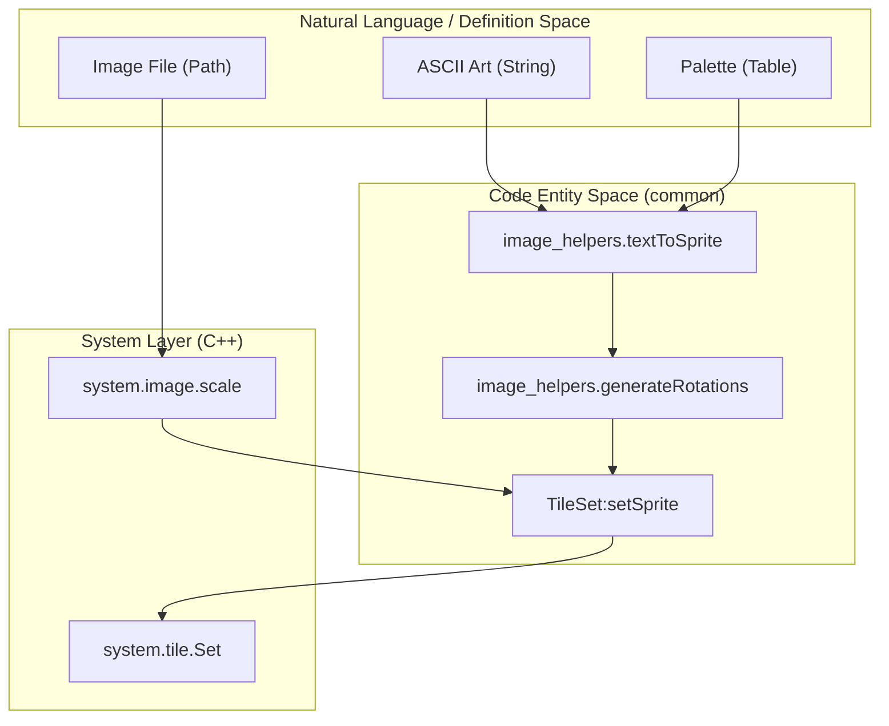
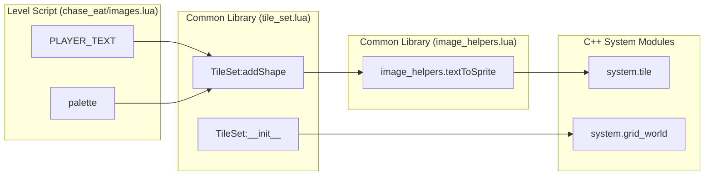

<!-- source: DeepWiki mcp.deepwiki.com · repo google-deepmind/lab2d · page 3.2 Common Lua Libraries (game_scripts/common) · fetched 2026-10-26 -->

# Common Lua Libraries (game_scripts/common)

Relevant source files

The following files were used as context for generating this wiki page:

- [dmlab2d/lib/game_scripts/common/image_helpers.lua](dmlab2d/lib/game_scripts/common/image_helpers.lua)
- [dmlab2d/lib/game_scripts/common/image_helpers_test.lua](dmlab2d/lib/game_scripts/common/image_helpers_test.lua)
- [dmlab2d/lib/game_scripts/common/log.lua](dmlab2d/lib/game_scripts/common/log.lua)
- [dmlab2d/lib/game_scripts/common/tile_set.lua](dmlab2d/lib/game_scripts/common/tile_set.lua)
- [dmlab2d/lib/game_scripts/levels/chase_eat/images.lua](dmlab2d/lib/game_scripts/levels/chase_eat/images.lua)
- [dmlab2d/lib/game_scripts/levels/commons_harvest/images.lua](dmlab2d/lib/game_scripts/levels/commons_harvest/images.lua)
- [dmlab2d/lib/game_scripts/levels/pushbox/images.lua](dmlab2d/lib/game_scripts/levels/pushbox/images.lua)
- [dmlab2d/lib/game_scripts/levels/running_with_scissors/images.lua](dmlab2d/lib/game_scripts/levels/running_with_scissors/images.lua)

The `dmlab2d/lib/game_scripts/common/` directory contains a suite of reusable Lua modules that provide foundational utilities for building levels. These libraries extend the core C++ system modules with higher-level abstractions for Object-Oriented Programming, sprite management, settings parsing, and logging.

## Core Utility Modules

### OOP System: `class.lua`
The `class.lua` module provides a single-inheritance class system with support for mixins. It is used extensively throughout the codebase to structure level logic into reusable components.
*   **Implementation**: Uses Lua metatables to implement inheritance and constructor chaining via `__init__`.
*   **Mixins**: Allows classes to incorporate functionality from multiple sources without deep inheritance hierarchies.

**Sources**: [dmlab2d/lib/game_scripts/common/class.lua]()

### Logging: `log.lua`
A configurable logging library that supports multiple verbosity levels and colorized output.

| Level | Numeric Value | Description |
| :--- | :--- | :--- |
| `NEVER` | -3 | Suppresses all output. |
| `ERROR` | -2 | Critical issues (Red). |
| `WARN` | -1 | Non-fatal warnings (Orange). |
| `INFO` | 0 | General information (Green). |
| `V(n)` | > 0 | Custom verbosity levels for tracing. |

The log level is controlled via the `logLevel` setting [dmlab2d/lib/game_scripts/common/log.lua:23-28](). Messages are automatically prefixed with the source file and line number [dmlab2d/lib/game_scripts/common/log.lua:89-90]().

**Sources**: [dmlab2d/lib/game_scripts/common/log.lua:16-144]()

---

## Graphics and Sprite Management

The libraries provide tools to bridge raw `system.tensor` data with the `system.tile` rendering engine.

### `image_helpers.lua`
Provides functional utilities for manipulating sprite data before it is loaded into a tile set.

*   **`textToSprite(text, palette)`**: Converts ASCII art strings into `ByteTensor` sprites using a provided color palette [dmlab2d/lib/game_scripts/common/image_helpers.lua:106-139]().
*   **`generateRotations(sprite)`**: Takes a single sprite and returns a tensor containing 4 rotated versions (0, 90, 180, 270 degrees) [dmlab2d/lib/game_scripts/common/image_helpers.lua:31-44]().
*   **`colorToSprite(shape, color)`**: Generates a solid-colored rectangular sprite [dmlab2d/lib/game_scripts/common/image_helpers.lua:54-56]().

### `tile_set.lua`
A high-level wrapper around the `system.tile` C++ module. It simplifies the process of registering sprites into a `world`.

*   **Implementation**: It manages a `tile.Set` object [dmlab2d/lib/game_scripts/common/tile_set.lua:34]() and ensures all added sprites match the required grid size, scaling them if necessary using `image.scale` [dmlab2d/lib/game_scripts/common/tile_set.lua:65-67]().
*   **Data Flow**: Level scripts define "Shapes" (text + palette), which `TileSet:addShape` converts into tensors via `image_helpers` before committing them to the underlying C++ tile renderer [dmlab2d/lib/game_scripts/common/tile_set.lua:95-114]().

**Sprite Processing Pipeline**

**Sources**: [dmlab2d/lib/game_scripts/common/tile_set.lua:21-121](), [dmlab2d/lib/game_scripts/common/image_helpers.lua:1-145]()

---

## Configuration and Data Structures

### `read_settings.lua`
Facilitates the parsing of settings passed from the Python environment or the command line. It provides type-safe reading and default value handling for level configuration.

### `args.lua`
A utility for validating and extracting arguments from Lua tables, often used for keyword-argument style function calls to ensure required parameters are present.

### `tables.lua` & `set.lua`
*   **`tables.lua`**: Provides deep copying, recursive comparison, and merging of Lua tables.
*   **`set.lua`**: Implements a basic Set data structure for efficient membership testing.

### `strings.lua` & `paths.lua`
*   **`strings.lua`**: Common string manipulation (split, join, trim).
*   **`paths.lua`**: Utilities for handling file paths and ensuring compatibility with the Lab2D runfiles system.

---

## Example: Sprite Definition Flow
The following diagram illustrates how a level script (like `chase_eat`) uses these libraries to define a player sprite.

**Entity Mapping: Level to System**

**Sources**: [dmlab2d/lib/game_scripts/levels/chase_eat/images.lua:16-122](), [dmlab2d/lib/game_scripts/common/tile_set.lua:95-114](), [dmlab2d/lib/game_scripts/common/image_helpers.lua:106-139]()

---

