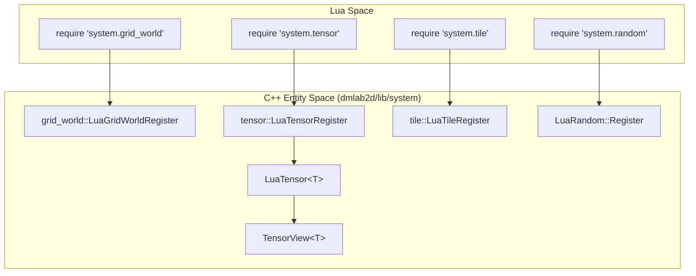
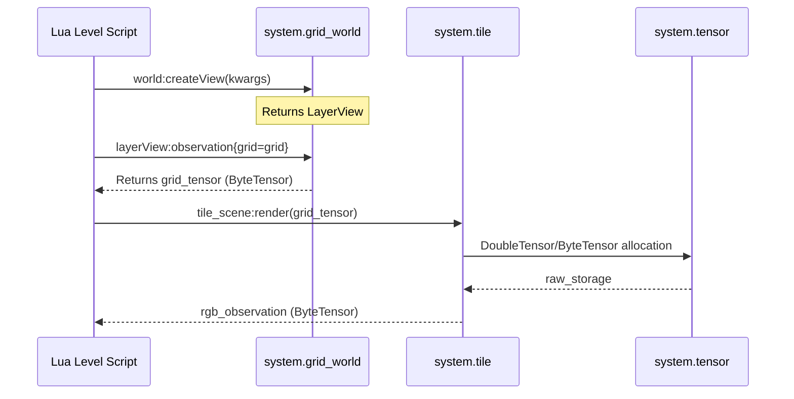

<!-- source: DeepWiki mcp.deepwiki.com · repo google-deepmind/lab2d · page 5 System Libraries (Lua-accessible C++ Modules) · fetched 2026-10-26 -->

# System Libraries (Lua-accessible C++ Modules)

Relevant source files

The following files were used as context for generating this wiki page:

- [dmlab2d/lib/system/tensor/lua/tensor.h](dmlab2d/lib/system/tensor/lua/tensor.h)
- [dmlab2d/lib/system/tensor/lua/tensor_test.cc](dmlab2d/lib/system/tensor/lua/tensor_test.cc)
- [docs/system/grid_world.md](docs/system/grid_world.md)
- [docs/system/tensor.md](docs/system/tensor.md)

DeepMind Lab2D provides a suite of high-performance system modules implemented in C++ and exposed to the Lua environment. These modules provide the foundational building blocks for environment logic, including grid manipulation, numerical computation via tensors, sprite rendering, and procedural generation.

In Lua level scripts, these modules are typically accessed using the `require 'system.<name>'` syntax [docs/system/grid_world.md:4-4]().

### Core Subsystems

The system libraries are divided into several specialized modules, each handling a specific aspect of the simulation engine.

#### system.grid_world: Grid World Engine
The `grid_world` module is the primary engine for 2D simulations. It manages the spatial state of the environment, including piece placement, movement, and interaction logic. It uses a `World` configuration to define static properties (layers, states, update orders) and a `Grid` object for per-episode state [docs/system/grid_world.md:11-14]().

*   **World Configuration:** Defines `renderOrder`, `updateOrder`, and `states` [docs/system/grid_world.md:19-27]().
*   **Grid Lifecycle:** Supports creation via `layout` strings or explicit `size` [docs/system/grid_world.md:88-98]().
*   **Callbacks:** Supports Lua hooks for `onAdd`, `onRemove`, `onUpdate`, `onContact`, and `onHit` [docs/system/grid_world.md:122-154]().

For details, see [system.grid_world: Grid World Engine](#5.1).

#### system.tensor: Tensor Library
The `tensor` module provides a numerical library similar to PyTorch for manipulating data arrays. It supports multiple data types (e.g., `DoubleTensor`, `Int32Tensor`, `ByteTensor`) and allows for shared storage between views [docs/system/tensor.md:1-9]().

*   **Layout Operations:** Includes `reshape`, `transpose`, `narrow`, and `select` [dmlab2d/lib/system/tensor/lua/tensor.h:121-131]().
*   **Arithmetic:** Supports scalar operations (`add`, `mul`) and element-wise view operations (`cadd`, `cmul`) [dmlab2d/lib/system/tensor/lua/tensor.h:138-147]().
*   **Indexing:** Tensors use 1-based indexing in Lua [docs/system/tensor.md:4-5]().

For details, see [system.tensor: Tensor Library](#5.2).

#### system.tile: Sprite Rendering
The `tile` module handles the transformation of grid states into visual observations. It works in conjunction with `grid_world.LayerView` to render a scene into an RGB `ByteTensor` [docs/system/grid_world.md:181-204]().

*   **tile.Set:** Defines the collection of sprites and shapes used for rendering.
*   **tile.Scene:** Manages the rendering process, taking a view of the grid and outputting pixel data [docs/system/grid_world.md:191-203]().

For details, see [system.tile: Sprite Rendering](#5.3).

#### Other Utilities
Additional modules provide essential infrastructure:
*   **system.random:** A seeded, deterministic random number generator supporting uniform, discrete, and shuffled distributions [dmlab2d/lib/system/tensor/lua/tensor_test.cc:53-58]().
*   **system.image:** Utilities for loading and scaling PNG images.
*   **system.file_system:** Methods for reading files from the environment's runfiles [dmlab2d/lib/system/tensor/lua/tensor.h:58-61]().
*   **system.generators:** Specialized procedural generation tools, such as `pushbox` for Sokoban-style maps.

For details, see [Other System Modules: image, random, file_system, generators](#5.4).

### Architecture: Lua to C++ Mapping

The following diagram illustrates how the Lua-accessible module names map to their underlying C++ implementation classes and registration logic.

**System Module Registration Bridge**

Sources: [dmlab2d/lib/system/tensor/lua/tensor.h:55-103](), [dmlab2d/lib/system/tensor/lua/tensor_test.cc:53-61]()

### Interaction Flow

The system modules frequently interact to produce environment observations. The `grid_world` defines the state, which is viewed by a `LayerView`, and finally rendered by `tile` into a `tensor`.

**Observation Rendering Pipeline**

Sources: [docs/system/grid_world.md:183-203](), [dmlab2d/lib/system/tensor/lua/tensor.h:103-148]()

| Module | Primary C++ Header | Lua Entry Point | Key Responsibility |
| :--- | :--- | :--- | :--- |
| `grid_world` | `grid_world/lua/grid_world.h` | `World` | Spatial simulation and piece logic. |
| `tensor` | `tensor/lua/tensor.h` | `DoubleTensor`, etc. | Multi-dimensional numerical arrays. |
| `tile` | `tile/lua/tile.h` | `Scene`, `Set` | Pixel-based sprite rendering. |
| `random` | `random/lua/random.h` | `seed` | Deterministic PRNG. |

Sources: [dmlab2d/lib/system/tensor/lua/tensor.h:50-61](), [docs/system/grid_world.md:4-19](), [docs/system/tensor.md:47-55]()

---

