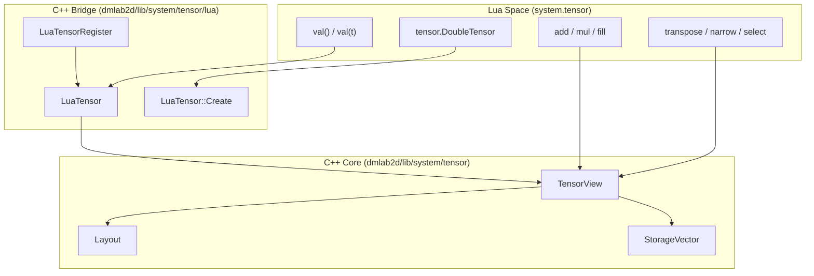
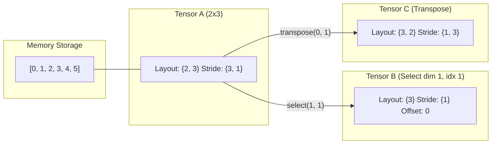

<!-- source: DeepWiki mcp.deepwiki.com · repo google-deepmind/lab2d · page 5.2 system.tensor: Tensor Library · fetched 2026-10-26 -->

# system.tensor: Tensor Library

Relevant source files

The following files were used as context for generating this wiki page:

- [dmlab2d/lib/system/tensor/lua/BUILD](dmlab2d/lib/system/tensor/lua/BUILD)
- [dmlab2d/lib/system/tensor/lua/tensor.cc](dmlab2d/lib/system/tensor/lua/tensor.cc)
- [dmlab2d/lib/system/tensor/lua/tensor.h](dmlab2d/lib/system/tensor/lua/tensor.h)
- [dmlab2d/lib/system/tensor/lua/tensor_benchmark.cc](dmlab2d/lib/system/tensor/lua/tensor_benchmark.cc)
- [dmlab2d/lib/system/tensor/lua/tensor_test.cc](dmlab2d/lib/system/tensor/lua/tensor_test.cc)
- [dmlab2d/lib/system/tensor/tensor_view.h](dmlab2d/lib/system/tensor/tensor_view.h)
- [dmlab2d/lib/system/tensor/tensor_view_test.cc](dmlab2d/lib/system/tensor/tensor_view_test.cc)
- [docs/system/tensor.md](docs/system/tensor.md)

The `system.tensor` library provides a high-performance numerical manipulation toolkit for DeepMind Lab2D. It is designed to be similar to tensors in PyTorch, supporting multi-dimensional arrays with shared storage, various data types, and efficient C++ backed operations.

## Overview and Implementation

The tensor library is implemented as a C++ core with Lua bindings. The core logic resides in `TensorView<T>`, a template class that provides a view into a block of memory.

### Key Components
*   **`Layout`**: Manages the mapping between multi-dimensional indices and flat memory offsets. It supports row-major (C-style) order by default [dmlab2d/lib/system/tensor/tensor_view.h:54-64]().
*   **`TensorView<T>`**: A non-owning view that combines a `Layout` with a pointer to data. It performs arithmetic, slicing, and transposition [dmlab2d/lib/system/tensor/tensor_view.h:234-245]().
*   **`LuaTensor<T>`**: The Lua-facing wrapper that manages storage ownership and exposes C++ methods to the Lua VM [dmlab2d/lib/system/tensor/lua/tensor.h:102-109]().

### Storage and Ownership
Tensors can either own their storage or share it with other tensors.
*   **`StorageVector<T>`**: Used when a tensor owns its memory (e.g., via `clone()` or initial creation) [dmlab2d/lib/system/tensor/lua/tensor.h:87-91]().
*   **Shared Storage**: Layout operations like `select`, `narrow`, and `transpose` create new tensor objects that point to the same underlying memory [docs/system/tensor.md:7-12]().

### Entity Mapping: Lua to C++
The following diagram illustrates how Lua-level tensor types and methods map to the underlying C++ implementation.

**Tensor Library Entity Mapping**

Sources: [dmlab2d/lib/system/tensor/lua/tensor.h:55-103](), [dmlab2d/lib/system/tensor/tensor_view.h:54-234](), [docs/system/tensor.md:45-55]()

## Tensor Types

There are seven supported tensor types, each corresponding to a specific C++ primitive [docs/system/tensor.md:47-55]().

| Lua Type | C++ Underlying Type | Conversion Method |
| :--- | :--- | :--- |
| `tensor.ByteTensor` | `std::uint8_t` | `:byte()` |
| `tensor.CharTensor` | `std::int8_t` | `:char()` |
| `tensor.Int16Tensor` | `std::int16_t` | `:int16()` |
| `tensor.Int32Tensor` | `std::int32_t` | `:int32()` |
| `tensor.Int64Tensor` | `std::int64_t` | `:int64()` |
| `tensor.FloatTensor` | `float` | `:float()` |
| `tensor.DoubleTensor` | `double` | `:double()` |

Sources: [dmlab2d/lib/system/tensor/lua/tensor.cc:37-44](), [docs/system/tensor.md:129-137]()

## Creation and Initialization

Tensors can be created in several ways via the `system.tensor` module:

1.  **Shape-based**: `tensor.DoubleTensor(dim1, dim2, ...)` creates a zero-initialized tensor of the specified rank and dimensions [docs/system/tensor.md:159-162]().
2.  **Table-based**: `tensor.DoubleTensor{{1, 2}, {3, 4}}` creates a tensor from nested Lua tables [docs/system/tensor.md:173-176]().
3.  **File-based**: `tensor.DoubleTensor{file = {name = 'data.bin', ...}}` reads raw bytes from the filesystem into a rank-1 tensor [docs/system/tensor.md:189-203]().
4.  **Range-based**: `tensor.DoubleTensor{range = {from, to, step}}` creates a rank-1 tensor with arithmetic progression [docs/system/tensor.md:238-243]().

Sources: [dmlab2d/lib/system/tensor/lua/tensor.h:508-620](), [docs/system/tensor.md:148-243]()

## Layout Operations

Layout operations manipulate the `Layout` object without copying the underlying data. This allows for efficient slicing and viewing of data.

*   **`transpose(dim1, dim2)`**: Swaps two dimensions [dmlab2d/lib/system/tensor/tensor_view.h:97-105]().
*   **`select(dim, index)`**: Reduces the rank of the tensor by 1 by fixing a dimension to a specific index [dmlab2d/lib/system/tensor/tensor_view.h:125-134]().
*   **`narrow(dim, index, size)`**: Narrows a dimension to a sub-range `[index, index + size - 1]` [dmlab2d/lib/system/tensor/tensor_view.h:140-149]().
*   **`reshape(new_shape)`**: Changes the shape of a contiguous tensor without altering its data [dmlab2d/lib/system/tensor/tensor_view.h:208-223]().

**Data Flow: Layout Transformation**

Sources: [dmlab2d/lib/system/tensor/tensor_view.h:54-150](), [dmlab2d/lib/system/tensor/tensor_view_test.cc:46-66]()

## Arithmetic and Mathematical Operations

The library provides vectorized operations implemented in C++.

### Scalar Operations
Operations that apply a scalar to every element in the tensor:
*   `add(val)`, `sub(val)`, `mul(val)`, `div(val)` [dmlab2d/lib/system/tensor/lua/tensor.h:138-141]().
*   `fill(val)`: Sets all elements to a specific value [dmlab2d/lib/system/tensor/lua/tensor.h:136]().

### Element-wise (Tensor-Tensor) Operations
Operations between two tensors of matching shapes:
*   `cadd(other)`, `csub(other)`, `cmul(other)`, `cdiv(other)` [dmlab2d/lib/system/tensor/lua/tensor.h:145-147]().

### Linear Algebra
*   **`dot(other)`**: Dot product of two tensors [dmlab2d/lib/system/tensor/lua/tensor.h:127]().
*   **`mmul(other)`**: Matrix multiplication (requires rank-2 tensors) [dmlab2d/lib/system/tensor/lua/tensor.h:148]().

### Reductions and Unary
*   `sum()`, `product()`, `maxElement()`, `minElement()` [dmlab2d/lib/system/tensor/lua/tensor.h:123-159]().
*   `floor()`, `ceil()`, `round()`, `clamp(min, max)` [dmlab2d/lib/system/tensor/lua/tensor.h:135-153]().

Sources: [dmlab2d/lib/system/tensor/lua/tensor.h:112-175](), [dmlab2d/lib/system/tensor/tensor_view.h:345-420]()

## Indexing and Slicing

Lua tensors support 1-based indexing via the `__call` metamethod.

*   **Accessing a value**: `t(i, j, k)` returns a scalar tensor representing the element at that position [docs/system/tensor.md:463-467]().
*   **Slicing**: Passing a table `{start, end}` as an argument performs a `narrow` operation. For example, `t({2, 4}, 1)` is equivalent to `t:narrow(1, 2, 3):select(2, 1)` [docs/system/tensor.md:483-490]().

### `val()` Function
The `val()` method is the primary way to move data between the tensor and Lua:
*   **Getter**: On a scalar tensor, it returns a Lua number. On a multi-dimensional tensor, it returns a nested Lua table [docs/system/tensor.md:65-89]().
*   **Setter**: `val(new_val)` updates the tensor elements using a Lua number or table [docs/system/tensor.md:91-122]().

Sources: [dmlab2d/lib/system/tensor/lua/tensor.h:354-415](), [docs/system/tensor.md:63-122]()

---

