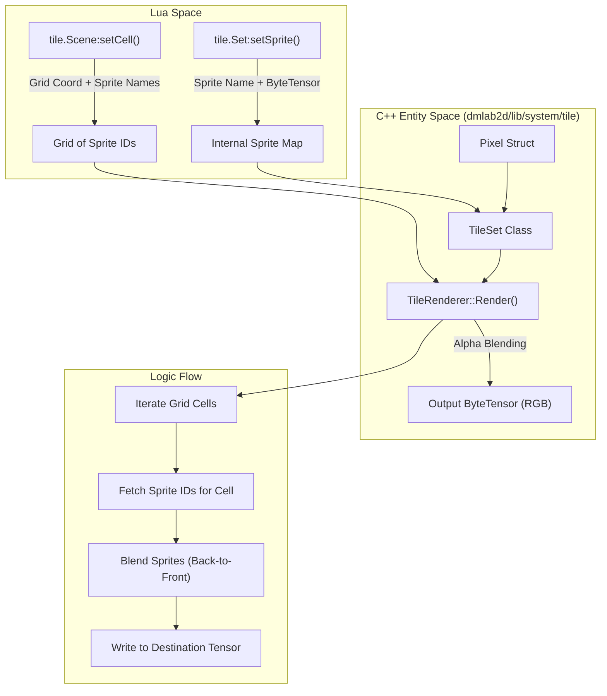
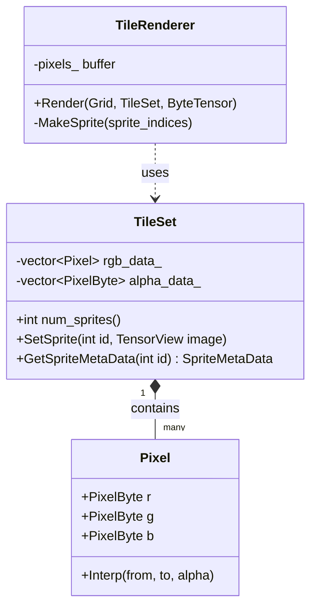

<!-- source: DeepWiki mcp.deepwiki.com · repo google-deepmind/lab2d · page 5.3 system.tile: Sprite Rendering · fetched 2026-10-26 -->

# system.tile: Sprite Rendering

<details>
<summary>Relevant source files</summary>

The following files were used as context for generating this wiki page:

- [dmlab2d/lib/game_scripts/common/tile_set.lua](dmlab2d/lib/game_scripts/common/tile_set.lua)
- [dmlab2d/lib/game_scripts/worlds/common/tile_set.lua](dmlab2d/lib/game_scripts/worlds/common/tile_set.lua)
- [dmlab2d/lib/system/tile/BUILD](dmlab2d/lib/system/tile/BUILD)
- [dmlab2d/lib/system/tile/pixel.h](dmlab2d/lib/system/tile/pixel.h)
- [dmlab2d/lib/system/tile/tile_renderer.cc](dmlab2d/lib/system/tile/tile_renderer.cc)

</details>


The `system.tile` module provides a high-performance 2D sprite rendering engine for DeepMind Lab2D. It allows developers to define a set of named sprites (the `tile.Set`) and render them onto a grid-based scene (`tile.Scene`). The engine supports alpha blending, various pixel formats, and efficient composition of multiple sprite layers into a final RGB observation.

## Core Concepts and Data Flow

The rendering pipeline transitions from abstract sprite names defined in Lua to raw pixel manipulation in C++.

1.  **`tile.Set`**: A collection of sprites. Each sprite is identified by a name and contains pixel data (RGB) and optional transparency data (Alpha) [dmlab2d/lib/system/tile/tile_set.h:26-30]().
2.  **`tile.Scene`**: Represents a 2D grid where each cell contains a list of sprite IDs to be rendered.
3.  **`TileRenderer`**: The C++ engine that processes the `tile.Scene` and `tile.Set` to produce a `ByteTensor` observation [dmlab2d/lib/system/tile/tile_renderer.h:25-28]().

### Sprite Rendering Pipeline

The following diagram illustrates how sprite definitions are processed into a rendered frame.

**Diagram: Sprite Rendering Pipeline**

Sources: [dmlab2d/lib/system/tile/tile_set.h:26-50](), [dmlab2d/lib/system/tile/tile_renderer.h:25-40](), [dmlab2d/lib/game_scripts/common/tile_set.lua:33-51]()

---

## Pixel Representation and Blending

At the lowest level, `system.tile` operates on `Pixel` structures.

### Pixel Structure
A `Pixel` is a 3-byte structure containing Red, Green, and Blue components [dmlab2d/lib/system/tile/pixel.h:39-43]().
*   **`PixelByte`**: An enum wrapping `unsigned char` (0-255) to avoid aliasing issues [dmlab2d/lib/system/tile/pixel.h:29-32]().
*   **`Interp`**: A constexpr function that performs linear interpolation between two pixels based on an alpha value [dmlab2d/lib/system/tile/pixel.h:66-81]().

### Blending Modes
The `TileRenderer` optimizes rendering by categorizing sprites into `SpriteMetaData` types [dmlab2d/lib/system/tile/tile_set.h:32-42]():

| MetaData Type | Description |
| :--- | :--- |
| `kInvisible` | Sprite is not rendered. |
| `kOpaque` | Fully opaque; overwrites previous layers. |
| `kOpaqueConstRgb` | Opaque sprite where every pixel is the same color. |
| `kSemiTransparent` | Uses per-pixel alpha for blending. |
| `kOneBitAlpha` | Alpha is either 0 (transparent) or 255 (opaque). |

Sources: [dmlab2d/lib/system/tile/pixel.h:17-85](), [dmlab2d/lib/system/tile/tile_set.h:32-42]()

---

## C++ Implementation: TileSet and TileRenderer

### TileSet
The `TileSet` class manages the lifecycle of sprite data. It stores:
*   **RGB Data**: A contiguous buffer of `Pixel` values [dmlab2d/lib/system/tile/tile_set.h:73]().
*   **Alpha Data**: A contiguous buffer of `PixelByte` values [dmlab2d/lib/system/tile/tile_set.h:74]().
*   **Metadata**: Information about transparency and color consistency used for rendering optimizations [dmlab2d/lib/system/tile/tile_set.h:72]().

### TileRenderer
The `TileRenderer` is responsible for the actual composition. When `Render` is called, it iterates through the grid provided by the scene. For each cell, it:
1.  Retrieves the list of sprite IDs.
2.  Filters out invisible sprites.
3.  Finds the topmost opaque sprite to skip rendering anything behind it [dmlab2d/lib/system/tile/tile_renderer.cc:156-164]().
4.  Performs back-to-front blending of the remaining sprites [dmlab2d/lib/system/tile/tile_renderer.cc:170-200]().

**Diagram: C++ Class Interaction**

Sources: [dmlab2d/lib/system/tile/tile_set.h:26-77](), [dmlab2d/lib/system/tile/tile_renderer.h:25-50](), [dmlab2d/lib/system/tile/pixel.h:39-55]()

---

## Lua Interface: tile.Set and TileSet Wrapper

While the C++ layer handles the heavy lifting, Lua provides a high-level API for configuration.

### `tile.Set` (System Module)
Accessed via `require 'system.tile'`.
*   **`setSprite{name, image}`**: Associates a name with a `ByteTensor`. If the tensor has 4 channels, the 4th is treated as Alpha [dmlab2d/lib/game_scripts/common/tile_set.lua:68-71]().

### `common.tile_set` (Lua Wrapper)
The `common.tile_set` library provides a more ergonomic `TileSet` class [dmlab2d/lib/game_scripts/common/tile_set.lua:24](). It simplifies common tasks:
*   **`addColor(name, color)`**: Creates a solid color sprite [dmlab2d/lib/game_scripts/common/tile_set.lua:46-51]().
*   **`addSpritePath(name, path)`**: Loads a sprite from a PNG file using `system.image` [dmlab2d/lib/game_scripts/common/tile_set.lua:83-85]().
*   **`addShape(name, shape)`**: Renders a text-based ASCII art shape into a sprite using a palette [dmlab2d/lib/game_scripts/common/tile_set.lua:95-114]().
*   **Auto-scaling**: Automatically scales input images to match the `tile.Set` shape using nearest-neighbor interpolation [dmlab2d/lib/game_scripts/common/tile_set.lua:65-67]().

### Example Usage
```lua
local tile = require 'system.tile'
local TileSet = require 'common.tile_set'

-- Initialize with world sprite names and tile size (e.g., 8x8 pixels)
local ts = TileSet.TileSet(world, {width = 8, height = 8})

-- Add a simple colored sprite
ts:addColor('wall', {200, 200, 200})

-- Add a sprite from a file
ts:addSpritePath('player', 'assets/player.png')
```
Sources: [dmlab2d/lib/game_scripts/common/tile_set.lua:33-121](), [dmlab2d/lib/game_scripts/worlds/common/tile_set.lua:16-19]()

---

