# Page: Overview

# Overview

<details>
<summary>Relevant source files</summary>

The following files were used as context for generating this wiki page:

- [README.md](README.md)

</details>


This document provides a technical overview of the latent multi-hop reasoning research codebase, which investigates whether Large Language Models (LLMs) perform multi-hop reasoning internally. The codebase implements experimental methodologies from two research papers that probe LLM reasoning mechanisms through different approaches: latent reasoning inspection and shortcut-free evaluation.

For detailed setup instructions, see [Getting Started](#2). For specific experimental implementations, see [Main Entry Points](#3). For dataset specifications, see [Datasets](#5).

## Research Papers and Scope

This codebase implements two complementary research investigations:

| Paper | Venue | Primary Focus | Main Dataset |
|-------|--------|---------------|--------------|
| Do Large Language Models Latently Perform Multi-Hop Reasoning? | ACL 2024 | Internal reasoning pathway inspection | TwoHopFact |
| Do Large Language Models Perform Latent Multi-Hop Reasoning without Exploiting Shortcuts? | arXiv 2024 | Shortcut-free evaluation and layer analysis | SOCRATES |

### Research Questions Addressed

The codebase systematically investigates three core research questions through different experimental methodologies:

- **RQ1**: How often do LLMs perform the first hop of reasoning in two-hop prompts?
- **RQ2**: How often do LLMs perform the second hop, and what is the consistency between single-hop and multi-hop reasoning?
- **Shortcut Analysis**: Do LLMs exploit superficial patterns instead of performing genuine multi-hop reasoning?

## System Architecture

### High-Level Component Organization

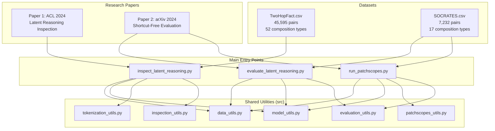

Sources: [README.md:3-6](), [README.md:83-93]()

### Experimental Pipeline Mapping

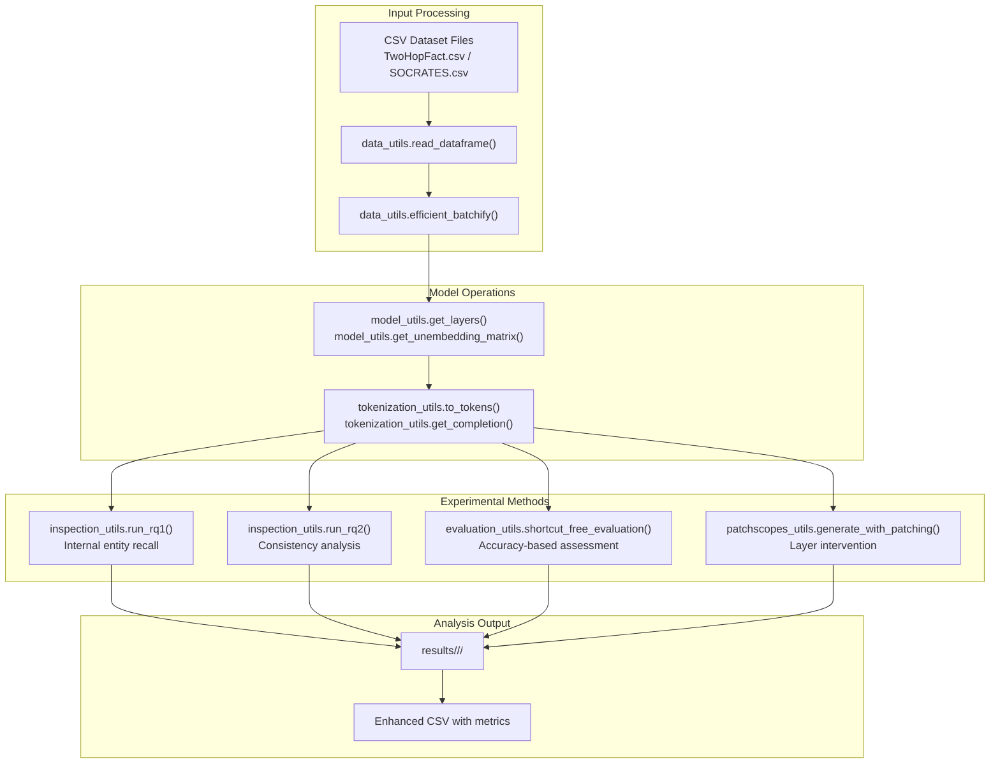

Sources: [README.md:88-92](), [README.md:46-55](), [README.md:61-81]()

## Entry Points and Experimental Approaches

The codebase provides three main entry points, each implementing specific experimental methodologies:

### Entry Point Summary

| Script | Purpose | Primary Functions | Batch Size Parameters |
|--------|---------|-------------------|----------------------|
| `inspect_latent_reasoning.py` | Paper 1 experiments | RQ1, RQ2, validation studies | `--rq1_batch_size`, `--rq2_batch_size`, `--completion_batch_size` |
| `evaluate_latent_reasoning.py` | Paper 2 shortcut-free evaluation | Completion generation, accuracy metrics | `--batch_size`, `--tensor_parallel_size` |
| `run_patchscopes.py` | Paper 2 patchscopes analysis | Layer intervention, hidden state patching | `--batch_size`, `--source_layer_idxs`, `--target_layer_idxs` |

### Experimental Method Implementation

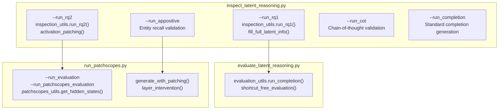

Sources: [README.md:46-55](), [README.md:61-68](), [README.md:72-81]()

## Key Dataset Specifications

The research utilizes two purpose-built datasets for different experimental approaches:

### Dataset Comparison

| Dataset | Size | Composition Types | Primary Use | File Location |
|---------|------|-------------------|-------------|---------------|
| TwoHopFact | 45,595 pairs | 52 types | Latent reasoning inspection | `datasets/TwoHopFact.csv` |
| SOCRATES v0 | 7,232 pairs | 17 types | Paper 2 experiments (with grammatical errors) | `datasets/SOCRATES_v0.csv` |
| SOCRATES v1 | 7,232 pairs | 17 types | Cleaned dataset (no grammatical errors) | `datasets/SOCRATES_v1.csv` |

Both datasets are also available via HuggingFace: `soheeyang/TwoHopFact` and `soheeyang/SOCRATES`.

Sources: [README.md:25-38]()

## Code Organization Structure

The codebase follows a modular architecture with shared utilities and experiment-specific implementations:

### Directory Structure

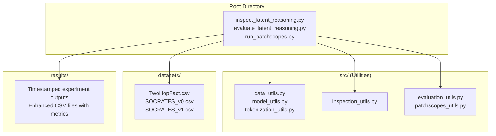

### Utility Module Responsibilities

| Module | Primary Functions | Used By |
|--------|-------------------|---------|
| `data_utils.py` | `read_dataframe()`, `efficient_batchify()`, `batchify()` | All entry points |
| `model_utils.py` | `get_unembedding_matrix()`, `get_layers()`, `is_instruction_tuned()` | All entry points |
| `tokenization_utils.py` | `to_tokens()`, `find_substrings()`, `get_completion()` | All entry points |
| `inspection_utils.py` | `run_rq1()`, `run_rq2()`, `activation_patching()` | `inspect_latent_reasoning.py` |
| `evaluation_utils.py` | `run_completion()`, `shortcut_free_evaluation()` | `evaluate_latent_reasoning.py`, `run_patchscopes.py` |
| `patchscopes_utils.py` | `get_hidden_states()`, `generate_with_patching()` | `run_patchscopes.py` |

Sources: [README.md:83-93]()

The codebase requires HuggingFace authentication via the `HF_TOKEN` environment variable for accessing certain models, and outputs all experimental results to the `results/` directory with timestamp-based organization.

Sources: [README.md:17-18](), [README.md:93]()

---

# Page: Getting Started

# Getting Started

<details>
<summary>Relevant source files</summary>

The following files were used as context for generating this wiki page:

- [README.md](README.md)
- [requirements.txt](requirements.txt)

</details>


This document provides installation instructions, setup requirements, and basic usage patterns for the latent multi-hop reasoning research codebase. It covers the essential steps needed to run experiments from both research papers implemented in this repository.

For detailed information about the specific experimental approaches and their implementations, see [Main Entry Points](#3). For information about the datasets used in the experiments, see [Datasets](#5).

## Prerequisites

The codebase requires Python 3.10 and access to HuggingFace models through an authentication token. The system is designed to work with GPU acceleration for large language model inference and supports distributed processing through vLLM.

### System Requirements

| Component | Requirement |
|-----------|-------------|
| Python Version | 3.10 |
| Package Manager | conda (recommended) |
| GPU Support | CUDA-compatible GPU (recommended) |
| Memory | Sufficient RAM for model loading (varies by model size) |
| HuggingFace Account | Required for model access |

Sources: [README.md:10-18]()

## Installation Process

The installation follows a standard conda-based workflow with pip dependencies. The process involves environment creation, dependency installation, and authentication setup.

### Installation Flow

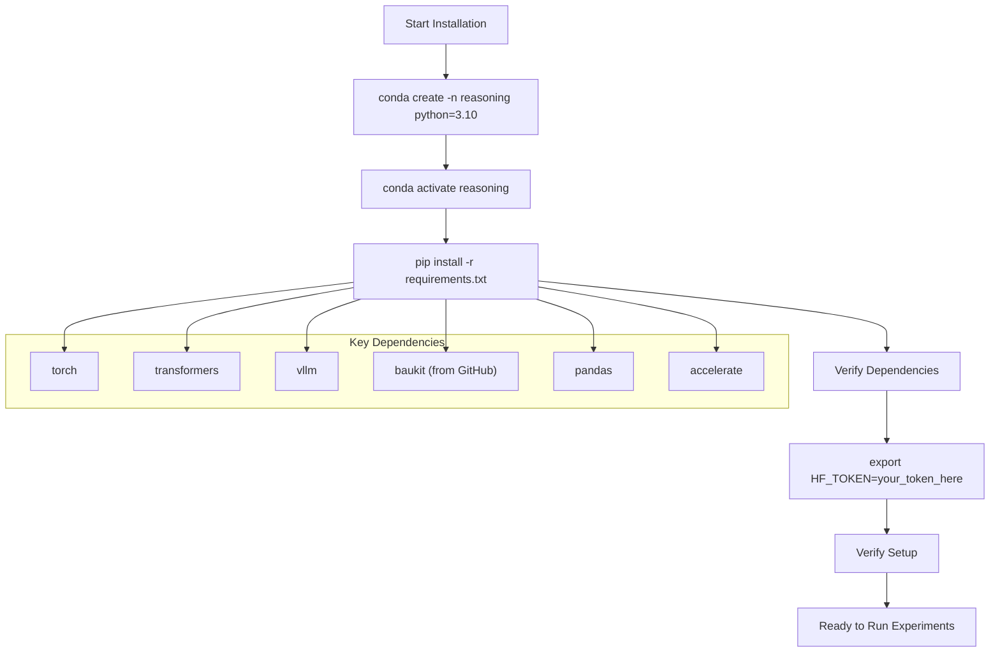

### Step-by-Step Installation

1. **Create conda environment:**
   ```bash
   conda create -n reasoning python=3.10
   conda activate reasoning
   ```

2. **Install dependencies:**
   ```bash
   pip install -r requirements.txt
   ```

3. **Set HuggingFace token:**
   ```bash
   export HF_TOKEN="your_token_here"
   ```

Sources: [README.md:8-19](), [requirements.txt:1-11]()

## Authentication Setup

The codebase requires a HuggingFace token for accessing certain models. This token must be set as an environment variable before running any experiments.

### HuggingFace Token Configuration

The `HF_TOKEN` environment variable is used throughout the codebase for model authentication. All three main entry points (`inspect_latent_reasoning.py`, `evaluate_latent_reasoning.py`, `run_patchscopes.py`) accept an `--hf_token` parameter that defaults to this environment variable.

```bash
# Option 1: Export as environment variable (recommended)
export HF_TOKEN="your_huggingface_token"

# Option 2: Pass directly to scripts
python inspect_latent_reasoning.py --hf_token "your_token" [other_args]
```

Sources: [README.md:17-18](), [README.md:53](), [README.md:67](), [README.md:79]()

## Basic Usage Workflow

The codebase provides three main entry points corresponding to different experimental approaches. Each operates on specific datasets and produces results in the `results/` directory.

### Experiment Execution Flow

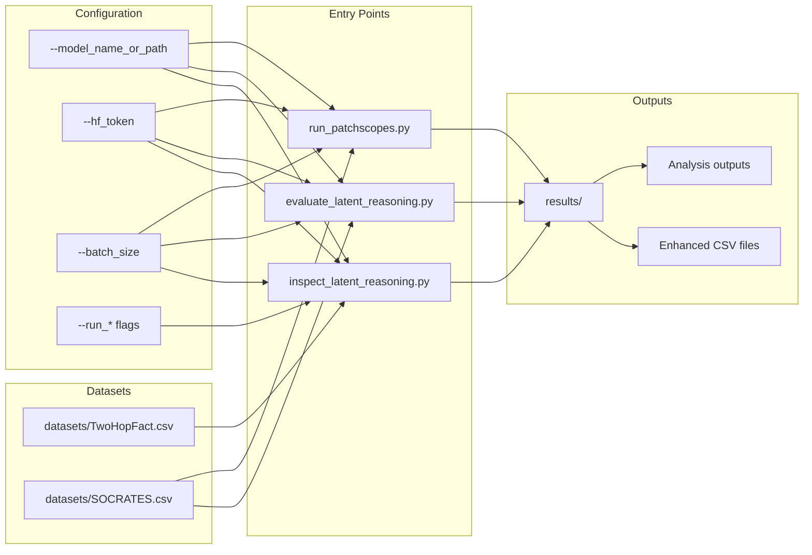

### Basic Usage Examples

**Paper 1 Experiments (Latent Reasoning Inspection):**
```bash
python inspect_latent_reasoning.py \
    --model_name_or_path $MODEL_NAME_OR_PATH \
    --input_csv_path datasets/TwoHopFact.csv \
    --hf_token $HF_TOKEN \
    --run_rq1 --run_rq2 --run_completion
```

**Paper 2 Experiments (Shortcut-Free Evaluation):**
```bash
python evaluate_latent_reasoning.py \
    --model_name_or_path $MODEL_NAME_OR_PATH \
    --input_csv_path datasets/SOCRATES.csv \
    --hf_token $HF_TOKEN
```

**Paper 2 Experiments (Patchscopes Analysis):**
```bash
python run_patchscopes.py \
    --model_name_or_path $MODEL_NAME_OR_PATH \
    --input_csv_path datasets/SOCRATES.csv \
    --hf_token $HF_TOKEN \
    --run_evaluation --run_patchscopes_evaluation
```

Sources: [README.md:46-55](), [README.md:61-68](), [README.md:72-81]()

## Directory Structure

The codebase follows a modular structure with clear separation between datasets, source code, and experimental outputs.

### Project Organization

| Directory | Purpose | Key Files |
|-----------|---------|-----------|
| `datasets/` | Research datasets | `TwoHopFact.csv`, `SOCRATES.csv` |
| `src/` | Utility modules | `*_utils.py` files |
| `results/` | Experiment outputs | Timestamped result files |
| Root | Entry point scripts | `inspect_latent_reasoning.py`, etc. |

### Source Code Organization

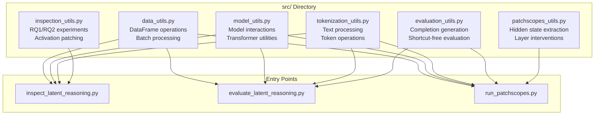

Sources: [README.md:83-94]()

## Common Configuration Patterns

The entry points share common configuration patterns for model specification, batch processing, and output management.

### Batch Size Configuration

Different experiments require different batch sizes based on memory requirements and computational complexity:

| Experiment Type | Typical Batch Size | Parameter |
|-----------------|-------------------|-----------|
| RQ1 Analysis | 256 | `--rq1_batch_size` |
| RQ2 Analysis | 8 | `--rq2_batch_size` |
| Completion Generation | 64 | `--completion_batch_size` |
| Standard Evaluation | 256 | `--batch_size` |
| Patchscopes Analysis | 64 | `--batch_size` |

### Output Management

All experiments generate timestamped outputs in the `results/` directory. The output directory can be customized using the `--output_dir` parameter available in all entry points.

Sources: [README.md:50-52](), [README.md:66](), [README.md:76](), [README.md:93]()

## Next Steps

After completing the installation and setup:

1. **Choose your experiment approach** - See [Main Entry Points](#3) for detailed information about each experimental script
2. **Prepare your datasets** - See [Datasets](#5) for information about TwoHopFact and SOCRATES datasets  
3. **Review utility modules** - See [Utility Modules](#4) for understanding the shared functionality
4. **Run your first experiment** using one of the basic usage examples above

The codebase is designed to be modular and extensible, with clear separation between different experimental approaches while sharing common utility functions for data processing, model interactions, and evaluation.

Sources: [README.md:1-143]()

---

# Page: Main Entry Points

# Main Entry Points

<details>
<summary>Relevant source files</summary>

The following files were used as context for generating this wiki page:

- [README.md](README.md)

</details>


This document provides an overview of the three primary scripts that serve as entry points for different experimental approaches in the latent multi-hop reasoning research codebase. These scripts implement the experiments described in two research papers and provide the main interfaces for running evaluations and analyses.

For detailed documentation of each entry point's functionality and implementation, see [Inspect Latent Reasoning](#3.1), [Evaluate Latent Reasoning](#3.2), and [Run Patchscopes](#3.3). For information about the shared utility modules used by these entry points, see [Utility Modules](#4).

## Overview

The codebase provides three main entry points that correspond to different research questions and experimental methodologies:

| Entry Point | Purpose | Associated Paper | Primary Dataset |
|-------------|---------|------------------|-----------------|
| `inspect_latent_reasoning.py` | Latent reasoning pathway inspection | Paper 1 (ACL 2024) | TwoHopFact |
| `evaluate_latent_reasoning.py` | Shortcut-free evaluation | Paper 2 (arXiv 2024) | SOCRATES |
| `run_patchscopes.py` | Patchscopes analysis | Paper 2 (arXiv 2024) | SOCRATES |

Each entry point implements specific experimental approaches and provides command-line interfaces for running different types of analyses on large language models' multi-hop reasoning capabilities.

## Entry Point Architecture

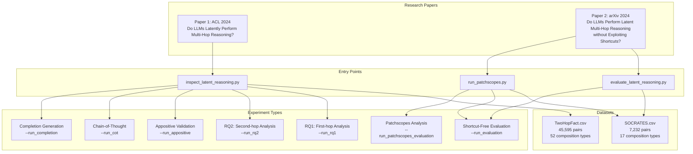

*Sources: [README.md:1-143]()*

## Command-Line Interfaces

Each entry point provides a comprehensive command-line interface with specific parameters for different experimental configurations:

### inspect_latent_reasoning.py Parameters

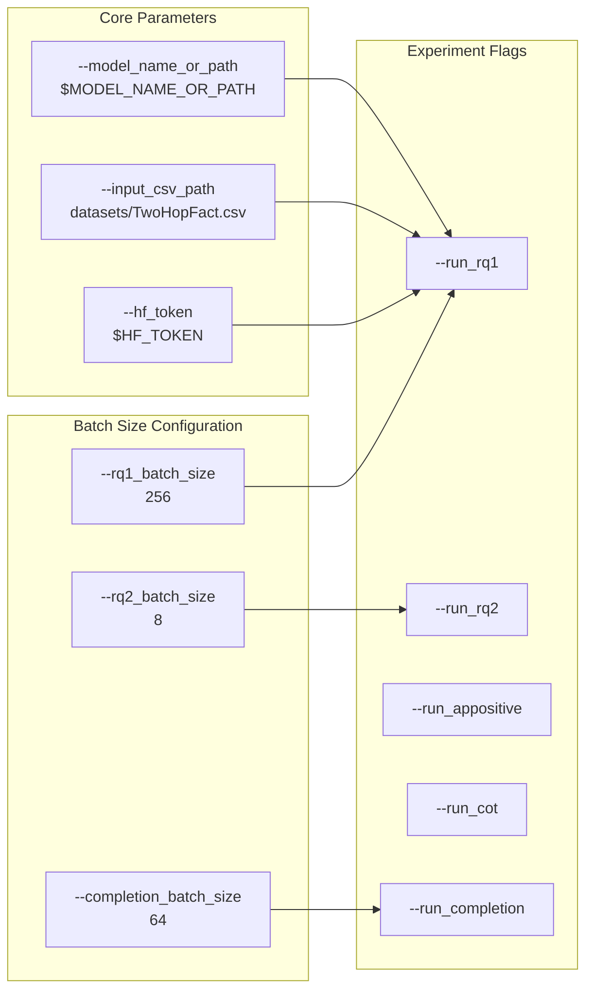

### evaluate_latent_reasoning.py Parameters

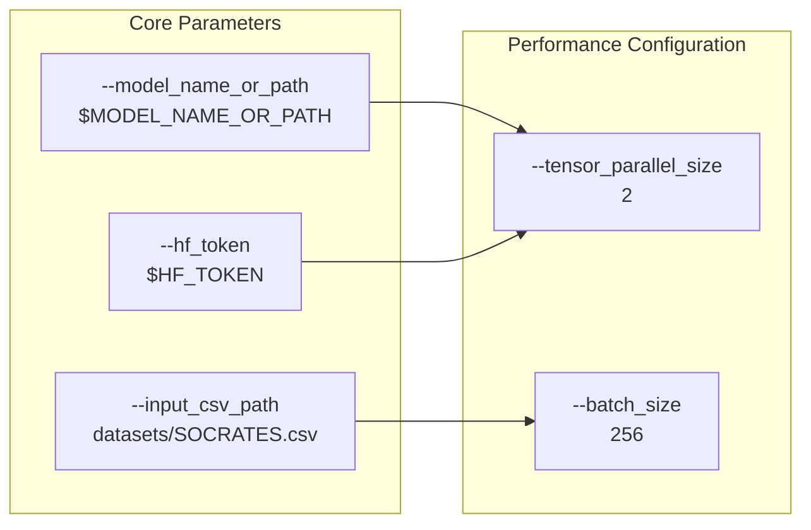

### run_patchscopes.py Parameters

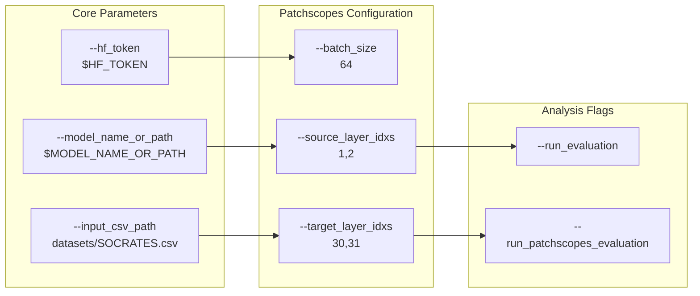

*Sources: [README.md:42-81]()*

## Experimental Pipeline Flow

The entry points implement different experimental pipelines that address specific research questions:

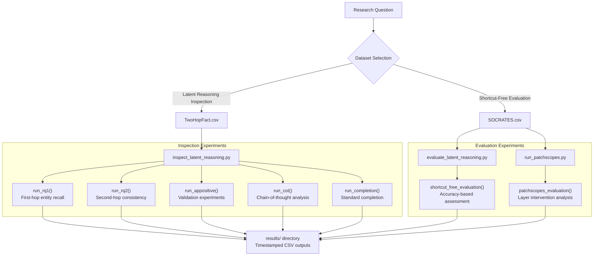

*Sources: [README.md:40-81]()*

## Shared Infrastructure

All entry points utilize common infrastructure components from the `src/` directory:

| Utility Module | Functions Used | Purpose |
|----------------|----------------|---------|
| `data_utils.py` | `read_dataframe()`, `efficient_batchify()` | Dataset loading and batch processing |
| `model_utils.py` | `get_unembedding_matrix()`, `get_layers()` | Model loading and manipulation |
| `tokenization_utils.py` | `to_tokens()`, `get_completion()` | Text processing and tokenization |
| `evaluation_utils.py` | `run_completion()`, `shortcut_free_evaluation()` | Evaluation logic implementation |
| `inspection_utils.py` | `run_rq1()`, `run_rq2()`, `activation_patching()` | Latent reasoning inspection |
| `patchscopes_utils.py` | `get_hidden_states()`, `generate_with_patching()` | Patchscopes analysis |

The entry points serve as orchestrators that coordinate these utility modules to implement specific experimental workflows, handling command-line argument parsing, experiment execution, and result output management.

*Sources: [README.md:83-93]()*

---

# Page: Inspect Latent Reasoning

# Inspect Latent Reasoning

<details>
<summary>Relevant source files</summary>

The following files were used as context for generating this wiki page:

- [README.md](README.md)
- [inspect_latent_reasoning.py](inspect_latent_reasoning.py)

</details>


## Purpose and Scope

The `inspect_latent_reasoning.py` script serves as the main entry point for experiments described in the ACL 2024 paper "Do Large Language Models Latently Perform Multi-Hop Reasoning?". This script implements five distinct experimental approaches to analyze how language models perform multi-hop reasoning internally, focusing on probing the latent reasoning pathways within transformer models.

This page covers the inspection methodology and experimental pipeline. For shortcut-free evaluation approaches, see [Evaluate Latent Reasoning](#3.2). For patchscopes-based analysis, see [Run Patchscopes](#3.3).

## Experimental Overview

The script implements five core experiment types, each designed to probe different aspects of latent multi-hop reasoning:

| Experiment | Flag | Purpose | Primary Metric |
|------------|------|---------|----------------|
| RQ1 | `--run_rq1` | First-hop reasoning analysis | Internal entity recall |
| RQ2 | `--run_rq2` | Second-hop reasoning analysis | Consistency score |
| Appositive | `--run_appositive` | Validation of entity recall metric | Internal entity recall |
| Chain-of-Thought | `--run_cot` | Validation of consistency score | Consistency score |
| Completion | `--run_completion` | Standard evaluation | Accuracy |

**Experimental Pipeline Flow**

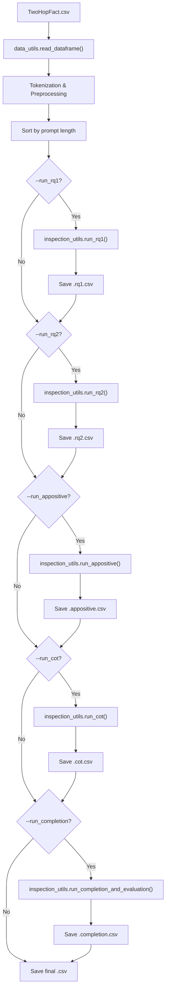

Sources: [inspect_latent_reasoning.py:209-319]()

## Script Architecture

The script follows a modular architecture, delegating specific functionality to utility modules while maintaining a clear experimental pipeline:

**Module Dependencies and Flow**

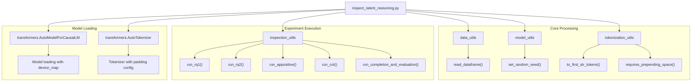

Sources: [inspect_latent_reasoning.py:22-25](), [inspect_latent_reasoning.py:150-164]()

## Data Processing Pipeline

The script implements a sophisticated data preprocessing pipeline that prepares the TwoHopFact dataset for analysis:

**Data Preprocessing Steps**

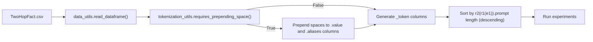

### Key Processing Operations

1. **Space Prepending**: For tokenizers requiring leading spaces, the script automatically prepends spaces to entity values and aliases [inspect_latent_reasoning.py:186-196]()

2. **Token Generation**: Creates `_token` columns for all `.value` columns using `tokenization_utils.to_first_str_tokens()` [inspect_latent_reasoning.py:199-204]()

3. **Length-Based Sorting**: Sorts data by prompt length in descending order to optimize batch processing [inspect_latent_reasoning.py:205-207]()

Sources: [inspect_latent_reasoning.py:183-207]()

## Experiment Types

### RQ1: First-Hop Analysis

**Purpose**: Analyzes how often language models perform the first hop of reasoning in two-hop prompts by measuring internal entity recall.

**Implementation**: `inspection_utils.run_rq1(model, tokenizer, df, batch_size, alt_batch_size, "e2.value", skip_positive)`

**Key Parameters**:
- `entity_col`: `"e2.value"` (intermediate entity)
- `skip_positive`: Set to `True` when RQ2 is also run to avoid redundant computation

### RQ2: Second-Hop Analysis  

**Purpose**: Measures second-hop reasoning consistency by comparing single-hop versus multi-hop reasoning distributions.

**Implementation**: `inspection_utils.run_rq2(df, model, tokenizer, batch_size, alt_batch_size, gather_device, fact_type="r2(r1(e1))", entity_col="e2.value", answer_col="e3.value")`

**Key Parameters**:
- `fact_type`: `"r2(r1(e1))"` (two-hop reasoning pattern)
- `entity_col`: `"e2.value"` (intermediate entity)
- `answer_col`: `"e3.value"` (final answer entity)

### Appositive Validation

**Purpose**: Validates the internal entity recall metric using appositive constructions as ground truth.

**Implementation**: `inspection_utils.run_appositive(df, model, tokenizer, batch_size, alt_batch_size, gather_device)`

### Chain-of-Thought Validation

**Purpose**: Validates consistency score calculations by comparing with explicit chain-of-thought reasoning.

**Implementation**: `inspection_utils.run_cot(df, model, tokenizer, batch_size)`

### Completion Generation

**Purpose**: Performs standard completion generation and evaluation for baseline comparison.

**Implementation**: `inspection_utils.run_completion_and_evaluation(df, model, tokenizer, batch_size)`

Sources: [inspect_latent_reasoning.py:209-319]()

## Configuration and Usage

### Command Line Arguments

The script accepts comprehensive configuration through command-line arguments:

| Argument | Type | Default | Purpose |
|----------|------|---------|---------|
| `--model_name_or_path` | str | "mistralai/Mistral-7B-v0.3" | HuggingFace model identifier |
| `--input_csv_path` | str | "datasets/TwoHopFact.csv" | Input dataset path |
| `--rq1_batch_size` | int | 512 | Batch size for RQ1 experiments |
| `--rq2_batch_size` | int | 32 | Batch size for RQ2 experiments |
| `--completion_batch_size` | int | 128 | Batch size for completion generation |
| `--gather_device` | str | "cuda:0" | Device for result gathering |
| `--half_precision` | flag | False | Use FP16 precision |
| `--output_dir` | str | "results/inspect_latent_reasoning" | Output directory |

### Experiment Selection Flags

| Flag | Purpose |
|------|---------|
| `--run_rq1` | Enable first-hop analysis |
| `--run_rq2` | Enable second-hop analysis |
| `--run_appositive` | Enable appositive validation |
| `--run_cot` | Enable chain-of-thought validation |
| `--run_completion` | Enable completion generation |

**Example Usage**:
```bash
python inspect_latent_reasoning.py \
    --model_name_or_path mistralai/Mistral-7B-v0.3 \
    --input_csv_path datasets/TwoHopFact.csv \
    --rq1_batch_size 256 \
    --rq2_batch_size 8 \
    --completion_batch_size 64 \
    --hf_token $HF_TOKEN \
    --run_rq1 --run_rq2 --run_appositive --run_cot --run_completion
```

Sources: [inspect_latent_reasoning.py:34-133](), [README.md:47-55]()

## Output Structure

The script generates timestamped output directories with structured file naming:

### Directory Structure
```
results/inspect_latent_reasoning/
└── YYMMDD_HHMMSS/
    ├── args.yaml
    ├── TwoHopFact.model-name.rq1.csv
    ├── TwoHopFact.model-name.rq2.csv
    ├── TwoHopFact.model-name.appositive.csv
    ├── TwoHopFact.model-name.cot.csv
    ├── TwoHopFact.model-name.completion.csv
    └── TwoHopFact.model-name.csv (final consolidated results)
```

### File Naming Convention
- **Model Name Sanitization**: `model_name_or_path` is converted to safe filename format by replacing `/` with `--` [inspect_latent_reasoning.py:167-170]()
- **Timestamping**: Directories use `YYMMDD_HHMMSS` format [inspect_latent_reasoning.py:173-174]()
- **Experiment Suffixes**: Each experiment type receives a specific suffix (`.rq1`, `.rq2`, `.appositive`, `.cot`, `.completion`)

### Error Handling
The script implements robust error handling with incomplete file markers. If an experiment fails, results are saved with `.incomplete` suffix [inspect_latent_reasoning.py:224-229]().

Sources: [inspect_latent_reasoning.py:167-177](), [inspect_latent_reasoning.py:220-327]()

---

# Page: Evaluate Latent Reasoning

# Evaluate Latent Reasoning

<details>
<summary>Relevant source files</summary>

The following files were used as context for generating this wiki page:

- [README.md](README.md)
- [evaluate_latent_reasoning.py](evaluate_latent_reasoning.py)

</details>


This document covers the `evaluate_latent_reasoning.py` script, which implements the shortcut-free evaluation experiments described in the paper "Do Large Language Models Perform Latent Multi-Hop Reasoning without Exploiting Shortcuts?". This script performs accuracy-based evaluation to assess whether language models genuinely perform multi-hop reasoning or exploit superficial patterns.

For information about the SOCRATES dataset used by this script, see [SOCRATES Dataset](#5.2). For details about the underlying evaluation utilities, see [Evaluation Utilities](#4.2).

## Script Overview

The `evaluate_latent_reasoning.py` script serves as the main entry point for Paper 2's shortcut-free evaluation experiments. It loads language models, processes the SOCRATES dataset, generates completions, and computes shortcut-free evaluation metrics to determine whether models perform genuine multi-hop reasoning.

**Key Components:**
- Model loading with vLLM or HuggingFace backends
- Completion generation for multi-hop reasoning prompts
- Shortcut-free evaluation metric computation
- Results output to timestamped CSV files

Sources: [evaluate_latent_reasoning.py:1-216](), [README.md:59-68]()

## Command-Line Interface

The script accepts multiple arguments to configure model selection, dataset input, inference backend, and output settings.

### Core Arguments

| Argument | Default | Description |
|----------|---------|-------------|
| `--model_name_or_path` | `mistralai/Mistral-7B-v0.3` | HuggingFace model identifier or path |
| `--input_csv_path` | `datasets/SOCRATES.csv` | Path to SOCRATES dataset CSV |
| `--hf_token` | `$HF_TOKEN` | HuggingFace authentication token |
| `--backend` | `vllm` | Inference backend (`vllm` or `hf`) |
| `--output_dir` | `results/evaluate_latent_reasoning` | Results output directory |

### Backend-Specific Arguments

| Argument | Backend | Default | Description |
|----------|---------|---------|-------------|
| `--tensor_parallel_size` | vLLM | `1` | Number of GPUs for parallel inference |
| `--gpu_memory_utilization` | vLLM | `0.85` | GPU memory utilization ratio |
| `--batch_size` | HuggingFace | `128` | Batch size for parallel processing |

Sources: [evaluate_latent_reasoning.py:30-122]()

## Execution Flow

### Main Execution Pipeline

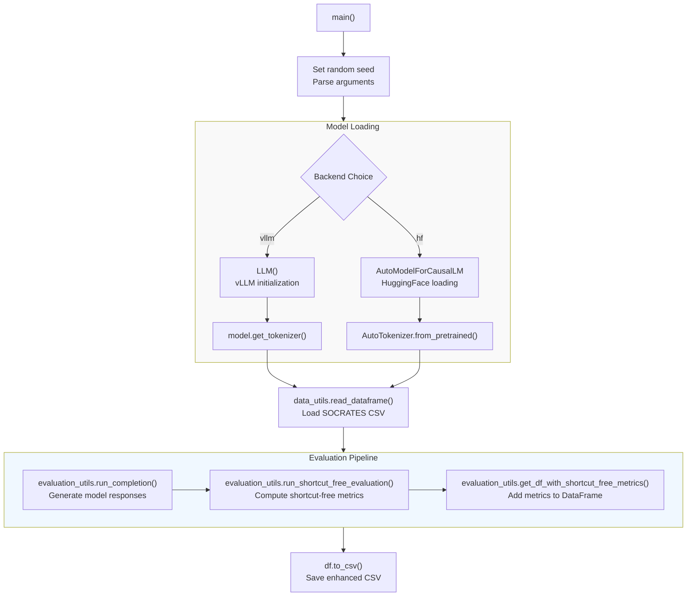

Sources: [evaluate_latent_reasoning.py:125-216]()

### Model Loading Architecture

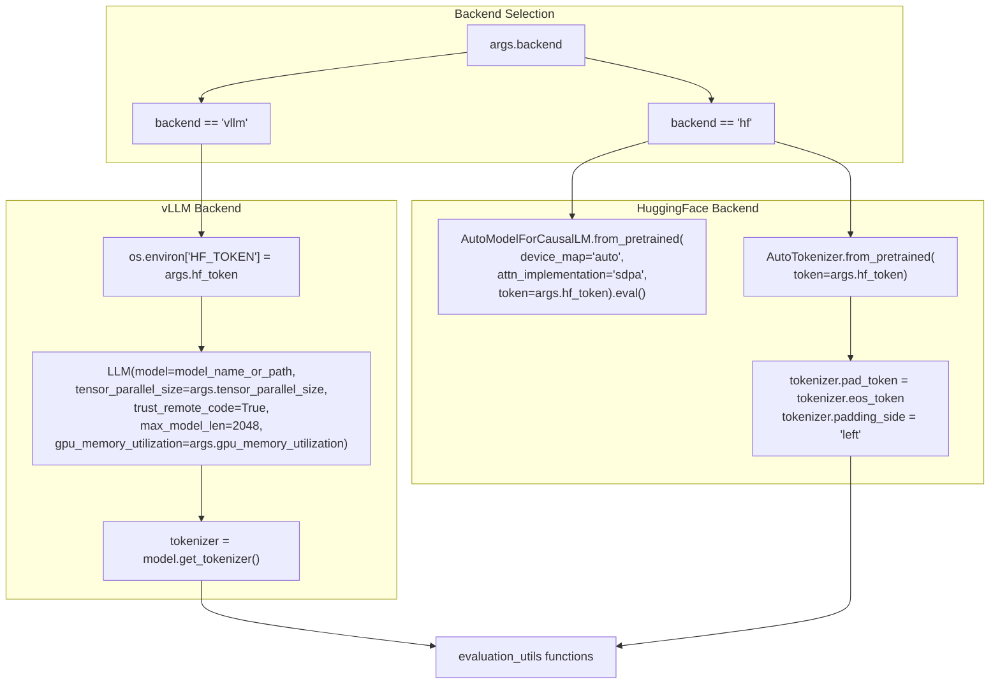

Sources: [evaluate_latent_reasoning.py:140-171]()

## Data Processing Pipeline

The script processes the SOCRATES dataset through a series of evaluation stages, each handled by specialized utility functions.

### Evaluation Stages

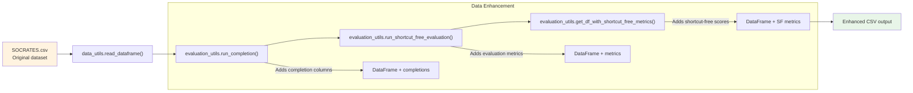

### Error Handling and Recovery

The script includes robust error handling for incomplete executions:

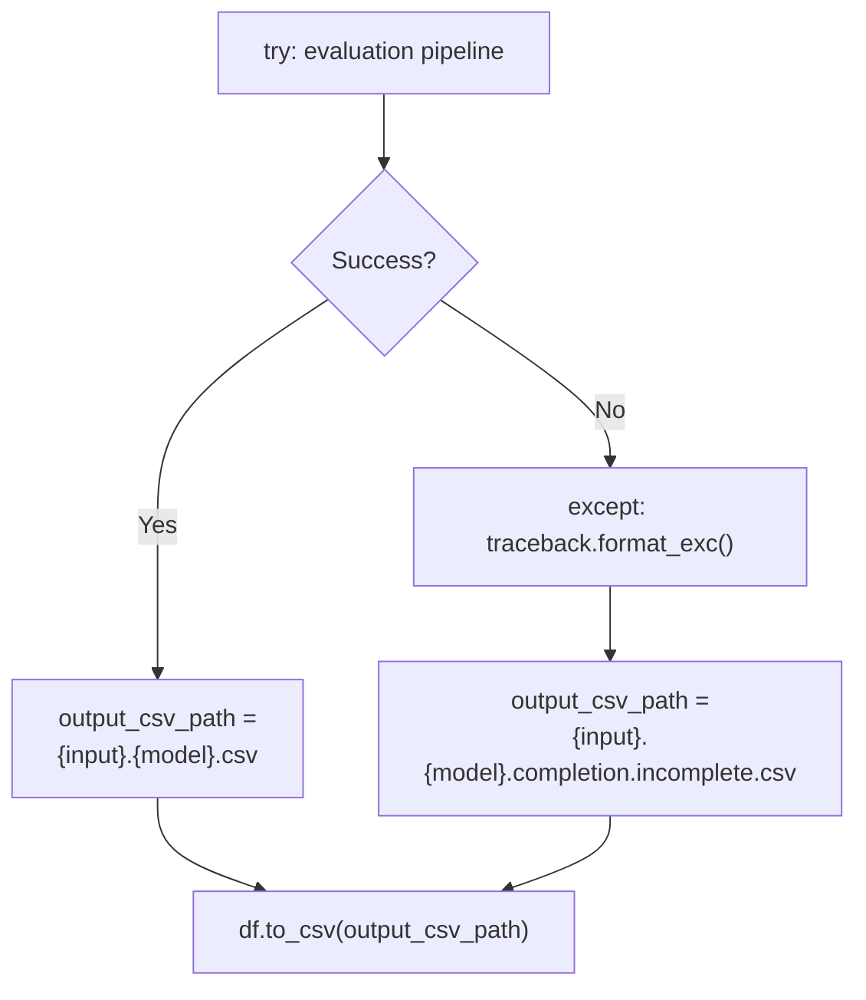

Sources: [evaluate_latent_reasoning.py:190-212]()

## Backend Configuration

The script supports two inference backends, each optimized for different use cases.

### vLLM Backend Configuration

**Optimized for:** High-throughput inference, multi-GPU deployments
**Key Parameters:**
- `tensor_parallel_size`: GPU parallelization
- `gpu_memory_utilization`: Memory management (default: 0.85)
- `max_model_len`: Sequence length limit (2048 tokens)
- `trust_remote_code`: Enable custom model code

### HuggingFace Backend Configuration

**Optimized for:** Flexibility, debugging, smaller-scale experiments
**Key Parameters:**
- `device_map`: Automatic device placement
- `attn_implementation`: Optimized attention ("sdpa")
- `batch_size`: Parallel processing batch size
- Tokenizer configuration with left padding

Sources: [evaluate_latent_reasoning.py:72-89](), [evaluate_latent_reasoning.py:140-171]()

## Output Structure

The script generates enhanced CSV files containing the original SOCRATES data plus computed metrics and model completions.

### Output File Naming

```
{experiment_dir}/{input_csv_name}.{safe_model_name}.csv
```

Where:
- `experiment_dir`: `results/evaluate_latent_reasoning` (default)
- `input_csv_name`: Base name of input CSV (e.g., "SOCRATES")
- `safe_model_name`: Model name with `/` replaced by `--`

### Enhanced DataFrame Columns

The output CSV includes original SOCRATES columns plus:
- Model completion columns (added by `run_completion`)
- Shortcut-free evaluation metrics (added by `run_shortcut_free_evaluation`)
- Aggregated shortcut-free scores (added by `get_df_with_shortcut_free_metrics`)

### Incomplete Execution Handling

If evaluation fails, the output filename includes `.completion.incomplete` to indicate partial results, allowing for recovery and reprocessing.

Sources: [evaluate_latent_reasoning.py:179-212]()

---

# Page: Run Patchscopes

# Run Patchscopes

<details>
<summary>Relevant source files</summary>

The following files were used as context for generating this wiki page:

- [README.md](README.md)
- [run_patchscopes.py](run_patchscopes.py)

</details>


## Purpose and Scope

The `run_patchscopes.py` script implements Patchscopes analysis for investigating latent entity representations in multi-hop reasoning tasks. This system is part of the second research paper "Do Large Language Models Perform Latent Multi-Hop Reasoning without Exploiting Shortcuts?" and specifically focuses on layer-wise intervention studies to understand how different transformer layers contribute to multi-hop reasoning processes.

This document covers the Patchscopes analysis pipeline, its configuration, and evaluation mechanisms. For general evaluation without Patchscopes interventions, see [Evaluate Latent Reasoning](#3.2). For inspection-based approaches used in the first paper, see [Inspect Latent Reasoning](#3.1).

Sources: [README.md:70-81](), [run_patchscopes.py:15-38]()

## System Architecture

The Patchscopes system implements layer-wise hidden state interventions to probe multi-hop reasoning capabilities. The architecture centers around extracting hidden states from source layers and patching them into target layers during generation.

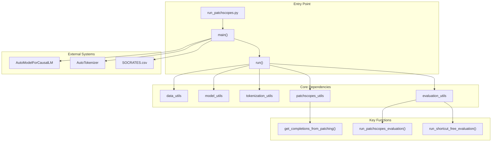

Sources: [run_patchscopes.py:19-23](), [run_patchscopes.py:131-220]()

## Key Components

### Model Loading and Configuration

The system loads transformer models using HuggingFace's `AutoModelForCausalLM` and `AutoTokenizer`. Model configuration includes device mapping, attention implementation, and tokenizer padding setup.

| Component | Function | Configuration |
|-----------|----------|---------------|
| `AutoModelForCausalLM` | Loads transformer model | `device_map="auto"`, `attn_implementation="sdpa"` |
| `AutoTokenizer` | Handles tokenization | `padding_side="left"`, `pad_token=eos_token` |
| Model Detection | Determines instruction tuning | Uses `model_utils.is_instruction_tuned()` |

The system automatically detects whether the model is instruction-tuned to select appropriate fact types: `"r2(r1(e1)).blank"` for instruction-tuned models and `"r2(r1(e1))"` for pretrained models.

Sources: [run_patchscopes.py:148-162](), [run_patchscopes.py:179-184]()

### Prompt Processing Pipeline

```mermaid
flowchart LR
    subgraph "Input Processing"
        CSV["SOCRATES.csv"]
        READ["data_utils.read_dataframe()"]
        FACT_TYPE["Fact Type Detection"]
    end
    
    subgraph "Prompt Generation"
        SUBJECT_CUT["subject_cut.prompt"]
        GET_SUBJECT["get_subject_prompt()"]
        PATCH_PROMPT["patchscopes.prompt"]
    end
    
    subgraph "Batch Processing"
        BATCH_FUNC["batch_get_completions_from_patching"]
        BATCHIFY["data_utils.batchify()"]
    end
    
    CSV --> READ
    READ --> FACT_TYPE
    FACT_TYPE --> GET_SUBJECT
    GET_SUBJECT --> SUBJECT_CUT
    SUBJECT_CUT --> BATCH_FUNC
    PATCH_PROMPT --> BATCH_FUNC
    BATCHIFY --> BATCH_FUNC
```

The system creates three types of prompts:
- **Original prompts**: Full multi-hop queries from dataset
- **Subject-cut prompts**: Truncated prompts ending at intermediate entity using `tokenization_utils.get_subject_prompt()`
- **Target prompts**: Fixed Patchscopes template with example entities

Sources: [run_patchscopes.py:186-193](), [run_patchscopes.py:262-267](), [run_patchscopes.py:269-286]()

## Configuration and Usage

### Command Line Arguments

The script accepts multiple configuration parameters for controlling the Patchscopes analysis:

| Argument | Default | Purpose |
|----------|---------|---------|
| `--model_name_or_path` | `"mistralai/Mistral-7B-v0.3"` | Model identifier or path |
| `--input_csv_path` | `"datasets/SOCRATES.csv"` | Input dataset path |
| `--batch_size` | `128` | Processing batch size |
| `--source_layer_idxs` | `""` | Comma-separated source layer indices |
| `--target_layer_idxs` | `""` | Comma-separated target layer indices |
| `--num_return_sequences` | `3` | Number of generations per patch |
| `--greedy` | `False` | Use greedy vs. sampling decoding |

### Layer Selection Strategy

If no layer indices are specified, the system defaults to using all available layers from the model configuration. Layer indices are parsed from comma-separated strings and converted to integer lists.

```bash
python run_patchscopes.py \
    --model_name_or_path $MODEL_NAME_OR_PATH \
    --source_layer_idxs 1,2 \
    --target_layer_idxs 30,31 \
    --run_evaluation --run_patchscopes_evaluation
```

Sources: [run_patchscopes.py:30-128](), [run_patchscopes.py:194-203](), [run_patchscopes.py:257-260]()

## Implementation Workflow

### Patchscopes Analysis Pipeline

```mermaid
flowchart TD
    subgraph "Setup Phase"
        LOAD["Load Model & Tokenizer"]
        READ_DATA["Read SOCRATES Dataset"]
        DETECT["Detect Model Type"]
    end
    
    subgraph "Prompt Preparation"
        CREATE_SUBJECT["Create subject_cut prompts"]
        SET_TARGET["Set patchscopes.prompt template"]
        BATCH_PREP["Prepare batch processing"]
    end
    
    subgraph "Patchscopes Execution"
        EXTRACT["Extract hidden states from source layers"]
        PATCH["Patch into target layers"]
        GENERATE["Generate completions"]
        COLLECT["Collect results by layer pairs"]
    end
    
    subgraph "Evaluation Phase"
        PATCH_EVAL["run_patchscopes_evaluation()"]
        SF_EVAL["run_shortcut_free_evaluation()"]
        SAVE["Save enhanced DataFrame"]
    end
    
    LOAD --> READ_DATA
    READ_DATA --> DETECT
    DETECT --> CREATE_SUBJECT
    CREATE_SUBJECT --> SET_TARGET
    SET_TARGET --> BATCH_PREP
    BATCH_PREP --> EXTRACT
    EXTRACT --> PATCH
    PATCH --> GENERATE
    GENERATE --> COLLECT
    COLLECT --> PATCH_EVAL
    PATCH_EVAL --> SF_EVAL
    SF_EVAL --> SAVE
```

### Core Processing Function

The `run()` function orchestrates the entire Patchscopes analysis workflow. It processes the DataFrame through several stages:

1. **Layer Configuration**: Sets up source and target layer indices, defaulting to all layers if not specified
2. **Template Setup**: Creates the fixed Patchscopes prompt template with example entities
3. **Batch Processing**: Uses `data_utils.batchify()` to create batched version of `patchscopes_utils.get_completions_from_patching()`
4. **Result Collection**: Organizes results by token position, generation index, and layer pair
5. **Evaluation**: Runs optional Patchscopes-specific and shortcut-free evaluations

Sources: [run_patchscopes.py:222-323](), [run_patchscopes.py:269-298]()

## Output and Evaluation

### Result Storage Format

The system stores Patchscopes results using a structured column naming convention:

```
{fact_type}.patched.{token_position}-{k}-{source_index}-{target_index}.completion
```

Where:
- `fact_type`: Either `"r2(r1(e1))"` or `"r2(r1(e1)).blank"`
- `token_position`: Position in sequence where patching occurs
- `k`: Generation sequence number (0 to `num_return_sequences-1`)
- `source_index`: Source layer index for hidden state extraction
- `target_index`: Target layer index for hidden state injection

### Evaluation Modes

The system supports two evaluation approaches controlled by command-line flags:

| Flag | Function | Purpose |
|------|----------|---------|
| `--run_patchscopes_evaluation` | `evaluation_utils.run_patchscopes_evaluation()` | Evaluates Patchscopes-generated completions |
| `--run_evaluation` | `evaluation_utils.run_shortcut_free_evaluation()` | Performs shortcut-free evaluation on results |

Both evaluation modes enhance the DataFrame with computed metrics and correctness assessments.

### Output File Management

Results are saved to timestamped directories under `results/run_patchscopes/` with filenames combining the input dataset name and model identifier:

```
{input_csv_name}.{safe_model_name_or_path}.csv
```

The system creates safe filenames by replacing path separators and handles model revisions in the naming scheme.

Sources: [run_patchscopes.py:288-298](), [run_patchscopes.py:299-322](), [run_patchscopes.py:172-175]()

---

# Page: Utility Modules

# Utility Modules

<details>
<summary>Relevant source files</summary>

The following files were used as context for generating this wiki page:

- [README.md](README.md)

</details>


The utility modules in the `src/` directory provide shared functionality that supports all experimental approaches in the latent multi-hop reasoning codebase. These modules handle common operations such as data processing, model interactions, tokenization, and specialized evaluation logic, allowing the main entry points to focus on their specific experimental objectives.

For detailed documentation of individual utility modules, see sections [4.1](#4.1) through [4.6](#4.6). For information about the main entry points that use these utilities, see [Main Entry Points](#3).

## Architecture Overview

The utility modules form a layered architecture where core utilities provide fundamental operations, while experiment-specific utilities implement specialized analysis functions:

```mermaid
graph TB
    subgraph "Core Utilities"
        data_utils["data_utils.py<br/>• read_dataframe<br/>• efficient_batchify<br/>• batchify"]
        model_utils["model_utils.py<br/>• get_unembedding_matrix<br/>• get_layers<br/>• is_instruction_tuned"]
        tokenization_utils["tokenization_utils.py<br/>• to_tokens<br/>• find_substrings<br/>• get_completion"]
    end
    
    subgraph "Experiment-Specific Utilities"
        inspection_utils["inspection_utils.py<br/>• run_rq1<br/>• run_rq2<br/>• activation_patching"]
        evaluation_utils["evaluation_utils.py<br/>• run_completion<br/>• shortcut_free_evaluation<br/>• patchscopes_evaluation"]
        patchscopes_utils["patchscopes_utils.py<br/>• get_hidden_states<br/>• generate_with_patching<br/>• layer_intervention"]
    end
    
    data_utils --> inspection_utils
    data_utils --> evaluation_utils
    data_utils --> patchscopes_utils
    
    model_utils --> inspection_utils
    model_utils --> evaluation_utils
    model_utils --> patchscopes_utils
    
    tokenization_utils --> inspection_utils
    tokenization_utils --> evaluation_utils
    tokenization_utils --> patchscopes_utils
```

*Sources: [README.md:88-92]()*

## Utility Module Usage by Main Entry Points

Each main entry point utilizes different combinations of utility modules based on its experimental requirements:

```mermaid
graph LR
    subgraph "Main Entry Points"
        inspect_latent_reasoning["inspect_latent_reasoning.py<br/>Paper 1 Experiments"]
        evaluate_latent_reasoning["evaluate_latent_reasoning.py<br/>Paper 2 Shortcut-Free"]
        run_patchscopes["run_patchscopes.py<br/>Paper 2 Patchscopes"]
    end
    
    subgraph "Utility Modules"
        data_utils["data_utils.py"]
        model_utils["model_utils.py"]
        tokenization_utils["tokenization_utils.py"]
        inspection_utils["inspection_utils.py"]
        evaluation_utils["evaluation_utils.py"] 
        patchscopes_utils["patchscopes_utils.py"]
    end
    
    inspect_latent_reasoning --> data_utils
    inspect_latent_reasoning --> model_utils
    inspect_latent_reasoning --> tokenization_utils
    inspect_latent_reasoning --> inspection_utils
    
    evaluate_latent_reasoning --> data_utils
    evaluate_latent_reasoning --> model_utils
    evaluate_latent_reasoning --> evaluation_utils
    
    run_patchscopes --> data_utils
    run_patchscopes --> model_utils
    run_patchscopes --> evaluation_utils
    run_patchscopes --> patchscopes_utils
```

*Sources: [README.md:88-92]()*

## Module Classification and Dependencies

The utility modules can be categorized by their scope and dependencies:

| Module | Category | Purpose | Used By |
|--------|----------|---------|---------|
| `data_utils.py` | Core | DataFrame operations, batch processing | All entry points |
| `model_utils.py` | Core | Model loading, layer access, random seed control | All entry points |
| `tokenization_utils.py` | Core | Text-to-token conversion, substring finding | All entry points |
| `inspection_utils.py` | Paper 1 Specific | RQ1/RQ2 experiments, activation patching | `inspect_latent_reasoning.py` |
| `evaluation_utils.py` | Paper 2 Specific | Completion generation, shortcut-free evaluation | `evaluate_latent_reasoning.py`, `run_patchscopes.py` |
| `patchscopes_utils.py` | Paper 2 Specific | Hidden state extraction, layer interventions | `run_patchscopes.py` |

*Sources: [README.md:88-92]()*

## Functional Flow Between Utilities

The utilities work together in a typical experimental pipeline following this data flow:

```mermaid
flowchart TD
    read_dataframe["data_utils.read_dataframe<br/>Load CSV datasets"]
    to_tokens["tokenization_utils.to_tokens<br/>Convert text to tokens"]
    efficient_batchify["data_utils.efficient_batchify<br/>Create memory-efficient batches"]
    get_layers["model_utils.get_layers<br/>Access transformer layers"]
    
    subgraph "Experiment-Specific Processing"
        run_rq1["inspection_utils.run_rq1<br/>First-hop analysis"]
        run_rq2["inspection_utils.run_rq2<br/>Second-hop analysis"] 
        run_completion["evaluation_utils.run_completion<br/>Generate completions"]
        get_hidden_states["patchscopes_utils.get_hidden_states<br/>Extract layer representations"]
    end
    
    find_substrings["tokenization_utils.find_substrings<br/>Locate entities in text"]
    get_completion["tokenization_utils.get_completion<br/>Extract generated text"]
    
    read_dataframe --> to_tokens
    to_tokens --> efficient_batchify
    efficient_batchify --> get_layers
    
    get_layers --> run_rq1
    get_layers --> run_rq2
    get_layers --> run_completion
    get_layers --> get_hidden_states
    
    run_rq1 --> find_substrings
    run_rq2 --> find_substrings
    run_completion --> get_completion
    get_hidden_states --> find_substrings
```

*Sources: [README.md:88-92]()*

## Cross-Module Integration Patterns

The utility modules implement several integration patterns that enable seamless collaboration:

### Shared Configuration Pattern
Core utilities like `model_utils.set_random_seed()` and `model_utils.is_instruction_tuned()` provide configuration services used by all experiment-specific modules.

### Data Pipeline Pattern  
`data_utils` functions create standardized data structures that flow through `tokenization_utils` processing and into experiment-specific utilities.

### Model Abstraction Pattern
`model_utils.get_unembedding_matrix()` and `model_utils.get_layers()` provide consistent interfaces to transformer internals, enabling experiment utilities to work across different model architectures.

### Batch Processing Pattern
`data_utils.efficient_batchify()` creates memory-optimized batches that all experiment utilities can process uniformly, regardless of their specific analysis requirements.

*Sources: [README.md:88-92]()*

---

# Page: Data Utilities

# Data Utilities

<details>
<summary>Relevant source files</summary>

The following files were used as context for generating this wiki page:

- [src/data_utils.py](src/data_utils.py)

</details>


## Purpose and Scope

The Data Utilities module provides core functionality for reading, processing, and efficiently batching datasets used in the latent multi-hop reasoning experiments. This module handles CSV file reading with specialized column processing, data type conversions, and memory-efficient batch processing operations that are shared across all experimental entry points.

For model-specific operations and transformations, see [Model Utilities](#4.4). For tokenization and text processing utilities, see [Tokenization Utilities](#4.6).

## Core Functions Overview

The `data_utils.py` module contains seven primary functions that form the foundation of data processing operations:

| Function | Purpose | Usage Context |
|----------|---------|---------------|
| `read_dataframe` | Read CSV with specialized column processing | Dataset loading in all experiments |
| `convert_object` | Convert string representations to Python objects | Column processing during CSV reading |
| `convert_correct` | Convert string representations to boolean values | Processing correctness metrics |
| `efficient_batchify` | Create memory-efficient batched functions | Large-scale data processing |
| `batchify` | General function batchification | Standard batch processing |
| `get_efficient_batchified_info` | Group data for efficient batching | Internal batching optimization |
| `unrolled_outputs` / `aggregated_results` | Handle batch result aggregation | Post-processing batch outputs |

**Data Flow Architecture**

```mermaid
flowchart TB
    subgraph "CSV Files"
        CSV1["TwoHopFact.csv"]
        CSV2["SOCRATES.csv"]
    end
    
    subgraph "read_dataframe Function"
        READ["read_dataframe()"]
        CONVERT_OBJ["convert_object()"]
        CONVERT_CORR["convert_correct()"]
    end
    
    subgraph "DataFrame Processing"
        DF["pd.DataFrame"]
        EVAL_COLS["eval_cols processing<br/>.aliases, .list, .entities"]
        ENTITY_COLS["entity value columns<br/>e1.value, e2.value, e3.value"]
        COUNT_COLS["count columns<br/>count, c4, dolma, oscar"]
        CORRECT_COLS["correctness columns<br/>*.correct"]
    end
    
    subgraph "Batch Processing System"
        EFFICIENT_BATCH["efficient_batchify()"]
        GET_BATCH_INFO["get_efficient_batchified_info()"]
        STANDARD_BATCH["batchify()"]
    end
    
    subgraph "Output Processing"
        UNROLL["unrolled_outputs()"]
        AGGREGATE["aggregated_results()"]
        FINAL_OUTPUT["Processed Results"]
    end
    
    CSV1 --> READ
    CSV2 --> READ
    READ --> CONVERT_OBJ
    READ --> CONVERT_CORR
    READ --> DF
    
    DF --> EVAL_COLS
    DF --> ENTITY_COLS
    DF --> COUNT_COLS
    DF --> CORRECT_COLS
    
    DF --> EFFICIENT_BATCH
    DF --> STANDARD_BATCH
    EFFICIENT_BATCH --> GET_BATCH_INFO
    
    STANDARD_BATCH --> UNROLL
    STANDARD_BATCH --> AGGREGATE
    UNROLL --> FINAL_OUTPUT
    AGGREGATE --> FINAL_OUTPUT
```

Sources: [src/data_utils.py:55-109](), [src/data_utils.py:151-194](), [src/data_utils.py:230-301]()

## CSV Reading and Data Conversion

### read_dataframe Function

The `read_dataframe` function serves as the primary entry point for loading research datasets. It performs specialized processing for different column types found in the TwoHopFact and SOCRATES datasets.

**Column Processing Strategy**

```mermaid
flowchart LR
    subgraph "Input CSV"
        RAW_CSV["Raw CSV Data"]
    end
    
    subgraph "Column Type Detection"
        EVAL_DETECT["eval_cols detection<br/>(.aliases, .list, .entities, .keywords, .matches)"]
        ENTITY_DETECT["Entity columns<br/>(e1.value, e2.value, e3.value)"]
        COUNT_DETECT["Count columns<br/>(count, c4, dolma, oscar, openwebtext)"]
        CORRECT_DETECT["Correctness columns<br/>(*.correct)"]
    end
    
    subgraph "Conversion Functions"
        CONVERT_OBJ_FUNC["convert_object()<br/>ast.literal_eval()"]
        STR_CONVERT["String conversion<br/>astype(str)"]
        INT_CONVERT["Integer conversion<br/>int(float(x))"]
        BOOL_CONVERT["convert_correct()<br/>Boolean processing"]
    end
    
    subgraph "Output DataFrame"
        PROCESSED_DF["Processed DataFrame<br/>with typed columns"]
    end
    
    RAW_CSV --> EVAL_DETECT
    RAW_CSV --> ENTITY_DETECT
    RAW_CSV --> COUNT_DETECT
    RAW_CSV --> CORRECT_DETECT
    
    EVAL_DETECT --> CONVERT_OBJ_FUNC
    ENTITY_DETECT --> STR_CONVERT
    COUNT_DETECT --> INT_CONVERT
    CORRECT_DETECT --> BOOL_CONVERT
    
    CONVERT_OBJ_FUNC --> PROCESSED_DF
    STR_CONVERT --> PROCESSED_DF
    INT_CONVERT --> PROCESSED_DF
    BOOL_CONVERT --> PROCESSED_DF
```

The function uses pattern matching to identify column types:
- **eval_cols**: Columns ending with `.aliases`, `.list`, `.entities`, `.keywords`, `.matches` are processed with `convert_object`
- **Entity columns**: Columns like `e1.value`, `e2.value`, `e3.value` are converted to strings
- **Count columns**: Columns containing `count`, `c4`, `dolma`, `oscar`, `openwebtext` are converted to integers
- **Correctness columns**: Columns containing `correct` are processed with `convert_correct`

Sources: [src/data_utils.py:55-109](), [src/data_utils.py:31-39](), [src/data_utils.py:42-52]()

### Data Type Conversion Functions

The module provides two specialized conversion functions:

**convert_object Function**
- Handles string representations of Python objects (lists, dictionaries)
- Uses `ast.literal_eval` for safe evaluation
- Returns `np.nan` for null or empty values

**convert_correct Function**
- Converts string representations to boolean values
- Handles special cases for experimental correctness metrics
- Maintains type safety with explicit validation

Sources: [src/data_utils.py:31-39](), [src/data_utils.py:42-52]()

## Batch Processing System

The module implements a sophisticated batch processing system designed for memory-efficient processing of large datasets typical in language model experiments.

### Efficient Batching Architecture

```mermaid
flowchart TB
    subgraph "Input Preparation"
        INPUT_DF["Input DataFrame"]
        PARAM_MAP["param_to_column mapping"]
    end
    
    subgraph "get_efficient_batchified_info"
        GROUP_BY["df.groupby(columns)"]
        SORT_BY_LENGTH["Sort by max length"]
        BATCH_INDICES["batched_indices"]
        BATCH_PARAMS["batched_param_to_column_values"]
    end
    
    subgraph "efficient_batchify Wrapper"
        WRAP_FUNC["@functools.wraps(function)"]
        BATCH_CALL["batchify() call"]
        UNROLL_CALL["unrolled_outputs() call"]
    end
    
    subgraph "batchify Execution"
        BATCH_LOOP["Batch processing loop"]
        FUNC_CALL["function(**batched_inputs)"]
        RESULT_COLLECT["Collect results"]
    end
    
    subgraph "Result Processing"
        AGGREGATE_FUNC["aggregated_results()"]
        UNROLL_FUNC["unrolled_outputs()"]
        FINAL_OUTPUT["Final processed output"]
    end
    
    INPUT_DF --> GROUP_BY
    PARAM_MAP --> GROUP_BY
    GROUP_BY --> SORT_BY_LENGTH
    SORT_BY_LENGTH --> BATCH_INDICES
    SORT_BY_LENGTH --> BATCH_PARAMS
    
    BATCH_INDICES --> WRAP_FUNC
    BATCH_PARAMS --> WRAP_FUNC
    WRAP_FUNC --> BATCH_CALL
    BATCH_CALL --> UNROLL_CALL
    
    BATCH_CALL --> BATCH_LOOP
    BATCH_LOOP --> FUNC_CALL
    FUNC_CALL --> RESULT_COLLECT
    
    RESULT_COLLECT --> AGGREGATE_FUNC
    AGGREGATE_FUNC --> UNROLL_FUNC
    UNROLL_CALL --> UNROLL_FUNC
    UNROLL_FUNC --> FINAL_OUTPUT
```

Sources: [src/data_utils.py:112-148](), [src/data_utils.py:151-194](), [src/data_utils.py:230-301]()

### Batching Function Parameters

The batching functions accept several configuration parameters for optimization:

| Parameter | Purpose | Default | Usage |
|-----------|---------|---------|-------|
| `batch_size` | Number of items per batch | 4 | Memory management |
| `max_size` | Maximum total items to process | None | Debugging/testing |
| `tqdm_desc` | Progress bar description | '' | User feedback |
| `flush_step` | GPU memory flush interval | None | Memory optimization |
| `concat_dim` | Tensor concatenation dimension | None | Result aggregation |

### Result Aggregation Strategies

The module handles different result types through specialized aggregation:

**Tensor Results**: Uses `torch.cat()` with specified concatenation dimension
**List/Tuple Results**: Flattened using `itertools.chain.from_iterable()`
**Dictionary Results**: Recursively aggregated with `collections.defaultdict`

Sources: [src/data_utils.py:304-339](), [src/data_utils.py:197-227]()

## Integration with Entry Points

The data utilities are used across all experimental entry points:

```mermaid
flowchart LR
    subgraph "Entry Points"
        ILR["inspect_latent_reasoning.py"]
        ELR["evaluate_latent_reasoning.py"] 
        RPS["run_patchscopes.py"]
    end
    
    subgraph "data_utils Functions"
        READ_DF["read_dataframe()"]
        EFFICIENT_BATCH["efficient_batchify()"]
        STANDARD_BATCH["batchify()"]
    end
    
    subgraph "Dataset Files"
        THF["TwoHopFact.csv"]
        SOC["SOCRATES.csv"]
    end
    
    subgraph "Processing Functions"
        MODEL_FUNCS["Model processing functions"]
        EVAL_FUNCS["Evaluation functions"]
        INSPECT_FUNCS["Inspection functions"]
    end
    
    THF --> READ_DF
    SOC --> READ_DF
    READ_DF --> ILR
    READ_DF --> ELR
    READ_DF --> RPS
    
    ILR --> EFFICIENT_BATCH
    ELR --> EFFICIENT_BATCH
    RPS --> EFFICIENT_BATCH
    
    EFFICIENT_BATCH --> MODEL_FUNCS
    STANDARD_BATCH --> EVAL_FUNCS
    STANDARD_BATCH --> INSPECT_FUNCS
```

The efficient batching system is particularly important for the large-scale processing required in:
- **RQ1/RQ2 experiments**: Processing thousands of entity recall operations
- **Shortcut-free evaluation**: Batch processing of model completions
- **Patchscopes analysis**: Memory-efficient hidden state extraction

Sources: [src/data_utils.py:1-340]()

---

# Page: Evaluation Utilities

# Evaluation Utilities

<details>
<summary>Relevant source files</summary>

The following files were used as context for generating this wiki page:

- [src/evaluation_utils.py](src/evaluation_utils.py)

</details>


This module provides the core evaluation functionality for the latent multi-hop reasoning experiments. It handles model completion generation using both vLLM and HuggingFace backends, implements shortcut-free evaluation methods, and provides patchscopes evaluation capabilities. The module is primarily used by the main entry points for Paper 2 experiments.

For inspection-specific utilities used in Paper 1 experiments, see [Inspection Utilities](#4.3). For general model operations, see [Model Utilities](#4.4).

## Core Completion Generation

The module provides unified interfaces for generating completions using either vLLM or HuggingFace models through the `run_completion()` function, which automatically detects model type and delegates to the appropriate backend.

### Completion Pipeline Flow

```mermaid
flowchart TD
    Input["DataFrame with prompts"] --> ModelType{"Model Type Detection"}
    
    ModelType -->|Instruction-tuned| ITFactTypes["it_fact_types"]
    ModelType -->|Pretrained| PTFactTypes["pretrained_fact_types"]
    
    ITFactTypes --> Backend{"Backend Selection"}
    PTFactTypes --> Backend
    
    Backend -->|vLLM| VLLMCompletion["run_vllm_completion()"]
    Backend -->|HuggingFace| HFCompletion["run_hf_completion()"]
    
    VLLMCompletion --> InputDict["get_input_dict()"]
    HFCompletion --> InputDict
    
    InputDict --> ChatTemplate["Chat Template Application"]
    InputDict --> SamplingParams["get_vllm_sampling_params()"]
    
    ChatTemplate --> Generation["Model Generation"]
    SamplingParams --> Generation
    
    Generation --> UpdateDF["update_df_with_completion()"]
    UpdateDF --> CompletedDF["DataFrame with completions"]
```

Sources: [src/evaluation_utils.py:787-843]()

### Fact Types and Model Adaptation

The module defines different fact types for pretrained and instruction-tuned models:

| Model Type | Fact Types | Examples |
|------------|------------|----------|
| Pretrained | `pretrained_fact_types` | `"condition": "r1(e1)"`, `"entailed": "r2(r1(e1))"` |
| Instruction-tuned | `it_fact_types` | `"blank.entailed": "r2(r1(e1)).blank"`, `"blank.cot": "r2(r1(e1)).blank.cot"` |

The `get_completion_messages()` function handles instruction formatting for different prompt types, with special handling for chain-of-thought and blank-filling tasks.

Sources: [src/evaluation_utils.py:36-72](), [src/evaluation_utils.py:75-127]()

## Shortcut-Free Evaluation

The core innovation of this module is the shortcut-free evaluation methodology that prevents models from exploiting superficial patterns instead of performing genuine multi-hop reasoning.

### Evaluation Architecture

```mermaid
flowchart TD
    Completion["Model Completion"] --> Normalize["normalize_text()"]
    Completion --> StrictMatch["Strict Matching"]
    
    Normalize --> GetMatches["get_matches()"]
    StrictMatch --> GetMatches
    
    GetMatches --> ShortcutEval["shortcut_free_evaluate()"]
    
    ShortcutEval --> MultiChoice["fill_has_multiple_choice_format()"]
    ShortcutEval --> RealCorrect["get_real_correct_and_failed_instruction()"]
    
    MultiChoice --> Unusable["Unusable Detection"]
    RealCorrect --> Unusable
    
    Unusable --> Metrics["composability_numer/denom"]
    Metrics --> FinalScore["Shortcut-Free Score"]
```

Sources: [src/evaluation_utils.py:373-463](), [src/evaluation_utils.py:551-586]()

### Key Evaluation Components

The `shortcut_free_evaluate()` function implements several critical checks:

1. **Multiple Choice Detection**: Identifies and filters out multiple-choice formatted responses using `fill_has_multiple_choice_format()`
2. **Entity Ordering**: Ensures e3 (final answer) appears before e2 (intermediate entity) in completions via `get_real_correct_and_failed_instruction()`
3. **Guessing Prevention**: Filters cases where models might guess correctly on null entities

The evaluation produces several boolean columns:
- `{fact_type}.correct`: Basic correctness
- `{fact_type}.real.correct`: Shortcut-free correctness  
- `{fact_type}.unusable`: Cases excluded from evaluation
- `{fact_type}.failed_instruction`: Instruction-following failures

Sources: [src/evaluation_utils.py:466-525](), [src/evaluation_utils.py:527-549]()

## Patchscopes Evaluation

The module provides specialized evaluation for patchscopes experiments through `run_patchscopes_evaluation()`, which processes layer-wise intervention results.

### Patchscopes Processing Flow

```mermaid
flowchart TD
    PatchDF["DataFrame with patchscopes results"] --> T1Cols["t1 completion columns"]
    PatchDF --> T2Cols["t2 completion columns"]
    
    T1Cols --> EvalE2["evaluate_patchscopes(e2)"]
    T1Cols --> EvalE3["evaluate_patchscopes(e3)"]
    T2Cols --> EvalE2
    T2Cols --> EvalE3
    
    EvalE2 --> LayerMetrics["Per-layer-pair metrics"]
    EvalE3 --> LayerMetrics
    
    LayerMetrics --> AggCorrect["get_patchscopes_correct()"]
    AggCorrect --> FinalResults["Aggregated correctness scores"]
```

The function processes completions for different source and target layer combinations, evaluating both e2 (intermediate) and e3 (final) entity recall across multiple return sequences.

Sources: [src/evaluation_utils.py:889-953](), [src/evaluation_utils.py:845-887]()

## Text Normalization and Matching

### Text Processing Pipeline

The module implements robust text normalization through `normalize_text()` with configurable options:

```mermaid
flowchart TD
    RawText["Raw completion text"] --> Strip["text.strip()"]
    Strip --> Abbr["Remove spaces in abbreviations"]
    Abbr --> Lower["Convert to lowercase"]
    Lower --> Accents["Remove accents (unidecode)"]
    Accents --> Articles["Remove articles (a, an, the)"]
    Articles --> Punct["Replace punctuation with spaces"]
    Punct --> Spaces["Normalize whitespace"]
    Spaces --> NormText["Normalized text"]
    
    NormText --> Matching["Word boundary matching"]
    Matching --> Results["Match results"]
```

The `get_matches()` function performs word-boundary matching between completions and correct answer aliases, returning tuples of matched entities.

Sources: [src/evaluation_utils.py:602-653](), [src/evaluation_utils.py:655-695](), [src/evaluation_utils.py:588-600]()

## Integration with Main Experiments

### Backend Integration

The module integrates with the broader experimental framework through several key functions:

| Function | Purpose | Used By |
|----------|---------|---------|
| `run_completion()` | Main completion interface | [evaluate_latent_reasoning.py](#3.2) |
| `run_shortcut_free_evaluation()` | Shortcut-free metrics | [evaluate_latent_reasoning.py](#3.2) |
| `run_patchscopes_evaluation()` | Patchscopes analysis | [run_patchscopes.py](#3.3) |
| `get_df_with_shortcut_free_metrics()` | Composability metrics | Paper 2 analysis |

The module handles both vLLM and HuggingFace backends through unified interfaces, with automatic model type detection and appropriate parameter selection.

Sources: [src/evaluation_utils.py:787-843](), [src/evaluation_utils.py:697-784]()

---

# Page: Inspection Utilities

# Inspection Utilities

<details>
<summary>Relevant source files</summary>

The following files were used as context for generating this wiki page:

- [src/inspection_utils.py](src/inspection_utils.py)

</details>


The `inspection_utils.py` module provides the core experimental infrastructure for answering the research questions in Paper 1: "Do Large Language Models Latently Perform Multi-Hop Reasoning?". This module implements internal entity recall measurement, consistency scoring, activation patching, and completion evaluation methods.

For broader evaluation utilities including shortcut-free evaluation, see [Evaluation Utilities](#4.2). For patchscopes-specific analysis, see [Patchscopes Utilities](#4.5).

## Core Research Question Implementation

The module implements two primary research questions through dedicated functions that orchestrate complex experimental pipelines:

| Research Question | Function | Purpose | Key Metrics |
|-------------------|----------|---------|-------------|
| RQ1: First-hop reasoning frequency | `run_rq1()` | Measure internal entity recall for bridge entities | `latentlogprob` scores across layers |
| RQ2: Second-hop reasoning consistency | `run_rq2()` | Measure consistency between single-hop and multi-hop predictions | `gradient_consistency` scores |
| Appositive validation | `run_appositive()` | Validate RQ1 metric using appositive constructions | Appositive generation probabilities |
| Chain-of-thought validation | `run_cot()` | Validate RQ2 metric using explicit reasoning | CoT consistency scores |

**Research Question 1 Flow**

```mermaid
flowchart TD
    RQ1["run_rq1()"] --> NEG_TYPES["Process negative types:<br/>r2(r1(e1'))<br/>r2(r1'(e1))"]
    RQ1 --> POS_TYPE["Process positive type:<br/>r2(r1(e1))"]
    
    NEG_TYPES --> FILL_NEG["fill_full_latent_info()<br/>for negative examples"]
    POS_TYPE --> FILL_POS["fill_full_latent_info()<br/>for positive examples"]
    
    FILL_NEG --> GET_LATENT_NEG["get_full_latent_info()<br/>Calculate internal recall"]
    FILL_POS --> GET_LATENT_POS["get_full_latent_info()<br/>Calculate internal recall"]
    
    GET_LATENT_NEG --> RESIDS_NEG["get_resids()<br/>Extract layer activations"]
    GET_LATENT_POS --> RESIDS_POS["get_resids()<br/>Extract layer activations"]
    
    RESIDS_NEG --> RESULTS["latentlogprob scores<br/>stored in DataFrame"]
    RESIDS_POS --> RESULTS
    
    style RQ1 fill:#e1f5fe
    style RESULTS fill:#e8f5e8
```

**Research Question 2 Flow**

```mermaid
flowchart TD
    RQ2["run_rq2()"] --> XNEW["get_xnew_and_alpha()<br/>Calculate patching directions"]
    
    XNEW --> CALC_G["get_calculated_g()<br/>Compute gradients"]
    CALC_G --> HOOK["get_adding_hook()<br/>Create activation hook"]
    
    HOOK --> CONSISTENCY["get_consistency_after_patching()<br/>Measure consistency with patching"]
    HOOK --> APPOSITIVE["get_appositive_after_patching()<br/>Measure appositive generation"]
    
    CONSISTENCY --> GRADIENTS["Compute gradients:<br/>∂consistency/∂α"]
    APPOSITIVE --> GRADIENTS
    
    GRADIENTS --> RESULTS["gradient_consistency scores<br/>stored in DataFrame"]
    
    style RQ2 fill:#f3e5f5
    style RESULTS fill:#e8f5e8
```

Sources: [src/inspection_utils.py:65-123](), [src/inspection_utils.py:211-341]()

## Internal Entity Recall System

The internal entity recall system measures how well language models internally represent bridge entities during multi-hop reasoning. This is the core metric for RQ1.

**Internal Entity Recall Architecture**

```mermaid
flowchart LR
    subgraph "Input Processing"
        PROMPTS["prompts<br/>(full two-hop)"]
        SUBJECTS["subject_prompts<br/>(truncated at entity)"]
        ENTITIES["bridge_entities<br/>(target entities)"]
    end
    
    subgraph "Core Functions"
        FILL_FUNC["fill_full_latent_info()"]
        GET_FUNC["get_full_latent_info()"]
        RESIDS["get_resids()"]
    end
    
    subgraph "Model Interaction"
        TRACE["TraceDict<br/>(baukit.nethook)"]
        LAYERS["model.layers<br/>(transformer blocks)"]
        UNEMBEDDING["get_unembedding_matrix()"]
    end
    
    subgraph "Output Metrics"
        LOGITS["logit scores<br/>(raw predictions)"]
        LOGPROBS["logprob scores<br/>(internal recall)"]
        HIDDEN["hidden_states<br/>(layer activations)"]
    end
    
    PROMPTS --> FILL_FUNC
    SUBJECTS --> FILL_FUNC
    ENTITIES --> FILL_FUNC
    
    FILL_FUNC --> GET_FUNC
    GET_FUNC --> RESIDS
    RESIDS --> TRACE
    TRACE --> LAYERS
    LAYERS --> UNEMBEDDING
    
    UNEMBEDDING --> LOGITS
    LOGITS --> LOGPROBS
    TRACE --> HIDDEN
    
    style FILL_FUNC fill:#e1f5fe
    style GET_FUNC fill:#e1f5fe
    style LOGPROBS fill:#e8f5e8
```

The system operates by:

1. **Position Identification**: Uses `tokenization_utils.find_exact_substrings_token_positions_from_string()` to locate the last token of the bridge entity mention
2. **Activation Extraction**: Captures hidden states at the identified position using `TraceDict` from baukit
3. **Logit Computation**: Projects hidden states through the unembedding matrix to get vocabulary logits
4. **Probability Calculation**: Applies softmax and log to get the internal entity recall score

Sources: [src/inspection_utils.py:343-404](), [src/inspection_utils.py:406-498](), [src/inspection_utils.py:501-582]()

## Consistency Measurement Framework

The consistency framework measures the similarity between single-hop and multi-hop prediction distributions, serving as the core metric for RQ2.

| Function | Purpose | Formula |
|----------|---------|---------|
| `get_consistency()` | Calculate symmetric consistency score | `-0.5 * (CE(p1, p2) + CE(p2, p1))` |
| `get_ce()` | Calculate cross-entropy between distributions | `-(p_target ⊙ log(p_pred)).sum()` |
| `fill_consistency()` | Batch process consistency calculations | Applies `get_consistency()` with batching |

**Consistency Calculation Pipeline**

```mermaid
flowchart TD
    subgraph "Input Prompts"
        SINGLE["singlehop_prompts<br/>r2(e2).prompt"]
        MULTI["multihop_prompts<br/>r2(r1(e1)).prompt"]
    end
    
    subgraph "Model Processing"
        TOKEN_SINGLE["to_tokens()<br/>single-hop tokenization"]
        TOKEN_MULTI["to_tokens()<br/>multi-hop tokenization"]
        
        MODEL_SINGLE["model(**inputs)<br/>single-hop inference"]
        MODEL_MULTI["model(**inputs)<br/>multi-hop inference"]
    end
    
    subgraph "Probability Computation"
        LOGITS_SINGLE["logits[:, -1, :]<br/>last token logits"]
        LOGITS_MULTI["logits[:, -1, :]<br/>last token logits"]
        
        SOFTMAX_SINGLE["softmax(-1)<br/>probability distribution"]
        SOFTMAX_MULTI["softmax(-1)<br/>probability distribution"]
    end
    
    subgraph "Consistency Metrics"
        CE1["CE(single → multi)<br/>cross-entropy"]
        CE2["CE(multi → single)<br/>cross-entropy"]
        CONSISTENCY["-0.5 * (CE1 + CE2)<br/>symmetric consistency"]
    end
    
    SINGLE --> TOKEN_SINGLE --> MODEL_SINGLE --> LOGITS_SINGLE --> SOFTMAX_SINGLE
    MULTI --> TOKEN_MULTI --> MODEL_MULTI --> LOGITS_MULTI --> SOFTMAX_MULTI
    
    SOFTMAX_SINGLE --> CE1
    SOFTMAX_MULTI --> CE1
    SOFTMAX_SINGLE --> CE2
    SOFTMAX_MULTI --> CE2
    
    CE1 --> CONSISTENCY
    CE2 --> CONSISTENCY
    
    style CONSISTENCY fill:#e8f5e8
```

Sources: [src/inspection_utils.py:804-874](), [src/inspection_utils.py:877-904]()

## Activation Patching System

The activation patching system performs causal interventions to test whether increasing internal entity recall leads to improved consistency in multi-hop reasoning.

**Patching Direction Calculation**

```mermaid
flowchart TD
    subgraph "Gradient Computation"
        PROMPTS["prompts<br/>(multi-hop)"]
        ENTITIES["bridge_entities<br/>(targets)"]
        SUBJECTS["subject_prompts<br/>(truncated)"]
    end
    
    subgraph "Core Processing"
        CALC_G["get_calculated_g()"]
        LATENT_INFO["get_full_latent_info()<br/>return_hidden_states=True"]
        GRAD_COMP["torch.autograd.grad()<br/>∂logprob/∂hidden"]
    end
    
    subgraph "Patch Construction"
        XNEW_ALPHA["get_xnew_and_alpha()"]
        POS_SLICE["pos_slice<br/>(token positions)"]
        ALPHA_ZERO["α = 0<br/>(scaling factors)"]
        XNEW["xnew = α * g<br/>(patch directions)"]
    end
    
    subgraph "Hook Application"
        HOOK_FN["get_adding_hook()"]
        TRACE_DICT["TraceDict<br/>(edit_output=hook_fn)"]
        PATCHED_FORWARD["model(**inputs)<br/>with patching"]
    end
    
    PROMPTS --> CALC_G
    ENTITIES --> CALC_G
    SUBJECTS --> CALC_G
    
    CALC_G --> LATENT_INFO
    LATENT_INFO --> GRAD_COMP
    GRAD_COMP --> XNEW_ALPHA
    
    XNEW_ALPHA --> POS_SLICE
    XNEW_ALPHA --> ALPHA_ZERO
    POS_SLICE --> XNEW
    ALPHA_ZERO --> XNEW
    
    XNEW --> HOOK_FN
    HOOK_FN --> TRACE_DICT
    TRACE_DICT --> PATCHED_FORWARD
    
    style GRAD_COMP fill:#ffebee
    style PATCHED_FORWARD fill:#e8f5e8
```

The patching system implements the following mathematical framework:

1. **Gradient Calculation**: `∂(internal_recall)/∂(hidden_state)` at the bridge entity position
2. **Patch Construction**: `patch = α * gradient` where `α` starts at zero
3. **Intervention**: `hidden_state_new = hidden_state_original + patch`
4. **Gradient Measurement**: `∂(consistency)/∂α` evaluated at `α = 0`

Sources: [src/inspection_utils.py:907-1009](), [src/inspection_utils.py:1012-1083](), [src/inspection_utils.py:1086-1130]()

## Completion and Evaluation Pipeline

The module provides comprehensive completion generation and evaluation capabilities for measuring model performance on factual knowledge tasks.

| Function | Input | Output | Purpose |
|----------|-------|--------|---------|
| `run_completion_and_evaluation()` | DataFrame with prompts | Completion results | Orchestrate evaluation for all fact types |
| `fill_completion_and_evaluation()` | Specific fact type | Completion metrics | Process single fact type with batching |
| `get_completion_and_evaluation_result()` | Prompt batch | Generated completions | Core generation and evaluation logic |
| `get_simple_matches()` | Completion and answers | Matched answers | Exact match evaluation |

**Completion Evaluation Flow**

```mermaid
flowchart TD
    subgraph "Fact Types"
        R1_E1["r1(e1)<br/>(first-hop facts)"]
        R2_E2["r2(e2)<br/>(second-hop facts)"]
        R2_R1_E1["r2(r1(e1))<br/>(multi-hop facts)"]
    end
    
    subgraph "Processing Pipeline"
        TOKENIZE["to_tokens()<br/>prompt tokenization"]
        GENERATE["model.generate()<br/>completion generation"]
        EXTRACT["get_completion()<br/>extract new tokens"]
        EVALUATE["get_simple_matches()<br/>exact match evaluation"]
    end
    
    subgraph "Output Metrics"
        COMPLETION["completion<br/>(generated text)"]
        MATCHES["matches<br/>(matched answers)"]
        CORRECT["correct<br/>(boolean accuracy)"]
    end
    
    R1_E1 --> TOKENIZE
    R2_E2 --> TOKENIZE
    R2_R1_E1 --> TOKENIZE
    
    TOKENIZE --> GENERATE
    GENERATE --> EXTRACT
    EXTRACT --> EVALUATE
    
    EVALUATE --> COMPLETION
    EVALUATE --> MATCHES
    EVALUATE --> CORRECT
    
    style GENERATE fill:#f3e5f5
    style CORRECT fill:#e8f5e8
```

The evaluation system processes three types of factual queries:
- **r1(e1)**: First-hop facts (e.g., "The mother of Stevie Wonder" → "Lula Mae Hardaway")
- **r2(e2)**: Second-hop facts (e.g., "The birthplace of Lula Mae Hardaway" → "Alabama")  
- **r2(r1(e1))**: Multi-hop facts (e.g., "The birthplace of the mother of Stevie Wonder" → "Alabama")

Sources: [src/inspection_utils.py:34-62](), [src/inspection_utils.py:585-643](), [src/inspection_utils.py:645-694](), [src/inspection_utils.py:1133-1158]()

## Validation Experiments

The module implements two key validation experiments that provide empirical support for the metrics used in RQ1 and RQ2.

### Appositive Validation

The `run_appositive()` function validates the internal entity recall metric by testing whether models are more likely to generate bridge entities as appositives (e.g., "The mother of the singer of Superstition, Stevie Wonder") when internal recall is higher.

### Chain-of-Thought Validation  

The `run_cot()` function validates the consistency score by comparing it against explicit chain-of-thought reasoning patterns across multiple prompt variations:

| CoT Prompt Type | Column Name | Purpose |
|-----------------|-------------|---------|
| Step-by-step first-hop | `cot.r1(e1).therefore.prompt` | Explicit first-hop reasoning |
| Step-by-step second-hop | `cot.r2(e2).therefore.prompt` | Explicit second-hop reasoning |
| Full step-by-step | `cot.r1(e1).r2(e2).therefore.prompt` | Complete reasoning chain |
| Implicit first-hop | `cot.r1(e1).prompt` | Partial reasoning exposure |
| Implicit second-hop | `cot.r2(e2).prompt` | Partial reasoning exposure |
| Full implicit | `cot.r1(e1).r2(e2).prompt` | Complete reasoning exposure |

Sources: [src/inspection_utils.py:125-164](), [src/inspection_utils.py:167-209]()

---

# Page: Model Utilities

# Model Utilities

<details>
<summary>Relevant source files</summary>

The following files were used as context for generating this wiki page:

- [src/model_utils.py](src/model_utils.py)

</details>


The Model Utilities module provides a centralized interface for working with transformer models across different architectures in the latent multi-hop reasoning experiments. This module abstracts model-specific implementations and provides unified access to model components, memory management, and configuration detection.

This module specifically handles transformer model operations and architecture-specific logic. For data processing operations, see [Data Utilities](#4.1). For text tokenization operations, see [Tokenization Utilities](#4.6).

## Core Functions

The `model_utils.py` module provides several categories of functionality for transformer model operations:

| Function Category | Functions | Purpose |
|-------------------|-----------|---------|
| Model Architecture Access | `get_unembedding_matrix`, `get_final_ln`, `get_layers`, `get_layer_names` | Extract architecture-specific components |
| Model Configuration Detection | `is_instruction_tuned`, `get_messages_start_role` | Identify model capabilities and requirements |
| System Utilities | `flush`, `set_random_seed` | Memory management and reproducibility |

Sources: [src/model_utils.py:1-237]()

## Model Architecture Support

The module supports multiple transformer architectures with unified interfaces:

```mermaid
graph TB
    subgraph "Supported Models"
        GPT2["transformers.GPT2LMHeadModel"]
        Llama["transformers.LlamaForCausalLM"]
        Qwen2["transformers.Qwen2ForCausalLM"]
        Mistral["transformers.MistralForCausalLM"]
        Mixtral["transformers.MixtralForCausalLM"]
        OLMo["transformers.OlmoForCausalLM"]
        Gemma["transformers.GemmaForCausalLM"]
        Gemma2["transformers.Gemma2ForCausalLM"]
        Cohere["transformers.CohereForCausalLM"]
    end
    
    subgraph "Unified Interface Functions"
        get_unembedding_matrix["get_unembedding_matrix()"]
        get_final_ln["get_final_ln()"]
        get_layers["get_layers()"]
        get_layer_names["get_layer_names()"]
    end
    
    subgraph "Architecture-Specific Access Patterns"
        GPT2_Pattern["GPT2: transformer.wte.weight<br/>transformer.h<br/>ln_f"]
        Llama_Pattern["Llama/Qwen2: lm_head.weight.T<br/>model.layers<br/>model.norm"]
    end
    
    GPT2 --> get_unembedding_matrix
    Llama --> get_unembedding_matrix
    Qwen2 --> get_unembedding_matrix
    
    GPT2 --> GPT2_Pattern
    Llama --> Llama_Pattern
    Qwen2 --> Llama_Pattern
    
    get_unembedding_matrix --> GPT2_Pattern
    get_unembedding_matrix --> Llama_Pattern
    
    get_final_ln --> GPT2_Pattern
    get_final_ln --> Llama_Pattern
    
    get_layers --> GPT2_Pattern
    get_layers --> Llama_Pattern
```

Sources: [src/model_utils.py:46-56](), [src/model_utils.py:72-83](), [src/model_utils.py:95-106]()

## Caching and Memory Management

The module implements efficient caching for expensive tensor operations and provides memory management utilities:

```mermaid
graph LR
    subgraph "Tensor Caching System"
        _tensor_cache["_tensor_cache<br/>dict[tuple[str, str], torch.Tensor]"]
        cache_key["Cache Key:<br/>(model_class_name, device_str)"]
        unembedding_matrix["Unembedding Matrix<br/>Cached on Device"]
    end
    
    subgraph "Memory Management"
        flush_func["flush()"]
        gc_collect["gc.collect()"]
        cuda_empty["torch.cuda.empty_cache()"]
        cuda_reset["torch.cuda.reset_peak_memory_stats()"]
    end
    
    subgraph "Model Operations"
        get_unembedding["get_unembedding_matrix()"]
        model_device["Model + Device"]
    end
    
    model_device --> get_unembedding
    get_unembedding --> cache_key
    cache_key --> _tensor_cache
    _tensor_cache --> unembedding_matrix
    
    flush_func --> gc_collect
    flush_func --> cuda_empty
    flush_func --> cuda_reset
```

The global cache `_tensor_cache` stores unembedding matrices with keys combining model class name and device string, avoiding redundant tensor transfers between devices.

Sources: [src/model_utils.py:25-27](), [src/model_utils.py:30-60](), [src/model_utils.py:220-224]()

## Instruction-Tuning Detection

The module provides logic to detect instruction-tuned models and configure appropriate message formatting:

| Model Family | Name Patterns | Starting Role |
|--------------|---------------|---------------|
| Google Gemma | `google/gemma` | `user` |
| Mistral Mixtral | `mistralai/Mixtral` | `user` |
| Mistral | `mistralai/Mistral` | `system` |
| Meta Llama | `meta-llama/Meta-Llama`, `meta-llama/Llama` | `system` |
| Qwen | `Qwen/Qwen` | `system` |
| Yi | `01-ai/Yi` | `system` |
| OLMo | `allenai/OLMo` | `user` |

The `is_instruction_tuned` function detects instruction-tuned models by checking for patterns like `-Instruct`, `-chat`, `command-r`, `gpt`, `claude`, `gemini` in model names.

Sources: [src/model_utils.py:132-183](), [src/model_utils.py:186-217]()

## Integration with Experiment Scripts

The model utilities are used across all main experiment entry points:

```mermaid
graph TB
    subgraph "Entry Points"
        inspect_latent["inspect_latent_reasoning.py"]
        evaluate_latent["evaluate_latent_reasoning.py"]
        run_patchscopes["run_patchscopes.py"]
    end
    
    subgraph "model_utils.py Functions"
        get_unembedding_matrix_func["get_unembedding_matrix()"]
        get_layers_func["get_layers()"]
        is_instruction_tuned_func["is_instruction_tuned()"]
        set_random_seed_func["set_random_seed()"]
        flush_func["flush()"]
    end
    
    subgraph "Use Cases"
        latent_analysis["Latent Information Analysis<br/>Unembedding matrix for logit conversion"]
        layer_patching["Layer-wise Interventions<br/>Access transformer layers"]
        prompt_formatting["Prompt Formatting<br/>Detect chat vs completion models"]
        reproducibility["Reproducibility<br/>Consistent random seeds"]
        memory_mgmt["Memory Management<br/>GPU memory cleanup"]
    end
    
    inspect_latent --> get_unembedding_matrix_func
    inspect_latent --> get_layers_func
    inspect_latent --> is_instruction_tuned_func
    inspect_latent --> set_random_seed_func
    
    evaluate_latent --> is_instruction_tuned_func
    evaluate_latent --> set_random_seed_func
    evaluate_latent --> flush_func
    
    run_patchscopes --> get_layers_func
    run_patchscopes --> get_unembedding_matrix_func
    run_patchscopes --> flush_func
    
    get_unembedding_matrix_func --> latent_analysis
    get_layers_func --> layer_patching
    is_instruction_tuned_func --> prompt_formatting
    set_random_seed_func --> reproducibility
    flush_func --> memory_mgmt
```

Sources: [src/model_utils.py:1-237]()

## Random Seed Management

The `set_random_seed` function ensures reproducibility across multiple random number generators used in the experiments:

- `random.seed()` for Python's built-in random module
- `np.random.seed()` for NumPy random operations
- `torch.manual_seed()` for PyTorch CPU operations  
- `torch.cuda.manual_seed_all()` for PyTorch CUDA operations

This comprehensive seeding is essential for reproducible experimental results across different model architectures and devices.

Sources: [src/model_utils.py:227-237]()

---

# Page: Patchscopes Utilities

# Patchscopes Utilities

<details>
<summary>Relevant source files</summary>

The following files were used as context for generating this wiki page:

- [src/patchscopes_utils.py](src/patchscopes_utils.py)

</details>


This module implements the Patchscopes methodology for analyzing latent representations in language models through hidden state interventions. The utilities support experiments from the paper "Do Large Language Models Perform Latent Multi-Hop Reasoning without Exploiting Shortcuts?" by enabling systematic patching of internal model states across different layers and positions.

For general model operations and layer management, see [Model Utilities](#4.4). For tokenization and completion extraction, see [Tokenization Utilities](#4.6). For the main Patchscopes experimental pipeline, see [Run Patchscopes](#3.3).

## Core Patchscopes Methodology

The Patchscopes technique involves extracting hidden states from one prompt context and injecting them into a different prompt context at specific layers and token positions. This allows researchers to study what information is encoded at different layers by observing how patched representations influence generation.

```mermaid
flowchart TD
    subgraph "Source Context"
        SP["Source Prompt"] --> SM["Source Model Forward Pass"]
        SM --> SH["Extract Hidden States at Layer L"]
    end
    
    subgraph "Target Context"  
        TP["Target Prompt"] --> TM["Target Model Forward Pass"]
        SH --> PATCH["Patch Hidden State at Position P"]
        TM --> PATCH
        PATCH --> TG["Generate with Patched State"]
    end
    
    subgraph "Analysis"
        TG --> COMP["Generated Completions"]
        COMP --> EVAL["Evaluate Information Transfer"]
    end
    
    style SP fill:#f9f9f9
    style TP fill:#f9f9f9
    style SH fill:#e1f5fe
    style PATCH fill:#ffebee
    style COMP fill:#e8f5e8
```

**Patchscopes Intervention Process**

*Sources: [src/patchscopes_utils.py:15-19]()*

## Function Architecture

The module provides three main functions that work together to implement the complete Patchscopes pipeline:

| Function | Purpose | Input | Output |
|----------|---------|-------|--------|
| `get_hidden_states` | Extract internal representations | Model + prompt inputs | Hidden states tensor [L, B, S, D] |
| `generate_with_patching_layer` | Single layer intervention | Model + hidden state + target layer | Generated completions |
| `get_completions_from_patching` | Systematic multi-layer analysis | Multiple prompts + layer configs | Completion dictionary |

```mermaid
graph TB
    subgraph "Core Functions"
        GHS["get_hidden_states()"] --> GWPL["generate_with_patching_layer()"]
        GHS --> GCFP["get_completions_from_patching()"]
        GWPL --> GCFP
    end
    
    subgraph "External Dependencies"
        BAUKIT["baukit.Trace<br/>baukit.TraceDict"] --> GHS
        BAUKIT --> GWPL
        MU["model_utils.get_layer_names()"] --> GHS
        MU --> GCFP
        TU["tokenization_utils<br/>.find_exact_substrings<br/>.get_completion"] --> GCFP
    end
    
    subgraph "Model Integration"
        MODEL["torch.nn.Module"] --> GHS
        TOKENIZER["transformers.PreTrainedTokenizerBase"] --> GWPL
        TOKENIZER --> GCFP
    end
    
    GHS --> MODEL
    GWPL --> MODEL
    GCFP --> MODEL
    GWPL --> TOKENIZER
    GCFP --> TOKENIZER
```

**Function Dependencies and Integration**

*Sources: [src/patchscopes_utils.py:21-28](), [src/patchscopes_utils.py:30-49](), [src/patchscopes_utils.py:52-119](), [src/patchscopes_utils.py:122-228]()*

## Hidden State Extraction

The `get_hidden_states` function serves as the foundation for all Patchscopes operations by extracting internal representations from every model layer.

### Implementation Details

```mermaid
sequenceDiagram
    participant Client
    participant get_hidden_states
    participant model_utils
    participant TraceDict
    participant Model
    
    Client->>get_hidden_states: model, prompt_inputs
    get_hidden_states->>model_utils: get_layer_names(model)
    model_utils-->>get_hidden_states: layer_names[]
    get_hidden_states->>TraceDict: context manager with layers
    get_hidden_states->>Model: forward pass with inputs
    Model-->>TraceDict: layer outputs
    TraceDict-->>get_hidden_states: traced outputs
    get_hidden_states->>get_hidden_states: stack layer outputs
    get_hidden_states-->>Client: hidden_states tensor [L,B,S,D]
```

**Hidden State Extraction Sequence**

The function uses `baukit.TraceDict` to intercept and collect outputs from all transformer layers during a single forward pass. The resulting tensor has dimensions `[num_layers, batch_size, sequence_length, hidden_dim]`.

*Sources: [src/patchscopes_utils.py:30-49]()*

## Layer-Specific Patching

The `generate_with_patching_layer` function implements the core intervention mechanism, replacing hidden states at a specific layer and position during text generation.

### Patching Hook Implementation

The function uses a custom hook that intercepts layer outputs and replaces the hidden state at the target position:

```mermaid
flowchart TD
    subgraph "Generation Process"
        INPUT["Target Prompt Inputs"] --> FORWARD["Model Forward Pass"]
        FORWARD --> LAYER["Target Layer L"]
        LAYER --> HOOK["replace_hidden_state_hook"]
        HOOK --> REPLACE["Replace Position P with Patched State"]
        REPLACE --> CONTINUE["Continue Generation"]
        CONTINUE --> OUTPUT["Generated Completions"]
    end
    
    subgraph "Hook Logic"
        HOOK --> CHECK["Check if cached (shape[1] == 1)"]
        CHECK -->|No| PATCH["Patch hidden_state[:, target_position, :]"]
        CHECK -->|Yes| SKIP["Skip patching (use cache)"]
        PATCH --> RETURN["Return modified output"]
        SKIP --> RETURN
    end
    
    style HOOK fill:#ffebee
    style REPLACE fill:#ffebee
    style PATCH fill:#e1f5fe
```

**Layer Patching Hook Mechanism**

The hook handles both initial generation and cached autoregressive steps by checking tensor dimensions and only patching during the initial forward pass.

*Sources: [src/patchscopes_utils.py:87-93](), [src/patchscopes_utils.py:95-108]()*

## Comprehensive Patching Analysis

The `get_completions_from_patching` function orchestrates systematic analysis across multiple layers and token positions.

### Multi-Position Analysis

The function analyzes two key positions in the source prompts:
- **t1**: Last token of subject entities (`last_subject_token_positions`)
- **t2**: Final token position of the prompt

```mermaid
graph TD
    subgraph "Source Processing"
        PROMPTS["Source Prompts"] --> TOKENIZE["Tokenize Prompts"]
        SUBJECTS["Subject Prompts"] --> FIND["Find Subject Token Positions"]
        TOKENIZE --> EXTRACT["Extract Hidden States"]
        FIND --> T1["t1: Subject Token States"]
        EXTRACT --> T1
        EXTRACT --> T2["t2: Final Token States"]
    end
    
    subgraph "Target Processing"
        TARGET_PROMPTS["Target Prompts"] --> TARGET_INPUTS["Target Prompt Inputs"]
        TARGET_INPUTS --> TARGET_POS["target_position = length - 1"]
    end
    
    subgraph "Patching Matrix"
        T1 --> PATCH_T1["Patch t1 states across layers"]
        T2 --> PATCH_T2["Patch t2 states across layers"]
        PATCH_T1 --> RESULTS["Completion Dictionary"]
        PATCH_T2 --> RESULTS
        TARGET_POS --> PATCH_T1
        TARGET_POS --> PATCH_T2
    end
    
    style T1 fill:#e1f5fe
    style T2 fill:#e1f5fe
    style RESULTS fill:#e8f5e8
```

**Multi-Position Patching Strategy**

### Output Structure

The function returns a dictionary with keys of the format `(token_position, k, source_index, target_index)`:
- `token_position`: Either "t1" or "t2"
- `k`: Completion sample index (when `num_return_sequences > 1`)
- `source_index`: Source layer index where hidden state was extracted
- `target_index`: Target layer index where hidden state was patched

*Sources: [src/patchscopes_utils.py:147-150](), [src/patchscopes_utils.py:154-174](), [src/patchscopes_utils.py:175-228]()*

## Integration with Evaluation Pipeline

The Patchscopes utilities integrate with the broader experimental framework through standardized interfaces:

```mermaid
flowchart LR
    subgraph "Entry Point"
        RPS["run_patchscopes.py"]
    end
    
    subgraph "Patchscopes Utils"
        GCFP["get_completions_from_patching()"]
    end
    
    subgraph "Supporting Modules"
        EU["evaluation_utils.py<br/>patchscopes_evaluation()"]
        MU["model_utils.py<br/>get_layer_names()"]
        TU["tokenization_utils.py<br/>find_exact_substrings<br/>get_completion"]
    end
    
    subgraph "Model Framework"
        BAUKIT["baukit library<br/>Trace, TraceDict"]
        TORCH["torch.nn.Module"]
        HF["transformers<br/>PreTrainedTokenizerBase"]
    end
    
    RPS --> EU
    EU --> GCFP
    GCFP --> MU
    GCFP --> TU
    GCFP --> BAUKIT
    GCFP --> TORCH
    GCFP --> HF
    
    style GCFP fill:#e1f5fe
    style EU fill:#f3e5f5
```

**Integration with Experimental Pipeline**

*Sources: [src/patchscopes_utils.py:21-28]()*

---

# Page: Tokenization Utilities

# Tokenization Utilities

<details>
<summary>Relevant source files</summary>

The following files were used as context for generating this wiki page:

- [src/tokenization_utils.py](src/tokenization_utils.py)

</details>


The tokenization utilities module provides foundational text processing and token manipulation functions used across all experimental workflows in the latent multi-hop reasoning research codebase. This module handles the conversion between natural language text and token representations, substring identification within tokenized sequences, and completion extraction from model generations.

For information about model-specific operations, see [Model Utilities](#4.4). For data processing and batching operations, see [Data Utilities](#4.1).

## Core Tokenization Functions

The module provides several wrapper functions around HuggingFace tokenizers to standardize tokenization operations across the research pipeline.

### Primary Tokenization Operations

The `to_tokens` function serves as the primary interface for converting text to token representations:

| Function | Purpose | Key Parameters | Return Type |
|----------|---------|----------------|-------------|
| `to_tokens` | Convert text to token IDs | `prepend_bos`, `padding_side`, `return_tensors` | `torch.Tensor` or `dict` |
| `to_str_tokens` | Convert text to string tokens | `prepend_bos` | `list[str]` or `list[list[str]]` |
| `to_first_tokens` | Extract first token only | None | `torch.Tensor` |
| `to_first_str_tokens` | Extract first string token only | None | `str` or `list[str]` |

The `to_tokens` function [src/tokenization_utils.py:23-61]() provides flexible tokenization with configurable padding and special token handling. It temporarily modifies the tokenizer's padding side to ensure consistent behavior across different tokenizer configurations.

### Tokenization Pipeline Flow

```mermaid
flowchart TD
    INPUT["Input Text<br/>(str or list[str])"]
    TO_TOKENS["to_tokens()<br/>Core tokenization function"]
    CONFIG["Tokenizer Configuration<br/>padding_side, prepend_bos"]
    
    TENSOR_OUTPUT["Token IDs<br/>(torch.Tensor)"]
    STRING_OUTPUT["String Tokens<br/>(list[str])"]
    FIRST_TOKEN["First Token<br/>(torch.Tensor)"]
    FIRST_STRING["First String Token<br/>(str)"]
    
    INPUT --> TO_TOKENS
    CONFIG --> TO_TOKENS
    
    TO_TOKENS --> TENSOR_OUTPUT
    TO_TOKENS --> STRING_OUTPUT
    TO_TOKENS --> FIRST_TOKEN
    TO_TOKENS --> FIRST_STRING
    
    TENSOR_OUTPUT --> DOWNSTREAM["Downstream Processing<br/>Model inference, patching"]
    STRING_OUTPUT --> ANALYSIS["Analysis Tasks<br/>Token inspection, debugging"]
```

Sources: [src/tokenization_utils.py:23-122]()

## Space Handling and Tokenizer Compatibility

The `requires_prepending_space` function [src/tokenization_utils.py:124-171]() addresses tokenizer-specific behavior differences by determining whether a target string requires a preceding space for consistent tokenization. This function uses a sacrificial text approach to test tokenization behavior:

```mermaid
flowchart TD
    TARGET["Target String"]
    SACRIFICIAL["Sacrificial Text: 'to'"]
    SPACE["Preceding Character: ' '"]
    
    ENCODE1["Encode: sacrificial_text"]
    ENCODE2["Encode: sacrificial_text + space"]
    ENCODE3["Encode: sacrificial_text + space + target"]
    
    COMPARE["Compare Token Sequences"]
    RESULT["Boolean: requires_prepending_space"]
    
    TARGET --> ENCODE3
    SACRIFICIAL --> ENCODE1
    SACRIFICIAL --> ENCODE2
    SPACE --> ENCODE2
    SPACE --> ENCODE3
    
    ENCODE1 --> COMPARE
    ENCODE2 --> COMPARE
    ENCODE3 --> COMPARE
    
    COMPARE --> RESULT
```

Sources: [src/tokenization_utils.py:124-171]()

## Substring Position Finding

The module provides two complementary functions for locating substrings within tokenized sequences, essential for entity identification and prompt analysis in the research experiments.

### Tensor-Based Substring Finding

The `find_exact_substrings_token_positions_from_tensor` function [src/tokenization_utils.py:174-235]() operates on pre-tokenized tensor data:

- Processes batches of token IDs and corresponding substrings
- Removes spaces from decoded strings for exact matching
- Returns token positions where substrings end (when `only_last=True`)
- Supports multiple substrings per input sequence

### String-Based Substring Finding

The `find_exact_substrings_token_positions_from_string` function [src/tokenization_utils.py:238-267]() provides a higher-level interface that tokenizes input strings before position finding:

```mermaid
flowchart TD
    INPUT_STRINGS["Input Strings<br/>(str or list[str])"]
    INPUT_SUBSTRINGS["Target Substrings<br/>(str or list[str])"]
    
    TOKENIZE["to_tokens()<br/>Convert to token IDs"]
    FIND_TENSOR["find_exact_substrings_token_positions_from_tensor()<br/>Process tokenized data"]
    
    DECODE["tokenizer.decode()<br/>Convert tokens to text"]
    NORMALIZE["Remove spaces<br/>string.replace(' ', '')"]
    SEARCH["string.find()<br/>Locate substring"]
    
    POSITIONS["Token Positions<br/>(list[int] or int)"]
    
    INPUT_STRINGS --> TOKENIZE
    INPUT_SUBSTRINGS --> FIND_TENSOR
    TOKENIZE --> FIND_TENSOR
    
    FIND_TENSOR --> DECODE
    DECODE --> NORMALIZE
    NORMALIZE --> SEARCH
    SEARCH --> POSITIONS
```

Sources: [src/tokenization_utils.py:174-267]()

## Completion Extraction

### Generated Text Processing

The `get_completion` function [src/tokenization_utils.py:270-288]() extracts completion text from model generations by removing the prompt portion:

- Takes generated token tensors and original prompt inputs
- Slices generated tokens to exclude prompt length
- Returns decoded completion text using batch decoding

### Subject-Based Prompt Truncation

The `get_subject_prompt` function [src/tokenization_utils.py:291-303]() creates subject-focused prompts by truncating at entity boundaries:

- Locates the last occurrence of a subject string in the prompt
- Returns the prompt prefix up to the end of the subject
- Used for entity-focused analysis in multi-hop reasoning experiments

## Integration with Research Pipeline

The tokenization utilities integrate with all major experimental workflows in the research codebase:

```mermaid
flowchart TD
    subgraph "Entry Points"
        ILR["inspect_latent_reasoning.py"]
        ELR["evaluate_latent_reasoning.py"] 
        RPS["run_patchscopes.py"]
    end
    
    subgraph "Tokenization Operations"
        TO_TOKENS["to_tokens()<br/>Primary tokenization"]
        FIND_SUBSTR["find_exact_substrings_*()<br/>Entity location"]
        GET_COMPLETION["get_completion()<br/>Response extraction"]
        GET_SUBJECT["get_subject_prompt()<br/>Prompt truncation"]
    end
    
    subgraph "Downstream Processing"
        MODEL_INFERENCE["Model Inference<br/>Generation and patching"]
        ENTITY_ANALYSIS["Entity Analysis<br/>Internal recall scoring"]
        COMPLETION_EVAL["Completion Evaluation<br/>Correctness assessment"]
    end
    
    ILR --> TO_TOKENS
    ELR --> TO_TOKENS
    RPS --> TO_TOKENS
    
    ILR --> FIND_SUBSTR
    ELR --> FIND_SUBSTR
    RPS --> FIND_SUBSTR
    
    TO_TOKENS --> MODEL_INFERENCE
    FIND_SUBSTR --> ENTITY_ANALYSIS
    GET_COMPLETION --> COMPLETION_EVAL
    GET_SUBJECT --> ENTITY_ANALYSIS
    
    MODEL_INFERENCE --> GET_COMPLETION
```

Sources: [src/tokenization_utils.py:1-304]()

The tokenization utilities serve as the foundation for text processing operations across the research pipeline, enabling consistent handling of prompts, entity identification, and response analysis in the multi-hop reasoning experiments.

---

# Page: Datasets

# Datasets

<details>
<summary>Relevant source files</summary>

The following files were used as context for generating this wiki page:

- [README.md](README.md)
- [datasets/SOCRATES_v1.csv](datasets/SOCRATES_v1.csv)

</details>


This document provides an overview of the datasets used in the latent multi-hop reasoning research experiments. The codebase utilizes two primary datasets for different experimental approaches: TwoHopFact for latent reasoning pathway inspection and SOCRATES for shortcut-free evaluation of multi-hop reasoning capabilities.

For information about how these datasets are processed and loaded, see [Data Utilities](#4.1). For details on the experimental scripts that use these datasets, see [Main Entry Points](#3).

## Overview

The datasets in this codebase are designed to evaluate large language models' ability to perform multi-hop reasoning tasks. Both datasets contain paired one-hop and two-hop factual prompts that test whether models can internally compose factual knowledge to answer complex questions.

```mermaid
graph TB
    subgraph "Dataset Usage Flow"
        THF["TwoHopFact.csv<br/>45,595 pairs<br/>52 composition types"]
        SOC["SOCRATES.csv<br/>7,232 pairs<br/>17 composition types"]
        
        THF --> ILR["inspect_latent_reasoning.py"]
        SOC --> ELR["evaluate_latent_reasoning.py"]
        SOC --> RPS["run_patchscopes.py"]
        
        ILR --> RQ1["RQ1: First-hop analysis"]
        ILR --> RQ2["RQ2: Second-hop analysis"]
        ELR --> SF["Shortcut-free evaluation"]
        RPS --> PS["Patchscopes analysis"]
    end
    
    subgraph "Data Processing"
        CSV["CSV Files"] --> DU["data_utils.read_dataframe()"]
        DU --> BATCH["data_utils.efficient_batchify()"]
        BATCH --> MODEL["Model Processing"]
    end
```

**Dataset Structure and Processing Flow**

Sources: [README.md:21-38](), [src/data_utils.py]()

## Data Schema and Entity Relationships

Both datasets follow a structured approach to multi-hop reasoning where entities are connected through compositional relationships:

```mermaid
graph LR
    subgraph "Multi-hop Structure"
        E1["Entity 1<br/>(e1.value)"] 
        R1["Relation 1<br/>(r1.template)"]
        E2["Entity 2<br/>(e2.value)"]
        R2["Relation 2<br/>(r2.template)"]
        E3["Entity 3<br/>(e3.value)"]
        
        E1 --> R1
        R1 --> E2
        E2 --> R2  
        R2 --> E3
    end
    
    subgraph "Prompt Generation"
        ONEHOP["r1(e1).prompt<br/>One-hop question"]
        TWOHOP["r2(r1(e1)).prompt<br/>Two-hop question"]
        BLANK["r2(r1(e1)).blank.prompt<br/>Fill-in-the-blank"]
        COT["r2(r1(e1)).blank.cot.prompt<br/>Chain-of-thought"]
    end
    
    E1 --> ONEHOP
    E1 --> TWOHOP
    E1 --> BLANK
    E1 --> COT
```

**Entity-Relation-Entity Composition Pattern**

Sources: [datasets/SOCRATES_v1.csv:1-5]()

The datasets use a systematic approach where:
- `e1` (first entity) connects to `e2` (intermediate entity) via `r1` (first relation)
- `e2` connects to `e3` (target entity) via `r2` (second relation)
- Various prompt templates test different aspects of this compositional reasoning

## Common Dataset Features

Both datasets share several structural elements that enable systematic evaluation:

| Feature | Description | Example |
|---------|-------------|---------|
| `uid` | Unique identifier for each example | `3870`, `8211` |
| `fact_comp_type` | Type of factual composition | `nobelchem of eurovisioncity's year` |
| `rough_fact_comp_type` | Broader category | `winner of eventcity's year` |
| Entity aliases | Multiple valid names | `('Turin', 'Torino', 'Turin, Italy')` |
| Prompt variants | Different question formats | `blank.prompt`, `cot.prompt`, `appositive.prompt` |
| WIMBD statistics | Web occurrence frequencies | `wimbd.dolma17(e1,e2)`, `wimbd.oscar(e2,e3)` |

The WIMBD (What's In My Big Data) statistics track how frequently entity pairs co-occur in large web corpora, helping researchers understand potential shortcut paths that models might exploit.

Sources: [datasets/SOCRATES_v1.csv:1-10]()

## Dataset Validation and Quality Control

The datasets include several mechanisms for ensuring quality and controlling for potential shortcuts:

```mermaid
flowchart TD
    subgraph "Quality Control Measures"
        ALIASES["Entity Aliases<br/>e1.aliases, e2.aliases, e3.aliases"]
        MINIMAL["Minimal Aliases<br/>e1.minimal_aliases"]
        SEARCH["Search Counts<br/>searchcount(e1,e3)"]
        WIMBD["WIMBD Statistics<br/>Web occurrence tracking"]
    end
    
    subgraph "Validation Experiments"
        APP["Appositive Validation<br/>r2(r1(e1)).appositive.prompt"]
        HINT["Hint-based Prompts<br/>r2(r1(e1)).hint_think.blank.prompt"]
        NULL["Null Entity Tests<br/>r2(e2.null).prompt"]
    end
    
    ALIASES --> APP
    MINIMAL --> SEARCH
    WIMBD --> NULL
    SEARCH --> HINT
```

**Dataset Quality Assurance Pipeline**

Sources: [datasets/SOCRATES_v1.csv:59-80]()

# 5.1 TwoHopFact Dataset

The TwoHopFact dataset is used primarily for Paper 1 experiments focused on inspecting the latent reasoning pathways within language models.

## Dataset Characteristics

- **Size**: 45,595 example pairs
- **Composition Types**: 52 different fact composition patterns
- **File Location**: `datasets/TwoHopFact.csv`
- **File Size**: 91MB
- **Primary Use**: Latent reasoning pathway inspection via `inspect_latent_reasoning.py`

## Research Applications

The TwoHopFact dataset enables several specific research questions:

| Research Question | Implementation | Dataset Feature Used |
|-------------------|----------------|---------------------|
| RQ1: First-hop analysis | `inspection_utils.run_rq1()` | One-hop prompts and entity recall |
| RQ2: Second-hop analysis | `inspection_utils.run_rq2()` | Two-hop prompts and consistency measures |
| Appositive validation | `--run_appositive` flag | Entity recall validation prompts |
| CoT validation | `--run_cot` flag | Chain-of-thought consistency scores |

Sources: [README.md:25-30](), [README.md:42-55]()

## Processing Configuration

When using TwoHopFact with `inspect_latent_reasoning.py`, the following batch sizes are typically configured:

```bash
--rq1_batch_size 256      # For first-hop analysis
--rq2_batch_size 8        # For second-hop analysis  
--completion_batch_size 64 # For completion generation
```

The smaller batch size for RQ2 accommodates the more memory-intensive activation patching operations.

Sources: [README.md:47-54]()

# 5.2 SOCRATES Dataset

The SOCRATES (ShOrtCut-fRee lATent rEaSoning) dataset is designed specifically for Paper 2 experiments that evaluate latent multi-hop reasoning while minimizing shortcut exploitation risks.

## Dataset Variants

The SOCRATES dataset comes in two versions:

| Version | File | Description | Use Case |
|---------|------|-------------|----------|
| v0 | `datasets/SOCRATES_v0.csv` | Original version with minor grammatical errors | Paper experiments |
| v1 | `datasets/SOCRATES_v1.csv` | Cleaned version without grammatical errors | Recommended usage |

Both versions contain the same core structure but v1 provides higher quality text for reproduction studies.

Sources: [README.md:32-38]()

## Shortcut Prevention Features

SOCRATES includes several mechanisms to prevent models from exploiting superficial patterns:

```mermaid
graph TB
    subgraph "Shortcut Prevention"
        WIMBD_TRACK["WIMBD Tracking<br/>Web co-occurrence monitoring"]
        NULL_TESTS["Null Entity Tests<br/>r2(e2.null).prompt<br/>r2(r1(e1.null)).prompt"]
        MINIMAL_ALIAS["Minimal Aliases<br/>Reduced surface forms"]
        SEARCH_CONTROL["Search Count Control<br/>searchcount(e1,e3)"]
    end
    
    subgraph "Evaluation Methods"
        SF_EVAL["Shortcut-Free Evaluation<br/>evaluate_latent_reasoning.py"]
        PATCH_EVAL["Patchscopes Analysis<br/>run_patchscopes.py"]
    end
    
    WIMBD_TRACK --> SF_EVAL
    NULL_TESTS --> SF_EVAL
    MINIMAL_ALIAS --> PATCH_EVAL
    SEARCH_CONTROL --> PATCH_EVAL
```

**SOCRATES Shortcut Prevention Architecture**

Sources: [datasets/SOCRATES_v1.csv:47-53]()

## Detailed Schema Structure

The SOCRATES dataset contains the following key column groups:

### Entity Information
- `e1.category`, `e1.value`, `e1.aliases`, `e1.wikidata_qid` - First entity details
- `e2.category`, `e2.value`, `e2.aliases`, `e2.wikidata_qid` - Intermediate entity  
- `e3.category`, `e3.value`, `e3.aliases`, `e3.wikidata_qid` - Target entity

### Relation Templates  
- `r1.template`, `r1.template_id` - First relation formatting
- `r2.template`, `r2.template_id` - Second relation formatting

### Prompt Variants
- `r1(e1).prompt` - One-hop question
- `r2(r1(e1)).prompt` - Two-hop question  
- `r2(r1(e1)).blank.prompt` - Fill-in-the-blank format
- `r2(r1(e1)).blank.cot.prompt` - Chain-of-thought prompting

### Validation Controls
- `r2(e2.null).prompt` - Null intermediate entity test
- `r2(r1(e1.null)).prompt` - Null first entity test
- `r2(r1(e1)).appositive.prompt` - Appositive validation

Sources: [datasets/SOCRATES_v1.csv:1]()

## Processing with Evaluation Scripts

SOCRATES is processed by two main evaluation scripts:

### Standard Evaluation
```bash
python evaluate_latent_reasoning.py \
    --input_csv_path datasets/SOCRATES.csv \
    --batch_size 256 \
    --tensor_parallel_size 2
```

### Patchscopes Analysis  
```bash
python run_patchscopes.py \
    --input_csv_path datasets/SOCRATES.csv \
    --batch_size 64 \
    --source_layer_idxs 1,2 \
    --target_layer_idxs 30,31
```

The patchscopes analysis uses smaller batch sizes due to the computational overhead of layer interventions.

Sources: [README.md:59-81]()

## Web Data Integration

SOCRATES includes comprehensive tracking of entity co-occurrence in web corpora through WIMBD statistics:

| Corpus | Column Pattern | Purpose |
|--------|----------------|---------|
| Dolma | `wimbd.dolma17(e1,e2)` | Track entity pair frequency |
| Oscar | `wimbd.oscar(e2,e3)` | Monitor relation occurrence |  
| C4 | `wimbd.c4(e1,e2)` | Validate shortcut paths |
| OpenWebText | `wimbd.openwebtext(e2,e3)` | Cross-corpus validation |
| Tulu | `wimbd.tulu(e1,e2)` | Instruction data tracking |

These statistics help researchers identify potential shortcut paths that models might exploit instead of performing genuine multi-hop reasoning.

Sources: [datasets/SOCRATES_v1.csv:54-64]()

---

# Page: TwoHopFact Dataset

# TwoHopFact Dataset

<details>
<summary>Relevant source files</summary>

The following files were used as context for generating this wiki page:

- [README.md](README.md)
- [datasets/TwoHopFact.csv](datasets/TwoHopFact.csv)

</details>


This document describes the TwoHopFact dataset, its structure, and integration within the latent multi-hop reasoning experimental framework. For information about the SOCRATES dataset used in Paper 2 experiments, see [SOCRATES Dataset](#5.2).

## Purpose and Scope

The TwoHopFact dataset is designed to evaluate the internal mechanisms of multi-hop reasoning in large language models. It contains structured pairs of one-hop and two-hop factual prompts that enable researchers to probe whether models perform latent multi-hop reasoning or rely on surface-level pattern matching. The dataset serves as the primary input for the inspection experiments described in the ACL 2024 paper "Do Large Language Models Latently Perform Multi-Hop Reasoning?".

## Dataset Overview

The TwoHopFact dataset contains 45,595 pairs of factual prompts across 52 different fact composition types with balanced distribution. Each entry represents a structured multi-hop reasoning scenario where models must combine two pieces of factual knowledge to answer a question.

### Dataset Statistics

| Metric | Value |
|--------|-------|
| Total Entries | 45,595 |
| Fact Composition Types | 52 |
| File Size | 91MB |
| Format | CSV |
| Distribution | Balanced across composition types |

**Dataset Locations:**
- Local: `datasets/TwoHopFact.csv`
- HuggingFace: `soheeyang/TwoHopFact`

Sources: [README.md:25-30]()

## Dataset Structure and Schema

The TwoHopFact dataset follows a complex schema designed to support various experimental conditions and prompt variations for multi-hop reasoning analysis.

### Core Entity Structure

```mermaid
graph TD
    E1["e1 (Entity 1)"] --> R1["r1 (Relation 1)"]
    R1 --> E2["e2 (Entity 2)"]
    E2 --> R2["r2 (Relation 2)"]
    R2 --> E3["e3 (Entity 3)"]
    
    E1 --> V1["e1.value<br/>e1.wikidata_qid<br/>e1.category"]
    E2 --> V2["e2.value<br/>e2.wikidata_qid<br/>e2.category"]
    E3 --> V3["e3.value<br/>e3.wikidata_qid<br/>e3.category"]
    
    R1 --> T1["r1.template<br/>r1.template_id<br/>r1.category"]
    R2 --> T2["r2.template<br/>r2.template_id<br/>r2.category"]
```

### Schema Components

| Field Category | Fields | Description |
|----------------|--------|-------------|
| **Identifiers** | `uid`, `eid` | Unique identifiers for entries |
| **Composition** | `fact_comp_type`, `category` | Type classification and categorization |
| **Entities** | `e1.value`, `e2.value`, `e3.value` | Entity names and values |
| **Entity Metadata** | `e1.wikidata_qid`, `e1.category`, etc. | Wikidata IDs and categories |
| **Relations** | `r1.template`, `r2.template` | Relation templates |
| **Aliases** | `e2.aliases`, `e3.aliases` | Alternative entity names |
| **Prompts** | Various prompt columns | Different experimental prompt variations |

Sources: [datasets/TwoHopFact.csv:1]()

## Integration with Experimental Pipeline

The TwoHopFact dataset integrates directly with the inspection experiments through the `inspect_latent_reasoning.py` entry point and associated utilities.

### Data Flow Architecture

```mermaid
graph TB
    CSV["datasets/TwoHopFact.csv"]
    ILR["inspect_latent_reasoning.py"]
    DU["data_utils.py"]
    IU["inspection_utils.py"]
    
    CSV --> ILR
    ILR --> DU
    ILR --> IU
    
    DU --> RDF["read_dataframe()"]
    DU --> BATCH["efficient_batchify()"]
    
    IU --> RQ1["run_rq1()"]
    IU --> RQ2["run_rq2()"]
    IU --> APP["run_appositive()"]
    IU --> COT["run_cot()"]
    IU --> COMP["run_completion()"]
    
    subgraph "Experiment Types"
        RQ1
        RQ2
        APP
        COT
        COMP
    end
```

### Usage in Code

The dataset is loaded and processed through several key functions:

1. **Data Loading**: [data_utils.py]() provides `read_dataframe()` for CSV loading
2. **Batch Processing**: [data_utils.py]() provides `efficient_batchify()` for memory-efficient processing
3. **Experiment Execution**: [inspection_utils.py]() contains experiment-specific functions

Sources: [README.md:42-55](), [README.md:88-90]()

## Prompt Template Structure

The dataset includes multiple prompt variations for different experimental conditions, enabling comprehensive analysis of model behavior.

### Prompt Categories

```mermaid
graph LR
    subgraph "Base Prompts"
        R1P["r1(e1).prompt"]
        R2P["r2(e2).prompt"]
        R2R1P["r2(r1(e1)).prompt"]
    end
    
    subgraph "Subject Cut Prompts"
        R1SC["r1(e1).subject_cut.prompt"]
        R2SC["r2(e2).subject_cut.prompt"]
        R2R1SC["r2(r1(e1)).subject_cut.prompt"]
    end
    
    subgraph "Chain-of-Thought Prompts"
        COTF1["cot.r1(e1).therefore.prompt"]
        COTF2["cot.r2(e2).therefore.prompt"]
        COTF12["cot.r1(e1).r2(e2).therefore.prompt"]
    end
    
    subgraph "Appositive Prompts"
        APP["r2(r1(e1)).appositive.prompt"]
    end
```

### Example Prompt Structure

From the dataset sample, a typical entry follows this pattern:

- **Entity 1**: "Nineteen Eighty-Four" (novel)
- **Relation 1**: "The author of the novel {} is"
- **Entity 2**: "George Orwell" (author)
- **Relation 2**: "{} was born in the city of"
- **Entity 3**: "Motihari" (birthcity)

This creates multi-hop reasoning: "The author of Nineteen Eighty-Four was born in the city of [answer]"

Sources: [datasets/TwoHopFact.csv:2-3]()

## Data Processing Utilities

The dataset integrates with several utility modules for processing and analysis:

### Integration Points

```mermaid
graph TD
    TwoHop["TwoHopFact.csv"]
    
    subgraph "Core Utilities"
        DU["data_utils.py"]
        TU["tokenization_utils.py"]
        MU["model_utils.py"]
    end
    
    subgraph "Inspection Utilities"
        IU["inspection_utils.py"]
    end
    
    TwoHop --> DU
    DU --> RDF["read_dataframe()"]
    DU --> BATCH["efficient_batchify()"]
    
    TwoHop --> TU
    TU --> TOK["to_tokens()"]
    TU --> COMP["get_completion()"]
    
    TwoHop --> IU
    IU --> LATENT["fill_latent_info()"]
    IU --> CONSIST["get_consistency()"]
```

### Key Processing Functions

- **`read_dataframe()`**: Loads the CSV with proper encoding and error handling
- **`efficient_batchify()`**: Creates memory-efficient batches for model processing
- **`to_tokens()`**: Converts text prompts to model tokens
- **`fill_latent_info()`**: Extracts latent reasoning information from model activations

Sources: [README.md:88-92]()

## Experimental Applications

The TwoHopFact dataset supports five main experimental approaches within the inspection framework:

### Research Questions Supported

| Experiment | Flag | Purpose |
|------------|------|---------|
| **RQ1** | `--run_rq1` | First-hop analysis and internal entity recall |
| **RQ2** | `--run_rq2` | Second-hop analysis and consistency patching |
| **Appositive** | `--run_appositive` | Entity recall metric validation |
| **Chain-of-Thought** | `--run_cot` | Consistency score validation |
| **Completion** | `--run_completion` | Standard evaluation baseline |

### Command Line Usage

```bash
python inspect_latent_reasoning.py \
    --model_name_or_path $MODEL_NAME_OR_PATH \
    --input_csv_path datasets/TwoHopFact.csv \
    --run_rq1 --run_rq2 --run_appositive --run_cot --run_completion
```

Sources: [README.md:47-55]()

---

# Page: SOCRATES Dataset

# SOCRATES Dataset

<details>
<summary>Relevant source files</summary>

The following files were used as context for generating this wiki page:

- [README.md](README.md)
- [datasets/SOCRATES_v0.csv](datasets/SOCRATES_v0.csv)
- [datasets/SOCRATES_v1.csv](datasets/SOCRATES_v1.csv)

</details>


This document covers the SOCRATES dataset used for Paper 2 experiments in the latent multi-hop reasoning research codebase. For information about the TwoHopFact dataset used in Paper 1 experiments, see [TwoHopFact Dataset](#5.1).

## Purpose and Scope

The SOCRATES dataset (ShOrtCut-fRee lATent rEaSoning) is designed specifically for evaluating latent multi-hop reasoning abilities in Large Language Models while minimizing the risk of shortcut exploitation. It provides carefully curated factual prompts that enable accuracy-based evaluation of whether models perform genuine multi-hop reasoning rather than relying on superficial patterns or memorized associations.

## Dataset Overview

SOCRATES contains 7,232 pairs of one-hop and two-hop factual prompts spanning 17 different fact composition types. The dataset was constructed to address limitations in existing multi-hop reasoning evaluations where models might exploit shortcuts rather than performing the intended reasoning steps.

```mermaid
graph TB
    subgraph "SOCRATES Dataset Structure"
        PAIRS["7,232 Prompt Pairs"]
        TYPES["17 Fact Composition Types"]
        V0["SOCRATES_v0.csv<br/>Original with grammatical errors"]
        V1["SOCRATES_v1.csv<br/>Cleaned version"]
    end
    
    subgraph "Usage in Experiments"
        ELR["evaluate_latent_reasoning.py<br/>Shortcut-free evaluation"]
        RPS["run_patchscopes.py<br/>Patchscopes analysis"]
    end
    
    subgraph "Prompt Structure"
        ONE_HOP["One-hop prompts<br/>Direct entity-relation queries"]
        TWO_HOP["Two-hop prompts<br/>Composed reasoning chains"]
        VARIANTS["Multiple prompt variants<br/>blank, CoT, appositive"]
    end
    
    PAIRS --> ONE_HOP
    PAIRS --> TWO_HOP
    TYPES --> VARIANTS
    
    V0 --> ELR
    V1 --> ELR
    V0 --> RPS
    V1 --> RPS
    
    style V0 fill:#fff3e0
    style V1 fill:#e8f5e8
    style ELR fill:#f3e5f5
    style RPS fill:#f3e5f5
```

Sources: [README.md:32-38](), [datasets/SOCRATES_v1.csv:1-10]()

## Dataset Versions

SOCRATES is available in two versions with distinct characteristics:

| Version | File | Description | Usage |
|---------|------|-------------|-------|
| v0 | `SOCRATES_v0.csv` | Original dataset with grammatical errors | Used in paper experiments |
| v1 | `SOCRATES_v1.csv` | Cleaned version without grammatical errors | Recommended for new experiments |

The key difference between versions is data quality - v1 corrects grammatical issues present in v0. For example, comparing the same entry:

**v0**: `"In 2022, the leaureate of the Nobel Prize in Chemistry was"`
**v1**: `"In 2022, the laureate of the Nobel Prize in Chemistry was"`

Sources: [README.md:36-37](), [datasets/SOCRATES_v0.csv:2-4](), [datasets/SOCRATES_v1.csv:2-4]()

## Dataset Structure and Schema

SOCRATES follows a structured format with entities, relations, and multiple prompt variations designed for comprehensive multi-hop reasoning evaluation:

```mermaid
graph LR
    subgraph "Entity Structure"
        E1["e1: First Entity<br/>(e.g., Turin)"]
        E2["e2: Intermediate Entity<br/>(e.g., 2022)"] 
        E3["e3: Target Entity<br/>(e.g., Morten P. Meldal)"]
    end
    
    subgraph "Relation Structure"
        R1["r1: First Relation<br/>(eurovisioncity-year)"]
        R2["r2: Second Relation<br/>(year-nobelchem)"]
    end
    
    subgraph "Prompt Variations"
        ONEHOP["r1(e1).prompt<br/>r2(e2).prompt"]
        TWOHOP["r2(r1(e1)).prompt"]
        BLANK["*.blank.prompt"]
        COT["*.blank.cot.prompt"]
        APPOS["*.appositive.prompt"]
    end
    
    E1 -->|R1| E2
    E2 -->|R2| E3
    
    R1 --> ONEHOP
    R2 --> ONEHOP
    R1 --> TWOHOP
    R2 --> TWOHOP
    
    ONEHOP --> BLANK
    TWOHOP --> BLANK
    TWOHOP --> COT
    TWOHOP --> APPOS
```

### Key Schema Fields

The dataset includes the following core components:

- **Entity Information**: `e1.value`, `e2.value`, `e3.value` with aliases and Wikidata QIDs
- **Relation Templates**: `r1.template`, `r2.template` with template IDs  
- **Prompt Variants**: Multiple formulations for different experimental conditions
- **Metadata**: Search counts, web mention statistics, fact composition types

Sources: [datasets/SOCRATES_v1.csv:1]()

## Fact Composition Types

SOCRATES covers 17 different fact composition types that represent various multi-hop reasoning patterns:

```mermaid
graph TD
    subgraph "Example Composition Types"
        PCT["person-country-anthem<br/>Person → Country → National Anthem"]
        PCI["person-country-isocode<br/>Person → Country → ISO Code"]
        PUF["person-university-founder<br/>Person → University → Founder"]
        ECY["eventcity-year-winner<br/>Event City → Year → Winner"]
    end
    
    subgraph "Reasoning Patterns"
        CHAIN1["Entity A → Entity B → Entity C"]
        CHAIN2["Geographic Reasoning"]
        CHAIN3["Temporal Reasoning"]
        CHAIN4["Institutional Reasoning"]
    end
    
    PCT --> CHAIN2
    PCI --> CHAIN2
    PUF --> CHAIN4
    ECY --> CHAIN3
    
    CHAIN1 --> CHAIN2
    CHAIN1 --> CHAIN3
    CHAIN1 --> CHAIN4
```

Examples from the dataset:
- `eurovisioncity-year-nobelchem`: Eurovision host city → year → Nobel Chemistry winner
- `person-country-anthem`: Person → birth country → national anthem
- `person-university-founder`: Person → university → founder

Sources: [datasets/SOCRATES_v1.csv:2-150]()

## Integration with Codebase

SOCRATES integrates into the research codebase through two main experimental pipelines:

```mermaid
graph TB
    subgraph "Entry Points"
        ELR_SCRIPT["evaluate_latent_reasoning.py"]
        RPS_SCRIPT["run_patchscopes.py"]
    end
    
    subgraph "Data Loading"
        DU_READ["data_utils.read_dataframe()"]
        DU_BATCH["data_utils.efficient_batchify()"]
    end
    
    subgraph "Evaluation Logic"
        EU_COMP["evaluation_utils.run_completion()"]
        EU_SF["evaluation_utils.shortcut_free_evaluation()"]
        EU_PATCH["evaluation_utils.patchscopes_evaluation()"]
        PU_GEN["patchscopes_utils.generate_with_patching()"]
    end
    
    subgraph "Model Interface"
        MU_LAYERS["model_utils.get_layers()"]
        TU_TOKENS["tokenization_utils.to_tokens()"]
    end
    
    ELR_SCRIPT --> DU_READ
    RPS_SCRIPT --> DU_READ
    
    DU_READ --> DU_BATCH
    DU_BATCH --> EU_COMP
    DU_BATCH --> EU_SF
    DU_BATCH --> EU_PATCH
    
    EU_PATCH --> PU_GEN
    PU_GEN --> MU_LAYERS
    EU_COMP --> TU_TOKENS
    
    style ELR_SCRIPT fill:#f3e5f5
    style RPS_SCRIPT fill:#f3e5f5
```

### Usage Commands

The dataset is loaded via command-line arguments in both main entry points:

```bash
# Shortcut-free evaluation
python evaluate_latent_reasoning.py \
    --input_csv_path datasets/SOCRATES_v1.csv \
    --model_name_or_path $MODEL_NAME \
    --batch_size 256

# Patchscopes analysis  
python run_patchscopes.py \
    --input_csv_path datasets/SOCRATES_v1.csv \
    --model_name_or_path $MODEL_NAME \
    --source_layer_idxs 1,2 \
    --target_layer_idxs 30,31
```

Sources: [README.md:62-67](), [README.md:72-80]()

## Example Data Entry

Here's a representative example showing the multi-hop reasoning structure:

| Field | Value |
|-------|-------|
| **Fact Type** | `eurovisioncity-year-nobelchem` |
| **Entity 1** | Turin (Eurovision host city) |
| **Entity 2** | 2022 (year) |
| **Entity 3** | Morten P. Meldal (Nobel Chemistry laureate) |
| **One-hop 1** | "The year the Eurovision Song Contest took place in Turin is" |
| **One-hop 2** | "In 2022, the laureate of the Nobel Prize in Chemistry was" |
| **Two-hop** | "In the year the Eurovision Song Contest took place in Turin, the laureate of the Nobel Prize in Chemistry was" |

This structure enables evaluation of whether models can:
1. Retrieve the intermediate entity (2022) from the first relation
2. Use that intermediate result in the second reasoning step
3. Avoid shortcuts based on direct entity associations

Sources: [datasets/SOCRATES_v1.csv:2-4]()

## Shortcut Prevention Features

SOCRATES includes several mechanisms to minimize shortcut exploitation:

- **Web mention statistics**: Tracks co-occurrence of entities across web corpora
- **Search count controls**: Ensures target entities aren't easily guessable
- **Template variation**: Multiple phrasings prevent memorization of specific formats
- **Balanced composition types**: Diverse reasoning patterns prevent pattern overfitting

The `wimbd.*` columns provide web mention statistics to identify potential shortcuts, while `searchcount(e1,e3)` tracks direct associations between start and end entities.

Sources: [datasets/SOCRATES_v1.csv:1](), [datasets/SOCRATES_v1.csv:2]()

---

# Page: Contributing and License

# Contributing and License

<details>
<summary>Relevant source files</summary>

The following files were used as context for generating this wiki page:

- [CONTRIBUTING.md](CONTRIBUTING.md)
- [LICENSE](LICENSE)

</details>


This document provides information about contributing to the latent multi-hop reasoning research codebase and the licensing terms that govern its use and distribution. It covers the contribution process, requirements for submitting changes, and the legal framework under which the code is made available.

## Contributing

The codebase follows Google's open source contribution practices, requiring all contributors to agree to a Contributor License Agreement and undergo code review for all submissions.

### Contributor License Agreement

All contributions to this project must be accompanied by a Contributor License Agreement (CLA). The CLA allows contributors to retain copyright to their contributions while granting the project permission to use and redistribute the contributions.

Key CLA requirements:
- Contributors (or their employers) retain copyright to contributions
- The CLA grants permission to use and redistribute contributions as part of the project
- CLAs are typically submitted once and apply across multiple Google projects
- New contributors must sign a CLA at https://cla.developers.google.com/

**Contribution Workflow**

```mermaid
flowchart TD
    DEV["Developer"] --> CLA_CHECK{"CLA Signed?"}
    CLA_CHECK -->|No| CLA_SIGN["Sign CLA at cla.developers.google.com"]
    CLA_CHECK -->|Yes| FORK["Fork Repository"]
    CLA_SIGN --> FORK
    
    FORK --> CHANGES["Make Changes to Code"]
    CHANGES --> COMMIT["Commit Changes"]
    COMMIT --> PR["Create Pull Request"]
    
    PR --> REVIEW["Code Review Process"]
    REVIEW --> FEEDBACK{"Review Feedback"}
    FEEDBACK -->|Changes Needed| CHANGES
    FEEDBACK -->|Approved| MERGE["Merge to Main Branch"]
    
    MERGE --> RELEASE["Include in Next Release"]
```

Sources: [CONTRIBUTING.md:1-26]()

### Code Review Process

All submissions, including those by project members, require review through GitHub pull requests. The review process ensures code quality, adherence to project standards, and compatibility with the existing research implementation.

Review requirements:
- All changes must be submitted via GitHub pull requests
- Reviews are required for all contributors, including project maintainers
- Reviews focus on code correctness, research methodology alignment, and documentation quality

**Code Review Integration Points**

```mermaid
graph TB
    subgraph "Repository Structure"
        MAIN["Main Branch"] 
        PR_BRANCH["Feature Branch"]
        
        subgraph "Core Components"
            ENTRY_POINTS["Entry Points<br/>inspect_latent_reasoning.py<br/>evaluate_latent_reasoning.py<br/>run_patchscopes.py"]
            UTILS["Utility Modules<br/>src/data_utils.py<br/>src/model_utils.py<br/>src/evaluation_utils.py"]
            DATASETS["Dataset Files<br/>TwoHopFact.csv<br/>SOCRATES.csv"]
        end
    end
    
    subgraph "Review Checkpoints"
        FUNC_REVIEW["Functionality Review<br/>Research methodology<br/>Experimental validity"]
        COMPAT_REVIEW["Compatibility Review<br/>Model compatibility<br/>Dataset format compliance"]
        DOC_REVIEW["Documentation Review<br/>Code comments<br/>Wiki updates"]
    end
    
    PR_BRANCH --> FUNC_REVIEW
    FUNC_REVIEW --> COMPAT_REVIEW
    COMPAT_REVIEW --> DOC_REVIEW
    DOC_REVIEW --> MAIN
    
    ENTRY_POINTS -.-> FUNC_REVIEW
    UTILS -.-> COMPAT_REVIEW
    DATASETS -.-> DOC_REVIEW
```

Sources: [CONTRIBUTING.md:15-20]()

### Community Guidelines

The project adheres to Google's Open Source Community Guidelines, which establish standards for respectful collaboration and inclusive participation in the open source community.

Community standards include:
- Following Google's Open Source Community Guidelines
- Maintaining respectful and constructive communication
- Supporting collaborative development practices
- Ensuring inclusive participation across diverse contributors

Sources: [CONTRIBUTING.md:22-25]()

## License

The codebase is released under the Apache License 2.0, a permissive open source license that allows for commercial and non-commercial use, modification, and distribution with certain conditions.

### License Terms

The Apache License 2.0 provides the following permissions and requirements:

| Permission | Description |
|------------|-------------|
| **Commercial Use** | Code may be used for commercial purposes |
| **Modification** | Code may be modified and adapted |
| **Distribution** | Code may be distributed in original or modified form |
| **Patent Rights** | Contributors grant patent rights for their contributions |
| **Private Use** | Code may be used privately without disclosure |

| Requirement | Description |
|-------------|-------------|
| **License Notice** | Must include copy of license with distributions |
| **Copyright Notice** | Must preserve original copyright notices |
| **State Changes** | Must indicate if modifications were made |
| **No Trademark Use** | Cannot use project trademarks without permission |

### License Coverage

The Apache License 2.0 applies to all components of the research codebase:

**Licensed Components Structure**

```mermaid
graph TB
    subgraph "Apache License 2.0 Coverage"
        subgraph "Source Code"
            INSPECT["inspect_latent_reasoning.py"]
            EVALUATE["evaluate_latent_reasoning.py"] 
            PATCHSCOPES["run_patchscopes.py"]
            
            subgraph "Utility Modules"
                DATA_UTILS["src/data_utils.py"]
                MODEL_UTILS["src/model_utils.py"]
                EVAL_UTILS["src/evaluation_utils.py"]
                INSPECT_UTILS["src/inspection_utils.py"]
                PATCH_UTILS["src/patchscopes_utils.py"]
                TOKEN_UTILS["src/tokenization_utils.py"]
            end
        end
        
        subgraph "Documentation"
            README["README.md"]
            CONTRIB["CONTRIBUTING.md"]
            WIKI_DOCS["Wiki Documentation"]
        end
        
        subgraph "Configuration"
            REQUIREMENTS["requirements.txt"]
            SETUP_SCRIPTS["Setup Scripts"]
        end
    end
    
    subgraph "License Terms Apply To"
        USE["Usage Rights"]
        MODIFY["Modification Rights"]
        DISTRIBUTE["Distribution Rights"]
        PATENT["Patent Grants"]
    end
    
    INSPECT --> USE
    EVALUATE --> MODIFY
    PATCHSCOPES --> DISTRIBUTE
    DATA_UTILS --> PATENT
    
    README --> USE
    REQUIREMENTS --> MODIFY
```

Sources: [LICENSE:1-203]()

### Key License Provisions

**Grant of Rights**: The license grants perpetual, worldwide, non-exclusive, royalty-free rights to reproduce, prepare derivative works, publicly display, distribute, and use the software ([LICENSE:67-72]()).

**Patent Protection**: Contributors grant patent licenses for any patent claims necessarily infringed by their contributions, with automatic termination if patent litigation is initiated ([LICENSE:74-88]()).

**Distribution Requirements**: Redistributions must include the license, preserve copyright notices, indicate changes made, and include attribution notices ([LICENSE:90-122]()).

**Warranty Disclaimer**: The software is provided "AS IS" without warranties of any kind, and contributors are not liable for damages arising from use ([LICENSE:144-164]()).

**Trademark Restrictions**: The license does not grant permission to use trade names, trademarks, or service marks except for reasonable attribution ([LICENSE:139-142]()).

Sources: [LICENSE:67-203]()