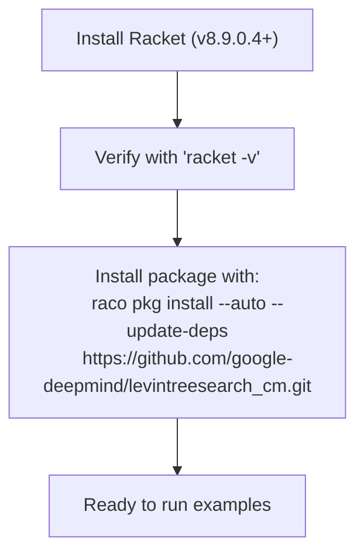
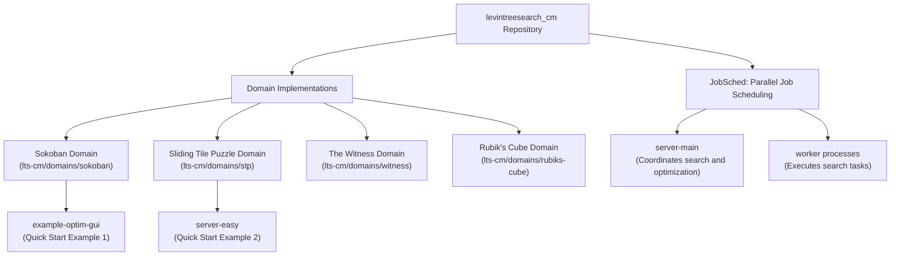
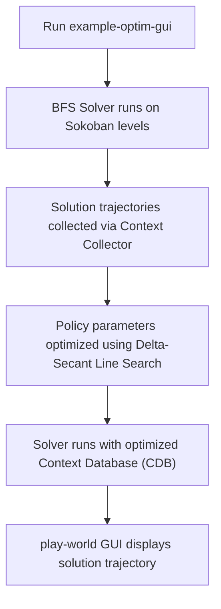
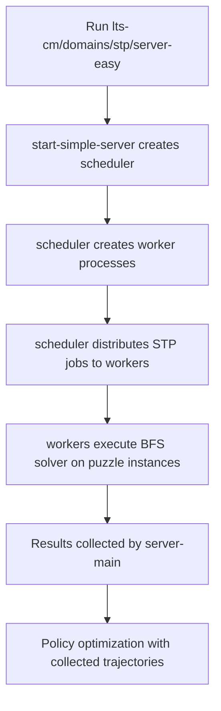

<!-- source: DeepWiki mcp.deepwiki.com · repo google-deepmind/levintreesearch_cm · page 1.1 Installation and Quick Start · fetched 2026-10-26 -->

# Installation and Quick Start

<details>
<summary>Relevant source files</summary>

The following files were used as context for generating this wiki page:

- [README.md](README.md)
- [lts-cm/img/domains.png](lts-cm/img/domains.png)

</details>


This page provides instructions for installing the levintreesearch_cm package and running basic examples to get started with the Levin Tree Search with Context Models (LTS-CM) system. For information about the algorithm and components, see [LTS-CM: Levin Tree Search with Context Models](#2).

## System Requirements

Before installing LTS-CM, ensure you have:

- **Racket programming language**: Version 8.9.0.4 or above

Sources: [README.md:14-17]()

## Installation Process

### 1. Install Racket

Download and install Racket from the Racket website (https://racket-lang.org). Installation steps vary by operating system:

#### Linux
- Download the installer
- In a terminal: `cd Downloads` then `sudo sh racket-….sh`
- Reply `y` to the first question (unix-like distribution)
- Press Enter for all following questions

#### Windows and MacOS
- Run the installer
- Configure the PATH environment variable to include the directory containing the `racket` and `raco` executables

Verify your installation by running `racket -v` in a terminal. Ensure the version is at least 8.9.0.4.

### 2. Install the levintreesearch_cm Package

Run the following command to install the package and all its dependencies:

```shell
raco pkg install --auto --update-deps https://github.com/google-deepmind/levintreesearch_cm.git
```

### Installation Process Diagram



Sources: [README.md:14-39]()

## Repository Components and Examples

The following diagram shows the main components and quick start examples:



Sources: [README.md:1-13](), [README.md:40-80]()

## Quick Start Examples

### Example 1: Sokoban with Optimization and GUI

This example demonstrates solving simple Sokoban levels, optimizing the policy, and visualizing results:

```shell
racket -l- lts-cm/domains/sokoban/example-optim-gui
```

The example workflow:



Sources: [README.md:41-56]()

### Example 2: Server-Worker Architecture with Sliding Tile Puzzle

This example demonstrates running multiple jobs in parallel using a server-worker architecture:

```shell
racket -l- lts-cm/domains/stp/server-easy
```

The execution process:



With a 4-core machine, this example typically takes less than 10 minutes to complete.

Sources: [README.md:58-69]()

## Command Line Options

The LTS-CM system supports several command line options:

| Option | Description | Default |
|--------|-------------|---------|
| `--log-base-dir <dir>` | Directory to store logs | `lts-cm-logs` in user's home directory |
| `--n-workers` | Number of workers for search | Number of CPUs divided by 2 |
| `--n-futures` | Number of workers for optimization | Number of CPUs divided by 2 |
| `--help` | Display help information | - |

Sources: [README.md:70-80]()

## Logging System

Each time a problem is solved, a file is written to the logs directory. This allows resuming from the last state if the process is interrupted. Logs are stored in a subdirectory named `lts-cm-logs` in the user's home directory, unless specified otherwise with `--log-base-dir`.

Sources: [README.md:70-74]()

## Reproducing the Paper's Results

To reproduce the results from the paper "Levin Tree Search with Context Models," run these commands in increasing order of computation time:

```shell
racket -l- lts-cm/domains/witness/server
racket -l- lts-cm/domains/sokoban/server
racket -l- lts-cm/domains/stp/server
racket -l- lts-cm/domains/sokoban/server-long
racket -l- lts-cm/domains/rubiks-cube/server
```

The first three commands take less than 2 hours each on a 64-core 2GHz machine, while the last one takes several days to complete.

Sources: [README.md:82-103]()

## Hardware Requirements

Reproducing the paper's results requires:
- Up to 2GB of RAM per worker
- Up to 5GB of free disk space per experiment

Sources: [README.md:83-85]()

## Next Steps

After getting started with these examples, you can:
1. Explore the other domain implementations
2. Try different problem instances
3. Experiment with command line options to tune performance
4. Learn about the LTS-CM architecture in the [Core Components](#2.1) page

Sources: [README.md:40-103]()

---

