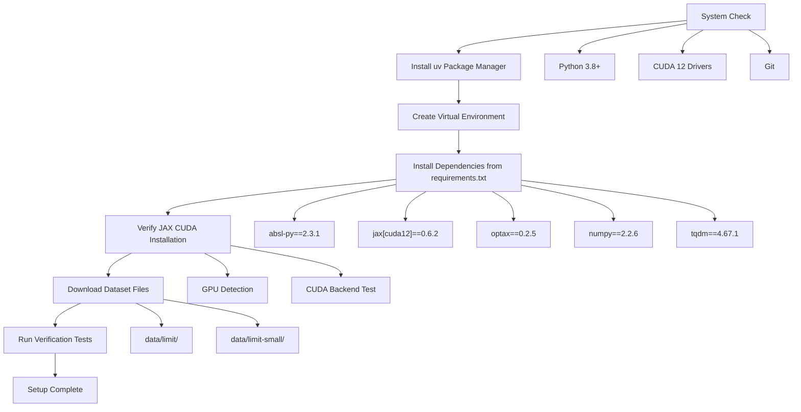
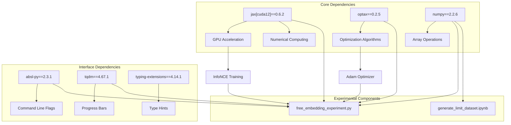
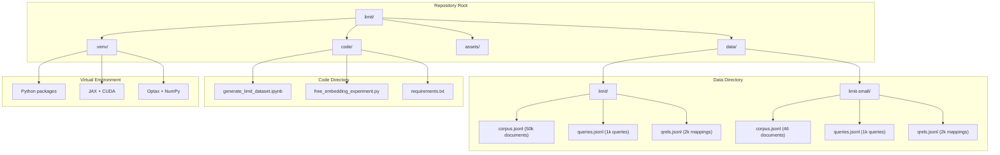

<!-- source: DeepWiki mcp.deepwiki.com · repo google-deepmind/limit · page 4 Installation and Setup · fetched 2026-10-26 -->

# Installation and Setup

<details>
<summary>Relevant source files</summary>

The following files were used as context for generating this wiki page:

- [README.md](README.md)
- [code/requirements.txt](code/requirements.txt)

</details>


This document provides comprehensive instructions for installing dependencies, configuring the environment, and preparing to work with the LIMIT dataset and free embedding experiments. This covers the technical setup process from a fresh system to running your first experiments.

For information about the dataset structure and generation process, see [Dataset Generation](#2.2). For details about running free embedding experiments after setup, see [Experiment Framework](#3.1).

## System Requirements

The LIMIT repository requires specific hardware and software configurations to run effectively, particularly for the computationally intensive free embedding experiments.

### Hardware Requirements

| Component | Requirement | Purpose |
|-----------|-------------|---------|
| GPU | CUDA-compatible GPU | JAX CUDA 12 acceleration for embedding optimization |
| RAM | 8GB minimum, 16GB recommended | Dataset loading and batch processing |
| Storage | 1GB free space | Dataset storage and experiment results |
| CPU | Modern multi-core processor | Parallel processing support |

### Software Prerequisites

The system requires Python 3.8+ and CUDA 12 drivers for GPU acceleration. The codebase uses JAX for high-performance numerical computing with GPU support.

**Installation Workflow**


Sources: [README.md:54-63](), [code/requirements.txt:1-7]()

## Package Manager Installation

The repository officially recommends using the `uv` package manager for dependency management and virtual environment creation. This provides faster installation and better dependency resolution than traditional pip-based workflows.

### Installing uv

Follow the [uv installation guide](https://docs.astral.sh/uv/getting-started/installation) for your operating system. Common installation methods:

```bash
# macOS and Linux
curl -LsSf https://astral.sh/uv/install.sh | sh

# Windows (PowerShell)
powershell -c "irm https://astral.sh/uv/install.ps1 | iex"

# Alternative: pip install
pip install uv
```

Sources: [README.md:54]()

## Environment Setup

### Virtual Environment Creation

Create an isolated Python environment to avoid dependency conflicts with other projects:

```bash
# Clone the repository
git clone https://github.com/google-deepmind/limit.git
cd limit

# Create virtual environment
uv venv

# Activate environment (Linux/macOS)
source .venv/bin/activate

# Activate environment (Windows)
.venv\Scripts\activate
```

### Dependency Installation

Install all required packages using the provided requirements file:

```bash
# Install dependencies
uv pip install -r https://raw.githubusercontent.com/google-deepmind/limit/refs/heads/main/code/requirements.txt
```

**Dependency Architecture**


Sources: [code/requirements.txt:1-7](), [README.md:62]()

## CUDA and JAX Configuration

### GPU Detection Verification

After installation, verify that JAX can detect your CUDA-capable GPU:

```bash
python -c "import jax; print(f'JAX devices: {jax.devices()}')"
```

Expected output should show CUDA devices if properly configured:
```
JAX devices: [cuda(id=0)]
```

### JAX Backend Configuration

JAX automatically selects the appropriate backend based on available hardware. The `jax[cuda12]` package includes CUDA 12 support for GPU acceleration, which is essential for the computationally intensive embedding optimization in `free_embedding_experiment.py`.

Sources: [code/requirements.txt:6]()

## Data Preparation

### Dataset Download

The LIMIT datasets are included in the repository and available in two variants:

**Repository Structure After Setup**


Sources: [README.md:24-36]()

### MTEB Format Validation

The datasets follow the MTEB (Massive Text Embedding Benchmark) format standard. Each dataset contains three JSON Lines files with specific schemas for corpus documents, queries, and relevance judgments.

## Installation Verification

### Basic Functionality Test

Verify your installation by running a simple JAX computation:

```bash
python -c "
import jax
import jax.numpy as jnp
import optax
import numpy as np

print('JAX version:', jax.__version__)
print('Available devices:', jax.devices())
print('NumPy version:', np.__version__)
print('Optax version:', optax.__version__)

# Test basic JAX operation
x = jnp.array([1, 2, 3])
y = jnp.sum(x)
print('JAX computation test:', y)
"
```

### Dataset Access Test

Verify that dataset files are accessible:

```bash
python -c "
import json
import os

# Check dataset files exist
datasets = ['data/limit', 'data/limit-small']
files = ['corpus.jsonl', 'queries.jsonl', 'qrels.jsonl']

for dataset in datasets:
    print(f'Checking {dataset}:')
    for file in files:
        path = os.path.join(dataset, file)
        exists = os.path.exists(path)
        if exists:
            with open(path, 'r') as f:
                lines = sum(1 for _ in f)
            print(f'  {file}: ✓ ({lines} lines)')
        else:
            print(f'  {file}: ✗ (missing)')
"
```

### Free Embedding Experiment Test

Test the core experiment functionality with minimal parameters:

```bash
cd code
python free_embedding_experiment.py \
  --d=32 \
  --k=2 \
  --critical_n_search=false \
  --n=10 \
  --iterations=100
```

This command runs a basic embedding experiment with 32-dimensional embeddings, 2 relevant documents per query, 10 total documents, and 100 optimization iterations.

Sources: [code/free_embedding_experiment.py:1]()

## Common Installation Issues

### CUDA Driver Mismatch

If JAX reports no CUDA devices despite having a GPU:
- Verify CUDA 12 drivers are installed
- Check GPU compatibility with CUDA 12
- Ensure no conflicting CUDA versions

### Memory Issues

For systems with limited RAM:
- Use the `limit-small` dataset for initial testing
- Reduce batch sizes in experiments
- Consider cloud computing options for large experiments

### Permission Errors

If encountering permission issues with `uv venv`:
- Ensure write permissions in the working directory
- Use `--python` flag to specify Python interpreter explicitly
- Consider user-local installation if system-wide fails

Sources: [README.md:52-63]()

## Next Steps

After successful installation and verification:

1. **Explore the dataset**: Examine the MTEB-formatted files in `data/limit/` and `data/limit-small/`
2. **Run dataset generation**: Open and execute `code/generate_limit_dataset.ipynb` to understand dataset creation
3. **Execute experiments**: Use `code/free_embedding_experiment.py` with various parameter configurations
4. **MTEB integration**: Set up MTEB framework for standardized evaluation workflows

For detailed information about dataset structure and generation, see [Dataset Structure and Format](#2.1). For comprehensive experiment configuration options, see [Experiment Framework](#3.1).

---

