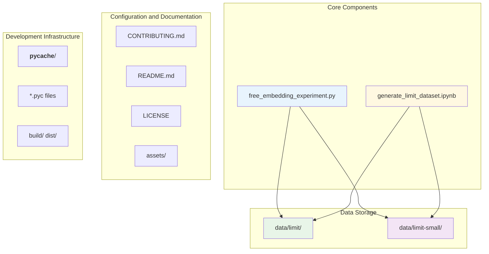
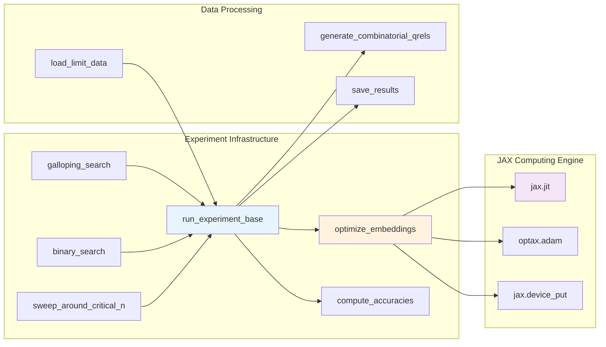

<!-- source: DeepWiki mcp.deepwiki.com · repo google-deepmind/limit · page 5 Development and Contributing · fetched 2026-10-26 -->

# Development and Contributing

<details>
<summary>Relevant source files</summary>

The following files were used as context for generating this wiki page:

- [.gitignore](.gitignore)
- [CONTRIBUTING.md](CONTRIBUTING.md)

</details>


This document provides comprehensive guidance for developers who want to contribute to the LIMIT repository, including contribution guidelines, development environment setup, and code organization. It covers the technical aspects of working with the codebase, understanding its architecture, and extending its functionality.

For information about installing and running the system as an end user, see [Installation and Setup](#4). For details about the theoretical background and dataset structure, see [LIMIT Dataset](#2) and [Free Embedding Experiments](#3).

## Contribution Guidelines

The LIMIT project follows standard open-source contribution practices with specific requirements for legal compliance and code quality.

### Contributor License Agreement

All contributions must be accompanied by a Contributor License Agreement (CLA). The copyright to your contribution remains with you or your employer, but the CLA grants permission to use and redistribute your contributions as part of the project. Visit https://cla.developers.google.com/ to view current agreements or sign a new one. Generally, you only need to submit a CLA once across Google projects.

### Code Review Process

All submissions require review through GitHub pull requests, including submissions by project members. The review process ensures code quality, architectural consistency, and adherence to the project's research goals.

### Community Standards

This project follows [Google's Open Source Community Guidelines](https://opensource.google/conduct), which establish expectations for respectful and constructive collaboration.

**Sources:** [CONTRIBUTING.md:1-26]()

## Development Environment Setup

The LIMIT repository requires a Python environment with JAX, scientific computing libraries, and Jupyter notebook support for dataset generation.

### Core Dependencies

| Component | Purpose | Key Libraries |
|-----------|---------|---------------|
| JAX/Optax | GPU-accelerated optimization | `jax`, `optax` |
| Scientific Computing | Data processing and analysis | `numpy`, `scipy` |
| Notebook Environment | Dataset generation pipeline | `jupyter`, `ipython` |
| Data Handling | JSON/JSONL processing | Standard library `json` |
| Command Line Interface | Experiment configuration | `absl-py` |

### Environment Configuration

The development environment should support:
- CUDA 12 for GPU acceleration (recommended)
- Python 3.8+ for modern language features
- Jupyter notebook execution for dataset generation
- Git LFS for large dataset files (if applicable)

**Sources:** [.gitignore:1-25]()

## Code Organization and Architecture

The repository follows a clear separation between dataset generation, experimental infrastructure, and data storage components.

### Repository Structure



**Sources:** [.gitignore:1-25]()

### Core Module Architecture



**Sources:** Based on system architecture from diagrams

## Extending the System

The LIMIT codebase is designed for extensibility in several key areas: dataset generation strategies, optimization algorithms, and evaluation metrics.

### Dataset Generation Extensions

The notebook-based dataset generation pipeline in `generate_limit_dataset.ipynb` can be extended with new qrel matrix generation strategies. The current implementation supports multiple approaches for creating query-document relevance mappings.

### Experiment Framework Extensions

The `free_embedding_experiment.py` script provides several extension points:

| Extension Point | Function/Class | Purpose |
|----------------|----------------|---------|
| Search Algorithms | `galloping_search`, `binary_search` | Critical N discovery strategies |
| Optimization Methods | `optimize_embeddings` | Embedding training algorithms |
| Loss Functions | InfoNCE implementation | Training objectives |
| Evaluation Metrics | `compute_accuracies` | Performance measurement |

### Configuration Management

The experiment system uses `absl.flags` for configuration management, allowing new parameters to be added through the standard flag definition pattern:

```python
flags.DEFINE_integer('new_parameter', default_value, 'Description')
```

## Testing and Validation

### Computational Validation

The free embedding experiments serve as both the primary research tool and validation mechanism. The three-phase search algorithm (`galloping_search`, `binary_search`, `sweep_around_critical_n`) provides robust validation of theoretical predictions.

### Dataset Integrity

The LIMIT dataset includes built-in validation through its qrels structure. The `limit-small` variant (46 documents) provides a manageable subset for development testing, while the full `limit` dataset (50,000 documents) enables comprehensive evaluation.

### Reproducibility Requirements

All experiments should be reproducible through:
- Deterministic random seed management
- Complete parameter logging
- Result caching with signature-based identification
- JSON serialization of all experimental outputs

**Sources:** Based on experimental framework architecture

## Development Workflow

### Code Style and Standards

Follow standard Python conventions and maintain consistency with the existing codebase:
- Use descriptive variable names that reflect the mathematical concepts
- Document functions with clear parameter descriptions
- Maintain separation between JAX computations and data processing
- Use type hints where beneficial for code clarity

### Performance Considerations

The codebase is optimized for high-performance computing:
- JAX functions should be JIT-compiled where possible
- Batch operations are preferred over iterative approaches
- GPU memory management should be considered for large experiments
- Early stopping mechanisms prevent unnecessary computation

### Integration Testing

Test changes against both dataset variants:
- `limit-small` for rapid development iteration
- `limit` for comprehensive validation
- Ensure MTEB compatibility is maintained
- Verify JSON serialization works correctly

**Sources:** [.gitignore:1-25](), [CONTRIBUTING.md:1-26]()

---

