# Page: Overview

# Overview

<details>
<summary>Relevant source files</summary>

The following files were used as context for generating this wiki page:

- [README.md](README.md)
- [assets/LIMIT.png](assets/LIMIT.png)

</details>


## Purpose and Scope

This document provides an overview of the LIMIT repository, which contains resources for studying the theoretical limitations of embedding-based retrieval systems. The repository implements research findings that demonstrate fundamental constraints in single-vector embedding approaches and provides both datasets and experimental tools to validate these theoretical limitations.

For detailed information about dataset generation and structure, see [Dataset Structure and Format](#2.1). For experimental methodology and computational infrastructure, see [Free Embedding Experiments](#3).

## Theoretical Foundation

The LIMIT repository is built on the theoretical principle that embedding-based retrieval systems have fundamental mathematical limitations. For any given embedding dimension `d`, there exist combinations of documents that cannot be retrieved by any query using single-vector representations. This theoretical insight drives both the dataset construction and experimental validation approaches implemented in this codebase.

The research demonstrates that state-of-the-art embedding models struggle with specifically constructed document combinations, highlighting inherent constraints in the single-vector embedding paradigm used by modern retrieval systems.

**Sources:** [README.md:6-10]()

## System Architecture

The LIMIT repository consists of three primary components that work together to validate theoretical limitations of embedding systems:

#### Core System Components

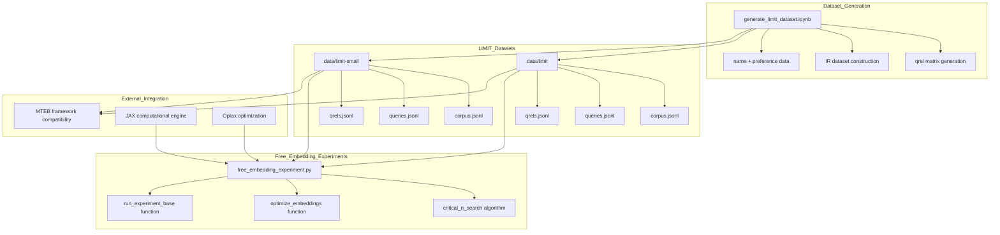

**Sources:** [README.md:24-47]()

## Dataset Architecture

The LIMIT dataset implements a structured approach to expose theoretical limitations through carefully constructed query-document relationships:

#### LIMIT Dataset File Structure

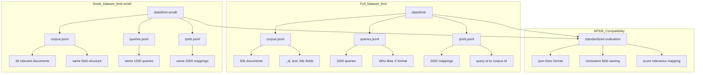

The dataset structure follows MTEB framework conventions, enabling standardized evaluation across different embedding models. The full dataset contains 50,000 documents while the small variant includes only the 46 documents that are relevant to the test queries, providing different scales for experimentation.

**Sources:** [README.md:26-36]()

## Experimental Framework

The repository includes a comprehensive experimental system for validating theoretical predictions through free embedding optimization:

| Component | Purpose | Implementation |
|-----------|---------|----------------|
| `free_embedding_experiment.py` | Critical N search algorithm | Three-phase search with JAX optimization |
| `optimize_embeddings` | Embedding optimization | InfoNCE loss with Adam optimizer |
| `run_experiment_base` | Single experiment execution | Combinatorial qrel generation and evaluation |
| Critical N Search | Find maximum retrievable documents | Galloping + binary search + sweep phases |

The experimental framework uses JAX for high-performance computation and implements a sophisticated search algorithm to identify the critical number of documents that can be simultaneously retrieved given embedding dimension constraints.

**Sources:** [README.md:46-47]()

## Dependencies and Requirements

The system requires specific computational dependencies for both dataset generation and experimental validation:

- **Dataset Generation**: Jupyter notebook environment with standard data science libraries
- **Free Embedding Experiments**: JAX, Optax, and CUDA 12 support for GPU acceleration
- **Evaluation Integration**: MTEB framework compatibility for standardized benchmarking

Installation follows the `uv` package manager workflow with requirements specified in `code/requirements.txt`.

**Sources:** [README.md:50-67]()

## Integration Ecosystem

The LIMIT repository integrates with established evaluation frameworks and computational tools:

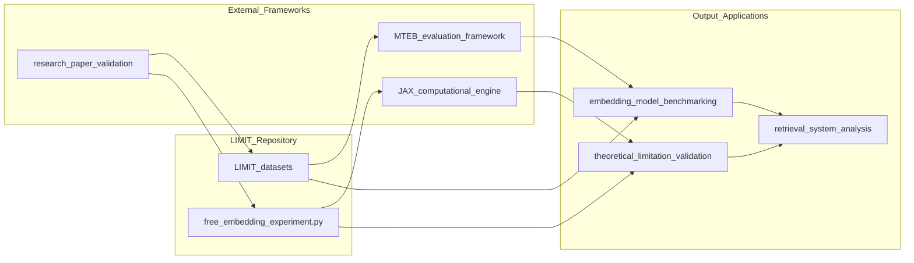

This integration enables researchers to evaluate embedding models using standardized metrics while validating theoretical predictions about fundamental limitations in embedding-based retrieval systems.

**Sources:** [README.md:67](), [README.md:3-10]()

---

# Page: LIMIT Dataset

# LIMIT Dataset

<details>
<summary>Relevant source files</summary>

The following files were used as context for generating this wiki page:

- [README.md](README.md)

</details>


This document covers the structure, organization, and usage of the LIMIT dataset - a theoretically-grounded information retrieval dataset designed to expose fundamental limitations of single-vector embedding models. The dataset demonstrates that for any given embedding dimension, there exist combinations of documents that cannot be retrieved by any query using current embedding paradigms.

For information about generating the LIMIT dataset from scratch, see [Dataset Generation](#2.2). For details about the experimental validation using free embeddings, see [Free Embedding Experiments](#3).

## Overview and Theoretical Foundation

The LIMIT dataset implements theoretical principles showing that embedding-based retrieval systems have fundamental mathematical limitations. The dataset construction follows a combinatorial approach where documents represent people with preferences, and queries ask "Who likes X?" - creating scenarios where certain document combinations become theoretically unretrievable given embedding dimension constraints.

The dataset serves as a stress test for state-of-the-art embedding models, demonstrating practical manifestations of these theoretical limitations through empirical evaluation.

## Dataset Architecture

### File Organization Structure

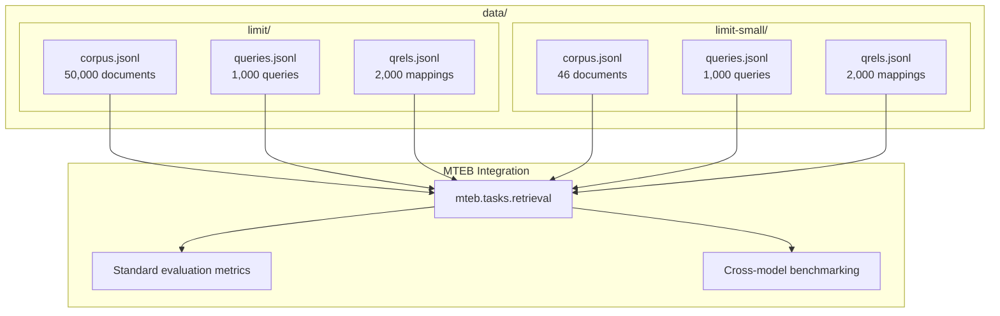

**Dataset File Structure**

Sources: [README.md:24-36]()

### Dataset Variants

The LIMIT dataset provides two variants optimized for different use cases:

| Variant | Documents | Queries | Relevance Mappings | Use Case |
|---------|-----------|---------|-------------------|----------|
| **Full** (`data/limit/`) | 50,000 | 1,000 | 2,000 | Complete evaluation, production testing |
| **Small** (`data/limit-small/`) | 46 | 1,000 | 2,000 | Development, debugging, fast iteration |

The small variant contains only the documents that are relevant to at least one query, making it ideal for rapid prototyping and development workflows while maintaining the same query and relevance structure.

Sources: [README.md:32-36]()

## MTEB Compatibility and Integration

### Standard Format Compliance

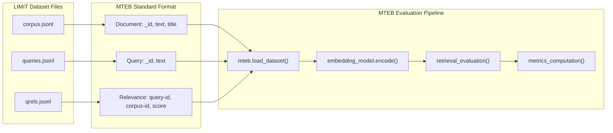

**MTEB Integration Flow**

The LIMIT dataset follows MTEB conventions exactly, ensuring compatibility with the standard evaluation framework. Each file uses JSON Lines format with specific field requirements that align with MTEB's expectations for retrieval tasks.

Sources: [README.md:24-31](), [README.md:67-68]()

## Data Format Specifications

### Corpus Document Structure

Each document in `corpus.jsonl` represents a person with specific preferences:

```json
{
  "_id": "doc_12345",
  "text": "Person profile with preference information",
  "title": ""
}
```

The `title` field remains empty as per MTEB requirements, with all content contained in the `text` field.

### Query Structure

Each query in `queries.jsonl` follows the pattern "Who likes X?":

```json
{
  "_id": "query_001", 
  "text": "Who likes [specific item]?"
}
```

### Relevance Mappings

The `qrels.jsonl` file contains query-document relevance mappings:

```json
{
  "query-id": "query_001",
  "corpus-id": "doc_12345", 
  "score": 1
}
```

The `score` field indicates binary relevance (1 = relevant, 0 = not relevant).

Sources: [README.md:28-31]()

## Dataset Statistics and Scale

### Numerical Overview

```mermaid
graph TD
    subgraph QuerySpace["Query Space"]
        A["1,000 queries<br/>Who likes X? format"]
    end
    
    subgraph DocumentSpace["Document Space"] 
        B["Full: 50,000 documents<br/>Small: 46 documents"]
        C["Person profiles<br/>Preference information"]
    end
    
    subgraph RelevanceSpace["Relevance Space"]
        D["2,000 query-document<br/>relevance mappings"]
        E["Binary relevance scoring<br/>score ∈ {0, 1}"]
    end
    
    subgraph TheoreticalFoundation["Theoretical Constraints"]
        F["Embedding dimension limits<br/>Combinatorial impossibility"]
        G["Critical N discovery<br/>Maximum retrievable docs"]
    end
    
    A --> D
    B --> D
    D --> E
    
    F --> A
    F --> B
    G --> F
```

**Dataset Scale and Theoretical Constraints**

The dataset's scale is specifically designed to demonstrate theoretical limitations while remaining computationally tractable for evaluation. The 2,000 relevance mappings create scenarios where embedding models must handle complex preference combinations that exceed their representational capacity.

Sources: [README.md:6-10](), [README.md:28-31]()

## Integration with Experimental Framework

The LIMIT dataset serves as input for both standard MTEB evaluation and specialized free embedding experiments. The dataset's structure enables direct integration with the experimental pipeline for discovering critical N values - the maximum number of documents that can be theoretically retrieved given embedding dimension constraints.

The consistent file format across both variants ensures seamless switching between development (small) and production (full) evaluation scenarios without requiring code changes in evaluation pipelines.

Sources: [README.md:41-47](), [README.md:67-68]()

---

# Page: Dataset Structure and Format

# Dataset Structure and Format

<details>
<summary>Relevant source files</summary>

The following files were used as context for generating this wiki page:

- [data/limit-small/corpus.jsonl](data/limit-small/corpus.jsonl)
- [data/limit-small/qrels.jsonl](data/limit-small/qrels.jsonl)
- [data/limit-small/queries.jsonl](data/limit-small/queries.jsonl)
- [data/limit/corpus.jsonl](data/limit/corpus.jsonl)
- [data/limit/qrels.jsonl](data/limit/qrels.jsonl)
- [data/limit/queries.jsonl](data/limit/queries.jsonl)

</details>


This document describes the file formats, structure, and relationships within the LIMIT dataset. The LIMIT dataset is designed as an information retrieval benchmark that exposes theoretical limitations of embedding-based retrieval systems.

For information about how the dataset is generated, see [Dataset Generation](#2.2). For documentation of the experimental framework that uses this dataset, see [Free Embedding Experiments](#3).

## Dataset Overview

The LIMIT dataset follows the MTEB (Massive Text Embedding Benchmark) standard format and consists of three primary components stored as JSONL files:

- **corpus.jsonl**: Document collection containing person profiles with preference lists
- **queries.jsonl**: Information retrieval queries asking "Who likes X?"  
- **qrels.jsonl**: Query-document relevance judgments mapping queries to relevant documents

The dataset is available in two variants:
- **LIMIT Full** (`data/limit/`): 50,000 documents, 1,000 queries, ~2,000 relevance judgments
- **LIMIT Small** (`data/limit-small/`): 46 documents, 1,000 queries, ~2,000 relevance judgments

## Dataset File Structure

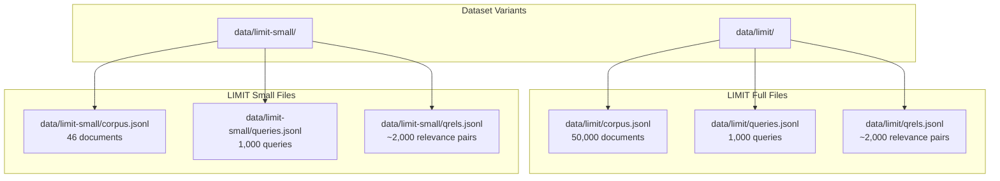

Sources: [data/limit-small/corpus.jsonl:1-47](), [data/limit-small/queries.jsonl:1-1000](), [data/limit-small/qrels.jsonl:1-2000](), [data/limit/corpus.jsonl:1-50]()

## Corpus Format

The `corpus.jsonl` file contains document records, with each line representing a single JSON object following this schema:

| Field | Type | Description | Required |
|-------|------|-------------|----------|
| `_id` | string | Unique document identifier (person name) | Yes |
| `title` | string | Document title (empty in LIMIT dataset) | Yes |
| `text` | string | Document content describing person's preferences | Yes |

### Example Corpus Entry

```json
{
  "_id": "Geneva Durben",
  "title": "",
  "text": "Geneva Durben likes Quokkas, River Otters, Tapirs, Asymmetry, Snow Leopards, Hydrangeas, Crocheting, Symphonies, Bassoons, Pangolins, Limes, Mosaic, Creativity, Licorice, Spinach, Chairs, Horror Literature, Scuba Diving, Glaciers, Cartography, Alternative Rock, Oceanic Trenches, Barley, Cheerios, Sapphires, Parakeets, The Aztec Empire, Traveling, Candle Making, Shasta Daisies, Patterns, Disco Music, White Pepper, Slide Rules, Halibut, Giant Isopods, Praying Mantises, Fables, Alligators, Caracals, Joshua Trees, Pansies, Soy Sauce, Cards Against Humanity and Elm Trees."
}
```

The document text follows a consistent pattern: "{Person Name} likes {comma-separated list of items}". Each document represents a person's complete preference profile.

Sources: [data/limit-small/corpus.jsonl:1-2]()

## Queries Format

The `queries.jsonl` file contains query records, with each line representing a single JSON object:

| Field | Type | Description | Required |
|-------|------|-------------|----------|
| `_id` | string | Unique query identifier (format: "query_N") | Yes |
| `text` | string | Natural language query text | Yes |

### Example Query Entries

```json
{"_id": "query_0", "text": "Who likes Joshua Trees?"}
{"_id": "query_1", "text": "Who likes Slide Rules?"}
{"_id": "query_2", "text": "Who likes Oceanic Trenches?"}
```

All queries follow the pattern "Who likes {item}?" where `{item}` corresponds to preferences mentioned in the corpus documents. The dataset contains 1,000 unique queries across both variants.

Sources: [data/limit-small/queries.jsonl:1-5]()

## Query Relevance Format

The `qrels.jsonl` file contains query-document relevance judgments:

| Field | Type | Description | Required |
|-------|------|-------------|----------|
| `query-id` | string | Query identifier matching `queries.jsonl` | Yes |
| `corpus-id` | string | Document identifier matching `corpus.jsonl` | Yes |
| `score` | integer | Relevance score (1 = relevant, 0 = not relevant) | Yes |

### Example Qrels Entries

```json
{"query-id": "query_0", "corpus-id": "Geneva Durben", "score": 1}
{"query-id": "query_0", "corpus-id": "Dorathea Bastress", "score": 1}
{"query-id": "query_1", "corpus-id": "Geneva Durben", "score": 1}
```

The relevance judgments create binary relationships: a document is relevant to a query if the person described in the document likes the item mentioned in the query.

Sources: [data/limit-small/qrels.jsonl:1-5]()

## Data Relationship Model

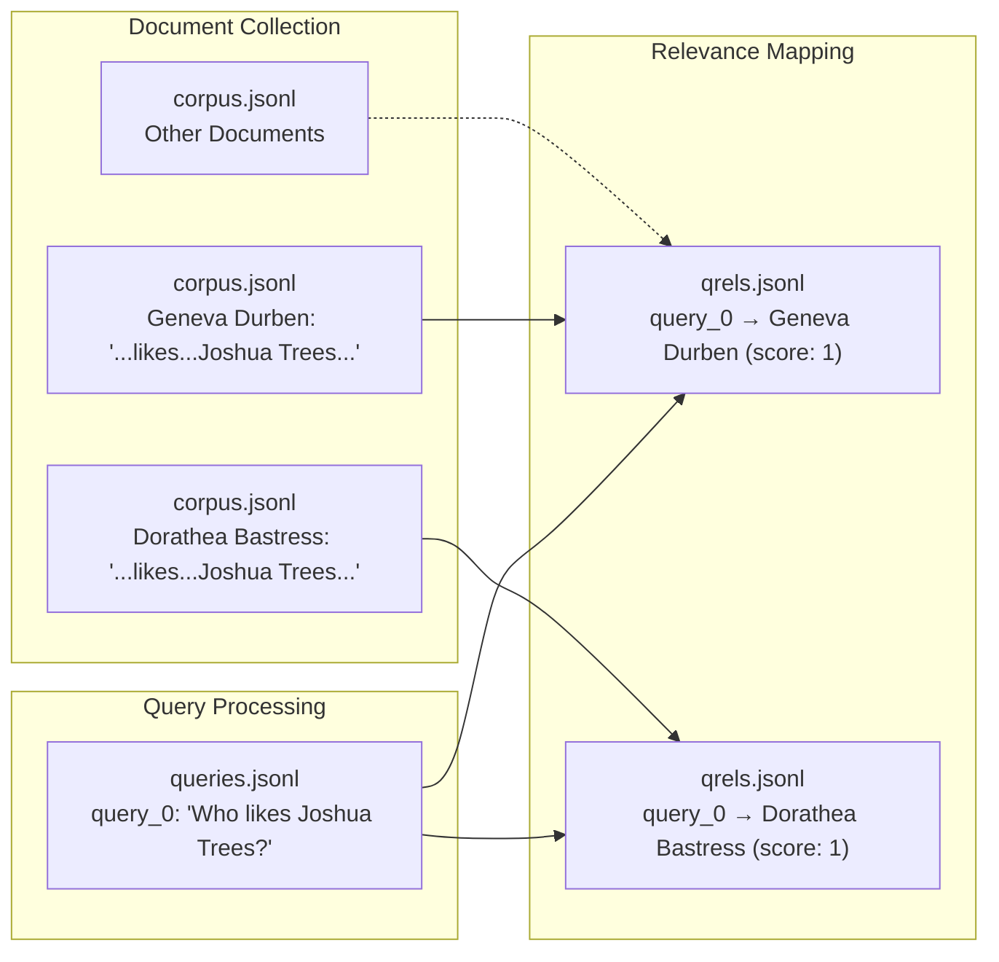

Sources: [data/limit-small/queries.jsonl:1](), [data/limit-small/corpus.jsonl:1-2](), [data/limit-small/qrels.jsonl:1-2]()

## MTEB Compatibility

The LIMIT dataset implements the standard MTEB retrieval task format:

### MTEB Field Mapping

| MTEB Standard | LIMIT Implementation | Description |
|---------------|---------------------|-------------|
| `corpus` | `corpus.jsonl` | Document collection with `_id`, `title`, `text` |
| `queries` | `queries.jsonl` | Query collection with `_id`, `text` |
| `qrels` | `qrels.jsonl` | Relevance judgments with `query-id`, `corpus-id`, `score` |

### Evaluation Metrics

The dataset supports standard MTEB retrieval metrics:
- **nDCG@k**: Normalized Discounted Cumulative Gain
- **MAP**: Mean Average Precision  
- **Recall@k**: Recall at cutoff k
- **Precision@k**: Precision at cutoff k

The binary relevance scores (`score: 1`) indicate perfect relevance for matching query-document pairs.

Sources: [data/limit-small/corpus.jsonl:1](), [data/limit-small/queries.jsonl:1](), [data/limit-small/qrels.jsonl:1]()

## Dataset Variants Comparison

| Aspect | LIMIT Full | LIMIT Small |
|--------|------------|-------------|
| **Documents** | 50,000 | 46 |
| **Queries** | 1,000 | 1,000 |
| **Relevance Pairs** | ~2,000 | ~2,000 |
| **Purpose** | Full-scale evaluation | Development/debugging |
| **File Size** | ~32MB corpus | ~2KB corpus |

### LIMIT Small Characteristics

The small variant contains only the 46 documents that are relevant to at least one query, making it useful for:
- Rapid development iteration
- Algorithm debugging  
- Understanding dataset structure
- Computational efficiency during development

All 1,000 queries and their relevance judgments are preserved in both variants, maintaining the theoretical properties that make the dataset challenging for embedding-based retrieval.

Sources: [data/limit-small/corpus.jsonl:1-47](), [data/limit/corpus.jsonl:1-10]()

## Data Integrity and Validation

The dataset maintains referential integrity across its components:

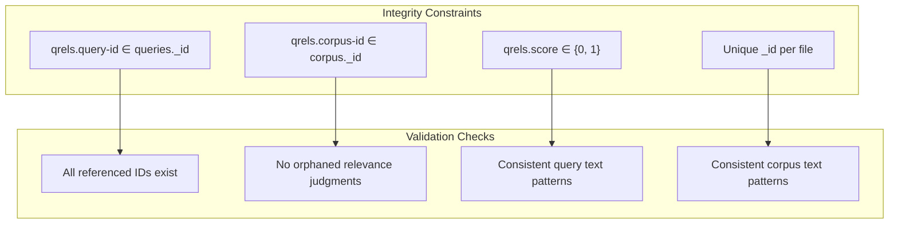

### Key Constraints

1. **Query ID References**: Every `query-id` in `qrels.jsonl` must exist in `queries.jsonl`
2. **Corpus ID References**: Every `corpus-id` in `qrels.jsonl` must exist in `corpus.jsonl`  
3. **Binary Relevance**: All relevance scores are binary (0 or 1)
4. **Unique Identifiers**: All `_id` fields are unique within their respective files

Sources: [data/limit-small/qrels.jsonl:1-10](), [data/limit-small/queries.jsonl:1-5](), [data/limit-small/corpus.jsonl:1-5]()

---

# Page: Dataset Generation

# Dataset Generation

<details>
<summary>Relevant source files</summary>

The following files were used as context for generating this wiki page:

- [README.md](README.md)
- [code/generate_limit_dataset.ipynb](code/generate_limit_dataset.ipynb)

</details>


## Purpose and Scope

This document explains the dataset generation process for the LIMIT dataset, which creates theoretically grounded information retrieval datasets designed to expose fundamental limitations of embedding-based retrieval systems. The generation process produces datasets in MTEB-compatible format with configurable relevance patterns that stress-test embedding models based on theoretical principles.

For information about the dataset structure and file formats, see [Dataset Structure and Format](#2.1). For details about using the generated datasets in experiments, see [Experiment Framework](#3.1).

## Generation Overview

The LIMIT dataset generation process follows a systematic approach to create synthetic information retrieval datasets where documents represent people with preferences and queries ask "Who likes X?" The theoretical foundation ensures that certain document combinations cannot be retrieved simultaneously by any embedding-based system, regardless of optimization.

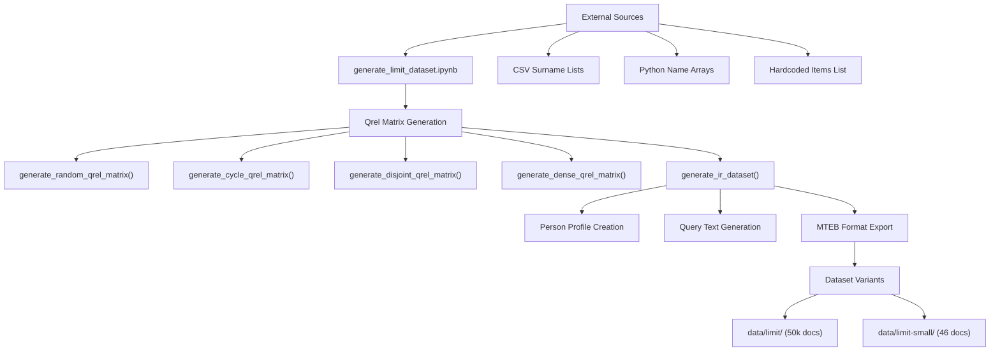

**Dataset Generation Process Flow**

The generation pipeline transforms external name sources and predefined preference items into structured IR datasets through configurable relevance matrix strategies.

Sources: [code/generate_limit_dataset.ipynb:1-2464](), [README.md:40-47]()

## Name and Item Sources

The generation process requires two primary data sources: names for creating person identities and items that people can express preferences about.

### Name Acquisition

Names are sourced dynamically from external repositories to ensure diversity:

| Source Type | URL Pattern | Processing Function |
|-------------|-------------|-------------------|
| Surnames | gist.githubusercontent.com CSV | `pd.read_csv()` |
| First Names | gist.githubusercontent.com Python array | `exec(python_content)` |

The system downloads approximately 1,000 unique surnames and 2,738 unique first names, then generates unique combinations for person profiles.

### Items to Like

The system includes a comprehensive hardcoded list of 1,972 preference items across categories:

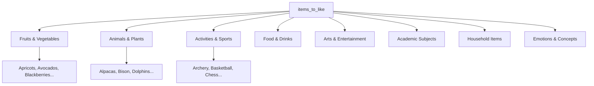

**Item Category Distribution in items_to_like**

Sources: [code/generate_limit_dataset.ipynb:62-94](), [code/generate_limit_dataset.ipynb:124-1973]()

## Qrel Matrix Generation Strategies

The system provides four distinct strategies for generating query-document relevance matrices, each designed to test different theoretical aspects of embedding limitations.

### Strategy Implementations

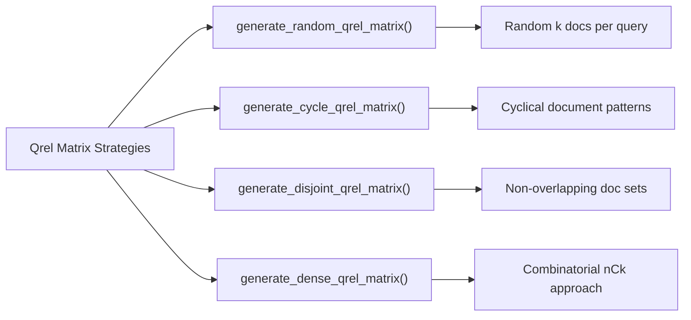

**Qrel Matrix Generation Function Architecture**

### Dense Matrix Strategy

The `generate_dense_qrel_matrix()` function implements the theoretically motivated approach:

1. **Minimum Document Calculation**: Finds smallest `n` where `nCk >= num_queries`
2. **Combinatorial Generation**: Creates all combinations of `k` documents from first `n` documents  
3. **Matrix Population**: Maps combinations to binary relevance matrix

This strategy ensures maximum theoretical stress on embedding systems by requiring retrieval of all possible k-combinations from a minimal document set.

### Matrix Validation

Each strategy includes validation logic:

| Strategy | Validation Check | Error Condition |
|----------|-----------------|-----------------|
| Random | `num_docs >= k_per_query` | Insufficient documents |
| Cycle | `num_queries <= num_docs` | Warning only |
| Disjoint | `num_queries * k_per_query <= num_docs` | Hard requirement |
| Dense | `nCk calculation feasible` | Mathematical impossibility |

Sources: [code/generate_limit_dataset.ipynb:2007-2143]()

## IR Dataset Construction

The `generate_ir_dataset()` function transforms qrel matrices into complete IR datasets with person profiles, natural language queries, and relevance judgments.

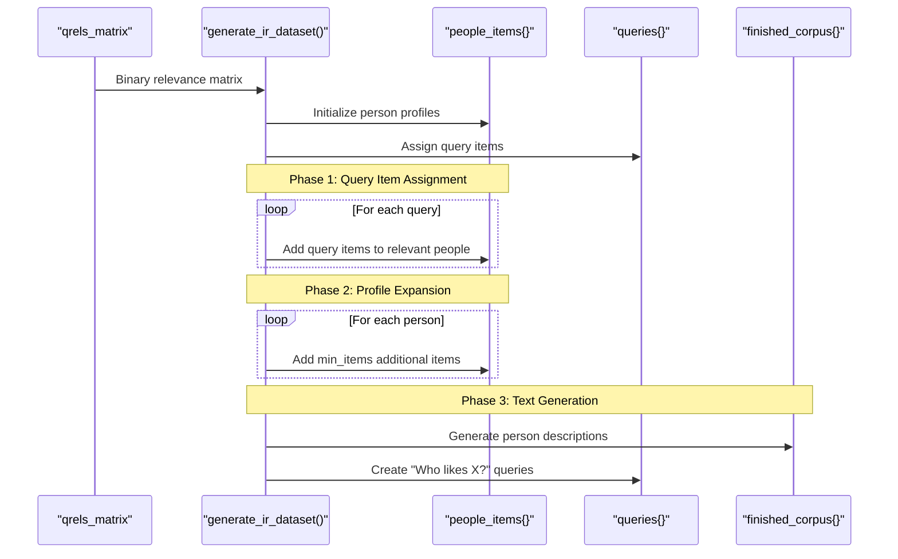

**IR Dataset Construction Sequence**

### Profile Generation Process

The system creates person profiles through conflict-aware item assignment:

1. **Query Item Assignment** [code/generate_limit_dataset.ipynb:2197-2204](): Assigns query-specific items to all relevant people based on qrel matrix
2. **Profile Expansion** [code/generate_limit_dataset.ipynb:2210-2238](): Adds `min_items` additional items while avoiding conflicts
3. **Name Mapping** [code/generate_limit_dataset.ipynb:2269-2278](): Maps `person_id` to generated names and creates natural language profiles

### Text Template Generation

The system uses consistent templates for dataset components:

| Component | Template Pattern | Example |
|-----------|-----------------|---------|
| Queries | `"Who likes {item}?"` | `"Who likes Joshua Trees?"` |
| Corpus | `"{name} likes {items} and {last_item}."` | `"John Smith likes apples, oranges and bananas."` |
| Qrels | `{query_id: {person_name: 1}}` | `{"query_0": {"John Smith": 1}}` |

Sources: [code/generate_limit_dataset.ipynb:2170-2289]()

## Dataset Variants

The generation system produces two primary dataset variants optimized for different use cases:

### LIMIT Small Configuration

```python
qrels_small = generate_dense_qrel_matrix(num_docs=46, num_queries=1000, k_per_query=2)
ir_dataset_small = generate_ir_dataset(items_to_like, qrels_small, min_items=45)
```

- **Documents**: 46 (minimum for 1000 combinations of 2)
- **Queries**: 1000  
- **Relevance Judgments**: 2000 (2 per query)
- **Profile Size**: 45+ items per person

### LIMIT Full Configuration

The full dataset scales to 50,000 documents while maintaining the same query structure, providing comprehensive evaluation coverage for production embedding systems.

### Theoretical Properties

Both variants guarantee specific mathematical properties:

- **Completeness**: All possible k-combinations represented in query set
- **Stress Testing**: Optimal adversarial conditions for embedding systems
- **Consistency**: Deterministic generation with fixed random seed (42)

Sources: [code/generate_limit_dataset.ipynb:2313-2319](), [README.md:32-36]()

---

# Page: Free Embedding Experiments

# Free Embedding Experiments

<details>
<summary>Relevant source files</summary>

The following files were used as context for generating this wiki page:

- [README.md](README.md)
- [code/free_embedding_experiment.py](code/free_embedding_experiment.py)

</details>


This document covers the free embedding experiment system designed to find the theoretical limits of embedding-based retrieval. The system conducts optimization experiments to determine the critical N value - the maximum number of documents that can be successfully retrieved for a given embedding dimension and relevance structure. 

For information about the LIMIT dataset used in these experiments, see [LIMIT Dataset](#2). For details about the computational infrastructure and JAX optimization stack, see [Computational Infrastructure](#3.2).

## Purpose and Core Concept

The free embedding experiment system implements a search algorithm to find the "critical N" - the maximum number of documents N for which embeddings of dimension d can achieve perfect retrieval accuracy when each query has exactly k relevant documents. This validates theoretical limitations of embedding-based retrieval by finding the empirical breaking point through unconstrained optimization.

The system uses InfoNCE loss with full-batch training to learn optimal query and document embeddings, testing whether perfect retrieval is achievable for specific parameter combinations.

Sources: [code/free_embedding_experiment.py:16-37](), [README.md:46-47]()

## Critical N Search Algorithm

The search process uses a three-phase algorithm implemented in `_run_critical_n_search_for_config` to efficiently locate the critical N value:

### Multi-Phase Search Strategy

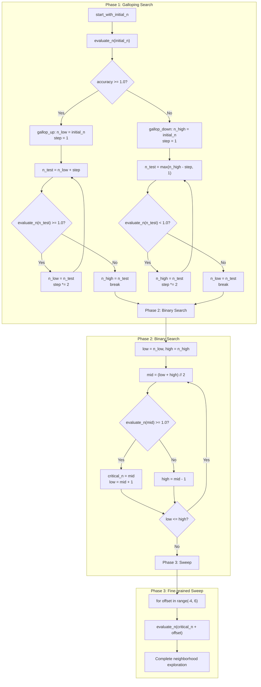

Sources: [code/free_embedding_experiment.py:576-676]()

### Evaluation Function

The `_evaluate_n` function handles experiment execution and result caching:

| Component | Function | Implementation |
|-----------|----------|----------------|
| **Signature-based Caching** | `get_params_signature` | Avoids redundant computation by checking processed signatures |
| **Experiment Execution** | `_process_experiment_and_save` | Runs single experiment and saves results incrementally |
| **Accuracy Selection** | `_pick_best_accuracy` | Chooses best accuracy signal from multiple metrics |

Sources: [code/free_embedding_experiment.py:602-625](), [code/free_embedding_experiment.py:591-600]()

## Experiment Execution Framework

### Single Experiment Workflow

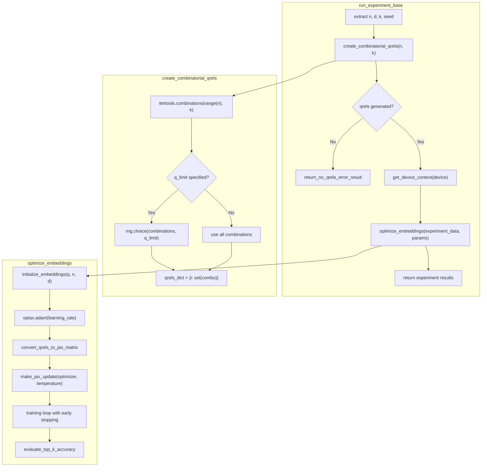

Sources: [code/free_embedding_experiment.py:496-535](), [code/free_embedding_experiment.py:123-151](), [code/free_embedding_experiment.py:363-493]()

### JAX Optimization Pipeline

The core optimization uses JAX for GPU-accelerated training with InfoNCE loss:


Sources: [code/free_embedding_experiment.py:348-360](), [code/free_embedding_experiment.py:279-311](), [code/free_embedding_experiment.py:250-276]()

## Configuration and Command-Line Interface

### Core Parameters

The experiment system uses `absl.flags` for configuration management:

| Flag | Type | Purpose | Default |
|------|------|---------|---------|
| `--d` | integer | Embedding dimension | Required |
| `--k` | integer | Relevant documents per query | Required |
| `--enable_critical_n_search` | integer | Starting N for search | Required |
| `--results_output_path` | string | JSON output path | None |
| `--device` | string | Compute device (gpu/tpu/cpu) | "gpu" |
| `--learning_rate` | float | Optimizer learning rate | 0.01 |
| `--num_iterations` | integer | Maximum training iterations | 100000 |
| `--temperature` | float | InfoNCE temperature parameter | 0.1 |

Sources: [code/free_embedding_experiment.py:682-723](), [code/free_embedding_experiment.py:58-71]()

### Usage Example

```bash
python free_embedding_experiment.py \
  --d=4 --k=2 \
  --enable_critical_n_search=11 \
  --results_output_path='d=4_k=2.json' \
  --device=gpu
```

Sources: [code/free_embedding_experiment.py:33-36]()

## Results Management and Output

### Result Structure and Serialization

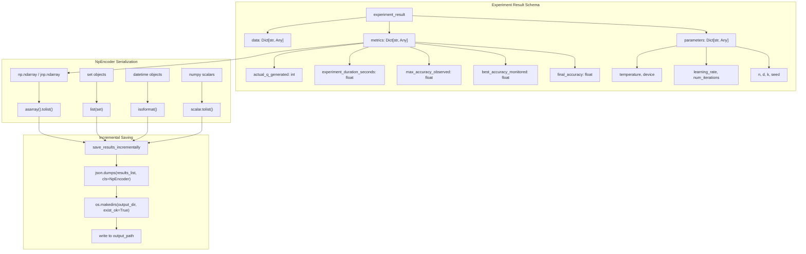

Sources: [code/free_embedding_experiment.py:97-115](), [code/free_embedding_experiment.py:216-229](), [code/free_embedding_experiment.py:526-534]()

### Early Stopping and Monitoring

The optimization includes sophisticated early stopping with multiple monitoring options:

| Parameter | Purpose | Default |
|-----------|---------|---------|
| `early_stopping_patience` | Iterations to wait before stopping | 1000 |
| `early_stopping_min_delta` | Minimum improvement threshold | 0.00001 |
| `early_stopping_monitor_metric` | Metric to monitor ("loss" or "accuracy") | "loss" |
| `early_stopping_restore_best_weights` | Restore best weights after stopping | False |

The system tracks multiple accuracy signals: `final_accuracy`, `best_accuracy_monitored`, `max_accuracy_observed`, and `last_logged_accuracy` to provide robust signals for the critical N search logic.

Sources: [code/free_embedding_experiment.py:67-70](), [code/free_embedding_experiment.py:412-475](), [code/free_embedding_experiment.py:591-600]()

---

# Page: Experiment Framework

# Experiment Framework

<details>
<summary>Relevant source files</summary>

The following files were used as context for generating this wiki page:

- [code/free_embedding_experiment.py](code/free_embedding_experiment.py)

</details>


This document covers the free embedding experiment system that implements a three-phase critical N search algorithm to find theoretical limitations of embedding-based retrieval. The framework executes combinatorial experiments to determine the maximum number of documents that can be successfully retrieved given specific embedding dimensions and relevance requirements.

For information about the underlying computational infrastructure and JAX optimization details, see [Computational Infrastructure](#3.2). For dataset structure and generation, see [Dataset Structure and Format](#2.1).

## Purpose and System Overview

The experiment framework in [code/free_embedding_experiment.py:1-808]() implements a systematic approach to discovering critical N values - the maximum number of documents for which embeddings of dimension `d` can successfully distinguish `k` relevant documents for every possible query. The system uses a multi-phase search strategy combined with InfoNCE loss optimization to find these theoretical boundaries.

**Core System Architecture**

```mermaid
flowchart TD
    CLI["`absl.flags`<br/>Command Line Interface"] --> SearchController["`_run_critical_n_search_for_config`<br/>Multi-Phase Search Controller"]
    
    SearchController --> GallopPhase["`Phase 1: Galloping Search`<br/>Exponential range finding"]
    SearchController --> BinaryPhase["`Phase 2: Binary Search`<br/>Precise critical point location"]
    SearchController --> SweepPhase["`Phase 3: Sweep`<br/>Neighborhood exploration"]
    
    GallopPhase --> ExperimentBase["`run_experiment_base`<br/>Single Experiment Execution"]
    BinaryPhase --> ExperimentBase
    SweepPhase --> ExperimentBase
    
    ExperimentBase --> QrelsGen["`create_combinatorial_qrels`<br/>Query-Document Relevance Generation"]
    ExperimentBase --> OptimizeEmb["`optimize_embeddings`<br/>JAX InfoNCE Training Loop"]
    
    OptimizeEmb --> JAXUpdate["`make_jax_update`<br/>JIT Compiled Gradient Updates"]
    OptimizeEmb --> EarlyStopping["`Early Stopping Logic`<br/>Patience-based termination"]
    
    ExperimentBase --> ResultsMgmt["`save_results_incrementally`<br/>JSON Persistence System"]
    ResultsMgmt --> Caching["`get_params_signature`<br/>Experiment Deduplication"]
```

Sources: [code/free_embedding_experiment.py:576-676](), [code/free_embedding_experiment.py:496-536](), [code/free_embedding_experiment.py:363-494]()

## Three-Phase Critical N Search Algorithm

The framework implements a sophisticated search strategy to efficiently locate critical N values across potentially large search spaces. The algorithm balances exploration speed with precision through three distinct phases.

**Search Algorithm Flow**

```mermaid
graph TD
    Start["`Initial N Parameter`<br/>enable_critical_n_search flag"] --> PhaseDecision{"`_evaluate_n(initial_n) >= 1.0`<br/>Initial accuracy check"}
    
    PhaseDecision -->|"≥ 1.0"| GallopUp["`Gallop Upward`<br/>n_low = initial_n, step *= 2"]
    PhaseDecision -->|"< 1.0"| GallopDown["`Gallop Downward`<br/>n_high = initial_n, step *= 2"]
    
    GallopUp --> GallopUpLoop["`while _evaluate_n(n_low + step) >= 1.0:`<br/>Continue exponential growth"]
    GallopUpLoop --> GallopUpLoop
    GallopUpLoop --> BinarySearch["`Binary Search Phase`<br/>low = n_low, high = n_high"]
    
    GallopDown --> GallopDownLoop["`while n_high > min_boundary:`<br/>Continue exponential decay"]
    GallopDownLoop --> GallopDownLoop
    GallopDownLoop --> BinarySearch
    
    BinarySearch --> BinaryLoop["`while low <= high:`<br/>mid = (low + high) // 2"]
    BinaryLoop --> BinaryCheck{"`_evaluate_n(mid) >= 1.0`"}
    BinaryCheck -->|"≥ 1.0"| UpdateLow["`critical_n = mid`<br/>low = mid + 1"]
    BinaryCheck -->|"< 1.0"| UpdateHigh["`high = mid - 1`"]
    UpdateLow --> BinaryLoop
    UpdateHigh --> BinaryLoop
    BinaryLoop --> SweepPhase["`Fine-grained Sweep`<br/>for offset in range(-4, 6)"]
    
    SweepPhase --> Complete["`Search Complete`<br/>All results cached"]
```

Sources: [code/free_embedding_experiment.py:627-676]()

### Phase 1: Galloping Search

The galloping phase quickly establishes bounds for the critical N by exponentially increasing or decreasing the search step size. This approach efficiently handles cases where the critical N is far from the initial guess.

| Phase | Purpose | Step Strategy | Termination |
|-------|---------|---------------|-------------|
| **Upward Gallop** | Find upper bound when initial_n succeeds | `step *= 2` while accuracy ≥ 1.0 | First failure sets `n_high` |
| **Downward Gallop** | Find lower bound when initial_n fails | `step *= 2` while accuracy < 1.0 | First success sets `n_low` |

The `_evaluate_n` function at [code/free_embedding_experiment.py:602-626]() handles experiment execution with intelligent result caching to avoid redundant computations.

Sources: [code/free_embedding_experiment.py:627-653]()

### Phase 2: Binary Search

Once bounds are established, binary search precisely locates the critical N within the identified range. The algorithm maintains the invariant that `n_low` represents the highest N value achieving perfect accuracy.

```mermaid
flowchart LR
    BinaryStart["`Binary Search Initialization`<br/>low = n_low, high = n_high"] --> MidCalc["`mid = (low + high) // 2`"]
    
    MidCalc --> EvaluateMid["`accuracy = _evaluate_n(mid)`"]
    EvaluateMid --> AccuracyCheck{"`accuracy >= 1.0`"}
    
    AccuracyCheck -->|"True"| UpdateCritical["`critical_n = mid`<br/>low = mid + 1"]
    AccuracyCheck -->|"False"| UpdateHigh["`high = mid - 1`"]
    
    UpdateCritical --> ContinueCheck{"`low <= high`"}
    UpdateHigh --> ContinueCheck
    
    ContinueCheck -->|"True"| MidCalc
    ContinueCheck -->|"False"| BinaryComplete["`Binary Search Complete`<br/>critical_n identified"]
```

Sources: [code/free_embedding_experiment.py:655-669]()

### Phase 3: Fine-Grained Sweep

The final phase explores the neighborhood around the identified critical N, providing comprehensive data for analysis. This sweep covers N-4 through N+5 relative to the critical point.

Sources: [code/free_embedding_experiment.py:672-676]()

## Configuration System

The framework uses `absl.flags` to provide extensive configuration options for experiments. All parameters have sensible defaults defined in `DEFAULT_EXPERIMENT_PARAMS`.

**Core Parameters**

| Flag | Type | Purpose | Default |
|------|------|---------|---------|
| `d` | integer | Embedding dimension | **Required** |
| `k` | integer | Relevant documents per query | **Required** |
| `enable_critical_n_search` | integer | Starting N for search | **Required** |

**Training Parameters**

| Flag | Type | Purpose | Default |
|------|------|---------|---------|
| `learning_rate` | float | Adam optimizer learning rate | 0.01 |
| `num_iterations` | integer | Maximum optimization iterations | 100000 |
| `temperature` | float | InfoNCE loss temperature | 0.1 |
| `seed` | integer | Random seed for reproducibility | 42 |

**Infrastructure Parameters**

| Flag | Type | Purpose | Default |
|------|------|---------|---------|
| `device` | string | JAX device preference | "gpu" |
| `show_progress` | boolean | Enable tqdm progress bars | True |
| `early_stopping_patience` | integer | Early stopping patience | 1000 |

Sources: [code/free_embedding_experiment.py:58-71](), [code/free_embedding_experiment.py:681-742]()

## Single Experiment Execution

Each experiment execution follows a standardized pipeline implemented in `run_experiment_base`. The process combines combinatorial query generation, JAX-based optimization, and comprehensive result tracking.

**Experiment Execution Pipeline**

```mermaid
flowchart TD
    ExperimentStart["`run_experiment_base`<br/>Single experiment entry point"] --> QrelsGeneration["`create_combinatorial_qrels`<br/>Generate all combinations of k from n"]
    
    QrelsGeneration --> QrelsCheck{"`qrels generated?`"}
    QrelsCheck -->|"No"| ErrorResult["`_build_no_qrels_error_result`<br/>Return error metrics"]
    QrelsCheck -->|"Yes"| DeviceSetup["`get_device_context`<br/>JAX device initialization"]
    
    DeviceSetup --> OptimizationSetup["`optimize_embeddings`<br/>Main training orchestrator"]
    
    OptimizationSetup --> InitEmbeddings["`initialize_embeddings`<br/>Random normal initialization"]
    OptimizationSetup --> CreateOptimizer["`optax.adam(learning_rate)`<br/>Adam optimizer setup"]
    OptimizationSetup --> JITCompilation["`make_jax_update`<br/>JIT compile update function"]
    
    InitEmbeddings --> TrainingLoop["`Training Loop`<br/>num_iterations with early stopping"]
    CreateOptimizer --> TrainingLoop
    JITCompilation --> TrainingLoop
    
    TrainingLoop --> UpdateStep["`jax_update(params, opt_state, relevance_matrix)`<br/>Gradient update + L2 normalization"]
    UpdateStep --> AccuracyEval["`evaluate_top_k_accuracy`<br/>Periodic performance assessment"]
    AccuracyEval --> EarlyStopCheck{"`Early stopping triggered?`"}
    
    EarlyStopCheck -->|"No"| UpdateStep
    EarlyStopCheck -->|"Yes"| FinalEvaluation["`Final accuracy evaluation`<br/>Return comprehensive metrics"]
    
    FinalEvaluation --> ResultConstruction["`Construct result dictionary`<br/>parameters + metrics + data"]
```

Sources: [code/free_embedding_experiment.py:496-536](), [code/free_embedding_experiment.py:363-494]()

### Query-Document Relevance Generation

The `create_combinatorial_qrels` function generates all possible combinations of `k` relevant documents from `n` total documents, creating a comprehensive test set for embedding optimization.

```mermaid
graph LR
    CombInput["`n documents, k relevant`<br/>Input parameters"] --> CombGen["`itertools.combinations(range(n), k)`<br/>Generate all k-combinations"]
    
    CombGen --> QLimit{"`q_limit specified?`"}
    QLimit -->|"Yes"| Sample["`rng.choice(len(combinations), q_limit)`<br/>Random sampling"]
    QLimit -->|"No"| AllCombos["`Use all combinations`<br/>Exhaustive coverage"]
    
    Sample --> QrelsDict["`Dict[int, Set[int]]`<br/>Query ID → Relevant Document IDs"]
    AllCombos --> QrelsDict
```

Sources: [code/free_embedding_experiment.py:123-152]()

### JAX Optimization Loop

The optimization process uses full-batch InfoNCE loss with all documents as negatives. The `jax_loss_fn` implements vectorized loss computation for efficiency.

**InfoNCE Loss Implementation**

```python
# Simplified version of jax_loss_fn logic
logits = jnp.dot(q_embeds, d_embeds.T) / temperature
log_probs = jax.nn.log_softmax(logits, axis=1) 
mask = relevance_matrix.astype(log_probs.dtype)
sum_pos_log_probs = jnp.sum(log_probs * mask)
num_pos = jnp.sum(mask)
return -sum_pos_log_probs / jnp.maximum(num_pos, 1.0)
```

Sources: [code/free_embedding_experiment.py:250-277](), [code/free_embedding_experiment.py:279-311]()

## Results Management and Caching

The framework implements sophisticated results management to handle long-running experiments efficiently. Key features include experiment signature-based caching, incremental JSON saving, and fault-tolerant persistence.

**Results Management Architecture**

```mermaid
flowchart TD
    ExperimentRun["`Experiment Execution`"] --> SignatureGen["`get_params_signature`<br/>Generate unique experiment ID"]
    
    SignatureGen --> CacheCheck{"`Signature in processed_signatures?`"}
    CacheCheck -->|"Yes"| ReuseResult["`Reuse cached result`<br/>Skip redundant computation"]
    CacheCheck -->|"No"| ExecuteExp["`Execute experiment`<br/>run_experiment_base"]
    
    ExecuteExp --> ResultCapture["`Capture result`<br/>parameters + metrics + data"]
    ResultCapture --> AddToCache["`Add to processed_signatures`<br/>Mark as completed"]
    AddToCache --> IncrementalSave["`save_results_incrementally`<br/>Atomic JSON write"]
    
    ReuseResult --> Continue["`Continue search`"]
    IncrementalSave --> Continue
    
    IncrementalSave --> ErrorHandling["`OSError handling`<br/>Graceful failure logging"]
    ErrorHandling --> Continue
```

Sources: [code/free_embedding_experiment.py:208-214](), [code/free_embedding_experiment.py:216-230](), [code/free_embedding_experiment.py:538-574]()

### Experiment Signature System

The signature system ensures experiment uniqueness and enables efficient caching. The signature includes all parameters that affect experimental outcomes, sorted for consistency.

**Signature Parameters**: `RELEVANT_PARAMS_FOR_SIGNATURE` at [code/free_embedding_experiment.py:75-77]() includes: `["device", "early_stopping_min_delta", "early_stopping_monitor_metric", "early_stopping_patience", "early_stopping_restore_best_weights", "learning_rate", "log_interval", "num_iterations", "seed", "show_progress", "temperature", "d", "k", "n"]`

### Custom JSON Serialization

The `NpEncoder` class at [code/free_embedding_experiment.py:97-116]() handles serialization of NumPy arrays, JAX arrays, sets, and datetime objects, ensuring comprehensive result persistence.

Sources: [code/free_embedding_experiment.py:97-116](), [code/free_embedding_experiment.py:216-230]()

## Early Stopping and Convergence

The framework implements flexible early stopping with support for both loss-based and accuracy-based monitoring. The system tracks multiple accuracy signals to provide robust convergence detection.

**Early Stopping Logic**

| Monitor Metric | Update Frequency | Best Value Tracking | Restore Weights |
|----------------|------------------|---------------------|-----------------|
| **Loss** | Every iteration | Minimum loss value | Optional |
| **Accuracy** | Every `log_interval` | Maximum accuracy value | Optional |

The `_pick_best_accuracy` function at [code/free_embedding_experiment.py:591-600]() provides hierarchy-based accuracy selection: `max_accuracy_observed` → `best_accuracy_monitored` → `last_logged_accuracy` → `final_accuracy`.

Sources: [code/free_embedding_experiment.py:392-493](), [code/free_embedding_experiment.py:591-600]()

---

# Page: Computational Infrastructure

# Computational Infrastructure

<details>
<summary>Relevant source files</summary>

The following files were used as context for generating this wiki page:

- [code/free_embedding_experiment.py](code/free_embedding_experiment.py)
- [code/requirements.txt](code/requirements.txt)

</details>


This document covers the high-performance computational infrastructure that powers the free embedding optimization experiments in the LIMIT repository. The infrastructure is built on JAX with GPU acceleration and provides optimized embedding training, device management, and result persistence capabilities.

For information about the experiment framework and search algorithms that use this infrastructure, see [Experiment Framework](#3.1). For dataset-related infrastructure, see [Dataset Generation](#2.2).

## JAX Computational Engine

The core computational engine is built on JAX, providing just-in-time (JIT) compilation and automatic differentiation for high-performance embedding optimization.

### JAX Computational Stack

```mermaid
graph TD
    subgraph "JAX Engine Core"
        A[jax_random_PRNGKey] --> B["initialize_embeddings()"]
        B --> C["jax.device_put()"]
        C --> D["JAX Device Context"]
    end
    
    subgraph "Optimization Pipeline"
        E["make_jax_update()"] --> F["@jax.jit decorator"]
        F --> G["jax.value_and_grad()"]
        G --> H["optax.apply_updates()"]
        H --> I["L2 Normalization"]
    end
    
    subgraph "Loss Computation"
        J["jax_loss_fn()"] --> K["jnp.dot() similarity"]
        K --> L["jax.nn.log_softmax()"]
        L --> M["InfoNCE Loss"]
    end
    
    D --> E
    M --> G
    I --> B
    
    subgraph "Memory Management"
        N["jax.device_get()"] --> O["CPU Transfer"]
        P["jnp.ndarray"] --> Q["GPU Memory"]
    end
    
    I --> N
    C --> P
```

The JAX engine handles embedding initialization with random normal distributions and L2 normalization. The `initialize_embeddings()` function [code/free_embedding_experiment.py:348-361]() creates query and document embeddings on the specified device context.

The JIT-compiled update function `make_jax_update()` [code/free_embedding_experiment.py:279-312]() combines gradient computation, optimizer updates, and normalization into a single compiled operation for maximum performance.

Sources: [code/free_embedding_experiment.py:279-361](), [code/free_embedding_experiment.py:250-277]()

### InfoNCE Loss Implementation

```mermaid
graph LR
    subgraph "Loss Computation Pipeline"
        A["q_embeds (Q×D)"] --> B["jnp.dot(q_embeds, d_embeds.T)"]
        C["d_embeds (N×D)"] --> B
        B --> D["logits / temperature"]
        D --> E["jax.nn.log_softmax()"]
        E --> F["relevance_matrix mask"]
        F --> G["InfoNCE Loss"]
    end
    
    subgraph "Vectorized Operations"
        H["Full-batch computation"] --> I["All negatives per query"]
        I --> J["Averaged positive pairs"]
    end
    
    B --> H
    G --> J
```

The `jax_loss_fn()` [code/free_embedding_experiment.py:250-277]() implements vectorized InfoNCE loss computation using full-batch training where all documents serve as negatives for each query. This approach maximizes GPU utilization and training efficiency.

Sources: [code/free_embedding_experiment.py:250-277]()

## Device Management and Hardware Acceleration

The system provides automatic device detection and context management for optimal hardware utilization across GPU, TPU, and CPU environments.

### Device Selection Architecture

```mermaid
graph TD
    subgraph "Device Context Management"
        A["get_device_context()"] --> B["device preference"]
        B --> C{"GPU available?"}
        C -->|Yes| D["jax.devices('gpu')[0]"]
        C -->|No| E{"TPU available?"}
        E -->|Yes| F["jax.devices('tpu')[0]"]
        E -->|No| G["jax.devices('cpu')[0]"]
    end
    
    subgraph "CUDA 12 Support"
        H["requirements.txt"] --> I["jax[cuda12]==0.6.2"]
        I --> J["GPU Acceleration"]
    end
    
    subgraph "Memory Placement"
        K["jax.device_put()"] --> L["Tensor placement"]
        L --> M["Device-optimized computation"]
    end
    
    D --> J
    J --> K
    G --> K
    F --> K
```

The `get_device_context()` function [code/free_embedding_experiment.py:336-346]() implements graceful device fallback, prioritizing GPU acceleration when available. The system supports CUDA 12 through the JAX installation specified in requirements.txt [code/requirements.txt:6]().

Device contexts are automatically applied to all tensors and computations, ensuring optimal memory placement and execution performance across different hardware configurations.

Sources: [code/free_embedding_experiment.py:336-346](), [code/requirements.txt:6]()

## Optimization Infrastructure

The optimization system combines Optax optimizers with JAX for high-performance gradient-based training with sophisticated early stopping mechanisms.

### Optimizer Configuration

| Component | Implementation | Configuration |
|-----------|----------------|---------------|
| Optimizer | `optax.adam()` | Learning rate configurable via flags |
| Learning Rate | Default: 0.01 | `--learning_rate` flag |
| Max Iterations | Default: 100,000 | `--num_iterations` flag |
| Temperature | Default: 0.1 | `--temperature` flag |
| Early Stopping | Patience-based | 1000 iterations default patience |

The optimization pipeline [code/free_embedding_experiment.py:363-494]() integrates Adam optimizer with custom early stopping logic that monitors either loss or accuracy metrics with configurable patience and minimum improvement thresholds.

### Early Stopping Mechanisms

```mermaid
graph TD
    subgraph "Early Stopping Logic"
        A["optimize_embeddings()"] --> B["monitor_metric selection"]
        B --> C{"Loss monitoring?"}
        C -->|Yes| D["Update patience each iteration"]
        C -->|No| E["Update patience at log intervals"]
        
        D --> F["best_val comparison"]
        E --> F
        F --> G{"Improvement detected?"}
        G -->|Yes| H["Reset patience_counter"]
        G -->|No| I["Increment patience_counter"]
        
        I --> J{"patience >= threshold?"}
        J -->|Yes| K["Early stop"]
        J -->|No| L["Continue training"]
        H --> L
    end
    
    subgraph "Weight Restoration"
        M["early_stopping_restore_best_weights"] --> N["best_params storage"]
        N --> O["Parameter restoration on stop"]
    end
    
    K --> M
```

The early stopping system [code/free_embedding_experiment.py:392-476]() supports both loss-based and accuracy-based monitoring with configurable patience, minimum delta, and optional best weight restoration.

Sources: [code/free_embedding_experiment.py:363-494](), [code/free_embedding_experiment.py:58-71]()

## Memory Management and Performance

The system implements efficient memory management strategies for large-scale embedding optimization while maintaining numerical stability.

### Memory-Efficient Training

```mermaid
graph TD
    subgraph "Memory Management Strategy"
        A["Full-batch Training"] --> B["All documents as negatives"]
        B --> C["Memory-efficient gradients"]
        
        D["L2 Normalization"] --> E["Unit sphere constraints"]
        E --> F["Numerical stability"]
        
        G["Device Transfers"] --> H["jax.device_get()"]
        H --> I["CPU evaluation"]
        I --> J["GPU optimization"]
    end
    
    subgraph "Performance Optimizations"
        K["@jax.jit compilation"] --> L["Optimized execution"]
        M["Vectorized operations"] --> N["jnp.dot() similarities"]
        N --> O["Batch processing"]
    end
    
    C --> D
    F --> G
    L --> M
    O --> A
```

The training loop maintains embeddings on GPU memory while transferring to CPU only for evaluation steps. L2 normalization [code/free_embedding_experiment.py:307-308]() ensures embeddings remain on the unit sphere, preventing gradient explosion and maintaining numerical stability.

JIT compilation of the update function eliminates Python overhead in the optimization loop, while vectorized similarity computation [code/free_embedding_experiment.py:118-121]() maximizes hardware utilization.

Sources: [code/free_embedding_experiment.py:118-121](), [code/free_embedding_experiment.py:307-308](), [code/free_embedding_experiment.py:294-311]()

## Result Persistence and Serialization

The infrastructure provides robust result persistence with custom serialization support for JAX/NumPy arrays and incremental saving capabilities.

### Custom JSON Serialization

```mermaid
graph TD
    subgraph "NpEncoder Serialization"
        A["NpEncoder class"] --> B["np.ndarray handling"]
        A --> C["jnp.ndarray handling"]  
        A --> D["numpy scalar conversion"]
        A --> E["set to list conversion"]
        A --> F["datetime serialization"]
        
        B --> G["tolist() conversion"]
        C --> G
        D --> G
    end
    
    subgraph "Incremental Saving"
        H["save_results_incrementally()"] --> I["JSON serialization"]
        I --> J["File write with makedirs"]
        J --> K["Error handling"]
    end
    
    subgraph "Signature-based Caching"
        L["get_params_signature()"] --> M["RELEVANT_PARAMS_FOR_SIGNATURE"]
        M --> N["Unique experiment ID"]
        N --> O["Duplicate detection"]
    end
    
    G --> I
    O --> H
```

The `NpEncoder` class [code/free_embedding_experiment.py:97-116]() provides comprehensive serialization support for JAX and NumPy data types, handling arrays, scalars, sets, and datetime objects with compact JSON output.

Incremental saving [code/free_embedding_experiment.py:216-230]() ensures results are persisted after each experiment completion, providing fault tolerance for long-running searches.

### Experiment Signature System

The signature system [code/free_embedding_experiment.py:208-214]() creates unique identifiers for experiment configurations using the parameters defined in `RELEVANT_PARAMS_FOR_SIGNATURE` [code/free_embedding_experiment.py:74-77](), enabling efficient caching and duplicate detection across experiment runs.

Sources: [code/free_embedding_experiment.py:97-116](), [code/free_embedding_experiment.py:216-230](), [code/free_embedding_experiment.py:208-214](), [code/free_embedding_experiment.py:74-77]()

## Integration with Experiment Framework

The computational infrastructure integrates seamlessly with the experiment framework through standardized interfaces and configuration management.

### Configuration Interface

```mermaid
graph TD
    subgraph "Flag-based Configuration"
        A["absl.flags"] --> B["Core parameters"]
        B --> C["d: embedding dimension"]
        B --> D["k: relevant docs per query"]
        B --> E["enable_critical_n_search"]
        
        F["Training parameters"] --> G["learning_rate"]
        F --> H["num_iterations"]  
        F --> I["temperature"]
        F --> J["device selection"]
    end
    
    subgraph "DEFAULT_EXPERIMENT_PARAMS"
        K["Parameter defaults"] --> L["Optimizer settings"]
        L --> M["Early stopping config"]
        M --> N["Logging configuration"]
    end
    
    subgraph "Runtime Integration"
        O["run_experiment_base()"] --> P["Parameter merging"]
        P --> Q["optimize_embeddings()"]
        Q --> R["Result dictionary"]
    end
    
    A --> K
    N --> O
    R --> O
```

The configuration system [code/free_embedding_experiment.py:678-743]() provides comprehensive flag-based parameter control, merging command-line arguments with sensible defaults defined in `DEFAULT_EXPERIMENT_PARAMS` [code/free_embedding_experiment.py:58-71]().

The `run_experiment_base()` function [code/free_embedding_experiment.py:496-536]() serves as the primary integration point, coordinating device setup, qrel generation, optimization execution, and result formatting for the experiment framework.

Sources: [code/free_embedding_experiment.py:678-743](), [code/free_embedding_experiment.py:58-71](), [code/free_embedding_experiment.py:496-536]()

---

# Page: Installation and Setup

# Installation and Setup

<details>
<summary>Relevant source files</summary>

The following files were used as context for generating this wiki page:

- [README.md](README.md)
- [code/requirements.txt](code/requirements.txt)

</details>


This document provides comprehensive instructions for installing dependencies, configuring the environment, and preparing to work with the LIMIT dataset and free embedding experiments. This covers the technical setup process from a fresh system to running your first experiments.

For information about the dataset structure and generation process, see [Dataset Generation](#2.2). For details about running free embedding experiments after setup, see [Experiment Framework](#3.1).

## System Requirements

The LIMIT repository requires specific hardware and software configurations to run effectively, particularly for the computationally intensive free embedding experiments.

### Hardware Requirements

| Component | Requirement | Purpose |
|-----------|-------------|---------|
| GPU | CUDA-compatible GPU | JAX CUDA 12 acceleration for embedding optimization |
| RAM | 8GB minimum, 16GB recommended | Dataset loading and batch processing |
| Storage | 1GB free space | Dataset storage and experiment results |
| CPU | Modern multi-core processor | Parallel processing support |

### Software Prerequisites

The system requires Python 3.8+ and CUDA 12 drivers for GPU acceleration. The codebase uses JAX for high-performance numerical computing with GPU support.

**Installation Workflow**
```mermaid
flowchart TD
    A["System Check"] --> B["Install uv Package Manager"]
    B --> C["Create Virtual Environment"]
    C --> D["Install Dependencies from requirements.txt"]
    D --> E["Verify JAX CUDA Installation"]
    E --> F["Download Dataset Files"]
    F --> G["Run Verification Tests"]
    G --> H["Setup Complete"]
    
    A --> A1["Python 3.8+"]
    A --> A2["CUDA 12 Drivers"]
    A --> A3["Git"]
    
    D --> D1["absl-py==2.3.1"]
    D --> D2["jax[cuda12]==0.6.2"]
    D --> D3["optax==0.2.5"]
    D --> D4["numpy==2.2.6"]
    D --> D5["tqdm==4.67.1"]
    
    E --> E1["GPU Detection"]
    E --> E2["CUDA Backend Test"]
    
    F --> F1["data/limit/"]
    F --> F2["data/limit-small/"]
```

Sources: [README.md:54-63](), [code/requirements.txt:1-7]()

## Package Manager Installation

The repository officially recommends using the `uv` package manager for dependency management and virtual environment creation. This provides faster installation and better dependency resolution than traditional pip-based workflows.

### Installing uv

Follow the [uv installation guide](https://docs.astral.sh/uv/getting-started/installation) for your operating system. Common installation methods:

```bash
# macOS and Linux
curl -LsSf https://astral.sh/uv/install.sh | sh

# Windows (PowerShell)
powershell -c "irm https://astral.sh/uv/install.ps1 | iex"

# Alternative: pip install
pip install uv
```

Sources: [README.md:54]()

## Environment Setup

### Virtual Environment Creation

Create an isolated Python environment to avoid dependency conflicts with other projects:

```bash
# Clone the repository
git clone https://github.com/google-deepmind/limit.git
cd limit

# Create virtual environment
uv venv

# Activate environment (Linux/macOS)
source .venv/bin/activate

# Activate environment (Windows)
.venv\Scripts\activate
```

### Dependency Installation

Install all required packages using the provided requirements file:

```bash
# Install dependencies
uv pip install -r https://raw.githubusercontent.com/google-deepmind/limit/refs/heads/main/code/requirements.txt
```

**Dependency Architecture**
```mermaid
graph TD
    subgraph "Core Dependencies"
        A["jax[cuda12]==0.6.2"] --> A1["GPU Acceleration"]
        A --> A2["Numerical Computing"]
        B["optax==0.2.5"] --> B1["Optimization Algorithms"]
        C["numpy==2.2.6"] --> C1["Array Operations"]
    end
    
    subgraph "Interface Dependencies"  
        D["absl-py==2.3.1"] --> D1["Command Line Flags"]
        E["tqdm==4.67.1"] --> E1["Progress Bars"]
        F["typing-extensions==4.14.1"] --> F1["Type Hints"]
    end
    
    subgraph "Experimental Components"
        G["free_embedding_experiment.py"] 
        H["generate_limit_dataset.ipynb"]
    end
    
    A --> G
    B --> G
    C --> G
    D --> G
    E --> G
    
    C --> H
    
    A1 --> A3["InfoNCE Training"]
    B1 --> B2["Adam Optimizer"]
    A3 --> G
    B2 --> G
```

Sources: [code/requirements.txt:1-7](), [README.md:62]()

## CUDA and JAX Configuration

### GPU Detection Verification

After installation, verify that JAX can detect your CUDA-capable GPU:

```bash
python -c "import jax; print(f'JAX devices: {jax.devices()}')"
```

Expected output should show CUDA devices if properly configured:
```
JAX devices: [cuda(id=0)]
```

### JAX Backend Configuration

JAX automatically selects the appropriate backend based on available hardware. The `jax[cuda12]` package includes CUDA 12 support for GPU acceleration, which is essential for the computationally intensive embedding optimization in `free_embedding_experiment.py`.

Sources: [code/requirements.txt:6]()

## Data Preparation

### Dataset Download

The LIMIT datasets are included in the repository and available in two variants:

**Repository Structure After Setup**
```mermaid
graph TD
    subgraph "Repository Root"
        A["limit/"] --> B["data/"]
        A --> C["code/"]
        A --> D["assets/"]
        A --> E[".venv/"]
    end
    
    subgraph "Data Directory"
        B --> B1["limit/"]
        B --> B2["limit-small/"]
        
        B1 --> B1a["corpus.jsonl (50k documents)"]
        B1 --> B1b["queries.jsonl (1k queries)"]
        B1 --> B1c["qrels.jsonl (2k mappings)"]
        
        B2 --> B2a["corpus.jsonl (46 documents)"]
        B2 --> B2b["queries.jsonl (1k queries)"]
        B2 --> B2c["qrels.jsonl (2k mappings)"]
    end
    
    subgraph "Code Directory"
        C --> C1["generate_limit_dataset.ipynb"]
        C --> C2["free_embedding_experiment.py"]
        C --> C3["requirements.txt"]
    end
    
    subgraph "Virtual Environment"
        E --> E1["Python packages"]
        E --> E2["JAX + CUDA"]
        E --> E3["Optax + NumPy"]
    end
```

Sources: [README.md:24-36]()

### MTEB Format Validation

The datasets follow the MTEB (Massive Text Embedding Benchmark) format standard. Each dataset contains three JSON Lines files with specific schemas for corpus documents, queries, and relevance judgments.

## Installation Verification

### Basic Functionality Test

Verify your installation by running a simple JAX computation:

```bash
python -c "
import jax
import jax.numpy as jnp
import optax
import numpy as np

print('JAX version:', jax.__version__)
print('Available devices:', jax.devices())
print('NumPy version:', np.__version__)
print('Optax version:', optax.__version__)

# Test basic JAX operation
x = jnp.array([1, 2, 3])
y = jnp.sum(x)
print('JAX computation test:', y)
"
```

### Dataset Access Test

Verify that dataset files are accessible:

```bash
python -c "
import json
import os

# Check dataset files exist
datasets = ['data/limit', 'data/limit-small']
files = ['corpus.jsonl', 'queries.jsonl', 'qrels.jsonl']

for dataset in datasets:
    print(f'Checking {dataset}:')
    for file in files:
        path = os.path.join(dataset, file)
        exists = os.path.exists(path)
        if exists:
            with open(path, 'r') as f:
                lines = sum(1 for _ in f)
            print(f'  {file}: ✓ ({lines} lines)')
        else:
            print(f'  {file}: ✗ (missing)')
"
```

### Free Embedding Experiment Test

Test the core experiment functionality with minimal parameters:

```bash
cd code
python free_embedding_experiment.py \
  --d=32 \
  --k=2 \
  --critical_n_search=false \
  --n=10 \
  --iterations=100
```

This command runs a basic embedding experiment with 32-dimensional embeddings, 2 relevant documents per query, 10 total documents, and 100 optimization iterations.

Sources: [code/free_embedding_experiment.py:1]()

## Common Installation Issues

### CUDA Driver Mismatch

If JAX reports no CUDA devices despite having a GPU:
- Verify CUDA 12 drivers are installed
- Check GPU compatibility with CUDA 12
- Ensure no conflicting CUDA versions

### Memory Issues

For systems with limited RAM:
- Use the `limit-small` dataset for initial testing
- Reduce batch sizes in experiments
- Consider cloud computing options for large experiments

### Permission Errors

If encountering permission issues with `uv venv`:
- Ensure write permissions in the working directory
- Use `--python` flag to specify Python interpreter explicitly
- Consider user-local installation if system-wide fails

Sources: [README.md:52-63]()

## Next Steps

After successful installation and verification:

1. **Explore the dataset**: Examine the MTEB-formatted files in `data/limit/` and `data/limit-small/`
2. **Run dataset generation**: Open and execute `code/generate_limit_dataset.ipynb` to understand dataset creation
3. **Execute experiments**: Use `code/free_embedding_experiment.py` with various parameter configurations
4. **MTEB integration**: Set up MTEB framework for standardized evaluation workflows

For detailed information about dataset structure and generation, see [Dataset Structure and Format](#2.1). For comprehensive experiment configuration options, see [Experiment Framework](#3.1).

---

# Page: Development and Contributing

# Development and Contributing

<details>
<summary>Relevant source files</summary>

The following files were used as context for generating this wiki page:

- [.gitignore](.gitignore)
- [CONTRIBUTING.md](CONTRIBUTING.md)

</details>


This document provides comprehensive guidance for developers who want to contribute to the LIMIT repository, including contribution guidelines, development environment setup, and code organization. It covers the technical aspects of working with the codebase, understanding its architecture, and extending its functionality.

For information about installing and running the system as an end user, see [Installation and Setup](#4). For details about the theoretical background and dataset structure, see [LIMIT Dataset](#2) and [Free Embedding Experiments](#3).

## Contribution Guidelines

The LIMIT project follows standard open-source contribution practices with specific requirements for legal compliance and code quality.

### Contributor License Agreement

All contributions must be accompanied by a Contributor License Agreement (CLA). The copyright to your contribution remains with you or your employer, but the CLA grants permission to use and redistribute your contributions as part of the project. Visit https://cla.developers.google.com/ to view current agreements or sign a new one. Generally, you only need to submit a CLA once across Google projects.

### Code Review Process

All submissions require review through GitHub pull requests, including submissions by project members. The review process ensures code quality, architectural consistency, and adherence to the project's research goals.

### Community Standards

This project follows [Google's Open Source Community Guidelines](https://opensource.google/conduct), which establish expectations for respectful and constructive collaboration.

**Sources:** [CONTRIBUTING.md:1-26]()

## Development Environment Setup

The LIMIT repository requires a Python environment with JAX, scientific computing libraries, and Jupyter notebook support for dataset generation.

### Core Dependencies

| Component | Purpose | Key Libraries |
|-----------|---------|---------------|
| JAX/Optax | GPU-accelerated optimization | `jax`, `optax` |
| Scientific Computing | Data processing and analysis | `numpy`, `scipy` |
| Notebook Environment | Dataset generation pipeline | `jupyter`, `ipython` |
| Data Handling | JSON/JSONL processing | Standard library `json` |
| Command Line Interface | Experiment configuration | `absl-py` |

### Environment Configuration

The development environment should support:
- CUDA 12 for GPU acceleration (recommended)
- Python 3.8+ for modern language features
- Jupyter notebook execution for dataset generation
- Git LFS for large dataset files (if applicable)

**Sources:** [.gitignore:1-25]()

## Code Organization and Architecture

The repository follows a clear separation between dataset generation, experimental infrastructure, and data storage components.

### Repository Structure

```mermaid
graph TD
    subgraph "Core Components"
        A["`free_embedding_experiment.py`"] 
        B["`generate_limit_dataset.ipynb`"]
    end
    
    subgraph "Data Storage"
        C["`data/limit/`"]
        D["`data/limit-small/`"]
    end
    
    subgraph "Configuration and Documentation"
        E["`CONTRIBUTING.md`"]
        F["`README.md`"]
        G["`LICENSE`"]
        H["`assets/`"]
    end
    
    subgraph "Development Infrastructure"
        I["`__pycache__/`"]
        J["`*.pyc files`"]
        K["`build/ dist/`"]
    end
    
    A --> C
    A --> D
    B --> C
    B --> D
    
    style A fill:#e8f4fd
    style B fill:#fff8e1
    style C fill:#e8f5e8
    style D fill:#f3e5f5
```

**Sources:** [.gitignore:1-25]()

### Core Module Architecture

```mermaid
graph LR
    subgraph "Experiment Infrastructure"
        A["`run_experiment_base`"]
        B["`optimize_embeddings`"]
        C["`compute_accuracies`"]
        D["`galloping_search`"]
        E["`binary_search`"]
        F["`sweep_around_critical_n`"]
    end
    
    subgraph "Data Processing"
        G["`generate_combinatorial_qrels`"]
        H["`load_limit_data`"]
        I["`save_results`"]
    end
    
    subgraph "JAX Computing Engine"
        J["`jax.jit`"]
        K["`optax.adam`"]
        L["`jax.device_put`"]
    end
    
    A --> B
    A --> C
    A --> G
    B --> J
    B --> K
    B --> L
    D --> A
    E --> A
    F --> A
    A --> I
    H --> A
    
    style A fill:#e8f4fd
    style B fill:#fff3e0
    style J fill:#f3e5f5
```

**Sources:** Based on system architecture from diagrams

## Extending the System

The LIMIT codebase is designed for extensibility in several key areas: dataset generation strategies, optimization algorithms, and evaluation metrics.

### Dataset Generation Extensions

The notebook-based dataset generation pipeline in `generate_limit_dataset.ipynb` can be extended with new qrel matrix generation strategies. The current implementation supports multiple approaches for creating query-document relevance mappings.

### Experiment Framework Extensions

The `free_embedding_experiment.py` script provides several extension points:

| Extension Point | Function/Class | Purpose |
|----------------|----------------|---------|
| Search Algorithms | `galloping_search`, `binary_search` | Critical N discovery strategies |
| Optimization Methods | `optimize_embeddings` | Embedding training algorithms |
| Loss Functions | InfoNCE implementation | Training objectives |
| Evaluation Metrics | `compute_accuracies` | Performance measurement |

### Configuration Management

The experiment system uses `absl.flags` for configuration management, allowing new parameters to be added through the standard flag definition pattern:

```python
flags.DEFINE_integer('new_parameter', default_value, 'Description')
```

## Testing and Validation

### Computational Validation

The free embedding experiments serve as both the primary research tool and validation mechanism. The three-phase search algorithm (`galloping_search`, `binary_search`, `sweep_around_critical_n`) provides robust validation of theoretical predictions.

### Dataset Integrity

The LIMIT dataset includes built-in validation through its qrels structure. The `limit-small` variant (46 documents) provides a manageable subset for development testing, while the full `limit` dataset (50,000 documents) enables comprehensive evaluation.

### Reproducibility Requirements

All experiments should be reproducible through:
- Deterministic random seed management
- Complete parameter logging
- Result caching with signature-based identification
- JSON serialization of all experimental outputs

**Sources:** Based on experimental framework architecture

## Development Workflow

### Code Style and Standards

Follow standard Python conventions and maintain consistency with the existing codebase:
- Use descriptive variable names that reflect the mathematical concepts
- Document functions with clear parameter descriptions
- Maintain separation between JAX computations and data processing
- Use type hints where beneficial for code clarity

### Performance Considerations

The codebase is optimized for high-performance computing:
- JAX functions should be JIT-compiled where possible
- Batch operations are preferred over iterative approaches
- GPU memory management should be considered for large experiments
- Early stopping mechanisms prevent unnecessary computation

### Integration Testing

Test changes against both dataset variants:
- `limit-small` for rapid development iteration
- `limit` for comprehensive validation
- Ensure MTEB compatibility is maintained
- Verify JSON serialization works correctly

**Sources:** [.gitignore:1-25](), [CONTRIBUTING.md:1-26]()

---

# Page: Legal and Licensing

# Legal and Licensing

<details>
<summary>Relevant source files</summary>

The following files were used as context for generating this wiki page:

- [LICENSE](LICENSE)

</details>


This document covers the legal terms, licensing requirements, and copyright information for the LIMIT repository. It provides guidance on permitted usage, distribution requirements, and compliance obligations for users, contributors, and organizations incorporating this software.

For information about contributing code changes, see [Development and Contributing](#5).

## Apache License 2.0

The LIMIT repository is licensed under the Apache License Version 2.0, as specified in [LICENSE:1-203](). This is a permissive open-source license that allows broad usage while requiring proper attribution and license preservation.

### License Overview

The Apache License 2.0 provides the following key permissions and requirements:

| Permission | Description | Requirements |
|------------|-------------|--------------|
| **Use** | Commercial and private use allowed | Include license and copyright notice |
| **Modify** | Create derivative works | Mark changed files, preserve attributions |
| **Distribute** | Share original or modified versions | Include license, provide attribution |
| **Patent Grant** | Protection from patent litigation | Automatic patent license from contributors |
| **Sublicense** | Include in larger works with different licenses | Maintain Apache 2.0 terms for this code |

Sources: [LICENSE:1-203]()

## License Compliance Workflow

```mermaid
graph TD
    A["Repository User"] --> B{"Usage Type?"}
    
    B --> C["Internal Use Only"]
    B --> D["Distribution/Redistribution"] 
    B --> E["Derivative Works"]
    
    C --> C1["Requirements:<br/>• No additional obligations<br/>• Recommended: Retain LICENSE"]
    
    D --> D1["Include LICENSE file"]
    D1 --> D2["Preserve copyright notices"]
    D2 --> D3["Include attribution notices"]
    
    E --> E1["Mark modified files"]
    E1 --> E2["Preserve original attributions"]
    E2 --> E3["Include LICENSE for original portions"]
    E3 --> E4["May add own copyright for modifications"]
    
    D3 --> F["Compliant Distribution"]
    E4 --> F
    C1 --> G["Compliant Usage"]
    
    style A fill:#e3f2fd
    style F fill:#e8f5e8
    style G fill:#e8f5e8
```

Sources: [LICENSE:90-129]()

## Copyright and Attribution

### Primary Copyright
The software is provided under copyright protection as specified in the Apache License terms. Users must preserve all copyright, patent, trademark, and attribution notices from the original source code when redistributing.

### Attribution Requirements
When distributing the Work or Derivative Works, you must:

1. **Preserve License File**: Include a copy of the Apache License 2.0 with any distribution
2. **Maintain Copyright Notices**: Retain all existing copyright notices in source files  
3. **Mark Modifications**: Add prominent notices to modified files indicating changes made
4. **Include Attribution**: Preserve attribution notices from the original Work

Sources: [LICENSE:95-105]()

## Rights and Obligations Framework

```mermaid
graph LR
    subgraph "Rights Granted"
        A["reproduce"]
        B["prepare_derivative_works"] 
        C["publicly_display"]
        D["publicly_perform"]
        E["sublicense"]
        F["distribute"]
    end
    
    subgraph "Patent Protection"
        G["patent_license_grant"]
        H["termination_on_litigation"]
    end
    
    subgraph "Attribution Obligations"
        I["include_license_copy"]
        J["mark_modified_files"]
        K["retain_notices"]
        L["include_notice_file"]
    end
    
    subgraph "Warranty Disclaimers"
        M["as_is_basis"]
        N["no_warranties"]
        O["limitation_of_liability"]
    end
    
    A --> I
    B --> J
    C --> I
    D --> I
    E --> I
    F --> K
    
    G --> H
    
    style A fill:#e8f5e8
    style B fill:#e8f5e8
    style C fill:#e8f5e8
    style D fill:#e8f5e8
    style E fill:#e8f5e8
    style F fill:#e8f5e8
    style I fill:#fff3e0
    style J fill:#fff3e0
    style K fill:#fff3e0
    style L fill:#fff3e0
```

Sources: [LICENSE:67-72](), [LICENSE:74-88](), [LICENSE:90-129]()

## Distribution Requirements

### Source Code Distribution
When distributing source code versions:
- Include the complete [LICENSE:1-203]() file
- Preserve all copyright notices in source files
- Maintain any existing `NOTICE` file with attribution information
- Mark any modified files with change notifications

### Binary/Object Form Distribution  
When distributing compiled or processed versions:
- Include license and attribution in documentation or display
- Provide readable copy of attribution notices
- May include notices in generated displays where third-party notices typically appear

Sources: [LICENSE:107-122]()

## Patent License Provisions

The Apache License 2.0 includes important patent protection mechanisms:

### Grant of Patent License
Each contributor grants users a perpetual, worldwide, royalty-free patent license covering any patent claims necessarily infringed by their contributions. This applies to patents that would be infringed by the contribution alone or in combination with the Work.

### Patent Litigation Termination
If you initiate patent litigation alleging that the Work or any contribution constitutes patent infringement, your patent licenses under this License terminate immediately as of the litigation filing date.

Sources: [LICENSE:74-88]()

## Warranty and Liability

### Disclaimer of Warranty
The software is provided on an "AS IS" BASIS without warranties of any kind, including:
- No warranty of MERCHANTABILITY
- No warranty of FITNESS FOR A PARTICULAR PURPOSE  
- No warranty of TITLE or NON-INFRINGEMENT
- No express or implied warranties or conditions

### Limitation of Liability
Contributors have no liability for damages arising from use of the Work, including:
- Direct, indirect, special, incidental, or consequential damages
- Loss of goodwill, work stoppage, computer failure, or commercial losses
- Any damages even if advised of the possibility of such damages

Sources: [LICENSE:144-164]()

## Compliance Guidelines

### For Individual Users
- No additional requirements for internal use and modification
- Follow attribution requirements only when distributing to others
- Recommended to preserve `LICENSE` file in local copies

### For Organizations
- Establish processes to include license files in distributed software
- Train developers on marking modified files appropriately
- Maintain attribution notices in documentation and displays
- Consider adding organization's own copyright notices to modifications

### For Contributors
- All contributions submitted are assumed to be under Apache License 2.0 terms
- May not impose additional license terms on contributions
- Separate license agreements may be executed for specific contributions

Sources: [LICENSE:131-137]()