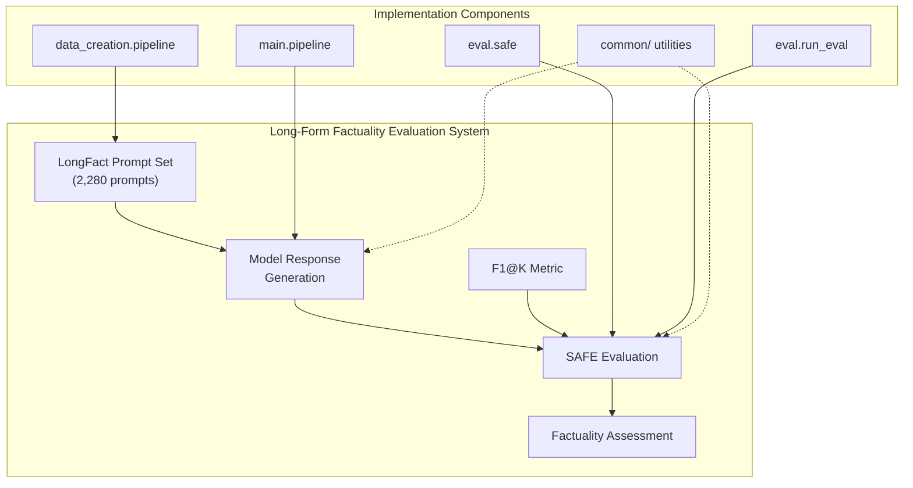
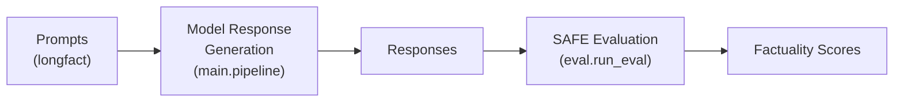
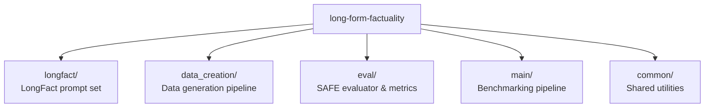

<!-- source: DeepWiki mcp.deepwiki.com · repo google-deepmind/long-form-factuality · page 1 Overview · fetched 2026-10-26 -->

# Overview

<details>
<summary>Relevant source files</summary>

The following files were used as context for generating this wiki page:

- [LICENSE](LICENSE)
- [README.md](README.md)

</details>


This document provides an introduction to the Long-Form Factuality repository, a comprehensive framework for evaluating factuality in long-form responses generated by Large Language Models (LLMs). The repository implements the methodologies described in the paper ["Long-form factuality in large language models"](https://arxiv.org/abs/2403.18802).

For installation instructions, see [Installation and Setup](#1.1).

## Core Components

The repository consists of four key components:

1. **LongFact**: A dataset of 2,280 fact-seeking prompts designed to elicit long-form responses from LLMs.

2. **Search-Augmented Factuality Evaluator (SAFE)**: An automatic evaluation framework that assesses the factual accuracy of model-generated responses.

3. **F1@K**: A metric that extends traditional F1 scoring to long-form content by using recall from human-preferred length.

4. **Experimentation Pipeline**: A system for benchmarking various LLMs (specifically OpenAI and Anthropic models) using the LongFact dataset and SAFE evaluator.

Sources: [README.md:3-9]()

## System Architecture

The following diagram illustrates the high-level architecture of the Long-Form Factuality evaluation system:



Sources: [README.md:3-9](), [README.md:66-80]()

## Data and Process Flow

The following diagram shows the workflow for evaluating LLM factuality:



The process begins with the LongFact prompt set, which is used to generate responses from various language models. These responses are then evaluated using the SAFE framework to produce factuality scores that assess the accuracy of the information provided in the responses.

Sources: [README.md:44-80]()

## Key Features

The Long-Form Factuality framework provides several important capabilities:

| Feature | Description | Implementation |
|---------|-------------|----------------|
| Long-form prompt dataset | 2,280 fact-seeking prompts requiring detailed responses | `longfact/` directory |
| Automated factuality evaluation | Search-augmented system to verify claims in LLM responses | `eval/safe/` |
| Benchmarking framework | System to evaluate and compare different LLMs | `main/pipeline.py` |
| Extended metrics for long-form content | F1@K adaptation for long-form factuality assessment | `eval/safe/` |
| Human correlation analysis | Tools to compare automated metrics with human annotations | `eval/correlation_vs_factscore.py` |

Sources: [README.md:3-9](), [README.md:44-64]()

## Repository Structure

The codebase is organized into several key directories:



Each directory serves a specific purpose:

- **longfact/**: Contains the LongFact prompt set.
- **data_creation/**: Implements the pipeline used to generate the LongFact dataset.
- **eval/**: Houses the SAFE evaluation framework and correlation analysis tools.
- **main/**: Contains the experimentation pipeline for benchmarking models.
- **common/**: Provides shared utilities, configuration settings, and model abstractions.

For a more detailed breakdown of each directory, see [Directory Structure](#3).

Sources: [README.md:44-80]()

## Getting Started

To use the Long-Form Factuality framework:

1. Install the required dependencies as outlined in [Installation and Setup](#1.1).
2. Configure API keys for OpenAI and Anthropic in the common configuration file.
3. Generate model responses using the main pipeline.
4. Evaluate the responses using SAFE.

Basic usage examples:

```bash
# Generate model responses
python -m main.pipeline

# Evaluate responses using SAFE
python -m eval.run_eval --result_path=path/to/responses.json
```

For detailed usage guides, see [Usage Guides](#4).

Sources: [README.md:11-80]()

## Related Resources

- For key terminology used throughout the system, see [Key Concepts and Terminology](#1.2).
- For detailed information about the LongFact prompt set, see [LongFact Prompt Set](#2.1).
- For a deeper understanding of the SAFE evaluator, see [SAFE Evaluator](#2.2).
- For information about the F1@K metric, see [F1@K Metric](#2.3).

This repository supports researchers and developers in assessing and improving factuality in long-form content generated by large language models.

Sources: [README.md:3-9](), [README.md:94-103]()

---

