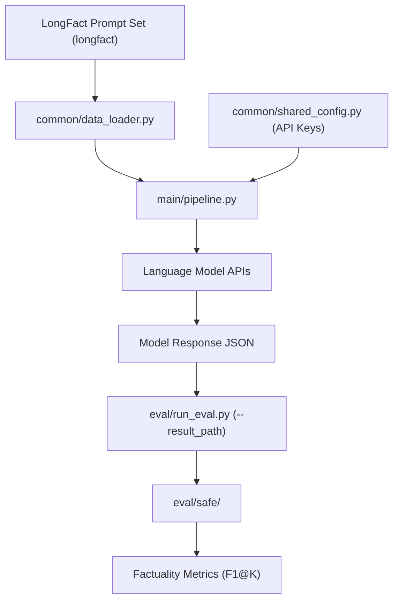
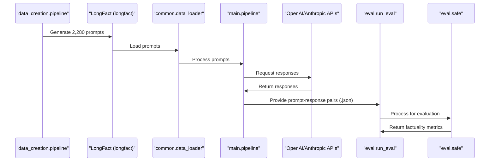
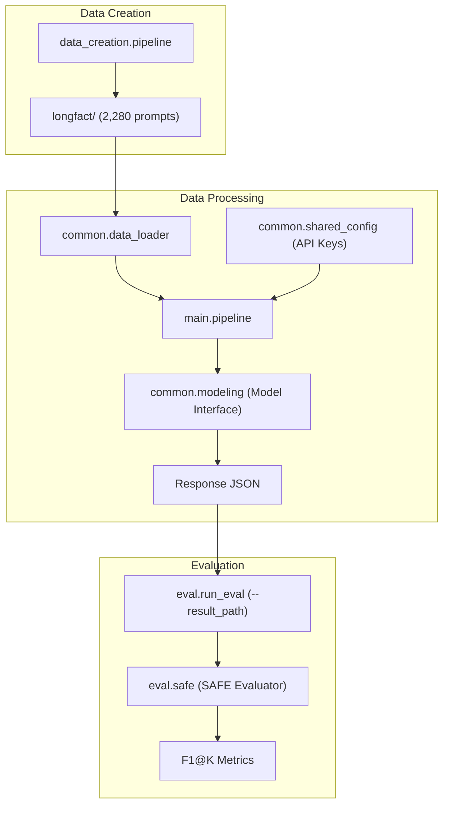

<!-- source: DeepWiki mcp.deepwiki.com · repo google-deepmind/long-form-factuality · page 2.1 LongFact Prompt Set · fetched 2026-10-26 -->

# LongFact Prompt Set

<details>
<summary>Relevant source files</summary>

The following files were used as context for generating this wiki page:

- [README.md](README.md)

</details>


## Purpose and Scope
The LongFact Prompt Set is a collection of 2,280 fact-seeking prompts specifically designed to elicit long-form responses from language models. It serves as the foundational input dataset for evaluating factuality in extended content generated by large language models. For information about how responses to these prompts are evaluated, see [SAFE Evaluator](#2.2) and [F1@K Metric](#2.3).

## Dataset Specifications
- **Size**: 2,280 prompts
- **Type**: Fact-seeking prompts requiring long-form responses
- **Location**: `longfact/` directory
- **Creation**: Generated via `data_creation.pipeline` module

## System Integration

### LongFact in System Architecture



Sources: README.md:6-8, README.md:44-46, README.md:67-80

### Data Processing Workflow



Sources: README.md:44-52, README.md:67-80

## Prompt Set Characteristics

The LongFact Prompt Set is designed to address a gap in existing factuality benchmarks, which typically focus on short-form question answering. By requiring long-form responses, LongFact allows for evaluation of a model's ability to maintain factual accuracy throughout extended text generation.

Key characteristics of the prompts include:
- Fact-seeking nature that requires reference to verifiable information
- Structure that encourages detailed, multi-paragraph responses
- Coverage of diverse domains and topics to test breadth of factual knowledge

Sources: README.md:3-9

## Usage in Codebase
The LongFact Prompt Set interacts with several components in the codebase:

### Data Creation and Loading
- Created by: `data_creation.pipeline` module
- Stored in: `longfact/` directory
- Loaded via: `common.data_loader` module

### Response Generation
- Processed by: `main.pipeline` module
- Uses API configuration from: `common.shared_config.py`
- Generates: Prompt-response pairs in JSON format

### Factuality Evaluation
- Evaluated by: `eval.run_eval` module
- Using: `eval.safe` (Search-Augmented Factuality Evaluator)
- Produces: Factuality metrics including F1@K

## Usage Instructions
To use the LongFact Prompt Set for benchmarking language models:

```bash
# Step 1: Ensure API keys are configured in common/shared_config.py
# Step 2: Generate model responses
python -m main.pipeline
# Step 3: Evaluate the responses
python -m eval.run_eval --result_path=[path_to_response_file]
```

Sources: README.md:67-80

## Code Component Diagram



Sources: README.md:44-52, README.md:55-80

## Creating or Regenerating the Prompt Set

To regenerate or modify the LongFact Prompt Set, you can use the data creation pipeline:

```bash
python -m data_creation.pipeline
```

This pipeline implements the methodology for generating fact-seeking prompts designed to elicit long-form responses suitable for factuality evaluation.

Sources: README.md:48-53

This technical documentation provides an overview of the LongFact Prompt Set, focusing on its role in the system architecture, its interactions with other code components, and how it's used in the factuality evaluation process.

---

