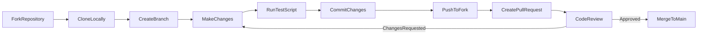
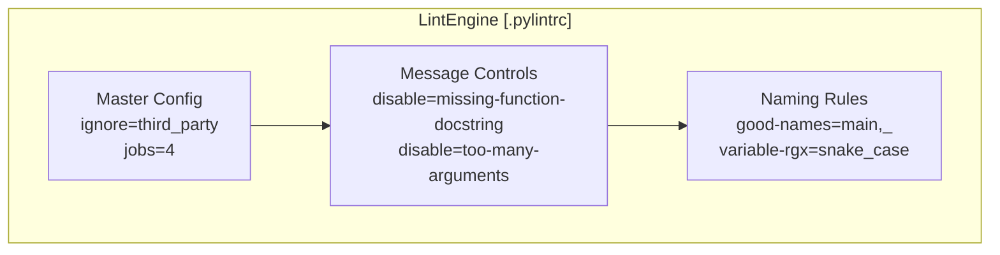

<!-- source: DeepWiki mcp.deepwiki.com · repo google-deepmind/mctx · page 6.2 Contributing Guidelines · fetched 2026-10-26 -->

# Contributing Guidelines

<details>
<summary>Relevant source files</summary>

The following files were used as context for generating this wiki page:

- [.pylintrc](.pylintrc)
- [CONTRIBUTING.md](CONTRIBUTING.md)

</details>


This document outlines the process and guidelines for contributing to the `mctx` library. It details the Contributor License Agreement (CLA), code review expectations, testing procedures via `test.sh`, and the code style enforcement configurations specified in [.pylintrc](). For information on running the test suite, see [Testing](#6.1), and for package organization, see [Package Structure](#1.2).

## Contributor License Agreement (CLA)

Contributions to `mctx` must be accompanied by a Contributor License Agreement. Developers or their employers retain the copyright to their contributions while granting permission to use and redistribute them as part of the project `[CONTRIBUTING.md:6-13]()`. 

* Contributors generally only need to submit a CLA once across Google-managed open-source repositories `[CONTRIBUTING.md:14-16]()`.
* Submissions can be checked or newly signed at [https://cla.developers.google.com/](https://cla.developers.google.com) `[CONTRIBUTING.md:11-12]()`.

Sources: [CONTRIBUTING.md:6-16]()

## Pull Request and Code Review Workflow

All changes—including those made by core project maintainers—require review via GitHub pull requests `[CONTRIBUTING.md:18-20]().`


*Figure: Pull request lifecycle for contributions to the codebase.*

Sources: [CONTRIBUTING.md:18-23]()

## Lint Configuration and Code Quality

The codebase utilizes a specialized Pylint configuration file [.pylintrc]() to enforce consistency with the Google Python style guide `[.pylintrc:1-6]()`.

### Master and Report Settings
The linter ignores `third_party` directories and executes analysis across `jobs=4` processing units `[.pylintrc:10-25]()`. Persistent caching is disabled `[.pylintrc:17-18]()`.

### Message Controls and Disabled Warnings
To accommodate JAX functional programming idioms and numerical computing conventions, specific pylint checks are disabled in `[.pylintrc:53-148]()`, including:
* `missing-function-docstring`: Permits concise helper functions without verbose docstrings where types and names are self-documenting `[.pylintrc:92-92]()`.
* `too-many-arguments` and `too-many-locals`: Allows complex state propagation functions (e.g., in `search.py` and policy modules) to accept necessary parameters without raising lint errors `[.pylintrc:128-132]()`.
* `too-many-statements` and `too-many-branches`: Accommodates comprehensive JIT-compiled loop structures in tree search expansions `[.pylintrc:130-136]()`.

### Naming Conventions
Variable and function name validation rules are defined under `[BASIC]` sections:
* `good-names`: Explicitly permits standard variable identifiers like `main` and `_` `[.pylintrc:175-176]`.
* `function-rgx`: Accepts camelCase for test setups/teardowns, and snake_case or standard identifiers for functions `[.pylintrc:193-193]()`.
* `variable-rgx`: Enforces lowercase snake_case naming conventions for standard variables `[.pylintrc:195-196]()`.


*Figure: Pylint validation pipeline governed by [.pylintrc]().*

Sources: [.pylintrc:1-198](), [CONTRIBUTING.md:1-34]()

## Testing Requirements

Before opening a pull request, all contributions must pass the local test suite execution `[CONTRIBUTING.md:25-29]()`:

```bash
bash test.sh
```

Contributors can also run focused individual unit tests depending on the specific module modified (such as tree manipulation or policy evaluation routines).

Sources: [CONTRIBUTING.md:25-29]()

## Community Guidelines

The project strictly follows [Google's Open Source Community Guidelines](https://opensource.google.com/conduct) `[CONTRIBUTING.md:31-34]()`. Participants must foster an inclusive, respectful, and constructive environment.

Sources: [CONTRIBUTING.md:31-34]()

---

