# Page: Overview

# Overview

<details>
<summary>Relevant source files</summary>

The following files were used as context for generating this wiki page:

- [README.md](README.md)
- [mctx/__init__.py](mctx/__init__.py)

</details>


This page provides an introduction to `mctx`, a JAX-native library for Monte Carlo Tree Search (MCTS) algorithms. It covers the library's purpose, key features, component architecture, and primary algorithms. For detailed installation and package organization, see the child pages [Getting Started](#1.1) and [Package Structure](#1.2).

Sources: [README.md:3-11](), [README.md:28-52]()

## Purpose and Scope

The `mctx` library implements efficient Monte Carlo Tree Search algorithms in JAX [mctx/__init__.py:15-15](), with a focus on advanced variants such as AlphaZero, MuZero, and Gumbel MuZero [README.md:3-7](). It is designed to enable researchers to easily incorporate tree search into reinforcement learning systems while maintaining high computational efficiency via JIT-compilation [README.md:8-11]().

The library aims to strike a balance between performance and usability, allowing researchers to explore search-based algorithms in Python [README.md:46-52](). 

Sources: [README.md:3-11](), [README.md:28-52]()

## Key Features

- **JAX-Native Implementation**: Fully compatible with JAX's JIT-compilation, auto-differentiation, and hardware acceleration [README.md:8-11]().
- **Batched Processing**: Operates on batches of inputs in parallel for efficient use of accelerators [README.md:8-11]().
- **Modular Design**: Separates core concerns into composable modules such as `search` [mctx/_src/search.py](), `Tree` [mctx/_src/tree.py](), and policy functions [mctx/_src/policies.py]() [mctx/__init__.py:17-64]().
- **Multiple Algorithm Variants**: Supports standard MuZero, Gumbel MuZero, and Stochastic MuZero through a common interface [mctx/__init__.py:31-33]().
- **Configurable**: Offers various options for action selection and Q-value transformations [README.md:50-52]().

Sources: [README.md:8-11](), [mctx/__init__.py:15-65]()

## Library Architecture

The following diagram illustrates the core code components of the `mctx` library and their relationships:

### Figure 1: Core Component Architecture
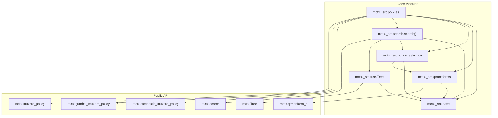

Sources: [mctx/__init__.py:17-64]()

## MCTS Process Flow

The Monte Carlo Tree Search process operates iteratively across simulations, invoking environment models and updating tree statistics:

### Figure 2: Simulation Search Loop Flow
```mermaid
flowchart TD
    Start(["Start"]) --> Init["Initialize \"Tree\" with \"RootFnOutput\""]
    Init --> Loop["Loop for \"num_simulations\""]
    
    subgraph "Simulation Phase"
        Loop --> Select["Select Node via Action Selection"]
        Select --> Expand["Expand Node via \"recurrent_fn\""]
        Expand --> Backprop["Backpropagate Values & Apply Q-transforms"]
    end
    
    Backprop --> Decision{"More Simulations?"}
    Decision -->|"Yes"| Loop
    Decision -->|"No"| PolicyExtract["Extract \"PolicyOutput\" action_weights"]
    PolicyExtract --> End(["End"])
```

Sources: [README.md:76-88]()

## Data Flow and User-Provided Components

To execute a search, users must provide root and recurrent functions matching the interfaces defined in `base.py` [mctx/_src/base.py]():

### Figure 3: User Component Data Flow
```mermaid
flowchart TB
    subgraph "User Provided Components"
        style UserProvided fill:#f9f9f9,stroke:#333
        UserProvided["User Provided Functions"]
        RepFn["Root Function<br>\"RootFnOutput\""]
        RecFn["Recurrent Function<br>\"RecurrentFnOutput\""]
    end
    
    subgraph "mctx Core Components"
        SearchAlg["mctx._src.search.search()"]
        PolicyFn["mctx._src.policies"]
        Tree["mctx._src.tree.Tree"]
    end
    
    subgraph "Inputs/Outputs"
        RootOut["RootFnOutput<br>\"prior_logits\", \"value\", \"embedding\""]
        RecOut["RecurrentFnOutput<br>\"reward\", \"discount\", \"prior_logits\", \"value\""]
        PolicyOut["PolicyOutput<br>\"action\", \"action_weights\", \"search_tree\""]
    end
    
    RepFn -->|"produces"| RootOut
    RecFn -->|"produces"| RecOut
    
    RootOut --> PolicyFn
    RootOut --> SearchAlg
    
    PolicyFn -->|"calls"| SearchAlg
    SearchAlg -->|"updates"| Tree
    RecFn -->|"used by"| SearchAlg
    
    SearchAlg --> PolicyOut
    PolicyFn --> PolicyOut
```

Sources: [README.md:82-107](), [mctx/_src/base.py:26-30]()

## Child Sections

For further details on setting up and exploring the library, refer to the following child pages:
- [Getting Started](#1.1) — Installation, dependencies, and a minimal usage walkthrough of `mctx` policies [README.md:13-25](), [README.md:77-113]().
- [Package Structure](#1.2) — Explanation of the organization of the package (`mctx/`, `_src/`, `examples/`) and build layout.

Sources: [README.md:13-25](), [README.md:77-113]()

---

# Page: Getting Started

# Getting Started

<details>
<summary>Relevant source files</summary>

The following files were used as context for generating this wiki page:

- [README.md](README.md)
- [pyproject.toml](pyproject.toml)

</details>


## Purpose and Scope
This page covers the installation requirements, package dependencies, and a minimal usage walkthrough for `mctx`. It outlines how to set up the library, configure required environment models using JAX, and execute high-level search policies such as `gumbel_muzero_policy` [README.md:77-102]().

Sources: [README.md:1-144](), [pyproject.toml:1-120]()

---

## Installation and System Requirements

`mctx` requires Python 3.11 or higher and relies on `jax` and `chex` for accelerated tensor computations and JIT compilation [README.md:3-11](), [pyproject.toml:11-38]().

### Core Dependencies
* `jax >= 0.7.0` [pyproject.toml:36-36]()
* `jaxlib >= 0.7.0` [pyproject.toml:37-37]()
* `chex >= 0.1.91` [pyproject.toml:35-35]()

### Installation Commands
You can install the stable release from PyPI or fetch the latest development version directly from GitHub:

```sh
# Install released version from PyPI
pip install mctx

# Install latest development version from GitHub
pip install git+https://github.com/google-deepmind/mctx.git
```
Sources: [README.md:13-25](), [pyproject.toml:34-38]()

### Optional Dependencies
For running test suites or visual examples, optional dependencies can be installed:
* **Testing:** `absl-py >= 2.3.1`, `numpy >= 1.24.1` [pyproject.toml:45-48]()
* **Examples:** `absl-py >= 2.3.1`, `pygraphviz >= 1.7` [pyproject.toml:49-52]()

Sources: [pyproject.toml:44-52]()

---

## Architecture and Dependency Mapping

The following diagram maps high-level conceptual components of search-based reinforcement learning to their concrete Python packages and requirements in `mctx`.

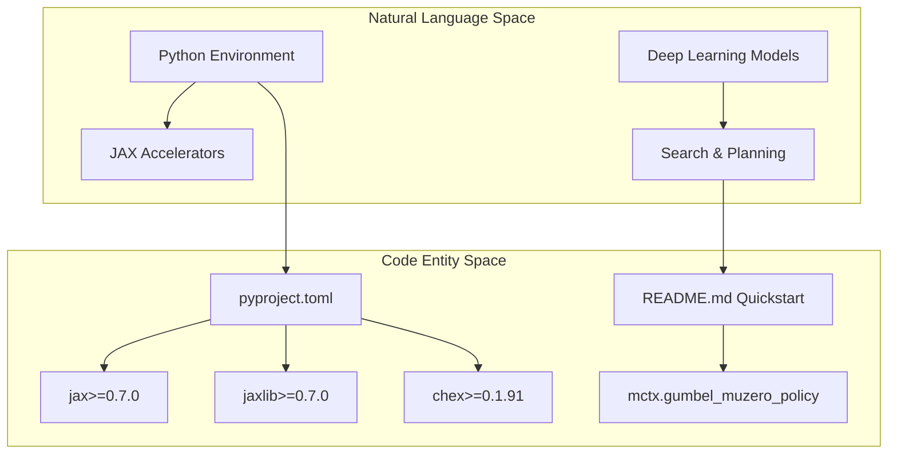
Sources: [README.md:1-25](), [pyproject.toml:34-38]()

---

## Minimal Usage Walkthrough

To execute a search policy in `mctx`, the user must provide a root state representation (`RootFnOutput`) and an environment dynamics model (`recurrent_fn`) [README.md:79-95]().

### 1. Root State Representation (`RootFnOutput`)
The root state function output defines the prior policy logits, the estimated value of the root state, and any internal state embedding required by the environment model [README.md:84-87]().

### 2. Dynamics Model (`recurrent_fn`)
The environment model is defined via a recurrent function with the signature:
`recurrent_fn(params, rng_key, action, embedding)` [README.md:89-92]().
It returns a tuple: `(recurrent_fn_output, new_embedding)` [README.md:91-92]().
* `RecurrentFnOutput`: Contains scalar `reward`, `discount`, policy `prior_logits`, and state `value` [README.md:93-94]().

### 3. Policy Execution
High-level policies such as `gumbel_muzero_policy` orchestrate batched tree search and return recommended actions alongside probability weights for policy improvement [README.md:79-107]().

```python
import jax
import mctx

# Example policy invocation
policy_output = mctx.gumbel_muzero_policy(
    params, rng_key, root, recurrent_fn, num_simulations=32
)

selected_action = policy_output.action
improved_weights = policy_output.action_weights
```
Sources: [README.md:77-114]()

---

## Data Flow and Execution Mapping

The following diagram maps the logical data flow of an MCTS search iteration to the corresponding data structures and functions invoked in the codebase.

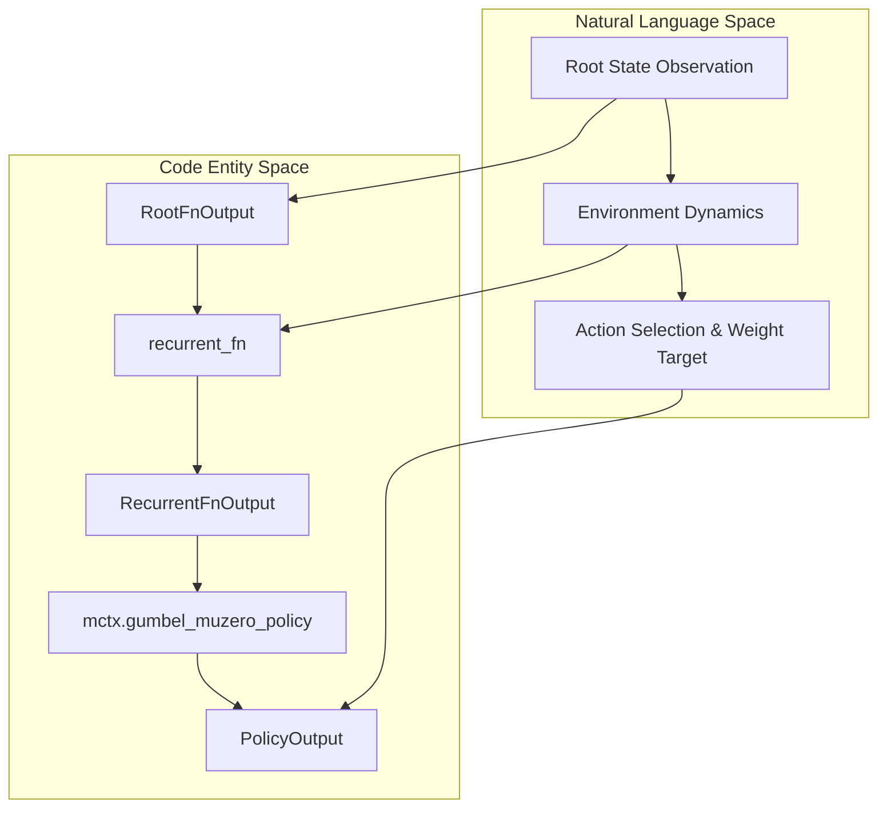
Sources: [README.md:77-114]()

---

# Page: Package Structure

# Package Structure

<details>
<summary>Relevant source files</summary>

The following files were used as context for generating this wiki page:

- [LICENSE](LICENSE)
- [mctx/__init__.py](mctx/__init__.py)
- [mctx/_src/__init__.py](mctx/_src/__init__.py)
- [pyproject.toml](pyproject.toml)

</details>


This document explains the organization of the MCTX package and its build process. It serves as a guide for developers who want to understand the codebase structure, dependencies, and how the package is built and distributed.

## Overview

MCTX is structured as a modern Python package following standard conventions for JAX-based libraries using `pyproject.toml` and Flit [pyproject.toml:1-3](). The codebase is organized to separate core functionality into distinct modules within the `mctx/_src/` directory, while exposing a clean public API surface through `mctx/__init__.py` [mctx/__init__.py:17-65]().

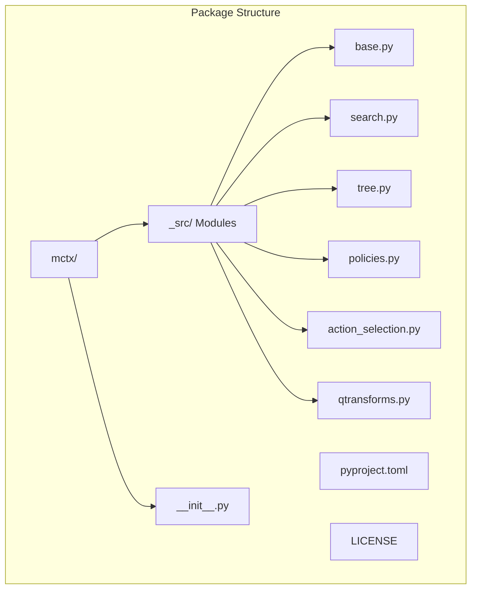

Sources: [pyproject.toml:1-3](), [mctx/__init__.py:1-76]()

## Directory Structure

The MCTX package follows a clean directory structure with core source files residing inside `mctx/_src/` and public exports exposed at the package root [mctx/__init__.py:17-65]().

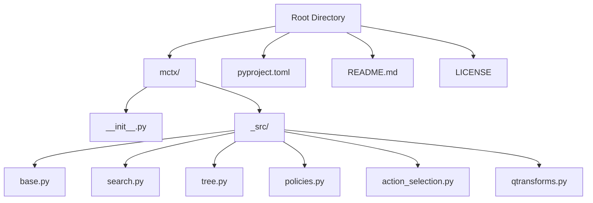

Sources: [mctx/__init__.py:17-65]()

### Key Directories

- **mctx/**: The main package directory containing public exports in `__init__.py` [mctx/__init__.py:1-76]() and internal implementations in `_src/`.
- **Root directory**: Contains configuration metadata like `pyproject.toml`, `README.md`, and `LICENSE` [pyproject.toml:1-120]().

Sources: [pyproject.toml:1-120](), [mctx/__init__.py:1-76]()

## Module Organization & Public API

The MCTX codebase separates public exports from internal implementations. Symbols defined under `_src/` are considered internal implementation details, and users should import exclusively from the top-level `mctx` namespace [mctx/__init__.py:67-76]().

```mermaid
classDiagram
    class "__init__.py" {
        Public API exports
        __version__ = "0.0.71"
        __all__ tuple
    }
    
    class "base.py" {
        Core Types & Interfaces
        RecurrentFn, LoopFn, etc.
    }
    
    class "search.py" {
        search()
        MCTS algorithm implementation
    }
    
    class "tree.py" {
        Tree class & search summary
    }
    
    class "policies.py" {
        muzero_policy()
        gumbel_muzero_policy()
        stochastic_muzero_policy()
    }
    
    class "action_selection.py" {
        PUCT & Gumbel action selection
    }
    
    class "qtransforms.py" {
        Q-value transformations
    }
    
    "__init__.py" --> "policies.py"
    "__init__.py" --> "search.py"
    "__init__.py" --> "qtransforms.py"
    "__init__.py" --> "tree.py"
    "__init__.py" --> "action_selection.py"
    "__init__.py" --> "base.py"
```

Sources: [mctx/__init__.py:17-65]()

## Dependencies

MCTX specifies its dependencies and build requirements in `pyproject.toml` [pyproject.toml:1-38]():

| Dependency | Version Requirement | Purpose |
|------------|---------------------|---------|
| jax        | >=0.7.0             | Core framework for array computations [pyproject.toml:36]() |
| jaxlib     | >=0.7.0             | JAX's backend implementation [pyproject.toml:37]() |
| chex       | >=0.1.91            | Testing and utility functions for JAX [pyproject.toml:35]() |

The package requires Python `>=3.11` [pyproject.toml:11](). Optional dependencies are defined for testing (`absl-py>=2.3.1`, `numpy>=1.24.1`) and examples (`absl-py>=2.3.1`, `pygraphviz>=1.7`) [pyproject.toml:44-52]().

Sources: [pyproject.toml:11-52]()

## Package Configuration and Building

MCTX uses `flit_core` as its build backend, configured via `pyproject.toml` [pyproject.toml:1-3]().

### pyproject.toml

- **Build System**: Uses `flit_core.buildapi` [pyproject.toml:1-3]().
- **Metadata**: Defines project name `mctx`, description, license, keywords, classifiers, and authors [pyproject.toml:5-33]().
- **Version**: Dynamically loaded (`dynamic = ["version"]`) [pyproject.toml:7]() from `mctx/__init__.py` (`__version__ = "0.0.71"`) [mctx/__init__.py:40]().

Sources: [pyproject.toml:1-38](), [mctx/__init__.py:40]()

## Code Style and Linting Tools

The project configures static analysis and formatting tools in `pyproject.toml`:

- **Ruff**: Configured with a line length of 80 and specific select/ignore rules [pyproject.toml:58-74]().
- **Pylint**: Disables various stylistic messages for JAX compatibility and code flow [pyproject.toml:76-111]().
- **Pyink**: Configured with Google-internal formatting compatibility (`pyink = true`, 2-space indentation) [pyproject.toml:113-120]().

Sources: [pyproject.toml:58-120]()

## Build and Version Management Workflow

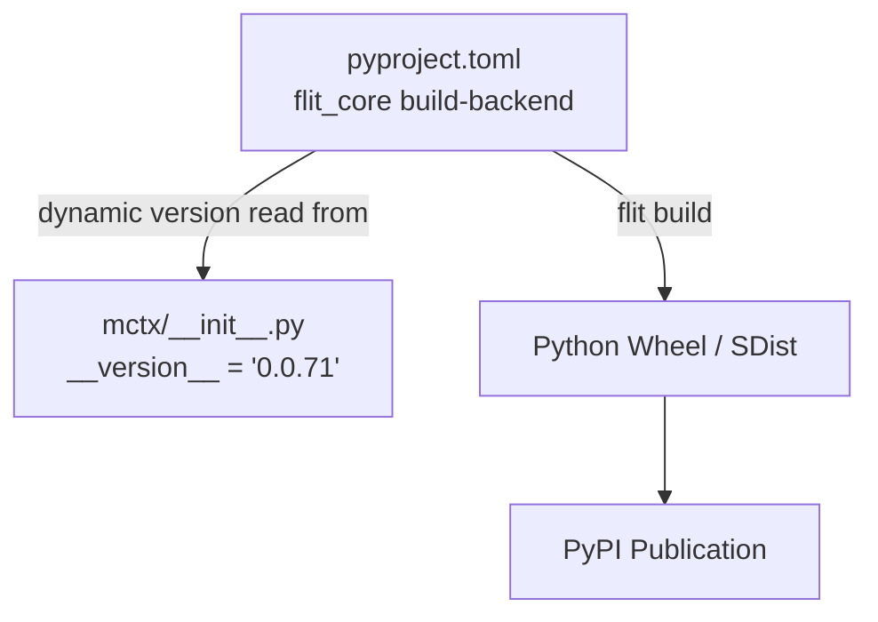

Sources: [pyproject.toml:1-7](), [mctx/__init__.py:40]()

## Extending the Package

To extend the MCTX package with new functionality, contributors should follow the established module organization pattern under `mctx/_src/`:

1. Core types and interfaces should be defined in `base.py`
2. New policy variants should be added to `policies.py`
3. New action selection mechanisms should go in `action_selection.py`
4. New Q-value transformations should go in `qtransforms.py`
5. Test files should be named with the `_test.py` suffix

Sources: [mctx/__init__.py:17-65]()

---

# Page: Core Concepts

# Core Concepts

<details>
<summary>Relevant source files</summary>

The following files were used as context for generating this wiki page:

- [README.md](README.md)

</details>


This document explains the theoretical foundations and key concepts behind Monte Carlo Tree Search (MCTS) and its implementation in the `mctx` library [README.md:1-11](). It covers the fundamental algorithms, data structures, and processes that power the batched JAX search capabilities [README.md:8-10]().

As a parent page, this provides a high-level overview. For implementation details and deeper technical breakdowns of specific algorithms, see the dedicated child pages:
- [Monte Carlo Tree Search Basics](#2.1) — Fundamentals of MCTS algorithms and their JAX implementation.
- [MuZero Algorithm](#2.2) — The MuZero algorithm and its implementation in `mctx` [README.md:6-6]().
- [Gumbel MuZero](#2.3) — The Gumbel MuZero variant, sequential halving, and policy improvement [README.md:7-7]().
- [Stochastic MuZero](#2.4) — Handling environments with stochastic transitions and chance nodes.

For API documentation, see [API Reference](#3).

---

## Monte Carlo Tree Search Overview

Monte Carlo Tree Search is a heuristic search algorithm that builds a search tree through repeated simulation cycles to find optimal decisions [README.md:64-67](). In reinforcement learning, MCTS enables an agent to plan its actions by simulating possible futures using a learned environment model [README.md:66-67]().

The search balances exploration and exploitation through targeted sampling of paths, guided by policy priors and value estimates [README.md:71-75]().

```mermaid
flowchart TD
    Start[""Start Search (mctx/_src/search.py)""] --> Init[""Initialize Tree Root (ROOT_INDEX=0)""]
    Init --> Simulate[""Run Simulations (num_simulations)""]
    
    subgraph "Single Simulation Loop"
        Simulate --> Select[""Selection: mctx/_src/search.py:simulate()""]
        Select --> Expand[""Expansion: mctx/_src/search.py:expand()""]
        Expand --> Evaluate[""Evaluation via recurrent_fn""]
        Evaluate --> Backprop[""Backpropagation: mctx/_src/search.py:backward()""]
    end
    
    Backprop --> MoreSims{""More sims?""}
    MoreSims -->|"Yes"| Simulate
    MoreSims -->|"No"| Extract[""Extract Policy (SearchSummary)""]
```
Sources: [mctx/_src/search.py:31-114](), [README.md:53-75]()

---

## Tree Data Structure

The search tree is the central data structure in `mctx`, implemented as a batched dataclass (`Tree`) to support parallel execution across multiple environments on hardware accelerators [README.md:8-10]().

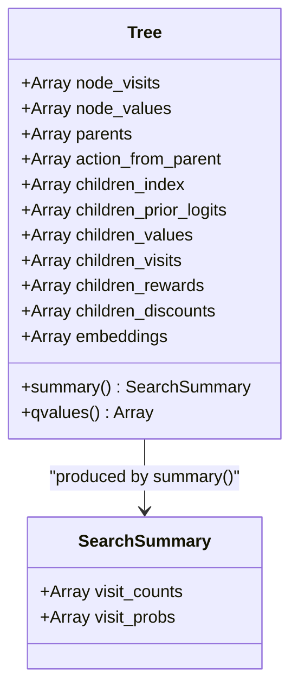
The `Tree` structure manages dimensions for the batch size (`B`), number of simulation nodes (`N`), and number of actions (`A`) [mctx/_src/search.py:345-385](). For detailed layout information, see [Tree Data Structure Implementation](#5.4).

Sources: [mctx/_src/search.py:345-385]()

---

## Search Process

The core execution flow in `mctx` is orchestrated by the `search` function, which coordinates the selection, expansion, and backpropagation phases across a fixed number of iterations [mctx/_src/search.py:31-114]().

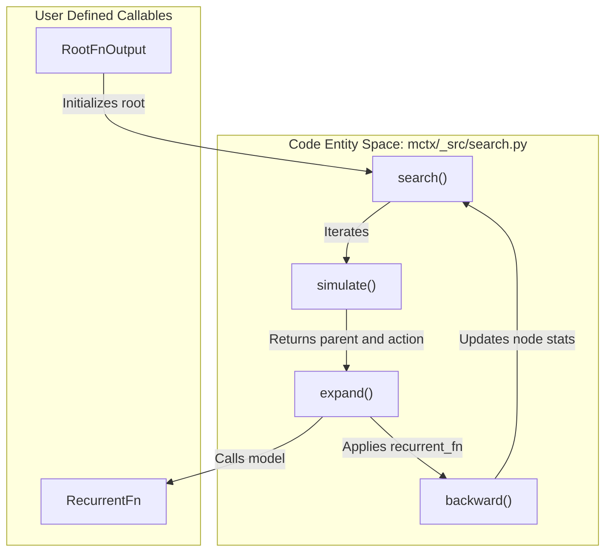
For deep algorithmic mechanics, see [Monte Carlo Tree Search Basics](#2.1) and [Search Implementation](#5.1).

Sources: [mctx/_src/search.py:31-114](), [mctx/_src/search.py:128-292]()

---

## Action Selection

Action selection mechanisms determine how the search traverses the tree. Different algorithms employ specialized strategies to balance exploration and exploitation:

1. **PUCT Selection**: Used in standard MuZero, balancing prior probabilities and Q-values [mctx/_src/policies.py:30-123]().
2. **Gumbel Action Selection**: Uses Gumbel noise and Sequential Halving at the root node for robust policy improvement [mctx/_src/policies.py:125-231]().
3. **Stochastic Selection**: Handles decision and chance nodes for stochastic environments [mctx/_src/policies.py:234-371]().

For details, see [Action Selection Mechanisms](#5.3) and child pages [Monte Carlo Tree Search Basics](#2.1) through [Stochastic MuZero](#2.4).

Sources: [mctx/_src/policies.py:30-371]()

---

## Policy Implementation

High-level policy wrappers integrate the search engine with environment models and neural network outputs [README.md:79-95](). 

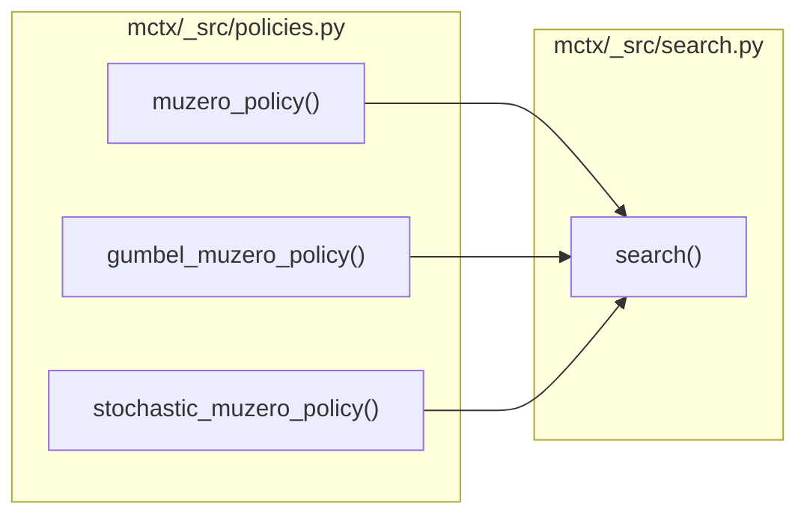
For complete details on each variant, refer to the child pages:
- [MuZero Algorithm](#2.2)
- [Gumbel MuZero](#2.3)
- [Stochastic MuZero](#2.4)

Sources: [mctx/_src/policies.py:30-371](), [README.md:79-80]()

---

## Q-Value Transforms

Q-value transforms normalize and complete action values for unvisited nodes or across sibling nodes to stabilize learning and improve search guidance [mctx/_src/policies.py:41](). Functions like `qtransform_by_parent_and_siblings` and `qtransform_completed_by_mix_value` are detailed in [QTransforms](#3.3).

Sources: [mctx/_src/policies.py:41](), [mctx/_src/policies.py:135](), [mctx/_src/policies.py:245]()

---

## Search-Policy Integration

The integration of search with reinforcement learning loops allows agents to generate improved action distributions (`action_weights`) that serve as targets for neural network training [README.md:105-107]().

For practical examples, see [Policy Improvement Example](#4.2).

Sources: [README.md:104-107](), [mctx/_src/policies.py:118-371]()

---

## Related Concepts

- [Monte Carlo Tree Search Basics](#2.1)
- [MuZero Algorithm](#2.2)
- [Gumbel MuZero](#2.3)
- [Stochastic MuZero](#2.4)
- [API Reference](#3)

---

# Page: Monte Carlo Tree Search Basics

# Monte Carlo Tree Search Basics

<details>
<summary>Relevant source files</summary>

The following files were used as context for generating this wiki page:

- [README.md](README.md)
- [mctx/_src/search.py](mctx/_src/search.py)

</details>


This document explains the fundamental concepts of Monte Carlo Tree Search (MCTS) and how it's implemented in the `mctx` library. It covers the core MCTS algorithm, its key components, and how they interact to create an effective search and planning mechanism. For specific algorithm variants like MuZero, Gumbel MuZero, or Stochastic MuZero, see their respective wiki pages ([MuZero Algorithm](#2.2), [Gumbel MuZero](#2.3), and [Stochastic MuZero](#2.4)).

Sources: [README.md:54-76]()

## What is Monte Carlo Tree Search?

Monte Carlo Tree Search is a heuristic search algorithm that combines tree search with random sampling to find optimal decisions in a given domain. It has been highly successful in domains with large state spaces, particularly in games and planning problems. MCTS builds a search tree incrementally through simulation, focusing the search on the most promising parts of the tree.

The algorithm's strength comes from its ability to balance exploration (trying new, potentially better moves) and exploitation (focusing on known good moves), making it particularly effective in reinforcement learning applications.

Sources: [README.md:54-76]()

## Core MCTS Process

MCTS operates through an iterative process consisting of four main phases:

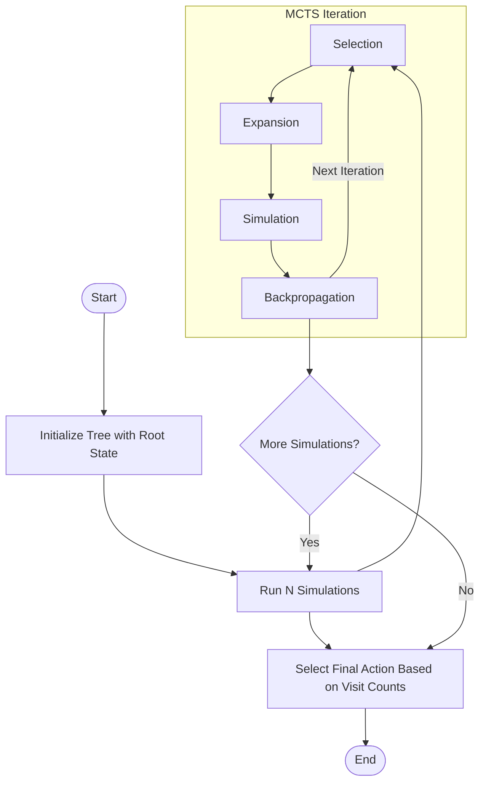

1. **Selection**: Starting from the root, the algorithm traverses the tree by selecting actions according to a policy that balances exploration and exploitation until it reaches a leaf node.
2. **Expansion**: When a leaf node is reached, one or more child nodes are added to expand the tree.
3. **Simulation**: From the new node, a simulation is run to estimate the value of the state (in `mctx`, this often uses a learned model rather than random playouts).
4. **Backpropagation**: The result of the simulation is propagated back up the tree, updating statistics for all nodes along the path.

Sources: [mctx/_src/search.py:31-114](), [README.md:54-76]()

## MCTS in `mctx` Implementation

In `mctx`, the MCTS algorithm is implemented through the core `search` function (`mctx._src.search.search`) which orchestrates the entire process:

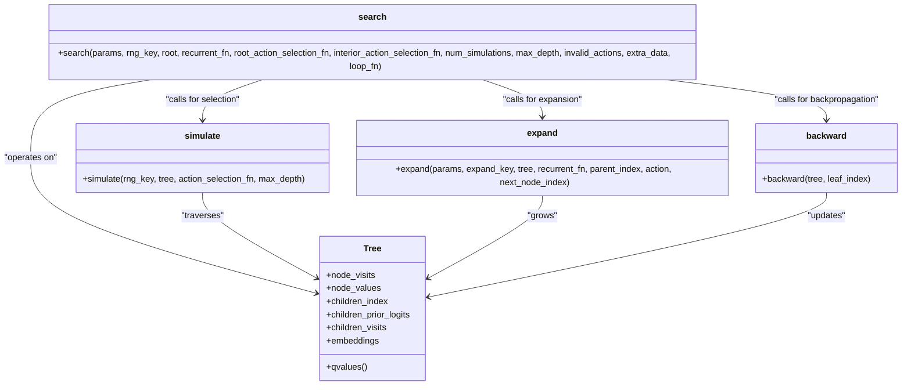

The `search` function takes several key components:

1. **Root Function Output**: Contains the prior policy logits, value estimate, and embedding for the root state.
2. **Recurrent Function**: Evaluates new states during expansion, returning rewards, values, and policy logits.
3. **Action Selection Functions**: Separate functions for selecting actions at the root and interior nodes.
4. **Number of Simulations**: Controls how many complete iterations of MCTS to run.

Sources: [mctx/_src/search.py:31-114]()

## Tree Data Structure

The MCTS process builds and operates on a tree data structure that stores the search state. In `mctx`, this is represented by the `Tree` dataclass (`mctx._src.tree.Tree`):

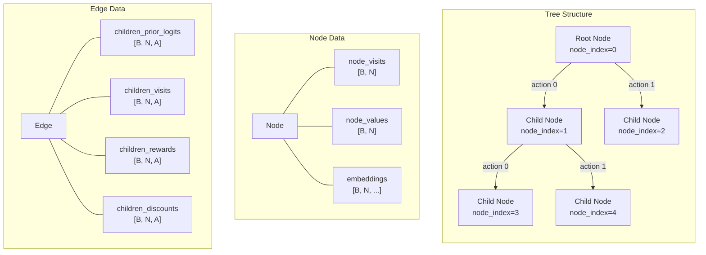

Key elements of the tree structure:
- **Nodes**: Each node represents a state in the search space.
- **Edges**: Connect nodes via actions.
- **Statistics**: Visit counts, values, prior probabilities stored for each node and edge.
- **Batched Arrays**: All data is stored in batched arrays for efficient parallel processing with JAX.

Sources: [mctx/_src/tree.py:18-90]()

## Selection Process

During the selection phase, MCTS traverses the tree from the root to a leaf by repeatedly selecting actions according to a policy:

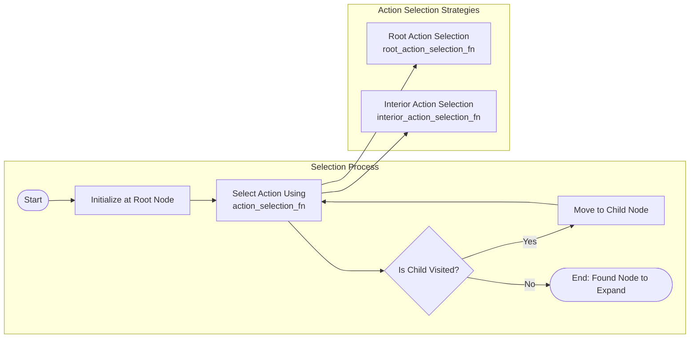

In `mctx`, the selection process is implemented in the `simulate` function (`mctx._src.search.simulate`):
- It traverses the tree until reaching an unvisited action or the maximum depth.
- Different action selection strategies can be used at the root vs. interior nodes via `switching_action_selection_wrapper` (`mctx._src.action_selection.switching_action_selection_wrapper`).
- The process is vectorized for batch processing across multiple search instances using `jax.vmap`.

Sources: [mctx/_src/search.py:75-78](), [mctx/_src/search.py:128-187]()

## Expansion Process

Once a leaf node is reached, MCTS expands the tree by adding a new node:

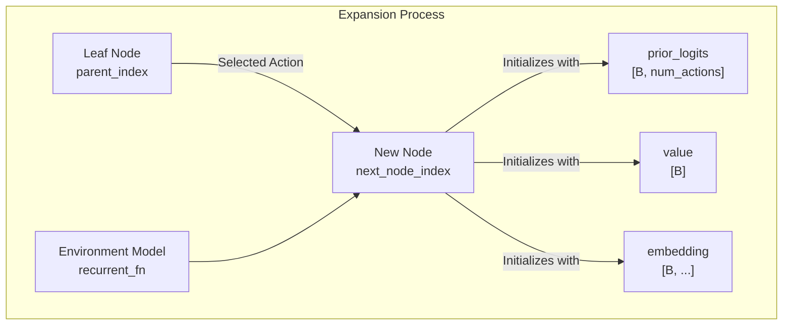

The expansion process in `mctx` (`mctx._src.tree.expand` or internal expansion logic):
1. Takes the leaf node and selected action from the simulation step.
2. Calls the recurrent function (`recurrent_fn`) to evaluate the new state.
3. Creates a new node with the resulting prior logits, value, and embedding.
4. Updates the tree topology to connect the new node to its parent.

Sources: [mctx/_src/search.py:90-104]()

## Backpropagation Process

After expansion, MCTS updates the tree by propagating values back up to the root:

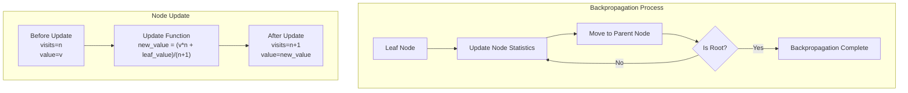

The backpropagation process in `mctx` (`mctx._src.tree.backward`):
1. Starts at the newly expanded node.
2. Updates visit counts and value estimates for the node.
3. Moves to the parent node.
4. Recursively continues until reaching the root.
5. Values are updated using incremental averaging based on visit counts.

Sources: [mctx/_src/search.py:104-104]()

## Complete Search Process Integration

Putting it all together, here's how the full MCTS process works in `mctx`:

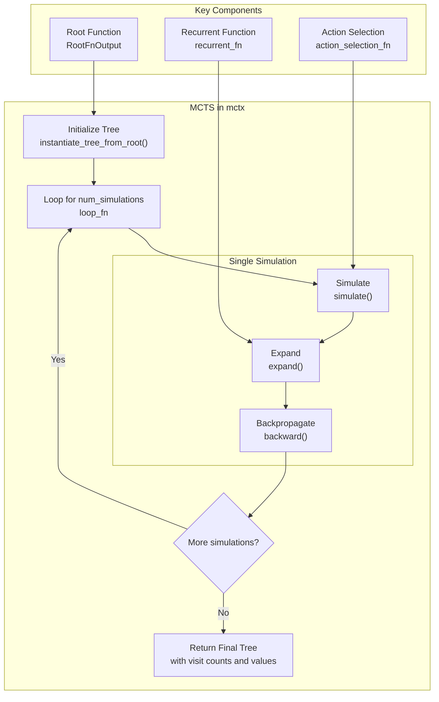

The complete search process:
1. Initialize the tree with the root state using `instantiate_tree_from_root` (`mctx._src.tree.instantiate_tree_from_root`).
2. For a specified number of simulations:
   a. Select a path through the tree to a leaf node via `simulate()`.
   b. Expand the leaf node by adding a new child via `expand()`.
   c. Backpropagate the new node's value up the tree via `backward()`.
3. Return the final `Tree` structure containing visit counts, values, and edge statistics.

Sources: [mctx/_src/search.py:31-114]()

## Action Selection Mechanisms

A critical component of MCTS is the action selection mechanism that balances exploration and exploitation:

```mermaid
flowchart LR
    subgraph "Action Selection Types"
        Root["Root Node Selection<br>root_action_selection_fn"] --> PUCT["PUCT Formula<br>Q(s,a) + c * P(s,a) * √N(s)/1+N(s,a)"]
        Interior["Interior Node Selection<br>interior_action_selection_fn"] --> UCB["UCB Formula<br>Q(s,a) + c * √(ln N(s))/N(s,a)"]
    end
    
    subgraph "Selection Wrapper"
        SW["switching_action_selection_wrapper()"] --> Root
        SW --> Interior
        SW --> Combined["Combined Selection<br>logic based on node depth"]
    end
```

Action selection in `mctx`:
1. Different selection strategies can be used at the root and interior nodes.
2. A wrapper function `switching_action_selection_wrapper` (`mctx._src.action_selection.switching_action_selection_wrapper`) provides a unified interface.
3. Selection balances exploration (trying new actions) and exploitation (selecting high-value actions).
4. Common approaches include PUCT (Predictor + UCT) and Gumbel-based selection strategies.

Sources: [mctx/_src/action_selection.py:1-50]()

## Integration with JAX

A key feature of `mctx` is its integration with JAX for efficient computation:

```mermaid
flowchart TD
    subgraph "JAX Integration"
        JIT["JIT Compilation<br>jax.jit"] --> Search["search()"]
        VMAP["Vectorization<br>jax.vmap"] --> Sim["simulate()"]
        VMAP --> Back["backward()"]
        Loop["Efficient Looping<br>jax.lax.fori_loop"] --> Search
    end
    
    subgraph "Benefits"
        Accel["Hardware Acceleration<br>GPU/TPU"] 
        Batch["Batched Processing<br>Multiple Searches in Parallel"]
        Grad["Automatic Differentiation<br>For Learning"]
    end
    
    Search --> Accel
    Search --> Batch
    Search --> Grad
```

JAX integration in `mctx`:
1. Functions are designed to be compatible with JAX's functional programming model.
2. Vectorization (`jax.vmap`) is used extensively to process multiple search instances in parallel.
3. Just-in-time compilation (`jax.jit`) improves computational efficiency.
4. Tree structure uses batched arrays for parallel operations.

Sources: [mctx/_src/search.py:127-128](), [README.md:7-11]()

## Conclusion

Monte Carlo Tree Search as implemented in `mctx` provides a powerful, flexible framework for decision-making and planning. The library's modular design allows for customization of key components like action selection and value estimation, while its JAX integration enables efficient computation on modern hardware.

Understanding these basics is essential for working with the more specialized variants like MuZero, Gumbel MuZero, and Stochastic MuZero, which build upon this foundation with additional features and optimizations.

Sources: [README.md:1-139]()

---

# Page: MuZero Algorithm

# MuZero Algorithm

<details>
<summary>Relevant source files</summary>

The following files were used as context for generating this wiki page:

- [README.md](README.md)
- [mctx/_src/policies.py](mctx/_src/policies.py)

</details>


This document details the MuZero algorithm implementation in the `mctx` library. MuZero combines Monte Carlo Tree Search (MCTS) with learned neural network models to achieve planning and policy improvement. For information about other algorithm variants, see [Gumbel MuZero](#2.3) or [Stochastic MuZero](#2.4).

## Algorithm Overview

MuZero learns a model of the environment and performs search-based planning using this model. Unlike classical planning methods that require environment rules, MuZero learns everything from data: a representation function, a dynamics model, and a prediction function.

```mermaid
flowchart TD
    subgraph "MuZero Components"
        direction TB
        Rep["Representation Network<br>State → Embedding"]
        Dyn["Dynamics Network<br>Action + Embedding → New Embedding + Reward"]
        Pred["Prediction Network<br>Embedding → Policy + Value"]
        MCTS["Monte Carlo Tree Search<br>Planning"]
    end

    subgraph "Algorithm Flow"
        direction LR
        State["Environment State"] --> Rep
        Rep --> Embedding["Hidden State Embedding"]
        Embedding --> MCTS
        MCTS --> |"Uses for simulation"| Dyn
        MCTS --> |"Uses for evaluation"| Pred
        MCTS --> Action["Selected Action"]
    end
```

Sources: [mctx/_src/policies.py:30-122](), [README.md:1-10]()

## Implementation in MCTX

The `muzero_policy` function in `mctx` implements the core MuZero algorithm [mctx/_src/policies.py:30-45](). It performs MCTS using learned models and returns a proposed action with corresponding policy statistics [mctx/_src/policies.py:76-122]().

```mermaid
classDiagram
    class muzero_policy {
        <<function>>
        +params: Params
        +rng_key: PRNGKey
        +root: RootFnOutput
        +recurrent_fn: RecurrentFn
        +num_simulations: int
        +invalid_actions: Array (optional)
        +max_depth: int (optional)
        +qtransform: QTransform
        +dirichlet_fraction: float
        +dirichlet_alpha: float
        +pb_c_init: float
        +pb_c_base: float
        +temperature: float
        +Returns: PolicyOutput
    }

    class RootFnOutput {
        +prior_logits: Array [B, num_actions]
        +value: Array [B]
        +embedding: Array [B, ...]
    }

    class PolicyOutput {
        +action: Array [B]
        +action_weights: Array [B, num_actions]
        +search_tree: Tree
    }

    muzero_policy ..> RootFnOutput: uses as input
    muzero_policy ..> PolicyOutput: returns
```

Sources: [mctx/_src/policies.py:30-122]()

## Key Algorithm Steps

The MuZero implementation follows these key steps:

1. **Root Initialization**: Setup the search root with prior policy logits, estimated value, and state embedding [mctx/_src/policies.py:33]()
2. **Add Exploration Noise**: Apply Dirichlet noise to the root prior policy for exploration [mctx/_src/policies.py:82-90]()
3. **Run Tree Search**: Execute MCTS for a specified number of simulations via `search.search` [mctx/_src/policies.py:101-111]()
4. **Extract Policy**: Sample action from the improved policy based on visit counts [mctx/_src/policies.py:113-122]()

```mermaid
flowchart TB
    Start([Start]) --> AddNoise["1. Add Dirichlet Noise<br>to Root Prior Policy"]
    AddNoise --> SelectActions["2. Configure Action Selection<br>muzero_action_selection"]
    SelectActions --> RunSearch["3. Run MCTS<br>search.search()"]
    RunSearch --> ExtractCounts["4. Extract Node Visit Counts"]
    ExtractCounts --> ApplyTemp["5. Apply Temperature<br>to Action Selection"]
    ApplyTemp --> SampleAction["6. Sample Final Action"]
    SampleAction --> Return["7. Return PolicyOutput<br>(action, action_weights, search_tree)"]
    Return --> End([End])
```

Sources: [mctx/_src/policies.py:30-122]()

## Action Selection Mechanism

MuZero employs the PUCT (Predictor + UCT) algorithm for action selection during search via `action_selection.muzero_action_selection`. This balances exploration and exploitation by combining prior policy knowledge with value estimates.

For interior nodes, the selection formula is:

$$\text{PUCT Score} = Q(s,a) + c \cdot P(s,a) \cdot \frac{\sqrt{\sum_b N(s,b)}}{1 + N(s,a)}$$

Where:
- $Q(s,a)$ is the estimated action value
- $P(s,a)$ is the prior probability from the policy network
- $N(s,a)$ is the visit count for the action
- $c$ is calculated based on parameters `pb_c_init` and `pb_c_base`

```mermaid
flowchart LR
    subgraph "Action Selection Process"
        direction TB
        P["Prior Logits<br>from Policy Network"] --> Score["PUCT Score Calculation"]
        N["Visit Counts"] --> Score
        Q["Action Q-Values"] --> Score
        pb_c["Exploration Constants<br>pb_c_init, pb_c_base"] --> Score
        Score --> Select["Select Action<br>with Highest Score"]
    end
```

Sources: [mctx/_src/policies.py:92-100](), [mctx/_src/action_selection.py]()

## Q-Value Transformation

MuZero supports different methods to transform raw Q-values through a configurable `qtransform` function [mctx/_src/policies.py:40](). The default implementation for MuZero is `qtransforms.qtransform_by_parent_and_siblings`, which normalizes Q-values based on the parent node and sibling actions.

This transformation helps with:
- Stability during learning
- Better generalization across different value ranges
- Improved exploration-exploitation balance

Sources: [mctx/_src/policies.py:40](), [mctx/_src/qtransforms.py]()

## Search Process

The search procedure works as follows:

```mermaid
flowchart TD
    Root["Root Node<br>(Environment State)"] --> Loop["Loop for num_simulations"]
    
    subgraph "Single Simulation"
        Loop --> Select["1. Select Path<br>PUCT-based Action Selection"]
        Select --> Expand["2. Expand Leaf Node<br>with recurrent_fn"]
        Expand --> |"reward, value,<br>new prior_logits"| Backprop["3. Backpropagate Values<br>Update Statistics"]
    end
    
    Backprop --> Loop
    Loop --> |"After all simulations"| Extract["Extract Final Policy<br>Based on Visit Counts"]
    Extract --> FinalAction["Sample Final Action<br>Based on Temperature"]
```

Sources: [mctx/_src/policies.py:101-118](), [mctx/_src/search.py]()

## Key Parameters

The MuZero implementation exposes several important parameters that control the algorithm's behavior:

| Parameter | Default Value | Description |
|-----------|---------------|-------------|
| `num_simulations` | - | Number of MCTS simulations to perform |
| `dirichlet_fraction` | 0.25 | Controls mixture of prior policy and Dirichlet noise |
| `dirichlet_alpha` | 0.3 | Concentration parameter for Dirichlet distribution |
| `pb_c_init` | 1.25 | Constant c₁ in PUCT formula for exploration control |
| `pb_c_base` | 19652 | Constant c₂ in PUCT formula for exploration control |
| `temperature` | 1.0 | Controls determinism of final action selection |
| `max_depth` | None | Maximum tree depth (unlimited if None) |

Sources: [mctx/_src/policies.py:30-74]()

## Input and Output Types

The MuZero algorithm operates on and produces the following data structures:

```mermaid
classDiagram
    class RootFnOutput {
        +prior_logits: Array [B, num_actions]
        +value: Array [B]
        +embedding: RecurrentState
    }
    
    class RecurrentFnOutput {
        +reward: Array
        +discount: Array
        +prior_logits: Array
        +value: Array
    }
    
    class PolicyOutput {
        +action: Array [B]
        +action_weights: Array [B, num_actions]
        +search_tree: Tree
    }
    
    class Tree {
        +node_visits: Array [B, N]
        +node_values: Array [B, N]
        +children_index: Array [B, N, A]
        +children_prior_logits: Array [B, N, A]
        +children_visits: Array [B, N, A]
        +embeddings: Array [B, N, ...]
    }
    
    RootFnOutput --> Tree: initializes
    RecurrentFnOutput --> Tree: updates
    Tree --> PolicyOutput: produces
```

Sources: [mctx/_src/policies.py:30-122](), [mctx/_src/base.py]()

## Relationship with Other MCTS Algorithms

MuZero forms the foundation for other algorithm variants in the `mctx` library, including Gumbel MuZero and Stochastic MuZero. These variants modify aspects of the search procedure while maintaining the core model-based planning approach.

```mermaid
graph TD
    subgraph "MCTS Family in mctx"
        MuZero["muzero_policy<br>- PUCT Selection<br>- Dirichlet Exploration"]
        Gumbel["gumbel_muzero_policy<br>- Gumbel Noise<br>- Sequential Halving"]
        Stochastic["stochastic_muzero_policy<br>- Decision + Chance Nodes<br>- Stochastic Transitions"]
    end
    
    MuZero --> Gumbel: "extends with<br>Gumbel noise"
    MuZero --> Stochastic: "extends with<br>stochastic dynamics"
    
    subgraph "Common Components"
        Search["search.py<br>Core Search Algorithm"]
        Tree["tree.py<br>Tree Data Structure"]
        QTransform["qtransforms.py<br>Value Transformations"]
    end
    
    MuZero --> Search: uses
    Gumbel --> Search: uses
    Stochastic --> Search: uses
    
    MuZero --> Tree: maintains
    MuZero --> QTransform: applies
```

Sources: [mctx/_src/policies.py:30-554]()

## Usage Example

To use the MuZero algorithm in `mctx`, you need to:
1. Define a representation function that outputs `RootFnOutput`
2. Define a dynamics function (`recurrent_fn`) that simulates the environment
3. Call `muzero_policy` with these components and appropriate parameters

The resulting `PolicyOutput` contains the selected action, improved policy weights for training, and the search tree.

Sources: [mctx/_src/policies.py:30-122](), [README.md:76-104]()

---

# Page: Gumbel MuZero

# Gumbel MuZero

<details>
<summary>Relevant source files</summary>

The following files were used as context for generating this wiki page:

- [mctx/_src/policies.py](mctx/_src/policies.py)
- [mctx/_src/seq_halving.py](mctx/_src/seq_halving.py)

</details>


## Purpose and Scope

This document describes the Gumbel MuZero variant implemented in the MCTX library (`mctx._src.policies.gumbel_muzero_policy`). Gumbel MuZero enhances standard MuZero by incorporating Gumbel noise and Sequential Halving techniques to improve planning efficiency, based on the paper "Policy improvement by planning with Gumbel". For information about the standard MuZero algorithm, see [MuZero Algorithm](#2.2). For Stochastic MuZero, see [Stochastic MuZero](#2.4).

Sources: [mctx/_src/policies.py:125-143]()

## Core Concepts

Gumbel MuZero introduces two key innovations to the standard Monte Carlo Tree Search algorithm:

1. **Gumbel noise**: Applied to action selection at the root node to improve exploration without relying on Dirichlet noise.
2. **Sequential Halving**: A pure exploration algorithm for multi-armed bandits that efficiently allocates search budget by focusing on top considered actions [mctx/_src/seq_halving.py:36-42]().

```mermaid
flowchart TD
    subgraph "Code Entity Space"
        GumbelPolicy["gumbel_muzero_policy"]
        SeqHalving["get_sequence_of_considered_visits"]
        ScoreFn["score_considered"]
        QTransform["qtransform_completed_by_mix_value"]
    end

    subgraph "Natural Language Space"
        GumbelNoise["Gumbel Noise Addition"]
        SeqHalvingConcept["Sequential Halving"]
        ActionSelection["Root vs Interior Selection"]
        TransformConcept["Specialized Q-Value Transform"]
    end

    GumbelNoise -.-> GumbelPolicy
    SeqHalvingConcept -.-> SeqHalving
    ActionSelection -.-> ScoreFn
    TransformConcept -.-> QTransform
```

Sources: [mctx/_src/policies.py:125-143](), [mctx/_src/seq_halving.py:36-42]()

## Algorithm Overview

Gumbel MuZero differs from standard MuZero in how it selects actions at different nodes in the search tree:

1. **Root Node**: Uses Sequential Halving with Gumbel noise to prioritize promising actions using visit sequences generated by `get_sequence_of_considered_visits` [mctx/_src/seq_halving.py:36-70]().
2. **Interior Nodes**: Uses a deterministic action selection strategy specific to Gumbel MuZero.

```mermaid
flowchart TD
    Start([Start]) --> AddGumbel["gumbel_muzero_policy: Add Gumbel Noise"]
    AddGumbel --> SearchLoop["search.search loop"]
    
    subgraph "Root Node Selection"
        direction LR
        RootStrategy["Sequential Halving"]
        RootScoring["seq_halving.score_considered"]
    end
    
    SearchLoop --> RootStrategy
    RootStrategy --> RootScoring
    RootScoring --> BackProp["Backpropagate Values"]
    BackProp --> Decision{More Simulations?}
    Decision -->|Yes| SearchLoop
    Decision -->|No| End([End])
```

Sources: [mctx/_src/policies.py:125-163](), [mctx/_src/seq_halving.py:23-70]()

## Sequential Halving with Gumbel

Sequential halving is implemented via sequence generation functions in `mctx/_src/seq_halving.py`. The visit counts allow implementing Sequential Halving by selecting the best action from the actions with the currently considered visit count [mctx/_src/seq_halving.py:36-55]().

```mermaid
flowchart TD
    Init["get_sequence_of_considered_visits"] --> Compute["Compute extra visits per halving step"]
    Compute --> LoopSeq["Generate sequence of length num_simulations"]
    LoopSeq --> Score["score_considered: Combine gumbel, logits, and normalized_qvalues"]
    Score --> Argmax["Select action via argmax score"]
```

Sources: [mctx/_src/seq_halving.py:23-70]()

## Configuration Parameters

The `gumbel_muzero_policy` function accepts parameters controlling its search behavior:

| Parameter | Default | Description |
|-----------|---------|-------------|
| `params` | Required | Parameters to be forwarded to root and recurrent functions [mctx/_src/policies.py:151-152]() |
| `rng_key` | Required | Random number generator state [mctx/_src/policies.py:153]() |
| `root` | Required | Initial state with prior logits, value, and embedding [mctx/_src/policies.py:154-156]() |
| `recurrent_fn` | Required | Callable for dynamics model simulation [mctx/_src/policies.py:157-160]() |
| `num_simulations` | Required | Number of simulations to run [mctx/_src/policies.py:161]() |
| `invalid_actions` | `None` | Mask for invalid actions (1=invalid, 0=valid) [mctx/_src/policies.py:162-163]() |
| `max_depth` | `None` | Maximum search tree depth [mctx/_src/policies.py:132]() |
| `qtransform` | `qtransform_completed_by_mix_value` | Function to obtain completed Q-values [mctx/_src/policies.py:135]() |
| `max_num_considered_actions` | `16` | Maximum number of actions to consider at root [mctx/_src/policies.py:136]() |
| `gumbel_scale` | `1.0` | Scale factor for Gumbel noise [mctx/_src/policies.py:137]() |

Sources: [mctx/_src/policies.py:125-163]()

## Comparison with Standard MuZero

| Feature | Standard MuZero | Gumbel MuZero |
|---------|----------------|---------------|
| Root action selection | PUCT formula with Dirichlet noise [mctx/_src/policies.py:93-100]() | Sequential Halving with Gumbel noise [mctx/_src/policies.py:145-147]() |
| Default Q-transform | `qtransform_by_parent_and_siblings` [mctx/_src/policies.py:40]() | `qtransform_completed_by_mix_value` [mctx/_src/policies.py:135]() |
| Exploration Noise | Dirichlet [mctx/_src/policies.py:41-42]() | Gumbel [mctx/_src/policies.py:137]() |

Sources: [mctx/_src/policies.py:30-44](), [mctx/_src/policies.py:125-138]()

---

# Page: Stochastic MuZero

# Stochastic MuZero

<details>
<summary>Relevant source files</summary>

The following files were used as context for generating this wiki page:

- [mctx/_src/base.py](mctx/_src/base.py)
- [mctx/_src/policies.py](mctx/_src/policies.py)

</details>


## Purpose and Scope
Stochastic MuZero is an extension of the MuZero algorithm that handles environments with stochastic transitions. Unlike standard MuZero [2.2] which assumes deterministic state transitions, Stochastic MuZero explicitly models chance outcomes resulting from actions, using decision nodes and chance nodes. This wiki page covers the implementation details, data flow, key functions, and data structures of Stochastic MuZero in the `mctx` library.

Sources: [mctx/_src/policies.py:234-371](), [mctx/_src/base.py:102-170]()

## Core Concepts

### Decision and Chance Nodes
The fundamental innovation in Stochastic MuZero is the introduction of two alternating node types in the search tree:
1. **Decision Nodes**: Represent states where the agent selects an action.
2. **Chance Nodes**: Represent the stochastic outcomes that occur after an action is taken (afterstates).

```mermaid
graph TD
    subgraph "Stochastic MuZero Tree Structure"
        R["Root (Decision Node)"]
        D1["Decision Node"]
        D2["Decision Node"]
        C1["Chance Node"]
        C2["Chance Node"]
        C3["Chance Node"]
        
        R -->|"action a"| C1
        R -->|"action b"| C2
        C1 -->|"outcome 1"| D1
        C2 -->|"outcome 1"| D2
        C2 -->|"outcome 2"| D2
    end
```

Sources: [mctx/_src/base.py:102-162](), [mctx/_src/policies.py:415-485]()

### Alternating Node Structure
The search tree alternates between decision layers and chance layers. 

```mermaid
sequenceDiagram
    participant Agent
    participant Environment
    
    Note over Agent,Environment: Decision Node
    Agent->>Environment: Select action
    Note over Agent,Environment: Chance Node (Afterstate)
    Environment->>Agent: Stochastic outcome
    Note over Agent,Environment: Decision Node
    Agent->>Environment: Select action
```

Sources: [mctx/_src/policies.py:469-470]()

## Implementation Details

### Function Signature
The main entry point for Stochastic MuZero search is `stochastic_muzero_policy`, which coordinates tree search with decision and chance recurrent functions.

```python
stochastic_muzero_policy(
    params, rng_key, root, decision_recurrent_fn, chance_recurrent_fn,
    num_simulations, invalid_actions=None, max_depth=None,
    loop_fn=jax.lax.fori_loop, qtransform=qtransforms.qtransform_by_parent_and_siblings,
    dirichlet_fraction=0.25, dirichlet_alpha=0.3, pb_c_init=1.25,
    pb_c_base=19652, temperature=1.0)
```

Sources: [mctx/_src/policies.py:234-290]()

### Data Structures

Stochastic MuZero relies on distinct input and state wrappers defined in `mctx/_src/base.py`:
- `DecisionRecurrentFnOutput`: Contains `chance_logits` (`[B, C]`) and `afterstate_value` (`[B]`) [mctx/_src/base.py:102-118]().
- `ChanceRecurrentFnOutput`: Contains `action_logits` (`[B, A]`), `value` (`[B]`), `reward` (`[B]`), and `discount` (`[B]`) [mctx/_src/base.py:120-139]().
- `StochasticRecurrentState`: Wraps `state_embedding`, `afterstate_embedding`, and `is_decision_node` flags [mctx/_src/base.py:141-162]().

```mermaid
classDiagram
    class StochasticRecurrentState {
        +state_embedding: ArrayTree
        +afterstate_embedding: ArrayTree
        +is_decision_node: Array
    }
    class DecisionRecurrentFnOutput {
        +chance_logits: Array
        +afterstate_value: Array
    }
    class ChanceRecurrentFnOutput {
        +action_logits: Array
        +value: Array
        +reward: Array
        +discount: Array
    }
```

Sources: [mctx/_src/base.py:102-162]()

### Action Space and Masking
Stochastic MuZero maps both action choices and chance outcomes into an expanded unified action space of size $A + C$ (where $A$ is the number of actions and $C$ is the number of chance outcomes). Decision nodes use the first $A$ indices, and chance nodes use the last $C$ indices. Tree masking via helper functions ensures only valid transitions are chosen per node type.

```mermaid
flowchart TD
    Start["Complete Tree\n(A+C actions)"] --> Mask["_mask_tree"]
    Mask --> Decision["Decision View\n(A actions)"]
    Mask --> Chance["Chance View\n(C outcomes)"]
    Decision --> Sel["muzero_action_selection"]
    Chance --> ChanceSel["Chance Selection Logic"]
```

Sources: [mctx/_src/policies.py:315-324](), [mctx/_src/policies.py:488-520]()

## Algorithm Flow

```mermaid
flowchart TD
    Start([Start]) --> Setup["Add Dirichlet noise & initialize StochasticRecurrentState"]
    Setup --> Build["Construct stochastic recurrent & action selection functions"]
    Build --> Search["Execute search.search() with alternating node logic"]
    Search --> Extract["Extract policy via search_tree.summary()"]
    Extract --> Return([Return PolicyOutput])
```

Sources: [mctx/_src/policies.py:234-371]()

## Comparison with Standard MuZero

| Feature | Standard MuZero [2.2] | Stochastic MuZero [2.4] |
|---------|-----------------------|-------------------------|
| Node Types | Single node type | Decision and chance nodes [mctx/_src/base.py:141-162]() |
| Recurrent Functions | Single `recurrent_fn` [mctx/_src/base.py:51-53]() | `decision_recurrent_fn` and `chance_recurrent_fn` [mctx/_src/base.py:166-170]() |
| Transition Model | Deterministic | Stochastic with explicit afterstates [mctx/_src/base.py:102-118]() |
| Internal Action Space | Size $A$ | Size $A + C$ [mctx/_src/policies.py:315-324]() |

Sources: [mctx/_src/base.py:51-170](), [mctx/_src/policies.py:234-371]()

## Testing and Verification
Tests in `mctx/_src/tests/policies_test.py` verify that configuring Stochastic MuZero with trivial single-outcome chance nodes matches the output of standard MuZero.

```mermaid
graph TD
    subgraph "Equivalence Test"
    MZ["muzero_policy"] --> Result["Identical Action & Weights"]
    SMZ["stochastic_muzero_policy\n(1 chance outcome)"] --> Result
    end
```

Sources: [mctx/_src/tests/policies_test.py:311-360]()

---

# Page: API Reference

# API Reference

<details>
<summary>Relevant source files</summary>

The following files were used as context for generating this wiki page:

- [mctx/__init__.py](mctx/__init__.py)

</details>


This page provides a high-level overview of the public API for the `mctx` library, covering core search capabilities, policy variants, Q-value transformations, and data structures. As a parent reference page, it outlines the architectural layout of the API; detailed technical specifications, parameter lists, and internal implementations are delegated to the child pages.

```mermaid
flowchart TB
    subgraph "APIReference"
        search_sec["3.1 Search API"]
        policy_sec["3.2 Policy APIs"]
        q_sec["3.3 QTransforms"]
        tree_sec["3.4 Tree Data Structure"]
    end
    
    subgraph "Core Entities"
        search_fn["search()"]
        policies["muzero_policy()\ngumbel_muzero_policy()\nstochastic_muzero_policy()"]
        qtransforms["qtransform_by_min_max()\nqtransform_by_parent_and_siblings()\nqtransform_completed_by_mix_value()"]
        tree_cls["Tree & SearchSummary"]
    end
    
    search_sec --> search_fn
    policy_sec --> policies
    q_sec --> qtransforms
    tree_sec --> tree_cls
```

Sources: [mctx/__init__.py:14-65]()

## 3.1. Search API

The core `search` function is the underlying engine for all Monte Carlo Tree Search variants in `mctx`. It executes batched JAX loops to perform simulation, expansion, and backup phases using a user-supplied recurrent environment model.

For complete details on function signatures, optional arguments, configuration parameters (such as Dirichlet noise, PUCT constants, and Gumbel scaling), and return structures, see [Search API](#3.1).

Sources: [mctx/_src/search.py](), [mctx/__init__.py:37-37]()

## 3.2. Policy APIs

High-level policy interfaces wrap the core search function to provide ready-to-use action selection and tree-search routines tailored to specific algorithms:
- `muzero_policy`: Standard MuZero search using PUCT action selection [mctx/_src/policies.py](), [mctx/__init__.py:32-32]().
- `gumbel_muzero_policy`: Gumbel MuZero search using sequential halving [mctx/_src/policies.py](), [mctx/__init__.py:31-31]().
- `stochastic_muzero_policy`: Extension for stochastic environment transitions supporting decision and chance nodes [mctx/_src/policies.py](), [mctx/__init__.py:33-33]().

For detailed documentation on each policy wrapper and its parameters, see [Policy APIs](#3.2).

Sources: [mctx/_src/policies.py](), [mctx/__init__.py:31-33]()

## 3.3. QTransforms

Q-value transformations modify raw Q-values during search backup and evaluation to stabilize learning and balance exploration. `mctx` provides several transformation utilities:
- `qtransform_by_min_max`: Rescales Q-values based on historical minimum and maximum bounds [mctx/_src/qtransforms.py](), [mctx/__init__.py:34-34]().
- `qtransform_by_parent_and_siblings`: Normalizes Q-values relative to parent and sibling nodes [mctx/_src/qtransforms.py](), [mctx/__init__.py:35-35]().
- `qtransform_completed_by_mix_value`: Mixes incomplete path estimates with bootstrap values [mctx/_src/qtransforms.py](), [mctx/__init__.py:36-36]().

For detailed math, signatures, and usage guidelines, see [QTransforms](#3.3).

Sources: [mctx/_src/qtransforms.py](), [mctx/__init__.py:34-36]()

## 3.4. Tree Data Structure

The `Tree` class is a JAX-friendly dataclass representing the search tree across batched simulations. It tracks node visits, values, prior logits, child indices, and state embeddings. It also provides helper methods like `qvalues` and summary generators.

For a comprehensive breakdown of `Tree` fields, shapes, and auxiliary methods, see [Tree Data Structure](#3.4).

Sources: [mctx/_src/tree.py](), [mctx/__init__.py:38-38]()

---

# Page: Search API

# Search API

<details>
<summary>Relevant source files</summary>

The following files were used as context for generating this wiki page:

- [mctx/_src/search.py](mctx/_src/search.py)

</details>


The Search API is the core of the `mctx` library, providing the fundamental functionality for Monte Carlo Tree Search (MCTS) implemented in JAX. This document details the primary `search` function, its parameters, data structures, and the internal mechanics of the search loop. For higher-level policy wrappers that leverage this search function, see [Policy APIs](#3.2).

Sources: [mctx/_src/search.py:15-43]()

## Core Search Function

The `mctx` library exposes the `search` function (`[mctx/_src/search.py:31]`), which executes a batched Monte Carlo Tree Search. It coordinates tree initialization, recurrent simulations, node expansion, and backpropagation over a fixed number of simulation steps (`num_simulations`).

```mermaid
flowchart TD
    subgraph "Code Entity Space: mctx/_src/search.py"
        SearchFn["search()"] --> InitFn["instantiate_tree_from_root()"]
        SearchFn --> LoopFn["loop_fn()"]
        LoopFn --> SimFn["simulate()"]
        SimFn --> ExpFn["expand()"]
        ExpFn --> BackFn["backward()"]
    end
    
    subgraph "Natural Language Space"
        S1["Main Entry Point"] --> S2["Tree Allocation"]
        S1 --> S3["Simulation Loop"]
        S3 --> S4["Tree Traversal & Selection"]
        S4 --> S5["Leaf Node Expansion"]
        S5 --> S6["Value Backpropagation"]
    end
    
    SearchFn --- S1
    InitFn --- S2
    LoopFn --- S3
    SimFn --- S4
    ExpFn --- S5
    BackFn --- S6
```

Sources: [mctx/_src/search.py:31-114]()

## Function Signature and Parameters

```python
def search(
    params: base.Params,
    rng_key: chex.PRNGKey,
    *,
    root: base.RootFnOutput,
    recurrent_fn: base.RecurrentFn,
    root_action_selection_fn: base.RootActionSelectionFn,
    interior_action_selection_fn: base.InteriorActionSelectionFn,
    num_simulations: int,
    max_depth: Optional[int] = None,
    invalid_actions: Optional[chex.Array] = None,
    extra_data: Any = None,
    loop_fn: base.LoopFn = jax.lax.fori_loop) -> Tree:
```

The search function accepts the parameters defined in `[mctx/_src/search.py:31-43]()`:

| Parameter | Type | Description |
|-----------|------|-------------|
| `params` | `base.Params` | Parameters to be forwarded to root and recurrent functions. |
| `rng_key` | `chex.PRNGKey` | Random number generator state (consumed). |
| `root` | `base.RootFnOutput` | Contains `prior_logits`, `value`, and `embedding` for the root state (`[B, num_actions]`, `[B]`, `[B, ...]`). |
| `recurrent_fn` | `base.RecurrentFn` | Callable applied on leaf nodes and unvisited actions. |
| `root_action_selection_fn` | `base.RootActionSelectionFn` | Function used to select an action at the root node. |
| `interior_action_selection_fn` | `base.InteriorActionSelectionFn` | Function used to select actions during interior tree simulation. |
| `num_simulations` | `int` | The total number of simulations to execute. |
| `max_depth` | `Optional[int]` | Maximum tree depth allowed during simulation (defaults to `num_simulations`). |
| `invalid_actions` | `chex.Array` | Mask of invalid actions at the root with shape `[B, num_actions]` (ones for invalid, zeros for valid). |
| `extra_data` | `Any` | Additional arbitrary data stored in the tree (`[B, ...]`). |
| `loop_fn` | `base.LoopFn` | Function used to run the simulation loop (defaults to `jax.lax.fori_loop`). |

Sources: [mctx/_src/search.py:31-43]()

## Return Value

The `search` function returns a `Tree` dataclass instance (`[mctx/_src/tree.py]`) containing all accumulated statistics, node visits, values, and topological relationships resulting from the search iterations.

Sources: [mctx/_src/search.py:44-74](), [mctx/_src/tree.py]()

## MCTS Algorithm Components

The search procedure executes four primary phases per simulation step:

```mermaid
flowchart TD
    subgraph "Simulation Lifecycle"
        Init["instantiate_tree_from_root()"] --> Loop["loop_fn() [jax.lax.fori_loop]"]
        Loop --> Sim["simulate()"]
        Sim --> Exp["expand()"]
        Exp --> Back["backward()"]
        Back --> Check{"Simulations Complete?"}
        Check -->|"No"| Loop
        Check -->|"Yes"| Done(["Return Tree"])
    end
```

Sources: [mctx/_src/search.py:76-114]()

### 1. Initialization

Before simulations begin, `instantiate_tree_from_root` allocates tensors and populates the root node with prior policy logits, values, and state embeddings from the `root` argument.

```mermaid
classDiagram
    class Tree {
        +node_visits: Array [B, N]
        +node_values: Array [B, N]
        +parents: Array [B, N]
        +action_from_parent: Array [B, N]
        +children_index: Array [B, N, A]
        +children_prior_logits: Array [B, N, A]
        +children_values: Array [B, N, A]
        +children_visits: Array [B, N, A]
        +children_rewards: Array [B, N, A]
        +children_discounts: Array [B, N, A]
        +embeddings: Array [B, N, ...]
    }
    
    class RootFnOutput {
        +prior_logits: Array [B, A]
        +value: Array [B]
        +embedding: RecurrentState
    }
    
    RootFnOutput --> Tree: "instantiate_tree_from_root()"
```

Sources: [mctx/_src/search.py:109-111]()

### 2. Simulation (Selection)

The `simulate` function (`[mctx/_src/search.py:129]()`) traverses the tree from the root node downwards using `action_selection_fn` (a combination of `root_action_selection_fn` and `interior_action_selection_fn` wrapped by `switching_action_selection_wrapper`).

```mermaid
flowchart TD
    subgraph "Code Entity Space: simulate()"
        SimStart["simulate() [mctx/_src/search.py]"] --> CondCheck["cond_fun() [state.is_continuing]"]
        CondCheck --> Body["body_fun()"]
        Body --> Sel["action_selection_fn()"]
        Sel --> NextIdx["Lookup next_node_index"]
        NextIdx --> DepthCheck["Check max_depth & is_visited"]
    end
    
    subgraph "Natural Language Space"
        N1["Start Simulation"] --> N2["Evaluate Continuation Condition"]
        N2 --> N3["Select Action via Policy"]
        N3 --> N4["Retrieve Child Node Index"]
        N4 --> N5["Check Depth and Visited Status"]
    end
    
    SimStart --- N1
    CondCheck --- N2
    Sel --- N3
    NextIdx --- N4
    DepthCheck --- N5
```

Sources: [mctx/_src/search.py:75-78](), [mctx/_src/search.py:127-187]()

### 3. Expansion

The `expand` function evaluates newly reached leaf states using the `recurrent_fn` callback, attaching the resulting values, rewards, discounts, and state embeddings to the tree topology.

Sources: [mctx/_src/search.py:100-103]()

### 4. Backpropagation

The `backward` function propagates values and visit updates from the newly expanded leaf node up to the root along the traversal path.

Sources: [mctx/_src/search.py:104]()

## Batched Implementation

The `search` function is fully vectorized across a batch dimension `B`. Functions like `simulate` are decorated with `jax.vmap` (`[mctx/_src/search.py:128]()`), enabling parallel execution of multiple independent search trees within a single JAX transformation context.

Sources: [mctx/_src/search.py:127-128]()

## Integration with Policy Functions

The search API is consumed by higher-level policy definitions to yield action distributions or selected actions:
- `muzero_policy`
- `gumbel_muzero_policy`
- `stochastic_muzero_policy`

Sources: [mctx/_src/search.py:31-43]()

---

# Page: Policy APIs

# Policy APIs

<details>
<summary>Relevant source files</summary>

The following files were used as context for generating this wiki page:

- [mctx/_src/policies.py](mctx/_src/policies.py)

</details>


## Purpose and Scope

This page documents the policy API functions provided by the MCTX library in `mctx/_src/policies.py`. These high-level APIs encapsulate the complete Monte Carlo Tree Search (MCTS) process in a single function call, making it easy to implement various MuZero-style planning algorithms. The page covers three core policy implementations: `muzero_policy`, `gumbel_muzero_policy`, and `stochastic_muzero_policy`.

Sources: [mctx/_src/policies.py:15-371]()

## Policy Architecture

The policy APIs provide a unified interface for different MCTS variants while invoking specific action selection and search modules internally.

```mermaid
flowchart TD
    Agent["Agent Code"] --> PolicyAPI["Policy Wrapper APIs"]
    PolicyAPI --> |"muzero_policy"| MP["mctx._src.policies.muzero_policy"]
    PolicyAPI --> |"gumbel_muzero_policy"| GMP["mctx._src.policies.gumbel_muzero_policy"]
    PolicyAPI --> |"stochastic_muzero_policy"| SMP["mctx._src.policies.stochastic_muzero_policy"]

    MP --> Search["mctx._src.search.search"]
    GMP --> Search
    SMP --> Search

    MP --> MAS["mctx._src.action_selection.muzero_action_selection"]
    GMP --> GMRAS["mctx._src.action_selection.gumbel_muzero_root_action_selection"]
    GMP --> GMIAS["mctx._src.action_selection.gumbel_muzero_interior_action_selection"]
```

Sources: [mctx/_src/policies.py:30-250](), [mctx/_src/search.py:1-50]()

## Standard MuZero Policy

The `muzero_policy` function implements the standard MuZero MCTS algorithm with PUCT-based action selection `[mctx/_src/policies.py:30-45]()`.

### Signature

```python
def muzero_policy(
    params: base.Params,
    rng_key: chex.PRNGKey,
    root: base.RootFnOutput,
    recurrent_fn: base.RecurrentFn,
    num_simulations: int,
    invalid_actions: Optional[chex.Array] = None,
    max_depth: Optional[int] = None,
    loop_fn: base.LoopFn = jax.lax.fori_loop,
    *,
    qtransform: base.QTransform = qtransforms.qtransform_by_parent_and_siblings,
    dirichlet_fraction: chex.Numeric = 0.25,
    dirichlet_alpha: chex.Numeric = 0.3,
    pb_c_init: chex.Numeric = 1.25,
    pb_c_base: chex.Numeric = 19652,
    temperature: chex.Numeric = 1.0) -> base.PolicyOutput[None]
```

Sources: [mctx/_src/policies.py:30-45]()

### Implementation Details

The execution flow of `muzero_policy` consists of the following steps:
1. Splits the random number generator key and adds Dirichlet noise to the root prior logits for exploration `[mctx/_src/policies.py:80-88]()`.
2. Masks out invalid actions using `_mask_invalid_actions` `[mctx/_src/policies.py:89-90]()`.
3. Configures interior and root action selection callables using `action_selection.muzero_action_selection` `[mctx/_src/policies.py:93-100]()`.
4. Executes the search loop via `search.search` `[mctx/_src/policies.py:101-111]()`.
5. Summarizes the tree and samples an action proportionally to visit counts modulated by the specified `temperature` `[mctx/_src/policies.py:113-122]`.

Sources: [mctx/_src/policies.py:80-123]()

## Gumbel MuZero Policy

The `gumbel_muzero_policy` function implements Full Gumbel MuZero as described in "Policy improvement by planning with Gumbel" `[mctx/_src/policies.py:125-143]`.

### Signature

```python
def gumbel_muzero_policy(
    params: base.Params,
    rng_key: chex.PRNGKey,
    root: base.RootFnOutput,
    recurrent_fn: base.RecurrentFn,
    num_simulations: int,
    invalid_actions: Optional[chex.Array] = None,
    max_depth: Optional[int] = None,
    loop_fn: base.LoopFn = jax.lax.fori_loop,
    *,
    qtransform: base.QTransform = qtransforms.qtransform_completed_by_mix_value,
    max_num_considered_actions: int = 16,
    gumbel_scale: chex.Numeric = 1.,
) -> base.PolicyOutput[action_selection.GumbelMuZeroExtraData]
```

Sources: [mctx/_src/policies.py:125-138]()

### Implementation Details

Key characteristics of `gumbel_muzero_policy`:
- At the root node, actions are selected using Sequential Halving with Gumbel noise `[mctx/_src/policies.py:145-147]()`.
- At interior nodes, deterministic action selection is used `[mctx/_src/policies.py:146-147]()`.
- Utilizes specialized Q-transformations such as `qtransforms.qtransform_completed_by_mix_value` `[mctx/_src/policies.py:135]()`.

Sources: [mctx/_src/policies.py:125-163]()

## Stochastic MuZero Policy

The `stochastic_muzero_policy` function adapts MCTS for environments featuring stochastic transitions by introducing decision nodes and chance nodes `[mctx/_src/policies.py:234-286]()`.

### Signature

```python
def stochastic_muzero_policy(
    params: chex.ArrayTree,
    rng_key: chex.PRNGKey,
    root: base.RootFnOutput,
    decision_recurrent_fn: base.DecisionRecurrentFn,
    chance_recurrent_fn: base.ChanceRecurrentFn,
    num_simulations: int,
    invalid_actions: Optional[chex.Array] = None,
    max_depth: Optional[int] = None,
    loop_fn: base.LoopFn = jax.lax.fori_loop,
    *,
    qtransform: base.QTransform = qtransforms.qtransform_by_parent_and_siblings,
    dirichlet_fraction: chex.Numeric = 0.25,
    dirichlet_alpha: chex.Numeric = 0.3,
    pb_c_init: chex.Numeric = 1.25,
    pb_c_base: chex.Numeric = 19652,
    temperature: chex.Numeric = 1.0) -> base.PolicyOutput[None]
```

Sources: [mctx/_src/policies.py:234-250]()

### Implementation Details

- Accepts two distinct recurrent functions: `decision_recurrent_fn` for agent actions and `chance_recurrent_fn` for environmental outcomes `[mctx/_src/policies.py:251-260]()`.
- Alternates tree expansion between decision and chance layers using specialized masking and transition logic `[mctx/_src/policies.py:415-484]()`.

Sources: [mctx/_src/policies.py:234-286]()

## Policy API Data Flow

```mermaid
flowchart TD
    Root["base.RootFnOutput\n- prior_logits\n- value\n- embedding"] --> Noise["Noise Addition\n_add_dirichlet_noise"]
    Noise --> Mask["Action Masking\n_mask_invalid_actions"]
    Mask --> ActionSelection["Action Selection Config\nmuzero_action_selection"]
    ActionSelection --> Search["mctx._src.search.search"]
    Search --> Tree["base.Tree\nsearch_tree"]
    Tree --> Summary["Tree Summary\nsearch_tree.summary()"]
    Summary --> Extract["Action Sampling\n_apply_temperature\njax.random.categorical"]
    Extract --> Output["base.PolicyOutput"]
```

Sources: [mctx/_src/policies.py:80-122]()

## Common Helper Functions and Return Value

Policy implementations rely on shared internal functions for preprocessing priors and scaling outputs:
- `_mask_invalid_actions`: Applies invalid action constraints `[mctx/_src/policies.py:374-385]()`.
- `_add_dirichlet_noise`: Injects exploration noise into root logits `[mctx/_src/policies.py:387-399]()`.
- `_apply_temperature`: Scales action logits by temperature `[mctx/_src/policies.py:401-408]()`.

All policy functions return a `base.PolicyOutput` container comprising the selected `action`, the probability distribution `action_weights`, and the resulting `search_tree` `[mctx/_src/base.py:50-70]()`.

Sources: [mctx/_src/policies.py:374-412]()

---

# Page: QTransforms

# QTransforms

<details>
<summary>Relevant source files</summary>

The following files were used as context for generating this wiki page:

- [mctx/_src/qtransforms.py](mctx/_src/qtransforms.py)
- [mctx/_src/tests/qtransforms_test.py](mctx/_src/tests/qtransforms_test.py)

</details>


## Purpose and Scope

QTransforms in the mctx library are monotonic transformations applied to Q-values during Monte Carlo Tree Search (MCTS). They play a critical role in normalizing and scaling Q-values to ensure effective action selection during tree traversal. This document covers the various Q-value transformation functions available in `mctx._src.qtransforms`, their implementation details, and their role in different MCTS policy variants.

For information about the overall search process, see [Search API](#3.1). For information about policies that use these QTransforms, see [Policy APIs](#3.2).

Sources: [mctx/_src/qtransforms.py:15-22]()

## Role in MCTS

Q-value transformations serve several important purposes in MCTS algorithms:

1. **Normalization**: Scaling Q-values to a standard range (typically `[0, 1]`) to ensure consistent behavior across different value scales.
2. **Handling unvisited actions**: Providing appropriate values for actions that haven't been explored yet.
3. **Balancing exploration and exploitation**: Influencing the action selection process to balance between exploring new actions and exploiting known good actions.

```mermaid
flowchart TD
    subgraph "MCTS Process"
        Root["Root State"] --> Selection["Selection Phase"]
        Selection --> Expansion["Expansion Phase"]
        Expansion --> Simulation["Simulation Phase"]
        Simulation --> Backprop["Backpropagation Phase"]
        Backprop --> |"Update Q-values"| QTransform["qtransforms.py"]
        QTransform --> |"Transformed Q-values"| Selection
    end

    subgraph "QTransform Functions"
        QT1["qtransform_by_min_max"]
        QT2["qtransform_by_parent_and_siblings"]
        QT3["qtransform_completed_by_mix_value"]
    end

    QTransform --> QT1
    QTransform --> QT2
    QTransform --> QT3
```

Sources: [mctx/_src/qtransforms.py:15-22]()

## Available QTransform Functions

The mctx library provides three main Q-value transformation functions defined in `mctx/_src/qtransforms.py`:

| Function | Primary Purpose | Typical Usage |
|----------|----------------|---------------|
| `qtransform_by_min_max` | Simple min-max normalization using fixed bounds | General-purpose normalization |
| `qtransform_by_parent_and_siblings` | Adaptive normalization based on parent and sibling node values | Standard MuZero |
| `qtransform_completed_by_mix_value` | Completes missing Q-values and applies special scaling | Gumbel MuZero |

```mermaid
classDiagram
    class Tree {
        +node_values
        +children_visits
        +children_prior_logits
        +raw_values
        +qvalues()
    }
    
    class qtransform_by_min_max {
        +tree: Tree
        +node_index: chex.Numeric
        +min_value: chex.Numeric
        +max_value: chex.Numeric
    }
    
    class qtransform_by_parent_and_siblings {
        +tree: Tree
        +node_index: chex.Numeric
        +epsilon: chex.Numeric
    }
    
    class qtransform_completed_by_mix_value {
        +tree: Tree
        +node_index: chex.Numeric
        +value_scale: chex.Numeric
        +maxvisit_init: chex.Numeric
        +rescale_values: bool
        +use_mixed_value: bool
        +epsilon: chex.Numeric
    }
    
    qtransform_by_min_max --> Tree: uses
    qtransform_by_parent_and_siblings --> Tree: uses
    qtransform_completed_by_mix_value --> Tree: uses
```

Sources: [mctx/_src/qtransforms.py:24-145]()

### qtransform_by_min_max

This function normalizes Q-values based on fixed minimum and maximum values [mctx/_src/qtransforms.py:24-31]():

```python
value_score = (value_score - min_value) / (max_value - min_value)
```

For unvisited actions (those with visit count of 0), the Q-value is set to `min_value` before normalization [mctx/_src/qtransforms.py:46-48]().

#### Parameters:
- `tree`: Unbatched MCTS tree state (`tree_lib.Tree`) [mctx/_src/qtransforms.py:34]()
- `node_index`: Scalar index of the parent node (`chex.Numeric`) [mctx/_src/qtransforms.py:35]()
- `min_value`: Given minimum value (`chex.Numeric`) [mctx/_src/qtransforms.py:36-37]()
- `max_value`: Given maximum value (`chex.Numeric`) [mctx/_src/qtransforms.py:38-39]()

#### Returns:
- Q-values normalized by `(qvalues - min_value) / (max_value - min_value)` with shape `[num_actions]` [mctx/_src/qtransforms.py:42-43]().

Sources: [mctx/_src/qtransforms.py:24-51]()

### qtransform_by_parent_and_siblings

This transformation normalizes Q-values based on the parent node's value and the values of sibling nodes [mctx/_src/qtransforms.py:54-85]():

```python
min_value = jnp.minimum(node_value, jnp.min(safe_qvalues, axis=-1))
max_value = jnp.maximum(node_value, jnp.max(safe_qvalues, axis=-1))
normalized = (completed_by_min - min_value) / (jnp.maximum(max_value - min_value, epsilon))
```

#### Parameters:
- `tree`: Unbatched MCTS tree state (`tree_lib.Tree`) [mctx/_src/qtransforms.py:63]()
- `node_index`: Scalar index of the parent node (`chex.Numeric`) [mctx/_src/qtransforms.py:64]()
- `epsilon`: Minimum denominator for the normalization (`chex.Numeric`) [mctx/_src/qtransforms.py:58(),65]()

#### Returns:
- Q-values normalized to be from the `[0, 1]` interval with shape `[num_actions]` [mctx/_src/qtransforms.py:68-69]().

Sources: [mctx/_src/qtransforms.py:54-86]()

### qtransform_completed_by_mix_value

This transformation is designed for Gumbel MuZero and completes missing Q-values for unvisited actions using a "mixed value" approach, then applies a scaling factor based on visit counts [mctx/_src/qtransforms.py:88-145]():

```python
visit_scale = maxvisit_init + maxvisit
return visit_scale * value_scale * completed_qvalues
```

#### Parameters:
- `tree`: Unbatched MCTS tree state (`tree_lib.Tree`) [mctx/_src/qtransforms.py:109]()
- `node_index`: Scalar index of the parent node (`chex.Numeric`) [mctx/_src/qtransforms.py:110]()
- `value_scale`: Scale for the Q-values (`chex.Numeric`) [mctx/_src/qtransforms.py:111]()
- `maxvisit_init`: Offset to the `max(visit_counts)` in the scaling factor (`chex.Numeric`) [mctx/_src/qtransforms.py:112]()
- `rescale_values`: If `True`, scale Q-values by `1 / (max_q - min_q)` (`bool`) [mctx/_src/qtransforms.py:113]()
- `use_mixed_value`: If `True`, complete Q-values with mixed value, otherwise with raw value (`bool`) [mctx/_src/qtransforms.py:114-115]()
- `epsilon`: Minimum denominator when using `rescale_values` (`chex.Numeric`) [mctx/_src/qtransforms.py:116]()

#### Returns:
- Completed Q-values with shape `[num_actions]` [mctx/_src/qtransforms.py:118-119]().

Sources: [mctx/_src/qtransforms.py:88-146]()

## Implementation Details

The QTransform functions rely on private helper utilities defined in `mctx/_src/qtransforms.py`:

```mermaid
flowchart TD
    subgraph "qtransform_completed_by_mix_value"
        CMV["qtransform_completed_by_mix_value"] --> CV["_complete_qvalues"]
        CMV --> RQ["_rescale_qvalues"]
        CMV --> MV["_compute_mixed_value"]
    end

    subgraph "Helper Function Details"
        MV --> |"Interpolates raw_value and qvalues"| MV1["_compute_mixed_value"]
        RQ --> |"Rescales to [0, 1] range"| RQ1["_rescale_qvalues"]
        CV --> |"Replaces unvisited actions"| CV1["_complete_qvalues"]
    end
```

Sources: [mctx/_src/qtransforms.py:148-182](), [mctx/_src/tests/qtransforms_test.py:25-53]()

### _compute_mixed_value

This helper function calculates an estimator of the state value by interpolating the raw value and weighted Q-values [mctx/_src/qtransforms.py:169-182]().

Sources: [mctx/_src/qtransforms.py:169-182](), [mctx/_src/tests/qtransforms_test.py:25-53]()

### _complete_qvalues

Returns completed Q-values, substituting unvisited action entries with the specified state `value` [mctx/_src/qtransforms.py:155-166]().

Sources: [mctx/_src/qtransforms.py:155-166]()

### _rescale_qvalues

Rescales the given completed Q-values to fall within the `[0, 1]` interval using `epsilon` for numerical stability [mctx/_src/qtransforms.py:148-152]().

Sources: [mctx/_src/qtransforms.py:148-152]()

## Summary

QTransforms are fundamental components in the MCTS routines provided by `mctx`, supplying consistent normalization and scale adjustments for action evaluation. The appropriate transform is selected based on the specific policy variant (`muzero_policy`, `gumbel_muzero_policy`, or `stochastic_muzero_policy`).

Sources: [mctx/_src/qtransforms.py:15-194]()

---

# Page: Tree Data Structure

# Tree Data Structure

<details>
<summary>Relevant source files</summary>

The following files were used as context for generating this wiki page:

- [mctx/_src/tree.py](mctx/_src/tree.py)

</details>


This page documents the `Tree` data structure in the MCTX library, which is the core representation for Monte Carlo Tree Search (MCTS) trees. It covers the structure's fields, methods, and how they're used in the search process. For information on the search algorithm implementation that uses this tree structure, see [Search Implementation](#5.1).

## Purpose and Role

The `Tree` class provides a structured representation of the search tree built during Monte Carlo Tree Search. It maintains the state of all nodes, their relationships, statistics, and values as the search progresses. The tree structure is designed to support batched operations, enabling parallel search instances through JAX's vectorized operations.

Sources: [mctx/_src/tree.py:28-143]()

## Tree Structure Overview

The MCTX Tree data structure organizes nodes in a flat array with explicit parent-child relationships, rather than using a traditional recursive tree structure. This design enables efficient vectorized operations in JAX and simpler state management.

```mermaid
graph TD
    subgraph "Tree Structure"
        Root["Root Node (index 0)"]
        N1["Node 1"]
        N2["Node 2"] 
        N3["Node 3"]
        N4["Node 4"]
        
        Root -->|"action 0"| N1
        Root -->|"action 1"| N2
        N1 -->|"action 0"| N3
        N1 -->|"action 1"| N4
    end
```

Each node stores statistics like visit counts and values, and each edge (action) stores associated rewards, prior probabilities, and child node indices. The flat array structure allows for efficient batch processing and is compatible with JAX's functional programming model.

Sources: [mctx/_src/tree.py:30-72]()

## Tree Fields and Their Shapes

The `Tree` dataclass contains several arrays that maintain the state of the search tree:

| Field | Shape | Description |
|-------|-------|-------------|
| `node_visits` | `[B, N]` | Visit counts for each node |
| `raw_values` | `[B, N]` | Raw value for each node (from value network) |
| `node_values` | `[B, N]` | Cumulative search value for each node |
| `parents` | `[B, N]` | Node index of the parent for each node |
| `action_from_parent` | `[B, N]` | Action taken from parent to reach this node |
| `children_index` | `[B, N, num_actions]` | Node indices of children for each action |
| `children_prior_logits` | `[B, N, num_actions]` | Action prior logits for each node |
| `children_visits` | `[B, N, num_actions]` | Visit counts for children of each action |
| `children_rewards` | `[B, N, num_actions]` | Immediate reward for each action |
| `children_discounts` | `[B, N, num_actions]` | Discounts between rewards and child values |
| `children_values` | `[B, N, num_actions]` | Value of the next node after each action |
| `embeddings` | `[B, N, ...]` | State embeddings of each node |
| `root_invalid_actions` | `[B, num_actions]` | Mask of invalid actions at the root |
| `extra_data` | `[B, ...]` | Extra data passed to the search |

Where:
- `B` is the batch dimension (number of parallel searches)
- `N` is the number of nodes in the tree
- `num_actions` is the number of discrete actions

Sources: [mctx/_src/tree.py:30-72]()

## Data Flow Through the Tree

```mermaid
flowchart TD
    subgraph "Tree Construction"
        Initial["Initialize Tree with Root Node (index 0)"]
        Expand["Expand new node at next available index"]
        Update["Update node statistics<br>- node_visits<br>- node_values"]
        Backprop["Backpropagate values through parents"]
    end
    
    Initial --> Expand
    Expand --> Update
    Update --> Backprop
    Backprop -.-> Expand
    
    subgraph "Data Relationships"
        Node["Node at index i"]
        Parent["Parent node<br>index = parents[i]"]
        ChildAction["Action a from node i"]
        Child["Child node<br>index = children_index[i][a]"]
        
        Parent -->|"action_from_parent[i]"| Node
        Node -->|"action a"| Child
        Child -->|"stores"| Value["node_values[child_index]"]
        ChildAction -->|"stores"| ActionStats["- children_prior_logits[i][a]<br>- children_visits[i][a]<br>- children_rewards[i][a]<br>- children_values[i][a]"]
    end
```

Sources: [mctx/_src/tree.py:30-72](), [mctx/_src/tree.py:88-95]()

## Tree Constants

The `Tree` class defines several class constants for special values:

| Constant | Value | Purpose |
|----------|-------|---------|
| `ROOT_INDEX` | `0` | Index of the root node in the tree arrays |
| `NO_PARENT` | `-1` | Value indicating a node has no parent (e.g., root) |
| `UNVISITED` | `-1` | Value indicating a node hasn't been visited |

Sources: [mctx/_src/tree.py:74-78]()

## Tree Methods and Properties

The `Tree` class provides several methods and properties for accessing and manipulating tree data:

### Properties

```python
@property
def num_actions(self):
  return self.children_index.shape[-1]

@property
def num_simulations(self):
  return self.node_visits.shape[-1] - 1
```

- `num_actions`: Returns the number of discrete actions
- `num_simulations`: Returns the total number of nodes minus one (the root)

### Methods

#### qvalues(indices)

Computes Q-values for specified node indices in the tree. Q-values represent the expected return when taking each action from a given node.

```python
def qvalues(self, indices):
  """Compute q-values for any node indices in the tree."""
  if jnp.asarray(indices).shape:
    return jax.vmap(_unbatched_qvalues)(self, indices)
  else:
    return _unbatched_qvalues(self, indices)
```

The Q-value for a given node and action is computed as:
```
Q(node, action) = immediate_reward + discount * value_of_child_node
```

#### summary()

Returns a `SearchSummary` containing statistics about the root node:

```python
def summary(self) -> SearchSummary:
  """Extract summary statistics for the root node."""
  # Get state and action values for the root nodes.
  value = self.node_values[:, Tree.ROOT_INDEX]
  batch_size, = value.shape
  root_indices = jnp.full((batch_size,), Tree.ROOT_INDEX)
  qvalues = self.qvalues(root_indices)
  # Extract visit counts and induced probabilities for the root nodes.
  visit_counts = self.children_visits[:, Tree.ROOT_INDEX]
  total_counts = jnp.sum(visit_counts, axis=-1, keepdims=True)
  visit_probs = visit_counts / jnp.maximum(total_counts, 1)
  visit_probs = jnp.where(total_counts > 0, visit_probs, 1 / self.num_actions)
  # Return relevant stats.
  return SearchSummary(
      visit_counts=visit_counts,
      visit_probs=visit_probs,
      value=value,
      qvalues=qvalues)
```

Sources: [mctx/_src/tree.py:80-115]()

## SearchSummary Data Structure

The `SearchSummary` dataclass contains aggregate statistics and predictions extracted from the search tree:

```python
@chex.dataclass(frozen=True)
class SearchSummary:
  """Stats from MCTS search."""
  visit_counts: chex.Array
  visit_probs: chex.Array
  value: chex.Array
  qvalues: chex.Array
```

This provides a compact representation of the most important information from the search, particularly at the root node, which can be used for policy extraction and decision-making.

Sources: [mctx/_src/tree.py:128-134]()

## Helper Functions

### infer_batch_size(tree)

Utility function that recovers the batch size from a `Tree` data structure:

```python
def infer_batch_size(tree: Tree) -> int:
  """Recovers batch size from `Tree` data structure."""
  if tree.node_values.ndim != 2:
    raise ValueError("Input tree is not batched.")
  chex.assert_equal_shape_prefix(jax.tree_util.tree_leaves(tree), 1)
  return tree.node_values.shape[0]
```

Sources: [mctx/_src/tree.py:118-123]()

## Integration with MCTS Process

```mermaid
flowchart TD
    subgraph "Search Process"
        Init["Initialize Tree"]
        Select["Select node to expand"]
        Expand["Expand node with recurrent_fn"]
        Backprop["Backpropagate values"]
        Extract["Extract policy from Tree"]
    end
    
    Init --> Select
    Select --> Expand
    Expand --> Backprop
    Backprop --> Select
    Backprop --> Extract
    
    subgraph "Tree Data Structure"
        direction LR
        TreeClass["Tree class"]
        
        NodeData["Node data:<br>- node_visits<br>- node_values<br>- raw_values<br>- embeddings"]
        EdgeData["Edge data:<br>- children_prior_logits<br>- children_visits<br>- children_rewards<br>- children_values"]
        Structure["Structure:<br>- parents<br>- action_from_parent<br>- children_index"]
        
        TreeClass --> NodeData
        TreeClass --> EdgeData
        TreeClass --> Structure
    end
    
    Init --> TreeClass
    Select --> TreeClass
    Expand --> TreeClass
    Backprop --> TreeClass
    Extract --> TreeClass
```

During the search process:

1. The tree is initialized with a root node
2. Nodes are selected for expansion based on tree statistics
3. New nodes are added to the tree during expansion
4. Values are backpropagated, updating node statistics
5. The final policy is extracted from the tree statistics

The `Tree` data structure provides the necessary storage and access patterns to support all these operations efficiently.

Sources: [mctx/_src/tree.py:30-72](), [mctx/_src/tree.py:97-115]()

## Usage Examples

The `Tree` data structure is returned as part of the `PolicyOutput` from policy functions like `muzero_policy`, allowing inspection of the search process:

```python
# Example usage (conceptual)
policy_output = mctx.muzero_policy(...)
tree = policy_output.search_tree

# Access tree statistics
summary = tree.summary()
visit_counts = summary.visit_counts
visit_probs = summary.visit_probs

# Compute Q-values for specific nodes
node_indices = jnp.array([0, 1, 2])  # Indices of nodes to analyze
qvalues = tree.qvalues(node_indices)
```

The tree can also be used for visualization and analysis of the search process, providing insights into the algorithm's decision-making.

Sources: [mctx/_src/tree.py:97-115]()

---

# Page: Usage Examples

# Usage Examples

<details>
<summary>Relevant source files</summary>

The following files were used as context for generating this wiki page:

- [examples/policy_improvement_demo.py](examples/policy_improvement_demo.py)
- [examples/visualization_demo.py](examples/visualization_demo.py)

</details>


This page provides an overview of how to use the `mctx` library for Monte Carlo Tree Search in JAX. It highlights common integration patterns, toy environments, and examples demonstrating tree visualization and policy improvement. 

For core theoretical concepts, see [Core Concepts](#2), and for detailed API descriptions, see [API Reference](#3).

## Basic Usage Pattern

To execute a search using `mctx`, you supply a root state representation (`RootFnOutput`), a dynamics transition model (`recurrent_fn`), and select a policy function such as `mctx.gumbel_muzero_policy` [examples/visualization_demo.py:142-150]().

```mermaid
flowchart TD
    subgraph "Inputs"
        Root["RootFnOutput
        - prior_logits
        - value
        - embedding"]
        RecFn["recurrent_fn
        - Environment model"]
        Params["params
        - Neural network parameters"]
        RNG["rng_key
        - Random number generator"]
    end

    subgraph "mctx"
        Policy["gumbel_muzero_policy"]
    end

    subgraph "Outputs"
        PolicyOut["PolicyOutput
        - action: Selected action
        - action_weights: Improved policy
        - search_tree: Tree data"]
    end

    Root --> Policy
    RecFn --> Policy
    Params --> Policy
    RNG --> Policy
    Policy --> PolicyOut
```

Sources: [examples/visualization_demo.py:142-150]()

---

## 4.1. Tree Visualization Example

The visualization demo illustrates how to run `mctx.gumbel_muzero_policy` on a deterministic toy environment and export the resulting search tree into a graphical format using `pygraphviz` [examples/visualization_demo.py:37-97](), [examples/visualization_demo.py:100-151]().

```mermaid
flowchart TD
    subgraph "Code Entity Space"
        Demo["_run_demo()
        examples/visualization_demo.py"]
        Conv["convert_tree_to_graph()
        examples/visualization_demo.py"]
        Policy["gumbel_muzero_policy()
        mctx"]
    end

    subgraph "Outputs"
        Tree["mctx.Tree
        Search tree data"]
        Graph["pygraphviz.AGraph
        Directed graph representation"]
    end

    Demo --> Policy
    Policy --> Tree
    Tree --> Conv
    Conv --> Graph
```

For complete implementation details, node attribute formatting, and step-by-step instructions, see [Visualization Example](#4.1).

Sources: [examples/visualization_demo.py:37-97](), [examples/visualization_demo.py:100-151]()

---

## 4.2. Policy Improvement Example

The policy improvement demo demonstrates how planning with Gumbel MuZero enhances a random prior policy in a bandit environment [examples/policy_improvement_demo.py:45-105](). It constructs a recurrent function returning reward signals from random Q-values and evaluates the value gains of the selected action [examples/policy_improvement_demo.py:108-128]().

```mermaid
flowchart TD
    subgraph "Code Entity Space"
        Demo["_run_demo()
        examples/policy_improvement_demo.py"]
        RecFn["_make_bandit_recurrent_fn()
        examples/policy_improvement_demo.py"]
        Out["DemoOutput
        examples/policy_improvement_demo.py"]
        Policy["gumbel_muzero_policy()
        mctx"]
    end

    subgraph "Evaluation"
        Eval["Value Improvement
        selected_action_value vs prior_policy_action_value"]
    end

    Demo --> RecFn
    RecFn --> Policy
    Policy --> Out
    Out --> Eval
```

For detailed code walkthroughs, execution metrics, and Q-value completion settings, see [Policy Improvement Example](#4.2).

Sources: [examples/policy_improvement_demo.py:37-43](), [examples/policy_improvement_demo.py:45-105](), [examples/policy_improvement_demo.py:108-128]()

---

## Integration with Neural Networks

When deploying `mctx` inside a full reinforcement learning loop (such as MuZero), your architecture typically comprises three neural components:
1. **Representation Network**: Maps raw observations to initial root embeddings [README.md:80-94]().
2. **Dynamics Network**: Implements `recurrent_fn` to predict subsequent states and rewards [README.md:80-94]().
3. **Prediction Network**: Outputs policy logits and value estimates for nodes [README.md:80-94]().

Sources: [README.md:80-94]()

## External Project Examples

Several third-party repositories integrate `mctx` for diverse environments and frameworks:
- **[Pgx](https://github.com/sotetsuk/pgx)**: Vectorized JAX board game environments (Chess, Shogi, Go)
- **[muax](https://github.com/bwfbowen/muax)**: MuZero implementation on Gym-style environments
- **[a0-jax](https://github.com/NTT123/a0-jax)**: AlphaZero implementations for Connect Four, Gomoku, and Go

Sources: [README.md:115-130]()

## Tips for Effective Usage

1. **JIT Compilation**: Wrap search functions with `jax.jit` to optimize performance across simulation loops.
2. **Batched Processing**: Take advantage of JAX vectorization by passing batch dimensions to `RootFnOutput` [examples/visualization_demo.py:169-175]().
3. **Q-Transform Selection**: Use `qtransform_completed_by_mix_value` for Gumbel-based policies and `qtransform_by_parent_and_siblings` for standard PUCT searches [examples/policy_improvement_demo.py:80-82]().

Sources: [README.md:108-113](), [examples/visualization_demo.py:169-175](), [examples/policy_improvement_demo.py:80-82]()

---

# Page: Visualization Example

# Visualization Example

<details>
<summary>Relevant source files</summary>

The following files were used as context for generating this wiki page:

- [examples/visualization_demo.py](examples/visualization_demo.py)

</details>


This page demonstrates how to visualize Monte Carlo Tree Search (MCTS) trees generated by `mctx` using `pygraphviz`. Visualizations are useful for debugging search algorithms, understanding search behavior, and gaining insights into how the search explores the state space. For information about other usage examples, see [Usage Examples](#4).

## Overview of Tree Visualization

The `mctx` library doesn't include visualization capabilities directly in its core API, but it provides a structure that makes visualizing search trees straightforward using external libraries like Graphviz. This example shows how to convert an `mctx.Tree` object into a visual representation.

The visualization process involves these main steps:

```mermaid
flowchart LR
    A["Run MCTS Search\nmctx.gumbel_muzero_policy"]
    B["Extract Tree from PolicyOutput\nsearch_tree"]
    C["Convert Tree to Graph\nexamples/visualization_demo.py:37"]
    D["Render Graph to Image\npygraphviz"]
    
    A --> B
    B --> C
    C --> D
```

Sources: [examples/visualization_demo.py:190-206]()

## Required Dependencies

To visualize `mctx` search trees, you need to install the following additional dependencies:

- `pygraphviz`: A Python interface to the Graphviz graph visualization software
- `graphviz`: The underlying visualization software

You can install these with pip:
```
pip install pygraphviz graphviz
```

## Converting a Tree to a Graph

The core of the visualization process is the `convert_tree_to_graph` function [examples/visualization_demo.py:37](), which transforms an `mctx.Tree` object into a Graphviz graph:

```mermaid
flowchart TD
    subgraph "convert_tree_to_graph"
        A["pygraphviz.AGraph"]
        B["node_to_str"]
        C["edge_to_str"]
        D["AGraph.add_node / add_edge"]
    end
    
    A --> B
    A --> C
    B --> D
    C --> D
    
    subgraph "Node Contents"
        N1["node_i
            Reward
            Discount
            node_values
            node_visits"]
    end
    
    subgraph "Edge Contents"
        E1["action_labels
            qvalues
            children_prior_logits"]
    end
    
    B --> N1
    C --> E1
```

The function accepts three parameters [examples/visualization_demo.py:37-41]():
- `tree`: A `mctx.Tree` object containing search data
- `action_labels`: Optional labels for edges (defaults to the action index)
- `batch_index`: Index of the batch element to plot (for batched searches)

The function creates a directed graph where:
- Each node represents a state in the search tree
- Each edge represents an action taken from a state
- Nodes contain information about values and visit counts
- Edges contain information about Q-values and prior probabilities

Sources: [examples/visualization_demo.py:37-95]()

## Complete Example: Toy Environment Visualization

The following diagram illustrates the complete process of running a search and visualizing the resulting tree using a toy environment:

```mermaid
flowchart TD
    subgraph "Environment Definition"
        EV1["_make_batched_env_model\ntransition_matrix"]
        EV2["rewards"]
        EV3["discounts"]
        EV4["values"]
        EV5["prior_logits"]
    end
    
    subgraph "Search Execution"
        S1["mctx.RootFnOutput"]
        S2["recurrent_fn"]
        S3["mctx.gumbel_muzero_policy"]
    end
    
    subgraph "Visualization"
        V1["convert_tree_to_graph"]
        V2["pygraphviz.AGraph.draw"]
    end
    
    EV1 --> S1
    EV2 --> S1
    EV3 --> S1
    EV4 --> S1
    EV5 --> S1
    
    S1 --> S3
    S2 --> S3
    S3 --> V1
    V1 --> V2
```

Let's examine the key components of this example:

### 1. Environment Model

The example creates a toy environment with [examples/visualization_demo.py:100-139]():
- A deterministic transition matrix that defines the next state for each `(state, action)` pair
- A reward matrix for each `(state, action)` pair
- Discount factors that determine if states are terminal (0) or not (1)
- Value estimates for each state
- Prior policy logits for each state

Sources: [examples/visualization_demo.py:98-137](), [examples/visualization_demo.py:152-187]()

### 2. Search Configuration

The example uses the `mctx.gumbel_muzero_policy` function [examples/visualization_demo.py:142]() with these key parameters:
- `num_simulations`: Number of simulations to run (default: 32)
- `max_depth`: Maximum search depth (optional)
- `max_num_considered_actions`: Maximum number of actions expanded at the root (default: 16)

Sources: [examples/visualization_demo.py:140-148]()

### 3. Visualization Output

The visualization produces a diagram with the following features:

```mermaid
graph TD
    subgraph "Node Information"
        N0["Node 0 (Root)
            Value: X.XX
            Visits: Y"]
        
        N1["Node 1
            Reward: X.XX
            Discount: X.XX
            Value: X.XX
            Visits: Y"]
    end
    
    N0 -->|"Action Label
            Q: X.XX
            p: X.XX"| N1
```

- Root node is colored green [examples/visualization_demo.py:81]()
- Other nodes are colored red [examples/visualization_demo.py:94]()
- Nodes show their index, value, and visit count [examples/visualization_demo.py:64-68]()
- Non-root nodes also show the reward and discount received [examples/visualization_demo.py:65-66]()
- Edges show the action label, Q-value, and prior probability [examples/visualization_demo.py:74-76]()

Sources: [examples/visualization_demo.py:62-74](), [examples/visualization_demo.py:76-94]()

## Running the Example

The example can be run from the command line using the following command:

```
python -m examples.visualization_demo
```

You can customize the behavior with these flags [examples/visualization_demo.py:27-34]():
- `--seed`: Random seed (default: 42)
- `--num_simulations`: Number of simulations (default: 32)
- `--max_num_considered_actions`: Maximum number of actions expanded at the root (default: 16)
- `--max_depth`: Maximum search depth (optional)
- `--output_file`: The output file for the visualization (default: `"/tmp/search_tree.png"`)

For example:
```
python -m examples.visualization_demo --num_simulations=64 --output_file=my_tree.png
```

Sources: [examples/visualization_demo.py:27-34](), [examples/visualization_demo.py:190-209]()

## Example Output Interpretation

When running the visualization demo, you'll see output similar to:

```
Starting search.
Selected action: 3
Selected action Q-value: 10.0
Saving tree diagram to: /tmp/search_tree.png
```

The generated image will show the full search tree with all expanded nodes and their properties.

The key information to look for in the visualization:

1. **Visit distribution**: Nodes with more visits indicate areas of the state space that the search algorithm found promising (`tree.node_visits`)
2. **Value estimates**: Higher values indicate more promising states (`tree.node_values`)
3. **Exploration patterns**: The breadth and depth of the search tree reveal how the algorithm balances exploration and exploitation
4. **Action selection**: The selected action at the root shows what the policy ultimately chose (`policy_output.action`)

Sources: [examples/visualization_demo.py:196-205]()

## Adapting the Visualization for Your Environment

To adapt the visualization for your own environment:

1. Replace the toy environment with your own environment model (`root` and `recurrent_fn`)
2. Provide meaningful `action_labels` to make the visualization more interpretable
3. Adjust the node and edge formatting in `convert_tree_to_graph` if needed
4. Consider visualizing only a subset of the tree if it becomes too large

The visualization can be particularly useful for:
- Debugging search behavior
- Understanding exploration patterns
- Validating model predictions
- Explaining search decisions to others

Sources: [examples/visualization_demo.py:37-95]()

## Relationship to Other MCTX Components

The visualization functionality works with any of the policy implementations in `mctx`:

```mermaid
flowchart LR
    subgraph "MCTX Policies"
        P1["mctx.muzero_policy"]
        P2["mctx.gumbel_muzero_policy"]
        P3["mctx.stochastic_muzero_policy"]
    end
    
    subgraph "Policy Output"
        PO["mctx.PolicyOutput
            - action
            - action_weights
            - search_tree"]
    end
    
    subgraph "Visualization"
        V1["convert_tree_to_graph"]
        V2["pygraphviz.AGraph"]
    end
    
    P1 --> PO
    P2 --> PO
    P3 --> PO
    
    PO --> V1
    V1 --> V2
```

The example uses `mctx.gumbel_muzero_policy` [examples/visualization_demo.py:142](), but the visualization works with any policy that returns a `mctx.PolicyOutput` with a valid `search_tree`.

Sources: [examples/visualization_demo.py:140-148](), [examples/visualization_demo.py:203-205]()

---

# Page: Policy Improvement Example

# Policy Improvement Example

<details>
<summary>Relevant source files</summary>

The following files were used as context for generating this wiki page:

- [examples/policy_improvement_demo.py](examples/policy_improvement_demo.py)

</details>


## Purpose

This page demonstrates how to use MCTX's Gumbel MuZero implementation (`mctx.gumbel_muzero_policy`) to improve policies through planning in a simple multi-armed bandit environment (`examples/policy_improvement_demo.py`). The example shows concretely how search-based planning can achieve policy improvement by finding actions with higher values than those that would be selected by a prior policy.

For information about other example usages, see [Visualization Example](#4.1).

Sources: [examples/policy_improvement_demo.py:15-16]()

## Overview

The policy improvement example showcases a fundamental strength of Monte Carlo Tree Search: its ability to transform a prior policy into an improved policy through planning. This demonstration uses a multi-armed bandit scenario with the following properties:

- Random prior policy logits (simulating a policy network's output)
- Random Q-values representing action values in the environment
- Gumbel MuZero search to find better actions
- Measurement of improvement in both action selection and policy distribution

```mermaid
flowchart TD
    subgraph "Policy_Improvement_Process"
        direction TB
        A["Prior_Policy"] -->|"Random_Logits"| B["mctx.gumbel_muzero_policy"]
        C["Environment_Qvalues"] --> B
        B --> D["Improved_Policy"]
        D --> E["Measure_Improvement"]
    end
```

Sources: [examples/policy_improvement_demo.py:15-16]()

## Bandit Environment Setup

The example sets up a bandit environment using random Q-values and a custom recurrent function (`_make_bandit_recurrent_fn`):

1. Each action has a fixed reward value (Q-value)
2. The environment has no state transitions (single-step decision)
3. The prior policy is represented by random logits
4. Only the rewards for visited actions are revealed during search

```mermaid
flowchart LR
    subgraph "Bandit_Environment"
        direction TB
        A1["Action_1"] --> R1["Reward_1"]
        A2["Action_2"] --> R2["Reward_2"]
        A3["Action_3"] --> R3["Reward_3"]
        AN["Action_N"] --> RN["Reward_N"]
    end

    subgraph "Policy"
        direction TB
        PL["prior_logits"] --> PP["Prior_Policy"]
        PP -->|"with_Gumbel_noise"| PA["Prior_Action"]
        
        PL --> GMS["mctx.gumbel_muzero_policy"]
        GMS --> IP["Improved_Policy"]
        IP --> IA["Improved_Action"]
    end
    
    PA --> QP["Prior_Action_Qvalue"]
    IA --> QI["Improved_Action_Qvalue"]
    QP --> COMP["Compare_Values"]
    QI --> COMP
```

Sources: [examples/policy_improvement_demo.py:47-59](), [examples/policy_improvement_demo.py:108-127]()

## Implementation Details

### Environment Implementation

The example sets up a bandit environment using random Q-values and a custom recurrent function:

1. Random prior logits simulate a policy network's output [examples/policy_improvement_demo.py:51-52]()
2. Random Q-values represent action values in the environment [examples/policy_improvement_demo.py:55-55]()
3. A custom recurrent function (`_make_bandit_recurrent_fn`) reveals Q-values only for selected actions [examples/policy_improvement_demo.py:108-128]()

The recurrent function is the environment simulator that returns:
- The reward for the selected action (only at the root level) [examples/policy_improvement_demo.py:114-116]()
- Discount factor (1.0 for single-player environments) [examples/policy_improvement_demo.py:119-119]()
- Dummy prior logits and value for non-root nodes [examples/policy_improvement_demo.py:123-124]()
- A simple counter as the embedding to track tree depth [examples/policy_improvement_demo.py:125-125]()

Sources: [examples/policy_improvement_demo.py:108-127]()

### Search Configuration

The example uses the Gumbel MuZero policy (`mctx.gumbel_muzero_policy`) with the following configuration:

- A small number of simulations (`num_simulations=4`) [examples/policy_improvement_demo.py:31-31](), [examples/policy_improvement_demo.py:78-78]()
- Limited number of considered actions at the root (`max_num_considered_actions=16`) [examples/policy_improvement_demo.py:32-33](), [examples/policy_improvement_demo.py:79-79]()
- Q-value transformation (`mctx.qtransform_completed_by_mix_value`) that can optionally use mixed values [examples/policy_improvement_demo.py:80-82]()
- Batch processing with a configurable batch size (`batch_size=256`) [examples/policy_improvement_demo.py:29-29](), [examples/policy_improvement_demo.py:47-47]()

```mermaid
flowchart TD
    subgraph "Code_Components_Mapping"
        direction TB
        RL["mctx.RootFnOutput
        prior_logits: random logits
        value: prior policy value
        embedding: zero tensor"]
        
        RF["recurrent_fn
        _make_bandit_recurrent_fn()
        Returns reward for action at root
        Zero rewards/values elsewhere"]
        
        GP["mctx.gumbel_muzero_policy()
        Runs search with num_simulations=4
        max_num_considered_actions=16"]
        
        QT["mctx.qtransform_completed_by_mix_value
        Transforms Q-values for policy improvement"]
        
        RL --> GP
        RF --> GP
        QT --> GP
        
        GP --> PO["PolicyOutput
        action: selected action
        action_weights: improved policy
        search_tree: contains search data"]
    end
```

Sources: [examples/policy_improvement_demo.py:63-83]()

## Measuring Policy Improvement

The example demonstrates two forms of policy improvement:

1. **Action Value Improvement**: Compares the Q-value of the action selected by the search versus the action that would have been selected by the prior policy (using the same Gumbel noise for fair comparison) [examples/policy_improvement_demo.py:85-93](), [examples/policy_improvement_demo.py:138-139]()

2. **Policy Distribution Improvement**: Compares the expected value under the improved policy distribution (`action_weights`) versus the expected value under the prior policy distribution (`raw_value`) [examples/policy_improvement_demo.py:95-97](), [examples/policy_improvement_demo.py:140-141]()

```mermaid
flowchart LR
    subgraph "Measurement_Process"
        direction TB
        PI["Prior_Policy
        & Gumbel_Noise"] --> PA["Prior_Action"]
        
        GS["Gumbel_Search"] --> SA["Selected_Action"]
        GS --> AW["action_weights
        (Improved_Policy)"]
        
        QV["Environment_Qvalues"] --> PAV["Prior_Action_Value"]
        QV --> SAV["Selected_Action_Value"]
        QV --> PV["Prior_Policy_Value
        E[Q values under prior]"]
        QV --> AWV["Action_Weights_Value
        E[Q values under improved policy]"]
        
        PAV --> CMP1["Compare
        Action_Value
        Improvement"]
        SAV --> CMP1
        
        PV --> CMP2["Compare
        Policy_Value
        Improvement"]
        AWV --> CMP2
    end
```

Sources: [examples/policy_improvement_demo.py:85-104](), [examples/policy_improvement_demo.py:137-145]()

## Complete Data Flow

The following diagram illustrates the complete data flow in the policy improvement demonstration:

```mermaid
flowchart TD
    subgraph "Inputs"
        PL["prior_logits
        Random normal values"]
        QV["qvalues
        Random uniform values"]
    end
    
    subgraph "Setup"
        RO["root = mctx.RootFnOutput()
        prior_logits, value, embedding"]
        RF["recurrent_fn
        Returns Q-value as reward at root"]
    end
    
    subgraph "Search"
        GMP["mctx.gumbel_muzero_policy()
        num_simulations=4
        max_num_considered_actions=16"]
        QT["mctx.qtransform_completed_by_mix_value
        Completes missing Q-values"]
    end
    
    subgraph "Outputs"
        PO["policy_output
        action, action_weights, search_tree"]
        
        SAV["selected_action_value
        Q-value of selected action"]
        PPAV["prior_policy_action_value
        Q-value of prior policy action"]
        
        AVI["action_value_improvement
        selected - prior action value"]
        
        PPV["prior_policy_value
        Expected value under prior"]
        AWPV["action_weights_policy_value
        Expected value under improved policy"]
        
        WVI["weights_value_improvement
        improved - prior policy value"]
    end
    
    PL --> RO
    PL --> PPV
    QV --> RF
    QV --> PPV
    QV --> SAV
    QV --> PPAV
    QV --> AWPV
    
    RO --> GMP
    RF --> GMP
    QT --> GMP
    
    GMP --> PO
    PO --> SAV
    PO --> AWPV
    PO --> PPAV
    
    SAV --> AVI
    PPAV --> AVI
    
    AWPV --> WVI
    PPV --> WVI
```

Sources: [examples/policy_improvement_demo.py:45-145]()

## Code Usage Example

To run the example with default parameters:

```bash
python examples/policy_improvement_demo.py
```

Configurable flags include:
- `--seed`: Random seed (default: 42) [examples/policy_improvement_demo.py:28-28]()
- `--batch_size`: Batch size (default: 256) [examples/policy_improvement_demo.py:29-29]()
- `--num_actions`: Number of actions (default: 82) [examples/policy_improvement_demo.py:30-30]()
- `--num_simulations`: Number of simulations (default: 4) [examples/policy_improvement_demo.py:31-31]()
- `--max_num_considered_actions`: Maximum actions expanded at root (default: 16) [examples/policy_improvement_demo.py:32-33]()
- `--num_runs`: Number of runs on random data (default: 1) [examples/policy_improvement_demo.py:34-34]()

Sources: [examples/policy_improvement_demo.py:27-34](), [examples/policy_improvement_demo.py:131-145]()

## Results Interpretation

The script prints two key metrics computed in `main()`:

1. **Action value improvement**: The average and minimum value improvement from selecting actions with the search policy versus the prior policy [examples/policy_improvement_demo.py:138-143]().
2. **Action weights value improvement**: The average and minimum improvement in expected value under the search policy distribution versus the prior policy distribution [examples/policy_improvement_demo.py:140-145]().

Both metrics should be non-negative, demonstrating that search never degrades policy performance and typically improves it.

Sources: [examples/policy_improvement_demo.py:137-145]()

## Key Takeaways

- Even with a small number of simulations (`num_simulations=4`), Gumbel MuZero search can improve upon a random prior policy [examples/policy_improvement_demo.py:31-31](), [examples/policy_improvement_demo.py:137-145]()
- Policy improvement can be measured both in terms of action selection and policy distribution [examples/policy_improvement_demo.py:37-43](), [examples/policy_improvement_demo.py:99-104]()
- The example demonstrates how MCTX can be used with a custom environment wrapper (the bandit recurrent function `_make_bandit_recurrent_fn`) [examples/policy_improvement_demo.py:108-128]()
- Batched processing (`batch_size=256`) allows efficient parallel evaluation and improvement of multiple policies [examples/policy_improvement_demo.py:29-29](), [examples/policy_improvement_demo.py:47-47]()

Sources: [examples/policy_improvement_demo.py:15-16](), [examples/policy_improvement_demo.py:137-145]()

---

# Page: Implementation Details

# Implementation Details

<details>
<summary>Relevant source files</summary>

The following files were used as context for generating this wiki page:

- [mctx/_src/policies.py](mctx/_src/policies.py)
- [mctx/_src/search.py](mctx/_src/search.py)

</details>


This page provides a high-level overview of the internal implementation of the `mctx` library for developers extending the system. For deep technical details, see the child pages linked below. For conceptual explanations of Monte Carlo Tree Search algorithms, see [Core Concepts](#2). For public API documentation, see [API Reference](#3).

## Core Search Implementation

The core search loop coordinates batched MCTS simulations across parallel environments in JAX. For details on the simulation loop, node expansion, and backpropagation phases, see [Search Implementation](#5.1).

```mermaid
flowchart TD
    subgraph "mctx/_src/search.py"
        search["search()"] --> instantiate["instantiate_tree_from_root()"]
        search --> for_loop["loop_fn (jax.lax.fori_loop)"]
        for_loop --> body_fun["body_fun()"]
        body_fun --> simulate["simulate()"]
        body_fun --> expand["expand()"]
        body_fun --> backward["backward()"]
    end
    
    subgraph "mctx/_src/tree.py"
        instantiate --> Tree["Tree Dataclass"]
    end

    search --> Tree
```
Sources: [mctx/_src/search.py:31-114](), [mctx/_src/search.py:128-187](), [mctx/_src/search.py:190-244](), [mctx/_src/search.py:247-292]()

The `search` function ([mctx/_src/search.py:31-114]()) initializes the tree structure from root outputs and iterates over simulations using `jax.lax.fori_loop` [mctx/_src/search.py:112-113](). Each iteration invokes `simulate` [mctx/_src/search.py:93-94]() to traverse the tree, `expand` [mctx/_src/search.py:100-103]() to query the recurrent environment model, and `backward` [mctx/_src/search.py:104-104]() to propagate values back to the root.

Sources: [mctx/_src/search.py:31-114](), [mctx/_src/search.py:88-114]()

## Policy Implementations

The library offers three policy variants built on top of the shared search infrastructure: standard MuZero, Gumbel MuZero, and Stochastic MuZero. For details on how these policies and stochastic tree masking are implemented, see [Policy Implementations](#5.2).

```mermaid
flowchart TD
    subgraph "mctx/_src/policies.py"
        muzero_policy["muzero_policy()"]
        gumbel_muzero_policy["gumbel_muzero_policy()"]
        stochastic_muzero_policy["stochastic_muzero_policy()"]
    end

    subgraph "mctx/_src/search.py"
        search["search()"]
    end

    muzero_policy --> search
    gumbel_muzero_policy --> search
    stochastic_muzero_policy --> search
```
Sources: [mctx/_src/policies.py:30-122](), [mctx/_src/policies.py:125-231](), [mctx/_src/policies.py:234-371]()

Each policy function preprocesses root statistics (such as adding Dirichlet or Gumbel noise), configures specialized action selection rules, invokes `search.search()`, and samples a final action based on visit counts or sequential halving outcomes.

Sources: [mctx/_src/policies.py:30-122](), [mctx/_src/policies.py:125-231](), [mctx/_src/policies.py:234-371]()

## Action Selection Mechanisms

Action selection dictates how the tree is explored during simulation phases. For details on PUCT, Gumbel action selection formulas, and sequential halving schedules, see [Action Selection Mechanisms](#5.3).

```mermaid
flowchart TD
    subgraph "mctx/_src/action_selection.py"
        muzero_action_selection["muzero_action_selection()"]
        gumbel_muzero_root_action_selection["gumbel_muzero_root_action_selection()"]
        gumbel_muzero_interior_action_selection["gumbel_muzero_interior_action_selection()"]
        switching_action_selection_wrapper["switching_action_selection_wrapper()"]
    end

    switching_action_selection_wrapper --> muzero_action_selection
    switching_action_selection_wrapper --> gumbel_muzero_root_action_selection
```
Sources: [mctx/_src/action_selection.py:1-50]()

Standard MuZero relies on the PUCT formula inside `muzero_action_selection`, balancing prior probabilities with Q-values and visit counts. Gumbel MuZero utilizes sequential halving at the root to systematically refine action subsets.

Sources: [mctx/_src/action_selection.py:1-100]()

## Tree Data Structure Implementation

The search tree state is encapsulated in a batched `Tree` dataclass. For details on how tree fields are allocated, indexed, and mutated during search, see [Tree Data Structure Implementation](#5.4).

```mermaid
classDiagram
    class Tree {
        +ROOT_INDEX: int
        +UNVISITED: int
        +node_visits: Array
        +node_values: Array
        +parents: Array
        +children_index: Array
        +children_prior_logits: Array
        +embeddings: Any
        +summary()
        +qvalues()
    }
```
Sources: [mctx/_src/tree.py:25-100]()

All tensor fields in `Tree` incorporate a leading batch dimension `B`, enabling parallel tree searches to execute efficiently under JAX transformations like `vmap` and `jit`.

Sources: [mctx/_src/tree.py:25-100]()

## Type System

The `mctx` library enforces a strict type and interface system across its modules. For details on `RootFnOutput`, `RecurrentFnOutput`, `PolicyOutput`, and other callable signatures, see [Type System](#5.5).

```mermaid
flowchart TD
    subgraph "mctx/_src/base.py"
        RootFnOutput["RootFnOutput"]
        RecurrentFnOutput["RecurrentFnOutput"]
        PolicyOutput["PolicyOutput"]
        RecurrentFn["RecurrentFn"]
        QTransform["QTransform"]
    end
```
Sources: [mctx/_src/base.py:1-100]()

These definitions standardize data contracts between the user's environment models, policy configurations, and internal search routines.

Sources: [mctx/_src/base.py:1-100]()

---

# Page: Search Implementation

# Search Implementation

<details>
<summary>Relevant source files</summary>

The following files were used as context for generating this wiki page:

- [mctx/_src/search.py](mctx/_src/search.py)

</details>


This document details the internal implementation of the Monte Carlo Tree Search (MCTS) algorithm in the `mctx` library [mctx/_src/search.py:15](). It focuses specifically on how the core search algorithm is structured and executed, covering simulation, expansion, and backpropagation steps within a batched JAX loop. For details on specific policy variants, see [Policy Implementations](#5.2).

## Overview of Search Algorithm

The `mctx` library implements a batched version of MCTS designed for JAX's functional paradigm, enabling hardware acceleration and automatic differentiation across multiple search instances simultaneously. The core routine follows these phases:

1. **Tree Initialization**: Instantiation of search storage via root data (`RootFnOutput`) [mctx/_src/search.py:109-111]().
2. **Simulation Loop**: Executed via a loop construct (`loop_fn`, defaulting to `jax.lax.fori_loop`) [mctx/_src/search.py:43]() over `num_simulations` [mctx/_src/search.py:61](). Each iteration performs:
   - **Selection (`simulate`)**: Traverses the tree from root to an unvisited node or `max_depth` using an action selection wrapper [mctx/_src/search.py:93-94]().
   - **Expansion (`expand`)**: Evaluates leaf node dynamics using `recurrent_fn` and adds a new node [mctx/_src/search.py:100-103]().
   - **Backpropagation (`backward`)**: Updates node values and visit counts up the tree path [mctx/_src/search.py:104]().

Sources: [mctx/_src/search.py:31-115]()

## Search Function and Execution Flow

The main entry point is the `search` function [mctx/_src/search.py:31](), which sets up action selection wrappers, initializes the tree, and runs the simulation loop.

### Search Execution Flow (Code Entity Mapping)
```mermaid
flowchart TD
    A["User Call: search()"] --> B["action.switching_action_selection_wrapper()"]
    A --> C["tree_lib.instantiate_tree_from_root()"]
    C --> D["jax.lax.fori_loop() / loop_fn"]
    D --> E["body_fun()"]
    E --> F["search.simulate()"]
    E --> G["search.expand()"]
    E --> H["search.backward()"]
    F --> I["Tree Datastructure Update"]
    G --> I
    H --> I
```
Sources: [mctx/_src/search.py:31-115]()

The `search` function signature accepts `params`, `rng_key`, `root`, `recurrent_fn`, `root_action_selection_fn`, `interior_action_selection_fn`, `num_simulations`, `max_depth`, `invalid_actions`, `extra_data`, and `loop_fn` [mctx/_src/search.py:31-43]().

Sources: [mctx/_src/search.py:31-115]()

## Tree Data Structure

The tree state during search is represented by the `Tree` dataclass (alias `Tree = tree_lib.Tree`) [mctx/_src/search.py:25-27](), storing batched arrays across batch dimension `B` and node dimension `N`.

```mermaid
classDiagram
    class Tree {
        +node_visits: Array[B, N]
        +node_values: Array[B, N]
        +raw_values: Array[B, N]
        +parents: Array[B, N]
        +action_from_parent: Array[B, N]
        +children_index: Array[B, N, A]
        +children_prior_logits: Array[B, N, A]
        +children_values: Array[B, N, A]
        +children_visits: Array[B, N, A]
        +children_rewards: Array[B, N, A]
        +children_discounts: Array[B, N, A]
        +embeddings: Array[B, N, ...]
    }
```
Sources: [mctx/_src/search.py:25-27]()

## Detailed Search Phases

### 1. Simulation Phase

The simulation step traverses the tree starting from the root until reaching an unvisited action or `max_depth` [mctx/_src/search.py:134-137](). It is implemented via the `simulate` function decorated with `jax.vmap` [mctx/_src/search.py:128-129]().

### Simulation State Machine and Code Entities
```mermaid
flowchart TD
    A["simulate() [vmapped over batch]"] --> B["_SimulationState(rng_key, node_index, action, next_node_index, depth, is_continuing)"]
    B --> C["cond_fun(): check state.is_continuing"]
    C -->|"True"| D["body_fun()"]
    D --> E["action_selection_fn()"]
    E --> F["Retrieve next_node_index from tree.children_index"]
    F --> G["Evaluate depth < max_depth and node != UNVISITED"]
    G --> B
    C -->|"False"| H["Return parent_index, action"]
```
Sources: [mctx/_src/search.py:118-170]()

The simulation loop state is encapsulated in `_SimulationState` [mctx/_src/search.py:118-126](), tracking the `rng_key`, current `node_index`, chosen `action`, `next_node_index`, search `depth`, and `is_continuing` boolean flag [mctx/_src/search.py:120-125]().

Sources: [mctx/_src/search.py:118-170]()

### 2. Expansion Phase

The expansion step calls `expand` [mctx/_src/search.py:100]() which invokes the user-provided `recurrent_fn` [mctx/_src/search.py:36]() using the state embedding and selected action, appending a newly discovered node into the `Tree` arrays.

Sources: [mctx/_src/search.py:31-115]()

### 3. Backpropagation Phase

The backpropagation step invokes `backward` [mctx/_src/search.py:104]() to propagate values, visit counts, and reward accumulations from the newly expanded leaf node back up to the root along the traversal path recorded in `parents` and `action_from_parent`.

Sources: [mctx/_src/search.py:31-115]()

## Batched Operations and JAX Integration

The entire search loop operates within JAX transformations. `simulate`, `expand`, and `backward` leverage `jax.vmap` across the batch dimension `B`. The simulation loop itself is driven by `loop_fn` (defaulting to `jax.lax.fori_loop`) [mctx/_src/search.py:43](), which ensures that JAX can compile the entire search process into static XLA graphs when wrapped in `jax.jit`.

Sources: [mctx/_src/search.py:31-115]()

## Summary

The `mctx` search implementation couples a functional loop structure with vmapped tree operations in JAX:
1. `search()` orchestrates initialization and the simulation loop [mctx/_src/search.py:31-115]().
2. `simulate()` traverses unvisted nodes via `_SimulationState` and `action_selection_fn` [mctx/_src/search.py:127-170]().
3. `expand()` and `backward()` manage tree growth and value propagation.

Sources: [mctx/_src/search.py:31-170]()

---

# Page: Policy Implementations

# Policy Implementations

<details>
<summary>Relevant source files</summary>

The following files were used as context for generating this wiki page:

- [mctx/_src/policies.py](mctx/_src/policies.py)

</details>


This document provides a technical overview of the policy implementations in the `mctx` library [mctx/_src/policies.py:15](). The policies determine how Monte Carlo Tree Search (MCTS) is executed and how actions are selected based on search results. For information about the underlying search mechanism used by these policies, see [Search Implementation](#5.1).

`mctx` implements three distinct policy variants, each with specific strengths and application domains:
1. **Standard MuZero Policy** (`muzero_policy`) — The classic MuZero algorithm with PUCT action selection [mctx/_src/policies.py:30]()
2. **Gumbel MuZero Policy** (`gumbel_muzero_policy`) — An improved variant with Gumbel noise and Sequential Halving [mctx/_src/policies.py:125]()
3. **Stochastic MuZero Policy** (`stochastic_muzero_policy`) — A variant designed for environments with stochastic transitions [mctx/_src/policies.py:234]()

## Policy Structure Overview

```mermaid
flowchart TD
    subgraph "NaturalLanguageSpace"
        direction TB
        Input["InputParameters"] --> Preproc["PreprocessingAndNoise"]
        Preproc --> Config["ConfigureActionSelection"]
        Config --> Search["ExecuteMCTSSearch"]
        Search --> Extract["ExtractFinalPolicy"]
        Extract --> Output["PolicyOutput"]
    end

    subgraph "CodeEntitySpace"
        direction TB
        PreprocCode["_add_dirichlet_noise / _mask_invalid_actions"] --> ConfigCode["action_selection.*"]
        ConfigCode --> SearchCode["search.search"]
        SearchCode --> ExtractCode["tree.summary"]
    end

    Config --> ConfigCode
    Search --> SearchCode
```

Sources: [mctx/_src/policies.py:30-371]()

## Standard MuZero Policy

The standard MuZero policy (`muzero_policy`) implements the original MuZero algorithm as described in the MuZero paper. It uses PUCT (Predictor + Upper Confidence bound applied to Trees) for action selection and adds Dirichlet noise at the root to encourage exploration [mctx/_src/policies.py:30-45]().

```mermaid
flowchart TD
    subgraph "muzero_policy_execution"
        direction TB
        Start["muzero_policy"] --> DirichletNoise["_add_dirichlet_noise"]
        DirichletNoise --> MaskInvalid["_mask_invalid_actions"]
        MaskInvalid --> ConfigActionSelection["action_selection.muzero_action_selection"]
        ConfigActionSelection --> RunSearch["search.search"]
        RunSearch --> SampleAction["jax.random.categorical"]
        SampleAction --> PolicyOutput["base.PolicyOutput"]
    end
```

Sources: [mctx/_src/policies.py:30-122]()

### Key Components

The function signature defines the required parameters and optional configurations:

```python
def muzero_policy(
    params: base.Params,
    rng_key: chex.PRNGKey,
    root: base.RootFnOutput,
    recurrent_fn: base.RecurrentFn,
    num_simulations: int,
    invalid_actions: Optional[chex.Array] = None,
    max_depth: Optional[int] = None,
    loop_fn: base.LoopFn = jax.lax.fori_loop,
    *,
    qtransform: base.QTransform = qtransforms.qtransform_by_parent_and_siblings,
    dirichlet_fraction: chex.Numeric = 0.25,
    dirichlet_alpha: chex.Numeric = 0.3,
    pb_c_init: chex.Numeric = 1.25,
    pb_c_base: chex.Numeric = 19652,
    temperature: chex.Numeric = 1.0) -> base.PolicyOutput[None]:
```

Sources: [mctx/_src/policies.py:30-45]()

The execution flow for `muzero_policy`:
1. Add Dirichlet noise to the root prior probabilities [mctx/_src/policies.py:83-88]()
2. Configure action selection functions using the PUCT formula [mctx/_src/policies.py:93-100]()
3. Run the search algorithm via `search.search` [mctx/_src/policies.py:101-111]()
4. Extract action weights from visit counts using `search_tree.summary()` [mctx/_src/policies.py:114-115]()
5. Apply temperature and sample the action [mctx/_src/policies.py:116-118]()

Sources: [mctx/_src/policies.py:30-122]()

## Gumbel MuZero Policy

The Gumbel MuZero policy (`gumbel_muzero_policy`) implements the algorithm from "Policy improvement by planning with Gumbel". It differentiates itself by using Sequential Halving with Gumbel noise at the root and deterministic action selection at interior nodes [mctx/_src/policies.py:125-148]().

```mermaid
flowchart TD
    subgraph "gumbel_muzero_policy_execution"
        direction TB
        Start["gumbel_muzero_policy"] --> MaskInvalid["_mask_invalid_actions"]
        MaskInvalid --> GenGumbel["jax.random.gumbel"]
        GenGumbel --> ConfigRoot["action_selection.gumbel_muzero_root_action_selection"]
        ConfigRoot --> ConfigInterior["action_selection.gumbel_muzero_interior_action_selection"]
        ConfigInterior --> RunSearch["search.search"]
        RunSearch --> ScoreActions["seq_halving.score_considered"]
        ScoreActions --> PolicyOutput["base.PolicyOutput"]
    end
```

Sources: [mctx/_src/policies.py:125-231]()

### Key Features

1. **Different action selection at root and interior nodes:**
   - Root: Sequential Halving with Gumbel noise [mctx/_src/policies.py:194-199]()
   - Interior: Deterministic selection using Q-values [mctx/_src/policies.py:200-203]()

2. **Limited action consideration:**
   - Considers only a subset of actions at the root controlled by `max_num_considered_actions` [mctx/_src/policies.py:136]()

3. **Gumbel noise for exploration:**
   - Adds Gumbel-distributed noise to prior logits for systematic exploration [mctx/_src/policies.py:182-185]()

Sources: [mctx/_src/policies.py:125-231]()

## Stochastic MuZero Policy

The Stochastic MuZero policy (`stochastic_muzero_policy`) extends MuZero to handle environments with stochastic transitions by introducing decision and chance nodes [mctx/_src/policies.py:234-371]().

```mermaid
flowchart TD
    subgraph "stochastic_muzero_policy_execution"
        direction TB
        Start["stochastic_muzero_policy"] --> DirichletNoise["_add_dirichlet_noise"]
        DirichletNoise --> MaskInvalid["_mask_invalid_actions"]
        MaskInvalid --> BuildState["StochasticRecurrentState"]
        BuildState --> CombineRecurFn["_make_stochastic_recurrent_fn"]
        CombineRecurFn --> ConfigActionSel["_make_stochastic_action_selection_fn"]
        ConfigActionSel --> RunSearch["search.search"]
        RunSearch --> MaskTree["_mask_tree"]
        MaskTree --> PolicyOutput["base.PolicyOutput"]
    end
```

Sources: [mctx/_src/policies.py:234-371]()

### Stochastic Recurrent State Structure

```mermaid
classDiagram
    class StochasticRecurrentState {
        +state_embedding: Any
        +afterstate_embedding: Any
        +is_decision_node: Array[B]
    }
    
    class RecurrentFnOutput {
        +prior_logits: Array[B, A']
        +value: Array[B]
        +reward: Array[B]
        +discount: Array[B]
    }
    
    StochasticRecurrentState -- RecurrentFnOutput: used to produce
```

Sources: [mctx/_src/policies.py:321-324](), [mctx/_src/policies.py:466-469]()

## Common Helper Functions

All policy implementations rely on shared helper utilities:

| Function | Purpose | Source |
|----------|---------|--------|
| `_mask_invalid_actions` | Prevents selection of invalid actions by applying a mask | [mctx/_src/policies.py:374-384]() |
| `_add_dirichlet_noise` | Adds exploration noise to the root prior | [mctx/_src/policies.py:392-404]() |
| `_apply_temperature` | Controls the sharpness of action selection distribution | [mctx/_src/policies.py:407-412]() |
| `_get_logits_from_probs` | Converts probabilities to logits with numerical stability | [mctx/_src/policies.py:387-389]() |
| `_mask_tree` | Filters tree parts based on node type in stochastic search | [mctx/_src/policies.py:488-519]() |

Sources: [mctx/_src/policies.py:374-554]()

## Policy Comparison

| Feature | Standard MuZero | Gumbel MuZero | Stochastic MuZero |
|---------|----------------|---------------|-------------------|
| **Root Action Selection** | PUCT | Sequential Halving with Gumbel | PUCT (Decision Nodes) |
| **Interior Action Selection** | PUCT | Deterministic | PUCT / Probability-based |
| **Default Q-transform** | `qtransform_by_parent_and_siblings` | `qtransform_completed_by_mix_value` | `qtransform_by_parent_and_siblings` |
| **Exploration Noise** | Dirichlet | Gumbel | Dirichlet |
| **Environment Type** | Deterministic | Deterministic | Stochastic |

Sources: [mctx/_src/policies.py:30-371]()

---

# Page: Action Selection Mechanisms

# Action Selection Mechanisms

<details>
<summary>Relevant source files</summary>

The following files were used as context for generating this wiki page:

- [mctx/_src/action_selection.py](mctx/_src/action_selection.py)
- [mctx/_src/seq_halving.py](mctx/_src/seq_halving.py)

</details>


This page documents the action selection mechanisms implemented in the `mctx` library for Monte Carlo Tree Search (MCTS). These mechanisms determine how actions are selected during the search process, balancing exploration and exploitation to effectively build a search tree. For information about the overall search process, see [Search Implementation](#5.1), and for details on policy implementations, see [Policy Implementations](#5.2).

## Overview of Action Selection in MCTS

Action selection is a critical component of the MCTS algorithm, determining which nodes to expand during each simulation. The `mctx` library implements several action selection strategies optimized for different MCTS variants within `mctx/_src/action_selection.py`.

```mermaid
flowchart TD
    subgraph "MCTS Iteration"
        Search["Search Iteration"] --> Select["Select Action"]
        Select --> Expand["Node Expansion"]
        Expand --> Backprop["Backpropagation"]
        Backprop --> Search
    end
    
    subgraph "Action Selection"
        SelectWrap["switching_action_selection_wrapper"]
        Root["Root Node Selection"]
        Interior["Interior Node Selection"]
        
        SelectWrap --> Root
        SelectWrap --> Interior
        
        Root --> MuZeroRoot["muzero_action_selection\n(depth = 0)"]
        Root --> GumbelRoot["gumbel_muzero_root_action_selection"]
        
        Interior --> MuZeroInt["muzero_action_selection\n(depth > 0)"]
        Interior --> GumbelInt["gumbel_muzero_interior_action_selection"]
    end
    
    Select --> SelectWrap
```

Sources: [mctx/_src/action_selection.py:28-45](), [mctx/_src/action_selection.py:48-93](), [mctx/_src/action_selection.py:105-161](), [mctx/_src/action_selection.py:163-180]().

## Root vs. Interior Action Selection

MCTS typically uses different action selection strategies at the root node versus interior nodes:

1. **Root Node Selection**: Often employs more exploratory methods or sophisticated batch sampling schemes since the root receives many more visits.
2. **Interior Node Selection**: Typically more focused on exploitation of known good paths or recursive tree traversal.

The `switching_action_selection_wrapper` function in `mctx/_src/action_selection.py` provides a conditional wrapper using `jax.lax.cond` to switch between root and interior selection based on node depth:

```mermaid
flowchart LR
    Input["Inputs:\n- rng_key\n- tree\n- node_index\n- depth"] --> Check{"depth == 10?"}
    Check -->|Yes depth == 0| Root["root_action_selection_fn(*x[:3])"]
    Check -->|No depth > 0| Interior["interior_action_selection_fn(*x)"]
    Root --> Action["Selected Action"]
    Interior --> Action
```

Sources: [mctx/_src/action_selection.py:28-45]().

## MuZero Action Selection

### PUCT Algorithm

The standard MuZero action selection implemented in `muzero_action_selection` uses the PUCT (Polynomial Upper Confidence Trees) formula, which balances exploration and exploitation:

```mermaid
flowchart TD
    subgraph "muzero_action_selection"
        direction LR
        Input["Inputs:\n- tree\n- node_index\n- pb_c_init\n- pb_c_base\n- qtransform"] --> Visits["Compute visit counts"]
        Visits --> PUCT["Calculate PUCT score:\nvalue_score + policy_score + node_noise_score"]
        PUCT --> Argmax["masked_argmax(to_argmax, tree.root_invalid_actions * depth == 0)"]
        
        subgraph "PUCT Formula Components"
            direction TB
            PolicyScore["policy_score = \nsqrt(node_visit) * pb_c * prior_probs / (visit_counts + 1)"]
            ValueScore["value_score = qtransform(tree, node_index)"]
            PbC["pb_c = pb_c_init + log((node_visit + pb_c_base + 1) / pb_c_base)"]
            Noise["node_noise_score = 1e-7 * jax.random.uniform(...)"]
            
            PbC --> PolicyScore
            ValueScore
            Noise
        end
    end
```

Where:
- `node_visit` = parent node visit count
- `visit_counts` = child visit counts (`tree.children_visits[node_index]`)
- `prior_probs` = softmax of prior logits (`tree.children_prior_logits[node_index]`)
- `pb_c_init`, `pb_c_base` = exploration constants

Sources: [mctx/_src/action_selection.py:48-93]().

### Implementation Details

The `muzero_action_selection` function combines:

1. Value component: Transformed Q-values via `qtransform` indicating expected returns [mctx/_src/action_selection.py:84]()
2. Policy component: Prior probabilities weighted by visit count-based exploration term [mctx/_src/action_selection.py:79-80]()
3. Noise component: Small random noise (`1e-7 * jax.random.uniform`) for tie-breaking [mctx/_src/action_selection.py:87-89]()

Key parameters:
- `pb_c_init` (default: `1.25`): Controls exploration strength [mctx/_src/action_selection.py:54]()
- `pb_c_base` (default: `19652.0`): Controls how quickly exploration decays with visits [mctx/_src/action_selection.py:55]()
- `qtransform`: Function to normalize Q-values (default: `qtransforms.qtransform_by_parent_and_siblings`) [mctx/_src/action_selection.py:56]()

Sources: [mctx/_src/action_selection.py:48-93]().

## Gumbel MuZero Action Selection

Gumbel MuZero employs different selection strategies for root and interior nodes.

### Root Action Selection with Sequential Halving

For root nodes, Gumbel MuZero uses Sequential Halving with Gumbel noise for efficient exploration, implemented in `gumbel_muzero_root_action_selection`:

```mermaid
flowchart TD
    subgraph "gumbel_muzero_root_action_selection"
        direction TB
        Input["Inputs:\n- tree (with extra_data.root_gumbel)\n- num_simulations\n- max_num_considered_actions"] --> Table["Get considered visits table:\nseq_halving.get_table_of_considered_visits"]
        Table --> Calc["Compute considered_visit based on simulation_index"]
        Calc --> Score["score_considered(considered_visit, gumbel, prior_logits, completed_qvalues, visit_counts)"]
        Score --> Mask["masked_argmax(to_argmax, tree.root_invalid_actions)"]
        Mask --> Return["Return selected action"]
    end
```

The `gumbel_muzero_root_action_selection` function:
1. Extracts pre-sampled Gumbel noise from `tree.extra_data.root_gumbel` [mctx/_src/action_selection.py:95-99](), [mctx/_src/action_selection.py:154]()
2. Computes a table of considered visits using `seq_halving.get_table_of_considered_visits` [mctx/_src/action_selection.py:142-143]()
3. Scores actions using `seq_halving.score_considered` based on prior logits, completed Q-values, Gumbel noise, and visit counts [mctx/_src/action_selection.py:155-157]()
4. Returns the highest-scoring valid action via `masked_argmax` [mctx/_src/action_selection.py:160]()

Sequential Halving efficiently allocates simulation budget by focusing on the most promising actions according to Karnin et al. (2013) [mctx/_src/seq_halving.py:36-42]().

Sources: [mctx/_src/action_selection.py:95-161](), [mctx/_src/seq_halving.py:36-70]().

### Interior Action Selection

For interior nodes, Gumbel MuZero uses a deterministic selection strategy implemented in `gumbel_muzero_interior_action_selection`:

```mermaid
flowchart LR
    subgraph "gumbel_muzero_interior_action_selection"
        Input["Inputs:\n- tree\n- node_index\n- depth"] --> QValues["completed_qvalues = qtransform(tree, node_index)"]
        QValues --> Softmax["probs = softmax(prior_logits + completed_qvalues)"]
        Softmax --> Prepare["_prepare_argmax_input(probs, visit_counts)"]
        Prepare --> Argmax["masked_argmax(to_argmax, invalid_actions)"]
    end
```

The interior action selection produces visitation frequencies that approximate `softmax(prior_logits + qvalues)` over multiple simulation visits.

Sources: [mctx/_src/action_selection.py:163-180]().

## Selection Mechanism Integration

The action selection mechanisms are integrated into the MCTS search functions and high-level policies.

```mermaid
classDiagram
    class "search()" {
        +action_selection_fn: Function
    }
    
    class "muzero_policy()" {
        +uses muzero_action_selection
    }
    
    class "gumbel_muzero_policy()" {
        +uses switching_action_selection_wrapper
    }
    
    class "muzero_action_selection()" {
        +PUCT formula
    }
    
    class "gumbel_muzero_root_action_selection()" {
        +Sequential Halving
        +Gumbel noise
    }
    
    class "gumbel_muzero_interior_action_selection()" {
        +Deterministic selection
    }
    
    "search()" --> "muzero_action_selection()"
    "search()" --> "gumbel_muzero_root_action_selection()"
    "search()" --> "gumbel_muzero_interior_action_selection()"
    
    "muzero_policy()" --> "muzero_action_selection()"
    "gumbel_muzero_policy()" --> "switching_action_selection_wrapper"
    "switching_action_selection_wrapper" --> "gumbel_muzero_root_action_selection()"
    "switching_action_selection_wrapper" --> "gumbel_muzero_interior_action_selection()"
```

Sources: [mctx/_src/action_selection.py:28-180]().

## Summary Table

| Mechanism | Policy / Context | Key Features & Formulas |
|-----------|------------------|-------------------------|
| `muzero_action_selection` | Standard MuZero (Root & Interior) | PUCT score (`value_score + policy_score`), noise tie-breaking [mctx/_src/action_selection.py:48-93]() |
| `gumbel_muzero_root_action_selection` | Gumbel MuZero (Root) | Sequential Halving schedule, Gumbel noise, `score_considered` [mctx/_src/action_selection.py:105-161]() |
| `gumbel_muzero_interior_action_selection` | Gumbel MuZero (Interior) | Deterministic selection approximating target policy [mctx/_src/action_selection.py:163-180]() |
| `switching_action_selection_wrapper` | Conditional wrapper | Switches between root and interior based on `depth == 0` [mctx/_src/action_selection.py:28-45]() |

Sources: [mctx/_src/action_selection.py:28-180]().

---

# Page: Tree Data Structure Implementation

# Tree Data Structure Implementation

<details>
<summary>Relevant source files</summary>

The following files were used as context for generating this wiki page:

- [mctx/_src/tree.py](mctx/_src/tree.py)

</details>


This document details the internal implementation of the search tree data structure in the MCTX library. It focuses on the technical implementation of the `Tree` class (`mctx/_src/tree.py`), which is the core data structure used to represent and manage Monte Carlo search trees. For information on how to use the Tree API, see [Tree Data Structure](#3.4).

## Overview

The `Tree` class in MCTX is a JAX-compatible data structure that stores the state of a search tree during Monte Carlo Tree Search (MCTS) simulations. It is designed to:

1. Efficiently store tree nodes and their relationships
2. Support batched operations for parallel searches
3. Track search statistics (visits, values, rewards)
4. Provide methods to extract search results
5. Maintain state embeddings for each node

The implementation is optimized for JAX's functional programming model and supports operations like automatic differentiation and just-in-time compilation.

Sources: [mctx/_src/tree.py:15-16](), [mctx/_src/tree.py:29-58]()

## Structure and Representation

The `Tree` class is implemented as an immutable dataclass using `chex.dataclass` with the `frozen=True` parameter. This immutability aligns with JAX's functional programming model where data structures are not modified in place but rather replaced with new instances [mctx/_src/tree.py:28-29].

```mermaid
classDiagram
    class Tree {
        +node_visits: Array [B, N]
        +raw_values: Array [B, N]
        +node_values: Array [B, N]
        +parents: Array [B, N]
        +action_from_parent: Array [B, N]
        +children_index: Array [B, N, A]
        +children_prior_logits: Array [B, N, A]
        +children_visits: Array [B, N, A]
        +children_rewards: Array [B, N, A]
        +children_discounts: Array [B, N, A]
        +children_values: Array [B, N, A]
        +embeddings: Any [B, N, ...]
        +root_invalid_actions: Array [B, A]
        +extra_data: T [B, ...]
        +ROOT_INDEX: ClassVar
        +NO_PARENT: ClassVar
        +UNVISITED: ClassVar
        +num_actions: property
        +num_simulations: property
        +qvalues(indices): method
        +summary(): method
    }
```

**Diagram: Tree Class Structure and Fields**

Sources: [mctx/_src/tree.py:29-72](), [mctx/_src/tree.py:76-79]()

### Array Dimensions and Notation

The Tree class uses a consistent dimensional structure across its fields:
- `B`: Batch dimension (supporting multiple parallel searches)
- `N`: Node dimension (total number of nodes in the tree)
- `A`: Action dimension (number of possible actions from each node)

The class maintains several arrays with different dimensions:
- `[B, N]` arrays: Node-level information (visits, values, parent indices)
- `[B, N, A]` arrays: Action-specific information (children indices, rewards, prior probabilities)

Sources: [mctx/_src/tree.py:32-37]()

## Key Fields

The `Tree` dataclass contains the following key fields:

| Field | Shape | Description |
|-------|-------|-------------|
| `node_visits` | `[B, N]` | Visit counts for each node [mctx/_src/tree.py:37] |
| `raw_values` | `[B, N]` | Raw value predictions for each node [mctx/_src/tree.py:38] |
| `node_values` | `[B, N]` | Cumulative search values for each node [mctx/_src/tree.py:39] |
| `parents` | `[B, N]` | Index of the parent for each node [mctx/_src/tree.py:40] |
| `action_from_parent` | `[B, N]` | Action taken from parent to reach this node [mctx/_src/tree.py:41-42] |
| `children_index` | `[B, N, A]` | Node indices for children of each action [mctx/_src/tree.py:43-44] |
| `children_prior_logits` | `[B, N, A]` | Action prior logits for each node [mctx/_src/tree.py:45-46] |
| `children_visits` | `[B, N, A]` | Visit counts for children of each action [mctx/_src/tree.py:47-48] |
| `children_rewards` | `[B, N, A]` | Immediate rewards for each action [mctx/_src/tree.py:49] |
| `children_discounts` | `[B, N, A]` | Discount factors for each action [mctx/_src/tree.py:50-51] |
| `children_values` | `[B, N, A]` | Values of the next node after each action [mctx/_src/tree.py:52-53] |
| `embeddings` | `[B, N, ...]` | State embeddings for each node [mctx/_src/tree.py:54] |
| `root_invalid_actions` | `[B, A]` | Mask for invalid actions at the root (1 = invalid) [mctx/_src/tree.py:55-56] |
| `extra_data` | `[B, ...]` | Additional data passed to the search [mctx/_src/tree.py:57] |

Sources: [mctx/_src/tree.py:37-57](), [mctx/_src/tree.py:59-72]()

## Class Constants

The Tree class defines three important class variables (constants):

| Constant | Value | Description |
|----------|-------|-------------|
| `ROOT_INDEX` | `0` | Index of the root node in the tree [mctx/_src/tree.py:76] |
| `NO_PARENT` | `-1` | Special value indicating a node has no parent [mctx/_src/tree.py:77] |
| `UNVISITED` | `-1` | Special value for unvisited nodes [mctx/_src/tree.py:78] |

Sources: [mctx/_src/tree.py:76-79]()

## Tree Representation in Memory

The Tree data structure uses a compact, array-based representation where nodes are stored in arrays with fixed indices. This approach provides efficient access and manipulation while working with JAX's functional paradigm.

```mermaid
graph TD
    subgraph "Tree Structure"
        Root["Root Node (index=0)"]
        Node1["Node 1"]
        Node2["Node 2"]
        Node3["Node 3"]
        Node4["Node 4"]
        
        Root -->|"action 0"| Node1
        Root -->|"action 1"| Node2
        Node1 -->|"action 0"| Node3
        Node1 -->|"action 1"| Node4
    end
    
    subgraph "Array Representation"
        NodeVisits["node_visits = [4, 2, 1, 1, 0, ...]"]
        NodeValues["node_values = [0.5, 0.7, 0.3, 0.8, 0.0, ...]"]
        Parents["parents = [-1, 0, 0, 1, 1, ...]"]
        ActionFromParent["action_from_parent = [-1, 0, 1, 0, 1, ...]"]
        ChildrenIndex["children_index = [[1, 2, -1, ...], [3, 4, -1, ...], ...]"]
    end
```

**Diagram: Tree Memory Representation**

In this representation:
- Each node has a fixed index in the arrays (`0` for root, `1` for first child, etc.) [mctx/_src/tree.py:76]
- Parent-child relationships are stored through indices rather than pointers [mctx/_src/tree.py:40,43]
- Unvisited or non-existent nodes/edges are represented with special values (like `-1`) [mctx/_src/tree.py:77-78]

Sources: [mctx/_src/tree.py:29-79]()

## Methods and Properties

The Tree class provides several methods and properties to access and manipulate the tree data:

### Properties

1. `num_actions`: Returns the number of possible actions from each node [mctx/_src/tree.py:81-82].
   ```python
   @property
   def num_actions(self):
     return self.children_index.shape[-1]
   ```

2. `num_simulations`: Returns the number of simulation steps performed (`nodes - 1`) [mctx/_src/tree.py:85-86].
   ```python
   @property
   def num_simulations(self):
     return self.node_visits.shape[-1] - 1
   ```

Sources: [mctx/_src/tree.py:80-86]()

### Methods

1. `qvalues(indices)`: Computes Q-values for specified nodes in the tree [mctx/_src/tree.py:88-93].
   - Handles both scalar and array indices through `jax.vmap` [mctx/_src/tree.py:90-91]
   - Q-values are computed as immediate reward + discounted future value via `_unbatched_qvalues` [mctx/_src/tree.py:136-143]

2. `summary()`: Extracts summary statistics for the root node [mctx/_src/tree.py:95-115].
   - Returns visit counts, visit probabilities, state value, and Q-values [mctx/_src/tree.py:110-114]
   - Returns these in a `SearchSummary` dataclass [mctx/_src/tree.py:110,128-134]

Sources: [mctx/_src/tree.py:88-116](), [mctx/_src/tree.py:128-134](), [mctx/_src/tree.py:137-142]()

## Tree Integration with Search Process

The Tree data structure is central to the MCTS algorithm's operation. Here's how it fits into the overall search process:

```mermaid
flowchart TD
    subgraph "Search Process"
        Init["Initialize Tree with Root"]
        Select["Select Node\n(using Tree stats)"]
        Expand["Expand Node\n(add to Tree)"]
        Backprop["Backpropagate\n(update Tree stats)"]
        Extract["Extract Policy\n(from Tree visit counts)"]
        
        Init --> Select
        Select --> Expand
        Expand --> Backprop
        Backprop --> Select
        Backprop -->|"after N simulations"| Extract
    end
    
    subgraph "Tree Operations"
        NodeSel["Access node statistics\nCompute UCB scores"]
        NodeAdd["Create new node entries\nInitialize with priors"]
        NodeUpdate["Update node values\nIncrement visit counts"]
        PolicyCompute["Compute visit distribution\nExtract SearchSummary"]
    end
    
    Select --> NodeSel
    Expand --> NodeAdd
    Backprop --> NodeUpdate
    Extract --> PolicyCompute
```

**Diagram: Tree's Role in Search Process**

During search:
1. The tree is initialized with a root node [mctx/_src/tree.py:76]
2. Selection uses tree statistics to compute UCB scores [mctx/_src/tree.py:37-39]
3. Expansion adds new nodes to the tree with prior probabilities [mctx/_src/tree.py:43-46]
4. Backpropagation updates node values and visit counts [mctx/_src/tree.py:37,39]
5. After all simulations, policy extraction uses visit counts to determine action probabilities [mctx/_src/tree.py:105-108]

Sources: [mctx/_src/tree.py:29-58](), [mctx/_src/tree.py:97-116]()

## Helper Functions

The file also defines helper functions that work with the Tree:

1. `infer_batch_size(tree)`: Recovers the batch size from a `Tree` instance [mctx/_src/tree.py:117-122].
   - Ensures the tree is batched (`node_values` has dimension 2) [mctx/_src/tree.py:119-120]
   - Verifies consistent batch dimensions across all tree fields [mctx/_src/tree.py:121]

2. `_unbatched_qvalues(tree, index)`: Helper function to compute Q-values for an unbatched tree [mctx/_src/tree.py:136-143].
   - Used internally by the `qvalues` method [mctx/_src/tree.py:91,93]
   - Computes $Q = \text{reward} + \text{discount} \times \text{value}$ [mctx/_src/tree.py:138-143]

Sources: [mctx/_src/tree.py:118-123](), [mctx/_src/tree.py:137-142]()

## SearchSummary Dataclass

The tree module also defines a `SearchSummary` dataclass that contains aggregate statistics extracted from the search [mctx/_src/tree.py:127-134]:

```python
@chex.dataclass(frozen=True)
class SearchSummary:
  """Stats from MCTS search."""
  visit_counts: chex.Array
  visit_probs: chex.Array
  value: chex.Array
  qvalues: chex.Array
```

This dataclass is returned by the `summary()` method of the Tree class and provides a compact representation of the search results at the root node [mctx/_src/tree.py:95-115,128-134].

Sources: [mctx/_src/tree.py:128-134]()

## Design Considerations and Implementation Details

Several design choices in the Tree implementation are worth noting:

1. **Immutable Structure**: The Tree is immutable (frozen dataclass), which aligns with JAX's functional programming model and enables efficient JIT compilation [mctx/_src/tree.py:28-29].

2. **Batched Operations**: The entire structure supports batched operations, allowing multiple searches to be performed in parallel for improved efficiency [mctx/_src/tree.py:32-35].

3. **Fixed-Size Arrays**: The tree uses fixed-size arrays with special values (`-1`) to indicate unvisited or non-existent nodes, which allows for efficient representation in JAX [mctx/_src/tree.py:43,77-78].

4. **Computation Efficiency**: Methods like `qvalues` use `jax.vmap` to vectorize operations across multiple nodes, improving computational efficiency [mctx/_src/tree.py:88-93].

5. **Generic Type Parameter**: The Tree class uses a generic type parameter `T` for the `extra_data` field, allowing users to store custom data with the search tree [mctx/_src/tree.py:25,29,57].

Sources: [mctx/_src/tree.py:17-18](), [mctx/_src/tree.py:29](), [mctx/_src/tree.py:57](), [mctx/_src/tree.py:88-95]()

## Relationship to Other Components

The Tree data structure is used by multiple components in the MCTX library:

1. **Search Algorithm**: Uses the Tree to store the state of the search and make decisions about node expansion.

2. **Action Selection**: Uses node values, visit counts, and prior probabilities from the Tree to select actions.

3. **Policy Implementation**: Extracts final policy outputs from the Tree's visit statistics.

4. **Q-Value Transformations**: Transform raw values stored in the Tree to improve search performance.

The Tree serves as the central data repository that connects these components together.

Sources: [mctx/_src/tree.py:29-58](), [mctx/_src/tree.py:95-115]()

---

# Page: Type System

# Type System

<details>
<summary>Relevant source files</summary>

The following files were used as context for generating this wiki page:

- [mctx/_src/base.py](mctx/_src/base.py)

</details>


## Purpose and Scope

This document details the type system used throughout the mctx library, which provides a structured foundation for implementing Monte Carlo Tree Search (MCTS) algorithms in JAX. The type system defines the core data structures, function signatures, and interfaces that compose the library's architecture. Understanding these types is essential for both using the library effectively and extending it with custom implementations.

For information about the implementation of specific algorithms built on top of this type system, see [Policy Implementations](#5.2) and [Action Selection Mechanisms](#5.3).

Sources: [mctx/_src/base.py:15-15]()

## Core Type Overview

The mctx library uses a carefully designed type system to ensure type safety and provide clear interfaces between components. The core types are defined in the `base.py` file and broadly fall into these categories:

1. **Basic Types**: Simple type aliases for commonly used data structures
2. **Function Types**: Type signatures for key functions in the MCTS process
3. **Output Types**: Dataclasses representing outputs from various functions
4. **State Types**: Types representing the state of the search process

```mermaid
classDiagram
    class "BasicTypes" {
        Params
        Action
        NodeIndices
        Depth
        RecurrentState
    }
    
    class "FunctionTypes" {
        RecurrentFn
        RootActionSelectionFn
        InteriorActionSelectionFn
        QTransform
        LoopFn
        DecisionRecurrentFn
        ChanceRecurrentFn
    }
    
    class "OutputTypes" {
        RecurrentFnOutput
        RootFnOutput
        PolicyOutput
        DecisionRecurrentFnOutput
        ChanceRecurrentFnOutput
    }
    
    class "StateTypes" {
        RecurrentState
        StochasticRecurrentState
    }
    
    "FunctionTypes" --> "OutputTypes" : "produces"
    "FunctionTypes" --> "StateTypes" : "manipulates"
    "BasicTypes" <-- "FunctionTypes" : "uses"
    "OutputTypes" --> "StateTypes" : "contains"
```

Sources: [mctx/_src/base.py:15-170]()

## Basic Types

The mctx library defines several type aliases for fundamental data structures used throughout the codebase:

| Type | Definition | Description |
|------|------------|-------------|
| `Params` | `chex.ArrayTree` | Arbitrary nested structures of arrays representing model parameters [mctx/_src/base.py:27-27]() |
| `Action` | `chex.Array` | Array representation of actions in the search space [mctx/_src/base.py:49-49]() |
| `NodeIndices` | `chex.Array` | Array of indices identifying nodes in the search tree [mctx/_src/base.py:70-70]() |
| `Depth` | `chex.Array` | Array representing depths in the search tree [mctx/_src/base.py:71-71]() |
| `RecurrentState` | `chex.ArrayTree` | Arbitrary tree of arrays representing state embeddings [mctx/_src/base.py:164-164]() |

Sources: [mctx/_src/base.py:25-27](), [mctx/_src/base.py:49-50](), [mctx/_src/base.py:70-71](), [mctx/_src/base.py:164-164]()

## Function Types

The library defines several function type signatures that are central to the MCTS algorithm:

```mermaid
flowchart LR
    subgraph "FunctionTypes"
        direction TB
        RecurrentFn["RecurrentFn"]
        RootActionSelect["RootActionSelectionFn"]
        InteriorActionSelect["InteriorActionSelectionFn"]
        QTransform["QTransform"]
        LoopFn["LoopFn"]
        DecisionRecurrentFn["DecisionRecurrentFn"]
        ChanceRecurrentFn["ChanceRecurrentFn"]
    end
    
    RecurrentFn --> RecurrentFnOutput
    RootActionSelect --> "Action selection at root"
    InteriorActionSelect --> "Action selection in tree"
    QTransform --> "Transform Q-values"
    LoopFn --> "Simulation control"
    DecisionRecurrentFn --> DecisionRecurrentFnOutput
    ChanceRecurrentFn --> ChanceRecurrentFnOutput
```

### RecurrentFn

The `RecurrentFn` is the function that models environment dynamics, taking an action and a state embedding, and producing the next state's information [mctx/_src/base.py:30-53]():

```python
RecurrentFn = Callable[
    [Params, chex.PRNGKey, Action, RecurrentState],
    Tuple[RecurrentFnOutput, RecurrentState]]
```

### Action Selection Functions

The library defines two types of action selection functions [mctx/_src/base.py:72-76]():

```python
RootActionSelectionFn = Callable[
    [chex.PRNGKey, tree.Tree, NodeIndices], chex.Array]

InteriorActionSelectionFn = Callable[
    [chex.PRNGKey, tree.Tree, NodeIndices, Depth],
    chex.Array]
```

### Other Function Types

- `QTransform`: Functions that transform raw Q-values in the search tree [mctx/_src/base.py:77-77]()
- `LoopFn`: Functions with the same interface as `jax.lax.fori_loop` for simulation control [mctx/_src/base.py:78-81]()
- `DecisionRecurrentFn` and `ChanceRecurrentFn`: Specialized recurrent functions for stochastic environments [mctx/_src/base.py:166-170]()

Sources: [mctx/_src/base.py:30-53](), [mctx/_src/base.py:70-81](), [mctx/_src/base.py:166-170]()

## Output Types

The library defines several dataclasses that represent outputs from various functions in the MCTS process:

### RecurrentFnOutput

Output from the recurrent function representing a transition in the environment [mctx/_src/base.py:33-46]():

```python
@chex.dataclass(frozen=True)
class RecurrentFnOutput:
  reward: chex.Array           # [B] reward from transition
  discount: chex.Array         # [B] discount factor
  prior_logits: chex.Array     # [B, num_actions] policy logits
  value: chex.Array            # [B] value estimate
```

### RootFnOutput

Output from the representation network at the root of the search [mctx/_src/base.py:56-66]():

```python
@chex.dataclass(frozen=True)
class RootFnOutput:
  prior_logits: chex.Array     # [B, num_actions] policy logits
  value: chex.Array            # [B] value estimate
  embedding: RecurrentState    # [B, ...] state embedding
```

### PolicyOutput

The final output of the search process [mctx/_src/base.py:86-99]():

```python
@chex.dataclass(frozen=True)
class PolicyOutput(Generic[T]):
  action: chex.Array           # [B] selected action
  action_weights: chex.Array   # [B, num_actions] refined policy
  search_tree: tree.Tree[T]    # [B, ...] final search tree
```

### Stochastic MuZero Types

For stochastic environments, additional output types are defined:
- `DecisionRecurrentFnOutput`: Output from expanding decision nodes [mctx/_src/base.py:102-118]()
- `ChanceRecurrentFnOutput`: Output from expanding chance nodes [mctx/_src/base.py:121-139]()

```mermaid
classDiagram
    class RecurrentFnOutput {
        +reward: chex.Array
        +discount: chex.Array
        +prior_logits: chex.Array
        +value: chex.Array
    }
    
    class RootFnOutput {
        +prior_logits: chex.Array
        +value: chex.Array
        +embedding: RecurrentState
    }
    
    class PolicyOutput {
        +action: chex.Array
        +action_weights: chex.Array
        +search_tree: tree.Tree
    }
    
    class DecisionRecurrentFnOutput {
        +chance_logits: chex.Array
        +afterstate_value: chex.Array
    }
    
    class ChanceRecurrentFnOutput {
        +action_logits: chex.Array
        +value: chex.Array
        +reward: chex.Array
        +discount: chex.Array
    }
```

Sources: [mctx/_src/base.py:33-46](), [mctx/_src/base.py:56-66](), [mctx/_src/base.py:86-99](), [mctx/_src/base.py:102-139]()

## State Types

The library defines types to represent the state of the search process:

### RecurrentState

`RecurrentState` is defined as `chex.ArrayTree`, representing an arbitrary nested structure of arrays that captures the state of the environment [mctx/_src/base.py:50-50](), [mctx/_src/base.py:164-164]().

### StochasticRecurrentState

For stochastic environments, the library defines a specialized state type [mctx/_src/base.py:141-161]():

```python
@chex.dataclass(frozen=True)
class StochasticRecurrentState:
  state_embedding: chex.ArrayTree     # [B, ...] state embedding
  afterstate_embedding: chex.ArrayTree # [B, ...] afterstate embedding
  is_decision_node: chex.Array        # [B] node type indicator
```

This type allows different treatment of decision and chance nodes in stochastic environments.

Sources: [mctx/_src/base.py:50-50](), [mctx/_src/base.py:141-164]()

## Type System Integration with Search Process

To better understand how these types fit into the overall search process, the following diagram illustrates the flow of data through the MCTS algorithm:

```mermaid
flowchart TD
    subgraph "Inputs"
        rootFn["RootFn"]
        recFn["RecurrentFn"]
    end
    
    subgraph "SearchProcess"
        tree["tree.Tree"]
        selection["ActionSelection"]
        expansion["NodeExpansion"]
        backprop["Backpropagation"]
    end
    
    subgraph "Outputs"
        policy["PolicyOutput"]
    end
    
    rootFn -->|"RootFnOutput"| tree
    tree -->|"NodeIndices"| selection
    selection -->|"Action"| expansion
    recFn -->|"Used by"| expansion
    expansion -->|"RecurrentFnOutput"| backprop
    backprop -->|"Updates"| tree
    tree -->|"After simulations"| policy
```

Sources: [mctx/_src/base.py:15-170]()

## Type System for Stochastic Environments

The type system includes specialized components for handling stochastic environments in the Stochastic MuZero algorithm:

```mermaid
flowchart TD
    subgraph "DecisionNodeProcessing"
        decState["StateEmbedding"]
        decFn["DecisionRecurrentFn"]
        afterState["AfterstateEmbedding"]
    end
    
    subgraph "ChanceNodeProcessing"
        chanceOutcome["ChanceOutcome"]
        chanceFn["ChanceRecurrentFn"]
        newState["NewStateEmbedding"]
    end
    
    decState -->|"Action"| decFn
    decFn -->|"DecisionRecurrentFnOutput"| afterState
    afterState -->|"Chance Outcome"| chanceOutcome
    chanceOutcome --> chanceFn
    chanceFn -->|"ChanceRecurrentFnOutput"| newState
```

The `StochasticRecurrentState` dataclass enables this dual-node approach by tracking whether a node is a decision node or a chance node, along with the appropriate embeddings for each type [mctx/_src/base.py:141-161]().

Sources: [mctx/_src/base.py:102-170]()

## JAX Integration

The mctx type system is designed to work seamlessly with JAX's functional programming model:

1. All types use `chex.Array` for tensors, allowing automatic differentiation [mctx/_src/base.py:19-20]()
2. Function types use the `Callable` interface compatible with JAX transformations [mctx/_src/base.py:17-17]()
3. Dataclasses are frozen (immutable) to align with JAX's functional paradigm [mctx/_src/base.py:33-33]()
4. Batch dimensions are explicit in type documentation to facilitate vectorized operations [mctx/_src/base.py:37-41]()

This integration enables mctx to leverage JAX features such as just-in-time compilation, automatic differentiation, and hardware acceleration.

Sources: [mctx/_src/base.py:17-46]()

## Type System Benefits

The type system in mctx provides several key benefits:

1. **Type Safety**: Static type checking helps catch errors early in development
2. **Clear Interfaces**: Well-defined interfaces between components make the code easier to understand
3. **Modularity**: Types facilitate composable, modular design where components can be swapped out
4. **Documentation**: Types serve as self-documenting code, explaining the shape and structure of data
5. **Extensibility**: The type system makes it easier to extend the library with custom implementations

This type-driven approach contributes to the library's flexibility, allowing it to support multiple MCTS variants through a common interface.

Sources: [mctx/_src/base.py:15-170]()

---

# Page: Development and Contribution

# Development and Contribution

<details>
<summary>Relevant source files</summary>

The following files were used as context for generating this wiki page:

- [.github/workflows/ci.yml](.github/workflows/ci.yml)
- [CONTRIBUTING.md](CONTRIBUTING.md)

</details>


This page provides a high-level overview for developers who want to contribute to the `mctx` codebase. The library relies on standardized testing suites, strict linting rules, continuous integration pipelines, and contributor agreements to maintain code quality. 

For deep technical details, refer to the child pages covering testing procedures, contribution guidelines, and the CI/release infrastructure.

Sources: [.github/workflows/ci.yml:1-26](), [CONTRIBUTING.md:1-34]()

```mermaid
flowchart TD
    subgraph "Natural Language Space"
        A["Continuous Integration Pipeline"]
        B["Contribution Guidelines"]
    end

    subgraph "Code Entity Space"
        C[".github/workflows/ci.yml"] --> D["test.sh"]
        E["CONTRIBUTING.md"] --> F["test.sh"]
    end

    A --> C
    B --> E

    style C fill:none,stroke:#000,stroke-width:1px
    style D fill:none,stroke:#000,stroke-width:1px
    style E fill:none,stroke:#000,stroke-width:1px
    style F fill:none,stroke:#000,stroke-width:1px
```

Sources: [.github/workflows/ci.yml:1-26](), [CONTRIBUTING.md:1-34]()

---

## Testing

The `mctx` test suite covers core functionalities including policies, tree manipulation, Q-value transformations, and sequential halving logic. Tests make use of golden JSON test data to verify correctness against expected search trajectories and outputs. Developers execute the local verification script to run checks before submitting patches.

For detailed information on test suites, golden JSON data, and local execution commands, see [Testing](#6.1).

Sources: [CONTRIBUTING.md:25-29]()

---

## Contributing Guidelines

Contributing to `mctx` requires adherence to specific community guidelines and code review workflows. All contributors must sign a Contributor License Agreement (CLA) before patches can be merged. Additionally, code submissions must satisfy quality standards enforced by linters like `flake8` and `pylint`.

For detailed information regarding the CLA, pull request procedures, and lint configurations, see [Contributing Guidelines](#6.2).

Sources: [CONTRIBUTING.md:1-34]()

---

## CI and Release Pipeline

Continuous integration for `mctx` is managed via GitHub Actions configurations defined in `.github/workflows/ci.yml`. The test runner executes `test.sh` across a matrix of supported Python versions on Ubuntu runners to catch regressions early. The release pipeline handles package distribution to PyPI following version validation checks.

For detailed information on the GitHub Actions matrix, test execution scripts, and PyPI publishing workflows, see [CI and Release Pipeline](#6.3).

Sources: [.github/workflows/ci.yml:1-26]()

```mermaid
flowchart TD
    subgraph "Natural Language Space"
        CI["CI Workflow Execution"]
        RP["Release Pipeline"]
    end

    subgraph "Code Entity Space"
        GH[".github/workflows/ci.yml"] --> TS["test.sh"]
        TS --> PY["PyPI Publish Workflow"]
    end

    CI --> GH
    RP --> PY

    style GH fill:none,stroke:#000,stroke-width:1px
    style TS fill:none,stroke:#000,stroke-width:1px
    style PY fill:none,stroke:#000,stroke-width:1px
```

Sources: [.github/workflows/ci.yml:1-26]()

---

# Page: Testing

# Testing

<details>
<summary>Relevant source files</summary>

The following files were used as context for generating this wiki page:

- [mctx/_src/tests/mctx_test.py](mctx/_src/tests/mctx_test.py)
- [mctx/_src/tests/policies_test.py](mctx/_src/tests/policies_test.py)
- [mctx/_src/tests/seq_halving_test.py](mctx/_src/tests/seq_halving_test.py)
- [mctx/_src/tests/test_data/muzero_tree.json](mctx/_src/tests/test_data/muzero_tree.json)
- [mctx/_src/tests/tree_test.py](mctx/_src/tests/tree_test.py)
- [test.sh](test.sh)

</details>


This document describes the testing infrastructure and practices used in the MCTX library. It covers test suites for policies, trees, Q-transforms, and sequential halving, golden JSON test data, and how to run the test suite via local scripts and continuous integration.

## 1. Testing Architecture

MCTX uses a comprehensive testing approach that combines unit tests, linting tools, and type checking to ensure code quality and correctness. The testing infrastructure is designed to work seamlessly with JAX's functional programming model and transformation functions.

```mermaid
flowchart TD
    subgraph "Testing Infrastructure"
        direction TB
        UnitTests["Unit Tests<br>absltest & parameterized"]
        Linting["Linting<br>flake8 & pylint"]
        TypeChecking["Type Checking<br>pytype"]
        CI["CI Pipeline<br>GitHub Actions"]
    end
    
    subgraph "Test Suites"
        PolicyTests["Policies Test<br>mctx._src.tests.policies_test.PoliciesTest"]
        TreeTests["Tree Test<br>mctx._src.tests.tree_test.TreeTest"]
        SeqHalvingTests["Seq Halving Test<br>mctx._src.tests.seq_halving_test.SeqHalvingTest"]
        MctxImportTests["Import Test<br>mctx._src.tests.mctx_test.MctxTest"]
    end
    
    subgraph "Test Runners"
        TestSh["test.sh<br>Local testing script"]
        PyTest["pytest<br>Test discovery & execution"]
    end
    
    PolicyTests --> UnitTests
    TreeTests --> UnitTests
    SeqHalvingTests --> UnitTests
    MctxImportTests --> UnitTests
    
    UnitTests --> PyTest
    Linting --> TestSh
    TypeChecking --> TestSh
    PyTest --> TestSh
    TestSh --> CI
```

Sources: [mctx/_src/tests/policies_test.py:98-362](), [mctx/_src/tests/tree_test.py:152-210](), [mctx/_src/tests/seq_halving_test.py:20-100](), [test.sh:16-67]()

## 2. Test Suites

The MCTX library organizes unit tests by component, with dedicated test modules for policies, search trees, Q-transform integrations, and sequential halving schedules.

### 2.1 Policy Tests

Policy tests verify that the different policy implementations (`muzero_policy`, `gumbel_muzero_policy`, and `stochastic_muzero_policy`) work correctly [mctx/_src/tests/policies_test.py:151-362](). These tests use artificial bandit environments with known rewards (`_make_bandit_recurrent_fn`) and decision/chance functions (`_make_bandit_decision_and_chance_fns`) to validate action selections and action weights [mctx/_src/tests/policies_test.py:28-70]().

Key test cases in `PoliciesTest` include:
- Temperature scaling validation via `_apply_temperature` for `temperature=1.0`, `2.0`, `0.0`, and large logits [mctx/_src/tests/policies_test.py:100-129]().
- Action masking validation via `_mask_invalid_actions` and handling of fully invalid action spaces [mctx/_src/tests/policies_test.py:130-150]().
- Policy simulations like `test_muzero_policy` and `test_gumbel_muzero_policy` [mctx/_src/tests/policies_test.py:151-254]().

```mermaid
flowchart LR
    subgraph "PoliciesTest"
        direction TB
        TempTest["_apply_temperature<br>PoliciesTest.test_apply_temperature_*"]
        MaskTest["_mask_invalid_actions<br>PoliciesTest.test_mask_invalid_actions"]
        MuZeroTest["muzero_policy<br>PoliciesTest.test_muzero_policy"]
        GumbelTest["gumbel_muzero_policy<br>PoliciesTest.test_gumbel_muzero_policy"]
    end
    
    subgraph "Test Helpers"
        BanditFn["_make_bandit_recurrent_fn"]
        ChanceFn["_make_bandit_decision_and_chance_fns"]
        LeafFn["_get_deepest_leaf"]
    end
    
    MuZeroTest --> BanditFn
    GumbelTest --> BanditFn
    GumbelTest --> LeafFn
```

Sources: [mctx/_src/tests/policies_test.py:28-95](), [mctx/_src/tests/policies_test.py:100-179]()

### 2.2 Tree Tests

Tree tests validate search tree construction against reference structures stored in golden JSON files [mctx/_src/tests/tree_test.py:15-172](). `TreeTest` loads expected trees, runs search reproduction using `_reproduce_tree()`, and compares the generated tree pytree with the expected structure using `chex.assert_trees_all_close()` [mctx/_src/tests/tree_test.py:152-172]().

```mermaid
flowchart TD
    subgraph "TreeTest Execution"
        LoadJSON["TreeTest.test_tree<br>Load JSON from test_data/"] --> Reproduce["_reproduce_tree<br>Re-run MCTS search"]
        Reproduce --> PrepRoot["_prepare_root"]
        Reproduce --> PrepRecur["_prepare_recurrent_fn"]
        Reproduce --> ConvertTree["tree_to_pytree"]
        ConvertTree --> AssertClose["chex.assert_trees_all_close"]
    end
```

Sources: [mctx/_src/tests/tree_test.py:32-88](), [mctx/_src/tests/tree_test.py:99-149](), [mctx/_src/tests/tree_test.py:152-210]()

### 2.3 Sequential Halving Tests

Sequential halving tests in `SeqHalvingTest` verify that `seq_halving.get_sequence_of_considered_visits` computes the correct visit allocations across simulation steps and action subsets [mctx/_src/tests/seq_halving_test.py:20-100](). Test cases cover:
- Minimum required simulations (`test_considered_min_sims`) [mctx/_src/tests/seq_halving_test.py:30-41]()
- Extra simulations (`test_considered_extra_sims`) [mctx/_src/tests/seq_halving_test.py:43-57]()
- Fewer simulations than rounds (`test_considered_less_sims`) [mctx/_src/tests/seq_halving_test.py:58-76]()
- Non-power-of-2 action spaces (`test_considered_not_power_of_2`) [mctx/_src/tests/seq_halving_test.py:77-87]()

Sources: [mctx/_src/tests/seq_halving_test.py:20-100]()

## 3. Golden JSON Test Data and Fixtures

Tree validation relies on golden JSON files located in `mctx/_src/tests/test_data/` [mctx/_src/tests/tree_test.py:157-165](). These files capture complete search tree structures, algorithm configurations, and environment configurations.

| JSON File Path | Algorithm | Q-Transform / Rescaling Config |
|----------------|-----------|--------------------------------|
| `mctx/_src/tests/test_data/muzero_tree.json` | MuZero | `qtransform_by_min_max` (no rescaling) [mctx/_src/tests/tree_test.py:158-159]() |
| `mctx/_src/tests/test_data/muzero_qtransform_tree.json` | MuZero | `qtransform_by_min_max` with bounds [mctx/_src/tests/tree_test.py:160-161]() |
| `mctx/_src/tests/test_data/gumbel_muzero_tree.json` | Gumbel MuZero | Standard Gumbel search tree [mctx/_src/tests/tree_test.py:162-163]() |
| `mctx/_src/tests/test_data/gumbel_muzero_reward_tree.json` | Gumbel MuZero | Gumbel search tree with reward values [mctx/_src/tests/test_data/gumbel_muzero_reward_tree.json](), [mctx/_src/tests/tree_test.py:164-165]() |

Sources: [mctx/_src/tests/tree_test.py:157-165](), [mctx/_src/tests/test_data/muzero_tree.json:1-17]()

## 4. Running Tests

The test suite can be executed locally using the provided shell script `test.sh`, which automates virtual environment setup, dependency installation, linting, package building, type checking, and pytest execution [test.sh:16-67]().

### 4.1 Local Execution via `test.sh`

Run the entire test and validation pipeline from the repository root:

```bash
bash test.sh
```

```mermaid
flowchart TD
    Start["bash test.sh"] --> SetupVenv["Create virtualenv in /tmp/mctx-env"]
    SetupVenv --> InstallDeps["Install dependencies via uv pip"]
    InstallDeps --> Lint["Run flake8 & pylint"]
    Lint --> BuildPackage["Build source distribution & wheel"]
    BuildPackage --> TypeCheck["Run pytype (Python < 3.12)"]
    TypeCheck --> PyTest["Run pytest --pyargs mctx"]
    PyTest --> Cleanup["Cleanup temporary dirs"]
```

Sources: [test.sh:16-67]()

### 4.2 Direct Test Execution with Pytest

After installing the package and test dependencies, individual test modules can be executed directly with `pytest`:

```bash
pytest -xvs mctx/_src/tests/policies_test.py
pytest -xvs mctx/_src/tests/tree_test.py
pytest -xvs mctx/_src/tests/seq_halving_test.py
```

Sources: [test.sh:58-63]()

## 5. Continuous Integration

Continuous integration is handled via GitHub Actions workflow definitions (`.github/workflows/ci.yml`), running `test.sh` across multiple Python versions (3.10, 3.11, 3.12) on Linux environments.

Sources: [.github/workflows/ci.yml:1-26](), [test.sh:16-67]()

---

# Page: Contributing Guidelines

# Contributing Guidelines

<details>
<summary>Relevant source files</summary>

The following files were used as context for generating this wiki page:

- [.pylintrc](.pylintrc)
- [CONTRIBUTING.md](CONTRIBUTING.md)

</details>


This document outlines the process and guidelines for contributing to the `mctx` library. It details the Contributor License Agreement (CLA), code review expectations, testing procedures via `test.sh`, and the code style enforcement configurations specified in [.pylintrc](). For information on running the test suite, see [Testing](#6.1), and for package organization, see [Package Structure](#1.2).

## Contributor License Agreement (CLA)

Contributions to `mctx` must be accompanied by a Contributor License Agreement. Developers or their employers retain the copyright to their contributions while granting permission to use and redistribute them as part of the project `[CONTRIBUTING.md:6-13]()`. 

* Contributors generally only need to submit a CLA once across Google-managed open-source repositories `[CONTRIBUTING.md:14-16]()`.
* Submissions can be checked or newly signed at [https://cla.developers.google.com/](https://cla.developers.google.com) `[CONTRIBUTING.md:11-12]()`.

Sources: [CONTRIBUTING.md:6-16]()

## Pull Request and Code Review Workflow

All changes—including those made by core project maintainers—require review via GitHub pull requests `[CONTRIBUTING.md:18-20]().`

```mermaid
flowchart LR
    fork["ForkRepository"] --> clone["CloneLocally"]
    clone --> branch["CreateBranch"]
    branch --> code["MakeChanges"]
    code --> test["RunTestScript"]
    test --> commit["CommitChanges"]
    commit --> push["PushToFork"]
    push --> pr["CreatePullRequest"]
    pr --> review["CodeReview"]
    review --> |"ChangesRequested"| code
    review --> |"Approved"| merge["MergeToMain"]
```
*Figure: Pull request lifecycle for contributions to the codebase.*

Sources: [CONTRIBUTING.md:18-23]()

## Lint Configuration and Code Quality

The codebase utilizes a specialized Pylint configuration file [.pylintrc]() to enforce consistency with the Google Python style guide `[.pylintrc:1-6]()`.

### Master and Report Settings
The linter ignores `third_party` directories and executes analysis across `jobs=4` processing units `[.pylintrc:10-25]()`. Persistent caching is disabled `[.pylintrc:17-18]()`.

### Message Controls and Disabled Warnings
To accommodate JAX functional programming idioms and numerical computing conventions, specific pylint checks are disabled in `[.pylintrc:53-148]()`, including:
* `missing-function-docstring`: Permits concise helper functions without verbose docstrings where types and names are self-documenting `[.pylintrc:92-92]()`.
* `too-many-arguments` and `too-many-locals`: Allows complex state propagation functions (e.g., in `search.py` and policy modules) to accept necessary parameters without raising lint errors `[.pylintrc:128-132]()`.
* `too-many-statements` and `too-many-branches`: Accommodates comprehensive JIT-compiled loop structures in tree search expansions `[.pylintrc:130-136]()`.

### Naming Conventions
Variable and function name validation rules are defined under `[BASIC]` sections:
* `good-names`: Explicitly permits standard variable identifiers like `main` and `_` `[.pylintrc:175-176]`.
* `function-rgx`: Accepts camelCase for test setups/teardowns, and snake_case or standard identifiers for functions `[.pylintrc:193-193]()`.
* `variable-rgx`: Enforces lowercase snake_case naming conventions for standard variables `[.pylintrc:195-196]()`.

```mermaid
flowchart TB
    subgraph "LintEngine [.pylintrc]"
        master["Master Config<br>ignore=third_party<br>jobs=4"]
        msg["Message Controls<br>disable=missing-function-docstring<br>disable=too-many-arguments"]
        basic["Naming Rules<br>good-names=main,_<br>variable-rgx=snake_case"]
        master --> msg --> basic
    end
```
*Figure: Pylint validation pipeline governed by [.pylintrc]().*

Sources: [.pylintrc:1-198](), [CONTRIBUTING.md:1-34]()

## Testing Requirements

Before opening a pull request, all contributions must pass the local test suite execution `[CONTRIBUTING.md:25-29]()`:

```bash
bash test.sh
```

Contributors can also run focused individual unit tests depending on the specific module modified (such as tree manipulation or policy evaluation routines).

Sources: [CONTRIBUTING.md:25-29]()

## Community Guidelines

The project strictly follows [Google's Open Source Community Guidelines](https://opensource.google.com/conduct) `[CONTRIBUTING.md:31-34]()`. Participants must foster an inclusive, respectful, and constructive environment.

Sources: [CONTRIBUTING.md:31-34]()

---

# Page: CI and Release Pipeline

# CI and Release Pipeline

<details>
<summary>Relevant source files</summary>

The following files were used as context for generating this wiki page:

- [.github/workflows/ci.yml](.github/workflows/ci.yml)
- [.github/workflows/pypi-publish.yml](.github/workflows/pypi-publish.yml)
- [.gitignore](.gitignore)
- [test.sh](test.sh)

</details>


The purpose and scope of this page is to detail the continuous integration (CI) workflows, local test runner scripts, and PyPI release mechanisms used in the `mctx` repository. It covers the GitHub Actions configuration, test execution via `test.sh`, static analysis steps (such as `flake8`, `pylint`, and `pytype`), and automated version validation during deployment.

## GitHub Actions CI Matrix

The main continuous integration workflow is defined in `.github/workflows/ci.yml`. It triggers automatically on push and pull request events targeting the `main` branch. 

The workflow uses a matrix strategy to test across multiple Python versions (`3.12`, `3.13`, and `3.14`) on an `ubuntu-latest` runner environment. Each job sets up the requested Python version using `actions/setup-python@v5.3.0` and delegates the actual test execution to the local test script `test.sh`.

```mermaid
graph TD
    A["Push / Pull Request to main"] --> B[".github/workflows/ci.yml"]
    B --> C["Matrix: python-version: 3.12, 3.13, 3.14"]
    C --> D["ubuntu-latest Runner"]
    D --> E["actions/checkout@v5"]
    E --> F["actions/setup-python@v5.3.0"]
    F --> G["Run test.sh"]
    
    classDef default fill:#fff,stroke:#000,stroke-width:1px;
```

Sources: [.github/workflows/ci.yml:1-26]()

---

## Local and CI Test Script (`test.sh`)

The script `test.sh` orchestrates the full suite of dependency installation, static code analysis, packaging, type checking, and test execution within a temporary virtual environment (`/tmp/mctx-env`).

### Execution Flow in `test.sh`

1. **Virtual Environment Setup**: Cleans up and creates a virtual environment at `/tmp/mctx-env`, activating it for subsequent commands [test.sh:19-24]().
2. **Dependency Management**: Upgrades pip, installs `uv`, and uses `uv pip` to install development, testing, and editing dependencies (`.[test]`, `flake8`, `pytest-xdist`, `pylint`, `pylint-exit`) [test.sh:26-30]().
3. **Linting & Code Quality**:
   - Runs `flake8` targeting specific error codes (`E9`, `F63`, `F7`, `F82`, `E225`, `E251`) on all package files [test.sh:32-33]().
   - Runs `pylint` with `.pylintrc` separately on core modules (failing on errors, warnings, and conventions) and tests (disabling `protected-access` warnings via `-d W0212,R0917`) [test.sh:35-41]().
4. **Build Validation**: Builds source distributions and wheel packages using `python3 -m build` and installs them locally to verify packaging integrity [test.sh:43-47]().
5. **Type Checking**: Conditionally runs `pytype` on Python versions below 3.12 (as `pytype` has compatibility limits on Python 3.12+) [test.sh:49-56]().
6. **Test Suite Execution**: Changes directory into a temporary `_testing` folder to prevent importing directly from the repository root, and runs `pytest` across CPU cores using `pytest-xdist` (`--numprocesses auto`) [test.sh:58-64]().
7. **Cleanup**: Removes temporary build artifacts and test directories [test.sh:66-67]().

```mermaid
sequenceDiagram
    participant GH as GitHub Actions
    participant SH as test.sh
    participant VENV as /tmp/mctx-env
    participant PT as pytest

    GH->>SH: Execute bash test.sh
    SH->>VENV: Create and activate venv
    SH->>VENV: Install uv & dependencies (.[test])
    SH->>SH: Run flake8 checks
    SH->>SH: Run pylint checks (modules & tests)
    SH->>SH: Build source dist & wheel (python3 -m build)
    SH->>VENV: Install generated wheel
    SH->>SH: Check pytype (if Python < 3.12)
    SH->>PT: Run pytest with pytest-xdist (--numprocesses auto)
    PT-->>SH: Test results
    SH->>GH: Exit code 0 on success
```

Sources: [test.sh:1-71]()

---

## PyPI Release Pipeline

The publishing workflow is specified in `.github/workflows/pypi-publish.yml`. It runs whenever a GitHub release is created (`types: [created]`).

### Key Steps and Version Consistency Check

1. **Environment Setup**: Checks out the repository and configures Python (`3.x`) [.github/workflows/pypi-publish.yml:13-17]().
2. **Build Dependencies**: Installs `setuptools`, `wheel`, `twine`, and `build` [.github/workflows/pypi-publish.yml:18-21]().
3. **Version Consistency Check**: Installs the current package locally, extracts the git tag reference (`GITHUB_REF`), compares it against `mctx.__version__`, and fails the pipeline if a mismatch is detected [.github/workflows/pypi-publish.yml:22-30]().
4. **Build and Publish**: Builds the distribution files and pushes them to PyPI using `pypa/gh-action-pypi-publish` with Trusted Publishing (`id-token: write`) [.github/workflows/pypi-publish.yml:31-35]().

```mermaid
graph TD
    A["GitHub Release Created"] --> B[".github/workflows/pypi-publish.yml"]
    B --> C["Setup Python 3.x & Dependencies"]
    C --> D["Install Package via pip install ."]
    D --> E["Extract GITHUB_REF & mctx.__version__"]
    E --> F{"RELEASE_VER == PACKAGE_VER?"}
    F -- "No" --> G["Exit 1 (Fail)"]
    F -- "Yes" --> H["python -m build"]
    H --> I["pypa/gh-action-pypi-publish@release/v1"]
    I --> J["Publish to PyPI"]

    classDef default fill:#fff,stroke:#000,stroke-width:1px;
```

Sources: [.github/workflows/pypi-publish.yml:1-35]()

---

# Page: Glossary

# Glossary

<details>
<summary>Relevant source files</summary>

The following files were used as context for generating this wiki page:

- [README.md](README.md)
- [mctx/__init__.py](mctx/__init__.py)
- [mctx/_src/base.py](mctx/_src/base.py)
- [mctx/_src/tree.py](mctx/_src/tree.py)

</details>


## Purpose and Scope

This page defines the core codebase-specific terms, domain concepts, and data structures used throughout the `mctx` library. It bridges high-level reinforcement learning and Monte Carlo Tree Search (MCTS) concepts with their concrete implementations and type definitions in the JAX-native codebase. 

---

## Core Data Structures & Types

### Tree
The central data structure holding search data for a batched set of inputs [mctx/_src/tree.py:29-35](). It maintains arrays representing node statistics, parent-child relationships, rewards, values, and environment embeddings across a batch dimension `B` and a node dimension `N`. Key fields include `node_visits`, `raw_values`, `node_values`, `parents`, `action_from_parent`, `children_index`, `children_prior_logits`, `children_visits`, `children_rewards`, `children_discounts`, `children_values`, `embeddings`, `root_invalid_actions`, and `extra_data` [mctx/_src/tree.py:59-72]().

### SearchSummary
A dataclass containing aggregate statistics and predictions extracted from the root of a finished search tree [mctx/_src/tree.py:125-134](). It includes `visit_counts`, `visit_probs`, `value`, and `qvalues` [mctx/_src/tree.py:128-134]().

### PolicyOutput
The primary return type of high-level policy functions (such as `muzero_policy`, `gumbel_muzero_policy`, and `stochastic_muzero_policy`) [mctx/_src/base.py:86-100](). It wraps the selected `action` `[B]`, the normalized `action_weights` `[B, num_actions]` used as targets for policy network training, and the final `search_tree` [mctx/_src/base.py:87-99]().

```mermaid
graph TD
    A["Tree Data Structure"] --> B["mctx/_src/tree.py:Tree"]
    C["Search Statistics Summary"] --> D["mctx/_src/tree.py:SearchSummary"]
    E["Policy Execution Result"] --> F["mctx/_src/base.py:PolicyOutput"]
    
    B -->|Contains| D
    F -->|Wraps| B
```

*Sources:* `mctx/_src/tree.py:29-73`, `mctx/_src/tree.py:125-134`, `mctx/_src/base.py:86-100`

---

## Model & Recurrent Function Interfaces

### RootFnOutput
The output structure produced by a representation or root network [mctx/_src/base.py:57-63](). It defines `prior_logits` `[B, num_actions]`, an estimated state `value` `[B]`, and state `embedding` `[B, ...]` [mctx/_src/base.py:64-66]().

### RecurrentFnOutput
The output of a standard MuZero dynamics transition function (`RecurrentFn`) [mctx/_src/base.py:33-47](). It contains the approximate `reward` `[B]`, transition `discount` `[B]`, policy `prior_logits` `[B, num_actions]`, and state `value` `[B]` after taking an action [mctx/_src/base.py:37-46]().

### DecisionRecurrentFnOutput & ChanceRecurrentFnOutput
Specialized outputs used in Stochastic MuZero [mctx/_src/base.py:102-139](). `DecisionRecurrentFnOutput` captures afterstate transitions with `chance_logits` `[B, C]` and `afterstate_value` `[B]` [mctx/_src/base.py:103-117](). `ChanceRecurrentFnOutput` captures chance outcome transitions producing `action_logits` `[B, A]`, `value` `[B]`, `reward` `[B]`, and `discount` `[B]` [mctx/_src/base.py:121-139]().

### StochasticRecurrentState
A wrapper container used in Stochastic MuZero to distinguish and hold embeddings for either decision nodes or chance nodes (`state_embedding`, `afterstate_embedding`, and `is_decision_node`) [mctx/_src/base.py:141-162]().

```mermaid
graph TD
    NL1["Representation Network Output"] --> CE1["mctx/_src/base.py:RootFnOutput"]
    NL2["Dynamics Transition Output"] --> CE2["mctx/_src/base.py:RecurrentFnOutput"]
    NL3["Decision Node Expansion"] --> CE3["mctx/_src/base.py:DecisionRecurrentFnOutput"]
    NL4["Chance Node Expansion"] --> CE4["mctx/_src/base.py:ChanceRecurrentFnOutput"]
    NL5["Stochastic State Wrapper"] --> CE5["mctx/_src/base.py:StochasticRecurrentState"]
```

*Sources:* `mctx/_src/base.py:33-66`, `mctx/_src/base.py:102-162`

---

## Algorithmic & Search Terminology

### Batch Dimension (`B`)
The leading tensor dimension representing independent parallel environments and searches processed simultaneously via JAX vectorization and JIT compilation [mctx/_src/tree.py:33]().

### Node Dimension (`N`)
The secondary dimension in tree tensors representing allocated tree nodes, spanning from the root index (`0`) up to the maximum number of simulations [mctx/_src/tree.py:33]().

### Q-Values
The estimated return following a state-action pair, computed by combining immediate `children_rewards`, `children_discounts`, and successor node `children_values` [mctx/_src/tree.py:88-93]().

### Prior Logits
Unnormalized log-probabilities generated by a policy network over discrete actions, guiding the exploration policy during tree search expansion [mctx/_src/tree.py:45]().

```mermaid
graph TD
    S1["Batch Dimension B"] --> S2["Parallel Environment Instances"]
    N1["Node Dimension N"] --> N2["Allocated Tree Nodes in Tree"]
    Q1["Q-Values Calculation"] --> Q2["Tree.qvalues method in mctx/_src/tree.py"]
    P1["Prior Logits"] --> P2["children_prior_logits in mctx/_src/tree.py"]
```

*Sources:* `mctx/_src/tree.py:33-93`, `mctx/_src/tree.py:45`