# Page: MD4: Masked Diffusion for Discrete Data

# MD4: Masked Diffusion for Discrete Data

<details>
<summary>Relevant source files</summary>

The following files were used as context for generating this wiki page:

- [README.md](README.md)
- [md4/__init__.py](md4/__init__.py)

</details>


## Purpose and Scope

This document provides an introduction to MD4 (Masked Diffusion for Discrete Data), a framework that implements a simplified and generalized masked diffusion approach for generating discrete data such as text and images. We cover the core concepts, architecture, supported data types, and basic usage patterns. For more detailed information about installation and setup, please see [Installation and Setup](#1.1). For in-depth architectural details, refer to [System Architecture](#2).

## What is Masked Diffusion?

Masked Diffusion is a generative modeling approach that adapts diffusion models to work effectively with discrete data. Unlike traditional diffusion models that operate in continuous space, masked diffusion is specifically designed for discrete tokens such as text characters, words, or image pixels after discretization.

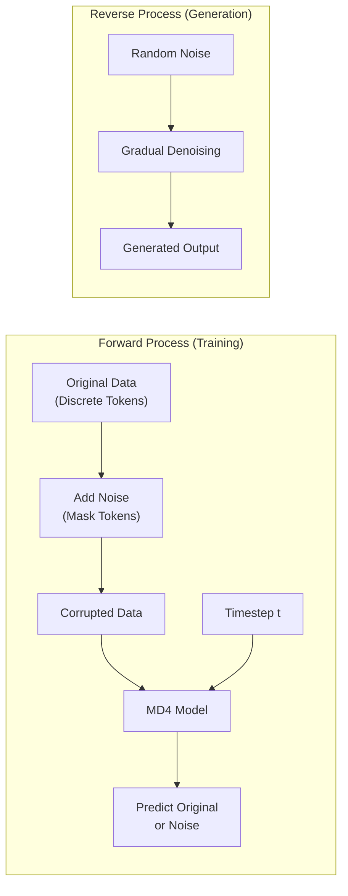

Sources: [README.md:1-1]()

## Core Architecture

MD4 employs a transformer-based architecture that learns to predict original data from corrupted or noised versions. The system is designed to be modular, with clear separation between configuration, data processing, model definition, and training/sampling processes.

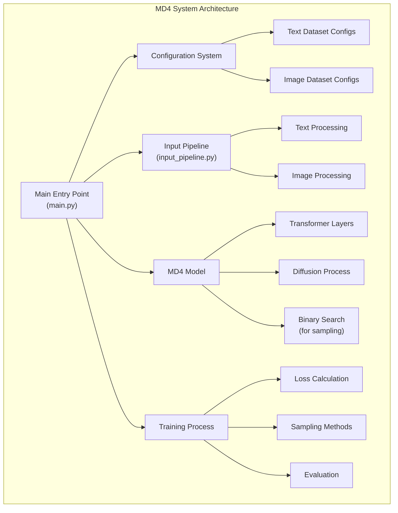

Sources: [README.md:18-39]()

## Supported Data Types

MD4 is designed to work with multiple types of discrete data:

| Data Type | Supported Datasets | Description |
|-----------|-------------------|-------------|
| Text | OpenWebText | Large-scale web text corpus |
| | Text8 | Character-level text dataset with 27 unique characters |
| | FineWeb-EDU | Educational content from the web |
| Images | CIFAR-10 | 32x32 pixel RGB images across 10 classes |
| | ImageNet-64 | 64x64 pixel RGB images across 1000 classes |

Each data type requires specific preprocessing steps to convert the data into discrete tokens that can be processed by the diffusion model.

Sources: [README.md:21-39]()

## Model Variants

The MD4 framework includes two primary model variants:

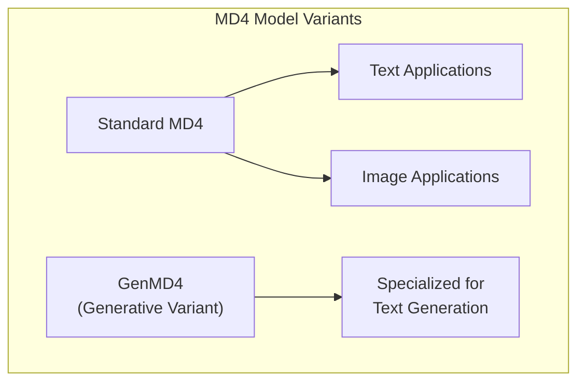

1. **Standard MD4**: The base implementation that works with both text and image data.
2. **GenMD4**: A specialized variant optimized for generative applications, primarily focused on text data.

The model size and configuration can be adjusted based on available computational resources. For example, the README mentions an MD4-S model, which likely refers to a smaller version of the architecture.

Sources: [README.md:28-39]()

## Training Process

The training process involves corrupting the input data by adding noise according to a predetermined schedule, then training the model to predict either the original data or the noise itself.

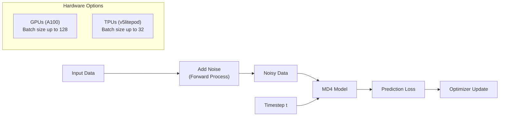

The batch size depends on available compute resources:
- Eight A100 GPUs can support a maximum batch size of 128 for an MD4-S model with sequence length 1024
- Eight v5litepod TPU chips can support a maximum batch size of 32

Sources: [README.md:41-46]()

## Sampling and Generation

MD4 supports multiple sampling strategies for generating new content:

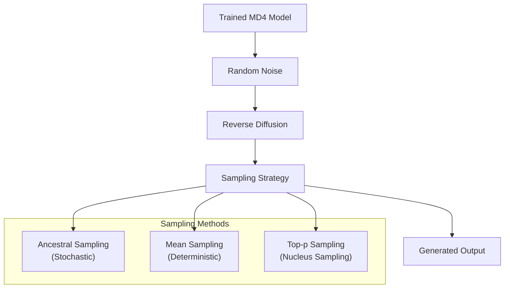

The binary search implementation provides efficient methods for top-k and top-p (nucleus) sampling, which are particularly important for high-quality text generation.

Sources: [README.md:28-39]()

## Usage Example

To train an MD4 model on text data like OpenWebText:

```
python md4/main.py --config=md4/configs/md4/openwebtext.py --sharded=false --workdir=./expt
```

For image data like CIFAR-10:

```
python md4/main.py --config=md4/configs/md4/cifar10.py --sharded=false --workdir=./expt
```

The framework handles the data loading, model initialization, training loop, and evaluation process.

Sources: [README.md:28-39]()

## Summary

MD4 represents a versatile framework for training diffusion models on discrete data types, offering:

1. Support for multiple data modalities (text and images)
2. Different model variants for various applications
3. Flexible configuration for model architecture, diffusion process, and training
4. Support for both GPU and TPU acceleration
5. Advanced sampling methods for high-quality generation

The system follows a modular design that allows for easy experimentation with different datasets, model architectures, and diffusion processes.

Sources: [README.md:1-76]()

---

# Page: Installation and Setup

# Installation and Setup

<details>
<summary>Relevant source files</summary>

The following files were used as context for generating this wiki page:

- [CONTRIBUTING.md](CONTRIBUTING.md)
- [README.md](README.md)

</details>


This page provides comprehensive instructions for setting up the MD4 (Masked Diffusion for Discrete Data) environment, installing dependencies, and preparing the system for both GPU and TPU usage. For information about the overall system architecture, see [System Architecture](#2), and for training instructions, see [Training MD4 Models](#5).

## Environment Requirements

Before installing MD4, ensure your system meets the following requirements:

### Hardware Requirements

MD4 can run on both GPU and TPU hardware:

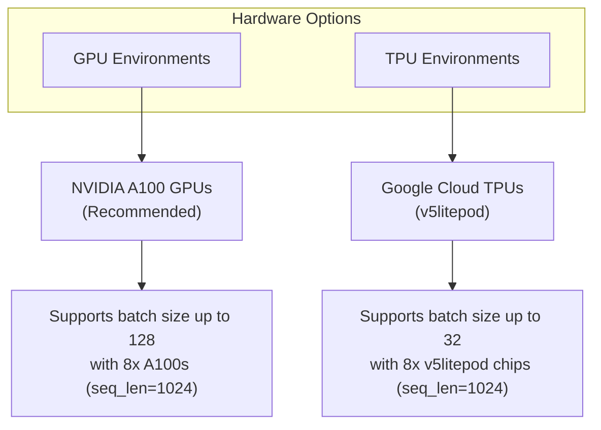

Sources: [README.md:42-46]()

### Software Requirements

The following software is required to run MD4:

- Python 3.8 or newer
- Git (for cloning the repository)
- CUDA drivers (for GPU usage)

## Installation Steps

Follow these steps to set up MD4 on your system:

### 1. Clone the Repository

```bash
git clone https://github.com/google-deepmind/md4.git
cd md4
```

### 2. Create and Activate a Python Virtual Environment

```bash
python -m venv md4_venv
source md4_venv/bin/activate  # On Windows: md4_venv\Scripts\activate
```

### 3. Install Dependencies

Install the appropriate dependencies based on your hardware:

```bash
# For GPU environments:
pip install -r requirements_gpu.txt

# For TPU environments:
pip install -r requirements_tpu.txt
```

### 4. Set Up PYTHONPATH

Ensure the MD4 directory is in your Python path:

```bash
export PYTHONPATH="$PYTHONPATH:$(pwd)"  # On Windows: set PYTHONPATH=%PYTHONPATH%;%CD%
```

Sources: [README.md:7-17]()

## Installation Architecture

The following diagram illustrates the relationship between installation components and the MD4 codebase structure:

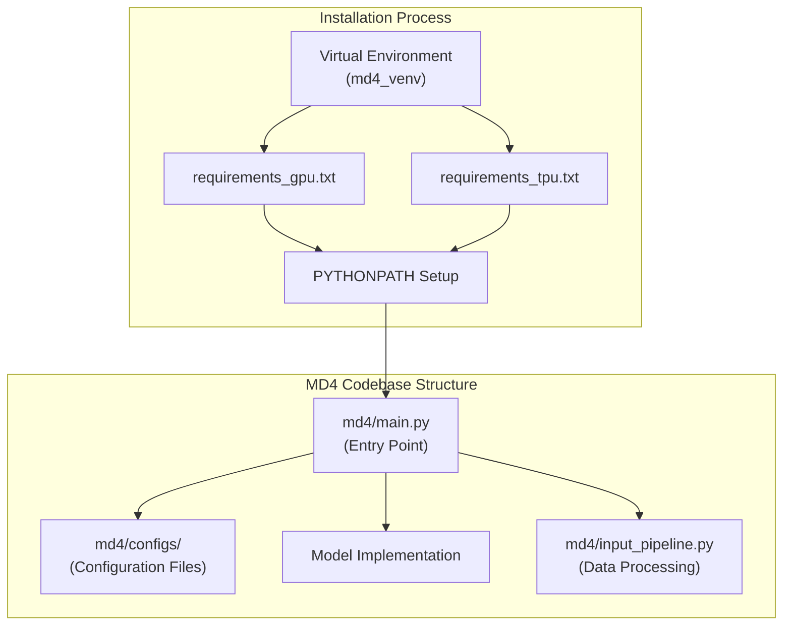

Sources: [README.md:12-17]()

## Data Preparation

Before training, you need to prepare the datasets:

### Preparing OpenWebText

To tokenize and pack examples from the OpenWebText dataset:

```bash
mkdir data_dir
python prepare_openwebtext_data.py
```

Sources: [README.md:21-26]()

## Basic Usage

After installation, you can train MD4 models on different datasets:

### Training on Text Datasets

To train an MD4-S model on OpenWebText or Fineweb-EDU text data:

```bash
python md4/main.py --config=md4/configs/md4/openwebtext.py --sharded=false --workdir=./expt
```

### Training on Image Datasets

To train an MD4-S model on CIFAR-10 or ImageNet-64 image data:

```bash
python md4/main.py --config=md4/configs/md4/cifar10.py --sharded=false --workdir=./expt
```

Sources: [README.md:28-39]()

## Configuration and Hardware Considerations

When setting up MD4 for training, the batch size is a critical parameter that depends on your available compute resources. The following table summarizes the recommended batch sizes for different hardware configurations:

| Hardware Configuration | Model Variant | Sequence Length | Maximum Batch Size |
|-----------------------|---------------|----------------|-------------------|
| 8× NVIDIA A100 GPUs   | MD4-S         | 1024           | 128               |
| 8× v5litepod TPU chips| MD4-S         | 1024           | 32                |

To adjust batch size in your configuration, modify the appropriate configuration file in the `md4/configs/` directory.

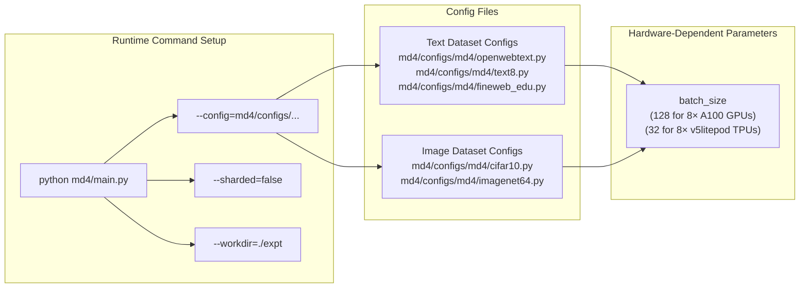

Sources: [README.md:41-46]()

## Troubleshooting

Common installation issues and their solutions:

### PYTHONPATH Issues

If you encounter import errors when running the code, ensure your PYTHONPATH is set correctly:

```bash
# Check current PYTHONPATH
echo $PYTHONPATH

# Set it again if needed
export PYTHONPATH="$PYTHONPATH:/path/to/md4"
```

### GPU/TPU Device Not Found

If the system cannot detect your accelerator:

1. For GPUs: Ensure CUDA is properly installed and visible to Python
2. For TPUs: Verify your Google Cloud TPU configuration and access permissions

## Next Steps

After successful installation and setup:

1. For dataset configuration details, see [Text Dataset Configurations](#3.1) and [Image Dataset Configurations](#3.2)
2. To understand the training process, see [Training MD4 Models](#5)
3. For sampling and generation instructions, see [Sampling and Generation](#6)

Sources: [README.md:5-46]()

---

# Page: System Architecture

# System Architecture

<details>
<summary>Relevant source files</summary>

The following files were used as context for generating this wiki page:

- [README.md](README.md)
- [md4/__init__.py](md4/__init__.py)

</details>


This document provides an overview of the MD4 (Masked Diffusion for Discrete Data) system architecture, explaining the key components and their interactions. It covers the high-level architecture design, core components, data flow, and how the different subsystems work together to implement the masked diffusion approach for discrete data types. For specific model variants and their differences, see [Model Variants](#2.1).

## High-Level System Architecture

The MD4 system consists of several interrelated components that work together to train diffusion models on discrete data such as text and images.

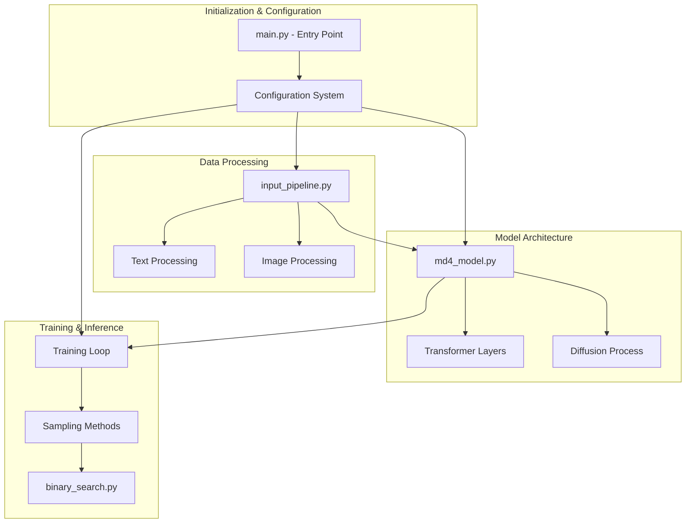

Sources: README.md

## Core Components

### Configuration System

The configuration system defines the model parameters, training settings, and dataset-specific configurations. The system supports several pre-defined configurations for both text and image datasets.

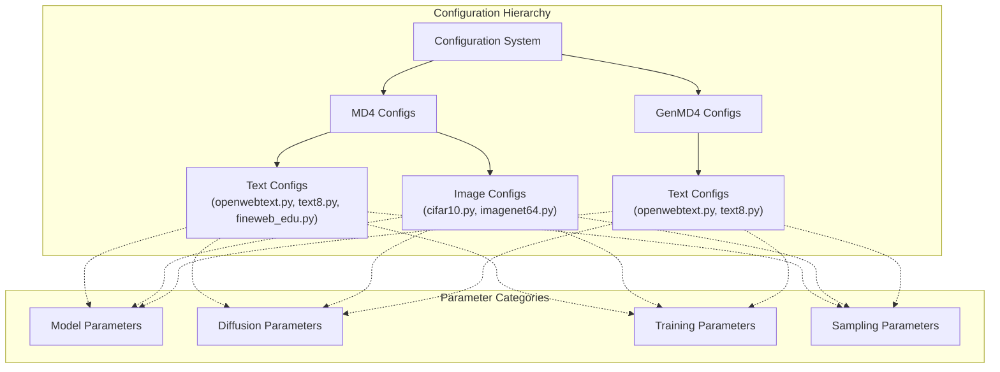

Sources: README.md

### Input Pipeline

The input pipeline handles data loading, preprocessing, and batching for both text and image datasets. It supports multiple datasets including OpenWebText, Text8, and FineWeb-EDU for text, and CIFAR-10 and ImageNet-64 for images.

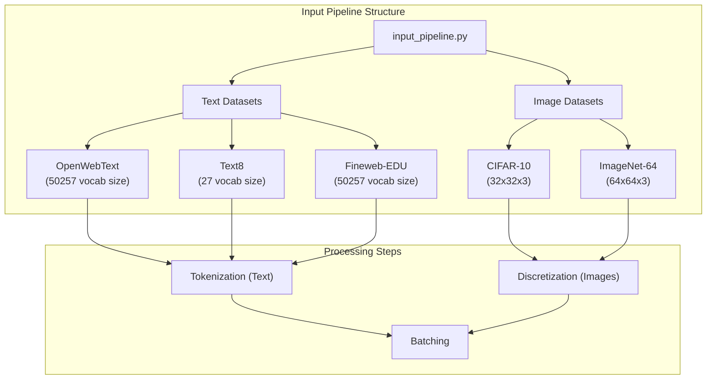

Sources: README.md

### Model Architecture

The MD4 model architecture is based on transformer layers with a diffusion process applied to discrete data. The architecture is designed to be flexible and can be applied to both text and image modalities.

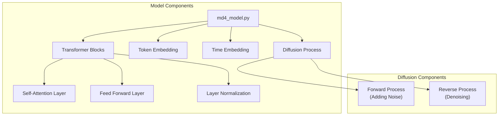

Sources: README.md

### Training and Sampling System

The training process includes forward diffusion, loss calculation, and optimization. The sampling system supports various generation strategies including ancestral sampling, mean-based sampling, and top-p (nucleus) sampling.

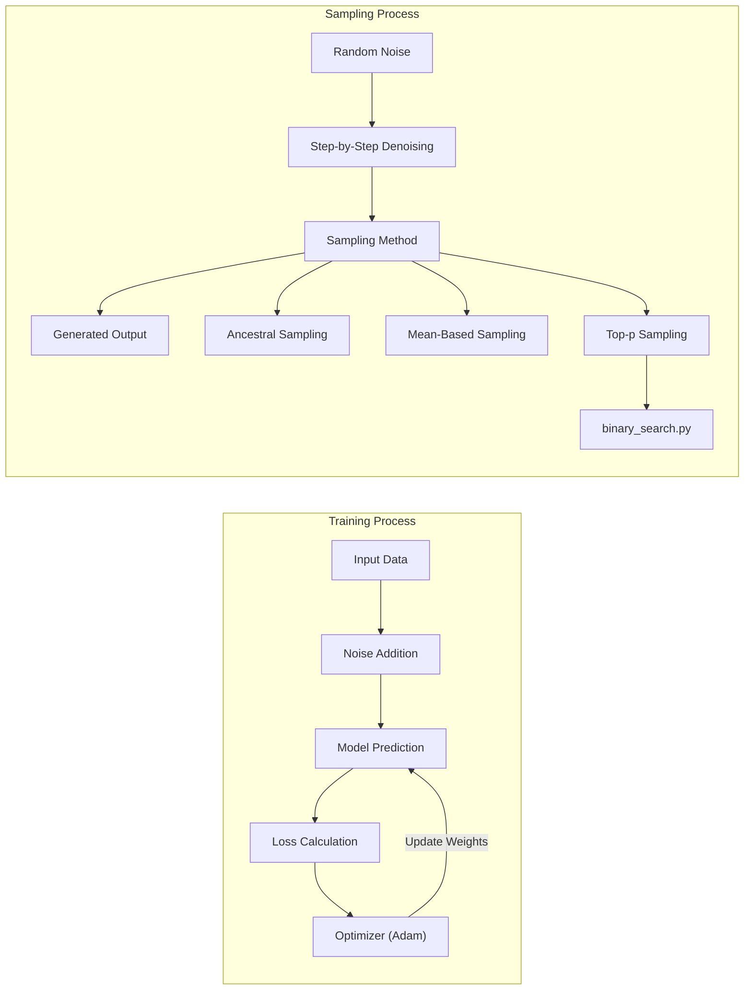

Sources: README.md

## Data Flow and Component Interactions

This diagram illustrates how data flows through the MD4 system during training and generation:

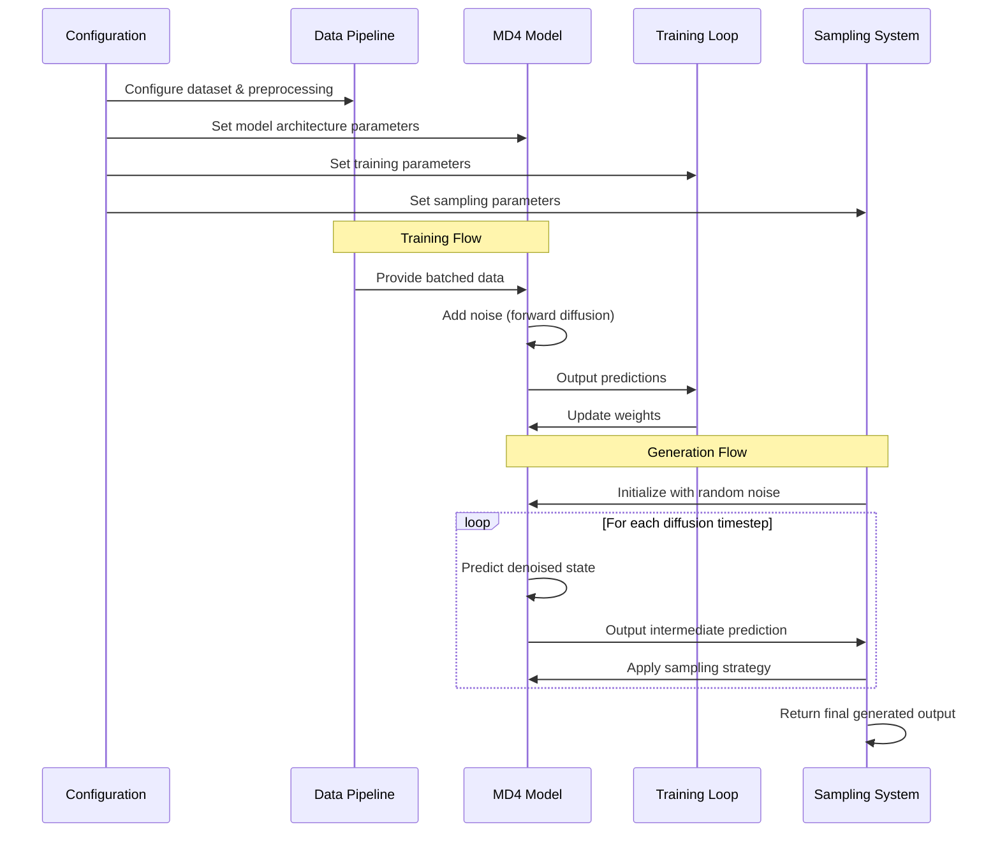

Sources: README.md

## Hardware and Deployment Requirements

The MD4 system supports different hardware accelerators for training and inference:

| Hardware | Supported | Batch Size (MD4-S, seq_len=1024) | Notes |
|----------|-----------|----------------------------------|-------|
| GPU (A100) | Yes | Up to 128 | Using 8x A100 GPUs |
| TPU (v5litepod) | Yes | Up to 32 | Using 8x v5litepod chips |

The system is designed to scale based on available hardware resources. Batch sizes need to be adjusted according to the compute resources available. For optimal performance:

1. For GPU deployments: Use `requirements_gpu.txt` for dependencies
2. For TPU deployments: Use `requirements_tpu.txt` for dependencies

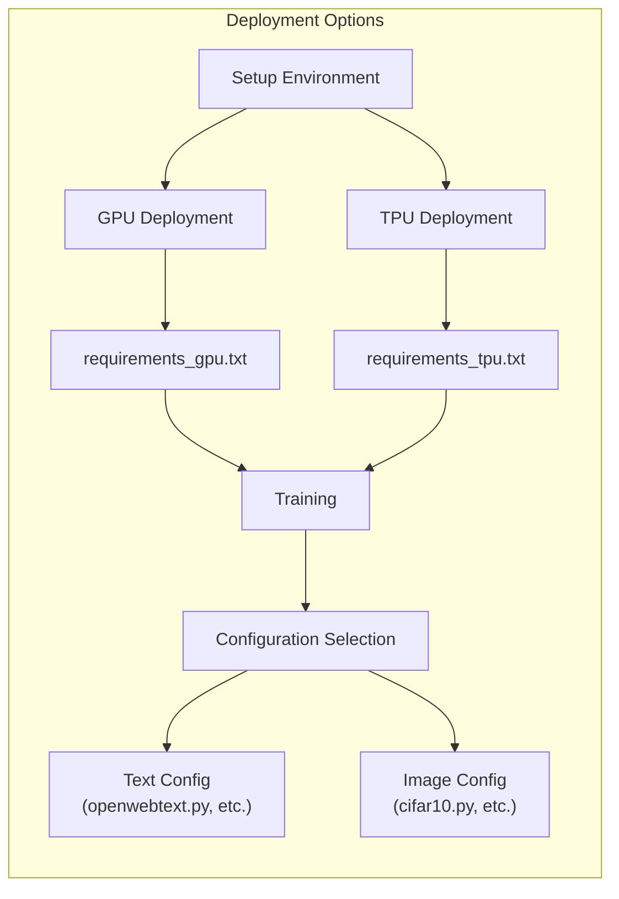

Sources: README.md

## System Integration

The following diagram shows how all components of the MD4 system integrate together, from configuration to output generation:

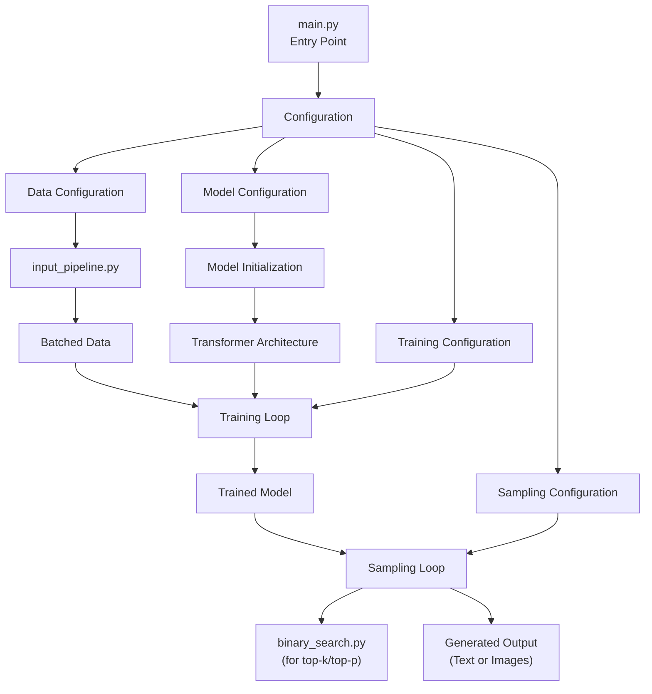

Sources: README.md

## Summary

The MD4 system implements a masked diffusion approach for discrete data types. The architecture is designed to be flexible, supporting various datasets and model configurations. Key architectural components include:

1. **Configuration System**: Provides dataset-specific and model-specific parameters
2. **Input Pipeline**: Handles data loading and preprocessing for text and image datasets
3. **Model Architecture**: Based on transformer layers with diffusion process
4. **Training System**: Implements the forward diffusion process and optimization
5. **Sampling System**: Supports various generation strategies with efficient implementations

This modular design allows for easy experimentation with different datasets, model sizes, and sampling strategies. For specific model variants and their differences, see [Model Variants](#2.1), and for detailed configuration options, see [Configuration System](#3).

---

# Page: Model Variants

# Model Variants

<details>
<summary>Relevant source files</summary>

The following files were used as context for generating this wiki page:

- [md4/configs/genmd4/openwebtext.py](md4/configs/genmd4/openwebtext.py)
- [md4/configs/md4/openwebtext.py](md4/configs/md4/openwebtext.py)

</details>


This page documents the different model variants available in the MD4 (Masked Diffusion for Discrete Data) system. The MD4 repository provides two main model variants: the standard MD4 model and the GenMD4 (Generative MD4) variant. This page explains their differences, capabilities, and use cases.

For information about configuring these model variants for specific datasets, see [Configuration System](#3).

## Overview of MD4 Model Variants

MD4 offers two model variants that serve different purposes in the masked diffusion framework:

1. **MD4 (Standard Model)**: The primary implementation that supports both text and image modalities
2. **GenMD4 (Generative Variant)**: A specialized variant optimized for generative text tasks

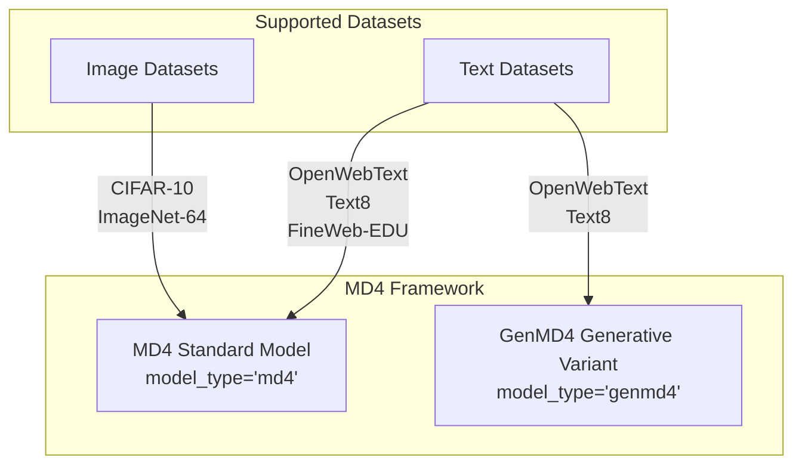

Sources: [md4/configs/md4/openwebtext.py:34](). [md4/configs/genmd4/openwebtext.py:34]()

## MD4 Standard Model

The standard MD4 model is a versatile implementation that supports both text and image data types. It uses a masked diffusion approach to model discrete data distributions.

### Key Characteristics

- **Model Type**: Identified by `model_type = "md4"` in configuration
- **Data Support**: Works with both text and image modalities
- **Sampling Methods**: Supports multiple sampling approaches
  - Ancestral sampling
  - Mean sampling
  - Top-p (nucleus) sampling
- **Sampling Grid Options**: Offers uniform or cosine sampling grid

### Configuration Example

The standard MD4 model is configured with parameters tailored to the specific dataset type:

```
# Model identification
config.model_type = "md4"

# Diffusion process settings
config.timesteps = 1000
config.noise_schedule = "linear"  # Options: linear, cosine, poly[exponent]

# Sampling configuration
config.sampler = "ancestral"  # Options: ancestral, mean, topp
config.sampling_grid = "cosine"  # Options: uniform, cosine
config.topp = 0.98  # For top-p sampling
```

Sources: [md4/configs/md4/openwebtext.py:34-85]()

## GenMD4 Generative Variant

The GenMD4 variant is optimized specifically for generative tasks, with a focus on text generation. It features modifications to the standard MD4 architecture to enhance its generative capabilities.

### Key Characteristics

- **Model Type**: Identified by `model_type = "genmd4"` in configuration
- **Data Support**: Currently only supports text datasets (OpenWebText, Text8)
- **Power Initialization**: Uses `power_init` parameter (set to 1.0 by default)
- **Noise Schedule**: Uses polynomial noise schedule by default, compared to linear in standard MD4

### Configuration Example

The GenMD4 variant has several distinctive configuration elements:

```
# Model identification
config.model_type = "genmd4"

# Diffusion process settings
config.timesteps = 1000
config.noise_schedule = "poly"  # Uses polynomial noise schedule
config.power_init = 1.0
```

Sources: [md4/configs/genmd4/openwebtext.py:34-42]()

## Comparison Between Model Variants

The following table highlights the key differences between MD4 and GenMD4 variants:

| Feature | MD4 (Standard) | GenMD4 (Generative) |
|---------|----------------|---------------------|
| Model Type | `"md4"` | `"genmd4"` |
| Text Dataset Support | OpenWebText, Text8, FineWeb-EDU | OpenWebText, Text8 |
| Image Dataset Support | CIFAR-10, ImageNet-64 | None |
| Default Noise Schedule | Linear | Polynomial |
| Power Initialization | Not specified | 1.0 |
| Sampling Methods | Ancestral, Mean, Top-p | Not explicitly configured |
| Use Case Focus | General-purpose modeling | Text generation optimization |

Sources: [md4/configs/md4/openwebtext.py:34-85](). [md4/configs/genmd4/openwebtext.py:34-42]()

## Model Architecture Details

Both model variants use the same core transformer-based architecture but with different configurations that affect their behavior and performance on specific tasks.

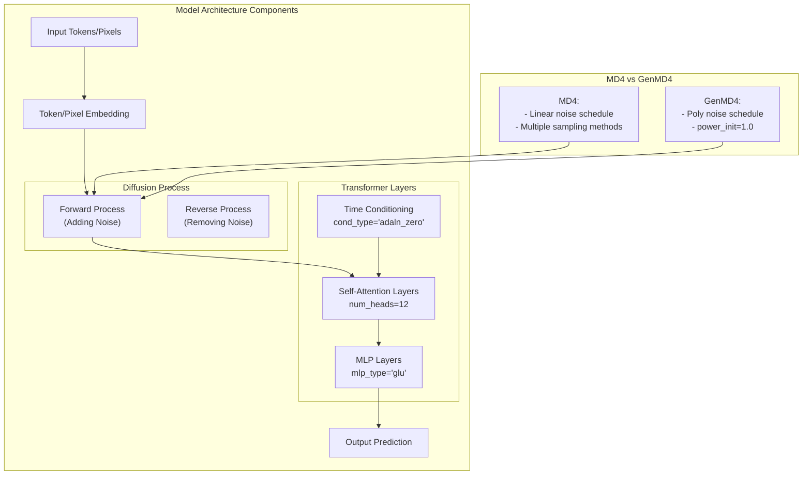

Sources: [md4/configs/md4/openwebtext.py:46-57](). [md4/configs/genmd4/openwebtext.py:45-56]()

## When to Use Each Variant

### Use MD4 Standard Model When:

- You need to work with both text and image data
- You want flexibility in sampling methods
- You need to experiment with different noise schedules
- You want a general-purpose discrete diffusion model

### Use GenMD4 Variant When:

- You're specifically focused on text generation tasks
- You want a model variant potentially optimized for generation quality
- You're working with text datasets like OpenWebText or Text8
- You prefer a polynomial noise schedule for the diffusion process

## Dataset Compatibility

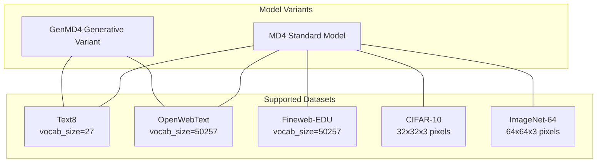

Sources: [md4/configs/md4/openwebtext.py:29-33](). [md4/configs/genmd4/openwebtext.py:29-35]()

## Configuration Parameters Comparison

Both model variants share many configuration parameters but differ in several key aspects. The following table shows important configuration parameters for both variants:

| Parameter | MD4 (Standard) | GenMD4 (Generative) |
|-----------|----------------|---------------------|
| `model_type` | `"md4"` | `"genmd4"` |
| `noise_schedule` | `"linear"` | `"poly"` |
| `power_init` | Not present | `1.0` |
| `feature_dim` | `64` | `64` |
| `n_layers` | `12` | `12` |
| `num_heads` | `12` | `12` |
| `mlp_type` | `"glu"` | `"glu"` |
| `cond_type` | `"adaln_zero"` | `"adaln_zero"` |
| `learning_rate` | `3e-4` | `3e-4` |
| Sampling configs | Present | Not present |

Sources: [md4/configs/md4/openwebtext.py:34-85](). [md4/configs/genmd4/openwebtext.py:34-56]()

## Summary

The MD4 framework provides two model variants to address different use cases within the masked diffusion approach:

1. **MD4 Standard Model**: A versatile implementation supporting both text and image data with flexible sampling methods
2. **GenMD4 Generative Variant**: A specialized variant focused on text generation tasks with optimizations like polynomial noise scheduling

The choice between these variants depends on your specific application requirements, dataset modality, and whether you need specialized generation capabilities or general-purpose diffusion modeling.

---

# Page: Configuration System

# Configuration System

<details>
<summary>Relevant source files</summary>

The following files were used as context for generating this wiki page:

- [README.md](README.md)
- [md4/configs/genmd4/openwebtext.py](md4/configs/genmd4/openwebtext.py)
- [md4/configs/md4/openwebtext.py](md4/configs/md4/openwebtext.py)

</details>


The MD4 Configuration System provides a structured way to define and manage parameters for model training, architecture, data processing, and sampling. This system enables consistent configuration across different model variants and datasets, supporting both text and image modalities.

For information about dataset-specific configurations, see [Text Dataset Configurations](#3.1) and [Image Dataset Configurations](#3.2).

## Configuration File Organization

The configuration files in MD4 are organized hierarchically based on model variant and dataset type.

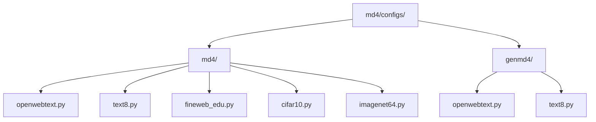

Sources: [md4/configs/md4/openwebtext.py](), [md4/configs/genmd4/openwebtext.py]()

Each configuration file follows a standard structure:

1. A `get_config()` function that returns a `ConfigDict` with default parameters
2. An optional `sweep()` function for hyperparameter tuning

## Configuration File Structure

Each configuration file defines a comprehensive set of parameters using the `ml_collections.ConfigDict` class. Here's an example of how a typical configuration file is structured:

```mermaid
graph TD
    GetConfig["get_config()"] --> ConfigDict["ConfigDict"]
    
    ConfigDict --> DatasetParams["Dataset Parameters"]
    DatasetParams --> DP1["vocab_size<br>dataset<br>classes<br>task_type<br>data_shape"]
    
    ConfigDict --> ModelParams["Model Parameters"]
    ModelParams --> MP1["model_type<br>feature_dim<br>n_layers<br>num_heads<br>mlp_type"]
    
    ConfigDict --> DiffusionParams["Diffusion Parameters"]
    DiffusionParams --> DP2["timesteps<br>noise_schedule<br>time_features<br>cont_time"]
    
    ConfigDict --> TrainingParams["Training Parameters"]
    TrainingParams --> TP1["learning_rate<br>batch_size<br>num_train_steps<br>dropout_rate"]
    
    ConfigDict --> SamplingParams["Sampling Parameters (MD4 only)"]
    SamplingParams --> SP1["sampler<br>sampling_grid<br>topp"]
    
    ConfigDict --> LoggingParams["Logging Parameters"]
    LoggingParams --> LP1["log_loss_every_steps<br>eval_every_steps<br>checkpoint_every_steps"]
    
    Sweep["sweep()"] --> AddFunc["add() function calls"]
    AddFunc --> ParamOverrides["Parameter Overrides"]
```

Sources: [md4/configs/md4/openwebtext.py:23-102](), [md4/configs/genmd4/openwebtext.py:23-92]()

## Key Configuration Parameters

The following table outlines the core parameters found in MD4 configuration files:

| Parameter Category | Key Parameters | Description | Typical Values |
|-------------------|----------------|-------------|----------------|
| Dataset | `vocab_size` | Size of vocabulary | 50257 (OpenWebText), 27 (Text8) |
| Dataset | `dataset` | Dataset name | "openwebtext", "text8", "cifar10" |
| Dataset | `task_type` | Data modality | "text" or "image" |
| Dataset | `data_shape` | Shape of input data | (1024,) for text |
| Model | `model_type` | Model variant | "md4" or "genmd4" |
| Model | `feature_dim` | Feature embedding dimension | 64 |
| Model | `n_layers` | Number of transformer layers | 12 |
| Model | `num_heads` | Number of attention heads | 12 |
| Diffusion | `timesteps` | Number of diffusion steps | 1000 |
| Diffusion | `noise_schedule` | Noise schedule type | "linear", "cosine", "poly" |
| Diffusion | `time_features` | Type of time features | "t" |
| Training | `learning_rate` | Optimizer learning rate | 3e-4 |
| Training | `batch_size` | Training batch size | 512 |
| Training | `num_train_steps` | Total training steps | 1,000,000 |
| Sampling | `sampler` | Sampling method (MD4 only) | "ancestral", "mean", "topp" |
| Sampling | `topp` | Top-p value (MD4 only) | 0.98 |
| Logging | `checkpoint_every_steps` | Checkpoint frequency | 5000 |

Sources: [md4/configs/md4/openwebtext.py:29-90](), [md4/configs/genmd4/openwebtext.py:29-83]()

## Configuration System Integration

The configuration system is central to the operation of MD4, feeding parameters to all major components of the system:

```mermaid
graph TD
    Main["main.py"] --> ConfigParser["Parse Config"]
    ConfigParser --> ConfigFile["md4/configs/*/dataset.py"]
    
    ConfigFile --> ConfigDict["ConfigDict Instance"]
    
    ConfigDict --> ModelBuilder["Model Builder"]
    ConfigDict --> DataProcessor["Input Pipeline"]
    ConfigDict --> TrainingLoop["Training Loop"]
    ConfigDict --> SamplingModule["Sampling Module"]
    
    ModelBuilder --> Model["MD4Model/GenMD4Model"]
    DataProcessor --> ProcessedData["Dataset Iterator"]
    
    Model --> TrainingLoop
    ProcessedData --> TrainingLoop
    
    Model --> SamplingModule
    
    TrainingLoop --> Checkpoints["Checkpoints"]
    TrainingLoop --> Metrics["Training Metrics"]
    
    SamplingModule --> GeneratedSamples["Generated Output"]
```

Sources: [README.md:28-39]()

## Usage Examples

### Basic Training Command

To train a model using a specific configuration:

```bash
python md4/main.py --config=md4/configs/md4/openwebtext.py --workdir=./expt
```

For image data:

```bash
python md4/main.py --config=md4/configs/md4/cifar10.py --workdir=./expt
```

Sources: [README.md:28-39]()

### Batch Size Considerations

The README provides guidance on selecting appropriate batch sizes based on available hardware:

> "For training a MD4-S model with sequence length 1024, eight `A100` GPUs can support a maximum batch size of `128`. If running on TPUs, eight `v5litepod` chips can support a maximum batch size of `32`."

Sources: [README.md:41-46]()

## Hyperparameter Tuning with Sweeps

Each configuration file includes a `sweep()` function that enables hyperparameter tuning:

```python
def sweep(add: abc.Callable[..., None]):
    """Starts multiple work units with varying config args."""
    add(
        noise_schedule="linear",
        dropout_rate=0.02,
        weight_decay=0.03,
    )
```

This function launches training runs with the specified parameter overrides. Multiple parameter combinations can be tested by calling `add()` with different parameters.

To run a sweep:

```bash
python md4/main.py --config=md4/configs/md4/openwebtext.py --workdir=./expt
```

To disable the sweep functionality:

```bash
python md4/main.py --config=md4/configs/md4/openwebtext.py --workdir=./expt --nosweep
```

Sources: [md4/configs/md4/openwebtext.py:98-115](), [md4/configs/genmd4/openwebtext.py:98-104]()

## MD4 vs GenMD4 Configuration Differences

The standard MD4 model and the GenMD4 variant have some key configuration differences:

| Feature | MD4 | GenMD4 |
|---------|-----|--------|
| Model Type | "md4" | "genmd4" |
| Default Noise Schedule | "linear" | "poly" |
| Power Initialization | Not used | Uses `power_init=1.0` |
| Sampling Parameters | Includes `sampler`, `sampling_grid`, `topp` | Does not include sampling parameters |
| Supported Datasets | Text and Images | Text only (based on provided configs) |

Sources: [md4/configs/md4/openwebtext.py:34-85](), [md4/configs/genmd4/openwebtext.py:34-43]()

## Best Practices

When working with the MD4 configuration system, consider these best practices:

1. **Start with existing configs**: Use the provided configuration files as templates for new experiments.
2. **Hardware-aware batch sizing**: Adjust batch sizes based on your available hardware.
3. **Systematic hyperparameter tuning**: Use the sweep functionality to explore parameter spaces methodically.
4. **Parameter organization**: Keep related parameters grouped together when creating custom configurations.
5. **Check compatibility**: Ensure parameters are consistent with the chosen model type (MD4 or GenMD4).

Sources: [md4/configs/md4/openwebtext.py](), [md4/configs/genmd4/openwebtext.py](), [README.md:41-46]()

---

# Page: Text Dataset Configurations

# Text Dataset Configurations

<details>
<summary>Relevant source files</summary>

The following files were used as context for generating this wiki page:

- [md4/configs/genmd4/openwebtext.py](md4/configs/genmd4/openwebtext.py)
- [md4/configs/genmd4/text8.py](md4/configs/genmd4/text8.py)
- [md4/configs/md4/fineweb_edu.py](md4/configs/md4/fineweb_edu.py)
- [md4/configs/md4/openwebtext.py](md4/configs/md4/openwebtext.py)
- [md4/configs/md4/text8.py](md4/configs/md4/text8.py)

</details>


This page documents the configuration options for text datasets used with the MD4 (Masked Diffusion for Discrete Data) framework. It covers the three supported text datasets: Text8, OpenWebText, and FineWeb-EDU, as well as their configuration parameters for both the standard MD4 and generative GenMD4 model variants. For information about image dataset configurations, see [Image Dataset Configurations](#3.2).

## Supported Text Datasets

MD4 supports three primary text datasets, each with different characteristics and use cases.

```mermaid
graph TD
    subgraph "MD4 Text Datasets"
        Text8["Text8<br>Small ASCII text dataset<br>vocab_size=27<br>data_shape=(256,)"]
        OWT["OpenWebText<br>Large web text corpus<br>vocab_size=50257<br>data_shape=(1024,)"]
        FW["FineWeb-EDU<br>Educational web content<br>vocab_size=50257<br>data_shape=(1024,)"]
    end
    
    subgraph "Model Variants"
        MD4["MD4<br>(Standard Diffusion Model)"]
        GenMD4["GenMD4<br>(Generative Variant)"]
    end
    
    MD4 --- Text8 & OWT & FW
    GenMD4 --- Text8 & OWT
```

Sources: [md4/configs/md4/text8.py:29-36](), [md4/configs/md4/openwebtext.py:29-36](), [md4/configs/md4/fineweb_edu.py:29-37](), [md4/configs/genmd4/text8.py:29-36](), [md4/configs/genmd4/openwebtext.py:29-36]()

## Configuration File Structure

Text dataset configurations are defined in Python files under the `md4/configs/` directory, organized by model variant and dataset name.

```mermaid
flowchart TD
    subgraph "md4/configs"
        subgraph "md4/"
            MD4Text8["text8.py"]
            MD4OWT["openwebtext.py"]
            MD4FW["fineweb_edu.py"]
        end
        
        subgraph "genmd4/"
            GenText8["text8.py"]
            GenOWT["openwebtext.py"]
        end
    end
    
    subgraph "Configuration Components"
        DatasetParams["Dataset Parameters<br>vocab_size, data_shape, etc."]
        ModelParams["Model Parameters<br>feature_dim, n_layers, etc."]
        DiffusionParams["Diffusion Parameters<br>timesteps, noise_schedule, etc."]
        TrainingParams["Training Parameters<br>learning_rate, batch_size, etc."]
        SamplingParams["Sampling Parameters<br>sampler, sampling_grid, topp"]
    end
    
    MD4Text8 & MD4OWT & MD4FW & GenText8 & GenOWT --> DatasetParams & ModelParams & DiffusionParams & TrainingParams
    MD4Text8 & MD4OWT & MD4FW --> SamplingParams
```

Sources: [md4/configs/md4/text8.py](), [md4/configs/md4/openwebtext.py](), [md4/configs/md4/fineweb_edu.py](), [md4/configs/genmd4/text8.py](), [md4/configs/genmd4/openwebtext.py]()

## Dataset-Specific Configuration Parameters

Each text dataset has unique configuration parameters that optimize model performance for that specific dataset.

### Text8

Text8 is a character-level dataset derived from Wikipedia text, consisting of 100 million lowercase characters in English with a vocab size of 27 (26 lowercase letters plus space).

| Parameter | MD4 Value | GenMD4 Value | Description |
|-----------|-----------|--------------|-------------|
| `vocab_size` | 27 | 27 | Vocabulary size (26 letters + space) |
| `dataset` | "text8" | "text8" | Dataset identifier |
| `data_shape` | (256,) | (256,) | Sequence length |
| `outside_embed` | True | True | Use outside embeddings |
| `grain_num_workers` | 15 | 15 | Number of data loader workers |

Sources: [md4/configs/md4/text8.py:29-36](), [md4/configs/md4/text8.py:96](), [md4/configs/genmd4/text8.py:29-36](), [md4/configs/genmd4/text8.py:88]()

### OpenWebText

OpenWebText is a large-scale web text corpus with a large vocabulary (50,257 tokens) that mirrors the dataset used to train GPT-2.

| Parameter | MD4 Value | GenMD4 Value | Description |
|-----------|-----------|--------------|-------------|
| `vocab_size` | 50257 | 50259 | Vocabulary size (GPT-2 tokenizer) |
| `dataset` | "openwebtext" | "openwebtext" | Dataset identifier |
| `data_shape` | (1024,) | (1024,) | Sequence length |
| `outside_embed` | False | False | Don't use outside embeddings |
| `grain_num_workers` | 1 | 15 | Number of data loader workers |

Sources: [md4/configs/md4/openwebtext.py:29-36](), [md4/configs/md4/openwebtext.py:98](), [md4/configs/genmd4/openwebtext.py:29-36](), [md4/configs/genmd4/openwebtext.py:88]()

### FineWeb-EDU

FineWeb-EDU contains educational content from the web, using the same tokenizer as OpenWebText but with more curated content.

| Parameter | MD4 Value | GenMD4 Value | Description |
|-----------|-----------|--------------|-------------|
| `vocab_size` | 50257 | N/A | Vocabulary size (GPT-2 tokenizer) |
| `dataset` | "fineweb_edu" | N/A | Dataset identifier |
| `data_shape` | (1024,) | N/A | Sequence length |
| `use_v2_input_pipeline` | True | N/A | Use version 2 of input pipeline |
| `outside_embed` | False | N/A | Don't use outside embeddings |
| `grain_num_workers` | 1 | N/A | Number of data loader workers |

Sources: [md4/configs/md4/fineweb_edu.py:29-37](), [md4/configs/md4/fineweb_edu.py:99]()

## Common Configuration Parameters

Beyond dataset-specific settings, several configuration categories apply across all text datasets.

### Model Parameters

These parameters define the architecture and capacity of the model.

| Parameter | Typical Value | Description |
|-----------|---------------|-------------|
| `model_type` | "md4" or "genmd4" | Model variant |
| `task_type` | "text" | Task modality |
| `feature_dim` | 64 | Feature dimension |
| `n_layers` | 12 | Number of transformer layers |
| `num_heads` | 12 | Number of attention heads |
| `mlp_type` | "glu" | MLP type in transformer |
| `dropout_rate` | 0.0-0.05 | Dropout rate |
| `depth_scaled_init` | True | Use depth-scaled initialization |
| `cond_type` | "adaln_zero" | Conditioning type |

Sources: [md4/configs/md4/text8.py:33-57](), [md4/configs/genmd4/text8.py:33-57](), [md4/configs/md4/openwebtext.py:33-57](), [md4/configs/genmd4/openwebtext.py:33-57](), [md4/configs/md4/fineweb_edu.py:34-58]()

### Diffusion Parameters

These parameters control the diffusion process.

```mermaid
flowchart LR
    subgraph "Diffusion Process Parameters"
        direction TB
        Timesteps["timesteps=1000<br>Number of diffusion steps"]
        Schedule["noise_schedule<br>linear/cosine/poly"]
        TimeFeat["time_features=t<br>Time conditioning"]
        ContTime["cont_time=True<br>Continuous time"]
    end
    
    subgraph "MD4 vs GenMD4 Differences"
        direction TB
        MD4Sched["MD4: Typically linear"]
        GenSched["GenMD4: Typically poly"]
        PowerInit["GenMD4: power_init=1.0"]
    end
    
    Timesteps & Schedule & TimeFeat & ContTime --> DiffusionProcess["Complete Diffusion Process"]
    MD4Sched & GenSched & PowerInit --> DiffusionVariants["Variant-Specific Settings"]
```

Sources: [md4/configs/md4/text8.py:38-44](), [md4/configs/genmd4/text8.py:38-43](), [md4/configs/md4/openwebtext.py:38-44](), [md4/configs/genmd4/openwebtext.py:38-43](), [md4/configs/md4/fineweb_edu.py:39-45]()

### Training Parameters

These parameters control the training process.

| Parameter | Typical Value | Description |
|-----------|---------------|-------------|
| `learning_rate` | 3e-4 | Base learning rate |
| `learning_rate_schedule` | "cosine" | Learning rate schedule |
| `warmup_steps` | 2000 | Number of warmup steps |
| `weight_decay` | 0.0-0.03 | Weight decay for regularization |
| `batch_size` | 512 | Global batch size |
| `num_train_steps` | 1,000,000 | Number of training steps |
| `ema_rate` | 0.9999 | Exponential moving average rate |
| `b2` | 0.999 | Adam optimizer beta2 parameter |
| `clip` | 0.0 | Gradient clipping value |

Sources: [md4/configs/md4/text8.py:59-77](), [md4/configs/genmd4/text8.py:58-77](), [md4/configs/md4/openwebtext.py:59-77](), [md4/configs/genmd4/openwebtext.py:58-77](), [md4/configs/md4/fineweb_edu.py:60-78]()

### Sampling Parameters

These parameters control the generation process (only present in MD4 configs, not GenMD4).

| Parameter | Typical Value | Description |
|-----------|---------------|-------------|
| `sampler` | "ancestral" | Sampling method (options: "ancestral", "mean", "topp") |
| `sampling_grid` | "cosine" | Sampling grid type (options: "uniform", "cosine") |
| `topp` | 0.98 | Top-p value for nucleus sampling |

Sources: [md4/configs/md4/text8.py:80-85](), [md4/configs/md4/openwebtext.py:80-85](), [md4/configs/md4/fineweb_edu.py:81-86]()

## Configuration Sweep Parameters

All configuration files include a `sweep()` function that allows for hyperparameter sweeps during training. These typically vary learning rate, dropout rate, and weight decay.

```python
# Example sweep parameters from OpenWebText MD4 config
learning_rate=3e-4
dropout_rate=0.02
weight_decay=0.03
```

Sources: [md4/configs/md4/text8.py:106-112](), [md4/configs/genmd4/text8.py:98-104](), [md4/configs/md4/openwebtext.py:110-115](), [md4/configs/genmd4/openwebtext.py:98-104](), [md4/configs/md4/fineweb_edu.py:110-116]()

## MD4 vs GenMD4 Differences

The standard MD4 and generative GenMD4 variants have several key differences in their text dataset configurations.

| Feature | MD4 | GenMD4 |
|---------|-----|--------|
| Supported Datasets | Text8, OpenWebText, FineWeb-EDU | Text8, OpenWebText |
| Noise Schedule | Typically "linear" | "poly" |
| Power Initialization | Not used | `power_init=1.0` |
| Sampling Parameters | Explicit (`sampler`, `sampling_grid`, `topp`) | Not explicitly defined |
| OpenWebText Vocabulary | 50257 | 50259 |

Sources: [md4/configs/md4/text8.py](), [md4/configs/genmd4/text8.py](), [md4/configs/md4/openwebtext.py](), [md4/configs/genmd4/openwebtext.py](), [md4/configs/md4/fineweb_edu.py]()

## Configuring a Custom Text Dataset

To configure a custom text dataset, you would typically need to:

1. Create a new configuration file based on an existing template
2. Set the appropriate vocabulary size and data shape
3. Adjust model parameters based on dataset complexity
4. Tune diffusion and training parameters as needed

The choice between Text8-like (character-level) or OpenWebText-like (token-level) configurations will depend on your vocabulary size and tokenization method.

---

# Page: Image Dataset Configurations

# Image Dataset Configurations

<details>
<summary>Relevant source files</summary>

The following files were used as context for generating this wiki page:

- [md4/configs/md4/cifar10.py](md4/configs/md4/cifar10.py)
- [md4/configs/md4/imagenet64.py](md4/configs/md4/imagenet64.py)

</details>


## Purpose and Scope

This page documents the configuration options for image datasets in the MD4 (Masked Diffusion for Discrete Data) framework. Specifically, it covers the configuration parameters for CIFAR-10 and ImageNet-64 datasets, including model architecture settings, training parameters, and sampling options. For text dataset configurations, see [Text Dataset Configurations](#3.1).

## Overview of Image Datasets

MD4 currently supports two primary image datasets:

1. **CIFAR-10**: A dataset of 60,000 32×32 RGB images across 10 classes
2. **ImageNet-64**: Downsampled version of ImageNet with 64×64 RGB images

```mermaid
graph TD
    subgraph "MD4 Image Dataset Configuration System"
        ImageConfig["Image Dataset Configurations"]
        ImageConfig --> CIFAR["CIFAR-10 Config<br>(cifar10.py)"]
        ImageConfig --> ImageNet["ImageNet-64 Config<br>(imagenet64.py)"]
        
        CIFAR --> CIFAR_Params["- 32x32 RGB images<br>- 10 classes<br>- Simple architecture<br>- 32 layers"]
        ImageNet --> ImageNet_Params["- 64x64 RGB images<br>- Optional class conditioning<br>- Hybrid architecture<br>- 8 base layers + 20 DiT layers"]
    end
```

Sources: [md4/configs/md4/cifar10.py:1-117](), [md4/configs/md4/imagenet64.py:1-131]()

## Common Configuration Parameters

Both image datasets share a common set of configuration parameters that control various aspects of the model training and sampling process.

### Core Parameters

| Parameter | Description | Typical Values |
|-----------|-------------|----------------|
| `vocab_size` | Size of vocabulary (pixel values) | 256 (8-bit color) |
| `task_type` | Type of data being modeled | "image" |
| `model_type` | Model architecture type | "md4" |
| `timesteps` | Number of diffusion timesteps | 256 |
| `noise_schedule` | Schedule for noise addition | "linear", "cosine" |
| `time_features` | Type of time features | "t" |
| `cont_time` | Whether to use continuous time | True |

### Training Parameters

| Parameter | Description | Typical Values |
|-----------|-------------|----------------|
| `learning_rate` | Base learning rate | 2e-4 |
| `learning_rate_schedule` | Learning rate schedule | "cosine" |
| `warmup_steps` | Number of warmup steps | 100 |
| `weight_decay` | Weight decay regularization | 0.01 |
| `num_train_steps` | Maximum training steps | 2,000,000 |
| `ema_rate` | Exponential moving average rate | 0.9999 |

### Sampling Parameters

| Parameter | Description | Typical Values |
|-----------|-------------|----------------|
| `sampler` | Sampling strategy | "ancestral", "mean", "topp" |
| `sampling_grid` | Grid type for sampling timesteps | "uniform", "cosine" |
| `topp` | Probability threshold for top-p sampling | 0.98 |

Sources: [md4/configs/md4/cifar10.py:28-84](), [md4/configs/md4/imagenet64.py:28-84]()

## CIFAR-10 Configuration

The CIFAR-10 configuration is designed for training MD4 models on 32×32 RGB images. It uses a simpler architecture compared to ImageNet-64.

```mermaid
graph TD
    subgraph "CIFAR-10 Model Architecture"
        Input["Input: 32x32x3 Images"] --> Embed["Embedding Layer"]
        Embed --> Layers["32 Network Layers<br>feature_dim=128"]
        Layers --> Diffusion["Diffusion Process<br>timesteps=256"]
        Diffusion --> Output["Output: 32x32x3 Images"]
    end
```

### Key Configuration Values

```python
config.vocab_size = 256
config.dataset = "cifar10"
config.data_shape = (32, 32, 3)
config.feature_dim = 128
config.n_layers = 32
config.batch_size = 256
```

### Optimization Goals

The CIFAR-10 configuration includes sweep options for different optimization goals:

- **Best likelihood results**: Uses linear noise schedule with cosine sampling grid
- **Best sample quality**: Uses cosine noise schedule with uniform sampling grid

Sources: [md4/configs/md4/cifar10.py:16-117]()

## ImageNet-64 Configuration

The ImageNet-64 configuration is designed for training on larger 64×64 RGB images, with an option for class-conditional generation. It uses a hybrid architecture that combines standard layers with Diffusion Transformer (DiT) layers.

```mermaid
graph TD
    subgraph "ImageNet-64 Model Architecture"
        Input["Input: 64x64x3 Images"] --> Embed["Embedding Layer"]
        Embed --> BaseLayers["8 Base Network Layers<br>feature_dim=256"]
        BaseLayers --> DiTLayers["20 DiT Layers<br>hidden_size=768<br>num_heads=12"]
        DiTLayers --> Diffusion["Diffusion Process<br>timesteps=256"]
        Diffusion --> Output["Output: 64x64x3 Images"]
        
        ClassLabels["Optional Class Labels<br>(1000 classes)"] -.-> DiTLayers
    end
```

### Key Configuration Values

```python
config.vocab_size = 256
config.dataset = "downsampled_imagenet/64x64"
config.data_shape = (64, 64, 3)
config.feature_dim = 256
config.n_layers = 8
config.n_dit_layers = 20
config.dit_num_heads = 12
config.dit_hidden_size = 768
config.batch_size = 512
```

### Model Variants

The ImageNet-64 configuration supports both unconditional and class-conditional models:

- **Unconditional**: Default configuration without class conditioning
- **Class-conditional**: Optional configuration with 1000 ImageNet classes

Sources: [md4/configs/md4/imagenet64.py:16-131]()

## Configuration Comparison

Below is a side-by-side comparison of key configuration differences between CIFAR-10 and ImageNet-64:

| Parameter | CIFAR-10 | ImageNet-64 |
|-----------|----------|-------------|
| Image dimensions | 32×32×3 | 64×64×3 |
| Feature dimension | 128 | 256 |
| Number of layers | 32 | 8 + 20 DiT layers |
| Batch size | 256 | 512 |
| DiT architecture | Not used | Used with 20 layers |
| Class conditioning | Not supported | Optional (1000 classes) |

Sources: [md4/configs/md4/cifar10.py:1-117](), [md4/configs/md4/imagenet64.py:1-131]()

## Customizing Image Dataset Configurations

The configuration system allows for customizing various parameters to achieve different trade-offs between likelihood optimization and sample quality. This is primarily controlled through the `sweep` function in each configuration file.

```mermaid
flowchart LR
    subgraph "Configuration Trade-offs"
        Config["Base Config"] --> LikelihoodPath["Likelihood Optimization Path"]
        Config --> QualityPath["Sample Quality Path"]
        
        LikelihoodPath --> LinearNoise["noise_schedule='linear'"]
        LikelihoodPath --> CosineSampling["sampling_grid='cosine'"]
        
        QualityPath --> CosineNoise["noise_schedule='cosine'"]
        QualityPath --> UniformSampling["sampling_grid='uniform'"]
    end
```

### Best Practices

- **For best likelihood results**:
  - Use linear noise schedule
  - Use cosine sampling grid
  
- **For best sample quality**:
  - Use cosine noise schedule
  - Use uniform sampling grid

- **For ImageNet-64 specifically**:
  - For best likelihood: Use n_layers=24, n_dit_layers=12
  - Default configuration: n_layers=8, n_dit_layers=20

Sources: [md4/configs/md4/cifar10.py:102-117](), [md4/configs/md4/imagenet64.py:102-131]()

## Relationship to Training System

The image dataset configurations are used by the main training system to determine model architecture, training parameters, and sampling behavior.

```mermaid
graph TD
    subgraph "Config to Training Flow"
        ConfigFiles["Configuration Files<br>(cifar10.py, imagenet64.py)"] --> ConfigObj["Configuration Object"]
        ConfigObj --> ModelBuilder["Model Builder"]
        ConfigObj --> DataPipeline["Data Pipeline<br>(CIFAR-10 or ImageNet-64)"]
        ConfigObj --> TrainLoop["Training Loop"]
        ConfigObj --> SamplingSystem["Sampling System"]
        
        ModelBuilder --> Model["MD4 Model Instance"]
        DataPipeline --> TrainLoop
        Model --> TrainLoop
        Model --> SamplingSystem
    end
```

Sources: [md4/configs/md4/cifar10.py:1-117](), [md4/configs/md4/imagenet64.py:1-131]()

---

# Page: Data Processing Pipeline

# Data Processing Pipeline

<details>
<summary>Relevant source files</summary>

The following files were used as context for generating this wiki page:

- [README.md](README.md)
- [md4/input_pipeline.py](md4/input_pipeline.py)

</details>


This document describes the data processing pipeline of the MD4 (Masked Diffusion for Discrete Data) system, which is responsible for loading, transforming, and preparing both text and image data for training and evaluation. The pipeline provides a unified interface for processing different data modalities while accommodating their specific requirements.

For information about specific text dataset processing details, see [Text Data Processing](#4.1). For specific image dataset processing information, see [Image Data Processing](#4.2).

## Overview

The MD4 data processing pipeline provides a deterministic, configurable approach to prepare data for masked diffusion models. The pipeline supports both text datasets (Text8, OpenWebText, FineWeb-EDU) and image datasets (CIFAR-10, ImageNet-64), with appropriate transformations for each data type.

```mermaid
flowchart TD
    subgraph "Data Processing Pipeline"
        direction LR
        DataSource["Data Sources"] --> Transformations["Data Transformations"]
        Transformations --> Sharding["Process Sharding"]
        Sharding --> Batching["Batching"]
        Batching --> ModelReady["Model-Ready Data"]
    end

    subgraph "Data Sources"
        TextData["Text Datasets<br>- Text8<br>- OpenWebText<br>- FineWeb-EDU"]
        ImageData["Image Datasets<br>- CIFAR-10<br>- ImageNet-64<br>- MNIST"]
    end

    subgraph "Transformations"
        TextTransforms["Text Transformations<br>- Tokenization<br>- Chunking"]
        ImageTransforms["Image Transformations<br>- Discretization<br>- Cropping<br>- Resizing"]
    end

    DataSource --> TextData & ImageData
    Transformations --> TextTransforms & ImageTransforms
```

Diagram: High-level Data Processing Pipeline Overview

Sources: [md4/input_pipeline.py:16-19]()

## Data Sources and Configuration

The MD4 system supports various data sources that are loaded and configured according to the specified dataset in the configuration.

### Text Datasets

- **Text8**: A character-level dataset with 27 characters vocabulary (26 lowercase letters and space)
- **OpenWebText**: A large collection of web text using GPT-2 tokenizer with 50,257 vocabulary size

### Image Datasets

- **CIFAR-10**: 32x32 RGB images in 10 classes
- **ImageNet-64**: 64x64 RGB images of the ImageNet dataset
- **MNIST**: 28x28 grayscale handwritten digit images

```mermaid
flowchart LR
    Config["create_datasets()"] --> DatasetSelection["Dataset Selection"]
    
    DatasetSelection -->|"config.dataset == 'text8'"| Text8["Text8 Processing"]
    DatasetSelection -->|"config.dataset == 'openwebtext'"| OWT["OpenWebText Processing"]
    DatasetSelection -->|"config.dataset.startswith('mnist/cifar/imagenet')"| TFDS["TFDS Image Processing"]
    DatasetSelection -->|"config.dataset == 'class_cond_imagenet64'"| ImageNet["ImageNet Processing"]
    
    Text8 --> Text8Source["ChunkDataSource<br>with Text8Tokenizer"]
    OWT --> OWTSource["ArrayRecordDataSource<br>with GPT2Tokenizer"]
    TFDS --> TFDSSource["TFDS DataSource<br>with DiscreteWithoutLabel"]
    ImageNet --> ImageNetSource["TFDS DataSource<br>with CentralSquareCrop<br>and ResizeSmall"]
    
    Text8Source & OWTSource & TFDSSource & ImageNetSource --> GrainLoader["grain.load()"]
    
    GrainLoader --> TrainLoader["train_loader"]
    GrainLoader --> EvalLoaders["eval_loaders"]
```

Diagram: Dataset Sources and Loading Flow

Sources: [md4/input_pipeline.py:284-407]()

## Data Tokenization and Preprocessing

Different data types require different preprocessing steps:

### Text Tokenization

For text data, the system uses appropriate tokenizers:

1. **Text8Tokenizer**: A custom tokenizer for character-level encoding with a small vocabulary size (27)
2. **GPT2Tokenizer**: Used for OpenWebText and other rich text datasets with a vocabulary size of 50,257

### Image Preprocessing

For image data, the system applies various transformations:

1. **Discretization**: Converts image data to discrete values
2. **Cropping**: Applies central square cropping (for ImageNet)
3. **Resizing**: Resizes images to the target dimensions (e.g., 64x64 for ImageNet)

```mermaid
classDiagram
    class grain.MapTransform {
        <<interface>>
        +map(features) FlatFeatures
    }
    
    class Tokenize {
        +tokenizer: Text8Tokenizer
        +map(features) FlatFeatures
    }
    
    class DiscreteWithoutLabel {
        +map(features) FlatFeatures
    }
    
    class CentralSquareCrop {
        +map(features) FlatFeatures
    }
    
    class ResizeSmall {
        +size: int
        +map(features) FlatFeatures
    }
    
    class DropFeatures {
        +feature_names: Sequence[str]
        +map(features) FlatFeatures
    }
    
    class ParseFeatures {
        +data_column: str
        +map(features) FlatFeatures
    }
    
    grain.MapTransform <|-- Tokenize
    grain.MapTransform <|-- DiscreteWithoutLabel
    grain.MapTransform <|-- CentralSquareCrop
    grain.MapTransform <|-- ResizeSmall
    grain.MapTransform <|-- DropFeatures
    grain.MapTransform <|-- ParseFeatures
```

Diagram: Data Transformation Classes Hierarchy

Sources: [md4/input_pipeline.py:172-262]()

## Text Data Processing Detail

### Text8 Processing

The Text8 dataset is processed as follows:

1. Data is downloaded from the source URL if not present
2. The raw text is split into train, validation, and test segments
3. Text is chunked into sequences of the configured length (typically 256)
4. Each character is tokenized using the `Text8Tokenizer`

```
Text8 Processing Flow:
Raw Text → Chunking → Character Tokenization → Batching
```

| Component | Function |
|-----------|----------|
| `Text8Tokenizer` | Encodes characters to integer tokens (a-z → 0-25, space → 26) |
| `ChunkDataSource` | Divides text into chunks of specified length (overlapping or non-overlapping) |
| `Tokenize` transform | Applies the tokenizer to each chunk |

Sources: [md4/input_pipeline.py:52-136](), [md4/input_pipeline.py:138-179]()

### OpenWebText Processing

For the OpenWebText dataset:

1. Uses precomputed tokenized data stored in ArrayRecord format
2. Each example is parsed using the `ParseFeatures` transformation
3. Uses GPT-2 tokenizer with a vocabulary size of 50,257
4. Configured for a sequence length of 1024

Sources: [md4/input_pipeline.py:331-348]()

## Image Data Processing Detail

Different image datasets are processed with specific transformations:

### CIFAR-10 and MNIST Processing

For CIFAR-10 and MNIST:

1. Loaded using TensorFlow Datasets (TFDS)
2. Processed using the `DiscreteWithoutLabel` transformation to remove labels
3. Images are converted to integer format for the discrete diffusion model

### ImageNet-64 Processing

For ImageNet-64:

1. Loaded from ImageNet2012 TFDS dataset
2. Applied `CentralSquareCrop` to create square images
3. Resized to 64x64 using `ResizeSmall` transformation
4. Unnecessary features removed with `DropFeatures`

Sources: [md4/input_pipeline.py:349-373]()

## Data Loading and Batching

The data pipeline uses Grain library to efficiently load and batch data:

```mermaid
flowchart TD
    createDatasets["create_datasets(config, seed)"] --> TrainLoader["Train Loader Configuration"]
    createDatasets --> EvalLoader["Evaluation Loader Configuration"]
    
    subgraph "Train Loader Setup"
        TrainLoader --> TrainSource["Define Train Source<br>Based on Dataset Type"]
        TrainSource --> TrainTransform["Configure Transformations"]
        TrainTransform --> GrainTrainLoad["grain.load()<br>with shuffle=True"]
    end
    
    subgraph "Eval Loader Setup"
        EvalLoader --> EvalSource["Define Eval Sources<br>For Different Splits"]
        EvalSource --> EvalTransform["Configure Transformations"]
        EvalTransform --> GrainEvalLoad["grain.load()<br>with num_epochs=1"]
    end
    
    subgraph "Shard Options"
        ShardConfig["Configure Sharding"]
        ShardConfig -->|"Training"| TrainShard["ShardByJaxProcess<br>drop_remainder=True"]
        ShardConfig -->|"Evaluation"| EvalShard["ShardByJaxProcess<br>drop_remainder=drop_remainder"]
    end
    
    GrainTrainLoad --> ReturnValues["Return:<br>train_loader, eval_loaders, info"]
    GrainEvalLoad --> ReturnValues
    
    TrainShard --> GrainTrainLoad
    EvalShard --> GrainEvalLoad
```

Diagram: Data Loading and Batching Process

Sources: [md4/input_pipeline.py:284-407]()

Key configuration parameters include:

| Parameter | Description |
|-----------|-------------|
| `batch_size` | Total batch size across all processes |
| `process_batch_size` | Batch size per process (batch_size / process_count) |
| `grain_num_workers` | Number of workers for data loading |
| `eval_pad_last_batch` | Whether to pad the last batch during evaluation |
| `eval_batch_size` | Batch size for evaluation (defaults to training batch_size) |

Sources: [md4/input_pipeline.py:297-301]()

## Integration with Training

The data pipeline integrates with the training process through the `create_datasets` function, which returns:

1. `train_loader`: A Grain data loader for training data
2. `eval_loaders`: A dictionary of data loaders for evaluation data
3. `info`: Additional information like tokenizers needed by the model

The `get_num_train_steps` function calculates the total number of training steps based on the dataset size, batch size, and number of epochs.

```python
# Example usage in training loop
train_loader, eval_loaders, info = create_datasets(config, seed)
num_train_steps = get_num_train_steps(config)

for batch in train_loader:
    # Training step with batch
    ...

# Evaluation
for split, eval_loader in eval_loaders.items():
    for batch in eval_loader:
        # Evaluation step with batch
        ...
```

Sources: [md4/input_pipeline.py:264-282](), [md4/input_pipeline.py:284-407]()

## Usage Examples

### Preparing OpenWebText Data

Before training a model on OpenWebText, you need to prepare the dataset:

```bash
mkdir data_dir
python prepare_openwebtext_data.py
```

This tokenizes the text data and packs it into the required format for efficient loading during training.

Sources: [README.md:20-26]()

### Training with the Prepared Data

Once the data is prepared, you can train a model using:

```bash
python md4/main.py --config=md4/configs/md4/openwebtext.py --sharded=false --workdir=./expt
```

For image data:

```bash
python md4/main.py --config=md4/configs/md4/cifar10.py --sharded=false --workdir=./expt
```

Sources: [README.md:28-39]()

## Hardware Considerations

The batch size used in the data pipeline should be chosen based on available hardware:

- For a MD4-S model with sequence length 1024:
  - Eight A100 GPUs can support a maximum batch size of 128
  - Eight v5litepod TPU chips can support a maximum batch size of 32

Sources: [README.md:41-46]()

---

# Page: Text Data Processing

# Text Data Processing

<details>
<summary>Relevant source files</summary>

The following files were used as context for generating this wiki page:

- [md4/configs/md4/openwebtext.py](md4/configs/md4/openwebtext.py)
- [md4/configs/md4/text8.py](md4/configs/md4/text8.py)
- [md4/input_pipeline.py](md4/input_pipeline.py)

</details>


This document details how text data is processed, tokenized, and prepared for training and generation in the MD4 (Masked Diffusion for Discrete Data) framework. It covers the implementation of text data sources, tokenization mechanisms, and the data loading pipeline. For information about image data processing, see [Image Data Processing](#4.2).

## Supported Text Datasets

MD4 supports the following text datasets:

| Dataset | Vocabulary Size | Sequence Length | Description |
|---------|----------------|-----------------|-------------|
| Text8 | 27 | 256 | Character-level dataset with lowercase letters and space |
| OpenWebText | 50257 | 1024 | Web text corpus tokenized with GPT-2 tokenizer |

Sources: [md4/configs/md4/text8.py:29-35](), [md4/configs/md4/openwebtext.py:29-35]()

## Text Data Processing Pipeline

The following diagram illustrates the overall text data processing pipeline in MD4:

```mermaid
flowchart TD
    subgraph "Dataset Sources"
        Text8Raw["Text8 Raw Data<br>(100M characters)"]
        OWTData["OpenWebText Processed Data<br>(ArrayRecord format)"]
    end

    subgraph "Data Loading"
        Text8Raw --> ChunkDS["ChunkDataSource<br>overlapping=true/false"]
        OWTData --> ARSource["grain.ArrayRecordDataSource"]
    end

    subgraph "Transformations"
        ChunkDS --> TokenizeT["Tokenize<br>(Text8Tokenizer)"]
        ARSource --> ParseFeatT["ParseFeatures<br>(data_column='text')"]
    end

    subgraph "Training Pipeline"
        TokenizeT & ParseFeatT --> GrainLoad["grain.load()"]
        GrainLoad --> Shuffle["shuffle=True"]
        Shuffle --> Shard["ShardByJaxProcess"]
        Shard --> Batch["batch_size=process_batch_size"]
        Batch --> TrainLoader["Training DataLoader"]
    end

    subgraph "Evaluation Pipeline"
        TokenizeT & ParseFeatT --> GrainLoadE["grain.load()"]
        GrainLoadE --> ShardE["ShardByJaxProcess"]
        ShardE --> BatchE["batch_size=process_eval_batch_size"]
        BatchE --> EvalLoader["Evaluation DataLoader"]
    end
```

Sources: [md4/input_pipeline.py:284-407]()

## Tokenization

MD4 implements different tokenization strategies depending on the dataset being used:

### Text8 Tokenizer

For the Text8 dataset, MD4 uses a custom character-level tokenizer that maps lowercase letters (a-z) to integers 0-25, with the space character represented by token 26.

```mermaid
classDiagram
    class Text8Tokenizer {
        +num_extra_tokens: int
        +vocab_size(): int
        +pad_token(): int
        +encode(text): np.ndarray
        +decode(tokens): str
    }
```

The tokenizer performs the following operations:
- **Encoding**: Converts ASCII character codes to token IDs (a=0, b=1, ..., z=25, space=26)
- **Decoding**: Converts token IDs back to ASCII characters and joins them into a string

Sources: [md4/input_pipeline.py:52-74]()

### GPT-2 Tokenizer

For OpenWebText, MD4 uses the pretrained GPT-2 tokenizer from the HuggingFace transformers library, which has a vocabulary size of 50257 tokens.

```mermaid
flowchart LR
    OWTText["Raw Text"] --> HFTokenizer["transformers.GPT2Tokenizer"]
    HFTokenizer --> TokenizedSeq["Tokenized Sequence<br>(50257 vocab)"]
```

Sources: [md4/input_pipeline.py:347-348]()

## Chunking Mechanism

Text data is divided into fixed-length chunks using the `ChunkDataSource` class:

```mermaid
classDiagram
    class ChunkDataSource {
        +tensor: np.ndarray
        +chunk_size: int
        +overlapping: bool
        +__len__(): int
        +__getitem__(record_key): dict
    }
```

The chunking mechanism supports two modes:
- **Non-overlapping**: Text is divided into discrete chunks of length `chunk_size`
- **Overlapping**: Creates chunks that overlap, enabling more training samples (used for Text8 training)

Sources: [md4/input_pipeline.py:138-169]()

## Data Transformation Pipeline

Text data undergoes several transformations before being fed to the model:

```mermaid
flowchart LR
    subgraph "Text8 Pipeline"
        Text8Raw["Raw Text"] --> Text8Chunking["ChunkDataSource<br>chunk_size=256"]
        Text8Chunking --> Text8TokenizeT["Tokenize Transform"]
        Text8TokenizeT --> Text8Batched["Batched Samples"]
    end

    subgraph "OpenWebText Pipeline"
        OWTRaw["ArrayRecord Files"] --> OWTSource["ArrayRecordDataSource"]
        OWTSource --> OWTParse["ParseFeatures<br>data_column='text'"]
        OWTParse --> OWTBatched["Batched Samples"]
    end
```

The pipeline consists of these key transformations:

1. **Tokenize**: Converts text to token IDs using the appropriate tokenizer
2. **ParseFeatures**: For OpenWebText, parses the serialized examples from ArrayRecord format

Sources: [md4/input_pipeline.py:172-180](), [md4/input_pipeline.py:242-261]()

## Data Loading and Batching

The `create_datasets` function orchestrates the entire data loading process:

```mermaid
flowchart TD
    Config["Configuration<br>batch_size, per_device_batch_size"] --> ProcessBatchSize["Calculate process_batch_size<br>batch_size / jax.process_count()"]
    
    ProcessBatchSize --> TrainLoader["Train DataLoader<br>grain.load()"]
    ProcessBatchSize --> EvalLoader["Eval DataLoader<br>grain.load()"]
    
    subgraph "Train Loading Parameters"
        TSource["Data Source"]
        TShuffle["shuffle=True"]
        TSeed["seed=config seed"]
        TShardOpt["ShardByJaxProcess<br>drop_remainder=True"]
        TTrans["train_transformations"]
        TBatch["batch_size=process_batch_size"]
        TWorker["worker_count=config.grain_num_workers"]
    end
    
    TSource & TShuffle & TSeed & TShardOpt & TTrans & TBatch & TWorker --> TrainLoader
    
    subgraph "Eval Loading Parameters"
        ESource["Eval Data Source"]
        ENumEpochs["num_epochs=1"]
        EShardOpt["ShardByJaxProcess<br>drop_remainder=True"]
        ETrans["eval_transformations"]
        EBatch["batch_size=process_eval_batch_size"]
        EWorker["worker_count=0"]
        EDropRem["drop_remainder=True"]
    end
    
    ESource & ENumEpochs & EShardOpt & ETrans & EBatch & EWorker & EDropRem --> EvalLoader
```

The loading process handles:
- Sharding data across multiple JAX processes for distributed training
- Batching samples based on device count and configured batch size
- Applying appropriate transformations based on dataset type

Sources: [md4/input_pipeline.py:284-407]()

## Dataset-Specific Processing

### Text8 Processing

For Text8, the processing flow is:

1. Download and unzip the text8.zip file if not already present
2. Split data into train (90M chars), validation (5M chars), and test (5M chars)
3. Create ChunkDataSource with appropriate chunking parameters
4. Apply Text8Tokenizer transformation

```mermaid
flowchart LR
    ZipFile["text8.zip"] --> RawData["100M Characters<br>a-z + space"]
    RawData --> Split["Split Data<br>train: 90M<br>valid: 5M<br>test: 5M"]
    Split --> ChunkDS["ChunkDataSource<br>chunk_size=256"]
    ChunkDS --> Tokenize["Tokenize<br>Text8Tokenizer"]
    Tokenize --> DataLoader["DataLoader"]
```

Sources: [md4/input_pipeline.py:77-136](), [md4/input_pipeline.py:308-328]()

### OpenWebText Processing

For OpenWebText, the processing flow is:

1. Load preprocessed data from ArrayRecord files
2. Create ArrayRecordDataSource pointing to train and eval paths
3. Apply ParseFeatures transformation to extract tokenized text
4. Use GPT-2 tokenizer for any additional processing

```mermaid
flowchart LR
    PreprocessedPath["owt_splits_1024_train/eval"] --> ARSource["ArrayRecordDataSource"]
    ARSource --> ParseFeat["ParseFeatures<br>data_column='text'"]
    ParseFeat --> DataLoader["DataLoader"]
```

Sources: [md4/input_pipeline.py:331-349]()

## Configuration Parameters

Text data processing is controlled by several configuration parameters:

| Parameter | Description | Text8 Value | OpenWebText Value |
|-----------|-------------|-------------|-------------------|
| vocab_size | Size of the token vocabulary | 27 | 50257 |
| data_shape | Shape of the input sequence | (256,) | (1024,) |
| task_type | Type of task | "text" | "text" |
| outside_embed | Whether to use outside embedding | True | False |
| batch_size | Global batch size | 512 | 512 |
| grain_num_workers | Number of data loading workers | 15 | 1 |

Sources: [md4/configs/md4/text8.py:23-100](), [md4/configs/md4/openwebtext.py:23-102]()

## Integration with Training Pipeline

The text data processing pipeline integrates with the training system through the `create_datasets` function, which returns:

1. A training data loader (`grain.DataLoader`)
2. A dictionary of evaluation data loaders for each evaluation split
3. Additional information like the tokenizer instance

These components are then used by the main training loop to fetch batches of tokenized text sequences for model training and evaluation.

Sources: [md4/input_pipeline.py:284-407]()

---

# Page: Image Data Processing

# Image Data Processing

<details>
<summary>Relevant source files</summary>

The following files were used as context for generating this wiki page:

- [md4/configs/md4/cifar10.py](md4/configs/md4/cifar10.py)
- [md4/configs/md4/imagenet64.py](md4/configs/md4/imagenet64.py)
- [md4/input_pipeline.py](md4/input_pipeline.py)

</details>


This page documents the image data processing pipeline used in the MD4 (Masked Diffusion for Discrete Data) model. It covers how image datasets are loaded, preprocessed, and prepared for training and evaluation. The MD4 model treats images as discrete data by working with 8-bit color values (0-255) per channel, which aligns with its core approach of handling discrete tokens.

For information about text data processing, see [Text Data Processing](#4.1).

## Supported Image Datasets

MD4 currently supports the following image datasets:

| Dataset | Resolution | Color Channels | Data Shape | Vocabulary Size |
|---------|------------|----------------|------------|----------------|
| CIFAR-10 | 32×32 | 3 (RGB) | (32, 32, 3) | 256 |
| ImageNet-64 | 64×64 | 3 (RGB) | (64, 64, 3) | 256 |
| Class-conditional ImageNet-64 | 64×64 | 3 (RGB) | (64, 64, 3) | 256 |

Each pixel channel value is treated as a discrete token from a vocabulary of size 256 (representing 0-255 intensity values).

Sources: [md4/configs/md4/cifar10.py:28-35](), [md4/configs/md4/imagenet64.py:28-35]()

## Image Data Pipeline Architecture

```mermaid
flowchart TD
    DataSource["TFDS Data Source<br>tfds.data_source()"] --> |"Load Dataset"| RawData["Raw Image Data"]
    RawData --> |"Optional for ImageNet"| CentralCrop["CentralSquareCrop<br>Make square from center"]
    RawData --> |"Standard for CIFAR/MNIST"| Discretize["DiscreteWithoutLabel<br>Convert to int32, remove labels"]
    CentralCrop --> |"Optional for ImageNet"| Resize["ResizeSmall<br>Resize to target dimensions (64x64)"]
    Resize --> Discretize
    Discretize --> Shard["ShardByJaxProcess<br>Distribute across devices"]
    Shard --> Batch["Batch Data<br>Fixed batch size"]
    Batch --> TrainLoader["Training DataLoader<br>grain.load()"]
    Batch --> EvalLoader["Evaluation DataLoader<br>grain.load()"]
```

This diagram illustrates the image data processing flow. The pipeline starts by loading the dataset through TFDS, applies appropriate transformations, shards the data across devices, and batches it for training or evaluation.

Sources: [md4/input_pipeline.py:183-225](), [md4/input_pipeline.py:349-372](), [md4/input_pipeline.py:376-406]()

## Image Preprocessing Transformations

### DiscreteWithoutLabel

The most fundamental transformation for image data processing is `DiscreteWithoutLabel`, which:
1. Converts image data to int32 data type
2. Removes any label or ID fields that aren't needed for unsupervised training

```python
@dataclasses.dataclass(frozen=True)
class DiscreteWithoutLabel(grain.MapTransform):
  def map(self, features):
    features["image"] = features["image"].astype(np.int32)
    if "label" in features:
      del features["label"]
    if "id" in features:
      del features["id"]
    return features
```

This transformation ensures that images are treated as discrete tokens suitable for the diffusion process.

Sources: [md4/input_pipeline.py:183-192]()

### Additional ImageNet-Specific Transformations

For ImageNet, which starts with variable-sized images, additional preprocessing is required:

1. **CentralSquareCrop**: Crops the image to a square from the center
   ```python
   @dataclasses.dataclass(frozen=True)
   class CentralSquareCrop(grain.MapTransform):
     def map(self, features: FlatFeatures) -> FlatFeatures:
       image = features["image"]
       h, w = image.shape[:2]
       size = min(h, w)
       top = (h - size) // 2
       left = (w - size) // 2
       image = image[top : top + size, left : left + size, :]
       features["image"] = image
       return features
   ```

2. **ResizeSmall**: Resizes the image to the target dimensions (64×64 for ImageNet-64)
   ```python
   @dataclasses.dataclass(frozen=True)
   class ResizeSmall(grain.MapTransform):
     size: int
     def map(self, features: FlatFeatures) -> FlatFeatures:
       image = features["image"]
       size = self.size
       image = cv2.resize(image, dsize=(size, size), interpolation=cv2.INTER_AREA)
       features["image"] = image.astype(np.int32)
       return features
   ```

Sources: [md4/input_pipeline.py:195-225]()

## Dataset Loading Implementation

The image datasets are loaded using TensorFlow Datasets (TFDS). The function `create_datasets` in `input_pipeline.py` contains the logic for determining which dataset to load and how to process it:

```mermaid
flowchart LR
    Config["Configuration<br>config.dataset"] --> Condition{"Dataset Type?"}
    
    Condition -->|"MNIST/CIFAR/ImageNet"| TFDSLoad["tfds.data_source(config.dataset)"]
    Condition -->|"class_cond_imagenet64"| ImageNetLoad["tfds.data_source('imagenet2012')"]
    
    TFDSLoad --> StandardTransform["Apply DiscreteWithoutLabel"]
    ImageNetLoad --> CustomTransform["Apply Special Transformations:<br>1. CentralSquareCrop<br>2. ResizeSmall(64)<br>3. DropFeatures"]
    
    StandardTransform & CustomTransform --> GrainLoader["grain.load()<br>with sharding & batching"]
    
    GrainLoader --> TrainDS["Train DataLoader"]
    GrainLoader --> EvalDS["Eval DataLoaders"]
```

For standard image datasets (CIFAR-10, ImageNet-64), only the `DiscreteWithoutLabel` transformation is applied. For class-conditional ImageNet, a sequence of transformations is applied to prepare the data.

Sources: [md4/input_pipeline.py:284-407](), [md4/input_pipeline.py:349-372]()

## Configuration Options for Image Data

The configuration system provides several options specific to image datasets:

### Basic Dataset Configuration

```python
# CIFAR-10 configuration example
config.vocab_size = 256
config.dataset = "cifar10"
config.classes = -1  # -1 means unconditional model
config.task_type = "image"
config.data_shape = (32, 32, 3)
```

### Model Architecture Considerations

Different image resolutions require different model architectures:

| Dataset | Feature Dimension | Layers | DIT Layers | Notes |
|---------|-------------------|--------|------------|-------|
| CIFAR-10 | 128 | 32 | 0 | Smaller networks sufficient |
| ImageNet-64 | 256 | 8 | 20 | Uses additional DIT (DiT transformer) layers |

For example, the configuration for ImageNet-64 includes additional transformer layers (DiT) to handle the higher resolution:

```python
# ImageNet-64 configuration
config.feature_dim = 256
config.n_layers = 8  # Base layers
config.n_dit_layers = 20  # Additional transformer layers
config.dit_num_heads = 12
config.dit_hidden_size = 768
```

Sources: [md4/configs/md4/cifar10.py:28-57](), [md4/configs/md4/imagenet64.py:28-57]()

## Data Sharding and Batching

To efficiently process data across multiple devices, the MD4 system implements:

1. **Data Sharding**: Data is sharded across JAX processes using `grain.ShardByJaxProcess`
2. **Batching**: Fixed batch sizes are used for training and evaluation
3. **Parallelism**: The `grain_num_workers` parameter controls the number of worker processes for data loading

```python
train_loader = grain.load(
    source=train_source,
    shuffle=True,
    seed=seed,
    shard_options=grain.ShardByJaxProcess(drop_remainder=True),
    transformations=train_transformations,
    batch_size=process_batch_size,
    worker_count=config.grain_num_workers,
)
```

The batch size is calculated based on the total batch size divided by the number of JAX processes:

```python
process_batch_size = config.batch_size // jax.process_count()
```

This ensures efficient distribution of the workload across multiple devices.

Sources: [md4/input_pipeline.py:376-385](), [md4/input_pipeline.py:298-300]()

## Typical Configuration Values for Image Datasets

| Parameter | CIFAR-10 | ImageNet-64 | Description |
|-----------|----------|-------------|-------------|
| batch_size | 256 | 512 | Total batch size across all devices |
| feature_dim | 128 | 256 | Model feature dimension |
| n_layers | 32 | 8 | Number of base model layers |
| n_dit_layers | 0 | 20 | Number of DiT transformer layers |
| timesteps | 256 | 256 | Number of diffusion timesteps |
| noise_schedule | "linear" | "linear" | Type of noise schedule |
| sampling_grid | "cosine" | "cosine" | Grid for sampling timesteps |

These configuration values can be adjusted based on the available computational resources and the desired quality/speed tradeoff.

Sources: [md4/configs/md4/cifar10.py:46-84](), [md4/configs/md4/imagenet64.py:46-84]()

## Integration with the Training Pipeline

The image data pipeline integrates with the main training loop through the `create_datasets` function, which returns:

1. A training data loader
2. A dictionary of evaluation data loaders for different splits
3. A dictionary of additional information

```mermaid
flowchart TD
    Config["MD4 Configuration"] --> CreateDatasets["create_datasets()<br>in input_pipeline.py"]
    CreateDatasets --> |"Returns"| Outputs
    
    subgraph Outputs
        TrainLoader["Training DataLoader"]
        EvalLoaders["Evaluation DataLoaders Dictionary"]
        Info["Additional Information Dictionary"]
    end
    
    TrainLoader --> MainLoop["Main Training Loop<br>in main.py"]
    EvalLoaders --> Evaluation["Evaluation Steps"]
```

This design allows the main training loop to be agnostic to the specifics of the data modality, making the system modular and extensible.

Sources: [md4/input_pipeline.py:284-407]()

## Summary

The image data processing pipeline in MD4 provides a robust and efficient way to prepare image data for masked diffusion models. It handles different dataset types and resolutions while ensuring that the data is properly formatted as discrete tokens. The pipeline leverages TFDS for data loading and Grain for efficient distribution and processing, making it suitable for large-scale training on multiple devices.

---

# Page: Training MD4 Models

# Training MD4 Models

<details>
<summary>Relevant source files</summary>

The following files were used as context for generating this wiki page:

- [README.md](README.md)
- [md4/configs/md4/cifar10.py](md4/configs/md4/cifar10.py)
- [md4/configs/md4/openwebtext.py](md4/configs/md4/openwebtext.py)

</details>


This document provides a comprehensive guide to training Masked Diffusion for Discrete Data (MD4) models. It covers the entire training process from configuration to execution, with specific considerations for different data types and hardware setups. For information about sampling and generation with trained models, see [Sampling and Generation](#6).

## Training Process Overview

Training an MD4 model follows a standard diffusion model training process, where the model learns to denoise progressively corrupted data. The MD4 approach simplifies this process for discrete data types like text and images.

```mermaid
flowchart LR
    Data["Input Data\n(Text/Image)"] --> Noise["Forward Process\n(Add Noise)"]
    Noise --> NoisyData["Noisy Data"]
    NoisyData --> Model["MD4 Model"]
    Model --> Loss["Prediction Loss"]
    Loss --> Optimizer["Adam Optimizer\n(lr=2e-4/3e-4)"]
    Optimizer --> UpdateModel["Update Model"]
    
    TimestepEmbed["Timestep\nEmbedding"] --> Model
    
    subgraph "Training Configuration"
        Config["Configuration File\n(Dataset-specific)"]
        Config --> ModelParams["Model Parameters"]
        Config --> TrainingParams["Training Parameters"]
        Config --> DiffusionParams["Diffusion Parameters"]
    end
    
    Config --> Data
    Config --> Model
    Config --> Optimizer
```

Sources: [md4/configs/md4/openwebtext.py:1-102](), [md4/configs/md4/cifar10.py:1-98](), [README.md:28-39]()

## Configuration System

MD4 uses a comprehensive configuration system that allows you to specify all aspects of model training. Each dataset has its own configuration file that defines default parameters optimized for that dataset.

### Key Configuration Parameters

| Parameter Group | Key Parameters | Description |
|-----------------|----------------|-------------|
| Dataset | `vocab_size`, `dataset`, `data_shape`, `task_type` | Defines the dataset and its characteristics |
| Diffusion Process | `timesteps`, `noise_schedule`, `time_features` | Controls the noise addition process |
| Model Architecture | `feature_dim`, `n_layers`, `num_heads`, `dropout_rate` | Defines the neural network structure |
| Training | `learning_rate`, `batch_size`, `num_train_steps`, `weight_decay` | Controls the optimization process |
| Sampling | `sampler`, `sampling_grid`, `topp` | Defines how samples are generated during evaluation |
| Logging & Checkpointing | `log_loss_every_steps`, `checkpoint_every_steps` | Controls progress tracking |

```mermaid
graph TD
    subgraph "Configuration System"
        Config["MD4 Configuration"]
        Config --> DataConfig["Dataset Configuration"]
        Config --> ModelConfig["Model Configuration"]
        Config --> TrainConfig["Training Configuration"]
        Config --> DiffConfig["Diffusion Configuration"]
        Config --> SampleConfig["Sampling Configuration"]
        
        DataConfig --> DataShape["data_shape\n(1024,) for text\n(32,32,3) for CIFAR-10"]
        DataConfig --> VocabSize["vocab_size\n50257 for OpenWebText\n256 for CIFAR-10"]
        
        ModelConfig --> FeatureDim["feature_dim\n64 for text\n128 for images"]
        ModelConfig --> Layers["n_layers\n12 for text\n32 for images"]
        
        TrainConfig --> LR["learning_rate\n3e-4 for text\n2e-4 for images"]
        TrainConfig --> Batch["batch_size\nDepends on hardware"]
        
        DiffConfig --> Timesteps["timesteps\n1000 for text\n256 for images"]
        DiffConfig --> Schedule["noise_schedule\nlinear or cosine"]
    end
```

Sources: [md4/configs/md4/openwebtext.py:23-102](), [md4/configs/md4/cifar10.py:23-99]()

### Text-Specific Configuration

Text models (such as those trained on OpenWebText) typically use these parameter values:

- `vocab_size`: 50257 (for GPT-2 tokenizer)
- `data_shape`: (1024,) - sequence length
- `feature_dim`: 64
- `n_layers`: 12
- `timesteps`: 1000
- `learning_rate`: 3e-4

Sources: [md4/configs/md4/openwebtext.py:28-36](), [md4/configs/md4/openwebtext.py:46-57]()

### Image-Specific Configuration

Image models (such as those trained on CIFAR-10) typically use these parameter values:

- `vocab_size`: 256 (for 8-bit pixel values)
- `data_shape`: (32, 32, 3) for CIFAR-10
- `feature_dim`: 128
- `n_layers`: 32
- `timesteps`: 256
- `learning_rate`: 2e-4

Sources: [md4/configs/md4/cifar10.py:28-36](), [md4/configs/md4/cifar10.py:46-57]()

## Hardware Requirements and Scaling

The batch size you can use depends on your available hardware. MD4 training can be done on both GPUs and TPUs, with different performance characteristics.

```mermaid
flowchart TD
    subgraph "Hardware Scaling"
        Hardware["Hardware Type"]
        Hardware --> GPU["GPUs (A100)"]
        Hardware --> TPU["TPUs (v5litepod)"]
        
        GPU --> GPUBatch["Max Batch Size: 128\n(8x A100, text model,\nseq_len=1024)"]
        TPU --> TPUBatch["Max Batch Size: 32\n(8x v5litepod chips,\ntext model, seq_len=1024)"]
        
        GPUBatch --> GPUTrain["Training Command\n(config batch_size=128)"]
        TPUBatch --> TPUTrain["Training Command\n(config batch_size=32)"]
    end
```

Sources: [README.md:41-46]()

## Running Training

### Training Command

To train an MD4 model, use the main.py script with an appropriate configuration:

For text data:
```bash
python md4/main.py --config=md4/configs/md4/openwebtext.py --sharded=false --workdir=./expt
```

For image data:
```bash
python md4/main.py --config=md4/configs/md4/cifar10.py --sharded=false --workdir=./expt
```

The `--workdir` parameter specifies where checkpoints and logs will be saved. The `--sharded` parameter determines whether to use distributed training.

Sources: [README.md:28-39]()

### Data Preparation

For text data like OpenWebText, tokenization and data packing must be done before training:

```bash
mkdir data_dir
python prepare_openwebtext_data.py
```

Sources: [README.md:21-26]()

## Monitoring and Checkpointing

The training progress is logged at regular intervals and checkpoints are saved for later use. These behaviors are controlled by the following configuration parameters:

- `log_loss_every_steps`: How often to log the loss (default: 500 steps)
- `eval_every_steps`: How often to evaluate the model (default: 10,000 steps)
- `checkpoint_every_steps`: How often to save a checkpoint (default: 5,000 steps)
- `checkpoint_keep_period`: How long to keep checkpoints (default varies by dataset)

Sources: [md4/configs/md4/openwebtext.py:87-90](), [md4/configs/md4/cifar10.py:86-89]()

## Hyperparameter Tuning

MD4 includes a sweep functionality for hyperparameter tuning. Each configuration file has a `sweep()` function that defines parameter combinations to try.

```mermaid
flowchart LR
    subgraph "Hyperparameter Sweeping"
        Sweep["sweep() function"]
        Sweep --> TextSweep["Text Models\nkey params: noise_schedule,\ndropout_rate, weight_decay"]
        Sweep --> ImageSweep["Image Models\nkey params: noise_schedule,\nsampling_grid"]
        
        TextSweep --> TextPerf["Text Model Performance\nOptimized for likelihood"]
        ImageSweep --> ImagePerf["Image Model Performance\nOptimized for sample quality"]
    end
```

Sources: [md4/configs/md4/openwebtext.py:105-125](), [md4/configs/md4/cifar10.py:102-116]()

### Key Hyperparameters for Tuning

Text models:
- `noise_schedule`: "linear" (default for likelihood optimization)
- `dropout_rate`: 0.02 (small models)
- `weight_decay`: 0.03

Image models:
- `noise_schedule`: "linear" (for likelihood) or "cosine" (for sample quality)
- `sampling_grid`: "cosine" (for likelihood) or "uniform" (for sample quality)

Sources: [md4/configs/md4/openwebtext.py:110-115](), [md4/configs/md4/cifar10.py:108-116]()

## Training Duration and Resources

The default training configurations run for a substantial number of steps:
- Text models (OpenWebText): 1,000,000 training steps
- Image models (CIFAR-10): 2,000,000 training steps

Be prepared for long training times, especially when using smaller batch sizes or less powerful hardware. Monitor GPU/TPU memory usage to avoid out-of-memory errors, and adjust batch size accordingly.

Sources: [md4/configs/md4/openwebtext.py:69](), [md4/configs/md4/cifar10.py:69]()

## Optimizing for Different Objectives

Depending on your goals, you may want to optimize your model differently:

1. For best likelihood (reconstruction quality):
   - Use `noise_schedule="linear"`
   - Use `sampling_grid="cosine"`

2. For best sample quality (generation):
   - Use `noise_schedule="cosine"`
   - Use `sampling_grid="uniform"`

Sources: [md4/configs/md4/cifar10.py:107-116]()

---

# Page: Hyperparameter Tuning

# Hyperparameter Tuning

<details>
<summary>Relevant source files</summary>

The following files were used as context for generating this wiki page:

- [md4/configs/md4/cifar10.py](md4/configs/md4/cifar10.py)
- [md4/configs/md4/imagenet64.py](md4/configs/md4/imagenet64.py)
- [md4/configs/md4/openwebtext.py](md4/configs/md4/openwebtext.py)

</details>


This document explains how to optimize MD4 model performance through hyperparameter tuning using the built-in sweep functionality. The MD4 codebase provides a structured approach to experiment with different hyperparameter combinations for various datasets and training objectives.

For information about the general training process, see [Training MD4 Models](#5).

## MD4 Hyperparameter Tuning Architecture

The MD4 codebase implements hyperparameter tuning through a `sweep()` function defined in each dataset configuration file. This function enables running multiple training experiments with different hyperparameter settings.

### Hyperparameter Tuning System Workflow

```mermaid
flowchart TD
    Launcher["md4/main.py"]
    ConfigFile["configs/md4/dataset.py"]
    GetConfig["get_config() function"]
    SweepFunc["sweep(add) function"]
    Training1["Training Run 1"]
    Training2["Training Run 2"]
    
    Launcher -->|"1. Imports"| ConfigFile
    ConfigFile -->|"2. Contains"| GetConfig
    ConfigFile -->|"3. Contains"| SweepFunc
    Launcher -->|"4. Calls by default"| SweepFunc
    Launcher -->|"5. Or calls directly with --nosweep flag"| GetConfig
    SweepFunc -->|"6. Calls add() multiple times"| AddFunc["add() callback"]
    AddFunc -->|"7. Creates config variant 1"| Training1
    AddFunc -->|"8. Creates config variant 2"| Training2
    GetConfig -->|"9. Default config"| DefaultRun["Default Training Run"]
```

Sources: [md4/configs/md4/cifar10.py:103-117](), [md4/configs/md4/imagenet64.py:103-131](), [md4/configs/md4/openwebtext.py:105-125]()

## Key Hyperparameters in MD4

The MD4 codebase organizes hyperparameters into logical categories that affect different aspects of model performance:

```mermaid
flowchart TD
    ConfigFile["configs/md4/*.py"]
    
    ConfigFile --> ModelArch["Model Architecture Parameters"]
    ConfigFile --> DiffProc["Diffusion Process Parameters"]
    ConfigFile --> TrainParams["Training Parameters"]
    ConfigFile --> SampParams["Sampling Parameters"]
    
    ModelArch --> FeatureDim["config.feature_dim"]
    ModelArch --> NLayers["config.n_layers"]
    ModelArch --> NumHeads["config.num_heads"]
    ModelArch --> Dropout["config.dropout_rate"]
    
    DiffProc --> Timesteps["config.timesteps"]
    DiffProc --> NoiseSchedule["config.noise_schedule"]
    DiffProc --> TimeFeatures["config.time_features"]
    DiffProc --> ContTime["config.cont_time"]
    
    TrainParams --> LR["config.learning_rate"]
    TrainParams --> BatchSize["config.batch_size"]
    TrainParams --> WeightDecay["config.weight_decay"]
    TrainParams --> TrainSteps["config.num_train_steps"]
    
    SampParams --> Sampler["config.sampler"]
    SampParams --> SamplingGrid["config.sampling_grid"]
    SampParams --> TopP["config.topp"]
```

Sources: [md4/configs/md4/cifar10.py:28-76](), [md4/configs/md4/imagenet64.py:28-76](), [md4/configs/md4/openwebtext.py:28-77]()

### Key Hyperparameter Tables

#### Model Architecture Parameters

| Parameter | Description | Typical Values |
|-----------|-------------|----------------|
| `feature_dim` | Feature dimensionality | 64, 128, 256 |
| `n_layers` | Number of model layers | 8, 12, 24, 32 |
| `num_heads` | Number of attention heads | 12, 16 |
| `dropout_rate` | Dropout rate for regularization | 0.0, 0.02, 0.1 |

#### Diffusion Process Parameters

| Parameter | Description | Typical Values |
|-----------|-------------|----------------|
| `timesteps` | Number of diffusion timesteps | 256, 1000 |
| `noise_schedule` | Schedule for noise addition | `"linear"`, `"cosine"` |
| `time_features` | Type of time embedding features | `"t"`, `"none"` |
| `cont_time` | Whether to use continuous time | `True`, `False` |

#### Training Parameters

| Parameter | Description | Typical Values |
|-----------|-------------|----------------|
| `learning_rate` | Learning rate for optimization | 2e-4, 3e-4 |
| `batch_size` | Training batch size | 256, 512 |
| `weight_decay` | Weight decay coefficient | 0.0, 0.01, 0.03 |
| `num_train_steps` | Number of training steps | 1M, 2M |

#### Sampling Parameters

| Parameter | Description | Typical Values |
|-----------|-------------|----------------|
| `sampler` | Sampling strategy | `"ancestral"`, `"mean"`, `"topp"` |
| `sampling_grid` | Grid for sampling timesteps | `"uniform"`, `"cosine"` |
| `topp` | Parameter for top-p sampling | 0.98 |

Sources: [md4/configs/md4/cifar10.py:28-85](), [md4/configs/md4/imagenet64.py:28-85](), [md4/configs/md4/openwebtext.py:28-86]()

## Using the Sweep Functionality

The `sweep()` function in configuration files defines hyperparameter variations for multiple training runs. Each call to the `add()` callback function within `sweep()` creates a separate training job with specified hyperparameter overrides.

### Common Hyperparameter Sweeps by Objective

```mermaid
flowchart TD
    Objectives["Training Objectives"]
    
    Objectives --> BestLikelihood["Best Likelihood"]
    Objectives --> BestSampleQuality["Best Sample Quality"]
    
    BestLikelihood --> LinNoise["noise_schedule='linear'"]
    BestLikelihood --> CosSamp["sampling_grid='cosine'"]
    
    BestSampleQuality --> CosNoise["noise_schedule='cosine'"]
    BestSampleQuality --> UniSamp["sampling_grid='uniform'"]
    
    subgraph "Image Model Specific"
        BestLikelihood --> ImgLik["n_layers=24\nn_dit_layers=12"]
        BestSampleQuality --> ImgSamp["n_layers=8\nn_dit_layers=20"]
    end
    
    subgraph "Text Model Specific"
        BestLikelihood --> TxtLik["dropout_rate=0.02\nweight_decay=0.03"]
        BestSampleQuality --> TxtSamp["n_layers=24\nnum_heads=16"]
    end
```

Sources: [md4/configs/md4/cifar10.py:103-117](), [md4/configs/md4/imagenet64.py:103-131](), [md4/configs/md4/openwebtext.py:105-125]()

### Example Sweep Configurations

#### CIFAR-10 Image Dataset

```python
def sweep(add: abc.Callable[..., None]):
    # For best likelihood results
    add(
        noise_schedule="linear",
        sampling_grid="cosine",
    )
    # For best sample quality (commented out by default)
    # add(
    #     noise_schedule="cosine",
    #     sampling_grid="uniform",
    # )
```

Source: [md4/configs/md4/cifar10.py:103-117]()

#### ImageNet-64 Image Dataset

```python
def sweep(add: abc.Callable[..., None]):
    # Train unconditional model
    add(
        dataset="downsampled_imagenet/64x64",
        sampling_grid="cosine",
        noise_schedule="linear",
        n_layers=8,
        n_dit_layers=20,
    )
    # Cosine schedule: worse likelihood, for best sample quality
    # add(
    #     dataset="downsampled_imagenet/64x64",
    #     sampling_grid="uniform",
    #     noise_schedule="cosine",
    #     n_layers=8,
    #     n_dit_layers=20,
    # )
```

Source: [md4/configs/md4/imagenet64.py:103-131]()

#### OpenWebText Text Dataset

```python
def sweep(add: abc.Callable[..., None]):
    # Small size
    add(
        noise_schedule="linear",
        dropout_rate=0.02,
        weight_decay=0.03,
    )
    # Medium size
    # add(
    #     noise_schedule="cosine",
    #     n_layers=24,
    #     num_heads=16,
    #     batch_size=512,
    #     sampling_grid="uniform",
    #     dropout_rate=0.0,
    #     weight_decay=0.03,
    # )
```

Source: [md4/configs/md4/openwebtext.py:105-125]()

## Running Hyperparameter Sweeps

The MD4 codebase launcher automatically calls the `sweep()` function in the selected configuration file, which initiates multiple training runs with different hyperparameter settings.

### Running a sweep:

```bash
# Run with default sweep behavior
python -m md4.main --config=configs/md4/cifar10
```

### Disabling sweeps:

If you want to run only the default configuration without hyperparameter variation:

```bash
# Run with sweep disabled
python -m md4.main --config=configs/md4/cifar10 --nosweep
```

### Creating custom sweeps:

To create custom hyperparameter sweeps, modify the `sweep()` function in the appropriate configuration file:

1. Open the configuration file for your dataset (e.g., `configs/md4/cifar10.py`)
2. Locate the `sweep()` function at the bottom of the file
3. Add or modify the `add()` calls with your desired hyperparameter combinations
4. Run the training with your customized sweeps

## Best Practices for Hyperparameter Tuning

1. **Start with recommended configurations**: Use the predefined sweep configurations as starting points since they already target common objectives like best likelihood or best sample quality.

2. **Understand the trade-offs**: 
   - `noise_schedule="linear"` with `sampling_grid="cosine"` typically gives better likelihood
   - `noise_schedule="cosine"` with `sampling_grid="uniform"` typically gives better sample quality

3. **Prioritize key hyperparameters by data type**:
   - For image models: focus on `n_layers`, `n_dit_layers`, and `noise_schedule`
   - For text models: focus on `n_layers`, `num_heads`, and `dropout_rate`

4. **Hardware considerations**: Larger models (more layers, higher feature dimensions) require more memory and computational resources. Scale your batch size appropriately for your hardware.

5. **Document your results**: Keep track of hyperparameter combinations and their performance metrics to build knowledge for future experiments.

Sources: [md4/configs/md4/cifar10.py:103-117](), [md4/configs/md4/imagenet64.py:103-131](), [md4/configs/md4/openwebtext.py:105-125]()

---

# Page: Sampling and Generation

# Sampling and Generation

<details>
<summary>Relevant source files</summary>

The following files were used as context for generating this wiki page:

- [md4/binary_search.py](md4/binary_search.py)
- [md4/configs/md4/cifar10.py](md4/configs/md4/cifar10.py)
- [md4/configs/md4/openwebtext.py](md4/configs/md4/openwebtext.py)

</details>


This document explains the different sampling methods and generation techniques used in MD4 (Masked Diffusion for Discrete Data). It covers how to generate samples from trained models using various sampling strategies, how these methods are configured, and the efficient implementations that enable high-quality generation of discrete data.

## Overview of Sampling in Diffusion Models

In masked diffusion models, generation involves reversing the diffusion process - starting from pure noise and gradually denoising the data until a clean sample is produced. MD4 implements several sampling methods that offer different trade-offs between sample quality, diversity, and computational efficiency.

```mermaid
flowchart LR
    subgraph "Diffusion Process (Training)"
        direction LR
        Clean["Clean Data"] --> Noisy1["Slightly Noisy"] --> Noisy2["Noisier"] --> NoisyN["Pure Noise"]
    end
    
    subgraph "Reverse Process (Generation)"
        direction LR
        RNoise["Random Noise"] --> RNoisy2["Partially Denoised"] --> RNoisy1["Mostly Denoised"] --> RClean["Generated Data"]
    end
    
    NoisyN -.-> RNoise
```

Sources: [md4/configs/md4/cifar10.py:78-84](), [md4/configs/md4/openwebtext.py:79-85]()

## Sampling Methods in MD4

MD4 offers three distinct sampling methods, each configurable via the `config.sampler` parameter:

```mermaid
flowchart TD
    Model["MD4 Model"] --> Logits["Model Logits at timestep t"]
    Logits --> |"config.sampler='ancestral'"| AncestralSampling["Ancestral Sampling<br>(random sampling from distribution)"]
    Logits --> |"config.sampler='mean'"| MeanSampling["Mean Sampling<br>(take expected value)"]
    Logits --> |"config.sampler='topp'"| TopPSampling["Top-p Sampling<br>(nucleus sampling)"]
    
    AncestralSampling --> GenSample["Generated Sample"]
    MeanSampling --> GenSample
    TopPSampling --> GenSample
```

### Ancestral Sampling

Ancestral sampling follows the original reverse diffusion process, where at each denoising step, tokens are sampled from the full predicted distribution. This introduces randomness and helps maintain diversity in the generated samples.

- **Configuration**: Set `config.sampler = "ancestral"`
- **Use case**: Best for applications where diversity of outputs is important

### Mean Sampling

Mean sampling takes the expected value (mean) of the distribution at each denoising step rather than sampling randomly. This produces more deterministic results.

- **Configuration**: Set `config.sampler = "mean"`
- **Use case**: Best for applications where consistent, high-quality outputs are desired

### Top-p (Nucleus) Sampling

Top-p sampling restricts the sampling process to the smallest set of tokens that together have a cumulative probability mass exceeding a threshold p. This technique helps balance between quality and diversity by avoiding both overly deterministic outputs and random, low-probability choices.

- **Configuration**: 
  - Set `config.sampler = "topp"`
  - Set `config.topp = 0.98` (or another threshold between 0 and 1)
- **Use case**: Best for text generation where both quality and diversity are important

Sources: [md4/configs/md4/cifar10.py:79-84](), [md4/configs/md4/openwebtext.py:80-85](), [md4/binary_search.py:233-302]()

## Sampling Grid Types

The sampling grid determines how timesteps are allocated during the reverse diffusion process. MD4 supports two types of sampling grids:

```mermaid
flowchart LR
    subgraph "Sampling Grid Types"
        direction TB
        Uniform["Uniform Grid<br>config.sampling_grid='uniform'<br>(evenly spaced steps)"]
        Cosine["Cosine Grid<br>config.sampling_grid='cosine'<br>(variable step size)"]
    end
    
    Uniform --> |"Best for sample quality"| Quality["Optimized for Sample Quality"]
    Cosine --> |"Best for likelihood"| Likelihood["Optimized for Likelihood"]
```

### Uniform Grid

A uniform grid evenly spaces the sampling steps throughout the reverse diffusion process.

- **Configuration**: Set `config.sampling_grid = "uniform"`
- **Use case**: Often preferred for better sample quality, especially with cosine noise schedule

### Cosine Grid

A cosine grid uses a cosine schedule to determine sampling steps, allocating more steps to critical parts of the diffusion process.

- **Configuration**: Set `config.sampling_grid = "cosine"`
- **Use case**: Often preferred for better likelihood results, especially with linear noise schedule

Sources: [md4/configs/md4/cifar10.py:80-82](), [md4/configs/md4/cifar10.py:107-116]()

## Efficient Binary Search Implementation for Top-p Sampling

For efficient top-p sampling, MD4 implements a sophisticated binary search algorithm that works directly with float32 bit patterns. This approach enables fast masking operations during the sampling process, which is critical for high-performance generation.

```mermaid
flowchart TD
    Logits["Model Logits"] --> Probs["Convert to Probabilities<br>via softmax"]
    Probs --> BinarySearch["Binary Search for Threshold<br>(md4/binary_search.py)"]
    BinarySearch --> Mask["Create Probability Mask<br>where p ≥ threshold"]
    Mask --> MaskedLogits["Apply Mask to Original Logits"]
    MaskedLogits --> Sample["Sample from Masked Distribution"]
    
    subgraph "Binary Search Components"
        Int32["int32_bsearch<br>(base algorithm)"]
        Float32["float32_bsearch<br>(adapts for floating point)"]
        ToppMask["topp_mask<br>(applies to probability distribution)"]
    end
```

The binary search implementation in MD4 consists of several components:

1. **Base Binary Search (`int32_bsearch`)**: A batched binary search over int32 values
2. **Float32 Binary Search (`float32_bsearch`)**: Adapts the binary search to work with floating-point numbers
3. **Top-p Masking (`topp_mask`)**: Uses binary search to efficiently find the threshold for masking logits

This implementation is optimized for performance on modern accelerators (GPUs/TPUs) and supports batched operations, making it suitable for generating multiple samples in parallel.

Sources: [md4/binary_search.py:16-302](), [md4/binary_search.py:233-302]()

## How Top-p Masking Works

The `topp_mask` function masks logits to the smallest set of choices with a total probability mass >= p:

1. Convert logits to probabilities using softmax
2. Use binary search to find the threshold value where cumulative probability is just below p
3. Create a mask that preserves only values above this threshold
4. Apply the mask to the original logits, replacing masked values with a specified value

```mermaid
flowchart LR
    subgraph "topp_mask Operation"
        direction TB
        Input["Input: Logits [batch, vocab_size]"] --> Softmax["1. Convert to probabilities<br>via softmax"]
        Softmax --> FindThreshold["2. Find threshold via<br>binary search"]
        FindThreshold --> CreateMask["3. Create mask where<br>prob ≥ threshold"]
        CreateMask --> ApplyMask["4. Apply mask to<br>original logits"]
        ApplyMask --> Output["Output: Masked Logits [batch, vocab_size]"]
    end
```

Sources: [md4/binary_search.py:233-302]()

## Optimizing For Different Objectives

Different sampling configurations can optimize for different objectives:

| Objective | Recommended Configuration | 
|-----------|---------------------------|
| Best likelihood results | `noise_schedule="linear"` with `sampling_grid="cosine"` |
| Best sample quality | `noise_schedule="cosine"` with `sampling_grid="uniform"` |

Sources: [md4/configs/md4/cifar10.py:107-116]()

## Implementation Considerations

When implementing top-k or top-p sampling in MD4, there are important performance considerations:

1. **Sharding considerations**: The vocab_size axis should be unsharded on input to avoid excessive latency from reductions.
2. **Memory considerations**: For optimal performance, the entire input array should fit in a fast memory tier.
3. **Batch processing**: Consider splitting large batches into microbatches processed sequentially to manage memory usage.

These optimizations are particularly important when generating text with large vocabulary sizes.

Sources: [md4/binary_search.py:170-191](), [md4/binary_search.py:233-245]()

## Related Pages

For more information about the binary search implementations used for efficient top-k and top-p sampling/masking, see [Binary Search Implementations](#6.1).

For details on how to configure and train MD4 models, see [Training MD4 Models](#5).

---

# Page: Binary Search Implementations

# Binary Search Implementations

<details>
<summary>Relevant source files</summary>

The following files were used as context for generating this wiki page:

- [md4/binary_search.py](md4/binary_search.py)

</details>


This page documents the binary search implementations used in MD4 to efficiently perform top-k and top-p (nucleus) sampling for discrete data generation. These implementations are foundational for high-quality sampling from diffusion models, particularly when working with language models where efficient token selection is critical. For information about the sampling methods that use these implementations, see [Sampling and Generation](#6).

## Purpose and Overview

The binary search module provides specialized implementations for efficiently finding threshold values over arrays of logits, enabling fast top-k and top-p masking operations. These operations are crucial for:
- Limiting the vocabulary to only the most likely tokens during sampling
- Maintaining diversity in generated outputs
- Improving quality while controlling computational costs

The implementations are optimized for performance on both GPU and TPU hardware, with careful consideration of memory usage and parallel execution.

Sources: [md4/binary_search.py:16-23]()

## Core Binary Search Implementations

MD4 provides two core binary search implementations:

1. `int32_bsearch`: Binary search over int32 values
2. `float32_bsearch`: Binary search over float32 values (built on top of int32_bsearch)

These functions serve as the foundation for the higher-level masking operations.

```mermaid
flowchart TD
    subgraph "Binary Search Core"
        direction TB
        int32["int32_bsearch()"]
        float32["float32_bsearch()"]
        int32 --> |"Used by"| float32
    end
    
    subgraph "Masking Operations"
        direction TB
        topk["topk_mask()"]
        topp["topp_mask()"]
        float32 --> |"Powers"| topk
        float32 --> |"Powers"| topp
    end

    subgraph "Applications"
        direction TB
        sampling["Sampling Methods"]
        topk --> |"Enables"| sampling
        topp --> |"Enables"| sampling
    end
```

**Binary Search Implementation Hierarchy**

Sources: [md4/binary_search.py:32-167]()

### Integer Binary Search (`int32_bsearch`)

The `int32_bsearch` function implements a batch-friendly binary search over 32-bit integers. Key characteristics:

- **Purpose**: For each element in a batch, find the largest int32 value where a predicate is False
- **Input**: Batch shape and a monotonic predicate function
- **Output**: For each batch element, the largest int32 for which the predicate returns False
- **Implementation**: Uses bit manipulation for efficiency, testing bits from most to least significant

The code efficiently searches through all 32 bits of the int32 space without recursion, making it highly optimized for GPU/TPU execution.

Sources: [md4/binary_search.py:32-74]()

### Float32 Binary Search (`float32_bsearch`)

Built on top of `int32_bsearch`, this function enables searching over float32 values:

- **Purpose**: Find the largest finite non-NaN float32 for which a predicate is False
- **Implementation**: Handles the complexity of IEEE 754 floating-point representation
- **Special Features**: 
  - Properly handles the floating-point total order
  - Manages special values (NaN, infinity) correctly
  - Maps between int32 bit patterns and float32 values

```mermaid
flowchart TD
    subgraph "float32_bsearch Process"
        direction TB
        input["Input: batch_shape, predicate"]
        int32pred["Convert to int32_predicate"]
        runsearch["Run int32_bsearch"]
        convert["Convert result to float32"]
        output["Return: batch of float32 values"]
        
        input --> int32pred
        int32pred --> runsearch
        runsearch --> convert
        convert --> output
    end
    
    subgraph "Key Conversion Functions"
        direction TB
        m2f["_monotonic_int32_to_float32()"]
        m2fbp["_monotonic_int32_to_float32_bit_pattern()"]
        m2fbp --> m2f
    end
    
    runsearch --> |"Result processed by"| m2f
```

**Float32 Binary Search Process Flow**

Sources: [md4/binary_search.py:77-167]()

## Top-k and Top-p Masking Implementations

### Top-k Masking (`topk_mask`)

The `topk_mask` function selectively preserves only the top-k highest values in a tensor:

- **Purpose**: Keep only the k largest values per batch element, masking all others
- **Input**: 
  - `x`: Values before masking [batch..., vocab_size]
  - `k`: Number of elements to keep
  - `replace_val`: Value to use for masked elements
- **Output**: Original values where in top-k, otherwise replaced with `replace_val`
- **Algorithm**:
  1. Uses binary search to find optimal cutoff threshold
  2. Applies threshold comparison to create mask
  3. Preserves original values above threshold

```mermaid
flowchart LR
    subgraph "topk_mask Implementation"
        direction TB
        input["Input Logits\n[batch..., vocab_size]"]
        prepare["Prepare for Reduction"]
        search["Binary Search for Threshold"]
        apply["Apply Threshold Mask"]
        output["Masked Output\n[batch..., vocab_size]"]
        
        input --> prepare
        prepare --> search
        search --> apply
        apply --> output
    end
    
    subgraph "Optimization Details"
        direction TB
        swap["Transpose for Efficient Reduction"]
        predicate["Predicate counts values > threshold"]
    end
    
    prepare --> swap
    search --> |"Uses"| predicate
    predicate --> |"Uses"| float32_bsearch
```

**Top-k Masking Process**

Sources: [md4/binary_search.py:170-230]()

### Top-p Masking (`topp_mask`)

The `topp_mask` function implements nucleus sampling by preserving elements whose cumulative probability exceeds threshold p:

- **Purpose**: Keep the smallest set of tokens that have cumulative probability >= p
- **Input**:
  - `logits`: Unnormalized log probabilities [batch..., vocab_size]
  - `p`: Probability threshold (0.0-1.0)
  - `replace_val`: Value to use for masked elements
- **Output**: Original logits where in top-p set, otherwise replaced with `replace_val`
- **Algorithm**:
  1. Converts logits to probabilities using softmax
  2. Uses binary search to find optimal probability threshold
  3. Computes cumulative probability mass for tokens above threshold
  4. Preserves logits where probabilities >= threshold

```mermaid
flowchart TD
    subgraph "topp_mask Implementation"
        direction TB
        input["Input Logits\n[batch..., vocab_size]"]
        softmax["Convert to Probabilities\n(softmax)"]
        prepare["Prepare for Reduction"]
        search["Binary Search for Threshold"]
        apply["Apply Probability Threshold"]
        output["Masked Output\n[batch..., vocab_size]"]
        
        input --> softmax
        softmax --> prepare
        prepare --> search
        search --> apply
        apply --> output
    end
    
    subgraph "Predicate Function"
        direction TB
        threshold["Calculate Mass\nAbove Threshold"]
        comparison["Compare Mass < p"]
    end
    
    search --> |"Uses"| threshold
    threshold --> comparison
```

**Top-p (Nucleus) Sampling Process**

Sources: [md4/binary_search.py:233-302]()

## Performance Considerations

Both masking implementations include important optimizations:

1. **Dimension Swapping**: Reductions over the vocabulary dimension are transposed to the second-last dimension to avoid inefficient vector lane reductions
   ```
   x_for_loop = jnp.swapaxes(x_for_loop, -1, -2)
   ```

2. **Sharding Recommendations**:
   - Vocabulary dimension should be unsharded to avoid excessive reduction latency
   - Batch axes are preferred for sharding

3. **Memory Management**:
   - Most efficient when the entire input array fits in fast memory
   - Consider using microbatches for large inputs

```mermaid
flowchart TD
    subgraph "Performance Optimization"
        direction TB
        vocab["Vocabulary Dimension\nUnsharded"]
        batch["Batch Dimensions\nSharded"]
        mem["Memory Optimization\nMicrobatches"]
        dim["Dimension Transposition\nFor Efficient Reduction"]
        
        vocab --> |"Enables"| efficient["Efficient Reductions"]
        batch --> |"Preferred for"| sharding["Parallelism"]
        mem --> |"Manages"| memuse["Memory Usage"]
        dim --> |"Improves"| vecperf["Vector Processing"]
    end
    
    efficient --> performance["Optimal Performance"]
    sharding --> performance
    memuse --> performance
    vecperf --> performance
```

**Performance Optimization Strategies**

Sources: [md4/binary_search.py:171-178](), [md4/binary_search.py:179-183](), [md4/binary_search.py:191-206](), [md4/binary_search.py:238-250]()

## Integration with Sampling Methods

These binary search implementations are crucial for the sampling process in MD4:

1. During the reverse diffusion process, top-p sampling is commonly used to maintain diversity while focusing on high-probability tokens
2. The implementation efficiently allows for batched sampling operations
3. The functions work in concert with the model's logits to produce high-quality samples

```mermaid
flowchart LR
    subgraph "MD4 Sampling System"
        direction TB
        model["MD4 Model"]
        logits["Model Logits"]
        mask["Apply Top-p/Top-k Masking"]
        sample["Sample from Masked Distribution"]
        next["Next Tokens/Values"]
        
        model --> logits
        logits --> mask
        mask --> sample
        sample --> next
    end
    
    mask --> |"Uses"| binary["Binary Search Module"]
    binary --> topk["topk_mask()"]
    binary --> topp["topp_mask()"]
```

**Integration with MD4 Sampling System**

Sources: [md4/binary_search.py:233-302]()

## Summary

The binary search implementations in MD4 provide efficient solutions for top-k and top-p masking operations, which are essential for high-quality sampling from discrete diffusion models. The implementations are carefully optimized for performance on modern accelerators, with special attention to memory usage, parallel execution, and numerical precision.

These implementations enable MD4 to efficiently generate high-quality samples from large vocabulary distributions, whether for text or discretized image data.

Sources: [md4/binary_search.py:16-23]()

---

# Page: Contributing to MD4

# Contributing to MD4

<details>
<summary>Relevant source files</summary>

The following files were used as context for generating this wiki page:

- [.gitignore](.gitignore)
- [CONTRIBUTING.md](CONTRIBUTING.md)
- [LICENSE](LICENSE)

</details>


This document provides guidelines and instructions for contributing to the MD4 (Masked Diffusion for Discrete Data) project. It covers the contribution workflow, code standards, and legal requirements for submitting changes to the codebase. For information about the overall architecture of MD4, see [System Architecture](#2).

## Prerequisites for Contributing

Before contributing to MD4, ensure you have:

1. Familiarized yourself with the [MD4 architecture](#2)
2. Set up your development environment as described in [Installation and Setup](#1.1)
3. Understood the specific component you wish to modify or enhance

## Contribution Workflow

The MD4 project follows a standard GitHub-based contribution workflow:

```mermaid
flowchart TD
    A["Fork Repository"] --> B["Clone Locally"]
    B --> C["Create Feature Branch"]
    C --> D["Make Changes"]
    D --> E["Run Tests"]
    E --> F["Submit Pull Request"]
    F --> G["Address Review Feedback"]
    G --> H["PR Merged"]
    
    style A fill:white
    style B fill:white
    style C fill:white
    style D fill:white
    style E fill:white
    style F fill:white
    style G fill:white
    style H fill:white
```

Sources: [CONTRIBUTING.md:15-20]()

### Step 1: Fork and Clone

1. Fork the MD4 repository on GitHub
2. Clone your fork locally:
   ```bash
   git clone https://github.com/YOUR-USERNAME/md4.git
   cd md4
   ```

### Step 2: Create a Feature Branch

Create a branch for your changes:
```bash
git checkout -b feature/your-feature-name
```

### Step 3: Make Changes

Implement your changes, following the code organization structure:

```mermaid
flowchart TD
    subgraph "MD4 Codebase Structure"
        A["main.py<br>Entry Point"] --> B["md4/<br>Core Module"]
        B --> C["configs/<br>Configuration Files"]
        B --> D["input_pipeline.py<br>Data Processing"]
        B --> E["binary_search.py<br>Sampling Methods"]
    end
    
    style A fill:white
    style B fill:white
    style C fill:white
    style D fill:white
    style E fill:white
```

Sources: [.gitignore:1-25]()

### Step 4: Testing

Ensure your changes:
- Pass all existing tests
- Include new tests for new functionality
- Don't break existing functionality

### Step 5: Submit a Pull Request

1. Push your changes to your fork
2. Create a pull request against the main repository
3. Provide a clear description of the changes and their purpose

## Legal Requirements

### Contributor License Agreement

All contributions to MD4 must be accompanied by a Contributor License Agreement (CLA):

1. Visit https://cla.developers.google.com/ to sign the CLA
2. You generally only need to submit a CLA once for all Google projects

### License Compliance

The MD4 project is licensed under the Apache License 2.0. All contributions must comply with this license:

- Ensure any new files include the proper license header
- Don't include code with incompatible licenses
- Don't add new dependencies with incompatible licenses

Sources: [CONTRIBUTING.md:3-13](), [LICENSE:1-203]()

## Code Review Process

All submissions to the MD4 project require review through GitHub pull requests:

```mermaid
sequenceDiagram
    participant Contributor
    participant Reviewers
    participant Repository
    
    Contributor->>Repository: Submit Pull Request
    Repository->>Reviewers: Notify of New PR
    Reviewers->>Repository: Review Code
    Repository->>Contributor: Provide Feedback
    
    loop Until Approved
        Contributor->>Repository: Address Feedback
        Repository->>Reviewers: Review Changes
        Reviewers->>Repository: Provide Additional Feedback
    end
    
    Reviewers->>Repository: Approve PR
    Repository->>Repository: Merge Changes
```

Sources: [CONTRIBUTING.md:15-20]()

### Review Guidelines

1. Be responsive to feedback
2. Make requested changes promptly
3. Ensure all automated checks pass
4. Address all comments before requesting re-review

## Community Guidelines

This project follows [Google's Open Source Community Guidelines](https://opensource.google/conduct), which promote:

- Using welcoming and inclusive language
- Being respectful of differing viewpoints and experiences
- Gracefully accepting constructive criticism
- Focusing on what is best for the community

Sources: [CONTRIBUTING.md:22-25]()

## Suggested Areas for Contribution

The MD4 project welcomes contributions in several areas:

| Area | Description | Relevant Files |
|------|-------------|----------------|
| Model Variants | Implementations of new model architectures | `md4/model.py` |
| Dataset Support | Adding support for new datasets | `md4/input_pipeline.py`, `configs/` |
| Sampling Methods | Implementing new sampling strategies | `md4/binary_search.py` |
| Documentation | Improving existing docs or adding tutorials | `.md` files |
| Performance Optimization | Optimizing model training and inference | Various files |

## Documentation Standards

When contributing documentation:

1. Use clear, concise language
2. Include examples where appropriate
3. Update relevant wiki pages
4. Ensure code comments are meaningful and up-to-date

## Best Practices for Pull Requests

1. **Keep changes focused**: Each PR should address a single concern
2. **Write meaningful commit messages**: Clearly describe what each commit does
3. **Update documentation**: When changing functionality, update relevant documentation
4. **Reference issues**: If your PR addresses an issue, reference it in the description
5. **Be responsive**: Respond to review comments promptly

By following these guidelines, you'll help maintain the quality and consistency of the MD4 codebase while making the review process smoother for everyone involved.