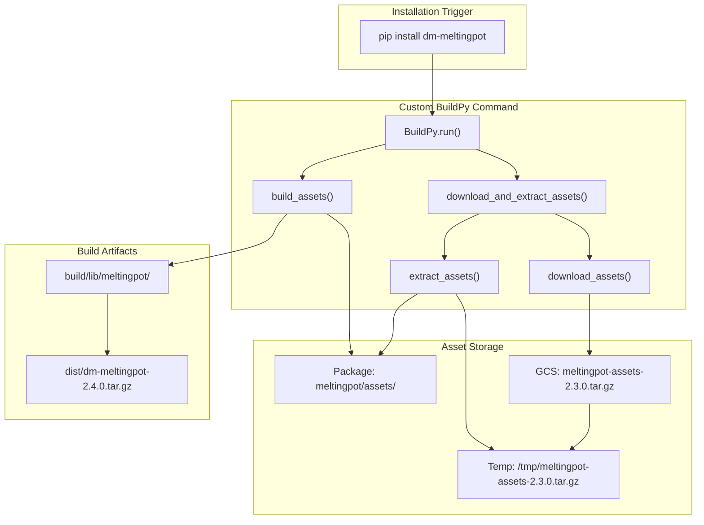
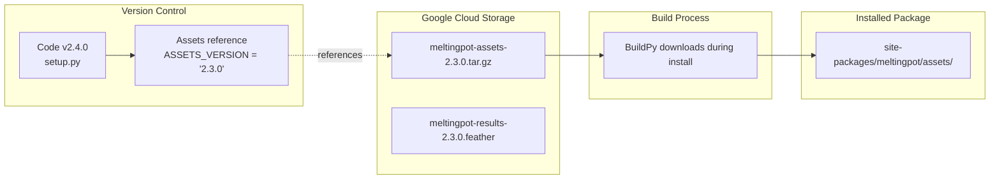
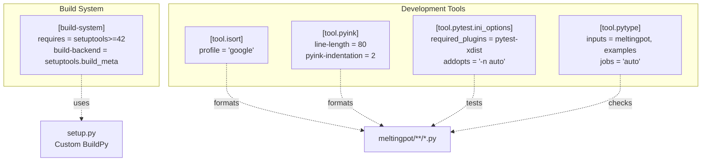
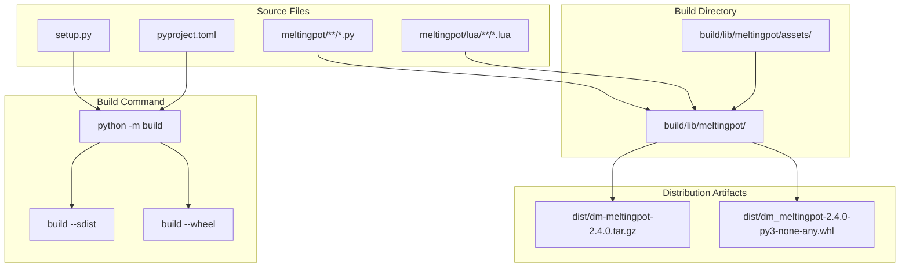

<!-- source: DeepWiki mcp.deepwiki.com · repo google-deepmind/meltingpot · page 7.1 Build and Package System · fetched 2026-10-26 -->

# Build and Package System

<details>
<summary>Relevant source files</summary>

The following files were used as context for generating this wiki page:

- [.gitignore](.gitignore)
- [CHANGELOG.md](CHANGELOG.md)
- [examples/tutorial/harvest/play_harvest.py](examples/tutorial/harvest/play_harvest.py)
- [notebooks/evaluation_results.ipynb](notebooks/evaluation_results.ipynb)
- [pyproject.toml](pyproject.toml)
- [setup.py](setup.py)

</details>


## Purpose and Scope

This document describes the build and package system for Melting Pot, covering how the Python package is configured, built, and distributed via PyPI. It focuses on the custom build process that downloads game assets from Google Cloud Storage, the package structure, dependency management, and versioning strategy.

For information about dependency management with pip-compile and requirements.txt, see [Dependency Management](#7.2). For CI/CD workflows that publish packages, see [CI/CD Pipelines](#7.5).

---

## Package Metadata and Configuration

Melting Pot uses `setuptools` with custom build commands defined in `setup.py`. The package metadata follows standard Python packaging conventions.

### Package Identity

| Property | Value | Location |
|----------|-------|----------|
| Package name | `dm-meltingpot` | [setup.py:103]() |
| Current version | `2.4.0` | [setup.py:25]() |
| Assets version | `2.3.0` | [setup.py:26]() |
| Minimum Python | `3.11` | [setup.py:139]() |
| Supported Python | `3.11`, `3.12`, `3.13` | [setup.py:126-128]() |

The package follows [Semantic Versioning](http://semver.org) as documented in [CHANGELOG.md](). Note that code version (2.4.0) and assets version (2.3.0) are **versioned independently** to allow asset updates without code changes.

### Package Contents

The package includes Python modules and Lua runtime files:

```python
# Python packages
packages=setuptools.find_packages(include=['meltingpot', 'meltingpot.*'])

# Included data files
package_data={
    'meltingpot': [
        'lua/levels/*/*.lua',
        'lua/modules/*.lua',
    ],
}
```

**Sources:** [setup.py:132-138]()

---

## Custom Build Process

The build system uses a custom `BuildPy` command that extends setuptools' standard `build_py` to download and extract game assets from Google Cloud Storage during installation.

### Build Process Flow Diagram



**Sources:** [setup.py:44-100]()

### BuildPy Command Implementation

The `BuildPy` class inherits from `setuptools.command.build_py.build_py` and implements a three-stage asset management process:

#### Stage 1: Download Assets

[setup.py:67-76]() implements `download_assets()`:

1. Checks temp directory (`/tmp`) for cached tar file
2. If not found, downloads from `ASSETS_URL` using `urllib.request.urlretrieve()`
3. Returns path to downloaded tar file

```python
ASSETS_URL = f'http://storage.googleapis.com/dm-meltingpot/meltingpot-assets-{ASSETS_VERSION}.tar.gz'
```

#### Stage 2: Extract Assets

[setup.py:78-87]() implements `extract_assets()`:

1. Removes any existing `meltingpot/assets` directory
2. Extracts tar file to `meltingpot/assets/` using `tarfile.open()`
3. Prints extraction status

#### Stage 3: Copy to Build Directory

[setup.py:89-99]() implements `build_assets()` (only in non-editable mode):

1. Removes existing assets in build lib directory
2. Copies `meltingpot/assets/` to `build/lib/meltingpot/assets/`

**Sources:** [setup.py:44-100]()

---

## Asset Management Strategy

Assets are stored separately from code to reduce repository size and allow independent versioning.

### Asset Versioning and Storage



**Why Split Versioning?**

| Aspect | Benefit |
|--------|---------|
| Repository size | Assets (~100MB+) not stored in git |
| Release flexibility | Update assets without code release |
| Bandwidth efficiency | Assets downloaded only during install |
| Version clarity | Separate CHANGELOG entries for assets |

**Sources:** [setup.py:25-28](), [CHANGELOG.md:8-42]()

### Asset Caching Behavior

The build process implements two levels of caching:

1. **System temp directory** (`/tmp/meltingpot-assets-{version}.tar.gz`)
   - Persists across builds
   - Shared between different package installations
   - Checked in [setup.py:70]()

2. **Package directory cache** (`meltingpot/assets/`)
   - Created during extraction
   - Copied to build directory
   - Listed in [.gitignore:29]() to prevent git tracking

**Sources:** [setup.py:53-76](), [.gitignore:29]()

---

## Dependency Management

### Core Dependencies

The package specifies dependencies in `install_requires` [setup.py:140-155]():

| Dependency | Purpose |
|------------|---------|
| `absl-py` | Command-line flags and logging |
| `chex` | JAX testing utilities |
| `dm-env` | DeepMind environment interface |
| `dmlab2d` | Core Lua-based game engine |
| `dm-tree` | Tree data structure utilities |
| `immutabledict` | Immutable dictionaries |
| `ml-collections` | Configuration management |
| `networkx` | Graph algorithms |
| `numpy` | Numerical computing |
| `opencv-python` | Image processing |
| `pandas` | Data manipulation |
| `pygame` | Human play interface |
| `reactivex` | Reactive programming |
| `tensorflow` | ML framework for saved models |

### Development Dependencies

Development tools are specified in `extras_require['dev']` [setup.py:158-168]():

| Tool | Purpose |
|------|---------|
| `build` | PEP 517 build frontend |
| `isort` | Import sorting |
| `pipreqs` | Requirements generation |
| `pip-tools` | Dependency compilation |
| `pyink` | Code formatting (Black variant) |
| `pylint` | Code linting |
| `pytest-xdist` | Parallel test execution |
| `pytype` | Static type checking |
| `twine` | Package upload to PyPI |

Install with: `pip install dm-meltingpot[dev]`

**Sources:** [setup.py:140-168]()

---

## Build System Configuration

### pyproject.toml Structure

The `pyproject.toml` file configures the build backend and development tools:



**Key Configurations:**

- **Build backend**: Uses `setuptools.build_meta` [pyproject.toml:2-3]()
- **isort**: Google style import ordering [pyproject.toml:5-7]()
- **pyink**: 80-char lines, 2-space indentation [pyproject.toml:9-22]()
- **pytest**: Auto-parallelization with xdist [pyproject.toml:24-27]()
- **pytype**: Type checks both `meltingpot` and `examples` [pyproject.toml:29-38]()

**Sources:** [pyproject.toml:1-39]()

---

## Build Artifacts and Distribution

### Build Process Execution



### Artifact Types

| Artifact | Description | Used For |
|----------|-------------|----------|
| Source distribution (`.tar.gz`) | Contains source code and setup files | `pip install` from source, PyPI upload |
| Wheel (`.whl`) | Pre-built distribution package | Fast installation, binary compatibility |
| `.egg-info/` | Package metadata | Development mode (`pip install -e .`) |

These artifacts are created in `dist/` and ignored by git [.gitignore:18]().

**Sources:** [.gitignore:13-19](), [pyproject.toml:1-3]()

---

## Package Classifiers and Metadata

The package includes PyPI classifiers for discoverability [setup.py:117-130]():

### Platform and Language Support

```python
classifiers=[
    'Development Status :: 4 - Beta',
    'Operating System :: POSIX :: Linux',
    'Operating System :: MacOS :: MacOS X',
    'Programming Language :: Python :: 3 :: Only',
    'Programming Language :: Python :: 3.11',
    'Programming Language :: Python :: 3.12',
    'Programming Language :: Python :: 3.13',
    'Topic :: Scientific/Engineering :: Artificial Intelligence',
]
```

### Package URLs and Contact

| Field | Value |
|-------|-------|
| Homepage | `https://github.com/google-deepmind/meltingpot` |
| Download | `https://github.com/google-deepmind/meltingpot/releases` |
| Author | DeepMind |
| License | Apache 2.0 |

**Sources:** [setup.py:103-130]()

---

## README Processing

The setup script processes `README.md` to remove GitHub-specific sections before including it as the package's long description [setup.py:31-41]():

```python
def _remove_excluded(description: str) -> str:
  description, *sections = description.split('<!-- GITHUB -->')
  for section in sections:
    excluded, included = section.split('<!-- /GITHUB -->')
    del excluded
    description += included
  return description
```

This allows maintaining GitHub-specific content (like badges, installation instructions that assume git clone) while providing clean PyPI documentation.

**Sources:** [setup.py:31-41]()

---

## Installation Modes

### Standard Installation

```bash
pip install dm-meltingpot
```

Triggers: `BuildPy.run()` → downloads assets → extracts → copies to site-packages

### Editable Installation

```bash
pip install -e .
```

In editable mode [setup.py:49]():
- Assets are downloaded and extracted to source directory
- `build_assets()` is **skipped** (no copy to build lib)
- Changes to source code immediately available

### Development Installation with Extras

```bash
pip install -e .[dev]
```

Installs package in editable mode plus all development dependencies.

**Sources:** [setup.py:47-51]()

---

## Version History and Migration

### Major Build System Changes

From [CHANGELOG.md]():

| Version | Change | Impact |
|---------|--------|--------|
| 2.2.0 (2023-07-25) | Made pip installable | Assets downloaded during install |
| 2.2.2 (2024-03-20) | Fixed setuptools compatibility | Works with older setuptools versions |
| 2.4.0 (2024-12-17) | Split assets version | Assets at 2.3.0, code at 2.4.0 |

### Known Issues

From [CHANGELOG.md:34-42](), version 2.3.0 had two scenario configuration issues, fixed in 2.4.0.

**Sources:** [CHANGELOG.md:1-234]()

---

