# Page: Overview

# Overview

<details>
<summary>Relevant source files</summary>

The following files were used as context for generating this wiki page:

- [.gitignore](.gitignore)
- [CHANGELOG.md](CHANGELOG.md)
- [README.md](README.md)
- [notebooks/evaluation_results.ipynb](notebooks/evaluation_results.ipynb)
- [setup.py](setup.py)

</details>


This document provides a high-level introduction to the Melting Pot repository, explaining its purpose as a multi-agent reinforcement learning research suite and describing the overall system architecture. For specific installation instructions, see [Installation](#2.1). For detailed information about the Lua simulation engine, see [Lua Simulation Engine](#4.2). For framework-specific integration details, see [Framework Integration](#5).

## Purpose and Scope

Melting Pot is a test suite for evaluating multi-agent reinforcement learning (MARL) algorithms across social scenarios. The repository provides:

- **50+ substrates**: Multi-agent game environments that define interaction mechanics
- **256+ scenarios**: Specific test configurations combining substrates with bot populations
- **Bot ecosystem**: Pre-trained policies and puppeteers for population-based evaluation
- **Framework integrations**: Adapters for RLLib, Gymnasium, and PettingZoo
- **Evaluation utilities**: Tools for measuring generalization to novel social situations

The system is distributed as the `dm-meltingpot` Python package on PyPI, with game assets hosted separately on Google Cloud Storage.

Sources: [README.md:27-47](), [setup.py:103-112]()

## What is Melting Pot

Melting Pot assesses whether MARL agents can generalize to novel social situations involving both familiar and unfamiliar individuals. The benchmark tests a broad range of social interactions including cooperation, competition, deception, reciprocation, and trust.

The evaluation methodology uses:

- **Training substrates**: Environments where focal agents are trained
- **Test scenarios**: Held-out configurations with different bot populations
- **Normalized scoring**: Performance metrics normalized across scenarios to rank algorithms

This approach quantifies two key capabilities:
1. Performance across diverse social situations with interdependent agents
2. Effective interaction with unfamiliar individuals not seen during training

Sources: [README.md:29-43]()

## Repository Structure

The repository is organized into distinct functional layers:

| Directory | Purpose | Key Contents |
|-----------|---------|--------------|
| `meltingpot/` | Core package | Python configs, Lua simulation, utilities |
| `meltingpot/lua/` | Simulation engine | BaseSimulation, components, level scripts |
| `meltingpot/python/` | Configuration layer | Substrate/scenario/bot configs |
| `examples/` | Integration examples | RLLib training scripts, PettingZoo adapters |
| `notebooks/` | Analysis tools | Evaluation result visualization |
| `.github/workflows/` | CI/CD pipelines | Testing, security scanning, publishing |

Sources: [setup.py:132-138](), [.gitignore:16-29]()

## System Architecture Overview

Melting Pot uses a layered architecture where Python configurations define what to simulate, a Lua engine executes the simulation, and framework adapters expose it to RL libraries.

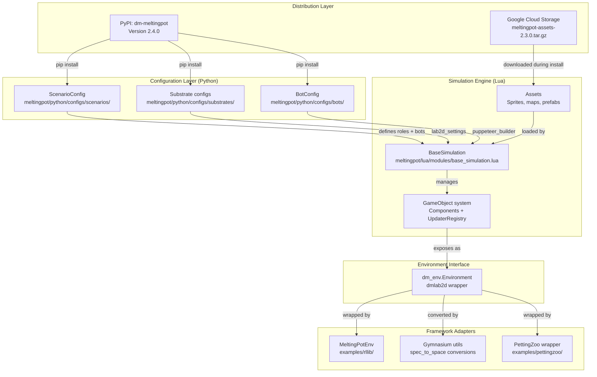

**Diagram: Melting Pot Layered Architecture**

The data flows from configuration to runtime as follows:

1. **Configuration Phase**: Python configs (`ScenarioConfig`, `BotConfig`, substrate settings) define the environment
2. **Instantiation Phase**: Lua `BaseSimulation` builds the game world from configurations and assets
3. **Runtime Phase**: `dm_env.Environment` interface exposes timesteps to agents
4. **Integration Phase**: Framework adapters translate `dm_env` to target API (RLLib, Gymnasium, etc.)

Sources: [setup.py:25-28](), [README.md:63-67]()

## Core Dependencies and Build Process

Melting Pot has a custom build process that downloads game assets during installation.

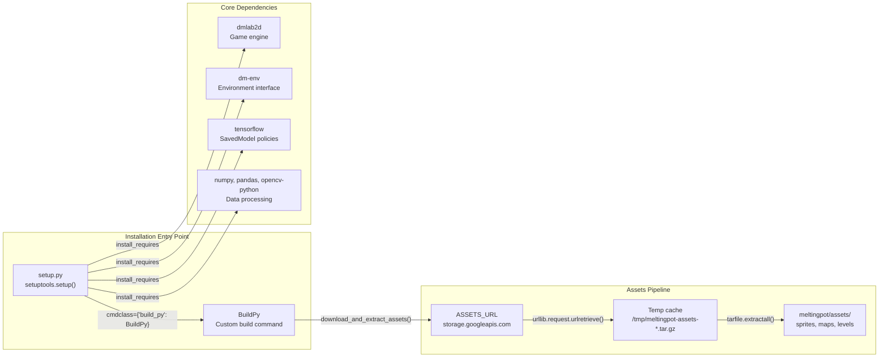

**Diagram: Build and Dependency System**

The custom `BuildPy` command [setup.py:44-100]() handles asset management:

1. Downloads `meltingpot-assets-{ASSETS_VERSION}.tar.gz` from GCS
2. Caches the tarball in temp directory
3. Extracts assets to `meltingpot/assets/`
4. Copies assets to build directory during package build

This split versioning strategy allows assets (v2.3.0) and code (v2.4.0) to be updated independently.

Sources: [setup.py:25-100](), [setup.py:140-155]()

## Key Abstractions

### Substrates vs Scenarios

| Concept | Definition | Configuration |
|---------|------------|---------------|
| **Substrate** | Base multi-agent game environment with specific mechanics | Defined by Lua levels, prefabs, and `lab2d_settings` |
| **Scenario** | Substrate + specific bot population + role assignment | Defined by `ScenarioConfig` Python dataclass |

Example: `clean_up` is a substrate. `clean_up_20` is a scenario that runs `clean_up` with 20 specific bots.

### Bots and Policies

The system supports two types of non-focal agents:

1. **Saved model bots**: Pre-trained TensorFlow SavedModels that generate actions
2. **Puppet bots**: Scripted behaviors controlled by `Puppeteer` classes

Both are configured through `BotConfig` objects that specify:
- Which substrate the bot is designed for
- What roles the bot can play
- Path to saved model OR puppeteer builder function

Sources: [README.md:29-36]()

## Configuration-to-Runtime Pipeline

The system translates declarative Python configurations into live Lua simulations:

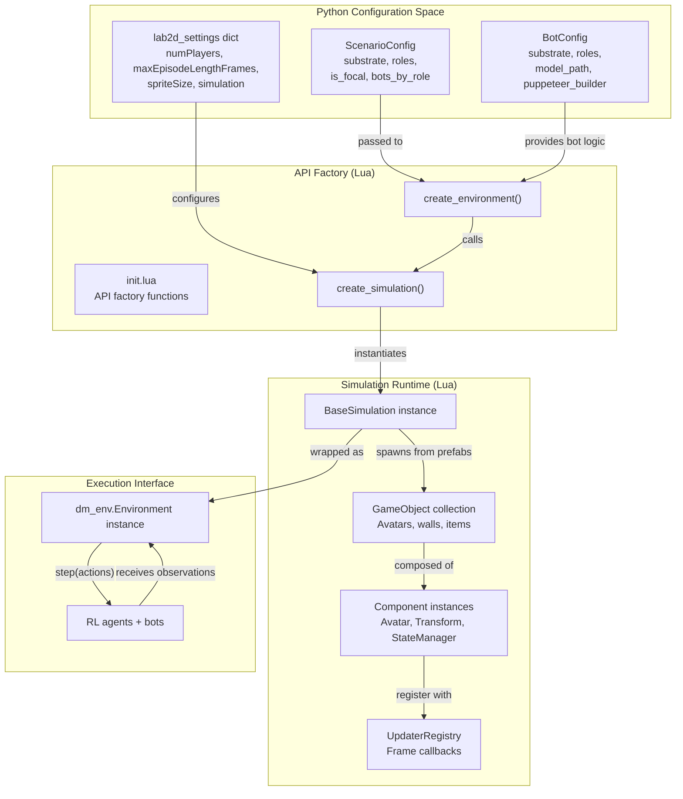

**Diagram: Configuration to Runtime Data Flow**

The pipeline executes as follows:

1. Python code defines `ScenarioConfig` and `BotConfig` instances
2. Lua `init.lua` factory functions receive these configurations
3. `BaseSimulation` is instantiated with settings from `lab2d_settings`
4. GameObjects are spawned from prefabs defined in configurations
5. Components attached to GameObjects register updater callbacks
6. The simulation is wrapped as a `dm_env.Environment` for agent interaction

Sources: [README.md:124-147]()

## Version and Release Information

The project uses semantic versioning with split version numbers for code and assets:

| Component | Current Version | Location |
|-----------|----------------|----------|
| Python package | 2.4.0 | PyPI `dm-meltingpot` |
| Game assets | 2.3.0 | GCS `meltingpot-assets-{version}.tar.gz` |
| Python support | 3.11, 3.12, 3.13 | `python_requires` in setup.py |

Recent changes (v2.4.0):
- Split out subjects with additional checks for VideoSubject
- Updated opencv version support
- Fixed `clean_up_20` scenario to use correct puppet bot
- Removed duplicate `territory__rooms_6` scenario

Sources: [setup.py:25-26](), [CHANGELOG.md:8-19](), [setup.py:139]()

## Integration Points

Melting Pot provides three primary integration paths for RL frameworks:

### RLLib Integration

Uses `MeltingPotEnv` wrapper that implements Ray's `MultiAgentEnv` interface. Handles multi-agent action/observation spaces and parallel stepping.

### Gymnasium Integration

Provides utility functions for converting `dm_env` specs to `gym.Space` objects and transforming timesteps to Gymnasium format.

### PettingZoo Integration

Wraps `dm_env.Environment` to implement PettingZoo's AEC or Parallel API, enabling use with Stable-Baselines3.

For detailed integration examples, see [Framework Integration](#5).

Sources: [README.md:158-175]()

## Evaluation and Analysis

The repository includes evaluation utilities and pre-computed results:

- **Evaluation library**: `meltingpot/utils/evaluation/evaluation.py` for running scenarios
- **Results dataset**: Hosted on GCS as `meltingpot-results-{version}.feather`
- **Analysis notebooks**: Jupyter notebooks for visualizing performance across scenarios
- **Normalization**: Scores normalized per-scenario to enable cross-algorithm comparison

The evaluation methodology computes normalized scores by:
1. Running each MAPLA (Multi-Agent Policy Learning Algorithm) on all test scenarios
2. Normalizing per-scenario scores to [0, 1] range
3. Aggregating to substrate-level and overall scores
4. Ranking algorithms by mean normalized performance

Sources: [README.md:124-129](), [notebooks/evaluation_results.ipynb:274-288]()

---

# Page: What is Melting Pot

# What is Melting Pot

<details>
<summary>Relevant source files</summary>

The following files were used as context for generating this wiki page:

- [README.md](README.md)
- [meltingpot/configs/bots/__init__.py](meltingpot/configs/bots/__init__.py)
- [meltingpot/configs/scenarios/__init__.py](meltingpot/configs/scenarios/__init__.py)
- [meltingpot/configs/scenarios/scenario_configs_test.py](meltingpot/configs/scenarios/scenario_configs_test.py)

</details>


This page introduces Melting Pot as a research suite for multi-agent reinforcement learning (MARL), explaining its core components—**substrates**, **scenarios**, and **bots**—and how they work together to evaluate agent behavior in social contexts. For information about the system's technical architecture, see [System Architecture](#1.2). For installation instructions, see [Installation](#2.1).

---

## Overview

Melting Pot is a test suite designed to assess whether multi-agent reinforcement learning algorithms can generalize to novel social situations. It provides a benchmark for evaluating how agents:

- Perform across a diverse range of social interactions (cooperation, competition, deception, reciprocation, trust, etc.)
- Adapt to unfamiliar individuals not encountered during training
- Handle scenarios involving interdependence between agents

The suite consists of **50+ substrates** (multi-agent game environments) for training and **256+ scenarios** (specific test configurations) for evaluation.

**Sources:** [README.md:27-43]()

---

## Core Components

### Substrates: Multi-Agent Game Environments

A **substrate** is a base multi-agent game environment that defines the rules, map layout, available actions, and reward structure. Each substrate represents a distinct social dilemma or interaction pattern.

Examples include:
- **`clean_up`** - A public goods game where agents must balance consuming resources with cleaning pollution
- **`prisoners_dilemma_in_the_matrix__arena`** - A spatial implementation of the classic Prisoner's Dilemma
- **`collaborative_cooking__asymmetric`** - A coordination task requiring role specialization
- **`allelopathic_harvest__open`** - A convention-following scenario with competing resource preferences

Substrates are configured using **`lab2d_settings`** (Lua-based game engine configuration) and can specify multiple **valid roles** for players.

**Sources:** [README.md:33-34](), [meltingpot/configs/scenarios/__init__.py:39]()

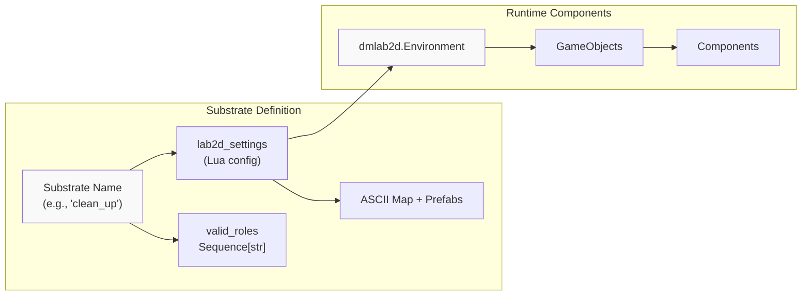

**Diagram: Substrate Structure**

**Sources:** [meltingpot/configs/scenarios/scenario_configs_test.py:66]()

### Scenarios: Test Configurations

A **scenario** is a specific configuration of a substrate that defines:
- Which player slots are **focal** (agents under evaluation)
- Which player slots are **background** (filled by bots)
- The **roles** assigned to each player
- Which **bots** can be sampled to fill background slots

Scenarios are defined using the `ScenarioConfig` dataclass and stored in the `SCENARIO_CONFIGS` dictionary.

**Sources:** [meltingpot/configs/scenarios/__init__.py:23-52]()

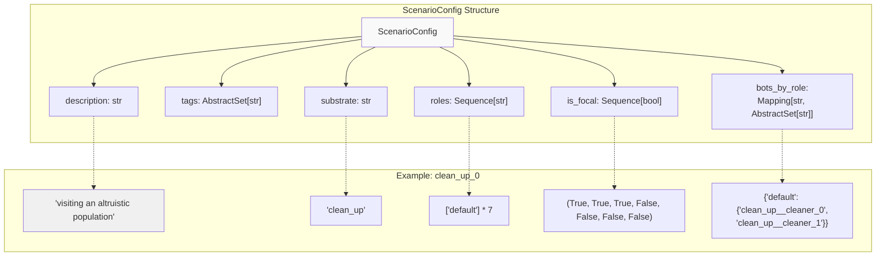

**Diagram: ScenarioConfig Data Structure**

**Sources:** [meltingpot/configs/scenarios/__init__.py:1148-1163]()

#### Scenario Taxonomy

Scenarios are tagged to indicate the social skills they test:

| Tag | Description | Example Scenarios |
|-----|-------------|-------------------|
| `visitor` | Focal agents join an established population | `clean_up_0`, `chemistry__three_metabolic_cycles_3` |
| `resident` | Focal agents form the majority, visited by bots | `clean_up_1`, `boat_race__eight_races_2` |
| `reciprocity` | Tests conditional cooperation | `chicken_in_the_matrix__repeated_5` |
| `convention_following` | Tests adaptation to local norms | `allelopathic_harvest__open_0` |
| `partner_choice` | Tests selective association | `boat_race__eight_races_4` |
| `exploitation` | Tests resistance to being taken advantage of | `coins_5` |
| `acceptance` | Tests tolerance of non-cooperators | `clean_up_1` |

**Sources:** [meltingpot/configs/scenarios/__init__.py:61-62,150-153,288-292]()

### Bots: Background Population Agents

A **bot** is a pre-trained or scripted agent used to populate background player slots in scenarios. Bots are defined using the `BotConfig` dataclass and stored in the `BOT_CONFIGS` dictionary.

Bots come in two types:

#### 1. Saved Model Bots
Pre-trained neural network policies stored as TensorFlow SavedModels.

**Sources:** [meltingpot/configs/bots/__init__.py:465-483]()

```python
# Example from BOT_CONFIGS
clean_up__cleaner_0=saved_model(
    substrate='clean_up',
    model='cleaner_0',
)
```

#### 2. Puppet Bots
Rule-based agents controlled by a **puppeteer** that dynamically selects goals based on game state.

**Sources:** [meltingpot/configs/bots/__init__.py:486-506]()

```python
# Example from BOT_CONFIGS
clean_up__puppet_alternator_first_cleans_0=puppet(
    substrate='clean_up',
    model='puppet_0',
    roles=('default',),
    puppeteer_builder=functools.partial(
        alternator.Alternator,
        goals=[
            _PUPPET_GOALS['clean_up']['CLEAN'],
            _PUPPET_GOALS['clean_up']['EAT'],
        ],
        steps_per_goal=200,
    ))
```

**Sources:** [meltingpot/configs/bots/__init__.py:1073-1084]()

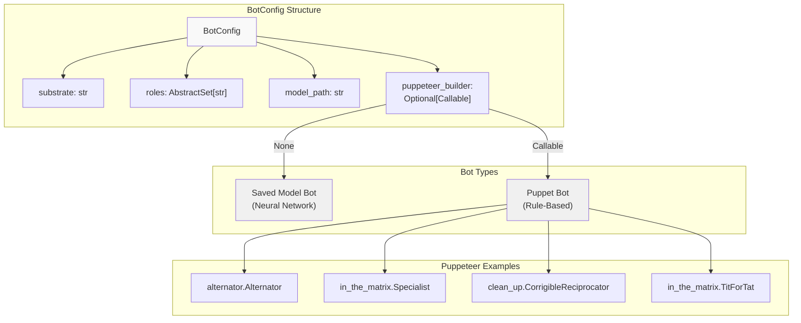

**Diagram: Bot Types and Puppeteers**

**Sources:** [meltingpot/configs/bots/__init__.py:445-462]()

---

## The Evaluation Framework

Melting Pot's evaluation framework operates on the principle of **generalization to novel social partners**. The workflow is:

1. **Training Phase**: Train focal agents on substrates (with any training partners)
2. **Evaluation Phase**: Deploy trained agents into scenarios with unfamiliar background bots
3. **Measurement**: Assess performance on held-out scenarios to quantify generalization

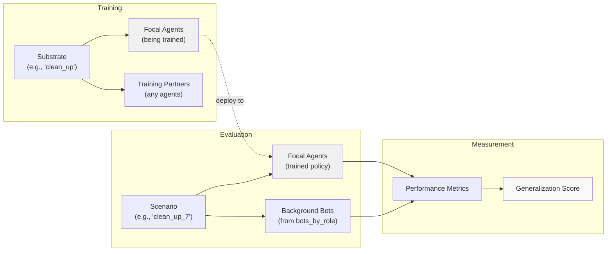

**Diagram: Training and Evaluation Pipeline**

**Sources:** [README.md:35-43]()

### Focal vs Background Players

Each scenario specifies which players are **focal** (under evaluation) and which are **background** (filled by bots):

```python
# Example: clean_up_0 scenario
is_focal=(True,) * 3 + (False,) * 4
# Players 0-2: Focal agents (3 total)
# Players 3-6: Background bots (4 total)
```

The `is_focal` sequence must match the length of `roles`, and at least one player must be focal.

**Sources:** [meltingpot/configs/scenarios/__init__.py:1156](), [meltingpot/configs/scenarios/scenario_configs_test.py:57-62]()

### Role Assignment

Scenarios can assign different **roles** to players, which may affect their observations, action spaces, or reward functions:

```python
# Example: allelopathic_harvest__open_0
roles=['player_who_likes_red',] * 8 + ['player_who_likes_green',] * 8
# 8 players prefer red berries, 8 prefer green berries
```

Background roles must have corresponding bot assignments in `bots_by_role`:

```python
bots_by_role={
    'player_who_likes_red': {
        'allelopathic_harvest__open__bot_that_supports_green_0',
        # ... more bots
    },
    'player_who_likes_green': {
        'allelopathic_harvest__open__bot_that_supports_green_0',
        # ... more bots
    },
}
```

**Sources:** [meltingpot/configs/scenarios/__init__.py:66-82](), [meltingpot/configs/scenarios/scenario_configs_test.py:88-96]()

---

## Key Code Entities

### Configuration Dictionaries

| Entity | Location | Description |
|--------|----------|-------------|
| `SCENARIO_CONFIGS` | [meltingpot/configs/scenarios/__init__.py:55]() | Mapping of scenario names to `ScenarioConfig` objects (256+ entries) |
| `BOT_CONFIGS` | [meltingpot/configs/bots/__init__.py:509]() | Mapping of bot names to `BotConfig` objects |
| `_PUPPET_GOALS` | [meltingpot/configs/bots/__init__.py:44]() | Ordered puppet goals for each substrate |
| `_RESOURCES` | [meltingpot/configs/bots/__init__.py:224]() | Resource definitions for "in the matrix" substrates |

**Sources:** [meltingpot/configs/scenarios/__init__.py:55](), [meltingpot/configs/bots/__init__.py:509]()

### Validation Rules

The test suite enforces several validation rules on scenario configurations:

1. **Substrate must exist** - `scenario.substrate` must be in `SUBSTRATES`
2. **Roles must be valid** - All roles in `scenario.roles` must be in the substrate's `valid_roles`
3. **Bots must be compatible** - Each bot's `substrate` and `roles` must match the scenario
4. **All background roles must have bots** - Every role with `is_focal=False` must appear in `bots_by_role`
5. **No unused bot assignments** - All roles in `bots_by_role` must have at least one background player

**Sources:** [meltingpot/configs/scenarios/scenario_configs_test.py:48-104]()

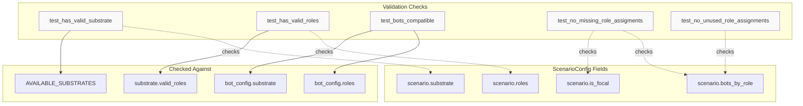

**Diagram: Scenario Validation Architecture**

**Sources:** [meltingpot/configs/scenarios/scenario_configs_test.py:48-104]()

---

## Scale and Coverage

Melting Pot provides comprehensive coverage of multi-agent scenarios:

| Dimension | Count | Notes |
|-----------|-------|-------|
| Substrates | 50+ | Diverse game mechanics and social dilemmas |
| Scenarios | 256+ | Test configurations across all substrates |
| Bots | Hundreds | Mix of neural network and rule-based agents |
| Social Skills Tested | 15+ | Tags include cooperation, reciprocity, trust, etc. |

The test suite ensures complete coverage:
- All substrates are used by at least one scenario
- All bots are used by at least one scenario
- No duplicate scenarios exist

**Sources:** [README.md:33-34](), [meltingpot/configs/scenarios/scenario_configs_test.py:113-123]()

---

# Page: System Architecture

# System Architecture

<details>
<summary>Relevant source files</summary>

The following files were used as context for generating this wiki page:

- [.gitignore](.gitignore)
- [CHANGELOG.md](CHANGELOG.md)
- [examples/tutorial/harvest/configs/environment/harvest.py](examples/tutorial/harvest/configs/environment/harvest.py)
- [examples/tutorial/harvest/configs/environment/harvest_finished.py](examples/tutorial/harvest/configs/environment/harvest_finished.py)
- [meltingpot/lua/modules/api_factory.lua](meltingpot/lua/modules/api_factory.lua)
- [notebooks/evaluation_results.ipynb](notebooks/evaluation_results.ipynb)
- [setup.py](setup.py)

</details>


## Purpose and Scope

This page provides a technical overview of Melting Pot's layered architecture, explaining how the major subsystems interact and how data flows through the system from package installation to runtime execution. 

For installation details, see [Installation](#2.1). For deep dives into specific components, see [Python Configuration Layer](#4.1), [Lua Simulation Engine](#4.2), and [Framework Integration](#5).

---

## Architectural Overview

Melting Pot uses a **four-layer architecture** that separates concerns between distribution, configuration, simulation, and framework integration:

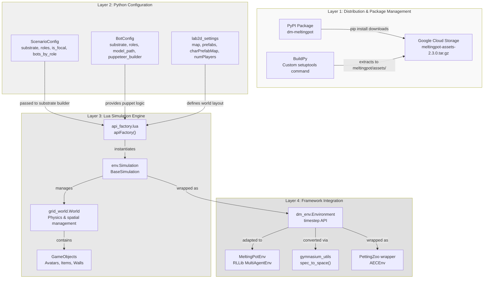

**Sources:** [setup.py:1-171](), [meltingpot/lua/modules/api_factory.lua:1-118](), [CHANGELOG.md:1-234]()

---

## Layer 1: Distribution and Package Management

The distribution layer handles package installation and asset management through a custom build process.

### Package Distribution Architecture

```mermaid
graph LR
    User["pip install dm-meltingpot"]
    setuptools["setuptools.setup()"]
    BuildPyClass["BuildPy<br/>class build_py.build_py"]
    
    User -->|"invokes"| setuptools
    setuptools -->|"cmdclass={'build_py': BuildPy}"| BuildPyClass
    
    BuildPyClass -->|"download_and_extract_assets()"| DownloadAssets
    DownloadAssets["urllib.request.urlretrieve()"]
    TmpCache["/tmp/meltingpot-assets-2.3.0.tar.gz"]
    
    DownloadAssets -->|"downloads from"| GCS_URL["ASSETS_URL<br/>storage.googleapis.com"]
    GCS_URL -->|"caches to"| TmpCache
    
    BuildPyClass -->|"extract_assets()"| ExtractAssets
    ExtractAssets["tarfile.open().extractall()"]
    FinalLocation["meltingpot/assets/<br/>lua/, sprites/, etc."]
    
    TmpCache -->|"extracts to"| FinalLocation
    
    BuildPyClass -->|"build_assets()"| CopyAssets
    CopyAssets["shutil.copytree()"]
    BuildLib["build/lib/meltingpot/assets/"]
    
    FinalLocation -->|"copies to"| BuildLib
```

| Component | Version | Purpose |
|-----------|---------|---------|
| Package Version | `2.4.0` | Code and Python modules |
| Assets Version | `2.3.0` | Game sprites, Lua scripts, maps |
| `ASSETS_URL` | GCS path | Hosted separately from code |
| `BuildPy` class | Custom command | Downloads assets during installation |

The split versioning strategy allows updating code without re-downloading multi-megabyte asset files.

**Sources:** [setup.py:25-100]()

### Dependency Graph

The package has a deep dependency tree rooted in `dmlab2d`, the core game engine:

| Dependency | Role |
|------------|------|
| `dmlab2d` | Core Lua-based game engine (C++ with Lua bindings) |
| `dm-env` | DeepMind environment API (timestep protocol) |
| `tensorflow` | ML framework for saved model policies |
| `numpy`, `opencv-python` | Array operations and image processing |
| `pygame` | Human play interface |
| `reactivex` | Observable streams for events |
| `ml-collections` | Configuration dictionaries |

**Sources:** [setup.py:140-155]()

---

## Layer 2: Python Configuration Layer

The Python layer provides declarative configuration objects that define what to simulate and how agents behave.

### Configuration Object Hierarchy

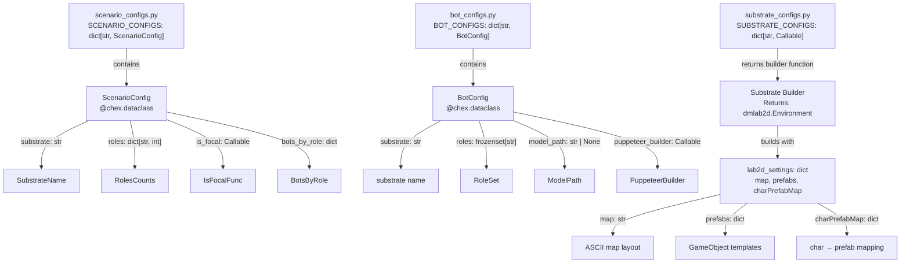

**Sources:** [examples/tutorial/harvest/configs/environment/harvest_finished.py:1-228](), [examples/tutorial/harvest/configs/environment/harvest.py:1-47]()

### Configuration to Runtime Translation

Python configurations are serialized and passed to the Lua runtime:

| Python Config | Lua Equivalent | Purpose |
|---------------|----------------|---------|
| `lab2d_settings['map']` | `textMap.layout` | ASCII grid defining spawn positions |
| `lab2d_settings['prefabs']` | `simulation.prefabs` | GameObject component definitions |
| `lab2d_settings['charPrefabMap']` | `textMap.stateMap` | Maps ASCII chars to prefab names |
| `lab2d_settings['numPlayers']` | `api._settings.numPlayers` | Number of controllable avatars |
| `lab2d_settings['maxEpisodeLengthFrames']` | `api._settings.maxEpisodeLengthFrames` | Episode timeout |

**Sources:** [examples/tutorial/harvest/configs/environment/harvest_finished.py:176-228]()

---

## Layer 3: Lua Simulation Engine

The simulation engine is implemented in Lua and runs inside `dmlab2d`, providing a component-based game object system.

### API Factory and Initialization Flow

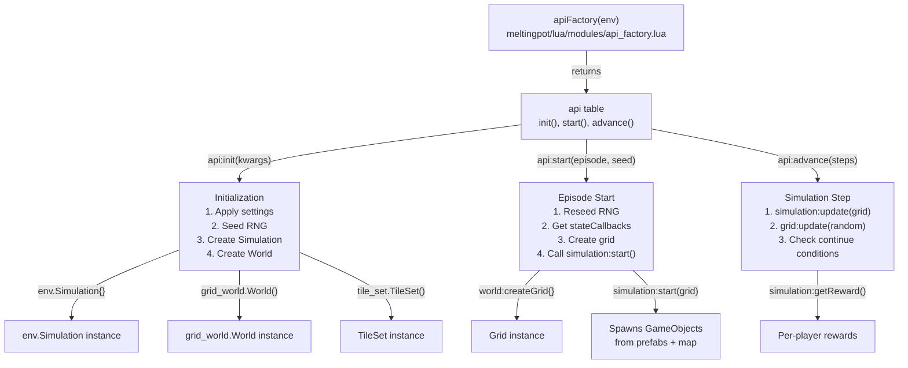

**Sources:** [meltingpot/lua/modules/api_factory.lua:26-117]()

### Runtime Object Graph

At runtime, the system maintains these key objects:

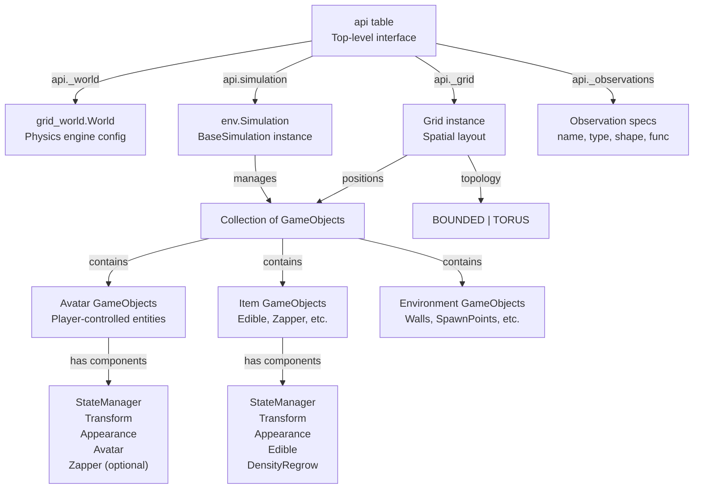

**Sources:** [meltingpot/lua/modules/api_factory.lua:26-68](), [examples/tutorial/harvest/configs/environment/harvest_finished.py:38-173]()

### Key Runtime Methods

| Method | File Location | Purpose |
|--------|---------------|---------|
| `api:init(kwargs)` | [api_factory.lua:53-67]() | Initialize simulation and world |
| `api:start(episode, seed)` | [api_factory.lua:85-102]() | Start new episode, create grid from map |
| `api:advance(steps)` | [api_factory.lua:104-111]() | Step simulation, update grid, return rewards |
| `api:discreteActions(actions)` | [api_factory.lua:81-83]() | Apply player actions |
| `api:observation(idx)` | [api_factory.lua:73-75]() | Get observation for player |

**Sources:** [meltingpot/lua/modules/api_factory.lua:53-111]()

---

## Layer 4: Framework Integration

Melting Pot provides adapters to make substrates compatible with popular RL frameworks.

### Integration Adapter Architecture

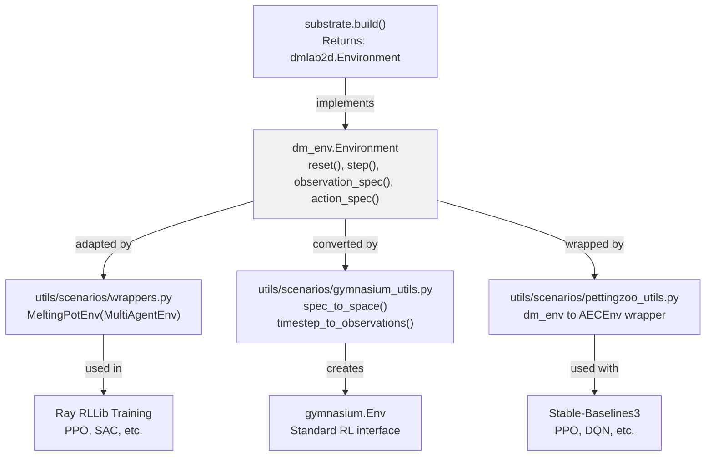

| Adapter | Input API | Output API | Key Transformations |
|---------|-----------|------------|---------------------|
| `MeltingPotEnv` | `dm_env.Environment` | `ray.rllib.MultiAgentEnv` | Converts timesteps to RLLib dict format |
| `spec_to_space()` | `dm_env.specs.Array` | `gymnasium.spaces.Space` | Maps spec types to Gym space types |
| PettingZoo wrapper | `dm_env.Environment` | `pettingzoo.AECEnv` | Adapts to alternating execution cycle API |

**Sources:** Based on high-level diagrams provided

---

## Data Flow: Configuration to Runtime

The complete data flow from Python configuration to Lua runtime execution:

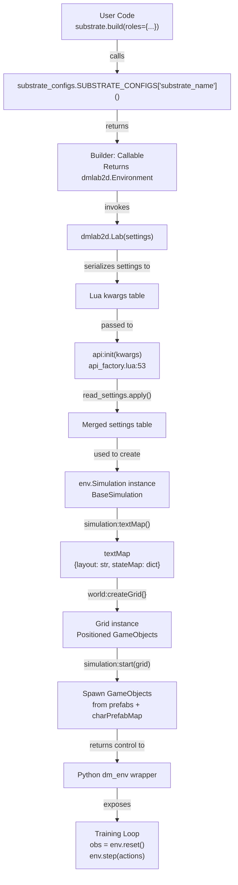

**Sources:** [meltingpot/lua/modules/api_factory.lua:53-102](), [examples/tutorial/harvest/configs/environment/harvest_finished.py:176-228]()

---

## Versioning and Release Strategy

Melting Pot uses **split versioning** to decouple code from assets:

| Version Type | Current Version | Update Frequency | Contents |
|--------------|-----------------|------------------|----------|
| Package Version | `2.4.0` | Each release | Python code, Lua scripts, configs |
| Assets Version | `2.3.0` | Less frequent | Sprites, pre-trained models, maps |

This allows bug fixes in Python code without requiring users to re-download large asset bundles.

**Timeline of Major Changes:**

- **v2.0.0** (2022-11): Complete rewrite with new substrates, heterogeneous roles
- **v2.2.0** (2023-07): Made pip-installable, assets downloaded during install
- **v2.3.0** (2024-06): Added NeurIPS 2023 competition scenarios and bots
- **v2.4.0** (2024-12): VideoSubject improvements, bug fixes

**Sources:** [CHANGELOG.md:1-234](), [setup.py:25-26]()

---

## Key Design Principles

The architecture embodies several design principles:

1. **Separation of Concerns**: Configuration (Python) is separate from simulation (Lua) is separate from framework integration (adapters)

2. **Component-Based Design**: GameObjects are composed of modular Components, enabling flexible behavior assembly

3. **Framework Agnostic Core**: The `dm_env.Environment` interface allows adaptation to any RL framework

4. **Reproducibility**: Explicit seeding, locked dependencies ([requirements.txt]()), hashed packages

5. **Split Versioning**: Code and assets versioned independently to minimize download size

**Sources:** [setup.py:1-171](), [meltingpot/lua/modules/api_factory.lua:1-118]()

---

# Page: Getting Started

# Getting Started

<details>
<summary>Relevant source files</summary>

The following files were used as context for generating this wiki page:

- [.gitignore](.gitignore)
- [CHANGELOG.md](CHANGELOG.md)
- [README.md](README.md)
- [notebooks/evaluation_results.ipynb](notebooks/evaluation_results.ipynb)
- [setup.py](setup.py)

</details>


This page provides an overview of installing and using Melting Pot. It covers the installation process, what happens under the hood, and your first steps with the framework. For detailed installation procedures, see [Installation](#2.1). For a comprehensive quick start tutorial, see [Quick Start Guide](#2.2). For development environment setup, see [Development Environment Setup](#2.3).

## Purpose and Scope

This document guides you through:
- Understanding the installation process and what gets installed
- Installing Melting Pot via PyPI or from source
- Running your first environment
- Understanding the package structure after installation

This page provides conceptual understanding. Detailed step-by-step instructions are in the child pages.

## Installation Methods

Melting Pot can be installed in two ways:

### PyPI Installation (Recommended for Users)

The simplest method uses pip:

```bash
pip install dm-meltingpot
```

This triggers a custom build process that downloads game assets from Google Cloud Storage during installation.

**Sources:** [README.md:54-67](), [setup.py:102-170]()

### Editable Installation (For Development)

For working on the Melting Pot source code:

```bash
git clone -b main https://github.com/google-deepmind/meltingpot
cd meltingpot
pip install --editable .[dev]
```

The `[dev]` extra installs development tools like `pytest`, `pylint`, `pytype`, and `pyink`.

**Sources:** [README.md:69-99](), [setup.py:156-169]()

## Installation Architecture

The following diagram shows the custom installation process orchestrated by the `BuildPy` command:

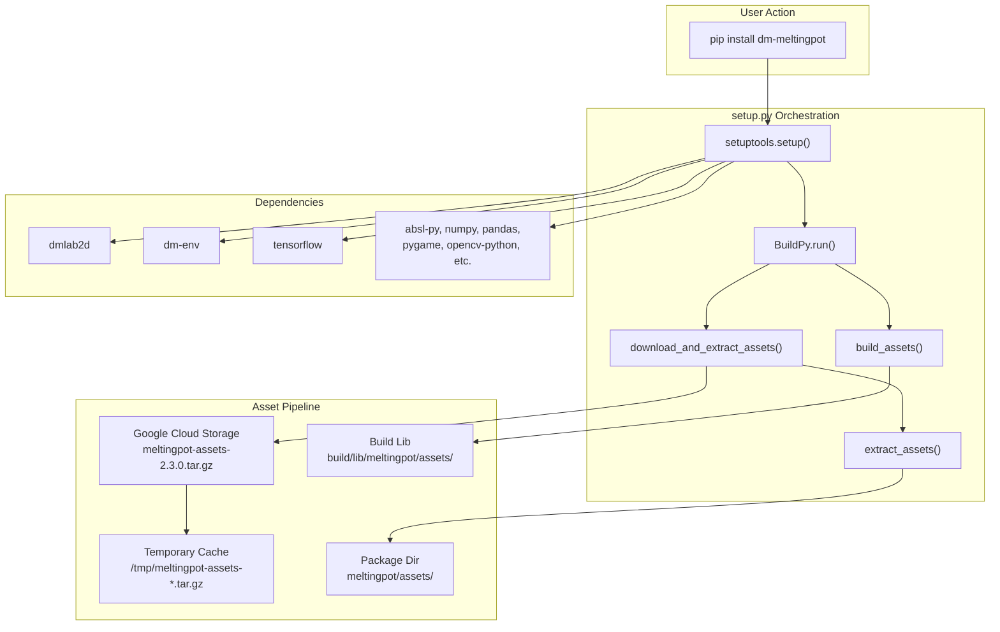

**Key Components:**

| Component | Purpose | File Reference |
|-----------|---------|---------------|
| `BuildPy` | Custom build command that extends `build_py.build_py` | [setup.py:44-100]() |
| `ASSETS_URL` | GCS location of versioned assets | [setup.py:28]() |
| `download_and_extract_assets()` | Downloads assets to temp cache, then extracts | [setup.py:53-65]() |
| `download_assets()` | Retrieves tar file from GCS or uses cached copy | [setup.py:67-76]() |
| `extract_assets()` | Extracts tar to `meltingpot/assets/` | [setup.py:78-87]() |
| `build_assets()` | Copies assets from package to build lib | [setup.py:89-99]() |

**Sources:** [setup.py:1-171](), [README.md:52-68]()

## Package Structure After Installation

After installation, the package structure looks like this:

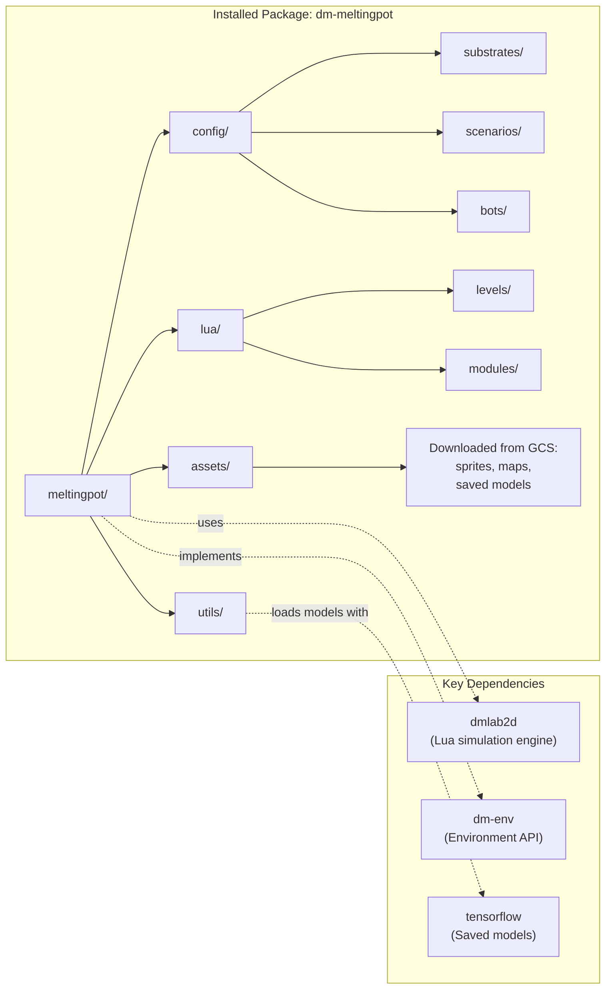

**Sources:** [setup.py:132-138](), [.gitignore:27-29]()

## Asset Versioning

Melting Pot uses **split versioning**: code and assets are versioned independently.

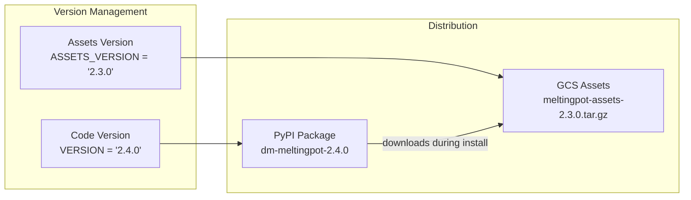

**Why Split Versioning?**
- Assets (sprites, maps, saved models) change less frequently than code
- Reduces download size when only code changes
- Assets are ~large binary files, code is lightweight

**Sources:** [setup.py:25-28](), [CHANGELOG.md:8-42]()

## System Requirements

| Requirement | Details |
|------------|---------|
| Python | 3.11, 3.12, or 3.13 |
| Operating System | Linux (x86_64), macOS (x86_64 or arm64) |
| dmlab2d | Pre-built wheels available for common platforms |
| GPU (Optional) | CUDA support for training (via TensorFlow) |

**Note on dmlab2d:** If no pre-built wheel is available for your platform, you must build dmlab2d from source. See the [dmlab2d README](https://github.com/google-deepmind/lab2d/blob/main/README.md).

**Sources:** [setup.py:123-128](), [setup.py:139-155](), [README.md:63-67]()

## First Steps with Melting Pot

### Basic Usage Pattern

The typical workflow for using Melting Pot follows this pattern:

```mermaid
graph TB
    subgraph "1. Import"
        IMP["import meltingpot"]
    end
    
    subgraph "2. Load Substrate"
        LOAD["substrate.build(<br/>  substrate_name,<br/>  roles=...)")
        ENV["Returns dm_env.Environment"]
    end
    
    subgraph "3. Interaction Loop"
        RESET["env.reset()"]
        STEP["env.step(actions)"]
        OBS["timestep.observation"]
        REWARD["timestep.reward"]
    end
    
    subgraph "4. Framework Integration"
        RLLIB["RLLib wrapper"]
        GYM["Gymnasium wrapper"]
        PETTING["PettingZoo wrapper"]
    end
    
    IMP --> LOAD
    LOAD --> ENV
    ENV --> RESET
    RESET --> STEP
    STEP --> OBS
    STEP --> REWARD
    STEP --> STEP
    
    ENV -.->|can wrap with| RLLIB
    ENV -.->|can wrap with| GYM
    ENV -.->|can wrap with| PETTING
```

**Sources:** [README.md:122-148](), [README.md:158-175]()

### Interactive Play Example

Melting Pot includes human player scripts for interactive testing:

```bash
# Play the clean_up substrate
python meltingpot/human_players/play_clean_up.py

# Controls:
# W, A, S, D - Move
# Q, E - Turn
# 1 - Fire zapper
# 2 - Fire cleaning beam
# TAB - Switch between players
```

**Sources:** [README.md:133-147]()

### Example Training Script

An RLlib self-play example demonstrates basic training:

```bash
# Install example dependencies
pip install -r examples/requirements.txt

# Run self-play training
cd examples/rllib
python self_play_train.py
```

**Note:** This is an illustrative example, not a recommended training configuration for competitive performance.

**Sources:** [README.md:149-175]()

## What You Get After Installation

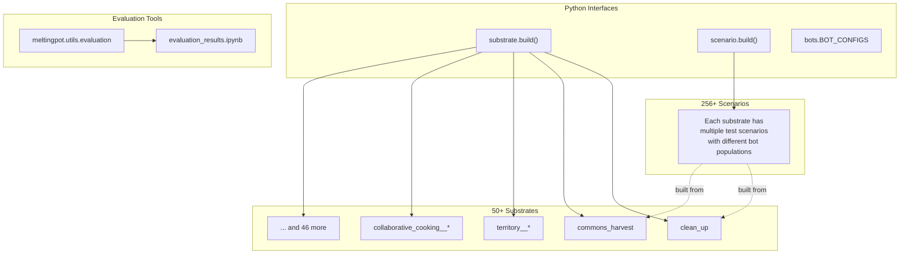

**Sources:** [README.md:28-47](), [README.md:123-131](), [notebooks/evaluation_results.ipynb:1-519]()

## Next Steps

After installation, proceed to:

1. **[Installation](#2.1)** - Detailed installation instructions, troubleshooting, and platform-specific notes
2. **[Quick Start Guide](#2.2)** - Step-by-step tutorial for loading substrates, running episodes, and understanding observations
3. **[Development Environment Setup](#2.3)** - Setting up the devcontainer, CUDA support, and development tools

For understanding the concepts before diving into code:
- See [Substrates and Scenarios](#3.1) to understand the environment structure
- See [Observations and Action Spaces](#3.4) to understand the agent interface

For training agents:
- See [RLLib Integration](#5.1) for distributed training
- See [Training with RLLib](#8.1) for practical examples

**Sources:** [README.md:1-213]()

---

# Page: Installation

# Installation

<details>
<summary>Relevant source files</summary>

The following files were used as context for generating this wiki page:

- [.gitignore](.gitignore)
- [CHANGELOG.md](CHANGELOG.md)
- [README.md](README.md)
- [bin/install.sh](bin/install.sh)
- [bin/test.sh](bin/test.sh)
- [bin/test_examples.sh](bin/test_examples.sh)
- [bin/update_requirements.sh](bin/update_requirements.sh)
- [notebooks/evaluation_results.ipynb](notebooks/evaluation_results.ipynb)
- [requirements.txt](requirements.txt)
- [setup.py](setup.py)

</details>


## Purpose and Scope

This document covers the installation of Melting Pot from PyPI or from source, including the custom asset downloading mechanism and dependency requirements. For setting up the full development environment with Docker containers and development tools, see [Development Environment Setup](#2.3). For package building and dependency management, see [Build and Package System](#7.1) and [Dependency Management](#7.2).

## Prerequisites

### Python Version

Melting Pot requires **Python 3.11 or later**. The package supports Python 3.11, 3.12, and 3.13.

**Sources:** [setup.py:139](), [setup.py:126-128]()

### Operating System Compatibility

The package officially supports:
- **Linux** (POSIX-compatible)
- **macOS** (MacOS X)

**Sources:** [setup.py:123-124]()

### DeepMind Lab2D Dependency

Melting Pot is built on top of `dmlab2d`, which is distributed as pre-built wheels. If no appropriate wheel is available for your platform, you will need to build `dmlab2d` from source. Refer to the [dmlab2d README](https://github.com/google-deepmind/lab2d/blob/main/README.md) for build instructions.

**Sources:** [README.md:63-67](), [setup.py:144]()

## PyPI Installation

### Basic Installation

The simplest installation method is via PyPI:

```bash
pip install dm-meltingpot
```

This command installs the `dm-meltingpot` package (version 2.4.0) along with all required dependencies.

**Sources:** [README.md:54-61](), [setup.py:25]()

### What Gets Installed

The installation includes:

| Component | Description |
|-----------|-------------|
| **Python Package** | Core `meltingpot` module with configuration layer |
| **Lua Scripts** | Simulation engine code (levels and modules) |
| **Game Assets** | Sprites, maps, and level data (downloaded separately) |
| **Dependencies** | All required packages including `dmlab2d`, `tensorflow`, `dm-env` |

**Sources:** [setup.py:132-138](), [setup.py:140-155]()

### Custom Asset Download Process

During installation, a custom `BuildPy` command automatically downloads game assets from Google Cloud Storage:

```mermaid
graph TB
    PipInstall["pip install dm-meltingpot"]
    BuildPy["BuildPy.run()"]
    CheckCache["Check for cached assets"]
    DownloadAssets["Download from GCS"]
    ExtractAssets["Extract tar.gz"]
    CopyToBuild["Copy to build/lib"]
    
    PipInstall --> BuildPy
    BuildPy --> CheckCache
    CheckCache -->|"Not cached"| DownloadAssets
    CheckCache -->|"Cached"| ExtractAssets
    DownloadAssets --> ExtractAssets
    ExtractAssets --> CopyToBuild
    
    GCS["Google Cloud Storage<br/>meltingpot-assets-2.3.0.tar.gz"]
    TempCache["/tmp/meltingpot-assets-2.3.0.tar.gz"]
    PackageCache["meltingpot/assets/<br/>meltingpot-assets-2.3.0.tar.gz"]
    ExtractedAssets["meltingpot/assets/"]
    
    GCS -.->|"urllib.request.urlretrieve()"| TempCache
    TempCache -.-> PackageCache
    PackageCache -.->|"tarfile.extractall()"| ExtractedAssets
```

**Asset Download Flow:**

1. **Cache Check**: First checks temporary directory (`/tmp`) for existing asset tarball
2. **Download**: If not cached, downloads from `http://storage.googleapis.com/dm-meltingpot/meltingpot-assets-{ASSETS_VERSION}.tar.gz`
3. **Package Cache**: Copies tarball to package directory for reuse
4. **Extraction**: Extracts assets to `meltingpot/assets/` directory
5. **Build Copy**: In non-editable mode, copies assets to `build/lib/meltingpot/assets/`

**Sources:** [setup.py:26-29](), [setup.py:44-100]()

### Asset Versioning

The code version and asset version are managed independently:

| Version Type | Current Version | Location |
|--------------|-----------------|----------|
| Package Version | 2.4.0 | [setup.py:25]() |
| Assets Version | 2.3.0 | [setup.py:26]() |

This split versioning allows asset updates without code changes and vice versa.

**Sources:** [setup.py:25-28]()

## Manual Installation (Development)

### Cloning the Repository

```bash
git clone -b main https://github.com/google-deepmind/meltingpot
cd meltingpot
```

**Sources:** [README.md:74-79]()

### Virtual Environment Setup (Recommended)

```bash
python -m venv venv
source venv/bin/activate  # On Linux/macOS
```

**Sources:** [README.md:81-86]()

### Editable Installation

Install in editable mode to work on the source code:

```bash
pip install --editable .[dev]
```

The `[dev]` extra includes development tools:
- `build` - Package building
- `isort` - Import sorting
- `pipreqs` - Dependency scanning
- `pip-tools` - Dependency compilation
- `pyink` - Code formatting (Black variant)
- `pylint` - Linting
- `pytest-xdist` - Parallel testing
- `pytype` - Type checking
- `twine` - Package uploading

**Sources:** [README.md:88-92](), [setup.py:156-169]()

### Dependency Installation with Hash Verification

For reproducible builds with security verification:

```bash
pip install --no-deps --require-hashes --requirement requirements.txt
pip install --no-deps --no-index --no-build-isolation --editable .
```

This approach:
- Installs exact versions with cryptographic hash verification
- Separates dependency installation from package installation
- Ensures reproducible builds

**Sources:** [bin/install.sh:21-28](), [requirements.txt:1-5]()

### Verifying Installation

Test the installation by running the test suite:

```bash
pytest --pyargs meltingpot
```

Or using the test script:

```bash
bash bin/test.sh
```

**Sources:** [README.md:94-98](), [bin/test.sh:22-23]()

## Installation Architecture

### BuildPy Command Flow

```mermaid
graph TD
    subgraph "setup.py"
        SetupConfig["setuptools.setup()<br/>cmdclass={'build_py': BuildPy}"]
    end
    
    subgraph "BuildPy Class"
        Run["BuildPy.run()"]
        DownloadExtract["download_and_extract_assets()"]
        DownloadAssets["download_assets()"]
        ExtractAssets["extract_assets()"]
        BuildAssets["build_assets()"]
    end
    
    subgraph "File System Operations"
        CheckTmp["os.path.exists(/tmp/...tar.gz)"]
        UrlRetrieve["urllib.request.urlretrieve()"]
        CheckPkg["os.path.exists(pkg_dir/...tar.gz)"]
        ShutilCopy["shutil.copy()"]
        TarExtract["tarfile.extractall()"]
        TreeCopy["shutil.copytree()"]
    end
    
    subgraph "Asset Locations"
        GCS["GCS: meltingpot-assets-2.3.0.tar.gz"]
        Tmp["/tmp/meltingpot-assets-2.3.0.tar.gz"]
        PkgCache["meltingpot/assets/...tar.gz"]
        PkgAssets["meltingpot/assets/"]
        BuildAssets2["build/lib/meltingpot/assets/"]
    end
    
    SetupConfig --> Run
    Run --> DownloadExtract
    Run --> BuildAssets
    
    DownloadExtract --> DownloadAssets
    DownloadExtract --> ExtractAssets
    
    DownloadAssets --> CheckTmp
    CheckTmp -->|"Not exists"| UrlRetrieve
    UrlRetrieve --> Tmp
    Tmp --> CheckPkg
    CheckPkg -->|"Not exists"| ShutilCopy
    ShutilCopy --> PkgCache
    
    ExtractAssets --> TarExtract
    PkgCache --> TarExtract
    TarExtract --> PkgAssets
    
    BuildAssets --> TreeCopy
    PkgAssets --> TreeCopy
    TreeCopy --> BuildAssets2
    
    GCS -.->|"download"| UrlRetrieve
```

**Sources:** [setup.py:44-100](), [setup.py:131]()

### Dependency Tree

The core runtime dependencies form this hierarchy:

```mermaid
graph TD
    MP["dm-meltingpot"]
    
    MP --> DMLAB2D["dmlab2d<br/>(Game engine)"]
    MP --> TF["tensorflow<br/>(ML framework)"]
    MP --> DMENV["dm-env<br/>(Environment API)"]
    MP --> DMTREE["dm-tree<br/>(Tree utilities)"]
    MP --> CHEX["chex<br/>(Testing utilities)"]
    MP --> MLCOL["ml-collections<br/>(Config management)"]
    MP --> NUMPY["numpy"]
    MP --> PANDAS["pandas"]
    MP --> OPENCV["opencv-python"]
    MP --> PYGAME["pygame"]
    MP --> NETWORKX["networkx"]
    MP --> REACTIVEX["reactivex<br/>(Observables)"]
    MP --> ABSL["absl-py"]
    MP --> IMMUT["immutabledict"]
    
    DMLAB2D --> DMENV
    DMENV --> DMTREE
    CHEX --> ABSL
    TF --> NUMPY
    TF --> GRPC["grpcio"]
    TF --> TENSORBOARD["tensorboard"]
```

**Sources:** [setup.py:140-155](), [requirements.txt:7-396]()

## Devcontainer Installation

### Platform Limitations

The pre-configured devcontainer **only supports x86 platforms**. Users on arm64 architectures (e.g., Apple M1/M2 Macs) must use the manual installation method.

**Sources:** [README.md:100-103]()

### Quick Start with Devcontainer

The repository includes a pre-configured development environment using the [devcontainer](https://containers.dev) standard. You can launch it using:

- **GitHub Codespaces**: One-click launch from the repository
- **VSCode Dev Containers**: Local container with VSCode integration

**Sources:** [README.md:105-111]()

### CUDA Support

For GPU training, CUDA support requires:

1. Install the `nvidia-container-toolkit` package on the host
2. Run Docker with the `--gpus all` flag

GitHub Codespaces automatically configures GPU access when available.

**Sources:** [README.md:113-119]()

## Verification and Troubleshooting

### Testing Installation

After installation, verify the package works correctly:

```bash
# Quick test - import the package
python -c "import meltingpot"

# Run full test suite
pytest --pyargs meltingpot

# Run with parallel execution
pytest -n auto --pyargs meltingpot
```

**Sources:** [README.md:94-98]()

### Common Issues

| Issue | Cause | Solution |
|-------|-------|----------|
| **No dmlab2d wheel available** | Unsupported platform | Build dmlab2d from source |
| **Asset download fails** | Network/proxy issues | Manually download assets from GCS URL |
| **Version conflicts** | Incompatible dependencies | Use `requirements.txt` with `--require-hashes` |
| **Import errors** | Incomplete installation | Re-run `pip install --editable .[dev]` |

**Sources:** [README.md:63-67](), [setup.py:28]()

### Checking Installed Versions

```bash
pip show dm-meltingpot
pip list
```

**Sources:** [bin/install.sh:31]()

## Package Metadata

The installed package includes the following metadata:

| Field | Value |
|-------|-------|
| **Name** | dm-meltingpot |
| **Version** | 2.4.0 |
| **License** | Apache 2.0 |
| **Author** | DeepMind |
| **URL** | https://github.com/google-deepmind/meltingpot |
| **Description** | A suite of test scenarios for multi-agent reinforcement learning |

**Sources:** [setup.py:103-116]()

---

# Page: Quick Start Guide

# Quick Start Guide

<details>
<summary>Relevant source files</summary>

The following files were used as context for generating this wiki page:

- [README.md](README.md)
- [examples/tutorial/harvest/configs/environment/harvest.py](examples/tutorial/harvest/configs/environment/harvest.py)
- [examples/tutorial/harvest/configs/environment/harvest_finished.py](examples/tutorial/harvest/configs/environment/harvest_finished.py)
- [meltingpot/lua/modules/api_factory.lua](meltingpot/lua/modules/api_factory.lua)

</details>


This guide provides the essential steps to load and interact with Melting Pot environments. It assumes you have already completed installation (see [Installation](#2.1)) and covers the basic API patterns for running episodes, observing agent states, and submitting actions.

For setting up a development environment, see [Development Environment Setup](#2.3). For interactive debugging and human play, see [Human Play Mode](#8.2). For training agents with RL frameworks, see [Framework Integration](#5).

---

## Environment Interface Overview

Melting Pot environments implement the `dm_env.Environment` interface, which provides a standardized API for multi-agent reinforcement learning. Each environment exposes observations, accepts actions, and returns rewards through a timestep-based protocol.

**Diagram: dm_env Interface Flow**

```mermaid
graph TD
    subgraph "Python Layer"
        USER["User Code"]
        BUILD["substrate.build()"]
        ENV["dm_env.Environment"]
        TIMESTEP["dm_env.TimeStep"]
    end
    
    subgraph "Lua Simulation Layer"
        API["api_factory.apiFactory()"]
        SIM["env.Simulation"]
        GRID["grid_world.World"]
    end
    
    USER -->|"calls"| BUILD
    BUILD -->|"returns"| ENV
    ENV -->|"wraps"| API
    API -->|"manages"| SIM
    SIM -->|"operates on"| GRID
    
    USER -->|"env.reset()"| ENV
    ENV -->|"api:start()"| API
    API -->|"returns"| TIMESTEP
    
    USER -->|"env.step(actions)"| ENV
    ENV -->|"api:discreteActions()<br/>api:advance()"| API
    API -->|"returns"| TIMESTEP
    
    TIMESTEP -->|"timestep.observation<br/>timestep.reward<br/>timestep.discount"| USER
```

Sources: [meltingpot/lua/modules/api_factory.lua:26-117](), [README.md:122-148]()

The core interaction loop follows this pattern:

1. **Build** the environment using a substrate configuration
2. **Reset** to start an episode and receive initial observations
3. **Step** repeatedly with actions to advance the simulation
4. **Extract** observations, rewards, and episode termination signals from timesteps

---

## Loading a Substrate

Substrates are loaded using the `substrate.build()` function, which takes a substrate name and optional configuration parameters. Melting Pot provides 50+ pre-configured substrates.

**Basic Substrate Loading Pattern:**

```python
from meltingpot import substrate

# Load a substrate by name
env = substrate.build(substrate_name='clean_up')

# Inspect environment specifications
print(env.observation_spec())
print(env.action_spec())
```

**Available Configuration Parameters:**

| Parameter | Type | Description |
|-----------|------|-------------|
| `substrate_name` | str | Name of the substrate to load (e.g., 'clean_up', 'prisoners_dilemma_in_the_matrix__arena') |
| `roles` | Sequence[str] | Optional role assignments for players |
| `config` | ConfigDict | Optional lab2d_settings overrides |

The `build()` function internally:
1. Loads the substrate's Python configuration from `SUBSTRATE_CONFIGS`
2. Passes the `lab2d_settings` to the Lua runtime
3. Instantiates the simulation through `api_factory.apiFactory()`
4. Returns a `dm_env.Environment` wrapper

Sources: [README.md:54-68](), [meltingpot/lua/modules/api_factory.lua:53-67]()

---

## Running Your First Episode

An episode consists of resetting the environment and stepping through it until termination. The `dm_env.TimeStep` object contains all information about the current state.

**Diagram: Episode Execution Flow**

```mermaid
graph LR
    RESET["env.reset()"]
    STEP["env.step(actions)"]
    TIMESTEP["TimeStep"]
    CHECK{"timestep.last()?"}
    
    RESET -->|"returns"| TIMESTEP
    TIMESTEP --> CHECK
    CHECK -->|"No"| STEP
    STEP -->|"returns"| TIMESTEP
    CHECK -->|"Yes"| END["Episode Complete"]
    
    subgraph "TimeStep Structure"
        OBS["timestep.observation<br/>(dict of arrays)"]
        REW["timestep.reward<br/>(array per player)"]
        DISC["timestep.discount<br/>(array per player)"]
        STEP_TYPE["timestep.step_type<br/>(FIRST/MID/LAST)"]
    end
    
    TIMESTEP -.->|"contains"| OBS
    TIMESTEP -.->|"contains"| REW
    TIMESTEP -.->|"contains"| DISC
    TIMESTEP -.->|"contains"| STEP_TYPE
```

Sources: [meltingpot/lua/modules/api_factory.lua:85-111]()

**Episode Loop Example:**

```python
# Reset environment
timestep = env.reset()

# Run until episode ends
while not timestep.last():
    # Sample random actions for all players
    actions = {
        player: env.action_spec()[player].sample()
        for player in env.action_spec().keys()
    }
    
    # Step the environment
    timestep = env.step(actions)
    
    # Access observations, rewards, and discounts
    observations = timestep.observation
    rewards = timestep.reward
    discounts = timestep.discount
```

The Lua simulation manages episode lifecycle through:
- `api:start()` - Initializes grid, spawns players [api_factory.lua:85-102]()
- `api:advance()` - Updates simulation, checks termination [api_factory.lua:104-111]()
- `maxEpisodeLengthFrames` - Episode length limit [api_factory.lua:42]()

Sources: [meltingpot/lua/modules/api_factory.lua:85-111](), [README.md:122-148]()

---

## Understanding Observations

Observations are returned as dictionaries where keys are observation names and values are numpy arrays. Each substrate defines which observation types are available.

**Observation Structure:**

| Observation Name | Shape | Description |
|-----------------|-------|-------------|
| `RGB` | `(height, width, 3)` | Agent's egocentric RGB view |
| `WORLD.RGB` | `(world_height, world_width, 3)` | Global top-down RGB view |
| `POSITION` | `(2,)` | Agent's (x, y) world coordinates |
| `ORIENTATION` | `(4,)` | One-hot encoded facing direction |

The available observations are configured in the substrate's `individual_observation_names` and `global_observation_names`:

```python
# From tutorial configuration
config.individual_observation_names = ["RGB"]
config.global_observation_names = ["WORLD.RGB"]
```

**Observation Specifications:**

```python
# Inspect observation specs
obs_spec = env.observation_spec()

# For multi-agent environments, specs are per-player
for player_name, player_obs_spec in obs_spec.items():
    for obs_name, spec in player_obs_spec.items():
        print(f"{player_name}.{obs_name}: {spec.shape} {spec.dtype}")
```

Observations are generated in Lua by:
1. `simulation:addObservations()` - Registers observation callbacks [api_factory.lua:66]()
2. `observation.func(grid)` - Executes rendering functions [api_factory.lua:74]()
3. Sprite rendering via `tile_set.TileSet` [api_factory.lua:48-50]()

Sources: [examples/tutorial/harvest/configs/environment/harvest_finished.py:181-182](), [examples/tutorial/harvest/configs/environment/harvest.py:24-25](), [meltingpot/lua/modules/api_factory.lua:66-74]()

---

## Understanding Actions

Actions are discrete integers representing different behaviors. Each player submits one action per timestep.

**Common Action Mappings:**

| Action Index | Description |
|-------------|-------------|
| 0 | No-op / Do nothing |
| 1 | Move forward |
| 2 | Move backward |
| 3 | Strafe left |
| 4 | Strafe right |
| 5 | Turn left |
| 6 | Turn right |
| 7+ | Substrate-specific actions (e.g., fire zapper, clean) |

**Action Specification Pattern:**

```python
# Get action specs for all players
action_spec = env.action_spec()

# Each player has a discrete action space
for player_name, spec in action_spec.items():
    print(f"{player_name}: {spec.num_values} possible actions")
    
# Submit actions as a dictionary
actions = {
    'player_0': 1,  # Move forward
    'player_1': 5,  # Turn left
    'player_2': 7,  # Fire zapper
}
timestep = env.step(actions)
```

The action space is defined in Lua:
- `simulation:discreteActionSpec()` - Returns action specifications [api_factory.lua:77-79]()
- `simulation:discreteActions(actions)` - Processes action inputs [api_factory.lua:81-83]()
- Avatar components interpret actions based on their configuration

Sources: [meltingpot/lua/modules/api_factory.lua:77-83](), [README.md:143-147]()

---

## Multi-Agent Interaction

Melting Pot environments are inherently multi-agent. All players step simultaneously, and observations/rewards are returned for each player.

**Diagram: Multi-Agent Timestep Structure**

```mermaid
graph TD
    ENV["Environment<br/>(N players)"]
    
    subgraph "Input: Actions Dictionary"
        A0["'player_0': action_0"]
        A1["'player_1': action_1"]
        AN["'player_N-1': action_N-1"]
    end
    
    subgraph "Output: TimeStep"
        OBS["observations<br/>{player: {obs_name: array}}"]
        REW["rewards<br/>{player: float}"]
        DISC["discounts<br/>{player: float}"]
    end
    
    A0 --> ENV
    A1 --> ENV
    AN --> ENV
    
    ENV --> OBS
    ENV --> REW
    ENV --> DISC
```

Sources: [meltingpot/lua/modules/api_factory.lua:104-111]()

**Multi-Agent Considerations:**

1. **Synchronous Steps**: All players submit actions simultaneously
2. **Per-Player Observations**: Each player receives their own egocentric view
3. **Per-Player Rewards**: Rewards can differ based on individual contributions
4. **Shared Environment**: Players interact through the same grid world

**Number of Players:**

The number of players is configured in `lab2d_settings`:

```python
config.lab2d_settings = {
    "numPlayers": 5,  # Exactly 5 players in this environment
    # ... other settings
}
```

Sources: [examples/tutorial/harvest/configs/environment/harvest_finished.py:206-207](), [meltingpot/lua/modules/api_factory.lua:39-59]()

---

## Interactive Testing

For quick experimentation, Melting Pot provides human playable scripts:

```bash
# Play the clean_up substrate interactively
python meltingpot/human_players/play_clean_up.py

# Controls:
# W, A, S, D - Movement
# Q, E - Turn
# 1 - Fire zapper
# 2 - Fire cleaning beam
# TAB - Switch between players
```

Available substrates in `human_players/` directory include variants that can be selected with `--level_name` flag.

Sources: [README.md:133-147]()

---

## Next Steps

After familiarizing yourself with basic environment interaction:

1. **Framework Integration**: Adapt Melting Pot to your RL framework
   - [RLLib Integration](#5.1) for Ray RLLib and multi-agent training
   - [Gymnasium Integration](#5.2) for gym-compatible wrappers
   - [PettingZoo Integration](#5.3) for Stable-Baselines3

2. **Training Agents**: Run self-play experiments
   - [Training with RLLib](#8.1) for end-to-end training examples

3. **Evaluation**: Assess agent performance
   - [Evaluation System](#8.3) for metrics and analysis

4. **Content Creation**: Build custom scenarios
   - [Substrates and Scenarios](#3.1) for understanding the configuration model
   - [Substrate Creation Tutorial](#6.1) for creating new environments

5. **Advanced Concepts**: Dive into the architecture
   - [GameObject and Component System](#3.3) for the Lua engine internals
   - [Observations and Action Spaces](#3.4) for detailed observation types

Sources: [README.md:149-180]()

---

# Page: Development Environment Setup

# Development Environment Setup

<details>
<summary>Relevant source files</summary>

The following files were used as context for generating this wiki page:

- [.devcontainer/Dockerfile](.devcontainer/Dockerfile)
- [.devcontainer/devcontainer.json](.devcontainer/devcontainer.json)
- [.github/dependabot.yml](.github/dependabot.yml)
- [.vscode/settings.json](.vscode/settings.json)
- [bin/install.sh](bin/install.sh)
- [bin/test.sh](bin/test.sh)
- [bin/test_examples.sh](bin/test_examples.sh)
- [bin/update_requirements.sh](bin/update_requirements.sh)
- [requirements.txt](requirements.txt)

</details>


## Purpose and Scope

This document describes how to set up a complete development environment for contributing to the Melting Pot codebase. It covers the containerized development setup, CUDA GPU support, integrated development tools, and quality assurance workflows.

For installing Melting Pot as an end user, see [Installation](#2.1). For running your first environment after installation, see [Quick Start Guide](#2.2).

## Development Container Overview

Melting Pot uses a containerized development environment based on Docker and VSCode's devcontainer specification. This provides a consistent, reproducible development setup across different host systems.

### Container Architecture

```mermaid
graph TB
    subgraph "Host System"
        VSCODE["VSCode IDE"]
        DOCKER["Docker Engine"]
        GPU["NVIDIA GPU<br/>(optional)"]
    end
    
    subgraph "Development Container"
        BASE["nvidia/cuda:12.8.1-devel-ubuntu22.04"]
        PYTHON["Python 3.11"]
        DEPS["Dependencies<br/>(requirements.txt)"]
        MP["Melting Pot<br/>(editable install)"]
        
        subgraph "Development Tools"
            PYTEST["pytest"]
            PYTYPE["pytype"]
            PYLINT["pylint"]
            PYINK["pyink (black)"]
            ISORT["isort"]
        end
        
        subgraph "VSCode Extensions"
            PYLANCE["Pylance"]
            BLACKFMT["Black Formatter"]
            ISORTEX["isort Extension"]
            PYLINTEX["Pylint Extension"]
        end
    end
    
    VSCODE -->|"Remote-Containers"| BASE
    DOCKER -->|"Runs"| BASE
    GPU -->|"CUDA passthrough"| BASE
    
    BASE --> PYTHON
    PYTHON --> DEPS
    DEPS --> MP
    
    MP --> PYTEST
    MP --> PYTYPE
    MP --> PYLINT
    MP --> PYINK
    MP --> ISORT
    
    VSCODE --> PYLANCE
    VSCODE --> BLACKFMT
    VSCODE --> ISORTEX
    VSCODE --> PYLINTEX
```

Sources: [.devcontainer/Dockerfile](), [.devcontainer/devcontainer.json](), [.vscode/settings.json]()

## Docker Configuration

### Base Image

The development container uses an NVIDIA CUDA base image to provide GPU acceleration support:

```dockerfile
FROM nvidia/cuda:12.8.1-devel-ubuntu22.04@sha256:a99a1860ba8e2916e5c3e73b72ec4c4301653a84586e05bfc9a2aa2d58027e97
```

This image includes:
- **CUDA 12.8.1**: Full CUDA development toolkit for GPU-accelerated workloads
- **Ubuntu 22.04**: Long-term support base system
- **SHA256 pinning**: Ensures reproducible builds

**Sources:** [.devcontainer/Dockerfile:3]()

### System Dependencies

The container installs essential build and development tools:

| Package | Purpose |
|---------|---------|
| `build-essential` | C/C++ compilation toolchain (required for dmlab2d) |
| `curl` | Download utilities |
| `ffmpeg` | Video processing (for rendering observations) |
| `git` | Version control |
| `python3.11` + `python3.11-dev` | Python runtime and headers |
| `rsync` | File synchronization utilities |

**Sources:** [.devcontainer/Dockerfile:8-17]()

### Python Configuration

Python 3.11 is configured as the default Python interpreter:

```bash
update-alternatives --install /usr/bin/python python /usr/bin/python3.11 1
update-alternatives --install /usr/bin/python3 python3 /usr/bin/python3.11 1
```

The latest `pip` and `setuptools` are installed to support modern Python packaging:

**Sources:** [.devcontainer/Dockerfile:20-28]()

## VSCode Devcontainer Configuration

### Container Runtime Parameters

The devcontainer is configured with specific runtime parameters for performance:

| Parameter | Value | Purpose |
|-----------|-------|---------|
| `--shm-size` | `6gb` | Shared memory for RLlib multiprocessing (recommended 30% of RAM for large machines) |

**Sources:** [.devcontainer/devcontainer.json:11-16]()

### Post-Creation Setup

After the container is created, the installation script automatically runs:

```json
"postCreateCommand": "bin/install.sh"
```

This executes [`bin/install.sh`]() which:
1. Installs all dependencies from `requirements.txt` with hash verification
2. Installs Melting Pot in editable mode with `--editable` flag
3. Lists all installed packages for verification

**Sources:** [.devcontainer/devcontainer.json:17](), [bin/install.sh]()

### VSCode Extensions

The devcontainer automatically installs these VSCode extensions:

| Extension ID | Purpose |
|--------------|---------|
| `donjayamanne.githistory` | Git history visualization |
| `ms-azuretools.vscode-docker` | Docker container management |
| `ms-python.black-formatter` | Code formatting with pyink |
| `ms-python.isort` | Import sorting |
| `ms-python.pylint` | Linting and error detection |
| `ms-python.python` | Core Python support |
| `ms-python.vscode-pylance` | Type checking and IntelliSense |

**Sources:** [.devcontainer/devcontainer.json:20-28]()

## Installation for Development

### Installation Script Workflow

```mermaid
graph LR
    START["bin/install.sh"] --> REQS["Install requirements.txt<br/>--require-hashes<br/>--no-deps"]
    REQS --> VERIFY["Verify hashes<br/>(pip security check)"]
    VERIFY --> EDITABLE["Install Melting Pot<br/>--editable<br/>--no-deps<br/>--no-build-isolation"]
    EDITABLE --> LIST["pip list<br/>(verification)"]
    LIST --> END["Development environment ready"]
```

**Sources:** [bin/install.sh]()

### Installation Commands

The installation process uses strict security and reproducibility flags:

```bash
# Install dependencies with hash verification
pip install --no-deps --require-hashes --requirement requirements.txt

# Install Melting Pot in editable mode
pip install --no-deps --no-index --no-build-isolation --editable .
```

**Key flags:**
- `--no-deps`: Prevent automatic dependency resolution (use locked requirements)
- `--require-hashes`: Enforce SHA256 hash verification for supply chain security
- `--editable`: Install as symlink for live code changes
- `--no-build-isolation`: Use existing environment instead of temporary build environment

**Sources:** [bin/install.sh:22-27]()

## VSCode Development Settings

### Code Formatting Configuration

The repository enforces Google Python style guidelines:

| Setting | Value | Purpose |
|---------|-------|---------|
| `editor.rulers` | `[80]` | 80-character line length limit |
| `editor.tabSize` | `2` | 2-space indentation |
| `editor.insertSpaces` | `true` | Spaces instead of tabs |
| `editor.formatOnSave` | `true` | Auto-format on save |
| `editor.formatOnSaveMode` | `"modifications"` | Format only modified lines |

**Sources:** [.vscode/settings.json:3-14]()

### Python Tool Integration

VSCode is configured to use specific formatters and linters:

```json
{
  "[python]": {
    "editor.defaultFormatter": "ms-python.black-formatter",
    "editor.codeActionsOnSave": {
      "source.organizeImports": "explicit"
    }
  },
  "black-formatter.path": ["pyink"],
  "isort.args": ["--resolve-all-configs"],
  "isort.check": true
}
```

**Tool configuration:**
- **Formatter**: `pyink` (Google-style Black fork)
- **Import organizer**: `isort` with project configuration
- **Linter**: `pylint` with full checks enabled
- **Type checker**: Pylance (powered by Pyright)

**Sources:** [.vscode/settings.json:40-50]()

### File Exclusions

Development artifacts are hidden from the file explorer:

| Pattern | Description |
|---------|-------------|
| `**/*.egg-info` | Package metadata |
| `**/.eggs` | Setuptools build artifacts |
| `**/*.py[cod]` | Compiled Python bytecode |
| `**/__pycache__` | Python cache directories |
| `**/.cache` | General cache directories |
| `**/.pytest_cache` | pytest cache |
| `**/.pytype` | pytype type inference cache |

**Sources:** [.vscode/settings.json:25-33]()

## Development Workflow

### Code Quality Pipeline

```mermaid
graph TD
    EDIT["Edit Code"] --> SAVE["Save File"]
    SAVE --> FMT["Auto-format<br/>(pyink)"]
    FMT --> SORT["Auto-sort imports<br/>(isort)"]
    SORT --> LINT["Background linting<br/>(pylint)"]
    LINT --> TYPE["Type checking<br/>(Pylance)"]
    
    EDIT --> COMMIT["Ready to commit"]
    COMMIT --> LOCALTEST["bin/test.sh"]
    
    LOCALTEST --> PYTEST["pytest meltingpot"]
    LOCALTEST --> PYTYPE["pytype meltingpot"]
    LOCALTEST --> PYLINT2["pylint --errors-only"]
    
    PYTEST --> PASS{All pass?}
    PYTYPE --> PASS
    PYLINT2 --> PASS
    
    PASS -->|Yes| PUSH["Push to GitHub"]
    PASS -->|No| EDIT
    
    PUSH --> CI["GitHub Actions CI"]
```

**Sources:** [.vscode/settings.json:12-14](), [bin/test.sh]()

### Testing Scripts

The repository provides three testing scripts:

#### Core Package Testing

**Script:** `bin/test.sh`

Runs the complete test suite for the core `meltingpot` package:

```bash
pytest meltingpot          # Unit and integration tests
pytype meltingpot          # Static type checking
pylint --errors-only meltingpot  # Linting with error-only mode
```

**Sources:** [bin/test.sh:22-33]()

#### Examples Testing

**Script:** `bin/test_examples.sh`

Validates all example code in the `examples/` directory:

```bash
pytest examples            # Test example scripts
pytype examples            # Type check examples
pylint --errors-only examples  # Lint examples
```

**Sources:** [bin/test_examples.sh:22-33]()

#### Dependency Updates

**Script:** `bin/update_requirements.sh`

Regenerates `requirements.txt` with updated dependency versions:

```bash
pip-compile --generate-hashes \
            --reuse-hashes \
            --strip-extras \
            --allow-unsafe \
            --upgrade \
            --extra dev \
            setup.py
```

This creates a fully locked requirements file with SHA256 hashes for all dependencies.

**Sources:** [bin/update_requirements.sh:21-22]()

## Code Quality Tools

### Tool Configuration Matrix

| Tool | Configuration File | Purpose | CI Integration |
|------|-------------------|---------|----------------|
| `pytest` | `pytest.ini` (inferred) | Unit testing | ✓ (test-meltingpot.yml) |
| `pytype` | Default | Static type checking | ✓ (test-meltingpot.yml) |
| `pylint` | `.pylintrc` | Code linting | ✓ (test-meltingpot.yml) |
| `pyink` | Default Black config | Code formatting | Manual/on-save |
| `isort` | `pyproject.toml` (inferred) | Import sorting | Manual/on-save |

**Sources:** [bin/test.sh](), [.vscode/settings.json:47-49]()

### Pytest Configuration

Pytest is configured for parallel test execution. The CI system uses:

```bash
pytest -n auto  # Auto-detect CPU count and parallelize
```

This significantly speeds up the test suite by running tests concurrently across multiple processes.

**Sources:** Referenced in CI workflows

### Type Checking with Pytype

Pytype performs static type inference and checking across the entire codebase. It:
- Infers types from Python code without annotations
- Validates type consistency
- Detects common runtime errors at compile time
- Generates `.pytype/` cache for incremental checking

The cache directory is excluded from version control and file watchers.

**Sources:** [.vscode/settings.json:32]()

### Linting with Pylint

Pylint is configured to run in error-only mode for CI:

```bash
pylint --errors-only meltingpot
```

This focuses on critical issues while allowing warnings to be addressed separately. The full linter (without `--errors-only`) can be run during development for comprehensive code quality checks.

**Sources:** [bin/test.sh:32-33]()

## Dependency Management

### Locked Dependencies with Hashes

The `requirements.txt` file is auto-generated using `pip-compile` and includes:
- **Exact version pins**: Every dependency has a specific version
- **SHA256 hashes**: Supply chain security through hash verification
- **Dependency tree**: Comments show which packages require each dependency

Example format:
```
absl-py==2.2.2 \
    --hash=sha256:bf25b2c2eed013ca456918c453d687eab4e8309fba81ee2f4c1a6aa2494175eb \
    --hash=sha256:e5797bc6abe45f64fd95dc06394ca3f2bedf3b5d895e9da691c9ee3397d70092
    # via
    #   chex
    #   dm-env
    #   dm-meltingpot (setup.py)
```

**Sources:** [requirements.txt:7-16]()

### Dependabot Configuration

Automated dependency updates are managed through Dependabot:

```yaml
updates:
  - package-ecosystem: github-actions
    schedule:
      interval: monthly
  
  - package-ecosystem: docker
    directory: /.devcontainer
    schedule:
      interval: monthly
  
  - package-ecosystem: devcontainers
    schedule:
      interval: monthly
```

This ensures:
- GitHub Actions are kept up-to-date
- Docker base images receive security updates
- Devcontainer configuration stays current

**Sources:** [.github/dependabot.yml]()

## CUDA and GPU Support

### GPU Acceleration

The development container includes full CUDA 12.8.1 development libraries, enabling:
- **GPU-accelerated training**: TensorFlow operations run on GPU
- **Parallel rendering**: dmlab2d can leverage GPU for faster rendering
- **RLlib distributed training**: Multi-GPU training support

### CUDA Availability

CUDA support is automatically detected:
- **If NVIDIA GPU present**: Full GPU acceleration available
- **If no GPU present**: Container still works, falls back to CPU

The base image (`nvidia/cuda:12.8.1-devel-ubuntu22.04`) includes both CUDA runtime and development tools, so GPU code can be both executed and compiled within the container.

**Sources:** [.devcontainer/Dockerfile:3]()

## Summary

The Melting Pot development environment provides:

1. **Containerized setup**: Consistent environment across machines using Docker and devcontainer
2. **GPU support**: Optional CUDA acceleration for training and rendering
3. **Automated tooling**: Format-on-save, import sorting, and background linting
4. **Quality gates**: pytest, pytype, and pylint enforce code quality
5. **Security**: Hash-verified dependencies and automated security updates
6. **Reproducibility**: Locked dependencies and pinned Docker images

To get started, open the repository in VSCode with the Remote-Containers extension, and the container will automatically build and configure itself using the `postCreateCommand`.

**Sources:** [.devcontainer/Dockerfile](), [.devcontainer/devcontainer.json](), [.vscode/settings.json](), [bin/install.sh]()

---

# Page: Core Concepts

# Core Concepts

<details>
<summary>Relevant source files</summary>

The following files were used as context for generating this wiki page:

- [README.md](README.md)
- [meltingpot/configs/bots/__init__.py](meltingpot/configs/bots/__init__.py)
- [meltingpot/configs/scenarios/__init__.py](meltingpot/configs/scenarios/__init__.py)
- [meltingpot/configs/scenarios/scenario_configs_test.py](meltingpot/configs/scenarios/scenario_configs_test.py)

</details>


This page explains the fundamental concepts of Melting Pot's architecture: substrates, scenarios, bots, roles, and the component-based game engine. These concepts form the foundation for understanding how to use and extend Melting Pot environments.

For installation and setup instructions, see [Getting Started](#2). For framework-specific integration details, see [Framework Integration](#5). For creating new content, see [Creating Content](#6).

## Substrates and Scenarios

Melting Pot's evaluation framework is built on two core abstractions: **substrates** and **scenarios**.

### Substrates

A **substrate** is a multi-agent game environment that defines the base mechanics, rules, and interactions. Substrates are implemented as Lua-based environments using the dmlab2d engine. Melting Pot includes 50+ substrates covering diverse social dilemmas such as:

- Public goods problems (`clean_up`, `commons_harvest`)
- Coordination games (`bach_or_stravinsky_in_the_matrix`, `pure_coordination_in_the_matrix`)
- Cooperative tasks (`collaborative_cooking`, `coop_mining`)
- Resource allocation (`territory__rooms`, `allelopathic_harvest`)

Each substrate defines:
- Game mechanics and physics
- Available actions
- Observation specifications
- Reward structure
- Valid roles for players

### Scenarios

A **scenario** is a specific configuration of a substrate that defines:
- Which player slots are filled by focal agents (being evaluated)
- Which player slots are filled by background bots
- What roles each player assumes
- Which bots are eligible for each background role

Melting Pot provides 256+ scenarios designed to test generalization across different social contexts.

```mermaid
graph TB
    subgraph "Substrate Layer"
        SUB["Substrate<br/>(e.g., 'clean_up')"]
        MECH["Game Mechanics<br/>Physics, Rules"]
        VALID["Valid Roles<br/>e.g., 'default'"]
        ACTIONS["Action Spec"]
        OBS["Observation Spec"]
    end
    
    subgraph "Scenario Layer"
        SC1["Scenario: clean_up_0<br/>'visiting altruistic population'"]
        SC2["Scenario: clean_up_1<br/>'resident visited by free riders'"]
        SC3["Scenario: clean_up_2<br/>'visiting turn-taking population'"]
    end
    
    subgraph "Configuration Details"
        ROLES["roles: Sequence[str]<br/>['default'] * 7"]
        FOCAL["is_focal: Sequence[bool]<br/>(True, True, True, False, ...)"]
        BOTS["bots_by_role:<br/>Mapping[str, Set[str]]"]
    end
    
    SUB -->|"defines base for"| SC1
    SUB -->|"defines base for"| SC2
    SUB -->|"defines base for"| SC3
    
    SC1 --> ROLES
    SC1 --> FOCAL
    SC1 --> BOTS
    
    MECH -.->|"implemented in"| SUB
    VALID -.->|"validated by"| SUB
    ACTIONS -.->|"defined by"| SUB
    OBS -.->|"defined by"| SUB
```

**Sources:** [meltingpot/configs/scenarios/__init__.py:23-52](), [README.md:27-43]()

## Scenario Configuration Structure

The `ScenarioConfig` dataclass defines how scenarios are configured:

```mermaid
classDiagram
    class ScenarioConfig {
        +str description
        +AbstractSet~str~ tags
        +str substrate
        +Sequence~str~ roles
        +Sequence~bool~ is_focal
        +Mapping~str,AbstractSet~str~~ bots_by_role
    }
    
    class Example_clean_up_0 {
        description: "visiting altruistic population"
        tags: {"visitor", ...}
        substrate: "clean_up"
        roles: ("default",) * 7
        is_focal: (True, True, True, False, False, False, False)
        bots_by_role: {"default": {"cleaner_0", "cleaner_1"}}
    }
    
    ScenarioConfig <|-- Example_clean_up_0
    
    note for ScenarioConfig "Defined in:\nmeltingpot/configs/scenarios/__init__.py:23-52"
    note for Example_clean_up_0 "Example instance:\nmeltingpot/configs/scenarios/__init__.py:1148-1163"
```

**Key Fields:**

| Field | Type | Description |
|-------|------|-------------|
| `description` | `str` | Human-readable description of the scenario |
| `tags` | `AbstractSet[str]` | Tags like `'visitor'`, `'reciprocity'`, `'convention_following'` |
| `substrate` | `str` | Name of the base substrate |
| `roles` | `Sequence[str]` | Role for each player slot (e.g., `'default'`, `'bach_fan'`, `'parent'`) |
| `is_focal` | `Sequence[bool]` | `True` if slot filled by focal agent, `False` for bot |
| `bots_by_role` | `Mapping[str, AbstractSet[str]]` | Eligible bot names for each background role |

**Sources:** [meltingpot/configs/scenarios/__init__.py:23-52](), [meltingpot/configs/scenarios/__init__.py:1148-1163]()

## Roles and Player Types

### Roles

Roles distinguish different player configurations within a substrate. Some substrates have asymmetric roles with different:
- Reward functions
- Available actions  
- Observation perspectives
- Game-theoretic incentives

Examples:
- `'bach_fan'` vs `'stravinsky_fan'` in coordination games
- `'parent'` vs `'child'` in `daycare`
- `'default'` for symmetric substrates

**Sources:** [meltingpot/configs/scenarios/__init__.py:40](), [meltingpot/configs/scenarios/scenario_configs_test.py:65-67]()

### Focal vs Background Players

The `is_focal` sequence determines player slot assignments:

- **Focal players** (`is_focal[i] == True`): Slots for agents being evaluated
- **Background players** (`is_focal[i] == False`): Slots filled by bots from `bots_by_role`

This enables testing how focal agents interact with diverse bot populations and social contexts.

```mermaid
graph LR
    subgraph "Scenario Instance"
        P0["Player 0<br/>is_focal=True<br/>role='default'"]
        P1["Player 1<br/>is_focal=True<br/>role='default'"]
        P2["Player 2<br/>is_focal=True<br/>role='default'"]
        P3["Player 3<br/>is_focal=False<br/>role='default'"]
        P4["Player 4<br/>is_focal=False<br/>role='default'"]
    end
    
    subgraph "Agent Assignment"
        FOCAL["Focal Agents<br/>(user-provided)"]
        BOTS["Background Bots<br/>sampled from<br/>bots_by_role['default']"]
    end
    
    FOCAL -->|"control"| P0
    FOCAL -->|"control"| P1
    FOCAL -->|"control"| P2
    BOTS -->|"control"| P3
    BOTS -->|"control"| P4
```

**Sources:** [meltingpot/configs/scenarios/__init__.py:32-35](), [meltingpot/configs/scenarios/scenario_configs_test.py:57-62]()

## Bot Configuration System

Bots provide background agents for scenarios. The `BotConfig` dataclass defines bot specifications:

```mermaid
classDiagram
    class BotConfig {
        +str substrate
        +AbstractSet~str~ roles
        +str model_path
        +Optional~Callable~ puppeteer_builder
    }
    
    class SavedModelBot {
        substrate: "clean_up"
        roles: {"default"}
        model_path: "assets/saved_models/clean_up/cleaner_0"
        puppeteer_builder: None
    }
    
    class PuppetBot {
        substrate: "clean_up"
        roles: {"default"}
        model_path: "assets/saved_models/clean_up/puppet_0"
        puppeteer_builder: functools.partial(Alternator, ...)
    }
    
    BotConfig <|-- SavedModelBot
    BotConfig <|-- PuppetBot
    
    note for BotConfig "Defined in:\nmeltingpot/configs/bots/__init__.py:445-463"
```

**Sources:** [meltingpot/configs/bots/__init__.py:445-463]()

### Saved Model Bots

Saved model bots use trained neural network policies stored as TensorFlow SavedModels. They provide naturalistic, learned behaviors.

Example configuration:
```python
# From meltingpot/configs/bots/__init__.py:1057-1064
clean_up__cleaner_0 = saved_model(
    substrate='clean_up',
    model='cleaner_0',
)
```

The `saved_model()` function constructs paths like: `{MODELS_ROOT}/clean_up/cleaner_0`

**Sources:** [meltingpot/configs/bots/__init__.py:465-484](), [meltingpot/configs/bots/__init__.py:1057-1064]()

### Puppet Bots

Puppet bots combine a trained policy with a **puppeteer** - a rule-based controller that dynamically sets goals for the policy. This enables programmatic behavior patterns.

```mermaid
graph LR
    subgraph "Puppet Bot Architecture"
        PUPPET["Puppeteer<br/>(rule-based logic)"]
        GOALS["Puppet Goals<br/>(discrete objectives)"]
        POLICY["Trained Policy<br/>(SavedModel)"]
        ENV["Environment"]
    end
    
    PUPPET -->|"selects goal"| GOALS
    GOALS -->|"conditions"| POLICY
    POLICY -->|"action"| ENV
    ENV -->|"observation"| PUPPET
    ENV -->|"observation"| POLICY
```

Example configuration:
```python
# From meltingpot/configs/bots/__init__.py:1073-1084
clean_up__puppet_alternator_first_cleans_0 = puppet(
    substrate='clean_up',
    model='puppet_0',
    roles=('default',),
    puppeteer_builder=functools.partial(
        alternator.Alternator,
        goals=[
            _PUPPET_GOALS['clean_up']['CLEAN'],
            _PUPPET_GOALS['clean_up']['EAT'],
        ],
        steps_per_goal=200,
    )
)
```

**Sources:** [meltingpot/configs/bots/__init__.py:486-507](), [meltingpot/configs/bots/__init__.py:1073-1097]()

## Puppet Goals and Resources

### Puppet Goals

Puppet goals are discrete behavioral objectives that condition the policy. Each substrate with puppet bots defines an ordered list of goals:

```python
# From meltingpot/configs/bots/__init__.py:78-86
_PUPPET_GOALS = immutabledict.immutabledict(
    clean_up=puppeteer.puppet_goals([
        'EAT',
        'CLEAN',
    ]),
    clean_up_3_goals=puppeteer.puppet_goals([
        'EAT',
        'CLEAN',
        'SANCTION',
    ]),
    # ...
)
```

The index in this list corresponds to the goal's numeric encoding passed to the policy.

**Sources:** [meltingpot/configs/bots/__init__.py:44-222]()

### Resources

For "in the matrix" substrates, resources define collectible items and their associated goals:

```python
# From meltingpot/configs/bots/__init__.py:250-273
_RESOURCES = immutabledict.immutabledict(
    chicken_in_the_matrix__arena=immutabledict.immutabledict({
        'DOVE': in_the_matrix.Resource(
            index=0,
            collect_goal=_PUPPET_GOALS['chicken_in_the_matrix__arena']['COLLECT_DOVE'],
            interact_goal=_PUPPET_GOALS['chicken_in_the_matrix__arena']['INTERACT_PLAYING_DOVE'],
        ),
        'HAWK': in_the_matrix.Resource(
            index=1,
            collect_goal=_PUPPET_GOALS['chicken_in_the_matrix__arena']['COLLECT_HAWK'],
            interact_goal=_PUPPET_GOALS['chicken_in_the_matrix__arena']['INTERACT_PLAYING_HAWK'],
        ),
    }),
)
```

Resources link collectibles to their pickup goals and interaction goals, enabling puppeteers to implement strategic behaviors.

**Sources:** [meltingpot/configs/bots/__init__.py:224-442]()

## Puppeteer Types

Melting Pot provides several puppeteer implementations:

| Puppeteer Class | Purpose | Example Use |
|-----------------|---------|-------------|
| `FixedGoal` | Always pursues same goal | Pure cooperator/defector |
| `Alternator` | Cycles through goals | Turn-taking behaviors |
| `TitForTat` | Mirrors partner's actions | Reciprocal cooperation |
| `GrimTrigger` | Cooperates until defected on k times | Punishment strategies |
| `Corrigible` | Starts defecting, switches if punished | Teachable behaviors |
| `ConditionalCleaner` | Cooperates if others cooperate | Conditional cooperation |
| `ConventionFollower` | Adapts to observed conventions | Social learning |

**Sources:** [meltingpot/configs/bots/__init__.py:22-31]()

## Configuration-to-Runtime Flow

The following diagram shows how Python configurations are transformed into running environments:

```mermaid
graph TB
    subgraph "Python Configuration Layer"
        SC["ScenarioConfig<br/>substrate, roles,<br/>is_focal, bots_by_role"]
        BC["BotConfig<br/>substrate, roles,<br/>model_path, puppeteer_builder"]
        SUBCONF["Substrate Config<br/>lab2d_settings, valid_roles"]
    end
    
    subgraph "Instantiation"
        LOAD["load_from_config(scenario)"]
        BUILDER["substrate.build()"]
    end
    
    subgraph "Runtime Objects"
        ENV["dmlab2d.Environment"]
        BOTS["Bot instances<br/>(SavedModel + Puppeteer)"]
        SIM["BaseSimulation (Lua)"]
    end
    
    subgraph "Lua Runtime"
        GO["GameObjects"]
        COMP["Components"]
        GRID["Grid World"]
    end
    
    SC --> LOAD
    BC --> LOAD
    SUBCONF --> BUILDER
    
    LOAD --> ENV
    LOAD --> BOTS
    BUILDER --> SIM
    
    ENV --> SIM
    SIM --> GO
    GO --> COMP
    SIM --> GRID
```

**Sources:** [meltingpot/configs/scenarios/__init__.py:23-52](), [meltingpot/configs/bots/__init__.py:445-463]()

## GameObject and Component Architecture Overview

While substrates are configured in Python, the game engine runs in Lua using a component-based architecture. This design is covered in detail in [GameObject and Component System](#3.3).

Key concepts:

- **GameObject**: Container entities that exist in the game world
- **Components**: Modular behaviors attached to GameObjects (e.g., `Avatar`, `Zapper`, `Transform`)
- **BaseSimulation**: Orchestrates GameObjects, manages simulation loop
- **UpdaterRegistry**: Schedules component callbacks each frame

```mermaid
graph TB
    subgraph "Component-Based Architecture"
        GO["GameObject<br/>(container)"]
        SM["StateManager<br/>(required)"]
        TF["Transform<br/>(required)"]
        AV["Avatar<br/>(optional)"]
        ZAP["Zapper<br/>(optional)"]
    end
    
    subgraph "Simulation Management"
        BS["BaseSimulation"]
        UR["UpdaterRegistry"]
        GRID["Grid World"]
    end
    
    GO -->|"has"| SM
    GO -->|"has"| TF
    GO -->|"can have"| AV
    GO -->|"can have"| ZAP
    
    BS -->|"manages"| GO
    BS -->|"uses"| UR
    BS -->|"uses"| GRID
    
    UR -.->|"schedules callbacks"| AV
    UR -.->|"schedules callbacks"| ZAP
```

**Sources:** Based on high-level architecture diagrams provided, detailed in [GameObject and Component System](#3.3)

## Observation and Action Spaces

Substrates define how agents perceive and act in the environment. These specifications vary by substrate but follow consistent patterns. Details are covered in [Observations and Action Spaces](#3.4).

Key observation types:
- **RGB observations**: First-person pixel view
- **Layered observations**: Symbolic grid representations
- **Inventory**: Agent-specific state information

Key action patterns:
- Discrete action spaces (move, turn, interact)
- Varying action sets per substrate
- Role-specific action availability

**Sources:** Based on README overview and architecture diagrams

## Summary

The core concepts of Melting Pot form a hierarchical structure:

1. **Substrates** define base game mechanics and valid roles
2. **Scenarios** configure specific social contexts using substrates
3. **Roles** enable asymmetric player configurations
4. **Bots** populate background player slots with diverse behaviors
5. **Puppeteers** provide rule-based control for puppet bots
6. **GameObject/Component system** implements the game engine in Lua

Understanding these concepts enables effective use of Melting Pot for multi-agent RL research and extension with new content.

---

# Page: Substrates and Scenarios

# Substrates and Scenarios

<details>
<summary>Relevant source files</summary>

The following files were used as context for generating this wiki page:

- [README.md](README.md)
- [docs/advanced.md](docs/advanced.md)
- [docs/extending.md](docs/extending.md)
- [docs/substrate_tutorial/index.md](docs/substrate_tutorial/index.md)
- [docs/substrates.md](docs/substrates.md)
- [meltingpot/configs/bots/__init__.py](meltingpot/configs/bots/__init__.py)
- [meltingpot/configs/scenarios/__init__.py](meltingpot/configs/scenarios/__init__.py)
- [meltingpot/configs/scenarios/scenario_configs_test.py](meltingpot/configs/scenarios/scenario_configs_test.py)
- [meltingpot/lua/modules/colors.lua](meltingpot/lua/modules/colors.lua)

</details>


This page explains the fundamental structure of Melting Pot's test environments: **substrates** (base game environments) and **scenarios** (specific test configurations). Understanding the distinction and relationship between these two concepts is essential for working with Melting Pot.

For implementation details on creating new substrates, see [Substrate Creation Tutorial](#6.1). For information on bot implementations that populate scenarios, see [Bots and Policies](#3.2).

## Overview

Melting Pot provides **50+ substrates** and **256+ scenarios** for evaluating multi-agent reinforcement learning. The key distinction:

- **Substrate**: A base game environment with specific rules, maps, objects, and dynamics (e.g., `clean_up`, `prisoners_dilemma_in_the_matrix__arena`)
- **Scenario**: A specific configuration of a substrate that defines which agents are focal (being tested) and which are background bots with pre-defined behaviors

```mermaid
graph TB
    subgraph "Substrate Layer"
        SUB1["Substrate: clean_up<br/>(base environment)"]
        SUB2["Substrate: allelopathic_harvest__open<br/>(base environment)"]
    end
    
    subgraph "Scenario Layer"
        SC1["Scenario: clean_up_0<br/>(visitors meet cleaners)"]
        SC2["Scenario: clean_up_1<br/>(visitors meet freeriders)"]
        SC3["Scenario: allelopathic_harvest__open_0<br/>(visit green convention)"]
        SC4["Scenario: allelopathic_harvest__open_1<br/>(visit red convention)"]
    end
    
    SUB1 -->|"configured as"| SC1
    SUB1 -->|"configured as"| SC2
    SUB2 -->|"configured as"| SC3
    SUB2 -->|"configured as"| SC4
    
    SC1 -->|"focal players: 2<br/>background bots: 5"| BOTS1["Bot population:<br/>cleaners"]
    SC2 -->|"focal players: 2<br/>background bots: 5"| BOTS2["Bot population:<br/>freeriders"]
    SC3 -->|"focal players: 4<br/>background bots: 12"| BOTS3["Bot population:<br/>green supporters"]
    SC4 -->|"focal players: 4<br/>background bots: 12"| BOTS4["Bot population:<br/>red supporters"]
```

Sources: [README.md:33-43](), [meltingpot/configs/scenarios/__init__.py:23-52]()

## Substrates: Base Game Environments

A **substrate** is a complete multi-agent game environment with:

- **Game mechanics**: Rules, physics, rewards
- **Visual layout**: ASCII maps defining spatial structure  
- **GameObject prefabs**: Templates for avatars, items, walls, etc.
- **Valid roles**: Player types that can exist in the environment (e.g., `bach_fan`, `stravinsky_fan`)

### Substrate Structure

```mermaid
graph LR
    subgraph "Substrate Definition"
        CONFIG["Python Config<br/>lab2d_settings"]
        LUA["Lua Implementation<br/>init.lua"]
        PREFABS["Prefabs<br/>(GameObject templates)"]
        MAP["ASCII Map"]
    end
    
    subgraph "Key Components"
        ROLES["valid_roles<br/>(player types)"]
        OBS["Observation specs"]
        ACT["Action specs"]
    end
    
    CONFIG -->|"defines"| PREFABS
    CONFIG -->|"defines"| MAP
    CONFIG -->|"specifies"| ROLES
    LUA -->|"implements"| OBS
    LUA -->|"implements"| ACT
```

**Example substrate structure** from `allelopathic_harvest__open`:

| Attribute | Value |
|-----------|-------|
| Name | `allelopathic_harvest__open` |
| Valid roles | `default`, `player_who_likes_red`, `player_who_likes_green` |
| Player count | 16 |
| Episode length | 1000 frames |
| Map size | Variable (defined by ASCII map) |

Sources: [docs/substrates.md:1-79](), [docs/substrate_tutorial/index.md:1-69]()

### Substrate Configuration Code Entities

The substrate configuration lives in Python and connects to Lua runtime:

```mermaid
graph TB
    subgraph "Python Layer"
        SUBCONFIG["config.lab2d_settings<br/>(ConfigDict)"]
        PREFABS_PY["config.lab2d_settings.simulation.prefabs<br/>(prefab definitions)"]
        MAP_PY["config.lab2d_settings.simulation.map<br/>(ASCII string)"]
        CHARMAP["config.lab2d_settings.simulation.charPrefabMap<br/>(char to prefab mapping)"]
    end
    
    subgraph "Lua Runtime"
        INIT["init.lua<br/>(API Factory)"]
        BASESIM["BaseSimulation"]
        GAMEOBJECTS["GameObject instances"]
    end
    
    SUBCONFIG -->|"passed to"| INIT
    PREFABS_PY -->|"instantiate as"| GAMEOBJECTS
    MAP_PY -->|"positions"| GAMEOBJECTS
    CHARMAP -->|"maps chars to"| PREFABS_PY
    INIT -->|"creates"| BASESIM
    BASESIM -->|"manages"| GAMEOBJECTS
```

Sources: [docs/substrates.md:138-158](), [meltingpot/configs/scenarios/__init__.py:23-52]()

## Scenarios: Test Configurations

A **scenario** specifies exactly which agents are being tested (focal) and which background population they interact with (bots). This allows systematic evaluation of how agents generalize to different social contexts.

### ScenarioConfig Structure

The `ScenarioConfig` dataclass defines a scenario:

```mermaid
classDiagram
    class ScenarioConfig {
        +str description
        +AbstractSet~str~ tags
        +str substrate
        +Sequence~str~ roles
        +Sequence~bool~ is_focal
        +Mapping~str,AbstractSet~ bots_by_role
    }
    
    class Example {
        substrate: "allelopathic_harvest__open"
        roles: ["player_who_likes_red"] * 8 + ["player_who_likes_green"] * 8
        is_focal: (True,) * 4 + (False,) * 12
        bots_by_role: {"player_who_likes_red": {...}, "player_who_likes_green": {...}}
    }
    
    ScenarioConfig --> Example : instance
```

**Key attributes explained**:

| Attribute | Purpose | Example |
|-----------|---------|---------|
| `substrate` | Base environment to use | `"bach_or_stravinsky_in_the_matrix__arena"` |
| `roles` | Role for each player slot | `["bach_fan", "stravinsky_fan", "bach_fan", ...]` |
| `is_focal` | Which slots are focal players | `[True, True, False, False, ...]` |
| `bots_by_role` | Bot pool for each background role | `{"stravinsky_fan": {"bot_0", "bot_1"}}` |
| `tags` | Categorization for analysis | `{"visitor", "convention_following"}` |

Sources: [meltingpot/configs/scenarios/__init__.py:23-52](), [meltingpot/configs/scenarios/scenario_configs_test.py:37-105]()

### Scenario Types

Scenarios are categorized by tags that describe the social situation being tested:

```mermaid
graph TD
    SCENARIOS["Scenario Categories"]
    
    SCENARIOS --> VISITOR["visitor scenarios<br/>(focal agents visit established population)"]
    SCENARIOS --> RESIDENT["resident scenarios<br/>(focal agents are established population)"]
    SCENARIOS --> SOCIAL["Social interaction types"]
    
    SOCIAL --> CONV["convention_following"]
    SOCIAL --> RECIP["reciprocity"]
    SOCIAL --> TRUST["dyadic_trust"]
    SOCIAL --> TURN["turn_taking"]
    SOCIAL --> PARTNER["partner_choice"]
    
    VISITOR -.->|"example"| EX1["allelopathic_harvest__open_0<br/>visiting green convention"]
    RESIDENT -.->|"example"| EX2["allelopathic_harvest__open_2<br/>resident meeting visitors"]
```

Sources: [meltingpot/configs/scenarios/__init__.py:57-270]()

## Relationship: Substrates to Scenarios

The mapping from substrates to scenarios follows a one-to-many relationship:

```mermaid
graph LR
    subgraph "One Substrate"
        SUB["allelopathic_harvest__open<br/>(16 players, red/green berries)"]
    end
    
    subgraph "Multiple Scenarios"
        SC1["_0: visit green convention<br/>focal=4, bots=12"]
        SC2["_1: visit red convention<br/>focal=4, bots=12"]
        SC3["_2: resident with visitors<br/>focal=14, bots=2"]
        SC4["_3: focal likes red + convention followers<br/>focal=8, bots=8"]
        SCMORE["... (9 more scenarios)"]
    end
    
    SUB --> SC1
    SUB --> SC2
    SUB --> SC3
    SUB --> SC4
    SUB --> SCMORE
```

### Configuration Validation

The test suite enforces consistency between substrates and scenarios:

| Validation Rule | Implementation |
|----------------|----------------|
| Scenario name starts with substrate name | [scenario_configs_test.py:53-54]() |
| Substrate exists in `SUBSTRATES` | [scenario_configs_test.py:48-49]() |
| All roles are valid for substrate | [scenario_configs_test.py:65-67]() |
| All bots are compatible with substrate/role | [scenario_configs_test.py:75-85]() |
| All background roles have bot assignments | [scenario_configs_test.py:88-96]() |

Sources: [meltingpot/configs/scenarios/scenario_configs_test.py:37-117]()

## Roles and Player Assignment

**Roles** define different player types within a substrate. Some substrates have a single `default` role, while others have multiple specialized roles.

### Role Examples by Substrate

```mermaid
graph TB
    subgraph "Single Role Substrate"
        BOAT["boat_race__eight_races"]
        BOAT_ROLE["role: 'default'<br/>(all players identical)"]
        BOAT --> BOAT_ROLE
    end
    
    subgraph "Multi-Role Substrate"
        BACH["bach_or_stravinsky_in_the_matrix__arena"]
        BACH_R1["role: 'bach_fan'<br/>(prefers Bach resource)"]
        BACH_R2["role: 'stravinsky_fan'<br/>(prefers Stravinsky resource)"]
        BACH --> BACH_R1
        BACH --> BACH_R2
    end
    
    subgraph "Complex Role Substrate"
        HARVEST["allelopathic_harvest__open"]
        HARV_R1["role: 'default'"]
        HARV_R2["role: 'player_who_likes_red'"]
        HARV_R3["role: 'player_who_likes_green'"]
        HARVEST --> HARV_R1
        HARVEST --> HARV_R2
        HARVEST --> HARV_R3
    end
```

### Role Assignment in Scenarios

A scenario assigns a role to each player slot:

**Example from `bach_or_stravinsky_in_the_matrix__arena_0`**:
```python
roles = ('bach_fan',) * 4 + ('stravinsky_fan',) * 4  # 8 players total
is_focal = (True,) * 1 + (False,) * 7  # 1 focal, 7 bots
```

This creates:
- Position 0: `bach_fan` role, focal player ✓
- Positions 1-3: `bach_fan` role, bots
- Positions 4-7: `stravinsky_fan` role, bots

Sources: [meltingpot/configs/scenarios/__init__.py:287-304](), [docs/extending.md:8-60]()

## Focal vs Background Players

The `is_focal` attribute determines which player slots are filled by **focal agents** (being evaluated) versus **background bots** (providing context).

```mermaid
graph TB
    subgraph "Scenario Player Assignment"
        SLOTS["16 player slots in scenario"]
        
        FOCAL["Focal Slots<br/>is_focal=True"]
        BACKGROUND["Background Slots<br/>is_focal=False"]
        
        SLOTS --> FOCAL
        SLOTS --> BACKGROUND
    end
    
    subgraph "Filled By"
        FOCAL_AGENTS["Focal agents<br/>(agents being tested)"]
        BOT_POOL["Bot pool<br/>sampled from bots_by_role"]
        
        FOCAL --> FOCAL_AGENTS
        BACKGROUND --> BOT_POOL
    end
    
    subgraph "Bot Sampling"
        BOT_POOL --> ROLE_MAP["bots_by_role mapping"]
        ROLE_MAP --> SAMPLE["Random sample from set<br/>for each background slot"]
    end
```

### Visitor vs Resident Scenarios

Two common patterns:

| Pattern | Focal Count | Bot Count | Purpose |
|---------|-------------|-----------|---------|
| **Visitor** | Low (1-4) | High (5-15) | Test generalization to new populations |
| **Resident** | High (5-15) | Low (1-4) | Test response to newcomers |

**Visitor example** (`boat_race__eight_races_0`):
- `is_focal=(True,) * 1 + (False,) * 5`
- 1 focal agent visits 5 cooperator bots

**Resident example** (`boat_race__eight_races_2`):
- `is_focal=(True,) * 5 + (False,) * 1`
- 5 focal agents host 1 cooperator bot

Sources: [meltingpot/configs/scenarios/__init__.py:529-567]()

## Configuration to Runtime Flow

The complete flow from configuration to running scenario:

```mermaid
graph TB
    subgraph "Configuration Files"
        SCENARIO["SCENARIO_CONFIGS<br/>(scenarios/__init__.py)"]
        BOTS["BOT_CONFIGS<br/>(bots/__init__.py)"]
        SUBSTRATE["Substrate config<br/>(Python ConfigDict)"]
    end
    
    subgraph "Runtime Construction"
        LOAD["Load scenario by name"]
        SELECT_SUB["Get substrate:<br/>scenario.substrate"]
        ASSIGN["Create player assignment:<br/>roles + is_focal"]
        SAMPLE["Sample bots from<br/>bots_by_role"]
    end
    
    subgraph "Execution"
        ENV["dm_env Environment"]
        FOCAL_POS["Focal player positions"]
        BOT_POS["Bot-controlled positions"]
    end
    
    SCENARIO --> LOAD
    LOAD --> SELECT_SUB
    LOAD --> ASSIGN
    SELECT_SUB --> SUBSTRATE
    
    ASSIGN --> FOCAL_POS
    ASSIGN --> SAMPLE
    
    BOTS --> SAMPLE
    SAMPLE --> BOT_POS
    
    SUBSTRATE --> ENV
    FOCAL_POS --> ENV
    BOT_POS --> ENV
```

### Code Entities in Flow

| Step | Code Entity | File Path |
|------|-------------|-----------|
| Scenario definition | `SCENARIO_CONFIGS[name]` | [scenarios/__init__.py:55-56]() |
| Bot definition | `BOT_CONFIGS[bot_name]` | [bots/__init__.py:509]() |
| Substrate config | `substrates.get_config(name)` | Referenced in tests |
| Role validation | `substrates.get_config().valid_roles` | [scenario_configs_test.py:66]() |
| Bot compatibility check | `bot_config.substrate`, `bot_config.roles` | [scenario_configs_test.py:30-34]() |

Sources: [meltingpot/configs/scenarios/__init__.py:1-52](), [meltingpot/configs/bots/__init__.py:445-507]()

## Scenario Configuration Examples

### Example 1: Simple Visitor Scenario

**Scenario**: `bach_or_stravinsky_in_the_matrix__arena_0`

```python
ScenarioConfig(
    description='visiting background population who picks bach',
    tags={'convention_following', 'visitor'},
    substrate='bach_or_stravinsky_in_the_matrix__arena',
    roles=('bach_fan',) * 4 + ('stravinsky_fan',) * 4,
    is_focal=(True,) * 1 + (False,) * 7,
    bots_by_role={
        'bach_fan': ('bach_or_stravinsky_in_the_matrix__arena__bach_picker_0',),
        'stravinsky_fan': ('bach_or_stravinsky_in_the_matrix__arena__bach_picker_0',),
    }
)
```

**Interpretation**:
- 8 total players (4 bach fans, 4 stravinsky fans)
- 1 focal agent (position 0, bach_fan role)
- 7 background bots (all controlled by bach_picker_0 bot)
- Tests: Can focal agent adapt to a population that picks Bach?

Sources: [meltingpot/configs/scenarios/__init__.py:287-304]()

### Example 2: Complex Multi-Bot Scenario

**Scenario**: `allelopathic_harvest__open_12`

```python
ScenarioConfig(
    description='focals are resident, visited by convention followers and bots who plant green',
    tags={'convention_following'},
    substrate='allelopathic_harvest__open',
    roles=['player_who_likes_red',] * 8 + ['player_who_likes_green',] * 8,
    is_focal=(True,) * 12 + (False,) * 4,
    bots_by_role={
        'player_who_likes_green': {
            'allelopathic_harvest__open__bot_that_supports_green_0',
            'allelopathic_harvest__open__puppet_convention_follower_0',
        },
    }
)
```

**Interpretation**:
- 16 total players (8 red likers, 8 green likers)
- 12 focal agents (resident population)
- 4 background bots (sampled from 2 different bot types)
- Tests: How do focal residents respond to mixed visitor population?

Sources: [meltingpot/configs/scenarios/__init__.py:271-286]()

## Summary: Key Relationships

```mermaid
graph TD
    SUB["Substrate<br/>(base environment)"]
    ROLES["Valid Roles<br/>(player types)"]
    SCENARIO["Scenario<br/>(test configuration)"]
    ASSIGNMENT["Player Assignment<br/>(roles + is_focal)"]
    BOTS["Bot Pool<br/>(bots_by_role)"]
    FOCAL["Focal Agents<br/>(being tested)"]
    BACKGROUND["Background Agents<br/>(providing context)"]
    
    SUB -->|"defines"| ROLES
    SUB -->|"configured by"| SCENARIO
    SCENARIO -->|"uses"| ROLES
    SCENARIO -->|"creates"| ASSIGNMENT
    SCENARIO -->|"specifies"| BOTS
    
    ASSIGNMENT -->|"focal slots"| FOCAL
    ASSIGNMENT -->|"background slots"| BACKGROUND
    BOTS -->|"controls"| BACKGROUND
```

**Core principles**:
1. **Substrates** are reusable game environments with defined roles
2. **Scenarios** configure substrates with specific focal/bot distributions
3. **Roles** link scenarios to valid player types in substrates
4. **Bots** must be compatible with both substrate and assigned role
5. Multiple scenarios test different social contexts within same substrate

Sources: [README.md:29-47](), [docs/extending.md:8-60](), [meltingpot/configs/scenarios/scenario_configs_test.py:1-128]()

---

# Page: Bots and Policies

# Bots and Policies

<details>
<summary>Relevant source files</summary>

The following files were used as context for generating this wiki page:

- [examples/rllib/self_play_train.py](examples/rllib/self_play_train.py)
- [examples/rllib/utils.py](examples/rllib/utils.py)
- [examples/rllib/view_models.py](examples/rllib/view_models.py)
- [meltingpot/configs/bots/__init__.py](meltingpot/configs/bots/__init__.py)
- [meltingpot/configs/scenarios/__init__.py](meltingpot/configs/scenarios/__init__.py)
- [meltingpot/configs/scenarios/scenario_configs_test.py](meltingpot/configs/scenarios/scenario_configs_test.py)

</details>


This page explains the bot configuration system, saved models, puppet bots, puppeteers, and the policy interface in Melting Pot. Bots are pre-configured agents used to populate scenarios with background populations, enabling focal agents to interact with specific behavioral patterns.

For information about how scenarios use bots to create specific social situations, see [Substrates and Scenarios](#3.1). For guidance on creating new bots, see [Bot Implementation](#6.3). For training policies using RLLib, see [RLLib Integration](#5.1).

## Bot Configuration System

The bot configuration system is built around the `BotConfig` dataclass, which encapsulates all information needed to instantiate a bot for a specific substrate.

### BotConfig Structure

```mermaid
graph TB
    BotConfig["BotConfig<br/>(dataclass)"]
    BotConfig --> substrate["substrate: str"]
    BotConfig --> roles["roles: AbstractSet[str]"]
    BotConfig --> model_path["model_path: str"]
    BotConfig --> puppeteer_builder["puppeteer_builder:<br/>Optional[Callable]"]
    
    substrate --> |"e.g."| sub_example["'clean_up'"]
    roles --> |"e.g."| role_example["{'default'}"]
    model_path --> |"e.g."| path_example["'assets/saved_models/<br/>clean_up/cleaner_0'"]
    puppeteer_builder --> |"if None"| saved["Saved Model Bot"]
    puppeteer_builder --> |"if not None"| puppet["Puppet Bot"]
```

**Sources:** [meltingpot/configs/bots/__init__.py:445-463]()

The `BotConfig` attributes are:

| Attribute | Type | Purpose |
|-----------|------|---------|
| `substrate` | `str` | The substrate the bot was trained for |
| `roles` | `AbstractSet[str]` | The roles the bot can play (e.g., 'default', 'bach_fan') |
| `model_path` | `str` | Path to the saved TensorFlow model |
| `puppeteer_builder` | `Optional[Callable[[], Puppeteer]]` | Factory function for puppeteer; `None` for saved model bots |

### Factory Functions

Two factory functions create `BotConfig` instances:

```mermaid
graph LR
    saved_model["saved_model()"]
    puppet["puppet()"]
    
    saved_model --> |"creates"| bc1["BotConfig<br/>puppeteer_builder=None"]
    puppet --> |"creates"| bc2["BotConfig<br/>puppeteer_builder=callable"]
    
    bc1 --> |"used by"| scenario1["Scenarios with<br/>trained bots"]
    bc2 --> |"used by"| scenario2["Scenarios with<br/>scripted behaviors"]
```

**Sources:** [meltingpot/configs/bots/__init__.py:465-507]()

## Saved Model Bots

Saved model bots are agents trained via reinforcement learning and stored as TensorFlow checkpoints. They provide realistic, learned behaviors for specific substrates and roles.

### Creating Saved Model Bots

The `saved_model()` function creates configurations for pre-trained bots:

```python
# From meltingpot/configs/bots/__init__.py:465-483
def saved_model(*,
                substrate: str,
                roles: Iterable[str] = ('default',),
                model: str,
                models_root: str = MODELS_ROOT) -> BotConfig
```

Example usage from `BOT_CONFIGS`:

```python
# allelopathic_harvest__open__bot_that_supports_green_0
BotConfig(
    substrate='allelopathic_harvest__open',
    roles={'default', 'player_who_likes_red', 'player_who_likes_green'},
    model_path='assets/saved_models/allelopathic_harvest__open/bot_that_loves_green_0',
    puppeteer_builder=None
)
```

**Sources:** [meltingpot/configs/bots/__init__.py:465-483, 511-515]()

### Model Storage Structure

```mermaid
graph TB
    MODELS_ROOT["MODELS_ROOT<br/>'meltingpot/assets/<br/>saved_models/'"]
    MODELS_ROOT --> substrate1["substrate/<br/>e.g., 'clean_up'"]
    MODELS_ROOT --> substrate2["substrate/<br/>e.g., 'chicken_in_the_matrix__arena'"]
    
    substrate1 --> model1["cleaner_0/<br/>(TF checkpoint)"]
    substrate1 --> model2["consumer_0/<br/>(TF checkpoint)"]
    
    substrate2 --> model3["puppet_1/<br/>(TF checkpoint)"]
```

**Sources:** [meltingpot/configs/bots/__init__.py:34-39]()

## Puppet Bots and Puppeteers

Puppet bots are agents controlled by **puppeteers**—scripted logic that interprets observations and selects puppet goals to achieve specific behavioral patterns.

### Puppet Bot Architecture

```mermaid
graph TB
    PuppetBot["Puppet Bot"]
    SavedModel["Saved TensorFlow<br/>Model (puppet_0, puppet_1, etc.)"]
    Puppeteer["Puppeteer Instance<br/>(e.g., in_the_matrix.Specialist)"]
    PuppetGoals["Puppet Goals<br/>(e.g., 'COLLECT_DOVE')"]
    
    PuppetBot --> |"policy network"| SavedModel
    PuppetBot --> |"controlled by"| Puppeteer
    Puppeteer --> |"selects from"| PuppetGoals
    PuppetGoals --> |"input to"| SavedModel
    
    SavedModel --> |"trained to achieve"| PuppetGoals
```

**Sources:** [meltingpot/configs/bots/__init__.py:486-507]()

### Creating Puppet Bots

The `puppet()` function creates configurations for puppeteer-controlled bots:

```python
# From meltingpot/configs/bots/__init__.py:486-506
def puppet(*,
           substrate: str,
           roles: Iterable[str] = ('default',),
           model: str,
           puppeteer_builder: Callable[[], puppeteer.Puppeteer],
           models_root: str = MODELS_ROOT) -> BotConfig
```

Example puppet bot from `BOT_CONFIGS`:

```python
# chicken_in_the_matrix__repeated__puppet_dove_margin_0
puppet(
    substrate='chicken_in_the_matrix__repeated',
    model='puppet_1',
    puppeteer_builder=functools.partial(
        in_the_matrix.Specialist,
        target=_RESOURCES['chicken_in_the_matrix__repeated']['DOVE'],
        margin=5,
    ),
)
```

**Sources:** [meltingpot/configs/bots/__init__.py:921-929]()

### Puppet Goals

Puppet goals are named objectives that puppet models are trained to achieve. Each substrate has a specific set of puppet goals:

```mermaid
graph LR
    substrate["Substrate<br/>'chicken_in_the_matrix__arena'"]
    goals["_PUPPET_GOALS[substrate]"]
    
    goals --> goal1["'COLLECT_DOVE'"]
    goals --> goal2["'COLLECT_HAWK'"]
    goals --> goal3["'INTERACT_PLAYING_DOVE'"]
    goals --> goal4["'INTERACT_PLAYING_HAWK'"]
    
    goal1 --> index1["index: 0"]
    goal2 --> index2["index: 1"]
    goal3 --> index3["index: 2"]
    goal4 --> index4["index: 3"]
```

The `_PUPPET_GOALS` dictionary maps substrate names to ordered goal mappings. Example:

```python
# From meltingpot/configs/bots/__init__.py:66-77
'chicken_in_the_matrix__arena': puppeteer.puppet_goals([
    'COLLECT_DOVE',
    'COLLECT_HAWK',
    'INTERACT_PLAYING_DOVE',
    'INTERACT_PLAYING_HAWK',
])
```

**Sources:** [meltingpot/configs/bots/__init__.py:44-222]()

### Puppeteer Types

Common puppeteer classes implement different behavioral patterns:

| Puppeteer Class | Module | Behavior |
|----------------|--------|----------|
| `Specialist` | `in_the_matrix` | Always pursues a single target resource |
| `TitForTat` | `in_the_matrix` | Reciprocates partner's previous action |
| `GrimTrigger` | `in_the_matrix` | Cooperates until defected on k times, then always defects |
| `AlternatingSpecialist` | `in_the_matrix` | Alternates between resources on a schedule |
| `Corrigible` | `in_the_matrix` | Starts defecting, switches to TFT if punished |
| `ConventionFollower` | `allelopathic_harvest` | Adapts to the prevailing color convention |
| `Alternator` | `alternator` | Cycles through goals on a fixed schedule |
| `CorrigibleReciprocator` | `clean_up` | Clean-up specific reciprocal behavior |

**Sources:** [meltingpot/configs/bots/__init__.py:22-31, 573-1127]()

### Resources (In The Matrix Games)

For "in_the_matrix" substrates, the `_RESOURCES` dictionary maps resource names to `Resource` objects containing collect and interact goals:

```mermaid
graph TB
    substrate["Substrate:<br/>'chicken_in_the_matrix__arena'"]
    resources["_RESOURCES[substrate]"]
    
    resources --> dove["'DOVE': Resource"]
    resources --> hawk["'HAWK': Resource"]
    
    dove --> dove_index["index: 0"]
    dove --> dove_collect["collect_goal:<br/>'COLLECT_DOVE'"]
    dove --> dove_interact["interact_goal:<br/>'INTERACT_PLAYING_DOVE'"]
    
    hawk --> hawk_index["index: 1"]
    hawk --> hawk_collect["collect_goal:<br/>'COLLECT_HAWK'"]
    hawk --> hawk_interact["interact_goal:<br/>'INTERACT_PLAYING_HAWK'"]
```

**Sources:** [meltingpot/configs/bots/__init__.py:224-442]()

## Policy Interface

The `Policy` interface defines the contract for agent policies, whether learned or scripted. It is implemented by both model-based policies and puppeteer-based policies.

### Policy Protocol

```mermaid
graph TB
    Policy["policy.Policy[State]<br/>(Abstract Base)"]
    
    Policy --> step["step(timestep, prev_state)<br/>→ (action, state)"]
    Policy --> initial_state["initial_state()<br/>→ State"]
    Policy --> close["close()<br/>→ None"]
    
    RayModelPolicy["RayModelPolicy"]
    PuppeteerPolicy["PuppeteerPolicy<br/>(internal)"]
    
    RayModelPolicy -.->|"implements"| Policy
    PuppeteerPolicy -.->|"implements"| Policy
```

**Sources:** [examples/rllib/utils.py:134-179]()

### RayModelPolicy Implementation

The `RayModelPolicy` class wraps RLLib trained models to implement the `Policy` interface:

```python
# From examples/rllib/utils.py:134-179
class RayModelPolicy(policy.Policy[policy.State]):
    def __init__(self,
                 model: algorithms.Algorithm,
                 policy_id: str = sample_batch.DEFAULT_POLICY_ID):
        self._model = model
        self._prev_action = 0
        self._policy_id = policy_id

    def step(self, timestep: dm_env.TimeStep,
             prev_state: policy.State) -> Tuple[int, policy.State]:
        observations = {
            key: value
            for key, value in timestep.observation.items()
            if 'WORLD' not in key  # Filter out world observations
        }
        
        action, state, _ = self._model.compute_single_action(
            observations,
            prev_state,
            policy_id=self._policy_id,
            prev_action=self._prev_action,
            prev_reward=timestep.reward)
        
        self._prev_action = action
        return action, state
```

**Sources:** [examples/rllib/utils.py:134-179]()

## Bot Registry

All available bots are registered in the `BOT_CONFIGS` dictionary, which maps bot names to their configurations.

### Bot Naming Convention

Bot names follow a structured pattern:

```
{substrate}__{variant}__{behavior}_{version}
```

Examples:
- `allelopathic_harvest__open__bot_that_supports_green_0`
- `chicken_in_the_matrix__arena__puppet_dove_margin_0`
- `clean_up__cleaner_0`

### Bot Registry Structure

```mermaid
graph TB
    BOT_CONFIGS["BOT_CONFIGS<br/>Mapping[str, BotConfig]"]
    
    BOT_CONFIGS --> saved["Saved Model Bots"]
    BOT_CONFIGS --> puppet["Puppet Bots"]
    
    saved --> saved1["'clean_up__cleaner_0'<br/>BotConfig(...)"]
    saved --> saved2["'boat_race__eight_races__cooperator_0'<br/>BotConfig(...)"]
    
    puppet --> puppet1["'chicken_in_the_matrix__repeated__puppet_tft_margin_0'<br/>BotConfig(...)"]
    puppet --> puppet2["'allelopathic_harvest__open__puppet_convention_follower_0'<br/>BotConfig(...)"]
```

**Sources:** [meltingpot/configs/bots/__init__.py:509-1848]()

### Example Bot Configurations

**Saved Model Bot:**
```python
# From BOT_CONFIGS
allelopathic_harvest__open__bot_that_supports_green_0=saved_model(
    substrate='allelopathic_harvest__open',
    model='bot_that_loves_green_0',
    roles=('default', 'player_who_likes_red', 'player_who_likes_green',),
)
```

**Puppet Bot:**
```python
# From BOT_CONFIGS
chicken_in_the_matrix__repeated__puppet_tft_margin_0=puppet(
    substrate='chicken_in_the_matrix__repeated',
    model='puppet_1',
    puppeteer_builder=functools.partial(
        in_the_matrix.TitForTat,
        cooperate_resource=_RESOURCES['chicken_in_the_matrix__repeated']['DOVE'],
        defect_resource=_RESOURCES['chicken_in_the_matrix__repeated']['HAWK'],
        tremble_probability=0,
        margin=5,
    ),
)
```

**Sources:** [meltingpot/configs/bots/__init__.py:511-1056]()

## Integration with Scenarios

Scenarios use bots to fill background player slots, creating specific social dynamics for focal agents to navigate.

### Bot Assignment Flow

```mermaid
graph LR
    ScenarioConfig["ScenarioConfig"]
    bots_by_role["bots_by_role:<br/>Mapping[str, Set[str]]"]
    BOT_CONFIGS["BOT_CONFIGS"]
    BotInstances["Bot Instances"]
    
    ScenarioConfig --> bots_by_role
    bots_by_role --> |"role: 'default'<br/>bots: {'bot_name_0', 'bot_name_1'}"| lookup["Lookup in<br/>BOT_CONFIGS"]
    lookup --> BOT_CONFIGS
    BOT_CONFIGS --> |"BotConfig"| instantiate["Instantiate<br/>bot policy"]
    instantiate --> BotInstances
```

**Sources:** [meltingpot/configs/scenarios/__init__.py:23-52]()

### Scenario Bot Usage Example

```python
# From scenarios/__init__.py:406-419
bach_or_stravinsky_in_the_matrix__repeated_0=ScenarioConfig(
    description='meeting a stubborn bach picker',
    tags={'convention_following'},
    substrate='bach_or_stravinsky_in_the_matrix__repeated',
    roles=('stravinsky_fan',) + ('bach_fan',),
    is_focal=(True,) + (False,),
    bots_by_role=immutabledict.immutabledict(
        bach_fan=(
            'bach_or_stravinsky_in_the_matrix__repeated__bach_picker_0',
        ),
    ),
)
```

The scenario references bot `'bach_or_stravinsky_in_the_matrix__repeated__bach_picker_0'`, which is defined in `BOT_CONFIGS` as a puppet bot using the `Specialist` puppeteer.

**Sources:** [meltingpot/configs/scenarios/__init__.py:406-419, meltingpot/configs/bots/__init__.py:621-630]()

### Bot Validation

Scenarios are validated to ensure bot compatibility:

| Validation Check | Purpose |
|-----------------|---------|
| Bot exists | Referenced bot name is in `BOT_CONFIGS` |
| Substrate matches | Bot's substrate matches scenario's substrate |
| Role compatibility | Bot supports the assigned role |
| No missing assignments | All background roles have bots assigned |
| No unused assignments | All bot assignments correspond to background roles |

**Sources:** [meltingpot/configs/scenarios/scenario_configs_test.py:30-105]()

## Usage Examples

### Loading a Bot in a Training Script

```python
# From examples/rllib/view_models.py:63-66
bots = [
    utils.RayModelPolicy(trainer, f"agent_{i}")
    for i in range(len(config["env_config"]["default_player_roles"]))
]
```

**Sources:** [examples/rllib/view_models.py:63-66]()

### Using Bots in Policy Evaluation

```python
# Initialize bot policies
timestep = env.reset()
states = [bot.initial_state() for bot in bots]

# Step each bot
for i, bot in enumerate(bots):
    timestep_bot = dm_env.TimeStep(
        step_type=timestep.step_type,
        reward=timestep.reward[i],
        discount=timestep.discount,
        observation=timestep.observation[i])
    
    actions[i], states[i] = bot.step(timestep_bot, states[i])
```

**Sources:** [examples/rllib/view_models.py:68-105]()

---

# Page: GameObject and Component System

# GameObject and Component System

<details>
<summary>Relevant source files</summary>

The following files were used as context for generating this wiki page:

- [docs/advanced.md](docs/advanced.md)
- [docs/concepts.md](docs/concepts.md)
- [docs/extending.md](docs/extending.md)
- [docs/substrate_tutorial/index.md](docs/substrate_tutorial/index.md)
- [docs/substrates.md](docs/substrates.md)
- [meltingpot/lua/levels/clean_up/components.lua](meltingpot/lua/levels/clean_up/components.lua)
- [meltingpot/lua/modules/avatar_library.lua](meltingpot/lua/modules/avatar_library.lua)
- [meltingpot/lua/modules/base_simulation.lua](meltingpot/lua/modules/base_simulation.lua)
- [meltingpot/lua/modules/colors.lua](meltingpot/lua/modules/colors.lua)
- [meltingpot/lua/modules/component.lua](meltingpot/lua/modules/component.lua)
- [meltingpot/lua/modules/game_object.lua](meltingpot/lua/modules/game_object.lua)

</details>


This page documents the component-based architecture that powers Melting Pot substrates. GameObjects are containers that gain functionality through modular Components, following a composition-over-inheritance design pattern similar to modern game engines.

For information about creating substrates using this system, see [Substrate Creation Tutorial](#6.1). For Python-level configuration of GameObjects, see [Python Configuration Layer](#4.1).

---

## Architecture Overview

Melting Pot uses a component-based entity system where all entities in a substrate are `GameObject`s that gain functionality through `Component`s. This architecture wraps the underlying DMLab2D piece system with an object-oriented paradigm.

**Core Components of the System:**

```mermaid
graph TB
    subgraph "Simulation Layer"
        BS[BaseSimulation]
        CR[ComponentRegistry]
    end
    
    subgraph "GameObject"
        GO[GameObject Container]
        SM[StateManager Component<br/>Required]
        TF[Transform Component<br/>Required]
        C1[Component 1..N<br/>Optional]
    end
    
    subgraph "DMLab2D Engine"
        PIECE[Piece<br/>x, y, layer, state]
        GRID[Grid World]
    end
    
    BS -->|"creates & manages"| GO
    CR -->|"instantiates components"| SM
    CR -->|"instantiates components"| TF
    CR -->|"instantiates components"| C1
    
    GO -->|"always contains"| SM
    GO -->|"always contains"| TF
    GO -->|"optionally contains"| C1
    
    SM -->|"manages"| PIECE
    TF -->|"controls position of"| PIECE
    PIECE -->|"exists in"| GRID
    
    GO -.->|"self.gameObject"| SM
    GO -.->|"self.gameObject"| TF
    GO -.->|"self.gameObject"| C1
```

Sources: [meltingpot/lua/modules/game_object.lua:1-669](), [meltingpot/lua/modules/base_simulation.lua:1-625](), [meltingpot/lua/modules/component.lua:1-91]()

---

## GameObject

A `GameObject` is an empty container that gains all functionality through its `Component`s. Every entity in a Melting Pot substrate—avatars, walls, spawn points, collectibles, etc.—is a GameObject.

### GameObject Properties

| Property | Type | Description |
|----------|------|-------------|
| `_id` | string | Unique identifier (e.g., `"OID_avatar_1"`) |
| `name` | string | Human-readable name for grouping/searching |
| `_components` | table | Components indexed by name |
| `simulation` | BaseSimulation | Reference to parent simulation |
| `_grid` | Grid | Reference to DMLab2D grid (set during `start()`) |
| `_stateManager` | StateManager | Required component managing state |
| `_transform` | Transform | Required component managing position |

Sources: [meltingpot/lua/modules/game_object.lua:77-97]()

### GameObject API

**Component Access:**
```lua
-- Check if component exists
gameObject:hasComponent("Avatar")  -- returns boolean

-- Get first component of type
gameObject:getComponent("Avatar")  -- returns Component or errors

-- Get all components of type
gameObject:getComponents("Avatar")  -- returns array of Components
```

**State Management (delegates to StateManager):**
```lua
gameObject:getState()           -- current state as string
gameObject:getAllStates()       -- array of all possible states
gameObject:setState("newState") -- schedule state change (queued)
gameObject:getLayer()           -- current layer
gameObject:getSprite()          -- current sprite name
gameObject:getGroups()          -- array of group names
```

**Transform (delegates to Transform):**
```lua
gameObject:getPosition()        -- {x=int, y=int}
gameObject:getOrientation()     -- "N", "E", "S", or "W"
gameObject:moveAbs("N")        -- move absolute direction
gameObject:moveRel("N")        -- move relative to orientation
gameObject:teleport(pos, ori)  -- instant position change
gameObject:turn(1)             -- rotate (1=90° CW, 2=180°, 3=90° CCW)
```

Sources: [meltingpot/lua/modules/game_object.lua:456-658]()

### GameObject Lifecycle

```mermaid
graph TB
    CREATE["GameObject Created<br/>(buildGameObjectFromSettings)"]
    AWAKE["awake() called on each Component"]
    RESET["reset() called on each Component"]
    START["start() called on each Component"]
    POSTSTART["postStart() called on each Component"]
    
    PREUPDATE["Each Frame:<br/>preUpdate() on each Component"]
    UPDATE["update() on each Component"]
    UPDATERS["Registered updaters execute<br/>(priority order)"]
    ENGINE["Engine processes queued events<br/>(movement, state changes, etc.)"]
    
    CREATE --> AWAKE
    AWAKE --> RESET
    RESET --> START
    START --> POSTSTART
    
    POSTSTART --> PREUPDATE
    PREUPDATE --> UPDATE
    UPDATE --> UPDATERS
    UPDATERS --> ENGINE
    ENGINE --> PREUPDATE
```

Sources: [meltingpot/lua/modules/game_object.lua:134-154](), [meltingpot/lua/modules/base_simulation.lua:450-486]()

---

## Component System

A `Component` is a modular piece of logic that can be attached to a GameObject. Components implement specific behaviors and can interact with other components on the same GameObject or other GameObjects.

### Component Structure

**Key Component Properties:**
```lua
-- In component:__init__()
self.name = "ComponentName"        -- identifies this component type
self._config = {}                  -- static configuration (from kwargs)
self._variables = {}               -- mutable runtime state
self.gameObject = nil              -- set when added to GameObject
```

Sources: [meltingpot/lua/modules/component.lua:67-75]()

### Component Lifecycle Methods

All lifecycle methods are **optional**. Components only implement what they need.

| Method | When Called | Purpose |
|--------|-------------|---------|
| `awake()` | When added to GameObject | Initialize references |
| `reset()` | Before each episode starts | Reset runtime variables |
| `start(locator)` | After all objects created | Initialize with grid reference |
| `postStart()` | After all `start()` complete | Cross-object initialization |
| `preUpdate()` | Every frame, before `update()` | Pre-computation |
| `update()` | Every frame | Main logic (unordered) |
| `registerUpdaters(registry)` | During initialization | Register ordered updates |

Sources: [meltingpot/lua/modules/component.lua:22-66](), [meltingpot/lua/modules/game_object.lua:34-39]()

### Component Event Callbacks

Components respond to events through callback methods:

```lua
-- Movement/collision events
function Component:onBlocked(blockingGameObject)
  -- Called when movement fails due to occupied cell
end

-- Contact events (same x,y, different layers)
function Component:onEnter(enteringGameObject, contactName)
  -- Another object entered same position
end

function Component:onExit(exitingGameObject, contactName)
  -- Another object left same position
end

-- Beam/raycast events
function Component:onHit(hitterGameObject, hitName)
  -- Hit by a beam (e.g., "zapHit", "cleanHit")
  return true  -- blocks beam from passing through
end

-- State changes
function Component:onStateChange(previousState)
  -- GameObject changed state
end
```

Sources: [meltingpot/lua/modules/game_object.lua:290-373](), [docs/concepts.md:234-248]()

### Component Registration

Components must be registered with the `ComponentRegistry` to be usable:

```lua
local component_registry = require(meltingpot .. 'component_registry')

local MyComponent = class.Class(component.Component)

function MyComponent:__init__(kwargs)
  -- ...
end

-- Register all components
local allComponents = {
    MyComponent = MyComponent,
    AnotherComponent = AnotherComponent,
}

component_registry.registerAllComponents(allComponents)
```

Sources: [meltingpot/lua/levels/clean_up/components.lua:560-580](), [docs/substrate_tutorial/index.md:583-590]()

---

## Required Components

Every GameObject must have exactly one `StateManager` and one `Transform`. These are automatically added if not explicitly provided.

### StateManager Component

Manages the GameObject's state, which determines its appearance and behavior.

**State Configuration:**
```python
{
    "component": "StateManager",
    "kwargs": {
        "initialState": "wall",
        "stateConfigs": [
            {
                "state": "wall",           # state identifier
                "layer": "upperPhysical",  # which layer (z-coordinate)
                "sprite": "Wall",          # which sprite to render
                "groups": ["obstacles"],   # group membership
                "contact": "wall"          # contact name for onEnter/onExit
            },
            # More states...
        ]
    }
}
```

**State Attributes:**

| Attribute | Type | Description |
|-----------|------|-------------|
| `state` | string | Unique state identifier for this GameObject |
| `layer` | string | Grid layer (e.g., "upperPhysical", "lowerPhysical", "background") |
| `sprite` | string | Sprite name to render |
| `groups` | array | Groups for querying/filtering (e.g., spawn points) |
| `contact` | string | Contact identifier for `onEnter`/`onExit` events |

Sources: [docs/substrate_tutorial/index.md:104-113](), [docs/concepts.md:122-163]()

### Transform Component

Manages position and orientation in the grid world.

**Configuration:**
```python
{
    "component": "Transform",
    "kwargs": {
        "position": [5, 10],    # Initial [x, y] - optional
        "orientation": "N"      # Initial facing - optional
    }
}
```

**Key Methods:**
- `getPosition()` → `{x, y}` table
- `getOrientation()` → `"N"`, `"E"`, `"S"`, or `"W"`
- `moveAbs(direction)` → move in absolute direction
- `moveRel(direction)` → move relative to current orientation
- `teleport(position, orientation)` → instant position change
- `queryDiamond(layer, radius)` → get nearby objects (L1 distance)
- `queryDisc(layer, radius)` → get nearby objects (L2 distance)

Sources: [docs/concepts.md:168-207](), [meltingpot/lua/modules/game_object.lua:567-657]()

---

## Updaters and Update Ordering

Components can update in two ways: unordered `update()` or priority-based updaters.

### Unordered Updates

```lua
function MyComponent:update()
  -- Called every frame, no guaranteed order
  -- Avoid if order matters across components
end
```

### Priority-Based Updaters

Updaters provide fine control over execution order, delay, and probability:

```lua
function MyComponent:registerUpdaters(updaterRegistry)
  updaterRegistry:registerUpdater{
    updateFn = function()
      -- Update logic here
    end,
    priority = 150,              -- Higher = earlier (default: 100)
    state = "activeState",       -- Only when in this state
    startFrame = 10,             -- Wait 10 frames after state change
    probability = 0.5,           -- Execute with 50% probability
  }
end
```

**Updater Parameters:**

| Parameter | Type | Default | Description |
|-----------|------|---------|-------------|
| `updateFn` | function | required | Function to execute |
| `priority` | number | 100 | Higher executes first |
| `state` | string | nil | Execute only in this state |
| `states` | array | nil | Execute in any of these states |
| `group` | string | auto | Execute for objects in this group |
| `startFrame` | number | 0 | Delay after state change |
| `probability` | number | 1.0 | Execution probability per frame |

Sources: [docs/concepts.md:275-322](), [meltingpot/lua/modules/avatar_library.lua:155-203]()

### Update Execution Order

```mermaid
graph LR
    R[Render Observations] --> U1[update on all Components<br/>arbitrary order]
    U1 --> U2[Registered Updaters<br/>priority order high to low]
    U2 --> E[Engine Processes Events<br/>movement state changes beams]
    E --> CB[Event Callbacks<br/>onEnter onExit onHit etc]
    CB --> R
```

Sources: [docs/advanced.md:34-56]()

---

## Component Communication Patterns

Components communicate through several patterns:

### 1. Same GameObject Communication

```lua
-- Access sibling component
function MyComponent:start()
  local avatar = self.gameObject:getComponent("Avatar")
  self._playerIndex = avatar:getIndex()
end
```

### 2. Parent Simulation Access

```lua
function MyComponent:postStart()
  -- Access other GameObjects via simulation
  local sim = self.gameObject.simulation
  
  -- By name
  local walls = sim:getGameObjectsByName("wall")
  
  -- By component
  local avatars = sim:getAllGameObjectsWithComponent("Avatar")
  
  -- Scene object (global state holder)
  local scene = sim:getSceneObject()
  local globalData = scene:getComponent("GlobalData")
end
```

### 3. Event-Based Communication

```lua
-- Zapper component hits DirtCleaning component
function DirtCleaning:onHit(hittingGameObject, hitName)
  if hitName == "cleanHit" then
    -- Access hitting object's components
    local avatar = hittingGameObject:getComponent("Avatar")
    avatar:addReward(10)
  end
end
```

### 4. Scene-Level State

Use a scene GameObject to hold global state:

```lua
-- Scene component holds shared data
local GlobalData = class.Class(component.Component)

function GlobalData:reset()
  self.dirtCount = 0
end

-- Other components access it
function MyComponent:update()
  local scene = self.gameObject.simulation:getSceneObject()
  local globalData = scene:getComponent("GlobalData")
  local count = globalData.dirtCount
end
```

Sources: [meltingpot/lua/levels/clean_up/components.lua:59-62](), [meltingpot/lua/levels/clean_up/components.lua:467-501](), [meltingpot/lua/modules/base_simulation.lua:569-572]()

---

## Creating GameObjects

GameObjects are created from **prefab** configurations in Python and instantiated by `BaseSimulation`.

### From Prefab Configuration

**Python Configuration:**
```python
WALL = {
    "name": "wall",
    "components": [
        {
            "component": "StateManager",
            "kwargs": {
                "initialState": "wall",
                "stateConfigs": [{
                    "state": "wall",
                    "layer": "upperPhysical",
                    "sprite": "Wall",
                }],
            }
        },
        {
            "component": "Transform",
        },
        {
            "component": "Appearance",
            "kwargs": {
                "renderMode": "ascii_shape",
                "spriteNames": ["Wall"],
                "spriteShapes": [shapes.WALL],
            }
        },
    ]
}

# Add to substrate config
config.lab2d_settings = {
    "simulation": {
        "map": "***\n* *\n***",
        "prefabs": {"wall": WALL},
        "charPrefabMap": {"*": "wall"},
    }
}
```

**Lua Instantiation:**
```lua
-- BaseSimulation builds GameObjects from prefabs
function BaseSimulation:buildGameObjectFromSettings(gameObjectConfig)
  local components = {}
  
  -- Instantiate each component
  for _, config in ipairs(gameObjectConfig.components) do
    local component = component_registry.getComponent(config.component)(config.kwargs)
    table.insert(components, component)
  end
  
  -- Create GameObject
  local gameObject = GameObject{
    id = "OID_" .. name .. "_" .. id,
    name = name,
    components = components
  }
  
  return gameObject
end
```

Sources: [docs/substrate_tutorial/index.md:296-337](), [meltingpot/lua/modules/base_simulation.lua:189-249]()

### Avatar GameObjects

Avatars are special GameObjects with an `Avatar` component:

```python
AVATAR = {
    "name": "avatar",
    "components": [
        {
            "component": "StateManager",
            "kwargs": {
                "initialState": "player",
                "stateConfigs": [{
                    "state": "player",
                    "layer": "upperPhysical",
                    "sprite": "Avatar",
                    "contact": "avatar",  # Other objects detect avatar contact
                }]
            }
        },
        {
            "component": "Transform",
        },
        {
            "component": "Avatar",
            "kwargs": {
                "index": 1,              # Player index
                "aliveState": "player",
                "waitState": "playerWait",
                "spawnGroup": "spawnPoints",
                "view": {
                    "left": 3, "right": 3,
                    "forward": 5, "backward": 1,
                    "centered": False
                }
            }
        },
    ]
}
```

Sources: [docs/substrate_tutorial/index.md:100-142](), [meltingpot/lua/modules/avatar_library.lua:37-125]()

---

## Built-in Component Library

Melting Pot provides a library of reusable components:

### Core Components

| Component | File | Purpose |
|-----------|------|---------|
| `StateManager` | component_library.lua | Manages GameObject state |
| `Transform` | component_library.lua | Manages position/orientation |
| `Appearance` | component_library.lua | Manages sprites and rendering |

### Avatar Components

| Component | File | Purpose |
|-----------|------|---------|
| `Avatar` | avatar_library.lua:37-501 | Player control and observations |
| `Zapper` | avatar_library.lua:570-850 | Beam weapon system |
| `AvatarDirectionIndicator` | avatar_library.lua:532-564 | Visual facing indicator |
| `ReadyToShootObservation` | avatar_library.lua:858-881 | Cooldown observation |
| `GraduatedSanctionsMarking` | avatar_library.lua:948-1084 | Punishment level system |

### Interaction Components

| Component | File | Purpose |
|-----------|------|---------|
| `Edible` | component_library.lua | Consumable items with rewards |
| `DensityRegrow` | (custom) | Density-dependent respawning |
| `BeamBlocker` | component_library.lua | Blocks specific beam types |

### Example Custom Component

```lua
local DensityRegrow = class.Class(component.Component)

function DensityRegrow:__init__(kwargs)
  kwargs = args.parse(kwargs, {
      {'name', args.default('DensityRegrow')},
      {'baseRate', args.ge(0.0), args.le(1.0)},
      {'liveState', args.stringType},
      {'waitState', args.stringType},
      {'neighborhoodRadius', args.default(1), args.numberType},
  })
  DensityRegrow.Base.__init__(self, kwargs)
  
  self._config.baseRate = kwargs.baseRate
  self._config.liveState = kwargs.liveState
  self._config.waitState = kwargs.waitState
  self._config.neighborhoodRadius = kwargs.neighborhoodRadius
end

function DensityRegrow:registerUpdaters(updaterRegistry)
  updaterRegistry:registerUpdater{
    state = self._config.waitState,
    updateFn = function()
      local transform = self.gameObject:getComponent("Transform")
      local neighbors = transform:queryDiamond("lowerPhysical", 
                                                self._config.neighborhoodRadius)
      
      local liveCount = 0
      for _, obj in pairs(neighbors) do
        if obj:getState() == self._config.liveState then
          liveCount = liveCount + 1
        end
      end
      
      if random:uniformReal(0, 1) < liveCount * self._config.baseRate then
        self.gameObject:setState(self._config.liveState)
      end
    end,
  }
end
```

Sources: [docs/substrate_tutorial/index.md:564-669](), [meltingpot/lua/modules/avatar_library.lua:1-2140](), [meltingpot/lua/modules/component_library.lua]()

---

## GameObject-Component-Piece Relationship

The relationship between Melting Pot's GameObject/Component system and DMLab2D's underlying piece system:

```mermaid
graph TB
    subgraph "Python Configuration"
        PREFAB["Prefab Dict<br/>{name components}"]
        CONFIG["lab2d_settings.simulation<br/>{map prefabs charPrefabMap}"]
    end
    
    subgraph "Lua GameObject Layer"
        GO["GameObject<br/>_id name _components"]
        SM["StateManager<br/>manages state transitions"]
        TF["Transform<br/>manages position"]
        COMP["Custom Components<br/>implement behavior"]
    end
    
    subgraph "DMLab2D Engine Layer"
        PIECE["Piece<br/>state position orientation layer"]
        GRID["Grid<br/>queryDiamond moveAbs setState"]
        CALLBACKS["Callbacks<br/>onUpdate onHit onContact"]
    end
    
    CONFIG -->|"BaseSimulation.buildGameObjectFromSettings"| GO
    PREFAB -->|"component_registry.getComponent"| COMP
    
    GO -->|"contains"| SM
    GO -->|"contains"| TF
    GO -->|"contains"| COMP
    
    SM -->|"grid:setState(piece state)"| PIECE
    TF -->|"grid:moveAbs(piece dir)"| PIECE
    COMP -->|"self.gameObject:hitBeam()"| GRID
    
    PIECE -->|"stored in"| GRID
    GRID -->|"triggers"| CALLBACKS
    CALLBACKS -->|"GameObject:_onHit()"| COMP
    
    GO -.->|"simulation:getGameObjectFromPiece()"| PIECE
```

Sources: [meltingpot/lua/modules/base_simulation.lua:189-249](), [meltingpot/lua/modules/game_object.lua:77-669](), [docs/concepts.md:55-121]()

---

# Page: Observations and Action Spaces

# Observations and Action Spaces

<details>
<summary>Relevant source files</summary>

The following files were used as context for generating this wiki page:

- [docs/concepts.md](docs/concepts.md)
- [examples/gym/__init__.py](examples/gym/__init__.py)
- [examples/gym/utils.py](examples/gym/utils.py)
- [examples/rllib/__init__.py](examples/rllib/__init__.py)
- [examples/rllib/self_play_train_test.py](examples/rllib/self_play_train_test.py)
- [examples/rllib/utils_test.py](examples/rllib/utils_test.py)
- [meltingpot/lua/levels/clean_up/components.lua](meltingpot/lua/levels/clean_up/components.lua)
- [meltingpot/lua/modules/avatar_library.lua](meltingpot/lua/modules/avatar_library.lua)
- [meltingpot/lua/modules/component.lua](meltingpot/lua/modules/component.lua)

</details>


## Purpose and Scope

This document explains the observation and action spaces used in Melting Pot substrates. It covers how actions are specified and executed, the different types of observations available to agents (RGB, layered, reward, and custom), and how partial observability is implemented. For information on configuring substrates and scenarios that use these observations and actions, see [Substrates and Scenarios](#3.1). For details on the component architecture that implements these systems, see [GameObject and Component System](#3.3).

## Action Spaces

### Action Specification Format

Actions in Melting Pot are discrete and defined per-player through the `Avatar` component. Each action has a name, minimum value, maximum value, and default value.

```mermaid
graph TB
    subgraph "Avatar Component Configuration"
        ActionSpec["actionSpec<br/>{move, turn, ...}"]
        ActionOrder["actionOrder<br/>['move', 'turn', ...]"]
    end
    
    subgraph "Default Actions"
        Move["move<br/>min: 0, max: 4<br/>default: 0"]
        Turn["turn<br/>min: -1, max: 1<br/>default: 0"]
    end
    
    subgraph "Custom Actions"
        FireZap["fireZap<br/>min: 0, max: 1<br/>default: 0"]
        FireClean["fireClean<br/>min: 0, max: 1<br/>default: 0"]
    end
    
    ActionSpec --> Move
    ActionSpec --> Turn
    ActionSpec --> FireZap
    ActionSpec --> FireClean
    
    ActionOrder -.->|"execution order"| Move
    ActionOrder -.->|"execution order"| Turn
    
    style ActionSpec fill:#f9f9f9
    style ActionOrder fill:#f9f9f9
```

**Sources:** [meltingpot/lua/modules/avatar_library.lua:68-72](), [meltingpot/lua/modules/avatar_library.lua:103-104]()

### Default Action Set

The `Avatar` component provides two default actions:

| Action | Type | Range | Default | Description |
|--------|------|-------|---------|-------------|
| `move` | Discrete | 0-4 | 0 | Movement direction (0=no-op, 1-4=cardinal directions) |
| `turn` | Discrete | -1 to 1 | 0 | Rotation (-1=counter-clockwise, 0=no-op, 1=clockwise) |

Movement can use either **relative coordinates** (default) or **absolute coordinates** (when `useAbsoluteCoordinates=true`):

- **Relative mode**: Actions move/turn relative to the avatar's current orientation using `moveRel` and `turn`
- **Absolute mode**: Actions specify cardinal directions (N/E/S/W) using `moveAbs` and `setOrientation`

**Sources:** [meltingpot/lua/modules/avatar_library.lua:68-72](), [meltingpot/lua/modules/avatar_library.lua:83-87](), [meltingpot/lua/modules/avatar_library.lua:156-203]()

### Custom Actions

Substrates can add custom actions by extending the `actionSpec`. Common examples include:

**Zapper Actions:**
```lua
actionSpec = {
    move = {default = 0, min = 0, max = #_COMPASS},
    turn = {default = 0, min = -1, max = 1},
    fireZap = {default = 0, min = 0, max = 1},  -- Binary action
}
```

**Cleaner Actions (Clean Up substrate):**
```lua
actionSpec = {
    move = {default = 0, min = 0, max = #_COMPASS},
    turn = {default = 0, min = -1, max = 1},
    fireClean = {default = 0, min = 0, max = 1},  -- Binary action
}
```

**Sources:** [meltingpot/lua/modules/avatar_library.lua:567-682]() (Zapper), [meltingpot/lua/levels/clean_up/components.lua:168-233]() (Cleaner)

### Action Execution Pipeline

```mermaid
sequenceDiagram
    participant Agent
    participant Avatar as "Avatar Component"
    participant Updater as "UpdaterRegistry"
    participant GameObject
    
    Agent->>Avatar: discreteActions(actions)
    Note over Avatar: Store in<br/>_playerVolatileVariables
    
    Updater->>Avatar: execute move updater<br/>(priority 150)
    Avatar->>GameObject: moveRel/moveAbs
    Avatar->>GameObject: turn/setOrientation
    
    Updater->>Avatar: execute custom action<br/>(e.g., zap at priority 140)
    Avatar->>GameObject: hitBeam('zapHit', length, radius)
    
    Note over Updater: Higher priority = earlier execution
```

**Sources:** [meltingpot/lua/modules/avatar_library.lua:155-203](), [meltingpot/lua/modules/avatar_library.lua:218-223]()

### Action Speed and Probability

The `Avatar` component supports **stochastic movement** via a `speed` parameter (0.0 to 1.0). When speed < 1.0, movement actions execute probabilistically:

```lua
updaterRegistry:registerUpdater{
    updateFn = move,
    priority = 150,
    probability = self._speed,  -- e.g., 0.8 = 80% chance per frame
}
```

**Sources:** [meltingpot/lua/modules/avatar_library.lua:64-66](), [meltingpot/lua/modules/avatar_library.lua:190-202]()

## Observation Types

### Observation Structure

Each player receives multiple observations, all keyed by their player index. The `Avatar` component's `addObservations` method creates three standard observations:

```mermaid
graph LR
    subgraph "Per-Player Observations"
        Reward["playerIndex.REWARD<br/>type: Doubles<br/>shape: {}"]
        Layer["playerIndex.LAYER<br/>type: tensor<br/>shape: [H, W, channels]"]
        RGB["playerIndex.RGB<br/>type: ByteTensor<br/>shape: [H, W, 3]"]
    end
    
    subgraph "Optional Observations"
        Custom1["playerIndex.READY_TO_SHOOT<br/>type: Doubles<br/>shape: {}"]
        Custom2["playerIndex.CUSTOM_OBS<br/>type: varies"]
    end
    
    Reward -.->|"scalar reward"| Reward
    Layer -.->|"grid layers"| Layer
    RGB -.->|"rendered pixels"| RGB
```

**Sources:** [meltingpot/lua/modules/avatar_library.lua:225-277]()

### RGB Observations

RGB observations provide a rendered pixel view of the game world from the avatar's perspective:

- **Type:** `tensor.ByteTensor`
- **Shape:** `[height, width, 3]` where dimensions depend on view configuration
- **Content:** Pixel values (0-255) for RGB channels
- **Rendering:** Sprites are rendered onto the layered observation to produce the RGB image

The rendering pipeline:
1. Create layered observation from grid
2. Apply sprite mapping (if configured)
3. Render sprites using `tile.Scene` to produce RGB output

**Sources:** [meltingpot/lua/modules/avatar_library.lua:259-277]()

### Layered Observations

Layered observations provide the raw grid state as a multi-channel tensor:

- **Type:** Tensor
- **Shape:** `[height, width, num_layers]`
- **Content:** Integer values representing sprite IDs at each grid position
- **Purpose:** Structured representation of the game world without rendering

The observation window is determined by the `view` configuration with fields:
- `left`, `right`: Horizontal extent
- `forward`, `backward`: Vertical extent
- `centered`: Whether avatar is at center of view

**Sources:** [meltingpot/lua/modules/avatar_library.lua:247-257]()

### Reward Observations

Each timestep, players receive a scalar reward observation:

- **Type:** `Doubles`
- **Shape:** `{}` (scalar)
- **Key:** `"{playerIndex}.REWARD"`
- **Accumulated:** Rewards from all sources are summed per frame

Rewards can be added from multiple components using `Avatar:addReward(amount)`. The `skipWaitStateRewards` flag (default: true) prevents reward accumulation when avatars are in wait state.

**Sources:** [meltingpot/lua/modules/avatar_library.lua:238-245](), [meltingpot/lua/modules/avatar_library.lua:364-378]()

### Custom Observations

Components can add custom observations via the `addObservations` callback. For example, the `ReadyToShootObservation` component adds a cooldown indicator:

```lua
observations[#observations + 1] = {
    name = tostring(playerIndex) .. '.READY_TO_SHOOT',
    type = 'Doubles',
    shape = {},
    func = function(grid)
      return zapper:readyToShoot()  -- Returns 0.0 to 1.0
    end
}
```

**Sources:** [meltingpot/lua/modules/avatar_library.lua:853-881]()

## Partial Observability

### View Configuration

Partial observability is implemented through view window configuration. Each avatar observes only a local region around itself:

```mermaid
graph TB
    subgraph "View Configuration"
        ViewConfig["view = {<br/>left: int,<br/>right: int,<br/>forward: int,<br/>backward: int,<br/>centered: bool<br/>}"]
    end
    
    subgraph "Observation Window"
        Window["Partial Observation<br/>Grid Region"]
    end
    
    subgraph "Query Functions"
        QueryPO["Avatar:queryPartialObservationWindow(layer)"]
    end
    
    ViewConfig -->|"defines bounds"| Window
    Window -->|"queries objects in view"| QueryPO
    
    style ViewConfig fill:#f9f9f9
```

The view is always oriented relative to the avatar's facing direction (unless `orientation='N'` is specified in the observation function).

**Sources:** [meltingpot/lua/modules/avatar_library.lua:73-81](), [meltingpot/lua/modules/avatar_library.lua:508-526]()

### Sprite Mapping

Avatars can have different visual perspectives through **sprite mapping**, which remaps source sprites to target sprites in their view:

```lua
Avatar:setSpriteMap({
    originalSprite1 = newSprite1,
    originalSprite2 = newSprite2,
})
```

This allows implementing features like:
- Team-based coloring (allies vs enemies)
- Hidden information (showing different sprites to different players)
- Player-specific visual feedback

**Sources:** [meltingpot/lua/modules/avatar_library.lua:88-91](), [meltingpot/lua/modules/avatar_library.lua:143-153](), [meltingpot/lua/modules/avatar_library.lua:228-236]()

### Querying Partial Observation Window

The `Avatar` component provides a utility to query all objects within the visible window:

```lua
local foundObjects = avatar:queryPartialObservationWindow(layer)
```

This method:
1. Calculates the absolute grid coordinates of the observation window
2. Uses `Transform:queryRectangle` to find all objects on the specified layer
3. Returns an array of `GameObject`s

**Sources:** [meltingpot/lua/modules/avatar_library.lua:502-526]()

## Framework Integration

### dm_env Specification

Melting Pot natively uses the `dm_env` interface. Action and observation specs follow this structure:

**Action Spec:**
```python
# DiscreteArray for each action dimension
{
    'name': 'playerIndex.actionName',
    'min': min_value,
    'max': max_value,
}
```

**Observation Spec:**
```python
{
    'name': 'playerIndex.OBS_NAME',
    'type': 'tensor.ByteTensor' | 'Doubles' | ...,
    'shape': tuple,
}
```

**Sources:** [meltingpot/lua/modules/avatar_library.lua:205-216]()

### Gymnasium Conversion

```mermaid
graph LR
    subgraph "dm_env Space"
        DMSpec["dm_env.specs.Array<br/>DiscreteArray<br/>BoundedArray"]
    end
    
    subgraph "Conversion Function"
        SpecToSpace["spec_to_space(spec)"]
    end
    
    subgraph "Gymnasium Space"
        GymSpace["spaces.Discrete<br/>spaces.Box<br/>spaces.Dict<br/>spaces.Tuple"]
    end
    
    DMSpec --> SpecToSpace
    SpecToSpace --> GymSpace
    
    style SpecToSpace fill:#f9f9f9
```

The `spec_to_space` utility converts dm_env specs to Gymnasium spaces:

| dm_env Type | Gymnasium Type | Notes |
|-------------|---------------|-------|
| `DiscreteArray` | `spaces.Discrete` | Discrete action/observation |
| `BoundedArray` | `spaces.Box` | Continuous with bounds |
| `Array` (float) | `spaces.Box` | Unbounded continuous |
| `Array` (int) | `spaces.Box` | Integer range from dtype |
| `dict` | `spaces.Dict` | Nested structure |
| `list/tuple` | `spaces.Tuple` | Ordered structure |

**Sources:** [examples/gym/utils.py:45-74]()

### Observation Filtering

World observations (prefixed with `WORLD.`) are typically filtered out for individual agents:

```python
def timestep_to_observations(timestep: dm_env.TimeStep):
  gym_observations = {}
  for index, observation in enumerate(timestep.observation):
    gym_observations[f'player_{index}'] = {
        key: value
        for key, value in observation.items()
        if 'WORLD.' not in key  # Filter world observations
    }
  return gym_observations
```

**Sources:** [examples/gym/utils.py:27-35](), [examples/gym/utils.py:38-42]()

### RLLib Action Space Example

RLLib integration uses the converted action spaces:

```python
# Test from examples/rllib/utils_test.py
env_action_space = env.action_space['player_1']
# Expected: Discrete(n) where n = len(ACTION_SET)
```

For multi-agent scenarios, each agent gets its own action space keyed by player identifier (e.g., `'player_0'`, `'player_1'`, ...).

**Sources:** [examples/rllib/utils_test.py:38-42]()

## Action and Observation Coordination

```mermaid
sequenceDiagram
    participant Env as "Environment"
    participant Avatar1 as "Avatar Component<br/>(Player 0)"
    participant Avatar2 as "Avatar Component<br/>(Player 1)"
    participant Grid as "Grid World"
    
    Note over Env: reset() or step()
    
    Env->>Avatar1: discreteActions([move, turn, ...])
    Env->>Avatar2: discreteActions([move, turn, ...])
    
    Note over Grid: Execute updates by priority
    
    Grid->>Avatar1: execute move (priority 150)
    Grid->>Avatar2: execute move (priority 150)
    
    Grid->>Avatar1: execute custom actions
    Grid->>Avatar2: execute custom actions
    
    Grid->>Avatar1: addObservations(observations)
    Avatar1->>Grid: REWARD, LAYER, RGB
    
    Grid->>Avatar2: addObservations(observations)
    Avatar2->>Grid: REWARD, LAYER, RGB
    
    Grid->>Env: Return timestep with all observations
```

**Sources:** [meltingpot/lua/modules/avatar_library.lua:155-203](), [meltingpot/lua/modules/avatar_library.lua:218-223](), [meltingpot/lua/modules/avatar_library.lua:225-277]()

---

# Page: Package Architecture

# Package Architecture

<details>
<summary>Relevant source files</summary>

The following files were used as context for generating this wiki page:

- [.gitignore](.gitignore)
- [CHANGELOG.md](CHANGELOG.md)
- [examples/tutorial/harvest/play_harvest.py](examples/tutorial/harvest/play_harvest.py)
- [notebooks/evaluation_results.ipynb](notebooks/evaluation_results.ipynb)
- [pyproject.toml](pyproject.toml)
- [setup.py](setup.py)

</details>


## Purpose and Scope

This document describes the high-level architecture of the Melting Pot package, including its module organization, distribution system, and how the major subsystems interact. It focuses on the structural organization of the codebase and the build/distribution pipeline.

For detailed information about specific subsystems, see:
- [Python Configuration Layer](#4.1) - configuration files and data structures
- [Lua Simulation Engine](#4.2) - the core game engine implementation
- [Component Library](#4.3) - individual component implementations
- [Asset Management](#4.4) - asset downloading and versioning details

## Overview

Melting Pot is organized as a multi-layered system where Python code provides configuration and integration adapters, while Lua code implements the core simulation engine. The package is distributed via PyPI with assets hosted separately on Google Cloud Storage.

**Key Architectural Principles:**
- **Separation of concerns**: Configuration (Python), simulation (Lua), integration (Python adapters)
- **Split versioning**: Code and assets are versioned independently
- **Modular design**: Component-based architecture for game objects
- **Multi-framework support**: Adapters for RLLib, Gymnasium, and PettingZoo

## Package Module Organization

The Melting Pot package follows a hierarchical structure organized by functionality:

```mermaid
graph TD
    ROOT["meltingpot/"]
    
    subgraph "Configuration & Data"
        CONFIG["config/"]
        SCENARIOS["scenarios/"]
        BOTS["bots/"]
        SUBSTRATES["substrates/"]
    end
    
    subgraph "Core Runtime"
        LUA["lua/"]
        LUAMODULES["lua/modules/"]
        LUALEVELS["lua/levels/"]
        UTILS["utils/"]
    end
    
    subgraph "Integration Adapters"
        ADAPTERS["adapters/"]
        ADAPTERS_RLLIB["adapters/rllib/"]
        ADAPTERS_GYM["adapters/gym/"]
        ADAPTERS_PZ["adapters/pettingzoo/"]
    end
    
    subgraph "Supporting Systems"
        HUMAN["human_players/"]
        TESTING["testing/"]
        EVAL["evaluation/"]
    end
    
    subgraph "Generated/Downloaded"
        ASSETS["assets/"]
    end
    
    ROOT --> CONFIG
    ROOT --> SCENARIOS
    ROOT --> BOTS
    ROOT --> SUBSTRATES
    ROOT --> LUA
    ROOT --> UTILS
    ROOT --> ADAPTERS
    ROOT --> HUMAN
    ROOT --> TESTING
    ROOT --> EVAL
    ROOT --> ASSETS
    
    LUA --> LUAMODULES
    LUA --> LUALEVELS
    ADAPTERS --> ADAPTERS_RLLIB
    ADAPTERS --> ADAPTERS_GYM
    ADAPTERS --> ADAPTERS_PZ
```

**Module Responsibilities:**

| Module | Purpose | Key Contents |
|--------|---------|--------------|
| `config/` | Base configuration data structures | `ScenarioConfig`, `BotConfig`, substrate settings |
| `scenarios/` | Scenario definitions | Registry of 256+ scenario configurations |
| `bots/` | Bot implementations | Puppeteers, policies, bot configurations |
| `substrates/` | Substrate definitions | 50+ substrate configurations and factories |
| `lua/` | Simulation engine | BaseSimulation, GameObject system, components |
| `lua/modules/` | Lua utilities | Helper modules for game logic |
| `lua/levels/` | Level-specific Lua code | Per-substrate initialization and logic |
| `utils/` | Python utilities | Helpers for sprites, colors, maps, observations |
| `adapters/` | Framework integrations | RLLib, Gymnasium, PettingZoo wrappers |
| `human_players/` | Interactive play | Pygame-based human player interface |
| `testing/` | Test utilities | Mocks, fixtures, test helpers |
| `evaluation/` | Evaluation tools | Performance analysis and scoring |
| `assets/` | Game assets | Sprites, maps, prefabs (downloaded at install) |

Sources: [setup.py:132-138](), directory structure inferred from import patterns

## Distribution Architecture

Melting Pot uses a custom build process to handle the split between code and assets:

```mermaid
graph LR
    subgraph "Build System"
        SETUP["setup.py"]
        BUILDPY["BuildPy<br/>(custom command)"]
        PYPROJECT["pyproject.toml"]
    end
    
    subgraph "Asset Pipeline"
        GCS["Google Cloud Storage<br/>meltingpot-assets-{VERSION}.tar.gz"]
        TMPDIR["Temp Directory<br/>/tmp/"]
        PKGDIR["Package Directory<br/>meltingpot/assets/"]
    end
    
    subgraph "Distribution"
        SDIST["Source Distribution<br/>dm-meltingpot-{VERSION}.tar.gz"]
        PYPI["PyPI Repository"]
        INSTALL["pip install dm-meltingpot"]
    end
    
    SETUP -->|"defines cmdclass"| BUILDPY
    PYPROJECT -->|"build-backend"| SETUP
    
    BUILDPY -->|"download_assets()"| GCS
    GCS -->|"downloaded to"| TMPDIR
    TMPDIR -->|"cached"| PKGDIR
    PKGDIR -->|"extracted from tar"| PKGDIR
    
    SETUP -->|"setuptools.setup()"| SDIST
    SDIST -->|"published to"| PYPI
    PYPI -->|"installed via"| INSTALL
    INSTALL -->|"triggers"| BUILDPY
```

**Version Management:**

The package uses split versioning as defined in `setup.py`:

```python
VERSION = '2.4.0'        # Code version
ASSETS_VERSION = '2.3.0' # Asset version
```

This allows assets to remain stable while code evolves, reducing download overhead during development iterations.

Sources: [setup.py:25-26](), [setup.py:44-100]()

## Build Process Flow

The custom `BuildPy` command orchestrates the build process:

```mermaid
sequenceDiagram
    participant User
    participant pip
    participant BuildPy
    participant GCS
    participant FileSystem
    
    User->>pip: pip install dm-meltingpot
    pip->>BuildPy: run()
    
    BuildPy->>BuildPy: download_and_extract_assets()
    
    alt Assets cached in /tmp/
        BuildPy->>FileSystem: Check tmp_path exists
        FileSystem-->>BuildPy: Found cached assets
    else Assets not cached
        BuildPy->>GCS: urllib.request.urlretrieve(ASSETS_URL)
        GCS-->>BuildPy: meltingpot-assets-{VERSION}.tar.gz
        BuildPy->>FileSystem: Save to /tmp/
    end
    
    BuildPy->>FileSystem: Copy to package dir
    BuildPy->>BuildPy: extract_assets(tar_file_path)
    BuildPy->>FileSystem: tarfile.extractall(root)
    
    alt Not editable mode
        BuildPy->>BuildPy: super().run()
        BuildPy->>BuildPy: build_assets()
        BuildPy->>FileSystem: Copy assets to build_lib/
    end
    
    BuildPy-->>pip: Build complete
    pip-->>User: Installation complete
```

**Key Methods:**

- [`BuildPy.download_and_extract_assets()`](setup.py:53-65) - Main orchestration method
- [`BuildPy.download_assets()`](setup.py:67-76) - Downloads tar from GCS with caching
- [`BuildPy.extract_assets()`](setup.py:78-87) - Extracts tar to `meltingpot/assets/`
- [`BuildPy.build_assets()`](setup.py:89-99) - Copies assets to build directory

Sources: [setup.py:44-100]()

## Configuration-to-Runtime Pipeline

The system transforms Python configurations into runtime Lua simulations:

```mermaid
graph TB
    subgraph "Python Config Space"
        SC["ScenarioConfig<br/>(scenarios)"]
        BC["BotConfig<br/>(bots)"]
        SUBCONF["substrate_configs<br/>(substrates)"]
    end
    
    subgraph "Config Data Structures"
        SCOBJ["@dataclass<br/>substrate: str<br/>roles: Mapping<br/>bots_by_role: Mapping<br/>is_focal: Callable"]
        BCOBJ["@dataclass<br/>substrate: str<br/>roles: Sequence<br/>model_path: str<br/>puppeteer_builder: Callable"]
        LAB2D["lab2d_settings dict<br/>levelName, maxEpisodeLengthFrames<br/>spriteSize, simulation"]
    end
    
    subgraph "Runtime Factory"
        BUILD["substrate.build()<br/>(Python)"]
        INITLUA["init.lua<br/>(Lua API Factory)"]
    end
    
    subgraph "Lua Runtime"
        BASESIM["BaseSimulation"]
        GRID["GridWorld"]
        GAMEOBJS["GameObject instances"]
    end
    
    subgraph "Environment Interface"
        DMENV["dmlab2d.Environment<br/>(dm_env interface)"]
    end
    
    SC --> SCOBJ
    BC --> BCOBJ
    SUBCONF --> LAB2D
    
    SCOBJ --> BUILD
    BCOBJ --> BUILD
    LAB2D --> BUILD
    
    BUILD --> INITLUA
    INITLUA --> BASESIM
    BASESIM --> GRID
    BASESIM --> GAMEOBJS
    
    BASESIM --> DMENV
```

**Configuration Loading Process:**

1. **Configuration registration**: Configs are registered in module-level dictionaries (`SCENARIO_CONFIGS`, `BOT_CONFIGS`, `SUBSTRATE_CONFIGS`)
2. **Substrate factory**: `substrate.build(roles=...)` creates a configured environment
3. **Lua initialization**: `init.lua` receives Python configs via dmlab2d API
4. **Simulation setup**: `BaseSimulation` instantiates GameObjects from prefabs
5. **Environment interface**: dmlab2d.Environment exposes dm_env API to Python

Sources: Configuration system inferred from high-level architecture diagrams

## Integration Adapter Architecture

Melting Pot provides adapters to three major RL frameworks:

```mermaid
graph TB
    subgraph "Core Environment"
        DMENV["dmlab2d.Environment<br/>(dm_env.Environment)"]
        DMTIMESTEP["dm_env.TimeStep<br/>(observation, reward, discount, step_type)"]
        DMACTIONSPEC["dm_env.specs.BoundedArray<br/>(action specifications)"]
    end
    
    subgraph "RLLib Adapter"
        MPENV["MeltingPotEnv<br/>(ray.rllib.MultiAgentEnv)"]
        RLLIBOBS["Dict[agent_id, np.ndarray]"]
        RLLIBREW["Dict[agent_id, float]"]
    end
    
    subgraph "Gymnasium Adapter"
        GYMUTILS["gymnasium_utils<br/>spec_to_space()<br/>timestep_to_observations()"]
        GYMSPACE["gymnasium.spaces.Space"]
        GYMOBS["observation dict"]
    end
    
    subgraph "PettingZoo Adapter"
        PZWRAPPER["dm_env_wrapper<br/>(pettingzoo AECEnv)"]
        PZOBS["observation for current agent"]
        PZACT["action from current agent"]
    end
    
    DMENV -->|"provides"| DMTIMESTEP
    DMENV -->|"provides"| DMACTIONSPEC
    
    DMENV -->|"wrapped by"| MPENV
    DMTIMESTEP -->|"converted to"| RLLIBOBS
    DMTIMESTEP -->|"converted to"| RLLIBREW
    
    DMENV -->|"converted via"| GYMUTILS
    DMACTIONSPEC -->|"spec_to_space()"| GYMSPACE
    DMTIMESTEP -->|"timestep_to_observations()"| GYMOBS
    
    DMENV -->|"wrapped by"| PZWRAPPER
    DMTIMESTEP -->|"converted to"| PZOBS
    PZACT -->|"converted to"| DMENV
```

**Adapter Responsibilities:**

| Adapter | Module | Key Transformations |
|---------|--------|---------------------|
| RLLib | `adapters/rllib/` | dm_env → MultiAgentEnv, single timestep → per-agent dicts |
| Gymnasium | `adapters/gym/` | dm_env.specs → gym.spaces, observations → gym format |
| PettingZoo | `adapters/pettingzoo/` | dm_env → AECEnv, parallel → sequential agent turns |

**Common Pattern**: All adapters handle the impedance mismatch between dm_env's unified timestep interface and framework-specific APIs that expect per-agent observations, actions, and rewards.

Sources: Integration architecture from high-level diagrams

## Dependency Management

The package declares dependencies in two locations:

**Build Configuration** ([pyproject.toml](pyproject.toml:1-3)):
```toml
[build-system]
requires = ["setuptools>=42"]
build-backend = "setuptools.build_meta"
```

**Runtime Dependencies** ([setup.py:140-155]()):
```python
install_requires=[
    'absl-py',
    'chex',
    'dm-env',         # DeepMind environment API
    'dmlab2d',        # Core Lua game engine
    'dm-tree',
    'immutabledict',
    'ml-collections',
    'networkx',
    'numpy',
    'opencv-python',
    'pandas',
    'pygame',         # Human player interface
    'reactivex',      # Observable pattern for events
    'tensorflow',     # Neural network inference
]
```

**Development Dependencies** ([setup.py:156-169]()):
```python
extras_require={
    'dev': [
        'build',         # Package building
        'isort',         # Import sorting
        'pipreqs',       # Requirements generation
        'pip-tools',     # Dependency compilation
        'pyink',         # Code formatting
        'pylint',        # Linting
        'pytest-xdist',  # Parallel testing
        'pytype',        # Type checking
        'twine',         # PyPI publishing
    ],
}
```

**Tool Configuration** ([pyproject.toml:5-38]()):

The package configures development tools in `pyproject.toml`:
- `isort`: Import statement organization
- `pyink`: Code formatting (Google style with 2-space indentation)
- `pytest`: Test discovery and parallel execution
- `pytype`: Static type analysis

Sources: [setup.py:140-169](), [pyproject.toml:1-38]()

## Package Data and Inclusion Rules

The package includes specific non-Python files:

**Included Files** ([setup.py:133-138]()):
```python
packages=setuptools.find_packages(include=['meltingpot', 'meltingpot.*'])
package_data={
    'meltingpot': [
        'lua/levels/*/*.lua',    # Per-substrate Lua implementations
        'lua/modules/*.lua',     # Shared Lua modules
    ],
}
```

**Excluded Files** ([.gitignore:13-30]()):
```
*.egg-info          # Build artifacts
.eggs/
/assets/            # Generated during installation
/build/
/dist/
/lab2d/             # dmlab2d build artifacts
.pytest_cache       # Test cache
.pytype             # Type checking cache
/examples/results/  # Training outputs
/meltingpot/assets/ # Downloaded assets
```

The `assets/` directory is deliberately excluded from version control because it's generated during installation via the custom `BuildPy` command.

Sources: [setup.py:132-138](), [.gitignore:13-30]()

## Summary

The Melting Pot package architecture achieves several design goals:

1. **Modularity**: Clear separation between configuration (Python), simulation (Lua), and integration (adapters)
2. **Efficiency**: Split versioning allows stable assets to be cached while code evolves
3. **Extensibility**: Component-based GameObject system enables easy addition of new behaviors
4. **Compatibility**: Framework adapters enable use with RLLib, Gymnasium, and PettingZoo
5. **Developer experience**: Comprehensive tooling for formatting, linting, type checking, and testing

The custom build process handles the complexity of downloading and extracting assets, while the standard setuptools infrastructure manages Python package distribution. This hybrid approach balances ease of installation with efficient asset management.

Sources: [setup.py:1-171](), [pyproject.toml:1-38](), [CHANGELOG.md:1-234]()

---

# Page: Python Configuration Layer

# Python Configuration Layer

<details>
<summary>Relevant source files</summary>

The following files were used as context for generating this wiki page:

- [examples/tutorial/harvest/configs/environment/harvest.py](examples/tutorial/harvest/configs/environment/harvest.py)
- [examples/tutorial/harvest/configs/environment/harvest_finished.py](examples/tutorial/harvest/configs/environment/harvest_finished.py)
- [meltingpot/configs/bots/__init__.py](meltingpot/configs/bots/__init__.py)
- [meltingpot/configs/scenarios/__init__.py](meltingpot/configs/scenarios/__init__.py)
- [meltingpot/configs/scenarios/scenario_configs_test.py](meltingpot/configs/scenarios/scenario_configs_test.py)
- [meltingpot/lua/modules/api_factory.lua](meltingpot/lua/modules/api_factory.lua)

</details>


## Purpose and Scope

The Python Configuration Layer provides declarative configuration objects that define the complete setup of Melting Pot environments. This layer translates high-level specifications of scenarios, bots, and game environments into structured data consumed by the Lua simulation engine.

This page covers:
- **ScenarioConfig**: defines player roles, focal vs. bot assignments, and bot selection
- **BotConfig**: specifies bot models, puppeteers, and substrate compatibility
- **Substrate Configuration**: `lab2d_settings` dictionaries that define game environments via prefabs, maps, and simulation parameters

For information about the Lua simulation engine that consumes these configurations, see [Lua Simulation Engine](#4.2). For details on implementing custom components referenced in prefabs, see [Component Library](#4.3).

---

## Core Configuration Objects

### ScenarioConfig

The `ScenarioConfig` dataclass defines a specific test scenario within a substrate. Each scenario specifies the composition of players (focal agents vs. bots) and their assigned roles.

**Structure:**

| Field | Type | Description |
|-------|------|-------------|
| `description` | `str` | Human-readable scenario description |
| `tags` | `AbstractSet[str]` | Semantic tags (e.g., 'visitor', 'convention_following') |
| `substrate` | `str` | Name of the substrate this scenario uses |
| `roles` | `Sequence[str]` | Role assignment for each player slot |
| `is_focal` | `Sequence[bool]` | Whether each slot is filled by focal agent (True) or bot (False) |
| `bots_by_role` | `Mapping[str, AbstractSet[str]]` | Bot names to sample from for each role |

**Immutability Enforcement:**

The `__post_init__` method converts mutable collections to immutable equivalents using `frozenset`, `tuple`, and `immutabledict` to ensure configuration objects cannot be modified after creation.

Sources: [meltingpot/configs/scenarios/__init__.py:23-52]()

```mermaid
graph TB
    subgraph "ScenarioConfig Data Structure"
        SC["ScenarioConfig"]
        DESC["description: str<br/>Human-readable text"]
        TAGS["tags: frozenset<br/>e.g. {'visitor', 'convention_following'}"]
        SUB["substrate: str<br/>e.g. 'allelopathic_harvest__open'"]
        ROLES["roles: tuple<br/>e.g. ('player_who_likes_red', ...)"]
        FOCAL["is_focal: tuple<br/>e.g. (True, True, False, False)"]
        BOTS["bots_by_role: immutabledict<br/>Maps role → set of bot names"]
    end
    
    SC --> DESC
    SC --> TAGS
    SC --> SUB
    SC --> ROLES
    SC --> FOCAL
    SC --> BOTS
    
    BOTS --> ROLE1["'player_who_likes_red': {<br/>'bot_that_supports_red_0',<br/>'bot_that_supports_red_1'<br/>}"]
    BOTS --> ROLE2["'player_who_likes_green': {<br/>'bot_that_supports_green_0'<br/>}"]
```

Sources: [meltingpot/configs/scenarios/__init__.py:23-52]()

**Example Configuration:**

```python
allelopathic_harvest__open_0=ScenarioConfig(
    description='visiting a population where planting green berries is the prevailing convention',
    tags={'visitor', 'convention_following'},
    substrate='allelopathic_harvest__open',
    roles=['player_who_likes_red',] * 8 + ['player_who_likes_green',] * 8,
    is_focal=(True,) * 4 + (False,) * 12,
    bots_by_role={
        'player_who_likes_red': {
            'allelopathic_harvest__open__bot_that_supports_green_0',
            'allelopathic_harvest__open__bot_that_supports_green_1',
        },
        'player_who_likes_green': {
            'allelopathic_harvest__open__bot_that_supports_green_0',
            'allelopathic_harvest__open__bot_that_supports_green_1',
        },
    },
)
```

This scenario has 16 total players: 4 focal agents and 12 bots. All players are split evenly between two roles. Bots are sampled from the specified sets for each role.

Sources: [meltingpot/configs/scenarios/__init__.py:57-83]()

### BotConfig

The `BotConfig` dataclass specifies a bot that can fill background player slots in scenarios. Bots come in two varieties: **saved model bots** (pure RL policies) and **puppet bots** (controlled by puppeteer logic).

**Structure:**

| Field | Type | Description |
|-------|------|-------------|
| `substrate` | `str` | Substrate the bot was trained for |
| `roles` | `AbstractSet[str]` | Roles the bot can play |
| `model_path` | `str` | Path to saved model weights |
| `puppeteer_builder` | `Optional[Callable]` | Factory function returning a `Puppeteer` instance, or `None` for pure RL bots |

Sources: [meltingpot/configs/bots/__init__.py:445-463]()

```mermaid
graph LR
    subgraph "Bot Type Taxonomy"
        BC["BotConfig"]
        SAVED["Saved Model Bot<br/>puppeteer_builder = None"]
        PUPPET["Puppet Bot<br/>puppeteer_builder = Callable"]
    end
    
    BC --> SAVED
    BC --> PUPPET
    
    SAVED --> MODEL["Pure RL policy<br/>Trained with PPO/SAC<br/>No runtime logic"]
    PUPPET --> LOGIC["Runtime control logic<br/>Puppeteer instance<br/>Goal-based behavior"]
    
    LOGIC --> EXAMPLES["Examples:<br/>• TitForTat<br/>• AlternatingSpecialist<br/>• ConventionFollower"]
```

Sources: [meltingpot/configs/bots/__init__.py:445-507]()

**Factory Functions:**

```python
# Saved model bot - pure RL policy
saved_model(
    substrate='allelopathic_harvest__open',
    model='bot_that_loves_green_0',
    roles=('default', 'player_who_likes_red', 'player_who_likes_green')
)

# Puppet bot - controlled by puppeteer logic
puppet(
    substrate='bach_or_stravinsky_in_the_matrix__arena',
    model='puppet_0',
    roles=('default', 'bach_fan', 'stravinsky_fan'),
    puppeteer_builder=functools.partial(
        in_the_matrix.Specialist,
        target=RESOURCES['bach_or_stravinsky_in_the_matrix__arena']['BACH'],
        margin=3
    )
)
```

Sources: [meltingpot/configs/bots/__init__.py:465-507]()

### Substrate Configuration

Substrate configurations are defined as Python dictionaries returned by `get_config()` functions. The primary configuration key is `lab2d_settings`, which contains all parameters needed by the Lua simulation engine.

**Core Structure:**

| Key | Type | Description |
|-----|------|-------------|
| `individual_observation_names` | `list[str]` | Observations returned to each agent |
| `global_observation_names` | `list[str]` | Global observations (e.g., `"WORLD.RGB"`) |
| `lab2d_settings` | `dict` | Lua simulation configuration |

**lab2d_settings Structure:**

| Key | Type | Description |
|-----|------|-------------|
| `levelName` | `str` | Unique identifier for the substrate |
| `levelDirectory` | `str` | Path to Lua implementation files |
| `maxEpisodeLengthFrames` | `int` | Episode length limit |
| `numPlayers` | `int` | Number of players |
| `spriteSize` | `int` | Sprite dimensions in pixels |
| `simulation` | `dict` | Contains `map`, `prefabs`, `charPrefabMap` |

Sources: [examples/tutorial/harvest/configs/environment/harvest_finished.py:176-227]()

---

## Prefab System

Prefabs are GameObject templates that define the components and initial configuration of entities in the simulation. Each prefab specifies a list of components with their initialization parameters.

```mermaid
graph TB
    subgraph "Prefab Instantiation Flow"
        MAP["ASCII Map<br/>'A' 'A' '*' '_'"]
        CHARMAP["charPrefabMap<br/>{'A': 'apple',<br/>'*': 'wall',<br/>'_': 'spawn_point'}"]
        PREFABS["prefabs dict<br/>{'apple': APPLE,<br/>'wall': WALL,<br/>'spawn_point': SPAWN_POINT}"]
        
        MAP --> CHARMAP
        CHARMAP --> PREFABS
        PREFABS --> GO1["GameObject: Apple<br/>Components:<br/>• StateManager<br/>• Transform<br/>• Appearance<br/>• Edible<br/>• DensityRegrow"]
        PREFABS --> GO2["GameObject: Wall<br/>Components:<br/>• StateManager<br/>• Transform<br/>• Appearance<br/>• BeamBlocker"]
        PREFABS --> GO3["GameObject: SpawnPoint<br/>Components:<br/>• StateManager<br/>• Transform"]
    end
```

Sources: [examples/tutorial/harvest/configs/environment/harvest_finished.py:176-227]()

**Example Prefab Definition:**

```python
APPLE = {
    "name": "apple",
    "components": [
        {
            "component": "StateManager",
            "kwargs": {
                "initialState": "apple",
                "stateConfigs": [
                    {
                        "state": "apple",
                        "layer": "lowerPhysical",
                        "sprite": "Apple",
                    },
                    {
                        "state": "appleWait",
                    }
                ],
            }
        },
        {
            "component": "Transform",
        },
        {
            "component": "Appearance",
            "kwargs": {
                "renderMode": "ascii_shape",
                "spriteNames": ["Apple"],
                "spriteShapes": [shapes.LEGACY_APPLE],
                "palettes": [shapes.GREEN_COIN_PALETTE],
                "noRotates": [True],
            }
        },
        {
            "component": "Edible",
            "kwargs": {
                "liveState": "apple",
                "waitState": "appleWait",
                "rewardForEating": 1.0,
            }
        },
        {
            "component": "DensityRegrow",
            "kwargs": {
                "liveState": "apple",
                "waitState": "appleWait",
                "baseRate": 0.01,
            }
        },
    ]
}
```

Sources: [examples/tutorial/harvest/configs/environment/harvest_finished.py:127-173]()

**Prefab Component Structure:**

Each component entry in the `components` list has:
- `component`: Component class name (string)
- `kwargs`: Dictionary of initialization parameters (optional)

**Common Components:**

| Component | Required | Purpose |
|-----------|----------|---------|
| `StateManager` | Yes | Manages entity state transitions |
| `Transform` | Yes | Provides position and orientation |
| `Appearance` | Often | Defines visual rendering |
| `Avatar` | For players | Enables agent control |
| `Edible` | For consumables | Provides eating mechanics |
| `DensityRegrow` | For resources | Controls respawn logic |
| `BeamBlocker` | For walls | Blocks beams (zap, gift) |

Sources: [examples/tutorial/harvest/configs/environment/harvest_finished.py:19-173]()

---

## Puppet Goals and Resources

For puppet bots, the configuration layer defines **puppet goals** and **resources** that puppeteers use to control bot behavior.

### Puppet Goals

Puppet goals are immutable dictionaries mapping goal names to integer indices. The order must match the order used during bot training.

```python
_PUPPET_GOALS = immutabledict.immutabledict(
    allelopathic_harvest__open=puppeteer.puppet_goals([
        'CONSUME_ANY',
        'PREFER_RED',
        'PREFER_GREEN',
        'FREERIDE_RED',
        'FREERIDE_GREEN',
        'ZAP_OTHERS',
    ]),
    bach_or_stravinsky_in_the_matrix__arena=puppeteer.puppet_goals([
        'COLLECT_BACH',
        'COLLECT_STRAVINSKY',
        'INTERACT_PLAYING_BACH',
        'INTERACT_PLAYING_STRAVINSKY',
    ]),
)
```

Sources: [meltingpot/configs/bots/__init__.py:44-221]()

### Resources

Resources represent game objects that puppeteers can target. Each resource has an index and associated collect/interact goals.

```python
_RESOURCES = immutabledict.immutabledict(
    bach_or_stravinsky_in_the_matrix__arena=immutabledict.immutabledict({
        'BACH': in_the_matrix.Resource(
            index=0,
            collect_goal=_PUPPET_GOALS['bach_or_stravinsky_in_the_matrix__arena']['COLLECT_BACH'],
            interact_goal=_PUPPET_GOALS['bach_or_stravinsky_in_the_matrix__arena']['INTERACT_PLAYING_BACH'],
        ),
        'STRAVINSKY': in_the_matrix.Resource(
            index=1,
            collect_goal=_PUPPET_GOALS['bach_or_stravinsky_in_the_matrix__arena']['COLLECT_STRAVINSKY'],
            interact_goal=_PUPPET_GOALS['bach_or_stravinsky_in_the_matrix__arena']['INTERACT_PLAYING_STRAVINSKY'],
        ),
    }),
)
```

Sources: [meltingpot/configs/bots/__init__.py:224-442]()

**Puppeteer Integration:**

Puppeteers use goals and resources to dynamically control bot behavior:

```python
# Specialist puppeteer - always targets one resource
puppeteer_builder=functools.partial(
    in_the_matrix.Specialist,
    target=_RESOURCES['bach_or_stravinsky_in_the_matrix__arena']['BACH'],
    margin=3
)

# TitForTat puppeteer - reciprocal behavior
puppeteer_builder=functools.partial(
    in_the_matrix.TitForTat,
    cooperate_resource=_RESOURCES['bach_or_stravinsky_in_the_matrix__repeated']['BACH'],
    defect_resource=_RESOURCES['bach_or_stravinsky_in_the_matrix__repeated']['STRAVINSKY'],
    tremble_probability=0.25,
    margin=5
)
```

Sources: [meltingpot/configs/bots/__init__.py:573-687]()

---

## Configuration Data Flow

The configuration layer bridges Python and Lua through a structured data flow that transforms declarative configurations into runtime simulation state.

```mermaid
graph TB
    subgraph "Python Space"
        SCENARIO["SCENARIO_CONFIGS<br/>scenario name → ScenarioConfig"]
        BOTS["BOT_CONFIGS<br/>bot name → BotConfig"]
        SUBSTRATE["get_config()<br/>Returns dict with lab2d_settings"]
    end
    
    subgraph "Interface Layer"
        DMLAB2D["dmlab2d Python-Lua Bridge"]
    end
    
    subgraph "Lua Space"
        API["api_factory.lua<br/>apiFactory(env)"]
        SETTINGS["api._settings<br/>Receives lab2d_settings"]
        INIT["api:init(kwargs)<br/>Creates Simulation instance"]
        SIM["env.Simulation<br/>Consumes settings"]
        WORLD["grid_world.World<br/>Creates game grid"]
    end
    
    subgraph "Runtime State"
        GRID["Grid instance<br/>layout from map<br/>stateMap from charPrefabMap"]
        PREFAB_INST["GameObject Instances<br/>Created from prefabs"]
        COMPONENTS["Component Instances<br/>StateManager, Transform, etc."]
    end
    
    SCENARIO --> DMLAB2D
    BOTS --> DMLAB2D
    SUBSTRATE --> DMLAB2D
    
    DMLAB2D --> SETTINGS
    SETTINGS --> INIT
    INIT --> SIM
    SIM --> WORLD
    WORLD --> GRID
    
    GRID --> PREFAB_INST
    PREFAB_INST --> COMPONENTS
```

Sources: [meltingpot/lua/modules/api_factory.lua:26-117](), [examples/tutorial/harvest/configs/environment/harvest_finished.py:176-227]()

### Initialization Sequence

**Step 1: Python Configuration Assembly**

```python
# Substrate config
config = get_config()  # Returns dict with lab2d_settings

# Scenario selection
scenario = SCENARIO_CONFIGS['allelopathic_harvest__open_0']

# Bot instantiation based on scenario
bots = [BOT_CONFIGS[bot_name] for bot_name in scenario.bots_by_role['role_name']]
```

**Step 2: Lua API Initialization**

The `api_factory.lua` receives configurations and creates the simulation environment:

```lua
function api:init(kwargs)
  read_settings.apply(kwargs, self._settings)  -- Merge lab2d_settings
  random:seed(self._settings.env_seed)
  
  self.simulation = env.Simulation{
    numPlayers = self._settings.numPlayers,
    settings = self._settings.simulation,  -- Contains map, prefabs, charPrefabMap
  }
  
  local worldConfig = self.simulation:worldConfig()
  self._world = grid_world.World(worldConfig)
end
```

Sources: [meltingpot/lua/modules/api_factory.lua:53-67]()

**Step 3: Grid Creation from Map**

```lua
function api:start(episode, seed)
  random:seed(seed)
  local stateCallbacks = {}
  self.simulation:stateCallbacks(stateCallbacks)
  local textMap = self.simulation:textMap()
  
  self._grid = self._world:createGrid{
    layout = textMap.layout,              -- ASCII map
    stateMap = textMap.stateMap,          -- charPrefabMap mappings
    stateCallbacks = stateCallbacks,
    topology = grid_world.TOPOLOGY[self._settings.topology],
  }
  
  self.simulation:start(self._grid)
  self._grid:update(random)
end
```

Sources: [meltingpot/lua/modules/api_factory.lua:85-102]()

---

## Configuration Registry

The configuration layer maintains three primary registries as immutable dictionaries:

```mermaid
graph LR
    subgraph "Configuration Registries"
        SC_REG["SCENARIO_CONFIGS<br/>immutabledict<br/>256+ scenarios"]
        BOT_REG["BOT_CONFIGS<br/>immutabledict<br/>200+ bots"]
        SUB_REG["SUBSTRATES<br/>substrate.py modules<br/>50+ substrates"]
    end
    
    SC_REG --> SC_LOOKUP["Lookup: str → ScenarioConfig<br/>e.g. 'allelopathic_harvest__open_0'"]
    BOT_REG --> BOT_LOOKUP["Lookup: str → BotConfig<br/>e.g. 'bach_picker_0'"]
    SUB_REG --> SUB_LOOKUP["Lookup: str → Config Module<br/>e.g. 'clean_up'"]
    
    SC_LOOKUP --> USAGE1["scenario.substrate<br/>scenario.bots_by_role"]
    BOT_LOOKUP --> USAGE2["bot.substrate<br/>bot.roles<br/>bot.puppeteer_builder"]
    SUB_LOOKUP --> USAGE3["config.lab2d_settings<br/>config.individual_observation_names"]
```

Sources: [meltingpot/configs/scenarios/__init__.py:55](), [meltingpot/configs/bots/__init__.py:509]()

---

## Validation and Testing

The configuration layer includes comprehensive validation to ensure consistency across scenarios, bots, and substrates.

**Validation Tests:**

| Test | Purpose | Source |
|------|---------|--------|
| `test_has_description` | Every scenario has non-empty description | [scenario_configs_test.py:40-41]() |
| `test_has_tags` | Every scenario has semantic tags | [scenario_configs_test.py:43-45]() |
| `test_has_valid_substrate` | Substrate exists in `SUBSTRATES` | [scenario_configs_test.py:47-49]() |
| `test_name_starts_with_substrate_name` | Naming convention enforcement | [scenario_configs_test.py:51-54]() |
| `test_has_focal_players` | At least one focal player per scenario | [scenario_configs_test.py:56-58]() |
| `test_has_matching_sizes` | `roles` and `is_focal` same length | [scenario_configs_test.py:60-62]() |
| `test_has_valid_roles` | Roles match substrate's `valid_roles` | [scenario_configs_test.py:64-67]() |
| `test_has_valid_bots` | All bots exist in `BOT_CONFIGS` | [scenario_configs_test.py:69-72]() |
| `test_bots_compatible` | Bot substrate/roles match scenario | [scenario_configs_test.py:74-85]() |
| `test_no_missing_role_assigments` | All background roles have bot assignments | [scenario_configs_test.py:87-96]() |
| `test_no_unused_role_assignments` | No bot assignments for non-existent roles | [scenario_configs_test.py:98-104]() |

Sources: [meltingpot/configs/scenarios/scenario_configs_test.py:37-105]()

**Compatibility Check:**

```python
def _is_compatible(bot_name, substrate, role):
  if bot_name == bot_factory.NOOP_BOT_NAME:
    return True
  bot_config = bots.BOT_CONFIGS[bot_name]
  return substrate == bot_config.substrate and role in bot_config.roles
```

This ensures bots are only used in scenarios for substrates they were trained on, with roles they support.

Sources: [meltingpot/configs/scenarios/scenario_configs_test.py:30-34]()

---

## Summary

The Python Configuration Layer provides:

1. **Declarative Configuration Objects**: `ScenarioConfig`, `BotConfig`, and substrate dictionaries define all aspects of environments
2. **Immutable Data Structures**: All configurations use `frozenset`, `tuple`, and `immutabledict` to prevent modification
3. **Prefab System**: GameObject templates specify component composition and initialization
4. **Puppet Control**: Goals and resources enable dynamic bot behavior via puppeteers
5. **Validation Framework**: Comprehensive tests ensure consistency across 256+ scenarios, 200+ bots, and 50+ substrates
6. **Clean Interface to Lua**: Structured data flows through `dmlab2d` to the simulation engine

This layer enables researchers to configure complex multi-agent scenarios without writing Lua code, while maintaining the flexibility to create custom substrates with full component-based control.

---

# Page: Lua Simulation Engine

# Lua Simulation Engine

<details>
<summary>Relevant source files</summary>

The following files were used as context for generating this wiki page:

- [examples/tutorial/harvest/configs/environment/harvest.py](examples/tutorial/harvest/configs/environment/harvest.py)
- [examples/tutorial/harvest/configs/environment/harvest_finished.py](examples/tutorial/harvest/configs/environment/harvest_finished.py)
- [meltingpot/lua/modules/api_factory.lua](meltingpot/lua/modules/api_factory.lua)
- [meltingpot/lua/modules/base_simulation.lua](meltingpot/lua/modules/base_simulation.lua)
- [meltingpot/lua/modules/game_object.lua](meltingpot/lua/modules/game_object.lua)

</details>


## Purpose and Scope

The Lua Simulation Engine is the runtime component that executes game logic in Melting Pot. It manages the game state, orchestrates GameObject interactions, handles the spatial grid, and provides the interface between Python configuration and runtime execution. This page covers `BaseSimulation`, the API Factory, grid world integration, and the simulation lifecycle.

For information about the Python configuration that drives this engine, see [Python Configuration Layer](#4.1). For details on the component architecture that provides game logic, see [Component Library](#4.3). For the GameObject and Component system concepts, see [GameObject and Component System](#3.3).

**Sources:** [meltingpot/lua/modules/base_simulation.lua:1-624](), [meltingpot/lua/modules/api_factory.lua:1-118]()

## Architecture Overview

The Lua Simulation Engine consists of three primary subsystems: the API Factory (Python-Lua bridge), BaseSimulation (GameObject orchestrator), and the Grid World (spatial manager).

```mermaid
graph TB
    subgraph "Python Layer"
        PYCONFIG["Python Config<br/>lab2d_settings"]
        DMENV["dm_env.Environment<br/>interface"]
    end
    
    subgraph "API Factory"
        APIFACTORY["apiFactory()<br/>meltingpot/lua/modules/api_factory.lua"]
        APIINIT["api:init()"]
        APISTART["api:start()"]
        APIADVANCE["api:advance()"]
    end
    
    subgraph "BaseSimulation"
        BASESIM["BaseSimulation<br/>GameObject orchestrator"]
        WORLDCONFIG["worldConfig()"]
        SIMSTART["start()"]
        SIMUPDATE["update()"]
    end
    
    subgraph "Grid World"
        GRIDWORLD["grid_world.World<br/>system.grid_world"]
        GRID["grid instance"]
        STATECALLBACKS["stateCallbacks"]
    end
    
    subgraph "GameObjects"
        GAMEOBJECTS["GameObject instances"]
        COMPONENTS["Component instances"]
    end
    
    PYCONFIG -->|"settings"| APIINIT
    DMENV -->|"calls"| APIFACTORY
    
    APIINIT -->|"creates"| BASESIM
    APISTART -->|"calls"| SIMSTART
    APIADVANCE -->|"calls"| SIMUPDATE
    
    BASESIM -->|"worldConfig()"| WORLDCONFIG
    WORLDCONFIG -->|"passed to"| GRIDWORLD
    BASESIM -->|"stateCallbacks()"| STATECALLBACKS
    STATECALLBACKS -->|"registered on"| GRID
    
    GRIDWORLD -->|"createGrid()"| GRID
    
    BASESIM -->|"manages"| GAMEOBJECTS
    GAMEOBJECTS -->|"composed of"| COMPONENTS
    SIMSTART -->|"places on"| GRID
    SIMUPDATE -->|"updates via"| GRID
```

**Sources:** [meltingpot/lua/modules/api_factory.lua:26-115](), [meltingpot/lua/modules/base_simulation.lua:47-148]()

## BaseSimulation Class

`BaseSimulation` is the central orchestrator that manages all GameObjects and coordinates the simulation lifecycle. It maintains registries of GameObjects, tracks avatar-specific objects, and provides methods for querying and manipulating the game state.

### Core Responsibilities

| Responsibility | Description | Key Methods |
|---|---|---|
| GameObject Registry | Maintains all GameObjects in the simulation | `buildGameObjectFromSettings()`, `getAllGameObjects()` |
| Avatar Management | Tracks player-controlled avatars separately | `getAvatarGameObjects()`, `getAvatarFromIndex()` |
| Lifecycle Orchestration | Coordinates initialization, start, and update phases | `worldConfig()`, `start()`, `update()` |
| State Callbacks | Registers GameObject callbacks with grid world | `stateCallbacks()` |
| Updater Registry | Manages frame-based update callbacks | `_updaterRegistry` |
| Spatial Queries | Provides methods to query GameObjects by position/group | `getGroupRandom()`, `getGroupShuffled()` |

**Sources:** [meltingpot/lua/modules/base_simulation.lua:40-148]()

### Internal State

BaseSimulation maintains several critical internal tables:

```mermaid
graph LR
    subgraph "_variables table"
        GAMEOBJECTS["gameObjects[]<br/>all GameObject instances"]
        AVATAROBJECTS["avatarObjects{}<br/>avatar GameObjects by ID"]
        PIECETOGO["pieceToGameObject{}<br/>dmlab2d piece → GameObject"]
        OBJSBYFN["objectsByFunctionName{}<br/>components by API function"]
        AVATARPIECE["avatarPieceToIndex{}<br/>avatarIndexToPiece{}"]
    end
    
    subgraph "_settings table"
        MAP["map<br/>ASCII layout"]
        PREFABS["prefabs<br/>GameObject templates"]
        CHARPREFAB["charPrefabMap<br/>char → prefab"]
        NUMPLAYERS["numPlayers"]
    end
    
    BASESIM["BaseSimulation instance"]
    
    BASESIM -->|"_variables"| GAMEOBJECTS
    BASESIM -->|"_variables"| AVATAROBJECTS
    BASESIM -->|"_variables"| PIECETOGO
    BASESIM -->|"_variables"| OBJSBYFN
    BASESIM -->|"_settings"| MAP
    BASESIM -->|"_settings"| PREFABS
```

**Sources:** [meltingpot/lua/modules/base_simulation.lua:83-101]()

The `_variables.objectsByFunctionName` table is particularly important - it indexes GameObjects by which component functions they implement, enabling efficient iteration during callbacks:

```lua
_COMPONENT_FUNCTIONS = {
    'awake', 'reset', 'start', 'postStart', 'preUpdate', 'update', 'onBlocked',
    'onEnter', 'onExit', 'onHit', 'onStateChange', 'registerUpdaters',
    'addHits', 'addSprites', 'addCustomSprites', 'addObservations',
    'addPlayerCallbacks'}
```

**Sources:** [meltingpot/lua/modules/base_simulation.lua:34-38](), [meltingpot/lua/modules/base_simulation.lua:97-100]()

## API Factory

The API Factory (`apiFactory`) creates the bridge between Python's `dm_env` interface and the Lua simulation runtime. It receives configuration from Python, instantiates the simulation, and translates environment API calls into simulation operations.

### Initialization Flow

```mermaid
sequenceDiagram
    participant Python as Python dm_env
    participant API as api:init()
    participant Sim as env.Simulation
    participant World as grid_world.World
    participant TileSet as tile_set.TileSet

    Python->>API: init(kwargs)
    API->>API: apply settings
    API->>API: random:seed()
    API->>Sim: new Simulation()
    Sim->>Sim: buildGameObjectFromSettings()
    API->>Sim: worldConfig()
    Sim-->>API: worldConfig
    API->>World: new World(worldConfig)
    API->>TileSet: new TileSet()
    API->>Sim: addSprites(tileSet)
    API->>Sim: addObservations(tileSet, world, observations)
```

**Sources:** [meltingpot/lua/modules/api_factory.lua:53-67]()

### API Settings and Methods

The API Factory maintains settings that control simulation behavior:

| Setting | Default | Description |
|---|---|---|
| `env_seed` | 1 | Random seed for environment |
| `numPlayers` | 1 | Number of player avatars |
| `spriteSize` | 16 | Pixel size of sprites |
| `maxEpisodeLengthFrames` | 3600 | Maximum episode length |
| `topology` | 'BOUNDED' | Grid world boundary behavior |

**Sources:** [meltingpot/lua/modules/api_factory.lua:37-44]()

Key API methods exposed to Python:

| Method | Purpose | Returns |
|---|---|---|
| `api:init(kwargs)` | Initialize simulation with settings | - |
| `api:start(episode, seed)` | Start new episode with seed | - |
| `api:advance(steps)` | Step simulation forward | continue (bool), reward |
| `api:observationSpec()` | Get observation specifications | observation specs |
| `api:observation(idx)` | Get observation by index | observation tensor |
| `api:discreteActionSpec()` | Get action specifications | action specs |
| `api:discreteActions(actions)` | Apply player actions | - |

**Sources:** [meltingpot/lua/modules/api_factory.lua:69-111]()

## Grid World Integration

The Grid World is the spatial management system that handles piece placement, movement, and collision detection. BaseSimulation interacts with the grid through several mechanisms.

### Grid Creation and State Callbacks

During `api:start()`, the API Factory creates the grid and registers state callbacks:

```mermaid
graph TD
    SIM["simulation:stateCallbacks()"]
    GO["GameObjects"]
    CALLBACKS["stateCallbacks{}<br/>state → callback functions"]
    
    GRID["_grid:createGrid()"]
    LAYOUT["textMap.layout"]
    STATEMAP["textMap.stateMap"]
    TOPOLOGY["topology"]
    
    SIM -->|"iterates"| GO
    GO -->|"addTypeCallbacks()"| CALLBACKS
    GO -->|"addPlayerCallbacks()"| CALLBACKS
    
    CALLBACKS -->|"registered on"| GRID
    LAYOUT -->|"defines layout"| GRID
    STATEMAP -->|"char → state"| GRID
    TOPOLOGY -->|"boundary behavior"| GRID
```

**Sources:** [meltingpot/lua/modules/api_factory.lua:85-102](), [meltingpot/lua/modules/base_simulation.lua:373-384]()

### Piece-GameObject Mapping

BaseSimulation maintains a bidirectional mapping between dmlab2d pieces (grid elements) and GameObjects:

- `_variables.pieceToGameObject` maps piece IDs to GameObjects
- `_variables.avatarPieceToIndex` maps avatar pieces to player indices
- `_variables.avatarIndexToPiece` maps player indices to avatar pieces

This enables efficient lookups during collision callbacks and spatial queries.

**Sources:** [meltingpot/lua/modules/base_simulation.lua:86-93](), [meltingpot/lua/modules/base_simulation.lua:434-439]()

### Spatial Query Methods

BaseSimulation provides methods to query GameObjects by spatial group:

| Method | Description | Example Use Case |
|---|---|---|
| `getGroupCount(group)` | Count objects in a group | Check apple density |
| `getGroupRandom(group)` | Get random object from group | Select random spawn point |
| `getGroupShuffled(group)` | Get all objects in random order | Iterate over resources |
| `getGroupShuffledWithCount(group, count)` | Get N random objects | Select spawn locations |
| `getGroupShuffledWithProbability(group, prob)` | Get objects with probability | Stochastic selection |

**Sources:** [meltingpot/lua/modules/base_simulation.lua:575-617]()

## Simulation Lifecycle

The simulation follows a strict lifecycle with three main phases: initialization, starting, and updating.

### Complete Lifecycle Flow

```mermaid
sequenceDiagram
    autonumber
    participant API as api:init()
    participant Sim as BaseSimulation
    participant GO as GameObjects
    participant Grid as Grid World
    participant Comp as Components

    Note over API,Comp: INITIALIZATION PHASE
    API->>Sim: new Simulation(settings)
    Sim->>Sim: buildGameObjectFromSettings()
    Sim->>GO: new GameObject(components)
    GO->>Comp: addComponent()
    Comp->>Comp: awake()
    
    Sim->>GO: registerUpdaters()
    Sim->>Sim: worldConfig()
    Sim->>GO: addStates(states)
    Sim->>GO: addHits(hits)
    Sim->>GO: setHits() / setContacts()
    
    Note over API,Comp: STARTING PHASE
    API->>Sim: start(grid)
    Sim->>GO: reset()
    Sim->>GO: start(grid) [non-avatars]
    Sim->>Sim: _avatarStart(grid)
    Sim->>GO: start(grid) [avatars]
    Sim->>GO: postStart(grid)
    Grid->>Grid: update(random)
    
    Note over API,Comp: UPDATE PHASE (per frame)
    API->>Sim: update(grid)
    Sim->>GO: preUpdate()
    Sim->>GO: update()
    Grid->>Grid: update(random)
    Grid->>Comp: callbacks (onHit, onEnter, etc)
```

**Sources:** [meltingpot/lua/modules/base_simulation.lua:253-486](), [meltingpot/lua/modules/api_factory.lua:85-111]()

### Initialization Phase

During initialization (`api:init()`), the simulation is constructed and configured:

1. **GameObject Creation** - GameObjects are built from prefab configurations, including avatars and world objects
2. **Component Registration** - Each GameObject's components are registered and their `awake()` methods are called
3. **World Configuration** - `worldConfig()` is called to gather states, hits, sprites, and updaters from all GameObjects
4. **State Registration** - All GameObject states are added to the world config
5. **Callback Preparation** - Hits and contacts are registered so GameObjects can prepare their callbacks

**Sources:** [meltingpot/lua/modules/base_simulation.lua:77-148](), [meltingpot/lua/modules/base_simulation.lua:253-320]()

### Starting Phase

When a new episode starts (`api:start()`), the simulation is reset and initialized on the grid:

1. **Grid Creation** - The grid world is created with the layout from `textMap()`
2. **Callback Registration** - `stateCallbacks()` registers all GameObject callbacks with the grid
3. **Reset** - All GameObjects' `reset()` methods are called
4. **Non-Avatar Start** - `start(grid)` is called on all non-avatar GameObjects, creating their pieces
5. **Avatar Spawn** - `_avatarStart(grid)` handles special avatar spawning logic with spawn groups
6. **Post-Start** - `postStart()` is called on all GameObjects for final initialization
7. **Initial Update** - The grid's `update()` is called once to stabilize state

**Sources:** [meltingpot/lua/modules/base_simulation.lua:450-471](), [meltingpot/lua/modules/base_simulation.lua:396-445]()

### Avatar Spawning Logic

Avatar spawning uses a sophisticated algorithm to prevent spawn collisions:

```mermaid
graph TB
    START["_avatarStart(grid)"]
    CACHE["Cache spawn groups<br/>per avatar"]
    COUNT["Count avatars<br/>per spawn group"]
    SAMPLE["Sample spawn points<br/>groupShuffledWithCount()"]
    ASSIGN["Assign avatars to<br/>spawn points"]
    CREATE["Call avatar:start(grid, point)"]
    INDEX["Register piece ↔ index<br/>mappings"]
    POST["Call postStart()"]
    
    START --> CACHE
    CACHE --> COUNT
    COUNT --> SAMPLE
    SAMPLE --> ASSIGN
    ASSIGN --> CREATE
    CREATE --> INDEX
    INDEX --> POST
```

The algorithm ensures:
- Each spawn group provides exactly enough spawn points for its avatars
- No two avatars spawn at the same location
- Spawn points are assigned randomly within each group

**Sources:** [meltingpot/lua/modules/base_simulation.lua:396-445]()

### Update Phase

Each simulation frame follows this update sequence:

1. **Simulation Update** - `simulation:update(grid)` is called
2. **Pre-Update** - All GameObjects with `preUpdate()` are called first
3. **Update** - All GameObjects with `update()` are called
4. **Grid Update** - `grid:update(random)` processes grid-level updates and fires callbacks
5. **Callbacks** - Grid triggers callbacks like `onHit`, `onEnter`, `onExit` based on interactions
6. **Continue Check** - `simulation:continue()` determines if the episode should end

**Sources:** [meltingpot/lua/modules/base_simulation.lua:476-498](), [meltingpot/lua/modules/api_factory.lua:104-111]()

## GameObject Management

BaseSimulation provides extensive methods for querying and managing GameObjects at runtime.

### Query Methods

| Method | Return Type | Description |
|---|---|---|
| `getGameObjectFromPiece(piece)` | GameObject | Get GameObject that owns a piece |
| `getGameObjectsByName(name)` | GameObject[] | Get all GameObjects with a name |
| `getAvatarGameObjects()` | table | Get all avatar GameObjects (keyed by ID) |
| `getAllGameObjectsWithComponent(name)` | GameObject[] | Get GameObjects with a component |
| `getAllGameObjects()` | table | Get all GameObjects |
| `getAvatarFromIndex(index)` | GameObject | Get avatar by player index |
| `getSceneObject()` | GameObject | Get the scene object |

**Sources:** [meltingpot/lua/modules/base_simulation.lua:508-572]()

### Episode Control

BaseSimulation provides methods to control episode flow:

- `endEpisode()` - Sets `_variables.continueEpisodeAfterThisFrame` to false, signaling episode termination
- `continue()` - Returns whether the episode should continue

The `api:advance()` method combines the simulation's `continue()` result with the frame limit to determine if the episode ends.

**Sources:** [meltingpot/lua/modules/base_simulation.lua:496-506](), [meltingpot/lua/modules/api_factory.lua:104-111]()

## Configuration to Runtime Mapping

The following table shows how Python configuration maps to Lua runtime structures:

| Python Config | Lua Runtime | Purpose |
|---|---|---|
| `lab2d_settings.simulation.map` | `_settings.map` → `textMap().layout` | ASCII map layout |
| `lab2d_settings.simulation.prefabs` | `_settings.prefabs` → GameObjects | GameObject templates |
| `lab2d_settings.simulation.charPrefabMap` | `_settings.charPrefabMap` → object placement | Maps ASCII chars to prefabs |
| `lab2d_settings.numPlayers` | `_settings.numPlayers` | Number of avatars to create |
| `lab2d_settings.maxEpisodeLengthFrames` | `_settings.maxEpisodeLengthFrames` | Episode length limit |
| `prefabs.avatar` | Avatar GameObjects | Player-controlled entities |
| `prefabs.<name>` | Non-avatar GameObjects | World objects (walls, items, etc) |

**Sources:** [meltingpot/lua/modules/base_simulation.lua:77-82](), [examples/tutorial/harvest/configs/environment/harvest_finished.py:176-227]()

### Example: Harvest Configuration

The Harvest tutorial demonstrates the configuration-to-runtime flow:

```python
config.lab2d_settings = {
    "simulation": {
        "map": ascii_map,  # ASCII layout
        "prefabs": {
            "avatar": AVATAR,      # Player prefab
            "spawn_point": SPAWN_POINT,
            "wall": WALL,
            "apple": APPLE,
        },
        "charPrefabMap": {
            "_": "spawn_point",
            "*": "wall",
            "A": "apple"
        },
    },
}
```

This configuration creates:
- Avatar GameObjects at spawn points (`_` chars)
- Wall GameObjects at `*` positions
- Apple GameObjects at `A` positions

**Sources:** [examples/tutorial/harvest/configs/environment/harvest_finished.py:198-224]()

## Updater Registry

The `UpdaterRegistry` manages frame-based callbacks that are more complex than simple `update()` methods. It supports:

- **Grouped Updaters** - Callbacks associated with specific states or groups
- **Update Order** - Configurable execution order for updaters
- **Grid Integration** - Registered as callbacks with the grid world

GameObjects populate the updater registry during `registerUpdaters()`, and the simulation merges all GameObject registries into a central registry that is then registered with the grid.

**Sources:** [meltingpot/lua/modules/base_simulation.lua:299-315](), [meltingpot/lua/modules/game_object.lua:182-200]()

## World Configuration

The `worldConfig()` method aggregates configuration data from all GameObjects to create the world specification:

```lua
config = {
    outOfBoundsSprite = 'OutOfBounds',
    outOfViewSprite = 'OutOfView',
    updateOrder = {},        -- Update execution order
    renderOrder = {          -- Layer drawing order
        'logic',
        'alternateLogic',
        'background',
        'lowerPhysical',
        'upperPhysical',     -- Avatars typically here
        'overlay',
        'superOverlay',
    },
    customSprites = {},      -- Sprites for view transformations
    hits = {},               -- Beam hit callbacks
    states = {}              -- State definitions
}
```

**Sources:** [meltingpot/lua/modules/base_simulation.lua:253-320]()

This configuration is passed to `grid_world.World()` to create the spatial simulation environment. Each GameObject contributes to this configuration through methods like `addStates()`, `addHits()`, `addSprites()`, and `registerUpdaters()`.

---

# Page: Component Library

# Component Library

<details>
<summary>Relevant source files</summary>

The following files were used as context for generating this wiki page:

- [docs/advanced.md](docs/advanced.md)
- [docs/concepts.md](docs/concepts.md)
- [docs/extending.md](docs/extending.md)
- [docs/substrate_tutorial/index.md](docs/substrate_tutorial/index.md)
- [docs/substrates.md](docs/substrates.md)
- [meltingpot/lua/levels/clean_up/components.lua](meltingpot/lua/levels/clean_up/components.lua)
- [meltingpot/lua/modules/avatar_library.lua](meltingpot/lua/modules/avatar_library.lua)
- [meltingpot/lua/modules/colors.lua](meltingpot/lua/modules/colors.lua)
- [meltingpot/lua/modules/component.lua](meltingpot/lua/modules/component.lua)

</details>


This page documents the built-in components provided by Melting Pot. Components are modular pieces of logic that can be attached to GameObjects to give them specific behaviors. For information about the GameObject and Component architecture, see [GameObject and Component System](#3.3). For creating custom components, see [Custom Components](#6.4).

## Overview

The Melting Pot component library provides reusable, composable components organized into several modules:

- **`avatar_library.lua`**: Components for player-controlled avatars and avatar-related functionality
- **`component_library.lua`**: General-purpose components for environment objects
- **`component.lua`**: Base `Component` class that all components inherit from

Components are registered in a **component registry** and can be referenced by name in Python configuration files when defining GameObject prefabs.

Sources: [meltingpot/lua/modules/avatar_library.lua:1-20](), [meltingpot/lua/modules/component.lua:1-91](), [docs/substrates.md:426-493]()

## Component Registration Architecture

```mermaid
graph TB
    subgraph "Component Modules"
        CL["component_library.lua<br/>(General components)"]
        AL["avatar_library.lua<br/>(Avatar components)"]
        CUSTOM["components.lua<br/>(Substrate-specific)"]
    end
    
    subgraph "Component Registry"
        REG["component_registry"]
        REGISTERED["Registered Components:<br/>Avatar, Zapper, StateManager,<br/>Transform, Edible, etc."]
    end
    
    subgraph "Python Configuration"
        PREFAB["Prefab Definition"]
        COMP_REF["Component Reference:<br/>{'component': 'Avatar',<br/>'kwargs': {...}}"]
    end
    
    subgraph "Runtime Instantiation"
        INIT["init.lua<br/>require modules"]
        GO["GameObject"]
        COMP_INST["Component Instances"]
    end
    
    CL -->|registerAllComponents| REG
    AL -->|registerAllComponents| REG
    CUSTOM -->|registerAllComponents| REG
    
    REG --> REGISTERED
    
    PREFAB --> COMP_REF
    COMP_REF -.->|lookup by name| REGISTERED
    
    INIT --> REG
    REGISTERED -->|instantiate| COMP_INST
    COMP_INST -->|attached to| GO
```

Sources: [meltingpot/lua/modules/component_registry.lua](), [docs/substrates.md:458-493](), [meltingpot/lua/levels/clean_up/components.lua:577-580]()

## Required Components

Every GameObject **must** have these two components:

### StateManager

Manages GameObject states, which control appearance, layer, groups, and contact behavior.

**File**: `meltingpot/lua/modules/component_library.lua`

**Configuration Parameters**:
| Parameter | Type | Description |
|-----------|------|-------------|
| `initialState` | string | The state the GameObject starts in |
| `stateConfigs` | table | Array of state configuration objects |

**State Configuration Structure**:
| Field | Type | Description |
|-------|------|-------------|
| `state` | string | Name of the state |
| `layer` | string | Layer the object occupies in this state (optional) |
| `sprite` | string | Sprite to display in this state (optional) |
| `groups` | table[string] | Groups the object belongs to in this state (optional) |
| `contact` | string | Contact name for onEnter/onExit events (optional) |

**Key Methods**:
- `getState()`: Returns current state as string
- `setState(newState)`: Queues state change (takes effect after update)
- `getAllStates()`: Returns list of all possible states
- `getLayer()`, `getSprite()`, `getGroups()`: State-dependent accessors

Sources: [docs/concepts.md:122-166](), [docs/substrates.md:217-237](), [docs/substrate_tutorial/index.md:163-166]()

### Transform

Manages GameObject position, orientation, and spatial queries.

**File**: `meltingpot/lua/modules/component_library.lua`

**Key Methods**:
| Method | Description |
|--------|-------------|
| `getPosition()` | Returns `{x, y}` table |
| `getOrientation()` | Returns `'N'`, `'E'`, `'S'`, or `'W'` |
| `moveAbs(orientation)` | Move one cell in absolute direction |
| `moveRel(orientation)` | Move one cell relative to current orientation |
| `teleport(position, orientation)` | Teleport to absolute position |
| `teleportToGroup(groupName, state, orient)` | Teleport to a random position in group |
| `turn(amount)` | Turn by amount (0=noop, 1=90°CW, 2=180°, 3=90°CCW) |
| `setOrientation(direction)` | Set absolute orientation |
| `queryDiamond(layer, radius)` | Query objects within L1 distance |
| `queryDisc(layer, radius)` | Query objects within L2 distance |
| `queryRectangle(layer, pos1, pos2)` | Query objects in rectangle |
| `rayCastDirection(layer, length, direction, offset)` | Cast ray in direction |

Sources: [docs/concepts.md:169-210](), [meltingpot/lua/modules/avatar_library.lua:508-526]()

## Avatar Components

### Avatar

The core component that makes a GameObject controllable by an agent. Handles actions, observations, rewards, spawning, and avatar lifecycle.

**File**: [meltingpot/lua/modules/avatar_library.lua:37-527]()

**Constructor Parameters**:
| Parameter | Type | Default | Description |
|-----------|------|---------|-------------|
| `index` | number | required | Player index (1-based) |
| `spawnGroup` | string | required | Group name for spawn points |
| `postInitialSpawnGroup` | string | `spawnGroup` | Group for respawning after first spawn |
| `aliveState` | string | required | State when avatar is alive |
| `additionalLiveStates` | table | `{}` | Additional states considered "alive" |
| `waitState` | string | required | State when avatar is inactive/dead |
| `speed` | number | `1.0` | Movement execution probability (0.0-1.0) |
| `actionOrder` | table | `{'move', 'turn'}` | Order actions are processed |
| `actionSpec` | table | see below | Discrete action specification |
| `view` | table | required | Observation window configuration |
| `useAbsoluteCoordinates` | boolean | `false` | Use absolute vs relative movement |
| `spriteMap` | table | `{}` | Remap sprites in avatar's view |
| `skipWaitStateRewards` | boolean | `true` | Don't reward when in wait state |
| `randomizeInitialOrientation` | boolean | `true` | Random initial orientation |

**Action Specification Format**:
```lua
actionSpec = {
    move = {default = 0, min = 0, max = 4},  -- 0=noop, 1-4=N/E/S/W
    turn = {default = 0, min = -1, max = 1}, -- -1=left, 0=noop, 1=right
}
```

**View Configuration**:
```lua
view = {
    left = 3,      -- cells to the left
    right = 3,     -- cells to the right
    forward = 5,   -- cells forward
    backward = 1,  -- cells backward
    centered = false  -- whether view is centered on avatar
}
```

**Key Methods**:
| Method | Description |
|--------|-------------|
| `addReward(amount)` | Add reward to current frame |
| `getReward()` | Get accumulated reward for current frame |
| `getIndex()` | Get player index |
| `getSpawnGroup()` | Get current spawn group |
| `isAlive()` | Returns true if in alive state |
| `isWait()` | Returns true if in wait state |
| `connect(objectToConnect)` | Connect another GameObject to move together |
| `disconnect(objectToDisconnect)` | Disconnect a connected GameObject |
| `getConnectedObjects()` | Get array of connected GameObjects |
| `disallowMovement()` | Prevent avatar from moving |
| `allowMovement()` | Allow avatar to move again |
| `disallowMovementUntil(numFrames)` | Freeze for N frames |
| `removeAfterDelay(delay)` | Set to wait state after delay |
| `queryPartialObservationWindow(layer)` | Get objects in avatar's view |

**Registered Updaters**:
- **Priority 150**: Movement/turning execution (with probability = `speed`)

Sources: [meltingpot/lua/modules/avatar_library.lua:37-527](), [docs/substrates.md:360-421]()

### Zapper

Enables avatars to fire beams that can hit other avatars or objects.

**File**: [meltingpot/lua/modules/avatar_library.lua:567-850]()

**Constructor Parameters**:
| Parameter | Type | Description |
|-----------|------|-------------|
| `cooldownTime` | number | Frames between shots |
| `beamLength` | number | Maximum beam length |
| `beamRadius` | number | Beam width radius (total width = 2*radius + 1) |
| `beamColor` | table | RGB color, default `{252, 252, 106}` (yellow) |
| `framesTillRespawn` | number | Frames until respawn after being zapped |
| `penaltyForBeingZapped` | number | Reward/penalty when hit |
| `rewardForZapping` | number | Reward for hitting another avatar |
| `removeHitPlayer` | boolean | Whether to remove hit player (default true) |

**Hit Registration**:
Adds `'zapHit'` to the world's hit configuration, rendered on layer `'beamZap'` with sprite `'BeamZap'`.

**Key Methods**:
| Method | Description |
|--------|-------------|
| `readyToShoot()` | Returns value 0.0-1.0 indicating cooldown status |
| `disallowZapping()` | Prevent zapping |
| `allowZapping()` | Allow zapping again |
| `disallowZappingUntil(numFrames)` | Prevent zapping for N frames |
| `getWhoZappable(layer)` | Get array of avatars in zap range |
| `getZappablePlayerIndices(layer)` | Get player indices in zap range |
| `getRemoveHitPlayer()` | Returns removeHitPlayer setting |

**Callback Behavior**:
- `onHit('zapHit')`: When hit, triggers state change to wait state, rewards both players, records event

**Registered Updaters**:
- **Priority 140**: Execute zap beam if action `fireZap == 1` and cooldown ready
- **Priority 135** (wait state only): Respawn after `framesTillRespawn` frames

**Volatile State Variables**:
- `playerRespawnedThisStep`: Boolean, true if respawned this frame
- `zapperIndex`: Index of avatar that zapped this one (set when hit)
- `num_others_player_zapped_this_step`: Count of avatars this player zapped

Sources: [meltingpot/lua/modules/avatar_library.lua:567-850]()

### AvatarDirectionIndicator

Draws a visual indicator showing which direction an avatar is facing.

**File**: [meltingpot/lua/modules/avatar_library.lua:529-564]()

**Constructor Parameters**:
| Parameter | Type | Default | Description |
|-----------|------|---------|-------------|
| `color` | table | `{100, 100, 100, 200}` | RGBA color for indicator |

**Behavior**:
- Adds sprite `'DirectionSprite'` with specified color
- Adds hit `'directionHit'` on layer `'directionIndicatorLayer'`
- Fires a beam of length 1 and radius 0 every frame (priority 130)

Sources: [meltingpot/lua/modules/avatar_library.lua:529-564]()

### ReadyToShootObservation

Adds an observation indicating when the avatar can fire its zapper.

**File**: [meltingpot/lua/modules/avatar_library.lua:853-881]()

**Constructor Parameters**:
| Parameter | Type | Default | Description |
|-----------|------|---------|-------------|
| `zapperComponent` | string | `'Zapper'` | Name of zapper component to query |

**Observation Added**:
- **Name**: `{playerIndex}.READY_TO_SHOOT`
- **Type**: `'Doubles'`
- **Shape**: `{}`
- **Value**: Result of `zapper:readyToShoot()` (0.0 to 1.0)

Sources: [meltingpot/lua/modules/avatar_library.lua:853-881]()

### AvatarConnector

Connects a GameObject to an avatar so they move together (e.g., for visual indicators attached to avatars).

**File**: [meltingpot/lua/modules/avatar_library.lua:884-945]()

**Constructor Parameters**:
| Parameter | Type | Description |
|-----------|------|-------------|
| `playerIndex` | number | Index of avatar to connect to |
| `aliveState` | string | State when connected object is active |
| `waitState` | string | State when connected object is inactive |

**Lifecycle**:
- `postStart()`: Sets state to aliveState, teleports to avatar position, connects to avatar
- `avatarStateChange(behavior)`: When avatar respawns or dies, updates own state accordingly

Sources: [meltingpot/lua/modules/avatar_library.lua:884-945]()

### GraduatedSanctionsMarking

Implements a graduated sanctions system where repeated violations increase punishment severity. Typically attached to a marker object connected to an avatar.

**File**: [meltingpot/lua/modules/avatar_library.lua:948-1100+]()

**Constructor Parameters**:
| Parameter | Type | Default | Description |
|-----------|------|---------|-------------|
| `playerIndex` | number | required | Index of player this marking is for |
| `waitState` | string | required | State when avatar is removed |
| `initialLevel` | number | `1` | Starting punishment level |
| `recoveryTime` | number/false | `false` | Frames to wait before resetting to initial level |
| `hitName` | string | required | Hit type that changes marking level |
| `hitLogic` | table | see below | Array of level-specific logic |

**Hit Logic Format**:
```lua
hitLogic = {
    {levelIncrement = 1, sourceReward = 0, targetReward = -2, 
     remove = false, freeze = nil},
    {levelIncrement = 1, sourceReward = 2, targetReward = -8, 
     remove = false, freeze = nil},
    {levelIncrement = -2, sourceReward = 10, targetReward = -16, 
     remove = false, freeze = nil},
}
```

**State Requirements**:
Must have states named `level_1`, `level_2`, ..., `level_N` where N = length of `hitLogic`.

**Behavior**:
- Each hit applies logic from current level: rewards, level increment, optional removal/freeze
- Automatically resets to initial level after `recoveryTime` frames (if specified)
- Connects to avatar and follows its position

Sources: [meltingpot/lua/modules/avatar_library.lua:948-1100]()

## Environment Components

### Edible

Makes a GameObject consumable by avatars, providing reward when touched.

**File**: Referenced in [docs/substrate_tutorial/index.md:434-444](), [meltingpot/lua/levels/clean_up/components.lua:353-408]()

**Constructor Parameters**:
| Parameter | Type | Description |
|-----------|------|-------------|
| `liveState` | string | State when object is consumable |
| `waitState` | string | State when object is consumed/inactive |
| `rewardForEating` | number | Reward given to eating avatar |

**Callback Behavior**:
- `onEnter(enteringGameObject, contactName)`: If `contactName == 'avatar'` and in `liveState`, gives reward and switches to `waitState`

**Example**:
```python
{
    "component": "Edible",
    "kwargs": {
        "liveState": "apple",
        "waitState": "appleWait",
        "rewardForEating": 1.0,
    }
}
```

Sources: [docs/substrate_tutorial/index.md:434-488](), [meltingpot/lua/levels/clean_up/components.lua:353-408]()

### BeamBlocker

Prevents beams from passing through an object.

**File**: `meltingpot/lua/modules/component_library.lua`

**Constructor Parameters**:
| Parameter | Type | Description |
|-----------|------|-------------|
| `beamType` | string | Type of beam to block (e.g., `'zap'`, `'gift'`) |

**Example from Tutorial**:
```python
{
    "component": "BeamBlocker",
    "kwargs": {
        "beamType": "gift"
    }
}
```

Sources: [docs/substrate_tutorial/index.md:324-334]()

### DensityRegrow (Custom Component Example)

An example custom component from the tutorial that regrows objects based on nearby density.

**File**: [docs/substrate_tutorial/index.md:558-668]()

**Constructor Parameters**:
| Parameter | Type | Default | Description |
|-----------|------|---------|-------------|
| `baseRate` | number | required | Base regrowth probability per frame (0.0-1.0) |
| `liveState` | string | required | Active state name |
| `waitState` | string | required | Inactive state name |
| `neighborhoodRadius` | number | `1` | Radius for neighbor detection |
| `queryLayer` | string | `'lowerPhysical'` | Layer to query for neighbors |

**Behavior**:
- Registered updater runs only in `waitState`
- Queries neighborhood for objects in `liveState`
- Regrowth probability = `baseRate * count_of_live_neighbors`
- Switches to `liveState` with computed probability

Sources: [docs/substrate_tutorial/index.md:558-668]()

## Visual Components

### Appearance

Manages sprites and visual rendering for GameObjects.

**File**: `meltingpot/lua/modules/component_library.lua`

**Constructor Parameters**:
| Parameter | Type | Description |
|-----------|------|-------------|
| `renderMode` | string | How sprites are rendered (e.g., `'ascii_shape'`) |
| `spriteNames` | table | Array of sprite names |
| `spriteShapes` | table | Array of ASCII art shapes (for ascii_shape mode) |
| `spriteRGBColors` | table | Array of RGB color tuples |
| `palettes` | table | Array of palette dictionaries |
| `noRotates` | table | Array of booleans indicating if sprite should rotate |

**Example**:
```python
{
    "component": "Appearance",
    "kwargs": {
        "renderMode": "ascii_shape",
        "spriteNames": ["Avatar"],
        "spriteShapes": [shapes.CUTE_AVATAR],
        "palettes": [{}],
        "noRotates": [True],
    }
}
```

Sources: [docs/substrate_tutorial/index.md:278-290](), [docs/substrate_tutorial/index.md:314-322]()

## Component Lifecycle and Callbacks

```mermaid
graph TB
    subgraph "Initialization Phase"
        AWAKE["awake()<br/>Component added to GameObject"]
        RESET["reset()<br/>Episode initialization"]
        START["start()<br/>All initialization complete"]
        POSTSTART["postStart()<br/>After all starts complete"]
    end
    
    subgraph "Update Phase (Each Frame)"
        PREUPDATE["preUpdate()<br/>Before main update"]
        REGUPD["Registered Updaters<br/>(priority order)"]
        UPDATE["update()<br/>Main update logic"]
    end
    
    subgraph "Event Callbacks"
        ONENTER["onEnter(enteringGameObject, contactName)<br/>Another object enters same (x,y)"]
        ONEXIT["onExit(exitingGameObject, contactName)<br/>Another object exits same (x,y)"]
        ONHIT["onHit(hittingGameObject, hitName)<br/>Hit by a beam"]
        ONBLOCKED["onBlocked(blockingGameObject)<br/>Movement blocked"]
        ONSTATECHANGE["onStateChange(previousState)<br/>State changed"]
    end
    
    AWAKE --> RESET
    RESET --> START
    START --> POSTSTART
    
    POSTSTART --> PREUPDATE
    PREUPDATE --> REGUPD
    REGUPD --> UPDATE
    
    UPDATE --> ONENTER
    UPDATE --> ONEXIT
    UPDATE --> ONHIT
    UPDATE --> ONBLOCKED
    UPDATE --> ONSTATECHANGE
    
    ONENTER -.->|next frame| PREUPDATE
    ONEXIT -.->|next frame| PREUPDATE
    ONHIT -.->|next frame| PREUPDATE
    ONBLOCKED -.->|next frame| PREUPDATE
    ONSTATECHANGE -.->|next frame| PREUPDATE
```

**Lifecycle Methods** (all optional):
| Method | When Called | Purpose |
|--------|-------------|---------|
| `awake()` | Component added to GameObject | Initialize component |
| `reset()` | Start of each episode | Reset episode-specific variables |
| `start()` | After all initialization | Setup that requires other components |
| `postStart()` | After all `start()` calls | Setup requiring all objects initialized |
| `preUpdate()` | Every frame, before update | Pre-frame logic |
| `update()` | Every frame | Main update logic |

**Event Callbacks** (all optional):
| Method | Trigger |
|--------|---------|
| `onEnter(enteringGameObject, contactName)` | Another object enters same (x,y) location |
| `onExit(exitingGameObject, contactName)` | Another object exits same (x,y) location |
| `onHit(hittingGameObject, hitName)` | GameObject hit by a beam |
| `onBlocked(blockingGameObject)` | Movement attempt blocked |
| `onStateChange(previousState)` | GameObject state changed |

Sources: [meltingpot/lua/modules/component.lua:20-91](), [docs/concepts.md:221-248](), [docs/advanced.md:33-56]()

## Updater Registry System

Components can register updater functions with fine-grained control over execution:

**Registration Example**:
```lua
function MyComponent:registerUpdaters(updaterRegistry)
    updaterRegistry:registerUpdater{
        updateFn = function()
            -- update logic here
        end,
        priority = 200,              -- Higher = earlier execution
        state = 'activeState',       -- Only run in this state
        startFrame = 10,             -- Wait 10 frames after state change
        probability = 0.5,           -- Run with 50% probability each frame
        group = 'specialGroup',      -- Run for objects in this group
    }
end
```

**Updater Parameters**:
| Parameter | Type | Default | Description |
|-----------|------|---------|-------------|
| `updateFn` | function | required | Function to execute |
| `priority` | number | `100` | Execution priority (higher = earlier) |
| `state` | string | all states | State in which to execute |
| `states` | table | all states | Multiple states (overrides `state`) |
| `startFrame` | number | `0` | Frames to wait after state change |
| `probability` | number | `1.0` | Execution probability per frame |
| `group` | string | nil | Execute for objects in group |

**Priority Conventions**:
- **400+**: Cleanup/reset operations
- **200-300**: High-priority game logic
- **140-150**: Actions (zapping, movement)
- **130-140**: Visual indicators
- **1-100**: Low-priority updates
- **1-10**: Monitoring/metrics collection

Sources: [docs/concepts.md:275-322](), [meltingpot/lua/modules/updater_registry.lua](), [meltingpot/lua/modules/avatar_library.lua:155-203]()

## Component Configuration in Python

Components are configured in Python prefabs and instantiated at runtime:

```mermaid
graph LR
    subgraph "Python Prefab Definition"
        PREFAB["prefab = {<br/>'name': 'apple',<br/>'components': [...]<br/>}"]
        COMP["{'component': 'Edible',<br/>'kwargs': {<br/>'liveState': 'apple',<br/>'waitState': 'appleWait',<br/>'rewardForEating': 1.0<br/>}<br/>}"]
    end
    
    subgraph "Lua Runtime"
        REG["Component Registry:<br/>Edible = EdibleClass"]
        LOOKUP["Look up 'Edible'"]
        CONST["EdibleClass:__init__(kwargs)"]
        INST["Edible instance"]
    end
    
    subgraph "GameObject"
        GO["GameObject"]
        COMPS["components = [...]"]
    end
    
    PREFAB --> COMP
    COMP -->|component name| LOOKUP
    LOOKUP --> REG
    REG --> CONST
    COMP -->|kwargs| CONST
    CONST --> INST
    INST --> COMPS
    COMPS -.->|attached to| GO
```

**Prefab Component Structure**:
```python
{
    "component": "ComponentName",  # Must be registered in component_registry
    "kwargs": {
        # Constructor parameters
        "parameterName": value,
        # ...
    }
}
```

**Multiple Components**:
GameObjects can have multiple components, even of the same type:
```python
"components": [
    {"component": "StateManager", "kwargs": {...}},
    {"component": "Transform"},
    {"component": "BeamBlocker", "kwargs": {"beamType": "zap"}},
    {"component": "BeamBlocker", "kwargs": {"beamType": "gift"}},
]
```

Sources: [docs/substrates.md:169-237](), [docs/substrate_tutorial/index.md:241-249]()

## Common Component Patterns

### Movement Control Pattern
```lua
-- In Avatar or custom component
function MyComponent:disableMovement()
    local avatar = self.gameObject:getComponent('Avatar')
    avatar:disallowMovement()
end

function MyComponent:enableMovement()
    local avatar = self.gameObject:getComponent('Avatar')
    avatar:allowMovement()
end
```

### State-Based Behavior Pattern
```lua
function MyComponent:registerUpdaters(updaterRegistry)
    -- Different behavior for different states
    updaterRegistry:registerUpdater{
        state = 'active',
        updateFn = function() self:activeUpdate() end,
        priority = 100,
    }
    
    updaterRegistry:registerUpdater{
        state = 'dormant',
        updateFn = function() self:dormantUpdate() end,
        priority = 100,
    }
end
```

### Scene Component Communication Pattern
```lua
function MyComponent:postStart()
    -- Access scene-level components
    local sceneObject = self.gameObject.simulation:getSceneObject()
    self._sceneComponent = sceneObject:getComponent('SceneComponentName')
end

function MyComponent:update()
    -- Use scene component
    local data = self._sceneComponent:getData()
end
```

### Spatial Query Pattern
```lua
function MyComponent:findNearbyObjects()
    local transform = self.gameObject:getComponent('Transform')
    local nearbyObjects = transform:queryDiamond('lowerPhysical', 2)
    
    for _, obj in ipairs(nearbyObjects) do
        if obj:hasComponent('TargetComponent') then
            -- Process object
        end
    end
end
```

Sources: [meltingpot/lua/modules/avatar_library.lua:463-485](), [meltingpot/lua/levels/clean_up/components.lua:59-62](), [docs/substrate_tutorial/index.md:650-665]()

## Special Component Methods

### Sprite and Visual Methods
| Method | Called By | Purpose |
|--------|-----------|---------|
| `addSprites(tileSet)` | Simulation | Register sprites with tileset |
| `addCustomSprites(customSprites)` | Simulation | Register non-state sprites |
| `getSpriteNames()` | Simulation | Return available sprite names |
| `addHits(worldConfig)` | Simulation | Register beam hit types |

### Avatar-Specific Methods
| Method | Called By | Purpose |
|--------|-----------|---------|
| `addObservations(tileSet, world, observations)` | Simulation | Add observations to spec |
| `discreteActionSpec(actSpec)` | Simulation | Add actions to spec |
| `discreteActions(actions)` | Simulation | Receive action values |

### Updater Registration
| Method | Called By | Purpose |
|--------|-----------|---------|
| `registerUpdaters(updaterRegistry)` | Simulation | Register frame update functions |

Sources: [docs/concepts.md:250-270](), [meltingpot/lua/modules/avatar_library.lua:205-223]()

## Component Internal State Convention

Components maintain state in two tables:

**`self._config`**: Static configuration from constructor
```lua
function MyComponent:__init__(kwargs)
    self._config.parameter1 = kwargs.parameter1
    self._config.parameter2 = kwargs.parameter2
end
```

**`self._variables`**: Mutable runtime state
```lua
function MyComponent:reset()
    self._variables.counter = 0
    self._variables.accumulator = 0
end
```

This separation supports proper episode reset - `_config` persists, `_variables` reset.

Sources: [docs/concepts.md:323-335](), [meltingpot/lua/modules/avatar_library.lua:100-125]()

---

# Page: Asset Management

# Asset Management

<details>
<summary>Relevant source files</summary>

The following files were used as context for generating this wiki page:

- [.gitignore](.gitignore)
- [CHANGELOG.md](CHANGELOG.md)
- [bin/install.sh](bin/install.sh)
- [bin/test.sh](bin/test.sh)
- [bin/test_examples.sh](bin/test_examples.sh)
- [bin/update_requirements.sh](bin/update_requirements.sh)
- [notebooks/evaluation_results.ipynb](notebooks/evaluation_results.ipynb)
- [requirements.txt](requirements.txt)
- [setup.py](setup.py)

</details>


## Purpose and Scope

This page documents how Melting Pot manages game assets (sprites, maps, levels, and evaluation data) separately from the Python package code. It covers the custom build process that downloads assets from Google Cloud Storage during installation, the split versioning strategy, and the caching mechanisms used to optimize the installation process.

For information about the package build system and dependencies, see [Build and Package System](#7.1). For details on how assets are used by the Lua simulation engine, see [Lua Simulation Engine](#4.2).

---

## Overview

Melting Pot uses a **split distribution model** where game assets are stored separately from the Python package code. Assets are hosted on Google Cloud Storage (GCS) and downloaded automatically during package installation via a custom build command. This approach:

- Reduces the size of the git repository
- Allows independent versioning of assets and code
- Enables faster iteration on visual/game content without code changes
- Provides caching to avoid redundant downloads

**Key Components:**
- `BuildPy` custom command in `setup.py`
- GCS-hosted asset tarball
- Local caching in temporary directories
- Extracted assets in `meltingpot/assets/`

Sources: [setup.py:1-171](), [CHANGELOG.md:76-87]()

---

## Asset Distribution Architecture

```mermaid
graph TD
    GCS["Google Cloud Storage<br/>storage.googleapis.com/dm-meltingpot"]
    TARBALL["meltingpot-assets-2.3.0.tar.gz"]
    RESULTS["meltingpot-results-2.3.0.feather"]
    
    SETUP["setup.py<br/>VERSION = 2.4.0<br/>ASSETS_VERSION = 2.3.0"]
    BUILDPY["BuildPy Command<br/>Custom build_py subclass"]
    
    TEMP["Temporary Cache<br/>tempfile.gettempdir()"]
    PKG_CACHE["Package Cache<br/>meltingpot/assets/[basename]"]
    
    EXTRACT["Extracted Assets<br/>meltingpot/assets/"]
    BUILDLIB["Build Directory<br/>build/lib/meltingpot/assets/"]
    
    GCS -->|hosts| TARBALL
    GCS -->|hosts| RESULTS
    
    SETUP -->|defines| BUILDPY
    SETUP -->|references| TARBALL
    
    BUILDPY -->|"1. download_assets()"| TEMP
    TARBALL -->|urllib.request.urlretrieve| TEMP
    
    BUILDPY -->|"2. download_and_extract_assets()"| PKG_CACHE
    TEMP -->|shutil.copy| PKG_CACHE
    
    BUILDPY -->|"3. extract_assets()"| EXTRACT
    PKG_CACHE -->|tarfile.extractall| EXTRACT
    
    BUILDPY -->|"4. build_assets()"| BUILDLIB
    EXTRACT -->|shutil.copytree| BUILDLIB
    
    GITIGNORE[".gitignore<br/>/meltingpot/assets/<br/>/assets/"]
    EXTRACT -.->|excluded by| GITIGNORE
```

**Asset Distribution Flow:**

| Step | Method | Source | Destination | Purpose |
|------|--------|--------|-------------|---------|
| 1 | `download_assets()` | GCS | `/tmp/meltingpot-assets-2.3.0.tar.gz` | Download to temp cache |
| 2 | `download_and_extract_assets()` | Temp | `meltingpot/assets/meltingpot-assets-2.3.0.tar.gz` | Copy to package cache |
| 3 | `extract_assets()` | Package cache | `meltingpot/assets/*` | Extract tarball contents |
| 4 | `build_assets()` | Source assets | `build/lib/meltingpot/assets/*` | Copy to build directory |

Sources: [setup.py:44-100](), [.gitignore:16-30]()

---

## Custom Build Process

The asset management system is implemented through a custom `BuildPy` command that extends `setuptools.command.build_py`:

```mermaid
graph TB
    subgraph "BuildPy.run() Execution"
        START["pip install dm-meltingpot"]
        RUN["BuildPy.run()"]
        
        DOWNLOAD["download_and_extract_assets()"]
        EDITABLE{"editable_mode?"}
        SUPER["super().run()<br/>Build Python package"]
        BUILD_ASSETS["build_assets()"]
        END["Installation complete"]
        
        START --> RUN
        RUN --> DOWNLOAD
        DOWNLOAD --> EDITABLE
        EDITABLE -->|No| SUPER
        SUPER --> BUILD_ASSETS
        BUILD_ASSETS --> END
        EDITABLE -->|Yes| END
    end
    
    subgraph "download_and_extract_assets() Logic"
        CHECK_PKG["Check if tar exists in<br/>meltingpot/assets/"]
        EXISTS_PKG{"Exists?"}
        DOWNLOAD_TMP["download_assets()"]
        COPY["shutil.copy to<br/>meltingpot/assets/"]
        EXTRACT["extract_assets()"]
        
        CHECK_PKG --> EXISTS_PKG
        EXISTS_PKG -->|Yes| EXTRACT
        EXISTS_PKG -->|No| DOWNLOAD_TMP
        DOWNLOAD_TMP --> COPY
        COPY --> EXTRACT
    end
    
    subgraph "download_assets() Logic"
        CHECK_TMP["Check if tar exists in<br/>/tmp/"]
        EXISTS_TMP{"Exists?"}
        URL_RETRIEVE["urllib.request.urlretrieve()<br/>from GCS"]
        RETURN["Return temp path"]
        
        CHECK_TMP --> EXISTS_TMP
        EXISTS_TMP -->|Yes| RETURN
        EXISTS_TMP -->|No| URL_RETRIEVE
        URL_RETRIEVE --> RETURN
    end
```

**Key Methods in BuildPy:**

| Method | Line Range | Purpose |
|--------|------------|---------|
| `run()` | [setup.py:47-51]() | Main entry point, orchestrates download and build |
| `download_and_extract_assets()` | [setup.py:53-65]() | Downloads to package cache and extracts |
| `download_assets()` | [setup.py:67-76]() | Downloads to temp cache with URL retrieval |
| `extract_assets()` | [setup.py:78-87]() | Extracts tarball using `tarfile` module |
| `build_assets()` | [setup.py:89-99]() | Copies assets to build directory |

Sources: [setup.py:44-100]()

---

## Asset Versioning Strategy

Melting Pot uses **split versioning** where code and assets are versioned independently:

```mermaid
graph LR
    subgraph "Package Versions"
        CODE_V["VERSION = '2.4.0'"]
        ASSET_V["ASSETS_VERSION = '2.3.0'"]
    end
    
    subgraph "Distribution"
        PYPI["PyPI Package<br/>dm-meltingpot-2.4.0.tar.gz"]
        GCS_ASSET["GCS Asset Bundle<br/>meltingpot-assets-2.3.0.tar.gz"]
    end
    
    subgraph "User Installation"
        PIP["pip install dm-meltingpot"]
        INSTALLED["Code v2.4.0 +<br/>Assets v2.3.0"]
    end
    
    CODE_V -->|builds| PYPI
    ASSET_V -->|references| GCS_ASSET
    
    PYPI -->|installed by| PIP
    GCS_ASSET -->|downloaded by| PIP
    PIP --> INSTALLED
```

**Version History:**

| Package Version | Assets Version | Changes |
|----------------|---------------|----------|
| 2.4.0 | 2.3.0 | Code updates without asset changes |
| 2.3.1 | 2.3.0 | Bug fixes, evaluation notebook updates |
| 2.3.0 | 2.3.0 | New scenarios and bots for NeurIPS 2023 competition |
| 2.2.2 | 2.2.0 | Setup.py fixes |
| 2.2.0 | 2.2.0 | Made pip installable, assets downloaded during install |

**Rationale for Split Versioning:**
- Assets change less frequently than code
- Large asset files don't bloat the git repository
- Allows code bug fixes without re-uploading assets
- Simplifies collaboration on visual/game content

Sources: [setup.py:25-26](), [CHANGELOG.md:1-234]()

---

## Asset Types and Structure

Assets downloaded from GCS include game-related files organized in the `meltingpot/assets/` directory:

```mermaid
graph TB
    ASSETS["meltingpot/assets/"]
    
    SPRITES["sprites/<br/>PNG image files"]
    MAPS["maps/<br/>ASCII map layouts"]
    LEVELS["levels/<br/>Lua level definitions"]
    MODELS["saved_models/<br/>Pre-trained bot models"]
    
    ASSETS --> SPRITES
    ASSETS --> MAPS
    ASSETS --> LEVELS
    ASSETS --> MODELS
    
    LUA_LOAD["Lua Simulation Engine"]
    PYTHON_LOAD["Python Configuration Layer"]
    
    SPRITES --> LUA_LOAD
    MAPS --> LUA_LOAD
    LEVELS --> LUA_LOAD
    MODELS --> PYTHON_LOAD
```

**Asset Categories:**

| Category | Format | Usage | Referenced By |
|----------|--------|-------|--------------|
| Sprites | PNG images | Visual rendering of game objects | Lua prefab definitions |
| Maps | ASCII text | Level layout definitions | `lab2d_settings` |
| Levels | Lua scripts | Game-specific logic | `dmlab2d.Environment` |
| Saved Models | TensorFlow SavedModel | Pre-trained bot policies | `BotConfig` |

**Additional Assets:**
- Evaluation results: `meltingpot-results-2.3.0.feather` hosted on GCS
- Used by evaluation notebooks for analysis

Sources: [setup.py:133-138](), [notebooks/evaluation_results.ipynb:275]()

---

## Caching Mechanism

The asset download process implements **two-tier caching** to minimize redundant downloads:

```mermaid
graph TD
    subgraph "Cache Tier 1: Temporary Directory"
        TMP_DIR["tempfile.gettempdir()"]
        TMP_FILE["/tmp/meltingpot-assets-2.3.0.tar.gz"]
        TMP_CHECK{"File exists?"}
        
        TMP_DIR --> TMP_FILE
        TMP_FILE --> TMP_CHECK
    end
    
    subgraph "Cache Tier 2: Package Directory"
        PKG_DIR["get_package_dir('assets')"]
        PKG_FILE["meltingpot/assets/<br/>meltingpot-assets-2.3.0.tar.gz"]
        PKG_CHECK{"File exists?"}
        
        PKG_DIR --> PKG_FILE
        PKG_FILE --> PKG_CHECK
    end
    
    subgraph "Download Decision"
        DOWNLOAD["urllib.request.urlretrieve()<br/>from GCS"]
        COPY["shutil.copy()<br/>tmp → package"]
        USE_TMP["Use cached temp file"]
        USE_PKG["Use cached package file"]
    end
    
    PKG_CHECK -->|Yes| USE_PKG
    PKG_CHECK -->|No| TMP_CHECK
    TMP_CHECK -->|Yes| USE_TMP
    TMP_CHECK -->|No| DOWNLOAD
    DOWNLOAD --> COPY
    USE_TMP --> COPY
```

**Caching Strategy:**

| Cache Location | Check Logic | Benefit |
|---------------|-------------|---------|
| Package directory | [setup.py:58-59]() | Persistent across builds |
| Temp directory | [setup.py:70-71]() | Shared across multiple package builds |
| No cache | [setup.py:73-75]() | Downloads from GCS URL |

**Cache Invalidation:**
- Extraction always deletes existing `meltingpot/assets/` directory: [setup.py:82-84]()
- Build always deletes existing `build/lib/meltingpot/assets/`: [setup.py:94-96]()
- Ensures clean state on each build

Sources: [setup.py:53-87]()

---

## Development Workflow

### Installation Process

Developers can install Melting Pot with assets in two ways:

**1. Standard Installation (with asset download):**
```bash
pip install dm-meltingpot
```

**2. Development Installation (editable mode):**
```bash
pip install --no-deps --no-build-isolation --editable .
```

```mermaid
graph TB
    subgraph "Standard Installation"
        STD_START["pip install dm-meltingpot"]
        STD_BUILDPY["BuildPy.run()"]
        STD_DOWNLOAD["Download & extract assets"]
        STD_SUPER["Build Python package"]
        STD_BUILD["Copy assets to build/lib"]
        STD_INSTALL["Install to site-packages"]
        
        STD_START --> STD_BUILDPY
        STD_BUILDPY --> STD_DOWNLOAD
        STD_DOWNLOAD --> STD_SUPER
        STD_SUPER --> STD_BUILD
        STD_BUILD --> STD_INSTALL
    end
    
    subgraph "Editable Installation"
        EDI_START["pip install --editable ."]
        EDI_BUILDPY["BuildPy.run()"]
        EDI_DOWNLOAD["Download & extract assets"]
        EDI_SKIP["Skip build_assets()<br/>editable_mode=True"]
        EDI_SYMLINK["Create symlink to source"]
        
        EDI_START --> EDI_BUILDPY
        EDI_BUILDPY --> EDI_DOWNLOAD
        EDI_DOWNLOAD --> EDI_SKIP
        EDI_SKIP --> EDI_SYMLINK
    end
```

**Key Installation Commands:**

| Command | Script | Purpose |
|---------|--------|---------|
| `pip-compile` | [bin/update_requirements.sh:21-22]() | Generate locked requirements |
| `pip install --no-deps` | [bin/install.sh:22]() | Install with locked deps |
| `pip install --editable` | [bin/install.sh:27]() | Development mode |

Sources: [bin/install.sh:1-32](), [setup.py:47-51]()

### Asset Management in Git

The `.gitignore` file explicitly excludes asset directories:

| Ignored Path | Reason |
|-------------|--------|
| `/meltingpot/assets/` | Downloaded assets, not source code |
| `/assets/` | Root-level asset cache |
| `/build/` | Build artifacts |
| `/dist/` | Distribution packages |

**Why Assets Are Excluded:**
- Binary files don't belong in git
- Large file sizes would bloat repository
- Assets are reproducibly downloaded from GCS
- Versioned separately via `ASSETS_VERSION` constant

Sources: [.gitignore:13-29]()

### URL Construction

The asset URL is constructed programmatically:

```python
ASSETS_URL = f'http://storage.googleapis.com/dm-meltingpot/meltingpot-assets-{ASSETS_VERSION}.tar.gz'
```

**URL Pattern:**
- Base: `http://storage.googleapis.com/dm-meltingpot/`
- Filename pattern: `meltingpot-assets-{version}.tar.gz`
- Current URL: `http://storage.googleapis.com/dm-meltingpot/meltingpot-assets-2.3.0.tar.gz`

**Additional GCS Resources:**
- Evaluation results: `meltingpot-results-2.3.0.feather`
- Legacy saved models (pre-v2.2.0): Bot models previously stored in git

Sources: [setup.py:28](), [notebooks/evaluation_results.ipynb:275]()

---

## Package Metadata

The `setup.py` configures asset inclusion via `package_data`:

```python
package_data={
    'meltingpot': [
        'lua/levels/*/*.lua',
        'lua/modules/*.lua',
    ],
}
```

**Package Data Specification:**

| Pattern | Files Included | Purpose |
|---------|---------------|---------|
| `lua/levels/*/*.lua` | Level-specific Lua scripts | Game logic for each substrate |
| `lua/modules/*.lua` | Shared Lua modules | Common components and utilities |

**Note:** The downloaded assets from GCS are handled separately by `BuildPy` and are not listed in `package_data`. The `package_data` only includes Lua source files that are committed to the repository.

Sources: [setup.py:133-138]()

---

# Page: Framework Integration

# Framework Integration

<details>
<summary>Relevant source files</summary>

The following files were used as context for generating this wiki page:

- [examples/gym/__init__.py](examples/gym/__init__.py)
- [examples/gym/utils.py](examples/gym/utils.py)
- [examples/rllib/__init__.py](examples/rllib/__init__.py)
- [examples/rllib/self_play_train.py](examples/rllib/self_play_train.py)
- [examples/rllib/self_play_train_test.py](examples/rllib/self_play_train_test.py)
- [examples/rllib/utils.py](examples/rllib/utils.py)
- [examples/rllib/utils_test.py](examples/rllib/utils_test.py)
- [examples/rllib/view_models.py](examples/rllib/view_models.py)

</details>


## Purpose and Scope

This document describes how Melting Pot integrates with popular reinforcement learning frameworks. Melting Pot provides a core `dm_env.Environment` interface (via `dmlab2d.Environment`) that serves as the foundation for framework-specific adapters. This page covers the common conversion utilities and integration patterns used across all frameworks.

For framework-specific implementation details, see:
- RLLib integration: [5.1](#5.1)
- Gymnasium integration: [5.2](#5.2)  
- PettingZoo integration: [5.3](#5.3)

## Core dm_env Interface

Melting Pot substrates implement the `dmlab2d.Environment` interface, which follows the `dm_env` protocol. This provides a standard interface with methods:

- `reset()` - Returns initial `dm_env.TimeStep`
- `step(actions)` - Takes actions (tuple/list), returns `dm_env.TimeStep`
- `observation_spec()` - Returns specs for observations
- `action_spec()` - Returns specs for actions
- `observation()` - Returns current observations

Each `TimeStep` contains:
- `step_type` - First, mid, or last step indicator
- `reward` - Tuple of rewards (one per agent)
- `discount` - Discount factor
- `observation` - Tuple of observation dicts (one per agent)

Sources: [examples/rllib/utils.py:37-43](), [examples/gym/utils.py:27-35]()

## Integration Architecture

```mermaid
graph TB
    subgraph "Melting Pot Core"
        DMLAB2D["dmlab2d.Environment"]
        SUBSTRATE["substrate.build()"]
        SPECS["observation_spec()<br/>action_spec()"]
    end
    
    subgraph "Conversion Layer"
        SPEC_TO_SPACE["spec_to_space()"]
        TIMESTEP_CONV["timestep_to_observations()"]
        WORLD_FILTER["remove_world_observations_from_space()"]
    end
    
    subgraph "Framework Adapters"
        RLLIB["MeltingPotEnv<br/>(MultiAgentEnv)"]
        GYM["Gymnasium<br/>Environment"]
        PETTINGZOO["PettingZoo<br/>ParallelEnv"]
    end
    
    subgraph "Training Frameworks"
        RAY["Ray RLLib<br/>(PPO, SAC, etc.)"]
        SB3["Stable-Baselines3<br/>(PPO, DQN, etc.)"]
        CUSTOM["Custom<br/>Gymnasium Trainers"]
    end
    
    SUBSTRATE -->|"builds"| DMLAB2D
    DMLAB2D -->|"provides"| SPECS
    
    SPECS -->|"converted by"| SPEC_TO_SPACE
    DMLAB2D -->|"timesteps from"| TIMESTEP_CONV
    SPECS -->|"filtered by"| WORLD_FILTER
    
    SPEC_TO_SPACE -->|"used by"| RLLIB
    TIMESTEP_CONV -->|"used by"| RLLIB
    WORLD_FILTER -->|"used by"| RLLIB
    
    SPEC_TO_SPACE -->|"used by"| GYM
    TIMESTEP_CONV -->|"used by"| GYM
    
    SPEC_TO_SPACE -->|"used by"| PETTINGZOO
    TIMESTEP_CONV -->|"used by"| PETTINGZOO
    
    RLLIB -->|"trains with"| RAY
    GYM -->|"trains with"| CUSTOM
    PETTINGZOO -->|"trains with"| SB3
```

**Framework Integration Architecture**: All frameworks adapt from the `dmlab2d.Environment` core using shared conversion utilities. Each adapter transforms the dm_env API to match the target framework's interface expectations.

Sources: [examples/rllib/utils.py:34-59](), [examples/gym/utils.py:45-74]()

## Common Conversion Utilities

### Spec to Space Conversion

The `spec_to_space()` function converts dm_env specs to Gymnasium spaces:

**Function**: `spec_to_space(spec)` at [examples/gym/utils.py:45-74]()

**Conversion Rules**:

| dm_env Spec Type | Gymnasium Space Type | Notes |
|------------------|---------------------|-------|
| `DiscreteArray` | `spaces.Discrete(num_values)` | Discrete action/observation |
| `BoundedArray` | `spaces.Box(min, max, shape, dtype)` | Bounded continuous values |
| `Array` (float) | `spaces.Box(-inf, inf, shape, dtype)` | Unbounded floats |
| `Array` (int) | `spaces.Box(dtype.min, dtype.max, shape, dtype)` | Unbounded integers |
| `tuple/list` | `spaces.Tuple([...])` | Recursive conversion |
| `dict` | `spaces.Dict({...})` | Recursive conversion |

Sources: [examples/gym/utils.py:45-74]()

### TimeStep to Observations Conversion

The `timestep_to_observations()` function extracts player observations from dm_env timesteps:

```mermaid
graph LR
    subgraph "dm_env TimeStep"
        TS["TimeStep.observation<br/>[tuple of dicts]"]
        OBS0["observation[0]<br/>{RGB, WORLD.RGB, etc.}"]
        OBS1["observation[1]<br/>{RGB, WORLD.RGB, etc.}"]
        OBS2["observation[2]<br/>{RGB, WORLD.RGB, etc.}"]
    end
    
    subgraph "Gym Observations"
        P0["player_0:<br/>{RGB, ...}"]
        P1["player_1:<br/>{RGB, ...}"]
        P2["player_2:<br/>{RGB, ...}"]
    end
    
    TS --> OBS0
    TS --> OBS1
    TS --> OBS2
    
    OBS0 -->|"filter WORLD.*"| P0
    OBS1 -->|"filter WORLD.*"| P1
    OBS2 -->|"filter WORLD.*"| P2
```

**TimeStep to Observations Conversion**: Converts dm_env tuple of observations to framework-specific dictionary format, filtering out world observations.

The function at [examples/gym/utils.py:27-35]():
1. Iterates through each agent's observation in the timestep tuple
2. Creates dictionary with player ID as key (format: `player_0`, `player_1`, etc.)
3. Filters out observations with `WORLD.` prefix
4. Returns mapping of player IDs to their observations

Sources: [examples/gym/utils.py:27-35]()

## Player and Observation Naming Conventions

### Player ID Format

All framework adapters use consistent player naming:

**Format**: `PLAYER_STR_FORMAT = 'player_{index}'` at [examples/gym/utils.py:23]()

This creates agent IDs: `player_0`, `player_1`, `player_2`, etc.

Sources: [examples/rllib/utils.py:31](), [examples/gym/utils.py:23]()

### World vs Player Observations

Observations are categorized into two types:

**World Observations** (prefix: `WORLD.`):
- Global environment state visible to all agents
- Examples: `WORLD.RGB` (full world view)
- Typically removed for agent training to ensure partial observability
- Used for rendering and visualization

**Player Observations** (no prefix):
- Agent-specific observations
- Examples: `RGB` (agent's local view), `POSITION`, `ORIENTATION`
- Used for agent policy decisions

The `remove_world_observations_from_space()` function filters world observations:

```python
def remove_world_observations_from_space(observation: spaces.Dict) -> spaces.Dict:
  return spaces.Dict({
      key: observation[key] for key in observation if _WORLD_PREFIX not in key
  })
```

Sources: [examples/gym/utils.py:24](), [examples/gym/utils.py:38-42](), [examples/rllib/utils.py:120-121]()

## Multi-Agent Environment Patterns

### Action and Observation Dictionaries

Framework adapters convert between different multi-agent conventions:

**dm_env Convention** (tuple-based):
- Actions: `[action_0, action_1, action_2, ...]` (tuple/list)
- Observations: `(obs_0, obs_1, obs_2, ...)` (tuple)
- Rewards: `[reward_0, reward_1, reward_2, ...]` (list/array)

**Framework Convention** (dict-based):
- Actions: `{'player_0': action_0, 'player_1': action_1, ...}` (dict)
- Observations: `{'player_0': obs_0, 'player_1': obs_1, ...}` (dict)
- Rewards: `{'player_0': reward_0, 'player_1': reward_1, ...}` (dict)

The RLLib adapter performs this conversion in the `step()` method at [examples/rllib/utils.py:66-78]():

1. Converts action dict to ordered list: `[action_dict[agent_id] for agent_id in self._ordered_agent_ids]`
2. Steps the environment with action list
3. Converts reward tuple to dict: `{agent_id: timestep.reward[index] for index, agent_id in enumerate(...)}`
4. Returns observations, rewards, and done flags as dicts

Sources: [examples/rllib/utils.py:66-78]()

### Environment Creation Pattern

All framework examples use a factory pattern for environment creation:

```mermaid
graph LR
    subgraph "Configuration"
        CONFIG["env_config<br/>{substrate, roles}"]
    end
    
    subgraph "Factory Function"
        FACTORY["env_creator(env_config)"]
        BUILD["substrate.build()"]
        WRAP["MeltingPotEnv()"]
    end
    
    subgraph "Usage"
        REGISTER["tune.register_env()"]
        TRAINER["RLLib Trainer"]
    end
    
    CONFIG --> FACTORY
    FACTORY --> BUILD
    BUILD --> WRAP
    FACTORY --> REGISTER
    REGISTER --> TRAINER
```

**Environment Factory Pattern**: Factory function creates and wraps substrate based on configuration.

The `env_creator()` function at [examples/rllib/utils.py:126-131]():
1. Accepts environment config dict with `substrate` and `roles`
2. Calls `substrate.build()` to create dmlab2d environment
3. Wraps in framework-specific adapter (e.g., `MeltingPotEnv`)
4. Returns wrapped environment

Sources: [examples/rllib/utils.py:126-131]()

## Space Conversion Examples

### Discrete Action Space

For discrete actions (e.g., movement, interactions):

```
dm_env: DiscreteArray(num_values=9, name='action')
↓
Gymnasium: Discrete(9)
```

Example at [examples/rllib/utils_test.py:38-42]() shows action space conversion for Commons Harvest substrate.

Sources: [examples/gym/utils.py:57-58](), [examples/rllib/utils_test.py:38-42]()

### RGB Observation Space

For RGB observations (typical agent view):

```
dm_env: BoundedArray(shape=(88, 88, 3), dtype=uint8, minimum=0, maximum=255)
↓
Gymnasium: Box(low=0, high=255, shape=(88, 88, 3), dtype=uint8)
```

Sources: [examples/gym/utils.py:59-60]()

### Complex Nested Observations

For multi-modal observations (RGB + scalar features):

```
dm_env: {
  'RGB': BoundedArray(shape=(88, 88, 3), ...),
  'POSITION': Array(shape=(2,), dtype=float32),
  'ORIENTATION': DiscreteArray(num_values=4)
}
↓
Gymnasium: Dict({
  'RGB': Box(low=0, high=255, shape=(88, 88, 3), dtype=uint8),
  'POSITION': Box(low=-inf, high=inf, shape=(2,), dtype=float32),
  'ORIENTATION': Discrete(4)
})
```

The conversion handles nested structures recursively at [examples/gym/utils.py:69-72]().

Sources: [examples/gym/utils.py:69-72]()

## Rendering Support

Framework adapters provide rendering capabilities for visualization:

The `render()` method in `MeltingPotEnv` at [examples/rllib/utils.py:92-107]():
1. Retrieves current observation from environment
2. Extracts world RGB view: `observation[0]['WORLD.RGB']`
3. Returns as numpy array with shape `(height, width, 3)`

This supports:
- Video recording via RLLib's `record_env` config
- Custom visualization scripts
- Debugging and analysis

The test at [examples/rllib/utils_test.py:68-72]() verifies render output dimensions for Commons Harvest substrate (144 x 192 pixels).

Sources: [examples/rllib/utils.py:92-107](), [examples/rllib/utils_test.py:64-72]()

## Integration Testing

Each framework integration includes tests to verify:

1. **Action Space Validation**: Ensures converted spaces match expected dimensions [examples/rllib/utils_test.py:38-42]()
2. **Reset Behavior**: Confirms all agents receive observations [examples/rllib/utils_test.py:44-47]()
3. **Step Behavior**: Validates reward distribution to all agents [examples/rllib/utils_test.py:49-62]()
4. **Render Modes**: Checks metadata and output format [examples/rllib/utils_test.py:64-72]()

Sources: [examples/rllib/utils_test.py:24-76]()

---

# Page: RLLib Integration

# RLLib Integration

<details>
<summary>Relevant source files</summary>

The following files were used as context for generating this wiki page:

- [README.md](README.md)
- [examples/rllib/self_play_train.py](examples/rllib/self_play_train.py)
- [examples/rllib/utils.py](examples/rllib/utils.py)
- [examples/rllib/view_models.py](examples/rllib/view_models.py)

</details>


This page documents how to use Melting Pot substrates with [Ray RLLib](https://docs.ray.io/en/latest/rllib/index.html), a scalable reinforcement learning library. The integration provides a `MeltingPotEnv` wrapper that adapts Melting Pot's `dmlab2d.Environment` to RLLib's `MultiAgentEnv` interface, enabling distributed multi-agent training with algorithms like PPO.

**Scope**: This page covers the RLLib-specific adapter implementation, training configuration, and example usage. For general multi-agent environment concepts, see [3.1](#3.1). For other framework integrations, see [5.2](#5.2) (Gymnasium) and [5.3](#5.3) (PettingZoo).

## Architecture Overview

The RLLib integration uses an adapter pattern to bridge Melting Pot's DeepMind environment interface with RLLib's multi-agent expectations.

```mermaid
graph TB
    subgraph "Melting Pot Core"
        SUBSTRATE["substrate.build()"]
        DMLAB2D["dmlab2d.Environment"]
    end
    
    subgraph "RLLib Adapter"
        MELTINGPOTENV["MeltingPotEnv<br/>(MultiAgentEnv)"]
        ENVCREATOR["env_creator()"]
        SPACESCONV["_convert_spaces_tuple_to_dict()"]
    end
    
    subgraph "RLLib Framework"
        MULTIAGENT["MultiAgentEnv Interface"]
        PPOCONFIG["PPOConfig"]
        TUNE["tune.Tuner"]
        ALGORITHM["PPO Algorithm"]
    end
    
    subgraph "Training/Inference"
        RAYMODELPOLICY["RayModelPolicy"]
        POLICY["policy.Policy"]
    end
    
    SUBSTRATE -->|"creates"| DMLAB2D
    ENVCREATOR -->|"wraps"| DMLAB2D
    ENVCREATOR -->|"returns"| MELTINGPOTENV
    MELTINGPOTENV -->|"implements"| MULTIAGENT
    MELTINGPOTENV -->|"uses"| SPACESCONV
    
    PPOCONFIG -->|"env_config"| ENVCREATOR
    TUNE -->|"registers 'meltingpot'"| ENVCREATOR
    TUNE -->|"trains with"| ALGORITHM
    ALGORITHM -->|"samples from"| MELTINGPOTENV
    
    ALGORITHM -->|"produces checkpoint"| RAYMODELPOLICY
    RAYMODELPOLICY -->|"implements"| POLICY
```

**Sources:** [examples/rllib/utils.py:1-179](), [examples/rllib/self_play_train.py:1-166]()

## MeltingPotEnv Wrapper

The `MeltingPotEnv` class is the core adapter that wraps a `dmlab2d.Environment` and exposes it as an RLLib `MultiAgentEnv`.

### Class Structure

```mermaid
graph LR
    subgraph "MeltingPotEnv Members"
        ENV["_env: dmlab2d.Environment"]
        NUMPLAYERS["_num_players: int"]
        AGENTIDS["_agent_ids: set[str]"]
        ORDEREDIDS["_ordered_agent_ids: list[str]"]
        OBSSPACE["observation_space: spaces.Dict"]
        ACTSPACE["action_space: spaces.Dict"]
    end
    
    subgraph "Key Methods"
        INIT["__init__(env)"]
        RESET["reset() -> observations, info"]
        STEP["step(action_dict) -> obs, rewards, done, info"]
        RENDER["render() -> np.ndarray"]
        CLOSE["close()"]
        GETENV["get_dmlab2d_env()"]
    end
    
    INIT -->|"initializes"| ENV
    INIT -->|"counts players"| NUMPLAYERS
    INIT -->|"generates"| AGENTIDS
    INIT -->|"converts spaces"| OBSSPACE
    INIT -->|"converts spaces"| ACTSPACE
    
    RESET -->|"calls _env.reset()"| ENV
    STEP -->|"calls _env.step()"| ENV
    RENDER -->|"extracts WORLD.RGB"| ENV
    CLOSE -->|"calls _env.close()"| ENV
    GETENV -->|"returns"| ENV
```

**Sources:** [examples/rllib/utils.py:34-124]()

### Agent ID Mapping

RLLib requires dictionary-based agent identification, while Melting Pot uses tuple-based indexing. The wrapper handles this conversion:

| Melting Pot Index | RLLib Agent ID | Format |
|-------------------|----------------|--------|
| 0 | `"player_0"` | `PLAYER_STR_FORMAT.format(index=0)` |
| 1 | `"player_1"` | `PLAYER_STR_FORMAT.format(index=1)` |
| ... | ... | ... |
| N-1 | `"player_{N-1}"` | `PLAYER_STR_FORMAT.format(index=N-1)` |

The `_ordered_agent_ids` list maintains the mapping from agent ID string back to index for action/observation conversion.

**Sources:** [examples/rllib/utils.py:31-48]()

### Space Conversion

The `_convert_spaces_tuple_to_dict()` method transforms Melting Pot's tuple-based observation and action spaces into RLLib's expected dictionary format:

```mermaid
graph LR
    subgraph "Input: Gymnasium Tuple"
        TUPLE["spaces.Tuple([<br/>  player_0_space,<br/>  player_1_space,<br/>  ...<br/>])"]
    end
    
    subgraph "Conversion Process"
        ITERATE["Iterate over tuple indices"]
        MAPID["Map index to agent_id"]
        REMOVEWORLD["remove_world_observations_from_space()<br/>(optional)"]
    end
    
    subgraph "Output: Dictionary"
        DICT["spaces.Dict({<br/>  'player_0': space_0,<br/>  'player_1': space_1,<br/>  ...<br/>})"]
    end
    
    TUPLE --> ITERATE
    ITERATE --> MAPID
    MAPID --> REMOVEWORLD
    REMOVEWORLD --> DICT
```

The `remove_world_observations` flag (set to `True` for observation space) removes global "WORLD.*" observations, leaving only per-agent observations.

**Sources:** [examples/rllib/utils.py:109-123](), [examples/rllib/utils.py:54-58]()

### Step Method Implementation

The `step()` method orchestrates the conversion between RLLib's dictionary-based interface and Melting Pot's tuple-based interface:

```mermaid
graph TD
    ACTIONDICT["action_dict: Dict[agent_id, action]"]
    CONVERTACT["Convert dict to ordered list:<br/>[action_dict[agent_id]<br/> for agent_id in _ordered_agent_ids]"]
    ENVSTEP["_env.step(actions)"]
    TIMESTEP["timestep: dm_env.TimeStep"]
    
    EXTRACTREWARDS["Extract rewards:<br/>rewards = {agent_id: timestep.reward[index]}"]
    EXTRACTOBS["timestep_to_observations(timestep)"]
    CHECKDONE["done = {'__all__': timestep.last()}"]
    
    RETURN["return observations, rewards, done, done, info"]
    
    ACTIONDICT --> CONVERTACT
    CONVERTACT --> ENVSTEP
    ENVSTEP --> TIMESTEP
    TIMESTEP --> EXTRACTREWARDS
    TIMESTEP --> EXTRACTOBS
    TIMESTEP --> CHECKDONE
    EXTRACTREWARDS --> RETURN
    EXTRACTOBS --> RETURN
    CHECKDONE --> RETURN
```

**Note:** The `done` dictionary is returned twice to satisfy RLLib's new API that returns both `terminated` and `truncated` flags.

**Sources:** [examples/rllib/utils.py:66-78]()

### Rendering Support

The `render()` method extracts the global RGB observation for video recording:

```mermaid
graph LR
    RENDER["render()"]
    GETOBS["_env.observation()"]
    EXTRACT["Extract observation[0]['WORLD.RGB']"]
    RETURN["return world_rgb: np.ndarray"]
    
    RENDER --> GETOBS
    GETOBS --> EXTRACT
    EXTRACT --> RETURN
```

This enables RLLib's `record_env` feature in training configuration.

**Sources:** [examples/rllib/utils.py:92-107]()

## Environment Registration

The `env_creator()` function serves as a factory for creating wrapped environments and is registered with RLLib's environment registry.

```mermaid
graph TD
    ENVCONFIG["env_config: ConfigDict<br/>{substrate: str, roles: list}"]
    BUILD["substrate.build(<br/>  env_config['substrate'],<br/>  roles=env_config['roles']<br/>)"]
    DMLAB2DENV["dmlab2d.Environment"]
    WRAP["MeltingPotEnv(env)"]
    RETURN["return wrapped_env"]
    
    ENVCONFIG --> BUILD
    BUILD --> DMLAB2DENV
    DMLAB2DENV --> WRAP
    WRAP --> RETURN
    
    REGISTER["tune.register_env(<br/>  'meltingpot',<br/>  env_creator<br/>)"]
    RETURN -.->|"called by"| REGISTER
```

**Usage Pattern:**
1. Call `tune.register_env("meltingpot", utils.env_creator)` once before training
2. Set `config.env = "meltingpot"` in PPO configuration
3. Pass substrate and roles via `config.env_config`

**Sources:** [examples/rllib/utils.py:126-131](), [examples/rllib/self_play_train.py:145]()

## Training Configuration

The `get_config()` function in `self_play_train.py` demonstrates a complete PPO training setup for Melting Pot substrates.

### PPO Configuration Structure

```mermaid
graph TB
    subgraph "Core PPO Settings"
        PPOCONFIG["PPOConfig()"]
        WORKERS["num_rollout_workers: int"]
        FRAGMENT["rollout_fragment_length: int"]
        TRAINBATCH["train_batch_size: int"]
        MINIBATCH["sgd_minibatch_size: int"]
    end
    
    subgraph "Environment Setup"
        ENVNAME["env: 'meltingpot'"]
        ENVCONFIG["env_config: {<br/>  substrate: str,<br/>  roles: list<br/>}"]
    end
    
    subgraph "Framework Settings"
        FRAMEWORK["framework: 'tf'"]
        GPUS["num_gpus: int"]
        PREPROC["preprocessor_pref: None"]
    end
    
    subgraph "Multi-Agent Config"
        POLICIES["policies: Dict[str, PolicySpec]"]
        MAPPING["policy_mapping_fn"]
    end
    
    subgraph "Model Architecture"
        CONVFILTERS["conv_filters"]
        FCNET["fcnet_hiddens"]
        POSTFC["post_fcnet_hiddens"]
        LSTM["lstm_cell_size"]
    end
    
    PPOCONFIG --> WORKERS
    PPOCONFIG --> FRAGMENT
    PPOCONFIG --> TRAINBATCH
    PPOCONFIG --> MINIBATCH
    PPOCONFIG --> ENVNAME
    PPOCONFIG --> ENVCONFIG
    PPOCONFIG --> FRAMEWORK
    PPOCONFIG --> GPUS
    PPOCONFIG --> PREPROC
    PPOCONFIG --> POLICIES
    PPOCONFIG --> MAPPING
    PPOCONFIG --> CONVFILTERS
    PPOCONFIG --> FCNET
    PPOCONFIG --> POSTFC
    PPOCONFIG --> LSTM
```

**Sources:** [examples/rllib/self_play_train.py:28-132]()

### Multi-Agent Policy Setup

Each player role gets a dedicated policy with custom observation/action spaces and model configuration:

| Configuration Step | Code Reference | Description |
|--------------------|----------------|-------------|
| Get player roles | `substrate.get_config(substrate_name).default_player_roles` | Extract roles from substrate config |
| Create test env | `utils.env_creator(config.env_config)` | Instantiate env to inspect spaces |
| Extract RGB shape | `test_env.observation_space[f"player_{i}"]["RGB"].shape` | Get observation dimensions |
| Calculate sprite size | `sprite_x = rgb_shape[0] // 8` | Compute sprite dimensions (8x8 sprites) |
| Define policy | `policy.PolicySpec(...)` | Create policy with custom conv filters |
| Map agents | `player_to_agent[f"player_{i}"] = f"agent_{i}"` | Map player IDs to policy IDs |

**Sources:** [examples/rllib/self_play_train.py:76-107]()

### CNN Architecture

The model uses a two-layer convolutional network specifically designed for Melting Pot's 8x8 sprite-based observations:

```mermaid
graph LR
    INPUT["RGB Input<br/>(H, W, 3)"]
    CONV1["Conv Layer 1<br/>16 filters, 8x8 kernel, stride 8"]
    CONV2["Conv Layer 2<br/>128 filters, (sprite_x, sprite_y) kernel, stride 1"]
    OUTPUT["Output: (B, 1, 1, 128)"]
    FC["Fully Connected<br/>fcnet_hiddens: (64, 64)"]
    POSTFC["Post-FC<br/>post_fcnet_hiddens: (256,)"]
    LSTM["LSTM<br/>lstm_cell_size: 256"]
    
    INPUT --> CONV1
    CONV1 -->|"Downsamples to sprite grid"| CONV2
    CONV2 -->|"Must output (B, 1, 1, X)"| OUTPUT
    OUTPUT --> FC
    FC --> POSTFC
    POSTFC --> LSTM
```

**Key Design Decisions:**
- **First conv layer stride of 8**: Aligns perfectly with 8x8 sprite boundaries
- **Second conv layer dimensions**: Calculated as `sprite_x = rgb_shape[0] // 8` to ensure output shape is `[B, 1, 1, X]` (required by RLLib)
- **LSTM with previous action**: Enables temporal reasoning with `lstm_use_prev_action=True`

**Sources:** [examples/rllib/self_play_train.py:88-130]()

### Hyperparameter Reference

| Parameter | Default Value | Description |
|-----------|---------------|-------------|
| `substrate_name` | `"bach_or_stravinsky_in_the_matrix__repeated"` | Substrate to train on |
| `num_rollout_workers` | 2 | Parallel environments for sampling |
| `rollout_fragment_length` | 100 | Episode chunk length per worker |
| `train_batch_size` | 6400 | Total timesteps per training iteration |
| `fcnet_hiddens` | `(64, 64)` | Fully connected layer sizes |
| `post_fcnet_hiddens` | `(256,)` | Post-convolution FC layer |
| `lstm_cell_size` | 256 | LSTM hidden state size |
| `sgd_minibatch_size` | 128 | Mini-batch size for SGD updates |

**Sources:** [examples/rllib/self_play_train.py:28-52]()

## RayModelPolicy

The `RayModelPolicy` class wraps a trained RLLib checkpoint for inference, implementing Melting Pot's `policy.Policy` interface.

### Class Architecture

```mermaid
graph TB
    subgraph "RayModelPolicy"
        MODEL["_model: algorithms.Algorithm"]
        POLICYID["_policy_id: str"]
        PREVACTION["_prev_action: int"]
    end
    
    subgraph "Policy Interface Methods"
        STEP["step(timestep, prev_state)<br/>-> (action, state)"]
        INITIALSTATE["initial_state()<br/>-> state"]
        CLOSE["close()"]
    end
    
    subgraph "Internal Processing"
        FILTEROBS["Filter observations:<br/>Remove 'WORLD' keys"]
        COMPUTE["_model.compute_single_action(<br/>  observations,<br/>  prev_state,<br/>  policy_id,<br/>  prev_action,<br/>  prev_reward<br/>)"]
        UPDATEPREV["Update _prev_action"]
    end
    
    MODEL --> STEP
    POLICYID --> STEP
    PREVACTION --> STEP
    
    STEP --> FILTEROBS
    FILTEROBS --> COMPUTE
    COMPUTE --> UPDATEPREV
    
    INITIALSTATE --> MODEL
```

**Usage Pattern:**
```python
# Load checkpoint
trainer = get_trainer_class("PPO")(config=config)
trainer.restore(checkpoint_path)

# Create policy wrapper
policy = RayModelPolicy(trainer, policy_id="agent_0")

# Use in episode loop
state = policy.initial_state()
action, state = policy.step(timestep, state)
```

**Sources:** [examples/rllib/utils.py:134-179]()

### Observation Filtering

The `step()` method filters out global "WORLD.*" observations before passing to the model, as these were removed during training:

```python
observations = {
    key: value
    for key, value in timestep.observation.items()
    if 'WORLD' not in key
}
```

**Sources:** [examples/rllib/utils.py:156-160]()

## Complete Training Example

### Training Script Workflow

```mermaid
graph TD
    GETCONFIG["get_config(<br/>  substrate_name,<br/>  num_rollout_workers,<br/>  ...<br/>)"]
    PPOCONFIG["PPOConfig with:<br/>- Multi-agent policies<br/>- Model architecture<br/>- Environment config"]
    
    REGISTER["tune.register_env(<br/>  'meltingpot',<br/>  env_creator<br/>)"]
    RAYINIT["ray.init()"]
    
    TUNER["tune.Tuner(<br/>  'PPO',<br/>  param_space=config.to_dict(),<br/>  run_config=air.RunConfig(stop=stop)<br/>)"]
    FIT["tuner.fit()"]
    RESULTS["Training results"]
    
    GETCONFIG --> PPOCONFIG
    PPOCONFIG --> REGISTER
    REGISTER --> RAYINIT
    RAYINIT --> TUNER
    TUNER --> FIT
    FIT --> RESULTS
```

**Sources:** [examples/rllib/self_play_train.py:135-155]()

### Running Training

**Step 1:** Install dependencies:
```bash
cd <meltingpot_root>
pip install -r examples/requirements.txt
```

**Step 2:** Run training:
```bash
cd examples/rllib
python self_play_train.py
```

**Step 3:** Configure GPU usage (optional):
```bash
export RLLIB_NUM_GPUS=1
python self_play_train.py
```

**Sources:** [README.md:163-175]()

### Training Output

The training script produces:
- Checkpoints in `~/ray_results/PPO/`
- TensorBoard logs for monitoring
- `experiment_state-<DATETIME>.json` files for resuming training

**Sources:** [examples/rllib/self_play_train.py:135-155]()

## Model Visualization

The `view_models.py` script demonstrates using trained checkpoints with Pygame rendering:

```mermaid
graph LR
    EXPSTATE["experiment_state.json"]
    ANALYSIS["ExperimentAnalysis"]
    BESTCONFIG["best_config"]
    CHECKPOINT["best_checkpoint"]
    
    TRAINER["get_trainer_class('PPO')"]
    RESTORE["trainer.restore(checkpoint_path)"]
    
    CREATEENV["env_creator(config['env_config'])"]
    CREATEBOTS["Create RayModelPolicy<br/>for each agent"]
    
    GAMELOOP["Pygame game loop:<br/>- Render observations<br/>- Compute actions<br/>- Step environment"]
    
    EXPSTATE --> ANALYSIS
    ANALYSIS --> BESTCONFIG
    ANALYSIS --> CHECKPOINT
    
    BESTCONFIG --> TRAINER
    CHECKPOINT --> RESTORE
    RESTORE --> CREATEBOTS
    BESTCONFIG --> CREATEENV
    
    CREATEENV --> GAMELOOP
    CREATEBOTS --> GAMELOOP
```

**Usage:**
```bash
python view_models.py --experiment_state ~/ray_results/PPO/experiment_state-<DATETIME>.json
```

**Sources:** [examples/rllib/view_models.py:1-110]()

## Integration Summary

### Key Components Reference

| Component | File | Purpose |
|-----------|------|---------|
| `MeltingPotEnv` | [examples/rllib/utils.py:34-124]() | Wraps dmlab2d.Environment as MultiAgentEnv |
| `env_creator()` | [examples/rllib/utils.py:126-131]() | Factory for environment registration |
| `RayModelPolicy` | [examples/rllib/utils.py:134-179]() | Wraps RLLib checkpoint as Policy |
| `get_config()` | [examples/rllib/self_play_train.py:28-132]() | Configures PPO for multi-agent training |
| `train()` | [examples/rllib/self_play_train.py:135-155]() | Executes training with Ray Tune |

### Conversion Flow Summary

```mermaid
graph LR
    subgraph "Melting Pot Format"
        MPTUPLE["Tuple[Space, ...]"]
        MPACTIONS["List[Action]"]
        MPREWARDS["List[float]"]
    end
    
    subgraph "RLLib Format"
        RLDICT["Dict[agent_id, Space]"]
        RLACTIONS["Dict[agent_id, Action]"]
        RLREWARDS["Dict[agent_id, float]"]
    end
    
    MPTUPLE -->|"_convert_spaces_tuple_to_dict()"| RLDICT
    RLACTIONS -->|"[action_dict[id] for id in ordered_ids]"| MPACTIONS
    MPREWARDS -->|"{id: rewards[i] for i, id in enumerate(ids)}"| RLREWARDS
```

**Sources:** [examples/rllib/utils.py:34-124]()

---

# Page: Gymnasium Integration

# Gymnasium Integration

<details>
<summary>Relevant source files</summary>

The following files were used as context for generating this wiki page:

- [examples/gym/__init__.py](examples/gym/__init__.py)
- [examples/gym/utils.py](examples/gym/utils.py)
- [examples/requirements.in](examples/requirements.in)
- [examples/rllib/__init__.py](examples/rllib/__init__.py)
- [examples/rllib/self_play_train_test.py](examples/rllib/self_play_train_test.py)
- [examples/rllib/utils_test.py](examples/rllib/utils_test.py)

</details>


## Purpose and Scope

This page documents how Melting Pot integrates with the Gymnasium library, providing utilities to convert dm_env-based environments into Gymnasium-compatible spaces and observations. For training with RLLib's MultiAgentEnv wrapper, see [RLLib Integration](#5.1). For PettingZoo/Stable-Baselines3 integration, see [PettingZoo Integration](#5.3).

The Gymnasium integration consists of utility functions that handle the impedance mismatch between DeepMind's `dm_env` API and Gymnasium's space-based interface. These utilities enable Melting Pot environments to work with any Gymnasium-compatible RL library.

## Overview

Melting Pot environments natively use the `dm_env` interface from DeepMind, which differs from Gymnasium's expectations in several ways:

- **Specification types**: dm_env uses `DiscreteArray`, `BoundedArray`, and `Array` specs; Gymnasium uses `Discrete`, `Box`, `Tuple`, and `Dict` spaces
- **Observation structure**: dm_env returns lists of observations per timestep; Gymnasium expects dictionaries keyed by agent names
- **World observations**: dm_env includes special "WORLD.*" observations that may not be needed in standard Gymnasium workflows

The integration layer provides conversion utilities that bridge these differences while preserving the multi-agent nature of Melting Pot environments.

Sources: [examples/gym/utils.py:1-75]()

## Core Conversion Functions

The Gymnasium integration provides three primary conversion functions located in `examples/gym/utils.py`:

### spec_to_space()

Converts dm_env spec structures to Gymnasium spaces recursively:

| dm_env Spec Type | Gymnasium Space Type | Conversion Logic |
|------------------|---------------------|------------------|
| `DiscreteArray` | `Discrete` | Uses `spec.num_values` for space size |
| `BoundedArray` | `Box` | Uses `spec.minimum`, `spec.maximum`, `spec.shape`, `spec.dtype` |
| `Array` (float) | `Box` | Unbounded: `(-inf, inf)` with spec shape/dtype |
| `Array` (int) | `Box` | Bounded by dtype limits (e.g., int32 min/max) |
| `dict` | `Dict` | Recursively converts each value |
| `list/tuple` | `Tuple` | Recursively converts each element |

The function handles nested structures, allowing complex observation and action spaces to be properly converted.

Sources: [examples/gym/utils.py:45-75]()

### timestep_to_observations()

Transforms a dm_env timestep into a Gymnasium-compatible observation dictionary:

```
dm_env.TimeStep (list of observations) 
    → Dict[str, Dict[str, Any]] (keyed by player names)
```

The function:
1. Iterates through the timestep's observation list (one per agent)
2. Creates player keys using the format `"player_{index}"`
3. Filters out observations with the `"WORLD."` prefix
4. Returns a dictionary mapping player names to their observations

Sources: [examples/gym/utils.py:23-35]()

### remove_world_observations_from_space()

Filters a Gymnasium `Dict` space to exclude world-level observations:

- Removes any observation keys containing the `_WORLD_PREFIX` (`"WORLD."`)
- Returns a new `spaces.Dict` with only player-specific observations
- Useful for creating agent-specific observation spaces

Sources: [examples/gym/utils.py:38-42]()

## Conversion Architecture

```mermaid
graph TB
    subgraph "dm_env Layer"
        DMTS["dm_env.TimeStep<br/>observation: List[Dict]"]
        DMSPEC["dm_env specs<br/>DiscreteArray<br/>BoundedArray<br/>Array"]
    end
    
    subgraph "Conversion Functions"
        T2O["timestep_to_observations()<br/>List → Dict[player, obs]"]
        S2S["spec_to_space()<br/>dm_env spec → gym.Space"]
        RWO["remove_world_observations_from_space()<br/>Filter WORLD.* keys"]
    end
    
    subgraph "Gymnasium Layer"
        GYMOBS["Gymnasium Observations<br/>Dict[str, Dict[str, Any]]"]
        GYMSPACE["Gymnasium Spaces<br/>Discrete, Box<br/>Tuple, Dict"]
    end
    
    subgraph "Agent Identification"
        PFMT["PLAYER_STR_FORMAT<br/>'player_{index}'"]
        WPFX["_WORLD_PREFIX<br/>'WORLD.'"]
    end
    
    DMTS -->|"transforms"| T2O
    T2O -->|"uses"| PFMT
    T2O -->|"filters by"| WPFX
    T2O -->|"produces"| GYMOBS
    
    DMSPEC -->|"converts"| S2S
    S2S -->|"produces"| GYMSPACE
    
    GYMSPACE -->|"optionally filtered by"| RWO
    RWO -->|"uses"| WPFX
    RWO -->|"produces"| GYMSPACE
```

Sources: [examples/gym/utils.py:1-75]()

## Space Conversion Details

### Discrete Actions

The most common case is converting discrete action spaces:

```python
# dm_env DiscreteArray with num_values=9
DiscreteArray(num_values=9, dtype=np.int32)

# Converts to:
spaces.Discrete(9)
```

This conversion is validated in the RLLib integration tests, where action spaces from substrate configs are verified.

Sources: [examples/gym/utils.py:57-58](), [examples/rllib/utils_test.py:38-42]()

### Bounded Observations

Visual observations (RGB arrays) are typically bounded:

```python
# dm_env BoundedArray for RGB observations
BoundedArray(shape=(72, 96, 3), dtype=np.uint8, minimum=0, maximum=255)

# Converts to:
spaces.Box(low=0, high=255, shape=(72, 96, 3), dtype=np.uint8)
```

Sources: [examples/gym/utils.py:59-60]()

### Nested Structures

Complex observation spaces with multiple components are handled recursively:

```python
# Input: dict of specs
{
  'RGB': BoundedArray(shape=(72, 96, 3), ...),
  'READY_TO_SHOOT': DiscreteArray(num_values=2, ...),
  'POSITION': Array(shape=(2,), dtype=np.float32)
}

# Converts to: spaces.Dict
spaces.Dict({
  'RGB': spaces.Box(...),
  'READY_TO_SHOOT': spaces.Discrete(2),
  'POSITION': spaces.Box(-inf, inf, shape=(2,), dtype=np.float32)
})
```

Sources: [examples/gym/utils.py:69-74]()

### Type Handling

The conversion handles different data types appropriately:

- **Floating point types**: Create unbounded `Box` spaces with `(-inf, inf)` range
- **Integer types**: Create bounded `Box` spaces using `np.iinfo()` to determine dtype limits
- **Unsupported types**: Raise `NotImplementedError`

Sources: [examples/gym/utils.py:62-68]()

## Observation Transformation Pipeline

```mermaid
graph LR
    subgraph "Input: dm_env.TimeStep"
        TSO["timestep.observation<br/>[obs_0, obs_1, ..., obs_N]"]
    end
    
    subgraph "Per-Agent Processing"
        ITER["Enumerate agents<br/>index=0,1,...,N"]
        FILTER["Filter observations<br/>exclude 'WORLD.*' keys"]
        FORMAT["Format player key<br/>'player_{index}'"]
    end
    
    subgraph "Output: Gymnasium Format"
        DICT["{'player_0': {...},<br/>'player_1': {...},<br/>...<br/>'player_N': {...}}"]
    end
    
    TSO -->|"for each obs"| ITER
    ITER --> FILTER
    FILTER --> FORMAT
    FORMAT --> DICT
    
    WPREF["_WORLD_PREFIX = 'WORLD.'"]
    WPREF -.->|"used to filter"| FILTER
```

Sources: [examples/gym/utils.py:27-35]()

## Multi-Agent Observation Handling

Melting Pot environments are inherently multi-agent, and the Gymnasium integration preserves this structure:

### Player Naming Convention

Each agent is identified using the `PLAYER_STR_FORMAT` constant:
- Format: `"player_{index}"`
- Example: `"player_0"`, `"player_1"`, `"player_2"`, etc.
- Index corresponds to the position in the timestep's observation list

Sources: [examples/gym/utils.py:23]()

### World vs. Player Observations

The dm_env interface can include two types of observations:

1. **Player-specific observations**: Standard observations for individual agents
2. **World observations**: Global observations prefixed with `"WORLD."`

The `timestep_to_observations()` function automatically filters out world observations, keeping only player-specific ones. If world observations are needed, they can be accessed directly from the original timestep before conversion.

Sources: [examples/gym/utils.py:31-34]()

### Observation Space Filtering

To create agent-specific observation spaces that exclude world information:

```python
# Start with full observation space (includes WORLD.* keys)
full_obs_space = spec_to_space(env.observation_spec())

# Filter to get player-only space
player_obs_space = remove_world_observations_from_space(full_obs_space)
```

This is particularly useful when wrapping environments for frameworks that expect per-agent observation spaces.

Sources: [examples/gym/utils.py:38-42]()

## Integration with RL Frameworks

### Dependencies

Gymnasium integration requires the following packages (defined in examples requirements):

- `gymnasium` - Core Gymnasium library
- `dm_env` - DeepMind environment interface
- `dm_tree` - For nested structure handling
- `numpy` - Numerical operations

Sources: [examples/requirements.in:3-9]()

### Usage Pattern

The typical integration pattern involves:

1. **Create substrate environment** using Melting Pot's substrate API
2. **Extract specifications** for actions and observations
3. **Convert to Gymnasium spaces** using `spec_to_space()`
4. **Transform timesteps** using `timestep_to_observations()` during environment steps
5. **Optionally filter** world observations using `remove_world_observations_from_space()`

This pattern allows Melting Pot to integrate with any Gymnasium-compatible library while maintaining the multi-agent structure.

Sources: [examples/gym/utils.py:1-75]()

## Relationship to Other Integrations

```mermaid
graph TB
    subgraph "Melting Pot Core"
        DMENV["dm_env.Environment<br/>(dmlab2d substrate)"]
        SPECS["Environment Specs<br/>action_spec()<br/>observation_spec()"]
    end
    
    subgraph "Gymnasium Utils"
        GYM_S2S["spec_to_space()<br/>Spec → Space"]
        GYM_T2O["timestep_to_observations()<br/>TimeStep → Dict"]
        GYM_RWO["remove_world_observations_from_space()<br/>Filter world obs"]
    end
    
    subgraph "RLLib Integration"
        RLLIB_ENV["MeltingPotEnv<br/>MultiAgentEnv wrapper"]
        RLLIB_USES["Uses spec_to_space()<br/>internally"]
    end
    
    subgraph "PettingZoo Integration"
        PZ_ENV["PettingZoo wrapper<br/>dm_env adapter"]
    end
    
    subgraph "Custom Integration"
        CUSTOM["Custom Gymnasium<br/>Environment"]
    end
    
    DMENV --> SPECS
    SPECS --> GYM_S2S
    DMENV --> GYM_T2O
    
    GYM_S2S --> RLLIB_USES
    RLLIB_USES --> RLLIB_ENV
    
    GYM_S2S --> CUSTOM
    GYM_T2O --> CUSTOM
    GYM_RWO --> CUSTOM
    
    DMENV --> PZ_ENV
```

The Gymnasium utilities serve as foundational conversion tools:

- **RLLib integration** (page [5.1](#5.1)) internally uses `spec_to_space()` to define action spaces in the `MeltingPotEnv` wrapper
- **Custom integrations** can use all three utilities to build Gymnasium-compatible wrappers
- **PettingZoo integration** (page [5.3](#5.3)) uses a different wrapping approach but addresses similar conversion challenges

Sources: [examples/gym/utils.py:1-75](), [examples/rllib/utils_test.py:17-42]()

## Validation and Testing

The conversion functions are validated through the RLLib integration tests, which verify:

- **Action space conversion**: Discrete action spaces match expected sizes from substrate configurations
- **Space type correctness**: Converted spaces have appropriate Gymnasium types (`Discrete`, `Box`, etc.)
- **Multi-agent structure**: Observations are properly keyed by player identifiers

Example validation from tests:

| Test Case | Validation |
|-----------|------------|
| Action space size | `env.action_space['player_1'] == Discrete(actions_count)` |
| Observation count | `len(obs) == num_players` after reset |
| Reward structure | `len(rewards) == num_players` after step |

Sources: [examples/rllib/utils_test.py:38-62]()

---

# Page: PettingZoo Integration

# PettingZoo Integration

<details>
<summary>Relevant source files</summary>

The following files were used as context for generating this wiki page:

- [examples/gym/__init__.py](examples/gym/__init__.py)
- [examples/gym/utils.py](examples/gym/utils.py)
- [examples/requirements.in](examples/requirements.in)
- [examples/rllib/__init__.py](examples/rllib/__init__.py)
- [examples/rllib/self_play_train_test.py](examples/rllib/self_play_train_test.py)
- [examples/rllib/utils_test.py](examples/rllib/utils_test.py)

</details>


## Purpose and Scope

This document describes how to integrate Melting Pot environments with PettingZoo, a Python library for multi-agent reinforcement learning that provides a standard API compatible with Stable-Baselines3. Unlike RLLib integration ([5.1](#5.1)) which has a built-in `MeltingPotEnv` wrapper, and Gymnasium integration ([5.2](#5.2)) which provides conversion utilities, PettingZoo integration requires implementing a custom wrapper that adapts Melting Pot's `dm_env` interface to PettingZoo's API specifications.

The integration enables:
- Training with Stable-Baselines3 algorithms (PPO, DQN, A2C, etc.)
- Using SuperSuit wrappers for preprocessing and observation manipulation
- Leveraging PettingZoo's ecosystem of multi-agent environments and tools

**Scope**: This page covers the conceptual approach to PettingZoo integration, the necessary adapter implementation, and how to use SuperSuit and Stable-Baselines3 with Melting Pot. For RLLib-based training, see [5.1](#5.1). For general Gymnasium space conversions, see [5.2](#5.2).

## PettingZoo API Overview

PettingZoo provides two API standards for multi-agent environments:

| API Type | Description | Use Case |
|----------|-------------|----------|
| **AEC (Agent Environment Cycle)** | Turn-based API where agents act sequentially | Environments where agent order matters, easier to implement |
| **Parallel API** | All agents act simultaneously each step | Environments where agents act in parallel, more efficient |

Melting Pot environments are naturally parallel (all agents observe and act simultaneously), making the Parallel API the more appropriate choice. However, both APIs are interconvertible using PettingZoo's utilities.

### Parallel API Requirements

A PettingZoo Parallel environment must implement:

```python
# Core methods
reset(seed=None, options=None) -> observations, infos
step(actions) -> observations, rewards, terminations, truncations, infos

# Properties
agents: list  # List of agent IDs
observation_spaces: dict  # Gymnasium spaces per agent
action_spaces: dict  # Gymnasium spaces per agent
```

Sources: PettingZoo documentation (external), [examples/gym/utils.py:45-74]()

## Architecture Overview

```mermaid
graph TB
    subgraph "Melting Pot Core"
        SUBSTRATE["substrate.build()<br/>Returns dm_env.Environment"]
        DMENV["dm_env.Environment<br/>timestep(), reset(), step()"]
    end
    
    subgraph "Conversion Layer"
        GYMUTILS["examples/gym/utils.py<br/>spec_to_space()<br/>timestep_to_observations()"]
        PZWRAPPER["Custom PettingZoo Wrapper<br/>ParallelEnv implementation"]
    end
    
    subgraph "PettingZoo Ecosystem"
        PZENV["PettingZoo ParallelEnv<br/>observation_spaces<br/>action_spaces<br/>reset(), step()"]
        SUPERSUIT["SuperSuit Wrappers<br/>normalize_obs_v0<br/>frame_stack_v2<br/>clip_reward_v0"]
    end
    
    subgraph "Training Framework"
        SB3["Stable-Baselines3<br/>PPO, DQN, A2C"]
        VECENV["VecEnv<br/>Vectorized environment"]
    end
    
    SUBSTRATE -->|"builds"| DMENV
    DMENV -->|"wrapped by"| PZWRAPPER
    GYMUTILS -->|"used by"| PZWRAPPER
    PZWRAPPER -->|"implements"| PZENV
    PZENV -->|"enhanced by"| SUPERSUIT
    SUPERSUIT -->|"compatible with"| SB3
    PZENV -->|"vectorized in"| VECENV
    VECENV -->|"trains with"| SB3
```

Sources: [examples/gym/utils.py:1-75](), [examples/requirements.in:1-13]()

## Implementing the PettingZoo Wrapper

Since Melting Pot does not provide a built-in PettingZoo wrapper, you must implement a custom adapter. This wrapper should leverage the existing Gymnasium conversion utilities.

### Basic Wrapper Structure

```mermaid
classDiagram
    class ParallelEnv {
        <<interface>>
        +reset() observations, infos
        +step(actions) observations, rewards, terminations, truncations, infos
        +observation_spaces dict
        +action_spaces dict
        +agents list
    }
    
    class MeltingPotPettingZooWrapper {
        -_env dm_env.Environment
        -_num_agents int
        -_agent_ids list
        +observation_spaces dict
        +action_spaces dict
        +agents list
        +reset() observations, infos
        +step(actions) observations, rewards, terminations, truncations, infos
        -_convert_timestep() observations, rewards, terminations, truncations
    }
    
    class GymUtils {
        <<utility>>
        +spec_to_space(spec) Space
        +timestep_to_observations(timestep) dict
        +remove_world_observations_from_space(space) Space
    }
    
    ParallelEnv <|-- MeltingPotPettingZooWrapper
    MeltingPotPettingZooWrapper ..> GymUtils : uses
```

Sources: [examples/gym/utils.py:27-43](), [examples/gym/utils.py:45-74]()

### Key Implementation Details

#### Agent Naming Convention

Melting Pot uses zero-indexed agent observations. The wrapper should convert these to PettingZoo's string-based agent IDs:

```
PLAYER_STR_FORMAT = 'player_{index}'
```

This format is used in both the Gymnasium utilities and should be consistent across integrations.

Sources: [examples/gym/utils.py:23-24]()

#### Space Conversion

The wrapper must convert dm_env specs to Gymnasium spaces for both observations and actions:

**Observation Spaces**:
- Use `spec_to_space()` to convert dm_env specs to Gymnasium spaces
- Use `timestep_to_observations()` to convert timesteps to agent-keyed dictionaries
- Filter out world observations (prefixed with `'WORLD.'`) using `remove_world_observations_from_space()`

**Action Spaces**:
- Convert `dm_env.specs.DiscreteArray` to `spaces.Discrete`
- All agents in a substrate share the same action space

Sources: [examples/gym/utils.py:27-43](), [examples/gym/utils.py:45-74]()

#### Timestep Conversion

The wrapper must map dm_env timesteps to PettingZoo's return format:

| dm_env | PettingZoo Parallel |
|--------|---------------------|
| `timestep.observation` | `observations` (dict keyed by agent ID) |
| `timestep.reward` | `rewards` (dict keyed by agent ID) |
| `timestep.discount == 0.0` | `terminations` (dict of booleans) |
| Episode length limit | `truncations` (dict of booleans) |
| Extra data | `infos` (dict of dicts) |

Note that dm_env uses `discount` to signal termination (0.0 = terminal), while PettingZoo uses explicit `terminations` and `truncations` dictionaries.

#### World Observations Handling

Melting Pot environments provide both per-agent observations and global "world" observations (prefixed with `'WORLD.'`). These should typically be filtered out for PettingZoo compatibility, as Stable-Baselines3 expects consistent observation spaces across agents:

```python
# Filter implementation from gym/utils.py
_WORLD_PREFIX = 'WORLD.'

def remove_world_observations_from_space(observation: spaces.Dict) -> spaces.Dict:
  return spaces.Dict({
      key: observation[key] for key in observation if _WORLD_PREFIX not in key
  })
```

Sources: [examples/gym/utils.py:24-25](), [examples/gym/utils.py:38-42]()

## SuperSuit Integration

SuperSuit provides a collection of wrappers for PettingZoo environments. Once you have a PettingZoo-compatible wrapper, you can apply SuperSuit transformations:

```mermaid
graph LR
    ENV["MeltingPotPettingZooWrapper"]
    NORM["normalize_obs_v0<br/>Normalize observations"]
    STACK["frame_stack_v2<br/>Stack temporal frames"]
    CLIP["clip_reward_v0<br/>Clip reward values"]
    FINAL["Wrapped Environment"]
    
    ENV --> NORM
    NORM --> STACK
    STACK --> CLIP
    CLIP --> FINAL
```

### Common SuperSuit Wrappers

| Wrapper | Purpose | Configuration |
|---------|---------|---------------|
| `normalize_obs_v0` | Normalize observations to [0, 1] or [-1, 1] | Useful for vision-based observations |
| `frame_stack_v2` | Stack multiple consecutive frames | Provides temporal context (e.g., velocity) |
| `clip_reward_v0` | Clip rewards to a range | Stabilize training with reward clipping |
| `dtype_v0` | Convert observation dtype | E.g., float64 to float32 for efficiency |
| `flatten_v0` | Flatten observation spaces | Convert Dict spaces to Box spaces |

SuperSuit is included in the examples requirements:

```
supersuit>=3.7.2
```

Sources: [examples/requirements.in:11-12]()

## Training with Stable-Baselines3

Stable-Baselines3 (SB3) supports PettingZoo environments but expects single-agent interfaces. You must either:

1. **Convert to AEC API**: Use PettingZoo's `parallel_to_aec()` converter and SB3's `ss.pettingzoo_env_to_vec_env_v1()` from SuperSuit
2. **Use Independent Learners**: Treat each agent as an independent learner with its own policy

### Example Training Flow

```mermaid
sequenceDiagram
    participant User
    participant Substrate
    participant PZWrapper as PettingZoo Wrapper
    participant SuperSuit
    participant SB3 as Stable-Baselines3
    
    User->>Substrate: substrate.build('commons_harvest__open')
    Substrate->>PZWrapper: dm_env.Environment
    PZWrapper->>PZWrapper: Convert spaces using gym/utils
    User->>SuperSuit: Apply wrappers (normalize, stack)
    SuperSuit->>SB3: Wrapped ParallelEnv
    SB3->>SB3: pettingzoo_env_to_vec_env_v1()
    User->>SB3: model.learn(total_timesteps)
    
    loop Training
        SB3->>PZWrapper: reset()
        PZWrapper->>Substrate: reset()
        Substrate-->>PZWrapper: timestep
        PZWrapper-->>SB3: observations, infos
        
        loop Episode
            SB3->>PZWrapper: step(actions)
            PZWrapper->>Substrate: step(actions)
            Substrate-->>PZWrapper: timestep
            PZWrapper-->>SB3: obs, rewards, terms, truncs, infos
        end
    end
```

Sources: [examples/requirements.in:11-12](), [examples/gym/utils.py:27-35]()

## Comparison with Other Integrations

| Aspect | PettingZoo | RLLib ([5.1](#5.1)) | Gymnasium ([5.2](#5.2)) |
|--------|------------|---------------------|--------------------------|
| **Built-in Wrapper** | No (custom required) | Yes (`MeltingPotEnv`) | Utilities only |
| **API Type** | Parallel/AEC | MultiAgentEnv | Single-agent focused |
| **Training Framework** | Stable-Baselines3 | Ray RLLib algorithms | Generic (any framework) |
| **Preprocessing** | SuperSuit | RLLib preprocessors | Manual |
| **Multi-agent Support** | Native | Native | Requires manual handling |
| **Complexity** | Medium (wrapper needed) | Low (built-in) | Low (utilities only) |
| **Scalability** | Limited (single machine) | High (distributed) | Depends on framework |

### When to Use PettingZoo Integration

**Use PettingZoo/Stable-Baselines3 when**:
- You want simple, single-machine training
- You need Stable-Baselines3 algorithms (PPO, SAC, TD3)
- You prefer a simple API without distributed complexity
- Your environments fit in single-machine memory

**Use RLLib instead when**:
- You need distributed, scalable training
- You want built-in support without custom wrappers
- You're training on large-scale substrates

**Use Gymnasium utilities when**:
- You're building custom training loops
- You want maximum flexibility
- You're integrating with other frameworks

Sources: [examples/requirements.in:10-12](), [examples/rllib/utils_test.py:24-76]()

## Implementation Checklist

When implementing a PettingZoo wrapper for Melting Pot:

- [ ] Import conversion utilities from `examples.gym.utils`
- [ ] Implement `ParallelEnv` interface (or `AECEnv` if needed)
- [ ] Use `spec_to_space()` for observation and action space conversion
- [ ] Use `timestep_to_observations()` for observation dictionary creation
- [ ] Filter world observations with `remove_world_observations_from_space()`
- [ ] Map agent indices to string IDs using `PLAYER_STR_FORMAT`
- [ ] Convert dm_env discounts to PettingZoo terminations/truncations
- [ ] Ensure all agents have consistent observation and action spaces
- [ ] Add SuperSuit wrappers as needed (normalize, frame stack, etc.)
- [ ] Test with a simple Stable-Baselines3 algorithm (e.g., PPO)
- [ ] Verify compatibility with `pettingzoo_env_to_vec_env_v1()`

Sources: [examples/gym/utils.py:1-75](), [examples/requirements.in:1-13]()

---

# Page: Creating Content

# Creating Content

<details>
<summary>Relevant source files</summary>

The following files were used as context for generating this wiki page:

- [docs/advanced.md](docs/advanced.md)
- [docs/extending.md](docs/extending.md)
- [docs/substrate_tutorial/index.md](docs/substrate_tutorial/index.md)
- [docs/substrates.md](docs/substrates.md)
- [meltingpot/configs/bots/__init__.py](meltingpot/configs/bots/__init__.py)
- [meltingpot/configs/scenarios/__init__.py](meltingpot/configs/scenarios/__init__.py)
- [meltingpot/configs/scenarios/scenario_configs_test.py](meltingpot/configs/scenarios/scenario_configs_test.py)
- [meltingpot/lua/modules/colors.lua](meltingpot/lua/modules/colors.lua)

</details>


This page provides a comprehensive overview of creating new content for Melting Pot. Content creation encompasses three main activities: creating substrates (game environments), configuring scenarios (specific test conditions with bots), and implementing bots (agents with pre-trained policies or scripted behaviors).

For detailed step-by-step instructions on creating a substrate, see [Substrate Creation Tutorial](#6.1). For scenario-specific configuration details, see [Scenario Configuration](#6.2). For bot implementation patterns, see [Bot Implementation](#6.3). For custom component development, see [Custom Components](#6.4).

## Content Types and Relationships

Melting Pot content is organized into three interconnected types that build upon each other:

```mermaid
graph TB
    subgraph "Content Hierarchy"
        SUBSTRATE["Substrate<br/>(Base Environment)"]
        SCENARIO["Scenario<br/>(Test Configuration)"]
        BOT["Bot<br/>(Agent Policy)"]
    end
    
    subgraph "Python Configs"
        SUBCONF["SubstrateConfig<br/>configs/substrates/"]
        SCENCONF["ScenarioConfig<br/>configs/scenarios/__init__.py"]
        BOTCONF["BotConfig<br/>configs/bots/__init__.py"]
    end
    
    subgraph "Lua Implementation"
        INITLUA["init.lua<br/>(API Factory)"]
        COMPLUA["components.lua<br/>(Custom Components)"]
        SIMLUA["BaseSimulation<br/>(GameObject Manager)"]
    end
    
    subgraph "Assets"
        MODELS["SavedModel<br/>assets/saved_models/"]
        PUPPET["Puppeteer<br/>utils/puppeteers/"]
    end
    
    SUBSTRATE --> SCENARIO
    BOT --> SCENARIO
    
    SUBCONF -.->|"defines"| SUBSTRATE
    SCENCONF -.->|"configures"| SCENARIO
    BOTCONF -.->|"provides"| BOT
    
    INITLUA -.->|"implements"| SUBSTRATE
    COMPLUA -.->|"extends"| SUBSTRATE
    SIMLUA -.->|"manages"| SUBSTRATE
    
    MODELS -.->|"policy for"| BOT
    PUPPET -.->|"controls"| BOT
    
    style SUBSTRATE fill:#ffe1e1
    style SCENARIO fill:#e1ffe1
    style BOT fill:#e1f5ff
```

Sources: [meltingpot/configs/scenarios/__init__.py:23-52](), [meltingpot/configs/bots/__init__.py:445-463](), [docs/extending.md:1-79]()

### Substrates

A **substrate** is a base game environment that defines the world, rules, and physics. Each substrate consists of:
- ASCII map defining the world layout
- Prefab definitions for GameObjects (walls, items, avatars)
- Custom Lua components implementing game logic
- Python configuration specifying settings

### Scenarios

A **scenario** is a specific test configuration of a substrate that defines:
- Which player slots are focal (being tested) vs. background (bots)
- Role assignments for each player slot
- Bot sampling pools for background players

### Bots

A **bot** is an agent policy that can fill background player slots in scenarios. Bots come in two types:
- **Saved models**: TensorFlow SavedModel with trained policy
- **Puppets**: Scripted agents controlled by a `Puppeteer` class

## Configuration System Architecture

The configuration system uses Python `ConfigDict` objects and dataclasses to define content, which are then consumed by the Lua runtime:

```mermaid
graph LR
    subgraph "Python Configuration Space"
        SC["ScenarioConfig<br/>substrate, roles,<br/>is_focal, bots_by_role"]
        BC["BotConfig<br/>substrate, roles,<br/>model_path,<br/>puppeteer_builder"]
        SUB["lab2d_settings<br/>map, prefabs,<br/>charPrefabMap"]
    end
    
    subgraph "Registration"
        SCENREG["SCENARIO_CONFIGS<br/>immutabledict"]
        BOTREG["BOT_CONFIGS<br/>immutabledict"]
        SUBREG["SUBSTRATES<br/>configs/substrates/"]
    end
    
    subgraph "Runtime Consumption"
        BUILDER["substrate.build()<br/>utils/substrates/builder.py"]
        ENV["dm_env.Environment"]
    end
    
    SC -->|"registered in"| SCENREG
    BC -->|"registered in"| BOTREG
    SUB -->|"defined in"| SUBREG
    
    SCENREG --> BUILDER
    BOTREG --> BUILDER
    SUBREG --> BUILDER
    
    BUILDER -->|"creates"| ENV
    
    style SC fill:#ffe1e1
    style BC fill:#fff4e1
    style SUB fill:#e1ffe1
```

Sources: [meltingpot/configs/scenarios/__init__.py:23-52](), [meltingpot/configs/bots/__init__.py:445-463](), [meltingpot/configs/substrates/__init__.py]()

## Directory Structure for New Content

When creating new content, follow this directory organization:

| Content Type | Location | Required Files |
|--------------|----------|----------------|
| **Substrate (Lua)** | `meltingpot/lua/levels/<substrate_name>/` | `init.lua`, `components.lua` (optional) |
| **Substrate (Python)** | `meltingpot/configs/substrates/<substrate_name>.py` | Config with `lab2d_settings` |
| **Scenario** | Add to `meltingpot/configs/scenarios/__init__.py` | Entry in `SCENARIO_CONFIGS` dict |
| **Bot (Saved Model)** | `meltingpot/assets/saved_models/<substrate_name>/<model_name>/` | TensorFlow SavedModel files |
| **Bot (Puppet)** | `meltingpot/utils/puppeteers/<name>.py` | `Puppeteer` subclass |
| **Bot Config** | Add to `meltingpot/configs/bots/__init__.py` | Entry in `BOT_CONFIGS` dict |
| **Human Player** | `meltingpot/human_players/play_<substrate_name>.py` | Interactive test script |

Sources: [docs/substrates.md:5-52](), [docs/extending.md:8-79]()

## Substrate Creation Workflow

Creating a substrate involves coordinating Python configuration with Lua implementation:

```mermaid
graph TB
    START["Start: New Substrate Idea"]
    
    subgraph "Python Configuration"
        PYCONF["Define lab2d_settings<br/>in configs/substrates/"]
        MAP["Create ASCII map"]
        PREFABS["Define prefabs dict<br/>(StateManager, Transform,<br/>Appearance, etc.)"]
        CHAR["Define charPrefabMap"]
    end
    
    subgraph "Lua Implementation"
        INITLUA["Create init.lua<br/>(API Factory)"]
        COMPLUA["Create components.lua<br/>(custom Components)"]
        REGISTER["Register components<br/>component_registry.registerAllComponents()"]
    end
    
    subgraph "Testing"
        HUMAN["Create human player script<br/>human_players/play_<name>.py"]
        TEST["Test interactively"]
    end
    
    START --> PYCONF
    PYCONF --> MAP
    MAP --> PREFABS
    PREFABS --> CHAR
    
    CHAR --> INITLUA
    INITLUA --> COMPLUA
    COMPLUA --> REGISTER
    
    REGISTER --> HUMAN
    HUMAN --> TEST
    
    TEST -.->|"iterate"| PREFABS
    TEST -.->|"iterate"| COMPLUA
```

Sources: [docs/substrate_tutorial/index.md:1-769](), [docs/substrates.md:54-516]()

### Key Configuration Objects

**ScenarioConfig Structure:**

```python
@dataclasses.dataclass(frozen=True)
class ScenarioConfig:
    description: str                              # Plain language description
    tags: AbstractSet[str]                        # Categorization tags
    substrate: str                                # Substrate name
    roles: Sequence[str]                          # Role per player slot
    is_focal: Sequence[bool]                      # True if focal agent
    bots_by_role: Mapping[str, AbstractSet[str]]  # Bot pools by role
```

Sources: [meltingpot/configs/scenarios/__init__.py:23-52]()

**BotConfig Structure:**

```python
@dataclasses.dataclass(frozen=True)
class BotConfig:
    substrate: str                                     # Substrate trained on
    roles: AbstractSet[str]                            # Valid roles
    model_path: str                                    # Path to SavedModel
    puppeteer_builder: Optional[Callable[[], Puppeteer]]  # For puppets
```

Sources: [meltingpot/configs/bots/__init__.py:445-463]()

## Prefab System

Prefabs are templates for GameObjects that define their components and behavior. The prefab system uses a three-level mapping:

```mermaid
graph LR
    subgraph "ASCII Map"
        MAPCHAR["Character in map<br/>(e.g., '*', 'A', '_')"]
    end
    
    subgraph "charPrefabMap"
        CHARMAP["char → prefab_name<br/>or prefab_spec"]
    end
    
    subgraph "prefabs dict"
        PREFAB["prefab_name → prefab<br/>{name, components[]}"]
    end
    
    subgraph "GameObject"
        GO["GameObject instance<br/>at (x,y) position"]
    end
    
    MAPCHAR -->|"lookup"| CHARMAP
    CHARMAP -->|"lookup"| PREFAB
    PREFAB -->|"instantiate"| GO
    
    style CHARMAP fill:#ffe1e1
    style PREFAB fill:#e1ffe1
```

Sources: [docs/substrates.md:168-243](), [docs/substrate_tutorial/index.md:203-239]()

### Prefab Specification Types

Prefabs can be specified in `charPrefabMap` in three ways:

| Type | Structure | Purpose |
|------|-----------|---------|
| **Direct** | `"*": "wall"` | Single prefab name |
| **All** | `{"type": "all", "list": ["wall", "spawn"]}` | Multiple GameObjects at same location (different layers) |
| **Choice** | `{"type": "choice", "list": ["apple_red", "apple_green"]}` | Random selection from list |

Sources: [docs/substrates.md:266-291]()

## Component Development

Components are the building blocks of GameObject behavior, implemented in Lua:

```mermaid
graph TB
    subgraph "Component Lifecycle"
        INIT["__init__(kwargs)<br/>Constructor with args"]
        REG["registerUpdaters()<br/>Register frame callbacks"]
        RESET["reset()<br/>Episode initialization"]
        UPDATE["update()<br/>Called every frame"]
    end
    
    subgraph "Event Callbacks"
        ENTER["onEnter(enteringObject)<br/>Object enters same cell"]
        EXIT["onExit(exitedObject)<br/>Before leaving cell"]
        BLOCK["onBlocked(blockingObject)<br/>Movement blocked"]
        STATE["onStateChange(oldState)<br/>State transition"]
        HIT["onHit(hitterObject, hitName)<br/>Hit by beam"]
    end
    
    subgraph "Component Registry"
        REGISTRY["component_registry.lua"]
        ALLCOMP["allComponents = {<br/>  MyComponent = MyComponent<br/>}"]
        REGCALL["registerAllComponents()"]
    end
    
    INIT --> REG
    REG --> RESET
    RESET --> UPDATE
    
    UPDATE -.->|"triggers"| ENTER
    UPDATE -.->|"triggers"| EXIT
    UPDATE -.->|"triggers"| BLOCK
    UPDATE -.->|"triggers"| STATE
    UPDATE -.->|"triggers"| HIT
    
    ALLCOMP --> REGCALL
    REGCALL --> REGISTRY
    
    style INIT fill:#ffe1e1
    style REGISTRY fill:#e1f5ff
```

Sources: [docs/substrates.md:425-486](), [docs/substrate_tutorial/index.md:549-692]()

### Required vs Optional Components

Every GameObject must have these components:

- **`StateManager`**: Manages state transitions, layer, sprite, groups
- **`Transform`**: Handles position and orientation

Common optional components:

| Component | Purpose | Key Parameters |
|-----------|---------|----------------|
| `Avatar` | Player control | `index`, `spawnGroup`, `actionSpec`, `view` |
| `Appearance` | Visual rendering | `spriteNames`, `spriteShapes`, `palettes` |
| `Edible` | Consumable items | `liveState`, `waitState`, `rewardForEating` |
| `BeamBlocker` | Block beams/zaps | `beamType` |
| `Zapper` | Fire beams | `cooldownTime`, `beamLength`, `beamRadius` |

Sources: [meltingpot/lua/modules/component_library.lua](), [meltingpot/lua/modules/avatar_library.lua](), [docs/substrate_tutorial/index.md:82-160]()

## Bot Types and Implementation

Bots provide background agents for scenarios. They are configured in Python but may have Lua or Python runtime components:

**Saved Model Bot:**

```python
saved_model(
    substrate='substrate_name',
    roles=('role1', 'role2'),
    model='model_directory_name',
    models_root=MODELS_ROOT
)
```

**Puppet Bot:**

```python
puppet(
    substrate='substrate_name', 
    roles=('role1', 'role2'),
    model='model_directory_name',
    puppeteer_builder=functools.partial(
        PuppeteerClass,
        initial_goal=PUPPET_GOALS['substrate']['GOAL_NAME'],
        **other_kwargs
    )
)
```

Sources: [meltingpot/configs/bots/__init__.py:465-507](), [docs/extending.md:26-35]()

### Puppet Goals and Resources

Puppets use goal-based control where goals are mapped to resources in the environment:

```mermaid
graph LR
    subgraph "Goal Definition"
        GOALS["PUPPET_GOALS<br/>puppeteer.puppet_goals([...])"]
        GOALMAP["{'COLLECT_X': goal_obj,<br/> 'INTERACT_Y': goal_obj}"]
    end
    
    subgraph "Resource Mapping"
        RES["RESOURCES<br/>Resource(index, collect_goal,<br/>interact_goal)"]
        RESMAP["{'ITEM_X': Resource(...)}"]
    end
    
    subgraph "Puppeteer"
        BUILDER["puppeteer_builder<br/>functools.partial(...)"]
        PUPPET["Puppeteer instance<br/>controls bot actions"]
    end
    
    GOALS --> GOALMAP
    GOALMAP --> RES
    RES --> RESMAP
    RESMAP --> BUILDER
    BUILDER --> PUPPET
    
    style GOALS fill:#ffe1e1
    style RES fill:#e1ffe1
```

Sources: [meltingpot/configs/bots/__init__.py:43-222](), [meltingpot/configs/bots/__init__.py:224-442]()

## Scenario Configuration

Scenarios combine substrates and bots to create specific test conditions:

```mermaid
graph TB
    subgraph "Scenario Definition"
        DESC["description: str<br/>Plain language"]
        TAGS["tags: Set[str]<br/>Categorization"]
        SUB["substrate: str<br/>Base environment"]
        ROLES["roles: Sequence[str]<br/>Per player slot"]
        FOCAL["is_focal: Sequence[bool]<br/>Focal vs background"]
        BOTS["bots_by_role:<br/>Mapping[str, Set[str]]"]
    end
    
    subgraph "Validation"
        COMPAT["Bot compatibility check<br/>substrate + role match"]
        COVER["All background roles<br/>have bots assigned"]
        UNUSED["No unused bot<br/>assignments"]
    end
    
    subgraph "Runtime"
        SAMPLE["Sample bots from pools<br/>for background slots"]
        BUILD["Build environment<br/>with focal + bot agents"]
    end
    
    DESC --> COMPAT
    TAGS --> COMPAT
    SUB --> COMPAT
    ROLES --> COMPAT
    FOCAL --> COMPAT
    BOTS --> COMPAT
    
    COMPAT --> COVER
    COVER --> UNUSED
    
    UNUSED --> SAMPLE
    SAMPLE --> BUILD
    
    style COMPAT fill:#ffe1e1
```

Sources: [meltingpot/configs/scenarios/__init__.py:23-52](), [meltingpot/configs/scenarios/scenario_configs_test.py:30-105]()

### Scenario Naming Convention

Scenarios follow the naming pattern: `<substrate_name>__<variant>_<number>`

Example: `allelopathic_harvest__open_0` where:
- `allelopathic_harvest__open` is the substrate
- `0` is the variant number

Sources: [meltingpot/configs/scenarios/scenario_configs_test.py:52-54]()

## Validation and Testing

Content must pass several validation checks before use:

**Scenario Validation:**

| Check | Validates | Location |
|-------|-----------|----------|
| `test_has_description` | Non-empty description | [scenario_configs_test.py:40-41]() |
| `test_has_tags` | Non-empty tags | [scenario_configs_test.py:44-45]() |
| `test_has_valid_substrate` | Substrate exists | [scenario_configs_test.py:48-49]() |
| `test_name_starts_with_substrate_name` | Naming convention | [scenario_configs_test.py:53-54]() |
| `test_has_focal_players` | At least one focal player | [scenario_configs_test.py:57-58]() |
| `test_has_matching_sizes` | `roles` and `is_focal` match | [scenario_configs_test.py:61-62]() |
| `test_has_valid_roles` | Roles valid for substrate | [scenario_configs_test.py:65-67]() |
| `test_bots_compatible` | Bots support substrate+role | [scenario_configs_test.py:75-85]() |
| `test_no_missing_role_assigments` | All background roles have bots | [scenario_configs_test.py:88-96]() |
| `test_no_unused_role_assignments` | No redundant bot assignments | [scenario_configs_test.py:99-104]() |

Sources: [meltingpot/configs/scenarios/scenario_configs_test.py:37-105]()

**Interactive Testing:**

Use human player scripts to interactively test substrates:

```python
# Example: meltingpot/human_players/play_<substrate>.py
python meltingpot/human_players/play_substrate.py \
    --substrate_name=your_substrate \
    --observation=WORLD.RGB \
    --verbose=True
```

The `--verbose` flag enables debugging output through the `verbose_fn` callback.

Sources: [docs/substrate_tutorial/index.md:536-547](), [docs/substrates.md:495-516]()

## Content Creation Checklist

When creating new content, ensure you complete these steps:

**For a New Substrate:**
- [ ] Create Lua directory structure: `meltingpot/lua/levels/<name>/`
- [ ] Implement `init.lua` with API Factory
- [ ] Define custom components in `components.lua` (if needed)
- [ ] Create Python config in `meltingpot/configs/substrates/<name>.py`
- [ ] Define `lab2d_settings` with `map`, `prefabs`, `charPrefabMap`
- [ ] Create human player script in `meltingpot/human_players/`
- [ ] Test interactively

**For a New Scenario:**
- [ ] Train or implement bots for the substrate
- [ ] Add bot configs to `meltingpot/configs/bots/__init__.py`
- [ ] Add scenario config to `meltingpot/configs/scenarios/__init__.py`
- [ ] Verify bot compatibility with substrate and roles
- [ ] Ensure all background roles have bot assignments
- [ ] Run scenario validation tests

**For a New Bot:**
- [ ] Train SavedModel OR implement Puppeteer class
- [ ] Save model to `meltingpot/assets/saved_models/<substrate>/<model>/`
- [ ] Add entry to `BOT_CONFIGS` in `meltingpot/configs/bots/__init__.py`
- [ ] Specify substrate, roles, and model path
- [ ] For puppets: define puppet goals and resource mappings
- [ ] Test bot in target scenario

Sources: [docs/extending.md:1-79](), [docs/substrates.md:1-516]()

---

# Page: Substrate Creation Tutorial

# Substrate Creation Tutorial

<details>
<summary>Relevant source files</summary>

The following files were used as context for generating this wiki page:

- [docs/advanced.md](docs/advanced.md)
- [docs/extending.md](docs/extending.md)
- [docs/substrate_tutorial/index.md](docs/substrate_tutorial/index.md)
- [docs/substrates.md](docs/substrates.md)
- [examples/tutorial/harvest/configs/environment/harvest.py](examples/tutorial/harvest/configs/environment/harvest.py)
- [examples/tutorial/harvest/configs/environment/harvest_finished.py](examples/tutorial/harvest/configs/environment/harvest_finished.py)
- [meltingpot/lua/modules/api_factory.lua](meltingpot/lua/modules/api_factory.lua)
- [meltingpot/lua/modules/colors.lua](meltingpot/lua/modules/colors.lua)

</details>


## Purpose and Scope

This document provides a step-by-step guide for creating a new substrate (game environment) in Melting Pot. A substrate defines the core game mechanics, visual layout, and object behaviors that form the foundation for multi-agent scenarios.

This tutorial covers:
- Setting up the directory structure and configuration files
- Defining GameObjects using prefabs
- Creating ASCII maps and mapping characters to prefabs
- Implementing custom components in Lua
- Testing substrates interactively

For information on configuring scenarios (which assign bots to substrates), see [Scenario Configuration](#6.2). For bot implementation details, see [Bot Implementation](#6.3).

---

## Substrate Architecture Overview

A Melting Pot substrate consists of two main layers: a Python configuration layer that defines what objects exist and their properties, and a Lua runtime layer that implements the game logic.

```mermaid
graph TB
    subgraph "Python Configuration Layer"
        CONFIG["lab2d_settings<br/>(ConfigDict)"]
        PREFABS["prefabs<br/>(dict of prefab configs)"]
        MAP["map<br/>(ASCII string)"]
        CHARMAP["charPrefabMap<br/>(dict: char -> prefab name)"]
    end
    
    subgraph "Lua Runtime Layer"
        INIT["init.lua<br/>(API Factory)"]
        SIM["BaseSimulation<br/>(Simulation class)"]
        COMPS["Component Modules<br/>(component_library,<br/>avatar_library,<br/>components.lua)"]
        REGISTRY["component_registry"]
    end
    
    subgraph "GameObject Instantiation"
        GAMEOBJ["GameObject instances<br/>(with Transform,<br/>StateManager, etc.)"]
        GRID["Grid World<br/>(spatial layout)"]
    end
    
    CONFIG --> INIT
    PREFABS --> INIT
    MAP --> INIT
    CHARMAP --> INIT
    
    INIT --> SIM
    COMPS --> REGISTRY
    REGISTRY --> SIM
    
    SIM --> GAMEOBJ
    SIM --> GRID
    GAMEOBJ --> GRID
    
    style CONFIG fill:#e1e1e1
    style INIT fill:#e1e1e1
    style SIM fill:#e1e1e1
```

**Substrate Creation Flow**

Sources: [docs/substrate_tutorial/index.md:1-68](), [docs/substrates.md:1-53](), [meltingpot/lua/modules/api_factory.lua:26-115]()

---

## Required Components

### Directory Structure

Substrates follow a specific directory structure that allows the dmlab2d engine to locate files correctly.

| Directory/File | Purpose | Required |
|---------------|---------|----------|
| `levelDirectory/substrate_name/` | Root directory for substrate | Yes |
| `levelDirectory/substrate_name/init.lua` | API Factory implementation | Yes |
| `levelDirectory/substrate_name/components.lua` | Custom component definitions | Optional |
| `configs/environment/substrate_name.py` | Python configuration | Yes |

The `levelDirectory` parameter is specified in the Python configuration and tells the engine where to find Lua files.

Sources: [docs/substrates.md:7-46]()

### Python Configuration File

The Python configuration uses `ml_collections.ConfigDict` to define substrate parameters. The minimal structure includes:

```python
# Required structure in get_config()
config.lab2d_settings = {
    "levelName": "substrate_name",           # Directory name in levelDirectory
    "levelDirectory": "path/to/levels",      # Where to find init.lua
    "maxEpisodeLengthFrames": 1000,          # Episode length
    "numPlayers": 1,                          # Number of players
    "spriteSize": 8,                          # Sprite dimensions (8x8 pixels)
    "simulation": {
        "map": "...",                         # ASCII layout
        "prefabs": {},                        # GameObject templates
        "charPrefabMap": {},                  # ASCII char to prefab mapping
        "playerPalettes": [],                 # Optional color palettes
    },
}
```

Key configuration parameters:

| Parameter | Type | Description |
|-----------|------|-------------|
| `individual_observation_names` | list | Per-player observations (e.g. `["RGB"]`) |
| `global_observation_names` | list | World observations (e.g. `["WORLD.RGB"]`) |
| `lab2d_settings.simulation.map` | str | ASCII map layout |
| `lab2d_settings.simulation.prefabs` | dict | Prefab name to prefab config mapping |
| `lab2d_settings.simulation.charPrefabMap` | dict | ASCII character to prefab name mapping |

Sources: [examples/tutorial/harvest/configs/environment/harvest.py:19-46](), [docs/substrates.md:138-167]()

### Lua API Factory (init.lua)

The `init.lua` file creates an API Factory that bridges the Python configuration to the Lua simulation engine.

```mermaid
graph LR
    APIFACTORY["api_factory.apiFactory"]
    SETTINGS["settings table"]
    SIMULATION["Simulation class"]
    COMPONENTS["Component registrations"]
    
    APIFACTORY --> SETTINGS
    APIFACTORY --> SIMULATION
    COMPONENTS --> APIFACTORY
    
    SETTINGS --> |"spriteSize<br/>maxEpisodeLengthFrames<br/>topology"| APIFACTORY
    SIMULATION --> |"BaseSimulation or<br/>custom class"| APIFACTORY
```

**API Factory Structure in init.lua**

Minimal `init.lua` structure:

```lua
local meltingpot = 'meltingpot.lua.modules.'
local api_factory = require(meltingpot .. 'api_factory')
local simulation = require(meltingpot .. 'base_simulation')

-- Register components by requiring them
local component_library = require(meltingpot .. 'component_library')
local avatar_library = require(meltingpot .. 'avatar_library')
local components = require 'components'  -- Custom components

return api_factory.apiFactory{
    Simulation = simulation.BaseSimulation,
    settings = {
        spriteSize = 8,
        maxEpisodeLengthFrames = 1000,
        simulation = {},  -- Filled from Python config
        topology = 'BOUNDED',  -- or 'TORUS'
    }
}
```

The `topology` parameter controls world wrapping behavior. `'BOUNDED'` creates walls at edges, while `'TORUS'` wraps around.

Sources: [docs/substrates.md:69-106](), [meltingpot/lua/modules/api_factory.lua:26-115]()

---

## GameObject Prefabs

Prefabs are templates that define GameObject structure and components. They are Python dictionaries that specify which components a GameObject has and their parameters.

```mermaid
graph TB
    subgraph "Prefab Definition (Python)"
        PREFAB["Prefab Dict"]
        NAME["'name': string"]
        COMPLIST["'components': list"]
    end
    
    subgraph "Component Specification"
        COMP1["Component Dict 1"]
        COMP2["Component Dict 2"]
        COMPN["Component Dict N"]
    end
    
    subgraph "Each Component Dict"
        COMPNAME["'component': class name"]
        KWARGS["'kwargs': parameters"]
    end
    
    PREFAB --> NAME
    PREFAB --> COMPLIST
    COMPLIST --> COMP1
    COMPLIST --> COMP2
    COMPLIST --> COMPN
    COMP1 --> COMPNAME
    COMP1 --> KWARGS
```

**Prefab Structure**

### Required Components

Every GameObject must have two components:

1. **StateManager**: Manages visual state, layer, and groups
2. **Transform**: Manages position and orientation

Example minimal prefab from the tutorial:

```python
SPAWN_POINT = {
    "name": "spawn_point",
    "components": [
        {
            "component": "StateManager",
            "kwargs": {
                "initialState": "spawnPoint",
                "stateConfigs": [{
                    "state": "spawnPoint",
                    "groups": ["spawnPoints"],
                }],
            }
        },
        {
            "component": "Transform",
        },
    ]
}
```

Sources: [docs/substrate_tutorial/index.md:177-195](), [docs/substrates.md:169-233]()

### Common Components

| Component | Purpose | Common kwargs |
|-----------|---------|---------------|
| `StateManager` | State, layer, sprite management | `initialState`, `stateConfigs` |
| `Transform` | Position and orientation | Usually no kwargs (set by map) |
| `Appearance` | Visual rendering | `spriteNames`, `spriteShapes`, `palettes`, `renderMode` |
| `Avatar` | Player control | `aliveState`, `waitState`, `spawnGroup`, `view` |
| `Edible` | Consumable items | `liveState`, `waitState`, `rewardForEating` |
| `BeamBlocker` | Block zaps/gifts | `beamType` |

### Avatar Prefab Example

The avatar prefab defines player-controlled entities:

```python
AVATAR = {
    "name": "avatar",
    "components": [
        {
            "component": "StateManager",
            "kwargs": {
                "initialState": "player",
                "stateConfigs": [
                    {
                        "state": "player",
                        "layer": "upperPhysical",
                        "contact": "avatar",  # Contact group for interactions
                        "sprite": "Avatar",
                    }
                ]
            }
        },
        {
            "component": "Transform",
        },
        {
            "component": "Appearance",
            "kwargs": {
                "renderMode": "ascii_shape",
                "spriteNames": ["Avatar"],
                "spriteShapes": [shapes.CUTE_AVATAR],
                "palettes": [{}],  # Overridden by playerPalettes
                "noRotates": [True],
            }
        },
        {
            "component": "Avatar",
            "kwargs": {
                "aliveState": "player",
                "waitState": "playerWait",
                "spawnGroup": "spawnPoints",  # Matches spawn point groups
                "view": {
                    "left": 3,
                    "right": 3,
                    "forward": 5,
                    "backward": 1,
                    "centered": False,
                }
            }
        },
    ]
}
```

Sources: [examples/tutorial/harvest/configs/environment/harvest_finished.py:38-82](), [docs/substrate_tutorial/index.md:100-141]()

### Appearance and Sprites

The `Appearance` component supports two render modes:

1. **`renderMode: "ascii_shape"`**: Uses shapes from `meltingpot.utils.substrates.shapes`
2. **`renderMode: "colored_square"`**: Simple colored blocks

Common sprite shapes available in `shapes.py`:

- `shapes.CUTE_AVATAR`: Directional avatar sprite
- `shapes.WALL`: Wall sprite
- `shapes.LEGACY_APPLE`: Apple sprite
- Palettes: `shapes.WALL_PALETTE`, `shapes.GREEN_COIN_PALETTE`

Sources: [docs/substrate_tutorial/index.md:269-291](), [examples/tutorial/harvest/configs/environment/harvest_finished.py:57-65]()

---

## ASCII Map and Character Mapping

### Map Definition

The ASCII map defines the spatial layout of the substrate. Each character represents a GameObject to instantiate at that position.

```python
ascii_map = """
**********************
*      AAA       AAA *
* AAA   A   AAA   A  *
*AAAAA  _  AAAAA  _  *
* AAA       AAA      *
*      AAA       AAA *
*     AAAAA  _  AAAAA*
*      AAA       AAA *
*  A         A       *
* AAA   _   AAA   _  *
**********************
"""

config.lab2d_settings["simulation"]["map"] = ascii_map
```

Sources: [examples/tutorial/harvest/configs/environment/harvest_finished.py:184-196]()

### Character to Prefab Mapping

The `charPrefabMap` links ASCII characters to prefab names:

```python
config.lab2d_settings["simulation"]["charPrefabMap"] = {
    "_": "spawn_point",
    "*": "wall",
    "A": "apple"
}
```

Characters not in `charPrefabMap` are ignored (rendered as empty space).

### Prefab Specifications

For advanced cases, `charPrefabMap` can use prefab specifications instead of simple names:

```python
# Type: "all" - instantiate multiple prefabs at same location (different layers)
"X": {
    "type": "all",
    "list": ["floor_tile", "spawn_point"]
}

# Type: "choice" - randomly select one prefab from list
"?": {
    "type": "choice",
    "list": ["apple", "berry", "coin"]
}
```

Sources: [docs/substrates.md:243-290](), [docs/substrate_tutorial/index.md:204-232]()

### Complete Simulation Configuration

The final `simulation` dict in `lab2d_settings`:

```python
config.lab2d_settings["simulation"] = {
    "map": ascii_map,
    "prefabs": {
        "avatar": AVATAR,
        "spawn_point": SPAWN_POINT,
        "wall": WALL,
        "apple": APPLE,
    },
    "charPrefabMap": {
        "_": "spawn_point",
        "*": "wall",
        "A": "apple"
    },
    "playerPalettes": [],  # Optional: custom colors for players
}
```

Sources: [examples/tutorial/harvest/configs/environment/harvest_finished.py:210-224]()

---

## Custom Components in Lua

Custom components implement substrate-specific game logic. They are defined in `components.lua` and registered with the component registry.

```mermaid
graph TB
    subgraph "Component Definition Flow"
        DEFINE["Define component class<br/>(class.Class)"]
        INIT["Implement __init__<br/>(parse kwargs)"]
        METHODS["Implement methods<br/>(registerUpdaters,<br/>onEnter, etc.)"]
        REGISTER["Register with<br/>component_registry"]
    end
    
    subgraph "Component Registry"
        ALLTABLE["allComponents table"]
        REGFUNC["registerAllComponents()"]
        REQUIRE["require 'components'<br/>in init.lua"]
    end
    
    subgraph "Usage"
        PREFAB["Reference in prefab<br/>'component': 'DensityRegrow'"]
        GAMEOBJ["Added to GameObject"]
    end
    
    DEFINE --> INIT
    INIT --> METHODS
    METHODS --> REGISTER
    REGISTER --> ALLTABLE
    ALLTABLE --> REGFUNC
    REGFUNC --> REQUIRE
    REQUIRE --> PREFAB
    PREFAB --> GAMEOBJ
```

**Custom Component Creation Flow**

### Component File Structure

Create `levelDirectory/substrate_name/components.lua`:

```lua
local args = require 'common.args'
local class = require 'common.class'
local meltingpot = 'meltingpot.lua.modules.'
local component = require(meltingpot .. 'component')
local component_registry = require(meltingpot .. 'component_registry')

-- Component class definition
local MyComponent = class.Class(component.Component)

function MyComponent:__init__(kwargs)
  -- Parse and store kwargs
end

function MyComponent:registerUpdaters(updaterRegistry)
  -- Register frame callbacks
end

-- Register all components
local allComponents = {
    MyComponent = MyComponent,
}

component_registry.registerAllComponents(allComponents)

return allComponents
```

Sources: [docs/substrate_tutorial/index.md:564-589](), [docs/substrates.md:425-485]()

### Component Constructor

The `__init__` method uses `args.parse` to validate and extract parameters:

```lua
function DensityRegrow:__init__(kwargs)
  kwargs = args.parse(kwargs, {
      {'name', args.default('DensityRegrow')},
      {'baseRate', args.ge(0.0), args.le(1.0)},  -- Range validation
      {'liveState', args.stringType},
      {'waitState', args.stringType},
      {'neighborhoodRadius', args.numberType, args.default(1)},
      {'queryLayer', args.stringType, args.default("lowerPhysical")},
  })
  DensityRegrow.Base.__init__(self, kwargs)
  
  -- Store configuration
  self._config.baseRate = kwargs.baseRate
  self._config.liveState = kwargs.liveState
  self._config.waitState = kwargs.waitState
  self._config.neighborhoodRadius = kwargs.neighborhoodRadius
  self._config.queryLayer = kwargs.queryLayer
end
```

Available argument validators from `args.lua`:
- `args.default(value)`: Default value if not provided
- `args.ge(n)` / `args.le(n)`: Greater/less than or equal
- `args.stringType` / `args.numberType`: Type validation

Sources: [docs/substrate_tutorial/index.md:609-632]()

### Updater Registration

Components can register updaters that execute every frame when the GameObject is in a specific state:

```lua
function DensityRegrow:registerUpdaters(updaterRegistry)
  updaterRegistry:registerUpdater{
      state = self._config.waitState,
      updateFn = function()
          local transform = self.gameObject:getComponent("Transform")
          
          -- Query neighboring objects
          local objects = transform:queryDiamond(
              self._config.queryLayer, 
              self._config.neighborhoodRadius
          )
          
          -- Count neighbors in live state
          local liveNeighbors = 0
          for _, object in pairs(objects) do
            if object:getState() == self._config.liveState then
              liveNeighbors = liveNeighbors + 1
            end
          end
          
          -- Stochastic state change based on density
          local actualRate = liveNeighbors * self._config.baseRate
          if random:uniformReal(0, 1) < actualRate then
            self.gameObject:setState(self._config.liveState)
          end
      end,
  }
end
```

The `updaterRegistry` provides state-specific callbacks. Common query methods on `Transform`:
- `transform:queryDiamond(layer, radius)`: Objects in diamond pattern
- `transform:queryRectangle(layer, width, height)`: Objects in rectangle
- `transform:queryDisc(layer, radius)`: Objects in circular area

Sources: [docs/substrate_tutorial/index.md:643-669]()

### Component Registration

At the end of `components.lua`, register all defined components:

```lua
local allComponents = {
    DensityRegrow = DensityRegrow,
    AnotherComponent = AnotherComponent,
    -- Add all custom components
}

component_registry.registerAllComponents(allComponents)

return allComponents
```

Then require in `init.lua`:

```lua
local components = require 'components'
```

This makes components available for use in Python prefab configurations:

```python
{
    "component": "DensityRegrow",
    "kwargs": {
        "liveState": "apple",
        "waitState": "appleWait",
        "baseRate": 0.01,
    }
}
```

Sources: [docs/substrate_tutorial/index.md:674-691](), [docs/substrates.md:459-485]()

---

## Component Lifecycle and Callbacks

Components can implement callback methods that execute when specific events occur:

| Callback Method | When Called | Common Use Cases |
|----------------|-------------|------------------|
| `registerUpdaters(registry)` | During initialization | Register per-frame update functions |
| `onEnter(enteringGameObject, contactName)` | Another object enters same position | Trigger interactions, apply effects |
| `onExit(exitingGameObject, contactName)` | Another object exits position | Clean up interactions |
| `onStateChange(oldState)` | GameObject changes state | Reset variables, update behavior |
| `onBlocked(blockedGameObject)` | Movement/state change blocked | Handle collisions |
| `update()` | Every frame | General per-frame logic |

The `contactName` parameter in `onEnter`/`onExit` comes from the `contact` field in `StateManager.stateConfigs`.

Sources: [docs/substrates.md:437-440](), [docs/advanced.md:34-56]()

---

## StateManager and Layers

The `StateManager` component controls GameObject visual state and physics layers.

### State Configuration

Each state has properties that control rendering and physics:

```python
"stateConfigs": [
    {
        "state": "apple",           # State name
        "layer": "lowerPhysical",   # Physics layer
        "sprite": "Apple",          # Sprite to render
        "groups": ["edibles"],      # Optional: group membership
        "contact": "food",          # Optional: contact group for callbacks
    }
]
```

### Layer Hierarchy

Layers determine which objects can occupy the same position:

| Layer | Purpose | Typical Use |
|-------|---------|-------------|
| `background` | Non-interactive background | Floor tiles, decorations |
| `lowerPhysical` | Lower physical layer | Items that can be walked over |
| `upperPhysical` | Upper physical layer | Avatars, walls (blocks movement) |
| `overlay` | Visual overlay | Effects, indicators |

Objects on different layers can coexist at the same position. Objects on the same layer block each other.

Sources: [docs/substrate_tutorial/index.md:406-427](), [examples/tutorial/harvest/configs/environment/harvest_finished.py:131-141]()

---

## Testing and Debugging

### Interactive Human Player

Test substrates interactively by creating a play script. The tutorial provides an example at `examples/tutorial/harvest/play_harvest.py`:

```python
from meltingpot.utils.substrates import builder
from meltingpot.human_players import level_playing_utils
from .configs.environment import harvest as game

env_config = game.get_config()
env = builder.builder(**env_config)

# Launch interactive game
level_playing_utils.run_episode(env, player_index=0)
```

Run with observation mode flags:

```bash
# First-person view (player RGB observation)
python examples/tutorial/harvest/play_harvest.py

# Third-person view (world RGB observation)
python examples/tutorial/harvest/play_harvest.py --observation WORLD.RGB
```

Default controls:
- `WASD`: Movement
- `Q/E`: Turn left/right
- `TAB`: Switch observation mode
- `SPACE`: Primary action

Sources: [docs/substrate_tutorial/index.md:13-67](), [docs/substrates.md:495-516]()

### Verbose Debugging

Enable verbose mode to inspect timestep data:

```bash
python examples/tutorial/harvest/play_harvest.py --verbose True
```

This activates a `verbose_fn` callback where you can print observations, rewards, or other timestep attributes for debugging.

Sources: [docs/substrate_tutorial/index.md:535-547]()

### Observation Configuration

Substrates must specify which observations are available:

```python
# Individual observations (per-player)
config.individual_observation_names = ["RGB"]

# Global observations (world view)
config.global_observation_names = ["WORLD.RGB", "WORLD.TEXT"]
```

Common observation types:
- `"RGB"`: Egocentric pixel observation
- `"WORLD.RGB"`: Full world pixel observation
- `"WORLD.TEXT"`: ASCII text representation

The observation must be configured before launching; attempting to view an unavailable observation causes errors.

Sources: [docs/substrate_tutorial/index.md:74-79](), [examples/tutorial/harvest/configs/environment/harvest_finished.py:181-182]()

---

## Complete Substrate Example Reference

The tutorial provides a complete working example in `examples/tutorial/harvest/`:

```mermaid
graph TB
    subgraph "Python Configuration"
        PLAYPY["play_harvest.py<br/>(launch script)"]
        HARVESTPY["harvest.py<br/>(empty config)"]
        FINISHEDPY["harvest_finished.py<br/>(complete config)"]
    end
    
    subgraph "Lua Implementation"
        INITLUA["levels/harvest/init.lua<br/>(API Factory)"]
        COMPSLUA["levels/harvest/components.lua<br/>(DensityRegrow)"]
    end
    
    subgraph "Prefab Definitions"
        SPAWN["SPAWN_POINT prefab"]
        AVATAR["AVATAR prefab"]
        WALL["WALL prefab"]
        APPLE["APPLE prefab"]
    end
    
    subgraph "Map and Mapping"
        MAP["ASCII map<br/>(20x11 grid)"]
        CHARMAP["charPrefabMap<br/>(*=wall, A=apple, _=spawn)"]
    end
    
    PLAYPY --> FINISHEDPY
    FINISHEDPY --> SPAWN
    FINISHEDPY --> AVATAR
    FINISHEDPY --> WALL
    FINISHEDPY --> APPLE
    FINISHEDPY --> MAP
    FINISHEDPY --> CHARMAP
    FINISHEDPY --> INITLUA
    INITLUA --> COMPSLUA
    APPLE --> |uses| COMPSLUA
```

**Tutorial Substrate File Structure**

Key files to reference:

| File | Purpose | Key Contents |
|------|---------|--------------|
| [examples/tutorial/harvest/configs/environment/harvest.py:1-46]() | Empty starter config | Minimal `lab2d_settings` structure |
| [examples/tutorial/harvest/configs/environment/harvest_finished.py:1-228]() | Complete implementation | All prefabs, map, configuration |
| `examples/tutorial/harvest/levels/harvest/init.lua` | API Factory | Requires components, sets up simulation |
| `examples/tutorial/harvest/levels/harvest/components.lua` | Custom components | `DensityRegrow` implementation |

Complete prefab examples:
- [Spawn Point: examples/tutorial/harvest/configs/environment/harvest_finished.py:19-36]()
- [Avatar: examples/tutorial/harvest/configs/environment/harvest_finished.py:38-82]()
- [Wall: examples/tutorial/harvest/configs/environment/harvest_finished.py:85-125]()
- [Apple with Edible: examples/tutorial/harvest/configs/environment/harvest_finished.py:127-173]()

Sources: [docs/substrate_tutorial/index.md:1-769](), [examples/tutorial/harvest/configs/environment/harvest_finished.py:1-228]()

---

## Key Substrate Concepts Summary

```mermaid
graph TB
    subgraph "Configuration Space (Python)"
        CONFIGDICT["ConfigDict<br/>(ml_collections)"]
        LAB2D["lab2d_settings"]
        SIMDICT["simulation dict"]
        PREFABSDICT["prefabs dict"]
        MAPSTR["map string"]
        CHARMAPDICT["charPrefabMap dict"]
    end
    
    subgraph "Runtime Space (Lua)"
        APIFACT["apiFactory"]
        BASESIM["BaseSimulation"]
        COMPREG["component_registry"]
        STATEMGR["StateManager"]
        TRANSFORM["Transform"]
        CUSTOMCOMP["Custom Components"]
    end
    
    subgraph "Game Entities"
        GAMEOBJ["GameObject"]
        COMP1["Component 1"]
        COMP2["Component 2"]
        GRIDWORLD["grid_world.Grid"]
    end
    
    CONFIGDICT --> LAB2D
    LAB2D --> SIMDICT
    SIMDICT --> PREFABSDICT
    SIMDICT --> MAPSTR
    SIMDICT --> CHARMAPDICT
    
    PREFABSDICT --> APIFACT
    MAPSTR --> APIFACT
    CHARMAPDICT --> APIFACT
    
    APIFACT --> BASESIM
    COMPREG --> BASESIM
    
    BASESIM --> GAMEOBJ
    GAMEOBJ --> COMP1
    GAMEOBJ --> COMP2
    GAMEOBJ --> STATEMGR
    GAMEOBJ --> TRANSFORM
    
    CUSTOMCOMP --> COMPREG
    BASESIM --> GRIDWORLD
    GAMEOBJ --> GRIDWORLD
```

**Substrate Entity Relationships**

Core concepts:

1. **ConfigDict** (`ml_collections.config_dict.ConfigDict`): Python configuration container
2. **lab2d_settings**: Main configuration dict containing all substrate parameters
3. **Prefabs**: Templates defining GameObject structure (dict with `name` and `components`)
4. **Components**: Modular functionality added to GameObjects (e.g., `StateManager`, `Avatar`, `Edible`)
5. **apiFactory**: Lua function that creates the substrate API from configuration
6. **BaseSimulation**: Manages GameObjects, grid, and callbacks
7. **component_registry**: Registers custom components for use in prefabs

File references for core implementations:
- ConfigDict usage: [examples/tutorial/harvest/configs/environment/harvest.py:16-21]()
- Prefab structure: [docs/substrates.md:169-233]()
- Component base class: [meltingpot/lua/modules/component.lua]()
- API Factory: [meltingpot/lua/modules/api_factory.lua:26-115]()
- BaseSimulation: [meltingpot/lua/modules/base_simulation.lua]()
- Component registry: [docs/substrates.md:459-485]()

Sources: [docs/substrate_tutorial/index.md:1-769](), [docs/substrates.md:1-516](), [meltingpot/lua/modules/api_factory.lua:1-118]()

---

# Page: Scenario Configuration

# Scenario Configuration

<details>
<summary>Relevant source files</summary>

The following files were used as context for generating this wiki page:

- [examples/tutorial/harvest/configs/environment/harvest.py](examples/tutorial/harvest/configs/environment/harvest.py)
- [examples/tutorial/harvest/configs/environment/harvest_finished.py](examples/tutorial/harvest/configs/environment/harvest_finished.py)
- [meltingpot/configs/bots/__init__.py](meltingpot/configs/bots/__init__.py)
- [meltingpot/configs/scenarios/__init__.py](meltingpot/configs/scenarios/__init__.py)
- [meltingpot/configs/scenarios/scenario_configs_test.py](meltingpot/configs/scenarios/scenario_configs_test.py)
- [meltingpot/lua/modules/api_factory.lua](meltingpot/lua/modules/api_factory.lua)

</details>


## Purpose and Scope

This page describes how to configure scenarios in Melting Pot. A **scenario** defines a specific social situation by specifying the substrate (game environment), the player composition (roles and population size), and which players are focal agents versus bots. Scenarios are the primary mechanism for creating reproducible test conditions for multi-agent reinforcement learning research.

For information about creating the underlying substrate environments, see [Substrate Creation Tutorial](#6.1). For information about implementing bot behaviors, see [Bot Implementation](#6.3). For the distinction between substrates and scenarios, see [Substrates and Scenarios](#3.1).

---

## ScenarioConfig Data Structure

Scenarios are defined using the `ScenarioConfig` dataclass. This immutable configuration object specifies all aspects of a scenario's player composition and social context.

```
ScenarioConfig Fields
┌─────────────────┬──────────────────────────────────────────────────────────┐
│ Field           │ Purpose                                                  │
├─────────────────┼──────────────────────────────────────────────────────────┤
│ description     │ Human-readable explanation of the social situation       │
│ tags            │ Set of categorical labels (e.g., 'visitor', 'resident')  │
│ substrate       │ Name of the base environment                             │
│ roles           │ Sequence specifying role for each player slot           │
│ is_focal        │ Boolean sequence indicating focal vs bot players         │
│ bots_by_role    │ Mapping from role names to sets of eligible bot names    │
└─────────────────┴──────────────────────────────────────────────────────────┘
```

The `ScenarioConfig` class implements immutability through `__post_init__` which converts mutable collections to their frozen equivalents:

[meltingpot/configs/scenarios/__init__.py:44-51]()

Sources: [meltingpot/configs/scenarios/__init__.py:23-52]()

---

## Player Composition Structure

### Roles

Each player slot in a scenario has an assigned **role**. Roles define the strategic position or preference of a player within the game. The available roles are determined by the substrate's `valid_roles` configuration.

**Role Examples:**
- `'default'` - Generic player with no special preferences
- `'player_who_likes_red'`, `'player_who_likes_green'` - Players with color preferences (allelopathic_harvest)
- `'bach_fan'`, `'stravinsky_fan'` - Players with musical preferences (bach_or_stravinsky)
- `'target'` - Special role for partner selection scenarios (boat_race)

### Focal vs Bot Players

The `is_focal` sequence determines which player slots are controlled by agents being trained/evaluated (focal) versus pre-trained bots (background):

```
Example: 4 focal players, 12 bots (visitor scenario)
is_focal: (True, True, True, True, False, False, False, False, False, False, False, False, False, False, False, False)
            └────────┬────────┘ └──────────────────────────┬──────────────────────────┘
              Focal agents                             Bot-controlled players
```

**Key constraint:** Every scenario must have at least one focal player (validated in tests).

[meltingpot/configs/scenarios/scenario_configs_test.py:57-58]()

### Population Size

Population size is implicitly defined by the length of the `roles` and `is_focal` sequences. These must have matching lengths:

[meltingpot/configs/scenarios/scenario_configs_test.py:61-62]()

Sources: [meltingpot/configs/scenarios/__init__.py:40-41](), [meltingpot/configs/scenarios/scenario_configs_test.py:57-62]()

---

## Bot Assignment System

### bots_by_role Mapping

The `bots_by_role` field maps role names to sets of bot names that can fill non-focal player slots with that role. At runtime, bots are randomly sampled from these sets.

```mermaid
graph LR
    subgraph "Scenario Definition"
        ROLES["roles sequence<br/>(player_who_likes_red × 8,<br/>player_who_likes_green × 8)"]
        ISFOCAL["is_focal sequence<br/>(True × 4, False × 12)"]
        BOTS["bots_by_role<br/>{player_who_likes_red: {bot1, bot2},<br/>player_who_likes_green: {bot1, bot2}}"]
    end
    
    subgraph "Runtime Instantiation"
        FOCAL["4 focal agents<br/>(being trained/evaluated)"]
        BGRED["8 background players<br/>with role player_who_likes_red"]
        BGGREEN["4 background players<br/>with role player_who_likes_green"]
    end
    
    ROLES --> FOCAL
    ROLES --> BGRED
    ROLES --> BGGREEN
    ISFOCAL --> FOCAL
    ISFOCAL --> BGRED
    ISFOCAL --> BGGREEN
    BOTS --> BGRED
    BOTS --> BGGREEN
```

**Example from allelopathic_harvest:**

[meltingpot/configs/scenarios/__init__.py:66-82]()

Sources: [meltingpot/configs/scenarios/__init__.py:42](), [meltingpot/configs/scenarios/__init__.py:66-82]()

### Bot Compatibility Rules

Bots must be compatible with the substrate and role they are assigned to. The validation logic checks:

1. **Substrate match:** Bot's `substrate` field must match scenario's substrate
2. **Role support:** Role must be in bot's `roles` set

[meltingpot/configs/scenarios/scenario_configs_test.py:30-34]()

Compatibility validation ensures no runtime errors:

[meltingpot/configs/scenarios/scenario_configs_test.py:75-85]()

### Completeness Requirements

All non-focal roles must have bot assignments, and no role should have bots assigned if no player uses it:

[meltingpot/configs/scenarios/scenario_configs_test.py:88-104]()

Sources: [meltingpot/configs/scenarios/scenario_configs_test.py:30-34](), [meltingpot/configs/scenarios/scenario_configs_test.py:75-104]()

---

## Naming and Categorization

### Naming Convention

Scenario names follow the pattern: `{substrate}__{variant_number}`

This convention is enforced by tests:

[meltingpot/configs/scenarios/scenario_configs_test.py:51-54]()

**Examples:**
- `allelopathic_harvest__open_0`
- `bach_or_stravinsky_in_the_matrix__arena_5`
- `chemistry__three_metabolic_cycles_1`

### Tag System

Tags provide semantic categorization for scenarios. Common tags include:

```
Social Structure Tags:
- 'visitor' - Focal agents are newcomers to an established population
- 'resident' - Focal agents form the established population

Behavioral Tags:
- 'convention_following' - Tests ability to adopt group conventions
- 'reciprocity' - Tests conditional cooperation strategies
- 'turn_taking' - Tests alternating resource access
- 'partner_choice' - Tests selective cooperation
- 'dyadic_trust' - Tests bilateral cooperation
- 'niche_discovery' - Tests role specialization

Interaction Tags:
- 'prosocial_newcomers' - Bots join cooperatively
- 'antisocial_newcomers' - Bots join antagonistically
- 'exploitation' - Tests response to exploitable bots
```

Tag requirements are validated:

[meltingpot/configs/scenarios/scenario_configs_test.py:44-45]()

Sources: [meltingpot/configs/scenarios/__init__.py:29](), [meltingpot/configs/scenarios/scenario_configs_test.py:44-45](), [meltingpot/configs/scenarios/scenario_configs_test.py:51-54]()

---

## Scenario Configuration Workflow

```mermaid
graph TD
    SUBSTRATE["Select Substrate<br/>(e.g., allelopathic_harvest__open)"]
    ROLES_DEF["Define Roles Sequence<br/>(e.g., player_who_likes_red × 8,<br/>player_who_likes_green × 8)"]
    FOCAL_DEF["Define is_focal Sequence<br/>(e.g., True × 4, False × 12)"]
    BOT_LOOKUP["Lookup Compatible Bots<br/>from BOT_CONFIGS"]
    BOT_ASSIGN["Create bots_by_role Mapping<br/>(role → set of bot names)"]
    META["Add Description and Tags"]
    CONFIG["Create ScenarioConfig Instance"]
    VALIDATE["Validation (automatic)"]
    REGISTER["Register in SCENARIO_CONFIGS"]
    
    SUBSTRATE --> ROLES_DEF
    SUBSTRATE --> BOT_LOOKUP
    ROLES_DEF --> FOCAL_DEF
    FOCAL_DEF --> BOT_ASSIGN
    BOT_LOOKUP --> BOT_ASSIGN
    BOT_ASSIGN --> META
    META --> CONFIG
    CONFIG --> VALIDATE
    VALIDATE --> REGISTER
    
    VALIDATE -->|"Fail"| ERROR["Validation Error:<br/>- Invalid substrate<br/>- Role not in valid_roles<br/>- Bot incompatible<br/>- Missing bot assignments"]
    
    style CONFIG fill:#f9f9f9
    style VALIDATE fill:#f9f9f9
```

Sources: [meltingpot/configs/scenarios/__init__.py:23-52](), [meltingpot/configs/scenarios/scenario_configs_test.py]()

---

## Configuration Examples

### Visitor Scenario

A small number of focal agents visit a large established population. This tests how agents adapt to existing conventions.

[meltingpot/configs/scenarios/__init__.py:57-83]()

**Key characteristics:**
- 4 focal players (25% of population)
- 12 bot players (75% of population)
- Bots sample from convention-supporting populations
- Tagged as `'visitor'` and `'convention_following'`

### Resident Scenario

Focal agents form the majority population, with a few bot visitors. This tests how agents establish and maintain conventions.

[meltingpot/configs/scenarios/__init__.py:111-133]()

**Key characteristics:**
- 14 focal players (87.5% of population)
- 2 bot players (12.5% of population)
- Bots sample from diverse behavior sets
- Tagged as `'resident'`

### Partner Selection Scenario

Focal agent must identify and cooperate with the right partner among defectors.

[meltingpot/configs/scenarios/__init__.py:581-594]()

**Key characteristics:**
- 1 focal player
- 5 bot players total (4 defectors + 1 cooperator target)
- Role differentiation: `'default'` vs `'target'`
- Tagged as `'partner_choice'` and `'dyadic_trust'`

Sources: [meltingpot/configs/scenarios/__init__.py:57-83](), [meltingpot/configs/scenarios/__init__.py:111-133](), [meltingpot/configs/scenarios/__init__.py:581-594]()

---

## Common Configuration Patterns

### Population Size Variations

Different population sizes test different social dynamics:

```
Scenario Family: allelopathic_harvest__open

Full Population (16 players):
- allelopathic_harvest__open_0: 4 focal, 12 bots
- allelopathic_harvest__open_11: 14 focal, 2 bots

Medium Population (10 players):
- allelopathic_harvest__open_6: 5 focal, 5 bots

Small Population (4 players):
- allelopathic_harvest__open_8: 2 focal, 2 bots
```

[meltingpot/configs/scenarios/__init__.py:57-83](), [meltingpot/configs/scenarios/__init__.py:186-210](), [meltingpot/configs/scenarios/__init__.py:211-225]()

### Bot Diversity Strategies

**Homogeneous:** All bots from one strategy
[meltingpot/configs/scenarios/__init__.py:287-303]()

**Heterogeneous:** Bots sample from multiple strategies
[meltingpot/configs/scenarios/__init__.py:595-610]()

**Conditional:** Different roles get different bot sets
[meltingpot/configs/scenarios/__init__.py:529-594]()

Sources: [meltingpot/configs/scenarios/__init__.py:57-225](), [meltingpot/configs/scenarios/__init__.py:287-303](), [meltingpot/configs/scenarios/__init__.py:529-610]()

---

## Validation Reference

The test suite enforces the following constraints on all scenarios:

| Validation Rule | Enforcement Location | Error Message Pattern |
|-----------------|----------------------|----------------------|
| Non-empty description | [scenario_configs_test.py:40-41]() | - |
| Non-empty tags | [scenario_configs_test.py:44-45]() | - |
| Valid substrate exists | [scenario_configs_test.py:48-49]() | - |
| Name starts with substrate | [scenario_configs_test.py:53-54]() | - |
| At least one focal player | [scenario_configs_test.py:57-58]() | - |
| Matching sequence lengths | [scenario_configs_test.py:61-62]() | - |
| Roles valid for substrate | [scenario_configs_test.py:65-67]() | - |
| Bots exist | [scenario_configs_test.py:70-72]() | - |
| Bots compatible | [scenario_configs_test.py:75-85]() | `'Substrate X, role Y not supported by: {bots}'` |
| All background roles assigned | [scenario_configs_test.py:88-96]() | `'Background roles X have not been assigned bots.'` |
| No unused role assignments | [scenario_configs_test.py:98-104]() | `'Bots assigned to X are unused.'` |

**Additional global validations:**
- No duplicate scenarios: [scenario_configs_test.py:106-111]()
- All substrates used: [scenario_configs_test.py:113-116]()
- All bots used: [scenario_configs_test.py:118-123]()

Sources: [meltingpot/configs/scenarios/scenario_configs_test.py:37-123]()

---

## Registration and Discovery

All scenarios are registered in the `SCENARIO_CONFIGS` immutabledict:

[meltingpot/configs/scenarios/__init__.py:55-56]()

This registry enables:
- **Enumeration:** Iterate over all available scenarios
- **Lookup:** Access scenarios by name
- **Validation:** Verify references to scenario names

The immutabledict ensures the registry cannot be modified at runtime, maintaining configuration integrity.

**Usage pattern:**
```python
from meltingpot.configs.scenarios import SCENARIO_CONFIGS

# Get specific scenario
scenario = SCENARIO_CONFIGS['allelopathic_harvest__open_0']

# List all scenarios for a substrate
substrate_scenarios = {
    name: config for name, config in SCENARIO_CONFIGS.items()
    if config.substrate == 'allelopathic_harvest__open'
}

# Filter by tag
visitor_scenarios = {
    name: config for name, config in SCENARIO_CONFIGS.items()
    if 'visitor' in config.tags
}
```

Sources: [meltingpot/configs/scenarios/__init__.py:55-56]()

---

## Creating a New Scenario

### Step-by-Step Process

1. **Choose substrate:** Select from existing substrates in `SUBSTRATE_CONFIGS`

2. **Determine population:** Decide total number of players (constrained by substrate)

3. **Define role distribution:** Assign roles to each player slot based on substrate's `valid_roles`

4. **Set focal/bot split:** Mark which positions are focal agents vs bots

5. **Select compatible bots:** Query `BOT_CONFIGS` for bots matching substrate and roles

6. **Assign bots to roles:** Create `bots_by_role` mapping ensuring all non-focal roles covered

7. **Add metadata:** Write description and select appropriate tags

8. **Create config:** Instantiate `ScenarioConfig` with all fields

9. **Add to registry:** Insert into `SCENARIO_CONFIGS` with appropriate name

10. **Run tests:** Verify with `pytest meltingpot/configs/scenarios/scenario_configs_test.py`

### Template

```python
scenario_name=ScenarioConfig(
    description='Brief explanation of the social situation',
    tags={
        'primary_category',  # visitor, resident
        'behavior_tested',   # convention_following, reciprocity, etc.
    },
    substrate='substrate_name',
    roles=('role1',) * count1 + ('role2',) * count2,
    is_focal=(True,) * focal_count + (False,) * bot_count,
    bots_by_role={
        'role1': {
            'compatible_bot_1',
            'compatible_bot_2',
        },
        'role2': {
            'compatible_bot_3',
        },
    },
)
```

Sources: [meltingpot/configs/scenarios/__init__.py:23-52](), [meltingpot/configs/scenarios/__init__.py:57-83]()

---

# Page: Bot Implementation

# Bot Implementation

<details>
<summary>Relevant source files</summary>

The following files were used as context for generating this wiki page:

- [docs/concepts.md](docs/concepts.md)
- [meltingpot/configs/bots/__init__.py](meltingpot/configs/bots/__init__.py)
- [meltingpot/configs/scenarios/__init__.py](meltingpot/configs/scenarios/__init__.py)
- [meltingpot/configs/scenarios/scenario_configs_test.py](meltingpot/configs/scenarios/scenario_configs_test.py)
- [meltingpot/lua/levels/clean_up/components.lua](meltingpot/lua/levels/clean_up/components.lua)
- [meltingpot/lua/modules/avatar_library.lua](meltingpot/lua/modules/avatar_library.lua)
- [meltingpot/lua/modules/component.lua](meltingpot/lua/modules/component.lua)

</details>


## Purpose and Scope

This page explains how to create and configure bots for Melting Pot scenarios. Bots are non-focal agents that populate scenarios to provide background populations and interaction partners for focal (trainable) agents.

For information about configuring scenarios that use bots, see [Scenario Configuration](#6.2). For implementing custom bot behaviors as components, see [Custom Components](#6.4).

## Bot Configuration Overview

Bots in Melting Pot are defined using the `BotConfig` dataclass, which specifies the substrate, roles, model path, and optionally a puppeteer for controlling the bot.

```mermaid
graph TD
    BotConfig["BotConfig<br/>(dataclass)"]
    substrate["substrate: str<br/>Substrate name"]
    roles["roles: frozenset[str]<br/>Valid player roles"]
    model_path["model_path: str<br/>Path to saved model"]
    puppeteer_builder["puppeteer_builder: Optional[Callable]<br/>Returns Puppeteer instance"]
    
    BotConfig --> substrate
    BotConfig --> roles
    BotConfig --> model_path
    BotConfig --> puppeteer_builder
    
    saved_model["saved_model() function<br/>Creates BotConfig for pure RL bots"]
    puppet["puppet() function<br/>Creates BotConfig for puppeteered bots"]
    
    saved_model -.-> BotConfig
    puppet -.-> BotConfig
```

**Sources:** [meltingpot/configs/bots/__init__.py:445-463]()

The `BotConfig` dataclass has four key attributes:

| Attribute | Type | Description |
|-----------|------|-------------|
| `substrate` | `str` | The substrate the bot was trained for |
| `roles` | `AbstractSet[str]` | The roles the bot can play (frozen set) |
| `model_path` | `str` | Path to the bot's saved model directory |
| `puppeteer_builder` | `Optional[Callable]` | Function that returns a `Puppeteer` instance (None for saved model bots) |

**Sources:** [meltingpot/configs/bots/__init__.py:445-463]()

## Types of Bots

Melting Pot supports two distinct types of bots, each serving different purposes in scenarios.

### Saved Model Bots

Saved model bots are pre-trained reinforcement learning agents loaded from checkpoints. These bots execute learned policies without additional control logic.

```mermaid
graph LR
    subgraph "Saved Model Bot"
        SavedModel["Saved Model Directory<br/>(TensorFlow checkpoint)"]
        BotConfig1["BotConfig<br/>puppeteer_builder = None"]
        Policy["Trained Policy<br/>(Neural Network)"]
    end
    
    SavedModel --> Policy
    Policy -.-> BotConfig1
    BotConfig1 --> Actions["Actions in Environment"]
```

**Creating a saved model bot:**

The `saved_model()` function creates a `BotConfig` for a bot loaded from a saved TensorFlow model.

```python
# Example from BOT_CONFIGS
allelopathic_harvest__open__bot_that_supports_green_0 = saved_model(
    substrate='allelopathic_harvest__open',
    model='bot_that_loves_green_0',
    roles=('default', 'player_who_likes_red', 'player_who_likes_green',),
)
```

**Sources:** [meltingpot/configs/bots/__init__.py:465-484](), [meltingpot/configs/bots/__init__.py:511-515]()

**Key parameters:**

| Parameter | Description |
|-----------|-------------|
| `substrate` | Substrate on which the bot was trained |
| `roles` | Roles the bot can play (defaults to `('default',)`) |
| `model` | Name of the model directory under `{models_root}/{substrate}/` |
| `models_root` | Root directory for saved models (defaults to `MODELS_ROOT`) |

**Sources:** [meltingpot/configs/bots/__init__.py:465-484]()

### Puppet Bots

Puppet bots are controlled by `Puppeteer` objects that implement goal-directed behavior. The puppeteer receives observations and selects actions to achieve specified goals using the bot's underlying policy.

```mermaid
graph LR
    subgraph "Puppet Bot"
        PuppetModel["Puppet Model Directory<br/>(Multi-goal policy)"]
        Puppeteer["Puppeteer Instance<br/>(Goal-based controller)"]
        BotConfig2["BotConfig<br/>puppeteer_builder != None"]
        Goals["Puppet Goals<br/>(e.g., COLLECT_BACH)"]
        Resources["Resources<br/>(Goal-resource mapping)"]
    end
    
    PuppetModel --> Puppeteer
    Goals --> Puppeteer
    Resources --> Puppeteer
    Puppeteer --> BotConfig2
    BotConfig2 --> Actions["Goal-directed Actions"]
```

**Creating a puppet bot:**

The `puppet()` function creates a `BotConfig` with a puppeteer that controls the bot's behavior.

```python
# Example from BOT_CONFIGS
bach_or_stravinsky_in_the_matrix__arena__bach_picker_0 = puppet(
    substrate='bach_or_stravinsky_in_the_matrix__arena',
    model='puppet_0',
    roles=('default', 'bach_fan', 'stravinsky_fan',),
    puppeteer_builder=functools.partial(
        in_the_matrix.Specialist,
        target=_RESOURCES['bach_or_stravinsky_in_the_matrix__arena']['BACH'],
        margin=3,
    ),
)
```

**Sources:** [meltingpot/configs/bots/__init__.py:486-507](), [meltingpot/configs/bots/__init__.py:573-582]()

**Key parameters:**

| Parameter | Description |
|-----------|-------------|
| `substrate` | Substrate on which the bot was trained |
| `roles` | Roles the bot can play |
| `model` | Name of the puppet model directory |
| `puppeteer_builder` | Callable that returns a `Puppeteer` instance when invoked |
| `models_root` | Root directory for saved models |

**Sources:** [meltingpot/configs/bots/__init__.py:486-507]()

## Puppet Goals and Resources

Puppet bots use a goal-based system where goals define what the bot should pursue, and resources map domain concepts to goals.

### Puppet Goals

Puppet goals are immutable dictionaries mapping goal names to integer indices. These indices correspond to the multi-goal policy outputs in the puppet model.

```mermaid
graph TD
    subgraph "Puppet Goals Structure"
        PG["_PUPPET_GOALS<br/>(immutabledict)"]
        Substrate1["'allelopathic_harvest__open'"]
        Substrate2["'bach_or_stravinsky_in_the_matrix__arena'"]
        
        Goals1["puppet_goals([<br/>'CONSUME_ANY',<br/>'PREFER_RED',<br/>'PREFER_GREEN',<br/>'FREERIDE_RED',<br/>...])"]
        Goals2["puppet_goals([<br/>'COLLECT_BACH',<br/>'COLLECT_STRAVINSKY',<br/>'INTERACT_PLAYING_BACH',<br/>...])"]
        
        PG --> Substrate1
        PG --> Substrate2
        Substrate1 --> Goals1
        Substrate2 --> Goals2
    end
```

**Example puppet goals definition:**

```python
_PUPPET_GOALS = immutabledict.immutabledict(
    allelopathic_harvest__open=puppeteer.puppet_goals([
        'CONSUME_ANY',
        'PREFER_RED',
        'PREFER_GREEN',
        'FREERIDE_RED',
        'FREERIDE_GREEN',
        'ZAP_OTHERS',
    ]),
    bach_or_stravinsky_in_the_matrix__arena=puppeteer.puppet_goals([
        'COLLECT_BACH',
        'COLLECT_STRAVINSKY',
        'INTERACT_PLAYING_BACH',
        'INTERACT_PLAYING_STRAVINSKY',
    ]),
)
```

**Important:** The order of goals must match the order used during bot training. The puppet model was trained to handle these specific goals in this specific order.

**Sources:** [meltingpot/configs/bots/__init__.py:44-222]()

### Resources

Resources map high-level domain concepts (like "BACH" or "STRAVINSKY") to their corresponding collect and interact goals. This abstraction allows puppeteers to work with semantic concepts rather than raw goal indices.

```mermaid
graph LR
    subgraph "Resource System"
        ResourceDef["in_the_matrix.Resource"]
        index["index: int<br/>(Resource type ID)"]
        collect_goal["collect_goal: int<br/>(Goal index for collecting)"]
        interact_goal["interact_goal: int<br/>(Goal index for interacting)"]
        
        ResourceDef --> index
        ResourceDef --> collect_goal
        ResourceDef --> interact_goal
    end
    
    subgraph "Example: BACH Resource"
        BACH["'BACH' resource"]
        idx0["index = 0"]
        cg["collect_goal = COLLECT_BACH"]
        ig["interact_goal = INTERACT_PLAYING_BACH"]
        
        BACH --> idx0
        BACH --> cg
        BACH --> ig
    end
```

**Example resource definition:**

```python
_RESOURCES = immutabledict.immutabledict(
    bach_or_stravinsky_in_the_matrix__arena=immutabledict.immutabledict({
        'BACH': in_the_matrix.Resource(
            index=0,
            collect_goal=_PUPPET_GOALS['bach_or_stravinsky_in_the_matrix__arena']['COLLECT_BACH'],
            interact_goal=_PUPPET_GOALS['bach_or_stravinsky_in_the_matrix__arena']['INTERACT_PLAYING_BACH'],
        ),
        'STRAVINSKY': in_the_matrix.Resource(
            index=1,
            collect_goal=_PUPPET_GOALS['bach_or_stravinsky_in_the_matrix__arena']['COLLECT_STRAVINSKY'],
            interact_goal=_PUPPET_GOALS['bach_or_stravinsky_in_the_matrix__arena']['INTERACT_PLAYING_STRAVINSKY'],
        ),
    }),
)
```

**Sources:** [meltingpot/configs/bots/__init__.py:224-442]()

## Puppeteers

Puppeteers are Python classes that control puppet bots by dynamically selecting goals based on observations and internal state. Common puppeteer types include:

```mermaid
graph TD
    PuppeteerBase["puppeteer.Puppeteer<br/>(Base class)"]
    
    Specialist["in_the_matrix.Specialist<br/>Always pursues same target"]
    AlternatingSpecialist["in_the_matrix.AlternatingSpecialist<br/>Alternates between targets"]
    ConventionFollower["allelopathic_harvest.ConventionFollower<br/>Adapts to population behavior"]
    FixedGoal["fixed_goal.FixedGoal<br/>Pursues single goal"]
    
    PuppeteerBase --> Specialist
    PuppeteerBase --> AlternatingSpecialist
    PuppeteerBase --> ConventionFollower
    PuppeteerBase --> FixedGoal
```

**Sources:** [meltingpot/configs/bots/__init__.py:22-32]()

### Specialist Puppeteer

The `Specialist` puppeteer always pursues a single target resource with a specified margin.

```python
# Creating a specialist that always collects BACH
puppeteer_builder=functools.partial(
    in_the_matrix.Specialist,
    target=_RESOURCES['bach_or_stravinsky_in_the_matrix__arena']['BACH'],
    margin=3,
)
```

**Sources:** [meltingpot/configs/bots/__init__.py:573-582]()

### Alternating Specialist Puppeteer

The `AlternatingSpecialist` switches between multiple targets, repeating each for a specified number of steps.

```python
# Creating a turn-taking bot that alternates between BACH and STRAVINSKY
puppeteer_builder=functools.partial(
    in_the_matrix.AlternatingSpecialist,
    targets=[
        _RESOURCES['bach_or_stravinsky_in_the_matrix__arena']['BACH'],
        _RESOURCES['bach_or_stravinsky_in_the_matrix__arena']['STRAVINSKY'],
    ],
    margin=3,
    num_steps_per_target=2,
)
```

**Sources:** [meltingpot/configs/bots/__init__.py:594-608]()

### Convention Follower Puppeteer

The `ConventionFollower` observes population behavior and adapts its goals to follow prevailing conventions.

```python
# Creating a convention follower for allelopathic harvest
puppeteer_builder=functools.partial(
    allelopathic_harvest.ConventionFollower,
    initial_goal=_PUPPET_GOALS['allelopathic_harvest__open']['CONSUME_ANY'],
    preference_goals=(
        _PUPPET_GOALS['allelopathic_harvest__open']['PREFER_RED'],
        _PUPPET_GOALS['allelopathic_harvest__open']['PREFER_GREEN'],
        _PUPPET_GOALS['allelopathic_harvest__open']['CONSUME_ANY'],
    ),
    color_threshold=57.0,
    recency_window=5,
)
```

**Sources:** [meltingpot/configs/bots/__init__.py:551-572]()

## Bot Registry

All available bots are registered in the `BOT_CONFIGS` dictionary, which maps bot names to their configurations.

```mermaid
graph TD
    BOT_CONFIGS["BOT_CONFIGS<br/>(immutabledict)"]
    
    SavedModelBots["Saved Model Bots<br/>(e.g., bot_that_supports_green_0)"]
    PuppetBots["Puppet Bots<br/>(e.g., puppet_convention_follower_0)"]
    
    BotName1["'allelopathic_harvest__open__<br/>bot_that_supports_green_0'"]
    BotName2["'allelopathic_harvest__open__<br/>puppet_convention_follower_0'"]
    BotName3["'bach_or_stravinsky_in_the_matrix__arena__<br/>bach_picker_0'"]
    
    Config1["BotConfig<br/>(saved model)"]
    Config2["BotConfig<br/>(puppet)"]
    Config3["BotConfig<br/>(puppet)"]
    
    BOT_CONFIGS --> SavedModelBots
    BOT_CONFIGS --> PuppetBots
    SavedModelBots --> BotName1
    PuppetBots --> BotName2
    PuppetBots --> BotName3
    BotName1 --> Config1
    BotName2 --> Config2
    BotName3 --> Config3
```

**Bot naming convention:**

Bot names follow the pattern: `{substrate}__{variant}__{description}_{version}`

Examples:
- `allelopathic_harvest__open__bot_that_supports_green_0`
- `bach_or_stravinsky_in_the_matrix__arena__bach_picker_0`
- `chicken_in_the_matrix__arena__puppet_dove_0`

**Sources:** [meltingpot/configs/bots/__init__.py:509-507]()

## Integration with Scenarios

Scenarios use bots to populate non-focal player slots. The `ScenarioConfig` specifies which bots can fill which roles.

```mermaid
graph LR
    subgraph "ScenarioConfig"
        SC["ScenarioConfig"]
        roles["roles: Sequence[str]<br/>(Role for each player slot)"]
        is_focal["is_focal: Sequence[bool]<br/>(True if slot is focal)"]
        bots_by_role["bots_by_role: Mapping[str, Set[str]]<br/>(Role → Bot names)"]
    end
    
    subgraph "Bot Assignment"
        Role1["Role: 'player_who_likes_green'"]
        BotSet["Available bots:<br/>{'bot_that_supports_green_0',<br/>'puppet_convention_follower_0'}"]
        RandomBot["Randomly selected bot<br/>for non-focal slot"]
    end
    
    SC --> roles
    SC --> is_focal
    SC --> bots_by_role
    bots_by_role --> Role1
    Role1 --> BotSet
    BotSet --> RandomBot
```

**Example scenario configuration:**

```python
allelopathic_harvest__open_0 = ScenarioConfig(
    description='visiting a population where planting green berries is the prevailing convention',
    tags={'visitor', 'convention_following'},
    substrate='allelopathic_harvest__open',
    roles=['player_who_likes_red',] * 8 + ['player_who_likes_green',] * 8,
    is_focal=(True,) * 4 + (False,) * 12,  # 4 focal, 12 bot-controlled
    bots_by_role={
        'player_who_likes_red': {
            'allelopathic_harvest__open__bot_that_supports_green_0',
            'allelopathic_harvest__open__bot_that_supports_green_1',
            'allelopathic_harvest__open__bot_that_supports_green_2',
            'allelopathic_harvest__open__bot_that_supports_green_3',
        },
        'player_who_likes_green': {
            'allelopathic_harvest__open__bot_that_supports_green_0',
            'allelopathic_harvest__open__bot_that_supports_green_1',
            'allelopathic_harvest__open__bot_that_supports_green_2',
            'allelopathic_harvest__open__bot_that_supports_green_3',
        },
    },
)
```

**Sources:** [meltingpot/configs/scenarios/__init__.py:57-83]()

### Bot Compatibility Validation

Scenarios validate that assigned bots are compatible with the specified roles and substrate:

```mermaid
graph TD
    Validation["Scenario Validation"]
    
    Check1["Check: bot exists in<br/>BOT_CONFIGS"]
    Check2["Check: bot.substrate matches<br/>scenario.substrate"]
    Check3["Check: role in<br/>bot.roles"]
    Check4["Check: all background roles<br/>have bot assignments"]
    
    Validation --> Check1
    Validation --> Check2
    Validation --> Check3
    Validation --> Check4
    
    Check1 --> Valid["Valid Bot Assignment"]
    Check2 --> Valid
    Check3 --> Valid
    Check4 --> Valid
```

**Sources:** [meltingpot/configs/scenarios/scenario_configs_test.py:75-86](), [meltingpot/configs/scenarios/scenario_configs_test.py:88-97]()

## Creating New Bots

### Step 1: Train the Bot

Train a multi-agent RL policy on the target substrate. For puppet bots, train a multi-goal policy that can pursue different goals based on input.

### Step 2: Save the Model

Save the trained model to the appropriate directory:
```
meltingpot/assets/saved_models/{substrate}/{model_name}/
```

### Step 3: Define Puppet Goals (Puppet Bots Only)

If creating a puppet bot, add goal definitions to `_PUPPET_GOALS`:

```python
_PUPPET_GOALS = immutabledict.immutabledict(
    my_new_substrate=puppeteer.puppet_goals([
        'GOAL_1',
        'GOAL_2',
        'GOAL_3',
    ]),
)
```

**Sources:** [meltingpot/configs/bots/__init__.py:44-222]()

### Step 4: Define Resources (Puppet Bots Only)

For puppet bots, define resources mapping domain concepts to goals:

```python
_RESOURCES = immutabledict.immutabledict(
    my_new_substrate=immutabledict.immutabledict({
        'RESOURCE_A': ResourceType(
            index=0,
            collect_goal=_PUPPET_GOALS['my_new_substrate']['GOAL_1'],
            interact_goal=_PUPPET_GOALS['my_new_substrate']['GOAL_2'],
        ),
    }),
)
```

**Sources:** [meltingpot/configs/bots/__init__.py:224-442]()

### Step 5: Create Bot Config

Add the bot to `BOT_CONFIGS`:

```python
# For saved model bot:
BOT_CONFIGS = immutabledict.immutabledict(
    my_new_substrate__my_bot_0=saved_model(
        substrate='my_new_substrate',
        model='my_model_name',
        roles=('default', 'role_a', 'role_b'),
    ),
)

# For puppet bot:
BOT_CONFIGS = immutabledict.immutabledict(
    my_new_substrate__my_puppet_0=puppet(
        substrate='my_new_substrate',
        model='puppet_0',
        roles=('default',),
        puppeteer_builder=functools.partial(
            MyPuppeteer,
            goal=_PUPPET_GOALS['my_new_substrate']['GOAL_1'],
        ),
    ),
)
```

**Sources:** [meltingpot/configs/bots/__init__.py:509-507]()

### Step 6: Use in Scenarios

Reference the bot in scenario configurations:

```python
my_scenario = ScenarioConfig(
    substrate='my_new_substrate',
    roles=['default'] * 8,
    is_focal=(True,) * 4 + (False,) * 4,
    bots_by_role={
        'default': {'my_new_substrate__my_bot_0'},
    },
)
```

**Sources:** [meltingpot/configs/scenarios/__init__.py:57-83]()

## Advanced: Graduated Sanctions

Some puppet bots implement graduated sanctions systems that track and respond to violations. While the implementation details are substrate-specific, the pattern involves:

1. Tracking violation counts in puppeteer state
2. Escalating responses based on violation severity
3. Resetting sanctions under certain conditions

This is typically implemented in custom puppeteer classes for substrates that require norm enforcement.

**Sources:** [meltingpot/configs/bots/__init__.py:1-507]() (references to graduated sanctions appear in bot names and puppeteer implementations)

---

# Page: Custom Components

# Custom Components

<details>
<summary>Relevant source files</summary>

The following files were used as context for generating this wiki page:

- [docs/advanced.md](docs/advanced.md)
- [docs/concepts.md](docs/concepts.md)
- [docs/extending.md](docs/extending.md)
- [docs/substrate_tutorial/index.md](docs/substrate_tutorial/index.md)
- [docs/substrates.md](docs/substrates.md)
- [meltingpot/lua/levels/clean_up/components.lua](meltingpot/lua/levels/clean_up/components.lua)
- [meltingpot/lua/modules/avatar_library.lua](meltingpot/lua/modules/avatar_library.lua)
- [meltingpot/lua/modules/colors.lua](meltingpot/lua/modules/colors.lua)
- [meltingpot/lua/modules/component.lua](meltingpot/lua/modules/component.lua)

</details>


This page describes how to implement custom component logic for Melting Pot substrates. Components are modular pieces of Lua code that add functionality to GameObjects. While Melting Pot provides built-in components in `component_library.lua` and `avatar_library.lua`, most substrates require custom logic specific to their game mechanics.

For a step-by-step tutorial on creating your first custom component, see [Substrate Creation Tutorial](#6.1). For information about configuring scenarios and bots, see [Scenario Configuration](#6.2) and [Bot Implementation](#6.3).

## Component Architecture

Custom components extend the base `Component` class and implement callback methods that are invoked during specific events in the game lifecycle. Each component instance belongs to exactly one GameObject and can access other components through the parent GameObject.

```mermaid
graph TB
    subgraph "Component Class Hierarchy"
        BaseComponent["Component<br/>(base class)<br/>component.lua"]
        CustomComp1["DensityRegrow<br/>(custom component)"]
        CustomComp2["AppleGrow<br/>(custom component)"]
        CustomComp3["Cleaner<br/>(custom component)"]
        BuiltinComp["Avatar<br/>(built-in component)<br/>avatar_library.lua"]
    end
    
    subgraph "GameObject Structure"
        GO["GameObject"]
        StateManager["StateManager<br/>(required)"]
        Transform["Transform<br/>(required)"]
        Custom["Custom Components"]
    end
    
    BaseComponent -.->|extends| CustomComp1
    BaseComponent -.->|extends| CustomComp2
    BaseComponent -.->|extends| CustomComp3
    BaseComponent -.->|extends| BuiltinComp
    
    GO -->|always has| StateManager
    GO -->|always has| Transform
    GO -->|can have| Custom
    
    CustomComp1 -.->|added to| Custom
    CustomComp2 -.->|added to| Custom
    BuiltinComp -.->|added to| Custom
```

**Sources:** [meltingpot/lua/modules/component.lua:1-91](), [docs/concepts.md:212-274](), [meltingpot/lua/modules/avatar_library.lua:1-50]()

## File Structure

Custom components are conventionally placed in a `components.lua` file within your substrate's directory. The file must register components with the component registry and be required by your substrate's `init.lua`.

**File Location Pattern:**
```
path/to/levelDirectory/
└── your_substrate_name/
    ├── init.lua
    └── components.lua
```

**Basic Template:**

```lua
local args = require 'common.args'
local class = require 'common.class'
local random = require 'system.random'
local meltingpot = 'meltingpot.lua.modules.'
local component = require(meltingpot .. 'component')
local component_registry = require(meltingpot .. 'component_registry')

-- Define your components here
local MyComponent = class.Class(component.Component)

-- Component implementation...

-- Register all components
local allComponents = {
    MyComponent = MyComponent,
}

component_registry.registerAllComponents(allComponents)

return allComponents
```

**Sources:** [docs/substrate_tutorial/index.md:564-590](), [docs/substrates.md:425-493](), [meltingpot/lua/levels/clean_up/components.lua:1-28]()

## Component Constructor

The constructor (`__init__`) defines the component's parameters and validates them using the `args` module. All configuration should be stored in `self._config` for persistence across episode resets.

```mermaid
graph LR
    subgraph "Component Initialization Flow"
        PythonConfig["Python Prefab Config<br/>{'component': 'MyComponent',<br/>'kwargs': {...}}"]
        Constructor["__init__(kwargs)"]
        ArgsParser["args.parse()<br/>validates & provides defaults"]
        ConfigTable["self._config<br/>(persistent)"]
        VarTable["self._variables<br/>(reset each episode)"]
    end
    
    PythonConfig -->|kwargs dict| Constructor
    Constructor -->|parse| ArgsParser
    ArgsParser -->|validated args| ConfigTable
    Constructor -.->|mutable state| VarTable
```

**Example Constructor:**

```lua
function DensityRegrow:__init__(kwargs)
  kwargs = args.parse(kwargs, {
      {'name', args.default('DensityRegrow')},
      {'baseRate', args.ge(0.0), args.le(1.0)},
      {'liveState', args.stringType},
      {'waitState', args.stringType},
      {'neighborhoodRadius', args.numberType, args.default(1)},
      {'queryLayer', args.stringType, args.default("lowerPhysical")},
  })
  DensityRegrow.Base.__init__(self, kwargs)
  
  -- Store configuration (persistent across resets)
  self._config.baseRate = kwargs.baseRate
  self._config.liveState = kwargs.liveState
  self._config.waitState = kwargs.waitState
  self._config.neighborhoodRadius = kwargs.neighborhoodRadius
  self._config.queryLayer = kwargs.queryLayer
end
```

| Argument Validator | Purpose | Example |
|-------------------|---------|---------|
| `args.default(value)` | Provides default value if not specified | `args.default(1.0)` |
| `args.stringType` | Requires string type | `args.stringType` |
| `args.numberType` | Requires number type | `args.numberType` |
| `args.booleanType` | Requires boolean type | `args.booleanType` |
| `args.tableType` | Requires table type | `args.tableType` |
| `args.ge(n)` | Greater than or equal to n | `args.ge(0.0)` |
| `args.le(n)` | Less than or equal to n | `args.le(1.0)` |
| `args.positive` | Must be positive number | `args.positive` |
| `args.nonNegative` | Must be non-negative | `args.nonNegative` |

**Sources:** [docs/substrate_tutorial/index.md:599-632](), [meltingpot/lua/levels/clean_up/components.lua:45-57](), [meltingpot/lua/modules/avatar_library.lua:41-125]()

## Component Lifecycle Methods

Components have optional callback methods invoked at specific points in the game lifecycle. All methods are optional—implement only what you need.

```mermaid
graph TD
    Start["Component Added to GameObject"]
    Awake["awake()"]
    Reset["reset()"]
    StartMethod["start()"]
    PostStart["postStart()"]
    
    FrameLoop["Frame Loop"]
    PreUpdate["preUpdate()"]
    Update["update()"]
    RegisteredUpdaters["Registered Updaters<br/>(by priority)"]
    ProcessEvents["Engine Processes Events"]
    
    EventCallbacks["Event Callbacks:<br/>onEnter(), onExit(),<br/>onHit(), onBlocked(),<br/>onStateChange()"]
    
    Start --> Awake
    Awake -->|Episode Start| Reset
    Reset --> StartMethod
    StartMethod --> PostStart
    
    PostStart --> FrameLoop
    FrameLoop --> PreUpdate
    PreUpdate --> Update
    Update --> RegisteredUpdaters
    RegisteredUpdaters --> ProcessEvents
    ProcessEvents -.->|triggers as needed| EventCallbacks
    EventCallbacks --> FrameLoop
```

### Initialization Phase

| Method | When Called | Purpose |
|--------|------------|---------|
| `awake()` | When component added to GameObject | One-time setup, access to `self.gameObject` available |
| `reset()` | Start of each episode, before `start()` | Initialize/reset `self._variables` |
| `start()` | After all initialization complete | Setup that requires other objects to exist |
| `postStart()` | After all `start()` calls on all objects | Setup requiring all objects to be fully initialized |

**Sources:** [meltingpot/lua/modules/component.lua:30-34](), [docs/concepts.md:222-228]()

### Update Phase

| Method | When Called | Purpose |
|--------|------------|---------|
| `preUpdate()` | Every frame, before `update()` | Preparation work |
| `update()` | Every frame | General frame logic (no order guarantee) |
| `registerUpdaters(updaterRegistry)` | During setup | Register prioritized update functions |

**Sources:** [meltingpot/lua/modules/component.lua:35-36](), [docs/concepts.md:229-230]()

### Event Callbacks

| Method | When Called | Parameters |
|--------|------------|-----------|
| `onEnter(enteringGameObject, contactName)` | Another object enters same (x,y) | The entering object, contact string |
| `onExit(exitingGameObject, contactName)` | Another object leaves same (x,y) | The exiting object, contact string |
| `onHit(hittingGameObject, hitName)` | Object hit by a beam | The hitting object, hit type string |
| `onBlocked(blockingGameObject)` | Movement/state change blocked | The blocking object |
| `onStateChange(previousState)` | GameObject state changes | The previous state string |

**Sources:** [meltingpot/lua/modules/component.lua:37-48](), [docs/concepts.md:234-248](), [meltingpot/lua/levels/clean_up/components.lua:390-408]()

## The Updater System

Instead of using `update()` with no execution order guarantees, components should use `registerUpdaters()` to register prioritized update functions with fine-grained control over execution timing.

```mermaid
graph TB
    subgraph "Updater Registration"
        RegMethod["registerUpdaters(updaterRegistry)"]
        RegCall["updaterRegistry:registerUpdater{}"]
        UpdaterConfig["Updater Configuration:<br/>- updateFn<br/>- priority<br/>- state/states<br/>- startFrame<br/>- probability<br/>- group"]
    end
    
    subgraph "Execution Order"
        P400["Priority 400<br/>(highest - cleanup)"]
        P200["Priority 200<br/>(high)"]
        P150["Priority 150<br/>(movement)"]
        P140["Priority 140<br/>(actions like zap)"]
        P100["Priority 100<br/>(default)"]
        P3["Priority 3<br/>(low)"]
    end
    
    RegMethod --> RegCall
    RegCall --> UpdaterConfig
    
    UpdaterConfig -.->|sorted by| P400
    P400 --> P200
    P200 --> P150
    P150 --> P140
    P140 --> P100
    P100 --> P3
```

### Updater Parameters

| Parameter | Type | Purpose | Default |
|-----------|------|---------|---------|
| `updateFn` | function | The function to call | **Required** |
| `priority` | number | Execution order (higher = earlier) | 100 |
| `state` | string | Only call when GameObject in this state | All states |
| `states` | table | Only call when GameObject in one of these states | All states |
| `startFrame` | number | Frames to wait after state change | 0 |
| `probability` | number | Probability of execution per frame (0-1) | 1.0 |
| `group` | string | Only execute for objects in this group | Component's objects |

**Example Updater Registration:**

```lua
function DensityRegrow:registerUpdaters(updaterRegistry)
  updaterRegistry:registerUpdater{
      state = self._config.waitState,
      updateFn = function()
          local transform = self.gameObject:getComponent("Transform")
          local objects = transform:queryDiamond(
              self._config.queryLayer, self._config.neighborhoodRadius)
          
          local liveNeighbors = 0
          for _, object in pairs(objects) do
            if object:getState() == self._config.liveState then
              liveNeighbors = liveNeighbors + 1
            end
          end
          
          local actualRate = liveNeighbors * self._config.baseRate
          if random:uniformReal(0, 1) < actualRate then
            self.gameObject:setState(self._config.liveState)
          end
      end,
  }
end
```

**Sources:** [docs/substrate_tutorial/index.md:647-669](), [docs/concepts.md:275-322](), [meltingpot/lua/modules/avatar_library.lua:155-203](), [meltingpot/lua/levels/clean_up/components.lua:197-233]()

## Accessing Game State

Components can access various parts of the game state through their parent GameObject and the simulation.

```mermaid
graph TB
    subgraph "Component Access Patterns"
        Comp["self<br/>(Component)"]
        GO["self.gameObject<br/>(GameObject)"]
        Sim["self.gameObject.simulation<br/>(Simulation)"]
        
        OtherComp["Other Component<br/>on same GameObject"]
        StateManager["StateManager"]
        Transform["Transform"]
        Avatar["Avatar"]
        
        OtherGO["Other GameObject<br/>in simulation"]
        SceneObj["Scene Object<br/>(global components)"]
    end
    
    Comp -->|"getComponent('Name')"| GO
    Comp -->|"simulation"| Sim
    
    GO -->|"getComponent('Name')"| OtherComp
    GO -->|"getComponent('StateManager')"| StateManager
    GO -->|"getComponent('Transform')"| Transform
    GO -->|"getComponent('Avatar')"| Avatar
    
    Sim -->|"getGameObjectFromPiece()"| OtherGO
    Sim -->|"getGameObjectsByName()"| OtherGO
    Sim -->|"getAllGameObjectsWithComponent()"| OtherGO
    Sim -->|"getSceneObject()"| SceneObj
    Sim -->|"getAvatarFromIndex()"| OtherGO
```

### Accessing Components on Same GameObject

```lua
-- Check if component exists
if self.gameObject:hasComponent('Avatar') then
  local avatar = self.gameObject:getComponent('Avatar')
  avatar:addReward(10)
end

-- Get required components
local transform = self.gameObject:getComponent('Transform')
local position = transform:getPosition()
```

### Accessing Other GameObjects

```lua
function MyComponent:postStart()
  local sim = self.gameObject.simulation
  
  -- Get scene object (for global state)
  local sceneObject = sim:getSceneObject()
  self._globalState = sceneObject:getComponent('GlobalState')
  
  -- Get avatar by index
  local avatarObject = sim:getAvatarFromIndex(self._playerIndex)
  
  -- Get objects by name
  local spawnPoints = sim:getGameObjectsByName('spawn_point')
  
  -- Get all objects with a component
  local allEatable = sim:getAllGameObjectsWithComponent('Edible')
end
```

### Querying Spatial Information

```lua
-- Query nearby objects
local transform = self.gameObject:getComponent('Transform')

-- Diamond query (L1 distance)
local nearbyObjects = transform:queryDiamond('lowerPhysical', 2)

-- Disc query (L2 distance)  
local nearbyObjects = transform:queryDisc('upperPhysical', 3)

-- Rectangle query
local objects = transform:queryRectangle(
    'lowerPhysical',
    {x1, y1},  -- top-left corner
    {x2, y2}   -- bottom-right corner
)

-- Ray cast
local success, foundObject, offset = transform:rayCastDirection(
    'upperPhysical',  -- layer
    5,                -- length
    {1, 0},          -- direction vector
    {0, 0}           -- position offset
)
```

**Sources:** [docs/concepts.md:336-380](), [meltingpot/lua/modules/avatar_library.lua:508-526](), [meltingpot/lua/levels/clean_up/components.lua:59-62, 103-116]()

## Common Component Patterns

### State-Dependent Logic

Components often implement different behavior based on the GameObject's state:

```lua
function Edible:onEnter(enteringGameObject, contactName)
  if contactName == 'avatar' then
    if self.gameObject:getState() == self._liveState then
      -- Reward the player
      local avatar = enteringGameObject:getComponent('Avatar')
      avatar:addReward(self._config.rewardForEating)
      -- Transition to wait state
      self.gameObject:setState(self._waitState)
    end
  end
end
```

**Sources:** [meltingpot/lua/levels/clean_up/components.lua:390-408]()

### Beams and Hits

Components can fire beams and respond to being hit:

```lua
function Cleaner:addHits(worldConfig)
  worldConfig.hits['cleanHit'] = {
      layer = 'beamClean',
      sprite = 'BeamClean',
  }
  component.insertIfNotPresent(worldConfig.renderOrder, 'beamClean')
end

function Cleaner:addSprites(tileSet)
  tileSet:addColor('BeamClean', {99, 223, 242, 175})
end

function Cleaner:registerUpdaters(updaterRegistry)
  local clean = function()
    if actions['fireClean'] == 1 then
      self._coolingTimer = self._config.cooldownTime
      self.gameObject:hitBeam(
          'cleanHit', self._config.beamLength, self._config.beamRadius)
    end
  end
  updaterRegistry:registerUpdater{updateFn = clean, priority = 140}
end

function DirtCleaning:onHit(hittingGameObject, hitName)
  if self.gameObject:getState() == 'dirt' and hitName == 'cleanHit' then
    self.gameObject:setState('dirtWait')
    return true  -- Stop beam propagation
  end
end
```

**Sources:** [meltingpot/lua/levels/clean_up/components.lua:132-157, 184-224](), [meltingpot/lua/modules/avatar_library.lua:597-651]()

### Cooldown Timers

Many components need cooldown mechanisms:

```lua
function Zapper:reset()
  self._coolingTimer = 0
end

function Zapper:registerUpdaters(updaterRegistry)
  local zap = function()
    if self._coolingTimer > 0 then
      self._coolingTimer = self._coolingTimer - 1
    else
      if actions['fireZap'] == 1 then
        self._coolingTimer = self._config.cooldownTime
        self.gameObject:hitBeam('zapHit', length, radius)
      end
    end
  end
  updaterRegistry:registerUpdater{updateFn = zap, priority = 140}
end
```

**Sources:** [meltingpot/lua/modules/avatar_library.lua:609-636, 687-693]()

### Scene-Level State Tracking

Scene components track global state:

```lua
local RiverMonitor = class.Class(component.Component)

function RiverMonitor:reset()
  self._dirtCount = 0
  self._cleanCount = 0
end

function RiverMonitor:incrementDirtCount()
  self._dirtCount = self._dirtCount + 1
end

function RiverMonitor:getDirtCount()
  return self._dirtCount
end

-- Other components access it:
function DirtTracker:postStart()
  local sceneObject = self.gameObject.simulation:getSceneObject()
  self._riverMonitor = sceneObject:getComponent('RiverMonitor')
end

function DirtTracker:onStateChange(oldState)
  if newState == 'dirt' then
    self._riverMonitor:incrementDirtCount()
  end
end
```

**Sources:** [meltingpot/lua/levels/clean_up/components.lua:262-298, 103-129]()

## Component Registration

All custom components must be registered with the component registry to be available for use in prefabs.

```mermaid
graph LR
    subgraph "Registration Flow"
        CompDef["Component Definition<br/>local MyComponent = class.Class(...)"]
        AllComps["allComponents table<br/>{MyComponent = MyComponent, ...}"]
        Registry["component_registry.registerAllComponents()"]
        InitLua["init.lua<br/>require 'components'"]
        PythonPrefab["Python Prefab Config<br/>{'component': 'MyComponent'}"]
    end
    
    CompDef --> AllComps
    AllComps --> Registry
    Registry -.->|makes available| InitLua
    InitLua -.->|enables| PythonPrefab
```

**Registration Pattern:**

```lua
-- At end of components.lua

local allComponents = {
    AppleGrow = AppleGrow,
    DirtTracker = DirtTracker,
    DirtCleaning = DirtCleaning,
    Cleaner = Cleaner,
    RiverMonitor = RiverMonitor,
}

component_registry.registerAllComponents(allComponents)

return allComponents
```

**In init.lua:**

```lua
local component_library = require(meltingpot .. 'component_library')
local avatar_library = require(meltingpot .. 'avatar_library')
local components = require 'components'  -- Registers custom components
```

**In Python prefab:**

```python
{
    "component": "DensityRegrow",  # Now available
    "kwargs": {
        "baseRate": 0.1,
        "liveState": "apple",
        "waitState": "appleWait",
    }
}
```

**Sources:** [docs/substrate_tutorial/index.md:583-590](), [docs/substrates.md:459-493](), [meltingpot/lua/levels/clean_up/components.lua:560-580]()

## Complete Component Example

Here is the complete `DensityRegrow` component from the substrate tutorial:

```lua
local DensityRegrow = class.Class(component.Component)

function DensityRegrow:__init__(kwargs)
  kwargs = args.parse(kwargs, {
      {'name', args.default('DensityRegrow')},
      {'baseRate', args.ge(0.0), args.le(1.0)},
      {'liveState', args.stringType},
      {'waitState', args.stringType},
      {'neighborhoodRadius', args.numberType, args.default(1)},
      {'queryLayer', args.stringType, args.default("lowerPhysical")},
  })
  DensityRegrow.Base.__init__(self, kwargs)

  self._config.baseRate = kwargs.baseRate
  self._config.liveState = kwargs.liveState
  self._config.waitState = kwargs.waitState
  self._config.neighborhoodRadius = kwargs.neighborhoodRadius
  self._config.queryLayer = kwargs.queryLayer
end

function DensityRegrow:registerUpdaters(updaterRegistry)
  updaterRegistry:registerUpdater{
      state = self._config.waitState,
      updateFn = function()
          local transform = self.gameObject:getComponent("Transform")
          -- Get neighbors
          local objects = transform:queryDiamond(
              self._config.queryLayer, self._config.neighborhoodRadius)
          -- Count live neighbors
          local liveNeighbors = 0
          for _, object in pairs(objects) do
            if object:getState() == self._config.liveState then
              liveNeighbors = liveNeighbors + 1
            end
          end
          local actualRate = liveNeighbors * self._config.baseRate
          if random:uniformReal(0, 1) < actualRate then
            self.gameObject:setState(self._config.liveState)
          end
        end,
  }
end
```

**Usage in Python prefab:**

```python
APPLE = {
    "name": "apple",
    "components": [
        # ... StateManager, Transform, Appearance ...
        {
            "component": "Edible",
            "kwargs": {
                "liveState": "apple",
                "waitState": "appleWait",
                "rewardForEating": 1.0,
            }
        },
        {
            "component": "DensityRegrow",
            "kwargs": {
                "liveState": "apple",
                "waitState": "appleWait",
                "baseRate": 0.1,
                "neighborhoodRadius": 2,
            }
        },
    ]
}
```

**Sources:** [docs/substrate_tutorial/index.md:558-686]()

## Best Practices

### Configuration vs Variables

- **`self._config`**: Store static configuration that persists across episode resets
- **`self._variables`**: Store mutable state that should be reset each episode
- Always reinitialize `self._variables` in `reset()`

### Accessing Other Components

- Use `postStart()` when you need to access other GameObjects that must be fully initialized
- Cache references to frequently accessed components in `postStart()` rather than looking them up every frame
- Always check with `hasComponent()` before calling `getComponent()` if the component is optional

### Updaters vs Update

- **Use updaters** for most frame-by-frame logic to guarantee execution order
- **Use update()** only when execution order doesn't matter or for simple state tracking
- Higher priority numbers execute earlier (e.g., cleanup at 400, movement at 150, actions at 140)

### State Changes

- State changes are queued and don't take effect immediately
- Use `onStateChange()` to react to state transitions
- Don't read state-dependent attributes immediately after `setState()`

**Sources:** [docs/concepts.md:323-335](), [docs/advanced.md:1-57](), [meltingpot/lua/modules/component.lua:67-75]()

---

# Page: Development Guide

# Development Guide

<details>
<summary>Relevant source files</summary>

The following files were used as context for generating this wiki page:

- [.github/actions/install/action.yml](.github/actions/install/action.yml)
- [.github/workflows/codeql-analysis.yml](.github/workflows/codeql-analysis.yml)
- [.github/workflows/pypi-publish.yml](.github/workflows/pypi-publish.yml)
- [.github/workflows/pypi-test.yml](.github/workflows/pypi-test.yml)
- [.github/workflows/scorecards-analysis.yml](.github/workflows/scorecards-analysis.yml)
- [.github/workflows/test-examples.yml](.github/workflows/test-examples.yml)
- [.github/workflows/test-meltingpot.yml](.github/workflows/test-meltingpot.yml)
- [.python-version](.python-version)

</details>


This document provides comprehensive guidance for contributors working on the Melting Pot codebase. It covers the build system, testing infrastructure, code quality tools, CI/CD pipelines, and security practices. 

For information about creating new substrates and scenarios, see [Creating Content](#6). For package architecture and asset management details, see [Package Architecture](#4).

## Development Workflow Overview

The Melting Pot development process uses GitHub Actions for automated testing, quality checks, and deployment. All code changes go through a standardized validation pipeline before being merged or released.

```mermaid
graph TB
    DEV["Developer<br/>Local Changes"]
    PR["Pull Request"]
    
    subgraph "Quality Gates"
        TEST_MP["test-meltingpot.yml<br/>Core Package Tests"]
        TEST_EX["test-examples.yml<br/>Examples Tests"]
        CODEQL["codeql-analysis.yml<br/>Security Scanning"]
    end
    
    MERGE["Merge to main"]
    
    subgraph "Release Process"
        TAG["Git Tag (v*.*.*)"]
        BUILD["Build Job<br/>sdist creation"]
        TEST_PLAT["Test Job<br/>Multi-platform validation"]
        PUBLISH["Publish Job<br/>PyPI + TestPyPI"]
    end
    
    subgraph "Post-Release"
        PYPI_TEST["pypi-test.yml<br/>Weekly validation"]
        SCORECARD["scorecards-analysis.yml<br/>Supply chain security"]
    end
    
    DEV --> PR
    PR --> TEST_MP
    PR --> TEST_EX
    PR --> CODEQL
    
    TEST_MP --> MERGE
    TEST_EX --> MERGE
    CODEQL --> MERGE
    
    MERGE --> TAG
    TAG --> BUILD
    BUILD --> TEST_PLAT
    TEST_PLAT --> PUBLISH
    
    PUBLISH --> PYPI_TEST
    MERGE --> SCORECARD
    
    style TEST_MP fill:#f9f9f9
    style TEST_EX fill:#f9f9f9
    style CODEQL fill:#f9f9f9
```

**Workflow: Developer Commits to Release**

Sources: [.github/workflows/test-meltingpot.yml:1-56](), [.github/workflows/test-examples.yml:1-59](), [.github/workflows/pypi-publish.yml:1-114]()

## CI/CD Pipeline Architecture

### Core Testing Workflows

Two primary workflows validate code changes on every push and pull request:

| Workflow | File | Trigger Paths | Jobs |
|----------|------|---------------|------|
| **test-meltingpot** | `.github/workflows/test-meltingpot.yml` | `meltingpot/**`, `setup.py`, `requirements.txt` | pytest, pylint, pytype |
| **test-examples** | `.github/workflows/test-examples.yml` | `examples/**`, `meltingpot/**` | pytest, pylint, pytype |

Both workflows use the same quality gates but operate on different code sections to enable focused validation.

```mermaid
graph LR
    subgraph "test-meltingpot.yml"
        INSTALL_MP["Install Action<br/>.github/actions/install"]
        PYTEST_MP["pytest meltingpot"]
        PYLINT_MP["pylint --errors-only meltingpot"]
        PYTYPE_MP["pytype meltingpot"]
    end
    
    subgraph "test-examples.yml"
        INSTALL_EX["Install Action<br/>.github/actions/install"]
        PYTEST_EX["pytest examples"]
        PYLINT_EX["pylint --errors-only examples"]
        PYTYPE_EX["pytype examples"]
    end
    
    subgraph "Shared Installation"
        VENV["venv creation"]
        BIN_INSTALL["bin/install.sh"]
        CACHE["GitHub Actions Cache<br/>venv + assets"]
    end
    
    INSTALL_MP --> VENV
    INSTALL_EX --> VENV
    VENV --> BIN_INSTALL
    BIN_INSTALL --> CACHE
    
    CACHE --> PYTEST_MP
    CACHE --> PYTEST_EX
    
    PYTEST_MP --> PYLINT_MP
    PYLINT_MP --> PYTYPE_MP
    
    PYTEST_EX --> PYLINT_EX
    PYLINT_EX --> PYTYPE_EX
```

**Diagram: Testing Workflow Structure**

Sources: [.github/workflows/test-meltingpot.yml:38-56](), [.github/workflows/test-examples.yml:40-59]()

### Reusable Installation Action

The `.github/actions/install/action.yml` provides a reusable installation workflow with caching:

**Key Features:**
- Creates Python virtual environment in `venv/`
- Executes `bin/install.sh` for package installation
- Caches both `venv/` and `meltingpot/assets/` directories
- Cache key includes OS, Python version, and `requirements.txt` hash
- Restores installation if cache hit, otherwise performs full install

**Cache Key Format:**
```
install-{OS_NAME}-{OS_VERSION}-py{PYTHON_VERSION}-{REQUIREMENTS_HASH}
```

Sources: [.github/actions/install/action.yml:24-46](), [.github/actions/install/action.yml:59-87]()

### Concurrency Control

Both testing workflows implement concurrency control to cancel outdated runs:

```yaml
concurrency:
  group: ${{ github.workflow }}-${{ github.head_ref || github.ref }}
  cancel-in-progress: true
```

This ensures that pushing new commits to a PR cancels previous test runs, saving CI resources.

Sources: [.github/workflows/test-meltingpot.yml:31-33](), [.github/workflows/test-examples.yml:33-35]()

## Testing Infrastructure

### Test Execution

The test suite uses `pytest` with the following configuration:

**Core Package Tests:**
```bash
pytest meltingpot
```

**Examples Tests:**
```bash
pytest examples
```

**PyPI Distribution Tests:**
```bash
pytest -n auto --pyargs meltingpot
```

The `-n auto` flag enables parallel test execution using `pytest-xdist`, automatically detecting the number of CPU cores.

Sources: [.github/workflows/test-meltingpot.yml:49](), [.github/workflows/test-examples.yml:52](), [.github/workflows/pypi-publish.yml:82]()

### Multi-Platform Validation

The PyPI publishing workflow tests across multiple platforms and Python versions before release:

| Platform | Python Versions |
|----------|----------------|
| macOS 13 (Intel) | 3.11, 3.12, 3.13 |
| macOS 14 (ARM) | 3.11, 3.12, 3.13 |
| Ubuntu 22.04 | 3.11, 3.12, 3.13 |
| Ubuntu 24.04 | 3.11, 3.12, 3.13 |

**Timeout Configuration:**
- Build job: 20 minutes
- Test job: 180 minutes
- Publish job: 10 minutes

```mermaid
graph TD
    BUILD["Build Job<br/>ubuntu-latest<br/>20min timeout"]
    
    subgraph "Test Matrix (180min timeout each)"
        MAC13_311["macOS-13<br/>Python 3.11"]
        MAC13_312["macOS-13<br/>Python 3.12"]
        MAC13_313["macOS-13<br/>Python 3.13"]
        MAC14_311["macOS-14<br/>Python 3.11"]
        MAC14_312["macOS-14<br/>Python 3.12"]
        MAC14_313["macOS-14<br/>Python 3.13"]
        U22_311["ubuntu-22.04<br/>Python 3.11"]
        U22_312["ubuntu-22.04<br/>Python 3.12"]
        U22_313["ubuntu-22.04<br/>Python 3.13"]
        U24_311["ubuntu-24.04<br/>Python 3.11"]
        U24_312["ubuntu-24.04<br/>Python 3.12"]
        U24_313["ubuntu-24.04<br/>Python 3.13"]
    end
    
    PUBLISH["Publish Job<br/>ubuntu-latest<br/>10min timeout"]
    
    BUILD --> MAC13_311
    BUILD --> MAC13_312
    BUILD --> MAC13_313
    BUILD --> MAC14_311
    BUILD --> MAC14_312
    BUILD --> MAC14_313
    BUILD --> U22_311
    BUILD --> U22_312
    BUILD --> U22_313
    BUILD --> U24_311
    BUILD --> U24_312
    BUILD --> U24_313
    
    MAC13_311 --> PUBLISH
    MAC13_312 --> PUBLISH
    MAC13_313 --> PUBLISH
    MAC14_311 --> PUBLISH
    MAC14_312 --> PUBLISH
    MAC14_313 --> PUBLISH
    U22_311 --> PUBLISH
    U22_312 --> PUBLISH
    U22_313 --> PUBLISH
    U24_311 --> PUBLISH
    U24_312 --> PUBLISH
    U24_313 --> PUBLISH
```

**Diagram: Multi-Platform Test Matrix**

Sources: [.github/workflows/pypi-publish.yml:41-82]()

### Environment Variables

**macOS Compatibility:**
```yaml
env:
  SYSTEM_VERSION_COMPAT: 0
```

This environment variable addresses a known issue with Python setup on macOS in GitHub Actions (see [actions/setup-python#279](https://github.com/actions/setup-python/issues/279)).

Sources: [.github/workflows/pypi-publish.yml:46](), [.github/workflows/pypi-test.yml:38]()

## Code Quality Tools

### Linting with pylint

Pylint is configured to run in errors-only mode:

```bash
pylint --errors-only meltingpot
pylint --errors-only examples
```

Configuration is stored in `.pylintrc` at the repository root. The errors-only mode ensures that only critical issues block CI, while warnings can be addressed separately.

Sources: [.github/workflows/test-meltingpot.yml:52](), [.github/workflows/test-examples.yml:55]()

### Type Checking with pytype

Type checking uses `pytype` without additional flags:

```bash
pytype meltingpot
pytype examples
```

Configuration is in `pyproject.toml`. Pytype performs static type analysis on the codebase to catch type-related errors before runtime.

Sources: [.github/workflows/test-meltingpot.yml:55](), [.github/workflows/test-examples.yml:58]()

### Tool Installation

All development tools are installed via the install action, which shows their versions:

```bash
which python
python --version
which pip
pip --version
which pylint
pylint --version
which pytest
pytest --version
which pytype
pytype --version
pip list
```

Sources: [.github/actions/install/action.yml:65-78]()

## Publishing Pipeline

### Build Process

The build job creates a source distribution:

```bash
python setup.py sdist
```

A workaround handles old setuptools not normalizing package names:

```bash
for OLD in ./dist/dm-meltingpot-*; do
   NEW="$(echo "$OLD" | sed s/dm-meltingpot/dm_meltingpot)"
   mv "$OLD" "$NEW"
done
```

This ensures the package name uses underscores (`dm_meltingpot`) instead of hyphens.

Sources: [.github/workflows/pypi-publish.yml:26-33]()

### Artifact Management

Built distributions are stored as GitHub Actions artifacts:

**Upload (build job):**
```yaml
- name: Save artifact
  uses: actions/upload-artifact@ea165f8d65b6e75b540449e92b4886f43607fa02
  with:
    name: dist
    path: ./dist
    retention-days: 1
```

**Download (test/publish jobs):**
```yaml
- name: Load artifact
  uses: actions/download-artifact@d3f86a106a0bac45b974a628896c90dbdf5c8093
  with:
    name: dist
    path: ./dist
```

Sources: [.github/workflows/pypi-publish.yml:34-39](), [.github/workflows/pypi-publish.yml:61-65]()

### Publishing Workflow

```mermaid
graph TB
    TRIGGER["Trigger:<br/>release published<br/>OR workflow_dispatch"]
    
    BUILD["Build Job<br/>python setup.py sdist"]
    ARTIFACT["Upload Artifact<br/>retention: 1 day"]
    
    subgraph "Test Matrix"
        DOWNLOAD_TEST["Download Artifact"]
        INSTALL_SDIST["pip install dist/*.tar.gz"]
        PIP_CHECK["pip check"]
        PYTEST_DIST["pytest -n auto --pyargs meltingpot"]
    end
    
    DOWNLOAD_PUB["Download Artifact"]
    TESTPYPI["Publish to TestPyPI<br/>if release event"]
    PYPI["Publish to PyPI<br/>if release event"]
    
    TRIGGER --> BUILD
    BUILD --> ARTIFACT
    ARTIFACT --> DOWNLOAD_TEST
    DOWNLOAD_TEST --> INSTALL_SDIST
    INSTALL_SDIST --> PIP_CHECK
    PIP_CHECK --> PYTEST_DIST
    
    PYTEST_DIST --> DOWNLOAD_PUB
    DOWNLOAD_PUB --> TESTPYPI
    TESTPYPI --> PYPI
```

**Diagram: Publishing Pipeline Flow**

The publish job uses OpenID Connect (OIDC) for authentication:

```yaml
environment:
  name: pypi
  url: https://pypi.org/p/dm-meltingpot
permissions:
  id-token: write
```

Both TestPyPI and PyPI publication use the same action with different repository URLs:

**TestPyPI:**
```yaml
repository-url: https://test.pypi.org/legacy/
```

Sources: [.github/workflows/pypi-publish.yml:84-114]()

### Post-Release Validation

The `pypi-test.yml` workflow runs on multiple schedules:

**Triggers:**
- **Schedule:** Every Monday at 2am (cron: `0 2 * * 1`)
- **Workflow Run:** After `pypi-publish` completes
- **Manual:** Via `workflow_dispatch` with optional version input

**Installation Test:**
```bash
VERSION="${{github.event.inputs.version}}"
pip install "dm-meltingpot${VERSION:+==$VERSION}"
pip check
pytest -n auto --pyargs meltingpot
```

This validates that the published package installs correctly across all supported platforms.

Sources: [.github/workflows/pypi-test.yml:6-74]()

## Security and Supply Chain

### OSSF Scorecards Analysis

The `scorecards-analysis.yml` workflow assesses supply chain security:

**Triggers:**
- **Schedule:** Weekly on Sundays at 10:17am UTC
- **Push:** On main branch
- **Branch Protection:** When protection rules change

**Analysis Process:**
```yaml
- name: "Run analysis"
  uses: ossf/scorecard-action@f49aabe0b5af0936a0987cfb85d86b75731b0186
  with:
    results_file: results.sarif
    results_format: sarif
    publish_results: true
```

**Output Handling:**
1. Upload as artifact (retention: 5 days)
2. Upload to GitHub Code Scanning dashboard

Sources: [.github/workflows/scorecards-analysis.yml:1-63]()

### CodeQL Security Scanning

The `codeql-analysis.yml` workflow performs static security analysis:

**Triggers:**
- **Push:** On main branch
- **Pull Request:** On main branch
- **Schedule:** Weekly on Thursdays at 1:36pm UTC

**Language Analysis:**
```yaml
matrix:
  language: [ 'python' ]
```

**Workflow Steps:**
1. Initialize CodeQL tools for Python
2. Autobuild (automatic dependency detection)
3. Perform CodeQL analysis
4. Upload SARIF results to security dashboard

Sources: [.github/workflows/codeql-analysis.yml:1-63]()

### Permissions Model

All workflows implement least-privilege permissions:

**Default Permissions:**
```yaml
permissions: read-all
```

**Job-Specific Permissions (Scorecards):**
```yaml
permissions:
  security-events: write  # Upload to code-scanning
  id-token: write         # Receive badge
  contents: read
  actions: read
```

**Job-Specific Permissions (CodeQL):**
```yaml
permissions:
  actions: read
  contents: read
  security-events: write
```

**Job-Specific Permissions (Publishing):**
```yaml
permissions:
  id-token: write  # OIDC authentication with PyPI
```

Sources: [.github/workflows/scorecards-analysis.yml:10-24](), [.github/workflows/codeql-analysis.yml:12-22](), [.github/workflows/pypi-publish.yml:92-93]()

### Security Scanning Results

Both security workflows upload results in SARIF format:

```yaml
- name: "Upload to code-scanning"
  uses: github/codeql-action/upload-sarif@28deaeda66b76a05916b6923827895f2b14ab387
  with:
    sarif_file: results.sarif
```

These results appear in GitHub's Security tab under Code Scanning Alerts, enabling automated vulnerability detection and tracking.

Sources: [.github/workflows/scorecards-analysis.yml:59-62](), [.github/workflows/codeql-analysis.yml:61-62]()

## Development Environment

### Python Version

The repository specifies Python 3.11 as the default development version:

```
3.11
```

This is used by tools that auto-detect Python versions from `.python-version` files.

Sources: [.python-version:1]()

### Supported Python Versions

CI/CD testing validates compatibility with Python 3.11, 3.12, and 3.13 across all supported platforms. The test matrix ensures broad compatibility before release.

Sources: [.github/workflows/pypi-publish.yml:56-59](), [.github/workflows/pypi-test.yml:48-51]()

## Workflow Trigger Summary

| Workflow | Push | PR | Release | Schedule | Dispatch |
|----------|------|-----|---------|----------|----------|
| **test-meltingpot** | ✓ main | ✓ main | - | - | ✓ |
| **test-examples** | ✓ main | ✓ main | - | - | ✓ |
| **codeql-analysis** | ✓ main | ✓ main | - | ✓ Thu 13:36 UTC | - |
| **scorecards-analysis** | ✓ main | - | - | ✓ Sun 10:17 UTC | - |
| **pypi-publish** | - | - | ✓ published | - | ✓ |
| **pypi-test** | ✓ (path only) | ✓ (path only) | - | ✓ Mon 02:00 UTC | ✓ |

This trigger matrix ensures comprehensive testing at appropriate stages of the development lifecycle while minimizing unnecessary CI runs through path-based filtering and concurrency controls.

Sources: [.github/workflows/test-meltingpot.yml:3-29](), [.github/workflows/test-examples.yml:3-31](), [.github/workflows/codeql-analysis.yml:3-10](), [.github/workflows/scorecards-analysis.yml:2-8](), [.github/workflows/pypi-publish.yml:5-8](), [.github/workflows/pypi-test.yml:5-28]()

---

# Page: Build and Package System

# Build and Package System

<details>
<summary>Relevant source files</summary>

The following files were used as context for generating this wiki page:

- [.gitignore](.gitignore)
- [CHANGELOG.md](CHANGELOG.md)
- [examples/tutorial/harvest/play_harvest.py](examples/tutorial/harvest/play_harvest.py)
- [notebooks/evaluation_results.ipynb](notebooks/evaluation_results.ipynb)
- [pyproject.toml](pyproject.toml)
- [setup.py](setup.py)

</details>


## Purpose and Scope

This document describes the build and package system for Melting Pot, covering how the Python package is configured, built, and distributed via PyPI. It focuses on the custom build process that downloads game assets from Google Cloud Storage, the package structure, dependency management, and versioning strategy.

For information about dependency management with pip-compile and requirements.txt, see [Dependency Management](#7.2). For CI/CD workflows that publish packages, see [CI/CD Pipelines](#7.5).

---

## Package Metadata and Configuration

Melting Pot uses `setuptools` with custom build commands defined in `setup.py`. The package metadata follows standard Python packaging conventions.

### Package Identity

| Property | Value | Location |
|----------|-------|----------|
| Package name | `dm-meltingpot` | [setup.py:103]() |
| Current version | `2.4.0` | [setup.py:25]() |
| Assets version | `2.3.0` | [setup.py:26]() |
| Minimum Python | `3.11` | [setup.py:139]() |
| Supported Python | `3.11`, `3.12`, `3.13` | [setup.py:126-128]() |

The package follows [Semantic Versioning](http://semver.org) as documented in [CHANGELOG.md](). Note that code version (2.4.0) and assets version (2.3.0) are **versioned independently** to allow asset updates without code changes.

### Package Contents

The package includes Python modules and Lua runtime files:

```python
# Python packages
packages=setuptools.find_packages(include=['meltingpot', 'meltingpot.*'])

# Included data files
package_data={
    'meltingpot': [
        'lua/levels/*/*.lua',
        'lua/modules/*.lua',
    ],
}
```

**Sources:** [setup.py:132-138]()

---

## Custom Build Process

The build system uses a custom `BuildPy` command that extends setuptools' standard `build_py` to download and extract game assets from Google Cloud Storage during installation.

### Build Process Flow Diagram

```mermaid
graph TB
    subgraph "Installation Trigger"
        PIP["pip install dm-meltingpot"]
    end
    
    subgraph "Custom BuildPy Command"
        RUN["BuildPy.run()"]
        DL_EXTRACT["download_and_extract_assets()"]
        DL["download_assets()"]
        EXTRACT["extract_assets()"]
        BUILD_ASSETS["build_assets()"]
    end
    
    subgraph "Asset Storage"
        GCS["GCS: meltingpot-assets-2.3.0.tar.gz"]
        TEMP["Temp: /tmp/meltingpot-assets-2.3.0.tar.gz"]
        PKG_CACHE["Package: meltingpot/assets/"]
    end
    
    subgraph "Build Artifacts"
        BUILD_LIB["build/lib/meltingpot/"]
        DIST["dist/dm-meltingpot-2.4.0.tar.gz"]
    end
    
    PIP --> RUN
    RUN --> DL_EXTRACT
    DL_EXTRACT --> DL
    DL --> GCS
    GCS --> TEMP
    DL_EXTRACT --> EXTRACT
    EXTRACT --> TEMP
    EXTRACT --> PKG_CACHE
    RUN --> BUILD_ASSETS
    BUILD_ASSETS --> PKG_CACHE
    BUILD_ASSETS --> BUILD_LIB
    BUILD_LIB --> DIST
```

**Sources:** [setup.py:44-100]()

### BuildPy Command Implementation

The `BuildPy` class inherits from `setuptools.command.build_py.build_py` and implements a three-stage asset management process:

#### Stage 1: Download Assets

[setup.py:67-76]() implements `download_assets()`:

1. Checks temp directory (`/tmp`) for cached tar file
2. If not found, downloads from `ASSETS_URL` using `urllib.request.urlretrieve()`
3. Returns path to downloaded tar file

```python
ASSETS_URL = f'http://storage.googleapis.com/dm-meltingpot/meltingpot-assets-{ASSETS_VERSION}.tar.gz'
```

#### Stage 2: Extract Assets

[setup.py:78-87]() implements `extract_assets()`:

1. Removes any existing `meltingpot/assets` directory
2. Extracts tar file to `meltingpot/assets/` using `tarfile.open()`
3. Prints extraction status

#### Stage 3: Copy to Build Directory

[setup.py:89-99]() implements `build_assets()` (only in non-editable mode):

1. Removes existing assets in build lib directory
2. Copies `meltingpot/assets/` to `build/lib/meltingpot/assets/`

**Sources:** [setup.py:44-100]()

---

## Asset Management Strategy

Assets are stored separately from code to reduce repository size and allow independent versioning.

### Asset Versioning and Storage

```mermaid
graph LR
    subgraph "Version Control"
        CODE["Code v2.4.0<br/>setup.py"]
        ASSETS_REF["Assets reference<br/>ASSETS_VERSION = '2.3.0'"]
    end
    
    subgraph "Google Cloud Storage"
        GCS_230["meltingpot-assets-2.3.0.tar.gz"]
        GCS_RESULTS["meltingpot-results-2.3.0.feather"]
    end
    
    subgraph "Build Process"
        DOWNLOAD["BuildPy downloads during install"]
    end
    
    subgraph "Installed Package"
        INSTALLED["site-packages/meltingpot/assets/"]
    end
    
    CODE --> ASSETS_REF
    ASSETS_REF -.->|references| GCS_230
    GCS_230 --> DOWNLOAD
    DOWNLOAD --> INSTALLED
```

**Why Split Versioning?**

| Aspect | Benefit |
|--------|---------|
| Repository size | Assets (~100MB+) not stored in git |
| Release flexibility | Update assets without code release |
| Bandwidth efficiency | Assets downloaded only during install |
| Version clarity | Separate CHANGELOG entries for assets |

**Sources:** [setup.py:25-28](), [CHANGELOG.md:8-42]()

### Asset Caching Behavior

The build process implements two levels of caching:

1. **System temp directory** (`/tmp/meltingpot-assets-{version}.tar.gz`)
   - Persists across builds
   - Shared between different package installations
   - Checked in [setup.py:70]()

2. **Package directory cache** (`meltingpot/assets/`)
   - Created during extraction
   - Copied to build directory
   - Listed in [.gitignore:29]() to prevent git tracking

**Sources:** [setup.py:53-76](), [.gitignore:29]()

---

## Dependency Management

### Core Dependencies

The package specifies dependencies in `install_requires` [setup.py:140-155]():

| Dependency | Purpose |
|------------|---------|
| `absl-py` | Command-line flags and logging |
| `chex` | JAX testing utilities |
| `dm-env` | DeepMind environment interface |
| `dmlab2d` | Core Lua-based game engine |
| `dm-tree` | Tree data structure utilities |
| `immutabledict` | Immutable dictionaries |
| `ml-collections` | Configuration management |
| `networkx` | Graph algorithms |
| `numpy` | Numerical computing |
| `opencv-python` | Image processing |
| `pandas` | Data manipulation |
| `pygame` | Human play interface |
| `reactivex` | Reactive programming |
| `tensorflow` | ML framework for saved models |

### Development Dependencies

Development tools are specified in `extras_require['dev']` [setup.py:158-168]():

| Tool | Purpose |
|------|---------|
| `build` | PEP 517 build frontend |
| `isort` | Import sorting |
| `pipreqs` | Requirements generation |
| `pip-tools` | Dependency compilation |
| `pyink` | Code formatting (Black variant) |
| `pylint` | Code linting |
| `pytest-xdist` | Parallel test execution |
| `pytype` | Static type checking |
| `twine` | Package upload to PyPI |

Install with: `pip install dm-meltingpot[dev]`

**Sources:** [setup.py:140-168]()

---

## Build System Configuration

### pyproject.toml Structure

The `pyproject.toml` file configures the build backend and development tools:

```mermaid
graph TB
    subgraph "Build System"
        BS["[build-system]<br/>requires = setuptools>=42<br/>build-backend = setuptools.build_meta"]
    end
    
    subgraph "Development Tools"
        ISORT["[tool.isort]<br/>profile = 'google'"]
        PYINK["[tool.pyink]<br/>line-length = 80<br/>pyink-indentation = 2"]
        PYTEST["[tool.pytest.ini_options]<br/>required_plugins = pytest-xdist<br/>addopts = '-n auto'"]
        PYTYPE["[tool.pytype]<br/>inputs = meltingpot, examples<br/>jobs = 'auto'"]
    end
    
    BS -.->|uses| SETUP["setup.py<br/>Custom BuildPy"]
    ISORT -.->|formats| CODE["meltingpot/**/*.py"]
    PYINK -.->|formats| CODE
    PYTEST -.->|tests| CODE
    PYTYPE -.->|checks| CODE
```

**Key Configurations:**

- **Build backend**: Uses `setuptools.build_meta` [pyproject.toml:2-3]()
- **isort**: Google style import ordering [pyproject.toml:5-7]()
- **pyink**: 80-char lines, 2-space indentation [pyproject.toml:9-22]()
- **pytest**: Auto-parallelization with xdist [pyproject.toml:24-27]()
- **pytype**: Type checks both `meltingpot` and `examples` [pyproject.toml:29-38]()

**Sources:** [pyproject.toml:1-39]()

---

## Build Artifacts and Distribution

### Build Process Execution

```mermaid
graph TB
    subgraph "Source Files"
        SETUP["setup.py"]
        PYPROJ["pyproject.toml"]
        SRC["meltingpot/**/*.py"]
        LUA["meltingpot/lua/**/*.lua"]
    end
    
    subgraph "Build Command"
        BUILD["python -m build"]
        SDIST["build --sdist"]
        WHEEL["build --wheel"]
    end
    
    subgraph "Build Directory"
        BUILD_LIB["build/lib/meltingpot/"]
        BUILD_ASSETS["build/lib/meltingpot/assets/"]
    end
    
    subgraph "Distribution Artifacts"
        TAR["dist/dm-meltingpot-2.4.0.tar.gz"]
        WHL["dist/dm_meltingpot-2.4.0-py3-none-any.whl"]
    end
    
    SETUP --> BUILD
    PYPROJ --> BUILD
    BUILD --> SDIST
    BUILD --> WHEEL
    
    SRC --> BUILD_LIB
    LUA --> BUILD_LIB
    BUILD_ASSETS --> BUILD_LIB
    
    BUILD_LIB --> TAR
    BUILD_LIB --> WHL
```

### Artifact Types

| Artifact | Description | Used For |
|----------|-------------|----------|
| Source distribution (`.tar.gz`) | Contains source code and setup files | `pip install` from source, PyPI upload |
| Wheel (`.whl`) | Pre-built distribution package | Fast installation, binary compatibility |
| `.egg-info/` | Package metadata | Development mode (`pip install -e .`) |

These artifacts are created in `dist/` and ignored by git [.gitignore:18]().

**Sources:** [.gitignore:13-19](), [pyproject.toml:1-3]()

---

## Package Classifiers and Metadata

The package includes PyPI classifiers for discoverability [setup.py:117-130]():

### Platform and Language Support

```python
classifiers=[
    'Development Status :: 4 - Beta',
    'Operating System :: POSIX :: Linux',
    'Operating System :: MacOS :: MacOS X',
    'Programming Language :: Python :: 3 :: Only',
    'Programming Language :: Python :: 3.11',
    'Programming Language :: Python :: 3.12',
    'Programming Language :: Python :: 3.13',
    'Topic :: Scientific/Engineering :: Artificial Intelligence',
]
```

### Package URLs and Contact

| Field | Value |
|-------|-------|
| Homepage | `https://github.com/google-deepmind/meltingpot` |
| Download | `https://github.com/google-deepmind/meltingpot/releases` |
| Author | DeepMind |
| License | Apache 2.0 |

**Sources:** [setup.py:103-130]()

---

## README Processing

The setup script processes `README.md` to remove GitHub-specific sections before including it as the package's long description [setup.py:31-41]():

```python
def _remove_excluded(description: str) -> str:
  description, *sections = description.split('<!-- GITHUB -->')
  for section in sections:
    excluded, included = section.split('<!-- /GITHUB -->')
    del excluded
    description += included
  return description
```

This allows maintaining GitHub-specific content (like badges, installation instructions that assume git clone) while providing clean PyPI documentation.

**Sources:** [setup.py:31-41]()

---

## Installation Modes

### Standard Installation

```bash
pip install dm-meltingpot
```

Triggers: `BuildPy.run()` → downloads assets → extracts → copies to site-packages

### Editable Installation

```bash
pip install -e .
```

In editable mode [setup.py:49]():
- Assets are downloaded and extracted to source directory
- `build_assets()` is **skipped** (no copy to build lib)
- Changes to source code immediately available

### Development Installation with Extras

```bash
pip install -e .[dev]
```

Installs package in editable mode plus all development dependencies.

**Sources:** [setup.py:47-51]()

---

## Version History and Migration

### Major Build System Changes

From [CHANGELOG.md]():

| Version | Change | Impact |
|---------|--------|--------|
| 2.2.0 (2023-07-25) | Made pip installable | Assets downloaded during install |
| 2.2.2 (2024-03-20) | Fixed setuptools compatibility | Works with older setuptools versions |
| 2.4.0 (2024-12-17) | Split assets version | Assets at 2.3.0, code at 2.4.0 |

### Known Issues

From [CHANGELOG.md:34-42](), version 2.3.0 had two scenario configuration issues, fixed in 2.4.0.

**Sources:** [CHANGELOG.md:1-234]()

---

# Page: Dependency Management

# Dependency Management

<details>
<summary>Relevant source files</summary>

The following files were used as context for generating this wiki page:

- [bin/install.sh](bin/install.sh)
- [bin/test.sh](bin/test.sh)
- [bin/test_examples.sh](bin/test_examples.sh)
- [bin/update_requirements.sh](bin/update_requirements.sh)
- [examples/requirements.in](examples/requirements.in)
- [requirements.txt](requirements.txt)

</details>


## Purpose and Scope

This document covers how Melting Pot manages its Python dependencies, including version pinning, hash verification, compilation workflows, and the distinction between core, development, and example dependencies. For information about the package build system itself, see [Build and Package System](#7.1). For information about security scanning and supply chain management, see [Security and Supply Chain](#7.6).

## Overview

Melting Pot uses **pip-tools** (`pip-compile`) to manage dependencies with a focus on reproducibility and security. All dependencies are pinned to specific versions with cryptographic hashes to ensure builds are deterministic across environments and to protect against supply chain attacks.

**Sources:** [requirements.txt:1-7](), [bin/update_requirements.sh:1-23]()

## Dependency Files

### Requirements File Structure

```mermaid
graph TB
    subgraph "Source Files"
        SETUP["setup.py<br/>(install_requires + extras_require)"]
        EXAMPLES_IN["examples/requirements.in<br/>(manually maintained)"]
    end
    
    subgraph "Compiled Files"
        REQ_TXT["requirements.txt<br/>(with hashes)"]
    end
    
    subgraph "Installation"
        CORE["Core Package<br/>pip install"]
        EXAMPLES["Examples<br/>Additional deps"]
    end
    
    SETUP -->|pip-compile --extra=dev| REQ_TXT
    REQ_TXT -->|pip install --require-hashes| CORE
    EXAMPLES_IN -->|manual install| EXAMPLES
    
    SETUP -.->|defines| CORE
```

**Dependency File Workflow**

**Sources:** [requirements.txt:1-7](), [examples/requirements.in:1-13](), [bin/update_requirements.sh:21-22]()

### requirements.txt

The primary dependency file is [requirements.txt](). This file is **autogenerated** by `pip-compile` and contains:

- All core dependencies from `setup.py`
- Development dependencies (when compiled with `--extra=dev`)
- Exact version pins for every package
- SHA256 cryptographic hashes for each package file
- Transitive dependency resolution

**Header format:**
```
# This file is autogenerated by pip-compile with Python 3.11
# by the following command:
#
#    pip-compile --allow-unsafe --extra=dev --generate-hashes --strip-extras setup.py
```

**Entry format:**
```
absl-py==2.2.2 \
    --hash=sha256:bf25b2c2eed013ca456918c453d687eab4e8309fba81ee2f4c1a6aa2494175eb \
    --hash=sha256:e5797bc6abe45f64fd95dc06394ca3f2bedf3b5d895e9da691c9ee3397d70092
    # via
    #   chex
    #   dm-env
    #   dm-meltingpot (setup.py)
```

Each entry includes:
- Package name with exact version (`==`)
- One or more SHA256 hashes (multiple hashes for multiple distribution formats)
- Comments showing which packages require this dependency

**Sources:** [requirements.txt:1-10](), [requirements.txt:7-17]()

### examples/requirements.in

This is a **manually maintained** input file listing additional dependencies needed for running examples:

```
absl_py
dm_env
dm_tree
dmlab2d
gymnasium
matplotlib
ml_collections
numpy
ray[rllib,default]==2.5.0
supersuit>=3.7.2
torch
```

Note:
- Most dependencies use unpinned versions (latest compatible)
- `ray` is pinned to `2.5.0` specifically
- `supersuit` has a minimum version requirement (`>=3.7.2`)

**Sources:** [examples/requirements.in:1-13]()

## Major Dependency Groups

### Core Dependencies

```mermaid
graph LR
    subgraph "Simulation Engine"
        DMLAB2D["dmlab2d==1.0.0"]
        DMENV["dm-env==1.6"]
        DMTREE["dm-tree==0.1.8"]
    end
    
    subgraph "Machine Learning"
        TF["tensorflow (latest)"]
        CHEX["chex==0.1.89"]
    end
    
    subgraph "Configuration"
        MLCOL["ml-collections"]
        ABSL["absl-py==2.2.2"]
        IMMUTABLEDICT["immutabledict==4.2.1"]
    end
    
    subgraph "Utilities"
        NUMPY["numpy"]
        PANDAS["pandas"]
        OPENCV["opencv-python"]
    end
    
    DMLAB2D --> DMENV
    DMLAB2D --> DMTREE
    TF --> NUMPY
```

**Core Dependency Categories**

**Sources:** [requirements.txt:310-395](), [requirements.txt:250-253](), [requirements.txt:521-527]()

| Category | Packages | Purpose |
|----------|----------|---------|
| **Simulation Engine** | `dmlab2d`, `dm-env`, `dm-tree` | Core game engine and environment API |
| **Machine Learning** | `tensorflow`, `chex`, `keras` | Neural network training and utilities |
| **Configuration** | `ml-collections`, `absl-py`, `immutabledict` | Scenario/bot configuration management |
| **Data Processing** | `numpy`, `pandas`, `opencv-python` | Numerical computation and image processing |
| **Distribution** | `build`, `setuptools`, `wheel` | Package building and distribution |

**Sources:** [requirements.txt:7-527]()

### Development Dependencies

Development dependencies are included when compiling with `--extra=dev`:

| Category | Packages | Purpose |
|----------|----------|---------|
| **Testing** | `pytest`, `pytest-xdist` | Unit testing with parallel execution |
| **Type Checking** | `pytype`, `importlab` | Static type analysis |
| **Linting** | `pylint`, `astroid` | Code quality enforcement |
| **Formatting** | `pyink`, `black`, `isort` | Code style formatting |
| **Documentation** | `jupyter`, `nbconvert`, `ipython` | Notebook support and documentation |
| **Package Tools** | `pip-tools`, `twine`, `pipreqs` | Dependency compilation and publishing |

**Sources:** [requirements.txt:49-72](), [requirements.txt:526-549](), [requirements.txt:1109-1176]()

## Updating Dependencies

### Update Workflow

```mermaid
graph TD
    START["Developer initiates update"]
    
    MODIFY["Modify setup.py<br/>(change install_requires<br/>or extras_require)"]
    
    RUN_SCRIPT["Run bin/update_requirements.sh"]
    
    PIPCOMPILE["pip-compile executes:<br/>--generate-hashes<br/>--reuse-hashes<br/>--strip-extras<br/>--allow-unsafe<br/>--upgrade<br/>--extra dev"]
    
    RESOLVE["Resolve all dependencies<br/>and transitive deps"]
    
    GENERATE["Generate requirements.txt<br/>with version pins and hashes"]
    
    COMMIT["Commit requirements.txt<br/>to version control"]
    
    CI["CI validates new deps<br/>in test workflows"]
    
    START --> MODIFY
    MODIFY --> RUN_SCRIPT
    RUN_SCRIPT --> PIPCOMPILE
    PIPCOMPILE --> RESOLVE
    RESOLVE --> GENERATE
    GENERATE --> COMMIT
    COMMIT --> CI
```

**Dependency Update Process**

**Sources:** [bin/update_requirements.sh:1-23]()

### update_requirements.sh

The update script is located at [bin/update_requirements.sh]():

```bash
pip-compile --generate-hashes --reuse-hashes --strip-extras --allow-unsafe \
  --upgrade --extra dev setup.py
```

**Flag explanations:**

| Flag | Purpose |
|------|---------|
| `--generate-hashes` | Generate SHA256 hashes for security verification |
| `--reuse-hashes` | Keep existing hashes when versions don't change |
| `--strip-extras` | Remove `[extra]` markers from package names in output |
| `--allow-unsafe` | Include packages like `setuptools` that pip normally excludes |
| `--upgrade` | Try to upgrade all packages to their latest versions |
| `--extra dev` | Include development dependencies from `extras_require['dev']` |

**Sources:** [bin/update_requirements.sh:21-22]()

### Dependency Resolution

When `pip-compile` runs, it:

1. **Reads `setup.py`** to extract `install_requires` and `extras_require['dev']`
2. **Resolves transitive dependencies** to find all required packages
3. **Determines compatible versions** using each package's version constraints
4. **Downloads package metadata** to obtain SHA256 hashes
5. **Writes `requirements.txt`** with pinned versions and hashes
6. **Adds dependency comments** showing why each package was included

Example of transitive dependency tracking:

```
absl-py==2.2.2 \
    --hash=sha256:...
    # via
    #   chex          <- chex depends on absl-py
    #   dm-env        <- dm-env depends on absl-py
    #   dm-meltingpot (setup.py)  <- direct dependency
    #   keras         <- keras depends on absl-py
    #   ml-collections <- ml-collections depends on absl-py
```

**Sources:** [requirements.txt:7-17]()

## Installing Dependencies

### Installation Workflow

```mermaid
graph TD
    subgraph "Installation Script"
        INSTALL["bin/install.sh"]
        
        STEP1["pip install<br/>--no-deps<br/>--require-hashes<br/>--requirement requirements.txt"]
        
        STEP2["pip install<br/>--no-deps<br/>--no-index<br/>--no-build-isolation<br/>--editable ."]
        
        LIST["pip list"]
    end
    
    subgraph "Verification"
        HASH_CHECK["Verify SHA256 hashes<br/>of downloaded packages"]
        DEP_CHECK["Ensure no additional<br/>dependencies installed"]
    end
    
    INSTALL --> STEP1
    STEP1 --> HASH_CHECK
    HASH_CHECK --> STEP2
    STEP2 --> DEP_CHECK
    DEP_CHECK --> LIST
```

**Installation Process**

**Sources:** [bin/install.sh:1-32]()

### install.sh

The installation script [bin/install.sh]() performs a secure two-step installation:

**Step 1: Install dependencies**
```bash
pip install --no-deps --require-hashes --requirement requirements.txt
```

| Flag | Purpose |
|------|---------|
| `--no-deps` | Only install packages listed, no transitive dependencies |
| `--require-hashes` | Enforce hash verification (security) |
| `--requirement requirements.txt` | Install from compiled requirements |

**Step 2: Install Melting Pot**
```bash
pip install --no-deps --no-index --no-build-isolation --editable .
```

| Flag | Purpose |
|------|---------|
| `--no-deps` | Don't install dependencies (already installed in step 1) |
| `--no-index` | Don't check PyPI (security) |
| `--no-build-isolation` | Use existing build dependencies |
| `--editable` | Install in development mode (changes reflect immediately) |

**Sources:** [bin/install.sh:21-28]()

### Why Two Steps?

The two-step installation ensures:

1. **Security:** All dependencies are verified against their hashes before Melting Pot is installed
2. **Reproducibility:** The exact versions from `requirements.txt` are used
3. **Development workflow:** The package itself is editable while dependencies are locked

**Sources:** [bin/install.sh:21-28]()

## Dependency Pinning Strategy

### Core Package Pins

Melting Pot uses **exact version pinning** (`==`) for all packages in `requirements.txt`:

```
dmlab2d==1.0.0
dm-env==1.6
dm-tree==0.1.8
chex==0.1.89
absl-py==2.2.2
```

This ensures:
- **Deterministic builds** across all environments
- **Reproducible CI/CD** pipelines
- **Protection against breaking changes** in dependencies
- **Security auditing** of specific versions

**Sources:** [requirements.txt:366-395](), [requirements.txt:250-253]()

### Hash Verification

Every package includes SHA256 hashes for verification:

```
cryptography==44.0.2 \
    --hash=sha256:04abd71114848aa25edb28e225ab5f268096f44cf0127f3d36975bdf1bdf3390 \
    --hash=sha256:0529b1d5a0105dd3731fa65680b45ce49da4d8115ea76e9da77a875396727b41 \
    --hash=sha256:1bc312dfb7a6e5d66082c87c34c8a62176e684b6fe3d90fcfe1568de675e6688 \
    ... (multiple hashes for different wheel formats)
```

Multiple hashes accommodate:
- Different Python versions (e.g., Python 3.10 vs 3.11)
- Different platforms (Linux, macOS, Windows)
- Source distributions vs. wheels

**Sources:** [requirements.txt:261-296]()

## Testing with Dependencies

### Test Scripts

Both test scripts ensure dependencies are compatible:

**bin/test.sh:**
```bash
pytest meltingpot || FAILURES=true
pytype meltingpot || FAILURES=true
pylint --errors-only meltingpot || FAILURES=true
```

**bin/test_examples.sh:**
```bash
pytest examples || FAILURES=true
pytype examples || FAILURES=true
pylint --errors-only examples || FAILURES=true
```

These scripts verify:
- All imports resolve correctly
- Type annotations are valid with current dependencies
- No linting errors from dependency API changes

**Sources:** [bin/test.sh:22-33](), [bin/test_examples.sh:22-33]()

## Dependency Categories by Use Case

```mermaid
graph TB
    subgraph "Users"
        USER_CORE["Core Users<br/>pip install dm-meltingpot"]
        USER_EXAMPLES["Example Users<br/>+ examples/requirements.in"]
    end
    
    subgraph "Contributors"
        CONTRIB["Contributors<br/>requirements.txt (--extra=dev)"]
    end
    
    subgraph "Dependencies Included"
        CORE_DEPS["Core:<br/>dmlab2d, dm-env,<br/>tensorflow, numpy,<br/>ml-collections"]
        
        EXAMPLE_DEPS["Examples:<br/>ray[rllib], gymnasium,<br/>matplotlib, torch,<br/>supersuit"]
        
        DEV_DEPS["Development:<br/>pytest, pytype,<br/>pylint, pyink,<br/>jupyter, pip-tools"]
    end
    
    USER_CORE --> CORE_DEPS
    USER_EXAMPLES --> CORE_DEPS
    USER_EXAMPLES --> EXAMPLE_DEPS
    CONTRIB --> CORE_DEPS
    CONTRIB --> EXAMPLE_DEPS
    CONTRIB --> DEV_DEPS
```

**Dependency Groups by User Type**

**Sources:** [requirements.txt:1-7](), [examples/requirements.in:1-13]()

## Dependency Version Management

### Current Major Versions

| Package | Version | Notes |
|---------|---------|-------|
| `dmlab2d` | 1.0.0 | Core simulation engine |
| `dm-env` | 1.6 | Environment API |
| `dm-tree` | 0.1.8 | Tree data structures |
| `tensorflow` | Latest compatible | ML framework (not pinned in setup.py) |
| `chex` | 0.1.89 | JAX testing utilities |
| `ray[rllib]` | 2.5.0 | RL framework (examples only) |
| `absl-py` | 2.2.2 | Google's Python utilities |
| `numpy` | Latest compatible | Numerical computing |

**Sources:** [requirements.txt:366-395](), [requirements.txt:250-253](), [examples/requirements.in:10]()

### Upgrade Policy

When updating dependencies:

1. **Run `bin/update_requirements.sh`** to regenerate with latest versions
2. **Test thoroughly** using CI/CD pipelines (see [CI/CD Pipelines](#7.5))
3. **Review changes** in the diff of `requirements.txt`
4. **Check for breaking changes** in package changelogs
5. **Update documentation** if APIs have changed

**Sources:** [bin/update_requirements.sh:21-22]()

## Security Considerations

### Hash Verification

The `--require-hashes` flag during installation provides **supply chain security**:

- Prevents installation if downloaded package doesn't match expected hash
- Protects against compromised PyPI packages
- Ensures downloaded package hasn't been tampered with
- Works with `--no-index` to prevent fallback to PyPI

**Sources:** [bin/install.sh:22]()

### Dependency Scanning

Dependencies are scanned for vulnerabilities through:

- **Dependabot** updates (automated dependency updates, see [Security and Supply Chain](#7.6))
- **CodeQL analysis** (static security scanning)
- **OSSF Scorecards** (supply chain security assessment)

These tools integrate with the locked `requirements.txt` to identify known CVEs in specific versions.

**Sources:** [bin/install.sh:22]()

## Common Workflows

### Adding a New Dependency

1. Add package to `install_requires` in `setup.py` (for core) or `extras_require['dev']` (for dev)
2. Run `bin/update_requirements.sh`
3. Review the diff of `requirements.txt`
4. Run `bin/test.sh` to ensure compatibility
5. Commit both `setup.py` and `requirements.txt`

**Sources:** [bin/update_requirements.sh:21-22](), [bin/test.sh:22-41]()

### Updating All Dependencies

1. Run `bin/update_requirements.sh` (includes `--upgrade` flag)
2. Review all version changes in `requirements.txt`
3. Run full test suite: `bin/test.sh` and `bin/test_examples.sh`
4. Check CI/CD passes (see [CI/CD Pipelines](#7.5))
5. Commit updated `requirements.txt`

**Sources:** [bin/update_requirements.sh:21-22]()

### Reproducing an Environment

```bash
# Clone repository
git clone https://github.com/google-deepmind/meltingpot
cd meltingpot

# Install exact locked versions
bin/install.sh

# Verify installation
pip list
```

This provides bit-for-bit reproducibility of the dependency environment.

**Sources:** [bin/install.sh:1-32]()

---

# Page: Testing Infrastructure

# Testing Infrastructure

<details>
<summary>Relevant source files</summary>

The following files were used as context for generating this wiki page:

- [.github/workflows/test-examples.yml](.github/workflows/test-examples.yml)
- [.github/workflows/test-meltingpot.yml](.github/workflows/test-meltingpot.yml)
- [examples/tutorial/harvest/play_harvest.py](examples/tutorial/harvest/play_harvest.py)
- [pyproject.toml](pyproject.toml)

</details>


## Purpose and Scope

This document describes Melting Pot's testing infrastructure, including how to run tests locally, the pytest configuration, parallel execution strategy, and the CI/CD test workflows. The testing system validates both the core `meltingpot` package and the `examples` directory through automated GitHub Actions workflows.

For information about code quality tools like pylint and pytype that complement testing, see [Code Quality and Linting](#7.4). For details on the overall CI/CD pipeline and publishing process, see [CI/CD Pipelines](#7.5).

## Test Suite Organization

Melting Pot uses `pytest` as its testing framework with tests distributed across two primary locations:

| Test Location | Purpose | Workflow |
|--------------|---------|----------|
| `meltingpot/` | Core package tests (co-located with source) | `test-meltingpot.yml` |
| `examples/` | Example code tests (co-located with examples) | `test-examples.yml` |

Tests are co-located with their source code following a standard Python testing convention. The test discovery is configured in [`pyproject.toml:27`]() where `testpaths = ["meltingpot", "examples"]` specifies both directories as test sources.

### Test Execution Flow

```mermaid
graph TB
    subgraph "Test Discovery"
        PYTEST["pytest command"]
        CONFIG["pyproject.toml<br/>testpaths configuration"]
        DISCOVER["pytest discovery<br/>finds test_*.py files"]
    end
    
    subgraph "Core Package Tests"
        MP_TESTS["meltingpot/**/*_test.py<br/>meltingpot/**/test_*.py"]
        MP_RUN["Run core tests"]
    end
    
    subgraph "Example Tests"
        EX_TESTS["examples/**/*_test.py<br/>examples/**/test_*.py"]
        EX_RUN["Run example tests"]
    end
    
    subgraph "Parallel Execution"
        XDIST["pytest-xdist plugin<br/>-n auto flag"]
        WORKERS["N worker processes<br/>(N = CPU count)"]
    end
    
    PYTEST --> CONFIG
    CONFIG --> DISCOVER
    DISCOVER --> MP_TESTS
    DISCOVER --> EX_TESTS
    
    MP_TESTS --> MP_RUN
    EX_TESTS --> EX_RUN
    
    MP_RUN --> XDIST
    EX_RUN --> XDIST
    XDIST --> WORKERS
    
    style CONFIG fill:#f9f9f9
    style XDIST fill:#f9f9f9
```

**Sources:** [`.github/workflows/test-meltingpot.yml:49`](), [`.github/workflows/test-examples.yml:52`](), [`pyproject.toml:24-27`]()

## Pytest Configuration

The pytest configuration is centralized in `pyproject.toml` under the `[tool.pytest.ini_options]` section:

### Configuration Settings

| Setting | Value | Purpose |
|---------|-------|---------|
| `required_plugins` | `["pytest-xdist"]` | Enforces parallel execution capability |
| `addopts` | `"-n auto"` | Automatically enables parallel execution |
| `testpaths` | `["meltingpot", "examples"]` | Directories containing tests |

The `required_plugins` setting at [`pyproject.toml:25`]() ensures that `pytest-xdist` is installed, preventing tests from running in serial mode unintentionally. The `addopts = "-n auto"` at [`pyproject.toml:26`]() automatically distributes test execution across all available CPU cores.

**Sources:** [`pyproject.toml:24-27`]()

## Running Tests Locally

### Basic Test Execution

To run all tests in the repository:

```bash
pytest
```

This command automatically:
1. Discovers tests in `meltingpot/` and `examples/` directories
2. Distributes tests across all CPU cores (via `-n auto`)
3. Executes tests in parallel

### Targeting Specific Test Locations

Run only core package tests:
```bash
pytest meltingpot
```

Run only example tests:
```bash
pytest examples
```

Run tests in a specific file:
```bash
pytest meltingpot/path/to/test_file.py
```

### Overriding Parallel Execution

To run tests serially (useful for debugging):
```bash
pytest -n 0
```

To specify a fixed number of workers:
```bash
pytest -n 4
```

**Sources:** [`.github/workflows/test-meltingpot.yml:49`](), [`.github/workflows/test-examples.yml:52`](), [`pyproject.toml:26`]()

## Parallel Test Execution with pytest-xdist

Melting Pot uses `pytest-xdist` to parallelize test execution, significantly reducing test runtime on multi-core machines.

### Architecture

```mermaid
graph LR
    subgraph "pytest-xdist Architecture"
        MAIN["pytest main process<br/>test discovery & collection"]
        
        subgraph "Worker Pool"
            W1["Worker 1<br/>executes subset of tests"]
            W2["Worker 2<br/>executes subset of tests"]
            W3["Worker N<br/>executes subset of tests"]
        end
        
        RESULTS["Aggregate results<br/>report generation"]
    end
    
    MAIN -->|"distribute tests"| W1
    MAIN -->|"distribute tests"| W2
    MAIN -->|"distribute tests"| W3
    
    W1 -->|"return results"| RESULTS
    W2 -->|"return results"| RESULTS
    W3 -->|"return results"| RESULTS
```

**Sources:** [`pyproject.toml:25-26`]()

### Worker Count Strategy

The `-n auto` flag in [`pyproject.toml:26`]() configures pytest-xdist to:
1. Detect the number of CPU cores available on the host system
2. Spawn one worker process per CPU core
3. Distribute tests evenly across workers

This approach maximizes CPU utilization while avoiding over-subscription. On CI runners (GitHub Actions ubuntu-latest), this typically results in 2-4 worker processes.

### Implications for Test Design

Tests must be written to support parallel execution:
- **Isolation:** Each test must be independent and not rely on shared state
- **Determinism:** Tests should produce consistent results regardless of execution order
- **Resource management:** File handles, network ports, and other resources must be properly managed

**Sources:** [`pyproject.toml:24-27`]()

## CI/CD Test Workflows

Melting Pot implements two parallel GitHub Actions workflows for continuous testing.

### Test Workflow Architecture

```mermaid
graph TB
    subgraph "Trigger Events"
        PUSH["Push to main<br/>specific paths"]
        PR["Pull request to main<br/>specific paths"]
        MANUAL["workflow_dispatch<br/>manual trigger"]
    end
    
    subgraph "test-meltingpot Workflow"
        MP_CHECKOUT["Checkout code<br/>actions/checkout"]
        MP_INSTALL["Install dependencies<br/>.github/actions/install"]
        MP_TEST["pytest meltingpot"]
        MP_LINT["pylint --errors-only meltingpot"]
        MP_TYPE["pytype meltingpot"]
    end
    
    subgraph "test-examples Workflow"
        EX_CHECKOUT["Checkout code<br/>actions/checkout"]
        EX_INSTALL["Install dependencies<br/>.github/actions/install"]
        EX_TEST["pytest examples"]
        EX_LINT["pylint --errors-only examples"]
        EX_TYPE["pytype examples"]
    end
    
    PUSH --> MP_CHECKOUT
    PR --> MP_CHECKOUT
    MANUAL --> MP_CHECKOUT
    
    PUSH --> EX_CHECKOUT
    PR --> EX_CHECKOUT
    MANUAL --> EX_CHECKOUT
    
    MP_CHECKOUT --> MP_INSTALL
    MP_INSTALL --> MP_TEST
    MP_TEST --> MP_LINT
    MP_LINT --> MP_TYPE
    
    EX_CHECKOUT --> EX_INSTALL
    EX_INSTALL --> EX_TEST
    EX_TEST --> EX_LINT
    EX_LINT --> EX_TYPE
    
    style MP_TEST fill:#f9f9f9
    style EX_TEST fill:#f9f9f9
```

**Sources:** [`.github/workflows/test-meltingpot.yml`](), [`.github/workflows/test-examples.yml`]()

### test-meltingpot Workflow

The core package testing workflow is defined in `.github/workflows/test-meltingpot.yml`:

| Step | Command | Purpose |
|------|---------|---------|
| Checkout | `actions/checkout@11bd71901bbe5b1630ceea73d27597364c9af683` | Clone repository |
| Install | `./.github/actions/install` | Install dependencies via custom action |
| Test | `pytest meltingpot` | Run all core package tests |
| Lint | `pylint --errors-only meltingpot` | Check for linting errors |
| Typecheck | `pytype meltingpot` | Static type analysis |

The workflow runs on `ubuntu-latest` and is triggered by:
- Pushes to `main` branch affecting specific paths ([`.github/workflows/test-meltingpot.yml:4-15`]())
- Pull requests to `main` branch affecting specific paths ([`.github/workflows/test-meltingpot.yml:16-28`]())
- Manual workflow dispatch ([`.github/workflows/test-meltingpot.yml:29`]())

**Sources:** [`.github/workflows/test-meltingpot.yml:1-56`]()

### test-examples Workflow

The examples testing workflow mirrors the core workflow structure but targets the `examples/` directory:

| Step | Command | Purpose |
|------|---------|---------|
| Checkout | `actions/checkout@11bd71901bbe5b1630ceea73d27597364c9af683` | Clone repository |
| Install | `./.github/actions/install` | Install dependencies via custom action |
| Test | `pytest examples` | Run all example tests |
| Lint | `pylint --errors-only examples` | Check for linting errors |
| Typecheck | `pytype examples` | Static type analysis |

This workflow includes a 90-minute timeout ([`.github/workflows/test-examples.yml:43`]()) to accommodate longer-running example tests that may involve environment instantiation and episode execution.

**Sources:** [`.github/workflows/test-examples.yml:1-59`]()

### Path-Based Triggering

Both workflows use path filters to optimize CI resource usage. Tests only run when relevant files change:

**test-meltingpot paths:**
- `.github/actions/install/action.yml`
- `.github/workflows/test-meltingpot.yml`
- `.pylintrc`
- `bin/install.sh`
- `meltingpot/**`
- `pyproject.toml`
- `requirements.txt`
- `setup.py`

**test-examples paths:**
- `.github/actions/install/action.yml`
- `.github/workflows/test-examples.yml`
- `.pylintrc`
- `bin/install.sh`
- `examples/**`
- `meltingpot/**` (examples depend on core)
- `pyproject.toml`
- `requirements.txt`
- `setup.py`

Note that changes to `meltingpot/**` trigger both workflows since examples depend on the core package.

**Sources:** [`.github/workflows/test-meltingpot.yml:7-15`](), [`.github/workflows/test-meltingpot.yml:19-28`](), [`.github/workflows/test-examples.yml:7-16`](), [`.github/workflows/test-examples.yml:20-30`]()

### Concurrency Control

Both workflows implement concurrency control to prevent redundant test runs:

```yaml
concurrency:
  group: ${{ github.workflow }}-${{ github.head_ref || github.ref }}
  cancel-in-progress: true
```

This configuration at [`.github/workflows/test-meltingpot.yml:31-33`]() and [`.github/workflows/test-examples.yml:31-33`]():
- Groups workflow runs by workflow name and branch
- Cancels in-progress runs when new commits are pushed to the same branch
- Reduces CI queue times and resource consumption

**Sources:** [`.github/workflows/test-meltingpot.yml:31-33`](), [`.github/workflows/test-examples.yml:31-33`]()

## Test Execution Pipeline

The complete testing pipeline integrates pytest execution with code quality checks:

```mermaid
graph LR
    subgraph "Installation Phase"
        CHECKOUT["Checkout repository"]
        INSTALL["Install via<br/>.github/actions/install"]
    end
    
    subgraph "Testing Phase"
        PYTEST["pytest<br/>(parallel execution)"]
        PASS["Tests pass"]
        FAIL["Tests fail<br/>❌ workflow fails"]
    end
    
    subgraph "Quality Checks"
        PYLINT["pylint --errors-only<br/>(linting)"]
        PYTYPE["pytype<br/>(type checking)"]
        COMPLETE["✓ All checks pass"]
    end
    
    CHECKOUT --> INSTALL
    INSTALL --> PYTEST
    PYTEST --> PASS
    PYTEST --> FAIL
    PASS --> PYLINT
    PYLINT --> PYTYPE
    PYTYPE --> COMPLETE
    
    style FAIL fill:#ffcccc
    style COMPLETE fill:#ccffcc
```

**Sources:** [`.github/workflows/test-meltingpot.yml:42-55`](), [`.github/workflows/test-examples.yml:45-58`]()

### Sequential Quality Gates

The workflow steps execute sequentially, each acting as a quality gate:

1. **pytest execution** - Tests must pass before linting runs
2. **pylint validation** - No errors must be present before type checking
3. **pytype analysis** - Final static analysis validation

A failure at any stage stops the workflow and reports the failure. This sequential approach provides fast feedback by failing early when tests don't pass, avoiding unnecessary linting and type checking.

**Sources:** [`.github/workflows/test-meltingpot.yml:48-55`](), [`.github/workflows/test-examples.yml:51-58`]()

## Test Coverage and Scope

The testing infrastructure validates multiple aspects of the codebase:

| Test Category | Location | Validation Target |
|--------------|----------|-------------------|
| Unit tests | `meltingpot/` | Core package functionality |
| Integration tests | `meltingpot/` | Component interactions |
| Example tests | `examples/` | Tutorial code, training scripts |
| Interactive tests | `examples/` | Human play interfaces |

### Testing Environment Components

Both test workflows validate against the same environment components:
- Python code in `meltingpot` and `examples`
- Dependencies specified in `requirements.txt`
- Configuration in `pyproject.toml` and `.pylintrc`
- Installation scripts in `bin/install.sh`

This ensures consistency between local development and CI environments.

**Sources:** [`.github/workflows/test-meltingpot.yml:7-15`](), [`.github/workflows/test-examples.yml:7-16`](), [`pyproject.toml:27`]()

## Permissions and Security

Both test workflows operate with minimal permissions following the principle of least privilege:

```yaml
permissions: read-all
```

This configuration at [`.github/workflows/test-meltingpot.yml:35`]() and [`.github/workflows/test-examples.yml:37`]() grants read-only access to repository contents, preventing accidental modifications during test execution.

**Sources:** [`.github/workflows/test-meltingpot.yml:35`](), [`.github/workflows/test-examples.yml:37`]()

---

# Page: Code Quality and Linting

# Code Quality and Linting

<details>
<summary>Relevant source files</summary>

The following files were used as context for generating this wiki page:

- [.github/workflows/test-examples.yml](.github/workflows/test-examples.yml)
- [.github/workflows/test-meltingpot.yml](.github/workflows/test-meltingpot.yml)
- [.pylintrc](.pylintrc)
- [examples/tutorial/harvest/play_harvest.py](examples/tutorial/harvest/play_harvest.py)
- [pyproject.toml](pyproject.toml)

</details>


This document describes the code quality and linting infrastructure used in the Melting Pot codebase. It covers static analysis with `pylint`, type checking with `pytype`, code formatting with `pyink` and `isort`, and how these tools are configured and integrated into the development workflow.

For information about the testing infrastructure that runs these quality checks, see [Testing Infrastructure](#7.3). For information about the CI/CD pipelines that enforce these checks, see [CI/CD Pipelines](#7.5).

## Overview

The Melting Pot codebase uses multiple automated tools to maintain code quality and consistency. These tools are configured to follow the Google Python Style Guide and run automatically in CI/CD pipelines on every push and pull request.

### Quality Assurance Tools

The following diagram shows the core tools and their relationships to configuration files:

```mermaid
graph TB
    subgraph "Configuration Files"
        PYLINTRC[".pylintrc<br/>Pylint configuration"]
        PYPROJECT["pyproject.toml<br/>Tool configurations"]
    end
    
    subgraph "Quality Tools"
        PYLINT["pylint<br/>Static analysis & linting"]
        PYTYPE["pytype<br/>Type checking"]
        ISORT["isort<br/>Import sorting"]
        PYINK["pyink<br/>Code formatting"]
    end
    
    subgraph "Source Code"
        MP["meltingpot/**<br/>Core package"]
        EX["examples/**<br/>Example code"]
    end
    
    PYLINTRC -->|configures| PYLINT
    PYPROJECT -->|tool.pytype section| PYTYPE
    PYPROJECT -->|tool.isort section| ISORT
    PYPROJECT -->|tool.pyink section| PYINK
    
    PYLINT -->|analyzes| MP
    PYLINT -->|analyzes| EX
    PYTYPE -->|type checks| MP
    PYTYPE -->|type checks| EX
    ISORT -->|sorts imports in| MP
    ISORT -->|sorts imports in| EX
    PYINK -->|formats| MP
    PYINK -->|formats| EX
    
    style PYLINT fill:#f9f9f9
    style PYTYPE fill:#f9f9f9
    style ISORT fill:#f9f9f9
    style PYINK fill:#f9f9f9
```

**Sources:** [.pylintrc:1-400](), [pyproject.toml:1-39](), [.github/workflows/test-meltingpot.yml:48-55](), [.github/workflows/test-examples.yml:51-58]()

## Pylint: Static Code Analysis

Pylint performs static analysis to detect errors, enforce coding standards, and identify code smells. The codebase uses a comprehensive `.pylintrc` configuration based on the Google Python Style Guide.

### Configuration Location

The main pylint configuration is in [.pylintrc:1-400](). This file is referenced by CI workflows at [.github/workflows/test-meltingpot.yml:10]() and [.github/workflows/test-examples.yml:10]().

### Key Configuration Settings

#### Execution Settings

- **Parallel jobs:** `jobs=4` runs pylint with 4 parallel processes for faster execution [.pylintrc:25]()
- **Ignore patterns:** Third-party code is excluded via `ignore=third_party` [.pylintrc:11]()
- **No persistent cache:** `persistent=no` prevents storing data between runs [.pylintrc:18]()

#### Code Style Enforcement

| Setting | Value | Location |
|---------|-------|----------|
| Max line length | 80 characters | [.pylintrc:241]() |
| Indentation | 2 spaces | [.pylintrc:262]() |
| Hanging indent | 4 spaces | [.pylintrc:265]() |
| Single-line if | Allowed | [.pylintrc:253]() |
| Quote consistency | Enforced | [.pylintrc:281]() |

#### Naming Conventions

Pylint enforces specific naming patterns using regular expressions:

- **Functions:** `^(?:(?P<exempt>setUp|tearDown|setUpModule|tearDownModule)|(?P<camel_case>_?[A-Z][a-zA-Z0-9]*)|(?P<snake_case>_?[a-z][a-z0-9_]*))$` [.pylintrc:176]()
- **Variables:** `^[a-z][a-z0-9_]*$` [.pylintrc:179]()
- **Classes:** `^_?[A-Z][a-zA-Z0-9]*$` [.pylintrc:197]()
- **Constants:** `^(_?[A-Z][A-Z0-9_]*|__[a-z0-9_]+__|_?[a-z][a-z0-9_]*)$` [.pylintrc:182]()

#### Disabled Checks

To reduce noise and focus on critical errors, many checks are disabled. The configuration disables all refactoring suggestions (`R`) and numerous specific warnings [.pylintrc:53-131](). Notable disables include:

- `missing-function-docstring` - Docstrings are not required for all functions
- `no-member` - Avoids false positives with dynamic attributes
- `import-error` - Import validation handled by type checker
- `fixme` - TODO comments are allowed

### Running Pylint

In CI/CD, pylint runs with the `--errors-only` flag to catch only critical issues:

```bash
pylint --errors-only meltingpot
pylint --errors-only examples
```

This is configured in [.github/workflows/test-meltingpot.yml:52]() and [.github/workflows/test-examples.yml:55]().

**Sources:** [.pylintrc:1-400](), [.github/workflows/test-meltingpot.yml:51-52](), [.github/workflows/test-examples.yml:54-55]()

## Pytype: Type Checking

Pytype performs static type inference and checking for Python code. It validates type annotations and catches type-related errors without requiring explicit type hints on all code.

### Configuration

Pytype is configured in the `[tool.pytype]` section of `pyproject.toml`:

```toml
[tool.pytype]
inputs = ["meltingpot", "examples"]
keep_going = true
jobs = 'auto'
use_enum_overlay = true
```

**Configuration Details:**

- **inputs:** Both `meltingpot` and `examples` directories are type-checked [pyproject.toml:30]()
- **keep_going:** Analysis continues past errors to check as many files as possible [pyproject.toml:32]()
- **jobs:** Automatically uses number of CPUs for parallel execution [pyproject.toml:35]()
- **use_enum_overlay:** Enhanced enum checking for more precise type inference [pyproject.toml:38]()

### Execution in CI/CD

Pytype runs after tests and linting in the CI workflows:

```bash
pytype meltingpot
pytype examples
```

Configured at [.github/workflows/test-meltingpot.yml:55]() and [.github/workflows/test-examples.yml:58]().

**Sources:** [pyproject.toml:29-39](), [.github/workflows/test-meltingpot.yml:54-55](), [.github/workflows/test-examples.yml:57-58]()

## Code Formatting

The codebase uses two tools for code formatting: `isort` for import statement ordering and `pyink` for general code formatting.

### isort: Import Sorting

Isort automatically organizes import statements according to a consistent style. Configuration is in `[tool.isort]` section of `pyproject.toml`:

```toml
[tool.isort]
profile = "google"
known_thirdparty = ["meltingpot"]
```

- **profile:** Uses Google's import ordering conventions [pyproject.toml:6]()
- **known_thirdparty:** Treats `meltingpot` as third-party when formatting example code [pyproject.toml:7]()

### pyink: Code Formatting

Pyink is Google's fork of Black, configured to match Google's Python style. Configuration is in `[tool.pyink]` section:

```toml
[tool.pyink]
line-length = 80
unstable = true
pyink-indentation = 2
pyink-use-majority-quotes = true
pyink-annotation-pragmas = ["noqa", "pylint:", "type: ignore", "pytype:", "mypy:", "pyright:", "pyre-"]
```

**Key settings:**

- **line-length:** 80 characters to match pylint [pyproject.toml:10]()
- **pyink-indentation:** 2 spaces (Google style) [pyproject.toml:12]()
- **pyink-use-majority-quotes:** Enforces quote consistency [pyproject.toml:13]()
- **pyink-annotation-pragmas:** Preserves inline directives for other tools [pyproject.toml:14-22]()

**Sources:** [pyproject.toml:5-22]()

## CI/CD Quality Gate Workflow

The following diagram shows how quality checks are integrated into the CI/CD pipeline:

```mermaid
graph LR
    subgraph "Trigger Events"
        PUSH["Push to main"]
        PR["Pull Request"]
        MANUAL["workflow_dispatch"]
    end
    
    subgraph "GitHub Actions Workflows"
        MP_TEST["test-meltingpot.yml"]
        EX_TEST["test-examples.yml"]
    end
    
    subgraph "Quality Gates (Sequential)"
        INSTALL["Install Dependencies<br/>.github/actions/install"]
        PYTEST["pytest<br/>Unit & integration tests"]
        PYLINT_RUN["pylint --errors-only<br/>Static analysis"]
        PYTYPE_RUN["pytype<br/>Type checking"]
    end
    
    subgraph "Outcomes"
        PASS["✓ All Checks Pass"]
        FAIL["✗ Quality Gate Failed"]
    end
    
    PUSH --> MP_TEST
    PUSH --> EX_TEST
    PR --> MP_TEST
    PR --> EX_TEST
    MANUAL --> MP_TEST
    MANUAL --> EX_TEST
    
    MP_TEST --> INSTALL
    EX_TEST --> INSTALL
    
    INSTALL --> PYTEST
    PYTEST -->|success| PYLINT_RUN
    PYTEST -->|failure| FAIL
    PYLINT_RUN -->|success| PYTYPE_RUN
    PYLINT_RUN -->|failure| FAIL
    PYTYPE_RUN -->|success| PASS
    PYTYPE_RUN -->|failure| FAIL
```

**Workflow Details:**

Both workflows ([test-meltingpot.yml](.github/workflows/test-meltingpot.yml:1-56) and [test-examples.yml](.github/workflows/test-examples.yml:1-59)) execute the same sequence of quality checks:

1. **Install:** Dependencies are installed using a shared GitHub action [.github/workflows/test-meltingpot.yml:45-46]()
2. **Test:** `pytest` runs with parallel execution [.github/workflows/test-meltingpot.yml:48-49]()
3. **Lint:** `pylint --errors-only` checks for critical issues [.github/workflows/test-meltingpot.yml:51-52]()
4. **Typecheck:** `pytype` validates type correctness [.github/workflows/test-meltingpot.yml:54-55]()

The checks run sequentially - if any step fails, subsequent steps are skipped and the workflow fails.

**Sources:** [.github/workflows/test-meltingpot.yml:38-56](), [.github/workflows/test-examples.yml:40-59]()

## Running Quality Checks Locally

Developers can run the same quality checks locally before pushing code.

### Individual Tool Execution

```bash
# Run tests with parallel execution
pytest -n auto meltingpot

# Lint for errors only
pylint --errors-only meltingpot

# Type check
pytype meltingpot

# Sort imports
isort meltingpot

# Format code
pyink meltingpot
```

### Running All Checks

To replicate the CI workflow locally:

```bash
# Run all quality checks in sequence
pytest meltingpot && \
pylint --errors-only meltingpot && \
pytype meltingpot
```

The parallel test execution (`-n auto`) is configured in [pyproject.toml:24-27]().

**Sources:** [.github/workflows/test-meltingpot.yml:48-55](), [pyproject.toml:24-27]()

## Configuration Files Reference

The following table summarizes the configuration files and their purposes:

| File | Purpose | Key Sections |
|------|---------|--------------|
| `.pylintrc` | Pylint static analysis configuration | `[MAIN]`, `[MESSAGES CONTROL]`, `[FORMAT]`, `[BASIC]` |
| `pyproject.toml` | Multi-tool configuration | `[tool.isort]`, `[tool.pyink]`, `[tool.pytype]`, `[tool.pytest.ini_options]` |

### Configuration File Locations

```mermaid
graph TB
    subgraph "Repository Root"
        PYLINTRC[".pylintrc<br/>Lines 1-400"]
        PYPROJECT["pyproject.toml<br/>Lines 1-39"]
    end
    
    subgraph "Pylint Sections"
        PY_MAIN["[MAIN]<br/>Execution settings<br/>Lines 8-30"]
        PY_MSG["[MESSAGES CONTROL]<br/>Enabled/disabled checks<br/>Lines 32-132"]
        PY_FORMAT["[FORMAT]<br/>Code style rules<br/>Lines 238-269"]
        PY_BASIC["[BASIC]<br/>Naming conventions<br/>Lines 156-212"]
    end
    
    subgraph "pyproject.toml Tools"
        PT_ISORT["[tool.isort]<br/>Import sorting<br/>Lines 5-7"]
        PT_PYINK["[tool.pyink]<br/>Code formatting<br/>Lines 9-22"]
        PT_PYTEST["[tool.pytest.ini_options]<br/>Test configuration<br/>Lines 24-27"]
        PT_PYTYPE["[tool.pytype]<br/>Type checking<br/>Lines 29-39"]
    end
    
    PYLINTRC --> PY_MAIN
    PYLINTRC --> PY_MSG
    PYLINTRC --> PY_FORMAT
    PYLINTRC --> PY_BASIC
    
    PYPROJECT --> PT_ISORT
    PYPROJECT --> PT_PYINK
    PYPROJECT --> PT_PYTEST
    PYPROJECT --> PT_PYTYPE
```

**Sources:** [.pylintrc:1-400](), [pyproject.toml:1-39]()

## Style Guide Compliance

The configuration enforces the Google Python Style Guide with specific adaptations:

### Line Length and Indentation

- Maximum line length: 80 characters [.pylintrc:241]()
- Indentation: 2 spaces [.pylintrc:262]()
- Hanging continuation: 4 spaces [.pylintrc:265]()

### Import Organization

Imports are organized in the following order by `isort` with the `google` profile:

1. Standard library imports
2. Third-party imports  
3. Local application imports

Special handling: `meltingpot` is marked as third-party in examples to ensure proper ordering [pyproject.toml:7]().

### Quote Consistency

Both `pylint` and `pyink` enforce consistent quote usage:

- `pylint`: `check-quote-consistency=yes` [.pylintrc:281]()
- `pyink`: `pyink-use-majority-quotes=true` [pyproject.toml:13]()

**Sources:** [.pylintrc:241-281](), [pyproject.toml:5-22]()

## Pragma Support

The tools support inline directives to suppress specific warnings. The `pyink` formatter preserves these pragmas:

```python
# Supported pragmas (preserved by pyink):
# noqa
# pylint: disable=...
# type: ignore
# pytype: disable=...
# mypy: ...
# pyright: ...
# pyre-...
```

These are configured in [pyproject.toml:14-22]() to prevent the formatter from breaking them across lines.

**Sources:** [pyproject.toml:14-22]()

---

# Page: CI/CD Pipelines

# CI/CD Pipelines

<details>
<summary>Relevant source files</summary>

The following files were used as context for generating this wiki page:

- [.github/actions/install/action.yml](.github/actions/install/action.yml)
- [.github/workflows/codeql-analysis.yml](.github/workflows/codeql-analysis.yml)
- [.github/workflows/pypi-publish.yml](.github/workflows/pypi-publish.yml)
- [.github/workflows/pypi-test.yml](.github/workflows/pypi-test.yml)
- [.github/workflows/scorecards-analysis.yml](.github/workflows/scorecards-analysis.yml)
- [.github/workflows/test-examples.yml](.github/workflows/test-examples.yml)
- [.github/workflows/test-meltingpot.yml](.github/workflows/test-meltingpot.yml)
- [.python-version](.python-version)

</details>


## Purpose and Scope

This document describes the Continuous Integration and Continuous Deployment (CI/CD) infrastructure for the Melting Pot repository. It covers all GitHub Actions workflows, their triggers, jobs, dependencies, and artifact management.

For information about code quality tools used within these pipelines, see [Code Quality and Linting](#7.4). For security-specific tooling details, see [Security and Supply Chain](#7.6). For package distribution mechanics, see [Build and Package System](#7.1).

---

## Workflow Overview

The Melting Pot CI/CD system consists of six GitHub Actions workflows organized into three categories:

| Category | Workflow | Primary Purpose | Trigger |
|----------|----------|-----------------|---------|
| **Testing** | `test-meltingpot.yml` | Validate core package | Push/PR to main |
| **Testing** | `test-examples.yml` | Validate example code | Push/PR to main |
| **Security** | `scorecards-analysis.yml` | Supply chain security assessment | Weekly schedule + push to main |
| **Security** | `codeql-analysis.yml` | Static security analysis | Push/PR to main + weekly schedule |
| **Publishing** | `pypi-publish.yml` | Build and publish to PyPI | Release creation |
| **Publishing** | `pypi-test.yml` | Validate PyPI distribution | Post-publish + weekly schedule |

### Workflow Dependencies and Triggers

```mermaid
graph TB
    subgraph "Trigger Events"
        PUSH["Push to main"]
        PR["Pull Request"]
        SCHEDULE["Scheduled (cron)"]
        RELEASE["Release Published"]
        WORKFLOW["workflow_dispatch"]
    end
    
    subgraph "Testing Workflows"
        TEST_MP["test-meltingpot.yml"]
        TEST_EX["test-examples.yml"]
    end
    
    subgraph "Security Workflows"
        SCORECARD["scorecards-analysis.yml"]
        CODEQL["codeql-analysis.yml"]
    end
    
    subgraph "Publishing Workflows"
        PYPI_PUB["pypi-publish.yml"]
        PYPI_TEST["pypi-test.yml"]
    end
    
    subgraph "Outputs"
        SARIF["SARIF Reports<br/>Security Events"]
        ARTIFACTS["Build Artifacts<br/>dist/*.tar.gz"]
        PYPI_PKG["PyPI Package<br/>dm-meltingpot"]
    end
    
    PUSH -->|triggers| TEST_MP
    PUSH -->|triggers| TEST_EX
    PUSH -->|triggers| SCORECARD
    PUSH -->|triggers| CODEQL
    
    PR -->|triggers| TEST_MP
    PR -->|triggers| TEST_EX
    PR -->|triggers| CODEQL
    
    SCHEDULE -->|"17 10 * * 0"| SCORECARD
    SCHEDULE -->|"36 13 * * 4"| CODEQL
    SCHEDULE -->|"0 2 * * 1"| PYPI_TEST
    
    RELEASE -->|triggers| PYPI_PUB
    WORKFLOW -->|manual| PYPI_PUB
    WORKFLOW -->|manual| PYPI_TEST
    
    SCORECARD -->|uploads| SARIF
    CODEQL -->|uploads| SARIF
    
    PYPI_PUB -->|creates| ARTIFACTS
    PYPI_PUB -->|triggers| PYPI_TEST
    PYPI_PUB -->|publishes| PYPI_PKG
    
    PYPI_TEST -->|validates| PYPI_PKG
```

**Sources:** [.github/workflows/test-meltingpot.yml:3-29](), [.github/workflows/test-examples.yml:3-31](), [.github/workflows/scorecards-analysis.yml:2-8](), [.github/workflows/codeql-analysis.yml:3-10](), [.github/workflows/pypi-publish.yml:5-8](), [.github/workflows/pypi-test.yml:5-28]()

---

## Testing Workflows

### test-meltingpot.yml

This workflow validates the core `meltingpot` package with three quality gates: testing, linting, and type checking.

**Trigger Conditions:**
- Push or pull request to `main` branch
- Only when specific paths change: workflow files, pylint config, install script, meltingpot source, requirements, setup files

**Jobs:**

The workflow runs a single job `test-meltingpot` with the following steps:

```mermaid
graph LR
    CHECKOUT["Checkout<br/>actions/checkout@11bd719"]
    INSTALL["Install<br/>.github/actions/install"]
    TEST["pytest meltingpot"]
    LINT["pylint --errors-only meltingpot"]
    TYPE["pytype meltingpot"]
    
    CHECKOUT --> INSTALL
    INSTALL --> TEST
    TEST --> LINT
    LINT --> TYPE
```

**Key Implementation Details:**

1. **Path-based triggering**: [.github/workflows/test-meltingpot.yml:7-28]() - Only runs when relevant files change
2. **Concurrency control**: [.github/workflows/test-meltingpot.yml:31-33]() - Cancels in-progress runs for same PR
3. **Reusable install action**: [.github/workflows/test-meltingpot.yml:45-46]() - Uses composite action for installation
4. **Three-phase validation**: [.github/workflows/test-meltingpot.yml:48-55]() - Tests, then lints, then typechecks

**Sources:** [.github/workflows/test-meltingpot.yml]()

### test-examples.yml

This workflow validates example code in the `examples/` directory using the same quality gates as the core package.

**Trigger Conditions:**
- Push or pull request to `main` branch
- Only when examples, meltingpot source, or build configuration changes

**Jobs:**

The `test-examples` job runs with a 90-minute timeout and follows an identical structure to `test-meltingpot`:

| Step | Command | Purpose |
|------|---------|---------|
| Test | `pytest examples` | Run example test suite |
| Lint | `pylint --errors-only examples` | Check for errors |
| Typecheck | `pytype examples` | Verify type annotations |

**Key Implementation Details:**

1. **Extended timeout**: [.github/workflows/test-examples.yml:43]() - 90 minutes for potentially long-running examples
2. **Path filtering**: [.github/workflows/test-examples.yml:12-30]() - Includes both examples and meltingpot changes
3. **Concurrency control**: [.github/workflows/test-examples.yml:33-35]() - Same cancel-in-progress behavior

**Sources:** [.github/workflows/test-examples.yml]()

---

## Security Workflows

### scorecards-analysis.yml

This workflow runs the [OSSF Scorecards](https://github.com/ossf/scorecard) tool to assess supply chain security practices.

**Trigger Conditions:**
- Weekly schedule: Sundays at 10:17 UTC ([.github/workflows/scorecards-analysis.yml:6]())
- Push to `main` branch
- Branch protection rule changes

**Job Execution Flow:**

```mermaid
graph TB
    START["analysis job<br/>ubuntu-latest"]
    CHECKOUT["Checkout code<br/>persist-credentials: false"]
    RUN["Run ossf/scorecard-action<br/>results_format: sarif"]
    UPLOAD_ART["Upload artifact<br/>SARIF file<br/>retention: 5 days"]
    UPLOAD_SCAN["Upload to code-scanning<br/>github/codeql-action/upload-sarif"]
    
    START --> CHECKOUT
    CHECKOUT --> RUN
    RUN --> UPLOAD_ART
    RUN --> UPLOAD_SCAN
```

**Permissions Model:**

The workflow declares minimal default permissions (`read-all`) but grants specific elevated permissions to the `analysis` job:

- `security-events: write` - Upload results to GitHub Security tab
- `id-token: write` - Receive OSSF badge (upcoming feature)
- `contents: read` - Read repository content
- `actions: read` - Read workflow metadata

[.github/workflows/scorecards-analysis.yml:11-24]()

**Key Implementation Details:**

1. **SARIF output**: [.github/workflows/scorecards-analysis.yml:35-36]() - Results formatted as SARIF for GitHub integration
2. **Public results**: [.github/workflows/scorecards-analysis.yml:47]() - `publish_results: true` enables scorecard badges
3. **Pinned actions**: [.github/workflows/scorecards-analysis.yml:28]() - Uses SHA-pinned action versions for security
4. **Dual upload**: [.github/workflows/scorecards-analysis.yml:51-62]() - Artifacts stored both as workflow artifacts and security events

**Sources:** [.github/workflows/scorecards-analysis.yml]()

### codeql-analysis.yml

This workflow performs static security analysis using GitHub's CodeQL engine.

**Trigger Conditions:**
- Push or pull request to `main` branch
- Weekly schedule: Thursdays at 13:36 UTC ([.github/workflows/codeql-analysis.yml:10]())

**Language Matrix:**

The workflow analyzes Python code using a strategy matrix: [.github/workflows/codeql-analysis.yml:24-27]()

**Job Steps:**

```mermaid
graph LR
    CHECKOUT["Checkout repository<br/>actions/checkout"]
    INIT["Initialize CodeQL<br/>language: python"]
    BUILD["Autobuild<br/>codeql-action/autobuild"]
    ANALYZE["Perform CodeQL Analysis<br/>codeql-action/analyze"]
    
    CHECKOUT --> INIT
    INIT --> BUILD
    BUILD --> ANALYZE
```

**Permissions:**

[.github/workflows/codeql-analysis.yml:19-22]()

- `actions: read` - Access workflow context
- `contents: read` - Read repository files
- `security-events: write` - Upload analysis results

**Key Implementation Details:**

1. **No custom queries**: [.github/workflows/codeql-analysis.yml:38-43]() - Uses default CodeQL query suite
2. **Autobuild**: [.github/workflows/codeql-analysis.yml:48-49]() - Automatic Python environment detection
3. **Fail-fast disabled**: [.github/workflows/codeql-analysis.yml:25]() - Continues even if one language fails

**Sources:** [.github/workflows/codeql-analysis.yml]()

---

## Publishing Workflows

### pypi-publish.yml

This workflow builds the package distribution and publishes it to PyPI and TestPyPI on release.

**Workflow Architecture:**

```mermaid
graph TB
    subgraph "build job"
        BUILD_START["Runs on: ubuntu-latest<br/>Timeout: 20 min"]
        BUILD_CHECKOUT["Checkout source"]
        BUILD_DIST["python setup.py sdist"]
        BUILD_RENAME["Normalize package name<br/>dm-meltingpot → dm_meltingpot"]
        BUILD_ARTIFACT["Upload artifact: dist<br/>retention: 1 day"]
    end
    
    subgraph "test job (matrix)"
        TEST_START["Runs on: matrix.os<br/>Timeout: 180 min"]
        TEST_DOWNLOAD["Download artifact: dist"]
        TEST_INSTALL["pip install dist/*.tar.gz"]
        TEST_RUN["pytest -n auto --pyargs meltingpot"]
    end
    
    subgraph "publish job"
        PUB_START["Runs on: ubuntu-latest<br/>Environment: pypi"]
        PUB_DOWNLOAD["Download artifact: dist"]
        PUB_TESTPYPI["Publish to TestPyPI"]
        PUB_PYPI["Publish to PyPI"]
    end
    
    BUILD_START --> BUILD_CHECKOUT
    BUILD_CHECKOUT --> BUILD_DIST
    BUILD_DIST --> BUILD_RENAME
    BUILD_RENAME --> BUILD_ARTIFACT
    
    BUILD_ARTIFACT -.->|needs: build| TEST_START
    TEST_START --> TEST_DOWNLOAD
    TEST_DOWNLOAD --> TEST_INSTALL
    TEST_INSTALL --> TEST_RUN
    
    TEST_RUN -.->|needs: test| PUB_START
    PUB_START --> PUB_DOWNLOAD
    PUB_DOWNLOAD --> PUB_TESTPYPI
    PUB_TESTPYPI --> PUB_PYPI
```

**Build Job Details:**

The build job creates the source distribution:

1. **Package name normalization**: [.github/workflows/pypi-publish.yml:28-32]() - Converts `dm-meltingpot-*` to `dm_meltingpot-*` for old setuptools compatibility
2. **Single artifact**: [.github/workflows/pypi-publish.yml:34-39]() - Uploads `dist/` directory with 1-day retention
3. **Tag filtering**: [.github/workflows/pypi-publish.yml:15]() - Only runs for tags starting with `v`

**Test Job Matrix:**

The test job validates the distribution across multiple platforms:

| Matrix Dimension | Values |
|------------------|--------|
| Operating Systems | `macos-13`, `macos-14`, `ubuntu-22.04`, `ubuntu-24.04` |
| Python Versions | `3.11`, `3.12`, `3.13` |
| Total Combinations | 12 |

[.github/workflows/pypi-publish.yml:48-59]()

**Test Job Configuration:**

- **Fail-fast**: [.github/workflows/pypi-publish.yml:49]() - Only enabled for actual releases (not workflow_dispatch)
- **Timeout**: 180 minutes for slower platforms
- **Environment variable**: [.github/workflows/pypi-publish.yml:46]() - `SYSTEM_VERSION_COMPAT=0` for macOS Python setup
- **Validation steps**: [.github/workflows/pypi-publish.yml:74-82]() - Install, list, check, test

**Publish Job Details:**

The publish job only runs if build succeeds and test doesn't fail:

[.github/workflows/pypi-publish.yml:87]()
```
if: always() && needs.build.result == 'success' && needs.test.result != 'failure'
```

This allows publishing even if tests are skipped, but blocks on failures.

**Publishing Sequence:**

1. **TestPyPI first**: [.github/workflows/pypi-publish.yml:101-107]() - Only on release events
2. **PyPI second**: [.github/workflows/pypi-publish.yml:108-113]() - Only on release events
3. **Trusted publishing**: Uses `id-token: write` permission for OIDC authentication
4. **No attestations**: [.github/workflows/pypi-publish.yml:105,112]() - `attestations: false`

**Sources:** [.github/workflows/pypi-publish.yml]()

### pypi-test.yml

This workflow validates that the published PyPI package is installable and functional.

**Trigger Conditions:**

- Weekly schedule: Mondays at 02:00 UTC
- After successful `pypi-publish` workflow completion
- Manual trigger with optional version specification
- Push/PR to workflow file itself (for testing changes)

[.github/workflows/pypi-test.yml:5-28]()

**Job Execution:**

```mermaid
graph LR
    SETUP["Setup Python<br/>matrix.python-version"]
    DEPS["Install pip, setuptools"]
    INSTALL["pip install dm-meltingpot"]
    VALIDATE["pytest -n auto<br/>--pyargs meltingpot"]
    
    SETUP --> DEPS
    DEPS --> INSTALL
    INSTALL --> VALIDATE
```

**Matrix Configuration:**

Identical to `pypi-publish.yml` test job:
- 4 operating systems (2 macOS, 2 Ubuntu versions)
- 3 Python versions (3.11, 3.12, 3.13)

[.github/workflows/pypi-test.yml:42-51]()

**Version Selection:**

The workflow supports testing specific versions via workflow_dispatch:

[.github/workflows/pypi-test.yml:65-67]()
```yaml
VERSION="${{github.event.inputs.version}}"
pip install "dm-meltingpot${VERSION:+==$VERSION}"
```

If no version specified, installs the latest from PyPI.

**Conditional Execution:**

[.github/workflows/pypi-test.yml:35]()
```yaml
if: ${{ github.event.workflow_run.conclusion != 'failure' }}
```

Skips execution if triggered by a failed `pypi-publish` run.

**Sources:** [.github/workflows/pypi-test.yml]()

---

## Reusable Actions

### install Action

The `.github/actions/install/action.yml` composite action provides a cacheable installation mechanism used by both testing workflows.

**Action Interface:**

```mermaid
graph TB
    subgraph "Inputs"
        INPUT_PY["python-version<br/>optional, default: ''"]
    end
    
    subgraph "Outputs"
        OUTPUT_KEY["key<br/>Cache identifier"]
    end
    
    subgraph "Internal Steps"
        STEP1["Setup Python"]
        STEP2["Generate cache key"]
        STEP3["Restore cache"]
        STEP4["Create venv (if cache miss)"]
        STEP5["Activate venv"]
        STEP6["Install (if cache miss)"]
        STEP7["Show installation"]
        STEP8["Save cache (if cache miss)"]
    end
    
    INPUT_PY --> STEP1
    STEP1 --> STEP2
    STEP2 --> STEP3
    STEP3 --> STEP4
    STEP4 --> STEP5
    STEP5 --> STEP6
    STEP6 --> STEP7
    STEP7 --> STEP8
    STEP2 --> OUTPUT_KEY
```

**Cache Key Generation:**

The cache key includes:

1. Operating system name and version ([.github/actions/install/action.yml:28-36]())
2. Python version from `setup-python` output
3. Hash of `requirements.txt`

Example key format: `Ubuntu-22.04-py3.11-<requirements-hash>`

[.github/actions/install/action.yml:37]()

**Cache Strategy:**

**Cached Paths:**
- `meltingpot/assets/` - Downloaded game assets
- `venv/` - Python virtual environment

[.github/actions/install/action.yml:43-46]()

**Cache Logic:**

1. **Restore**: [.github/actions/install/action.yml:39-46]() - Attempts to restore from cache
2. **Conditional steps**: [.github/actions/install/action.yml:49,60]() - Only runs if `cache-hit != 'true'`
3. **Save**: [.github/actions/install/action.yml:80-87]() - Saves cache after successful installation

**Virtual Environment Activation:**

[.github/actions/install/action.yml:54-57]()
```yaml
echo "${PWD}/venv/bin" >> $GITHUB_PATH
```

Adds venv to PATH for subsequent steps.

**Installation Script:**

The actual installation is delegated to `bin/install.sh`: [.github/actions/install/action.yml:62-63]()

**Verification Output:**

[.github/actions/install/action.yml:65-78]() - Shows versions of:
- `python`, `pip`, `pylint`, `pytest`, `pytype`
- Full `pip list` output

**Sources:** [.github/actions/install/action.yml]()

---

## Trigger Patterns and Scheduling

### Event-Based Triggers

**Push Triggers:**

All testing and security workflows trigger on push to `main`:

| Workflow | Additional Conditions |
|----------|----------------------|
| `test-meltingpot.yml` | Paths: meltingpot source, config files |
| `test-examples.yml` | Paths: examples, meltingpot source |
| `scorecards-analysis.yml` | No path filtering |
| `codeql-analysis.yml` | No path filtering |

**Pull Request Triggers:**

Testing workflows also trigger on PRs to `main`, with same path filtering.

**Release Triggers:**

[.github/workflows/pypi-publish.yml:6-7]()
```yaml
on:
  release:
    types: [published]
```

Only `pypi-publish.yml` triggers on GitHub release creation.

### Scheduled Triggers

Three workflows run on cron schedules:

| Workflow | Schedule | Cron Expression | Purpose |
|----------|----------|-----------------|---------|
| `scorecards-analysis.yml` | Weekly, Sunday 10:17 UTC | `17 10 * * 0` | Regular security assessment |
| `codeql-analysis.yml` | Weekly, Thursday 13:36 UTC | `36 13 * * 4` | Regular code scanning |
| `pypi-test.yml` | Weekly, Monday 02:00 UTC | `0 2 * * 1` | Validate PyPI package |

**Sources:** [.github/workflows/scorecards-analysis.yml:5-6](), [.github/workflows/codeql-analysis.yml:9-10](), [.github/workflows/pypi-test.yml:6-7]()

### Manual Triggers

Three workflows support `workflow_dispatch` for manual execution:

1. **test-meltingpot.yml**: [.github/workflows/test-meltingpot.yml:29]() - No inputs
2. **test-examples.yml**: [.github/workflows/test-examples.yml:31]() - No inputs  
3. **pypi-publish.yml**: [.github/workflows/pypi-publish.yml:8]() - No inputs
4. **pypi-test.yml**: [.github/workflows/pypi-test.yml:23-28]() - Optional `version` input

---

## Permissions Model

All workflows follow the principle of least privilege with default `permissions: read-all`.

### Per-Job Permissions

**scorecards-analysis.yml:**

[.github/workflows/scorecards-analysis.yml:17-24]()
- `security-events: write` - Upload SARIF to Security tab
- `id-token: write` - OIDC for scorecard badges
- `contents: read` - Repository access
- `actions: read` - Workflow metadata

**codeql-analysis.yml:**

[.github/workflows/codeql-analysis.yml:19-22]()
- `actions: read` - Workflow context
- `contents: read` - Source code access
- `security-events: write` - Upload scan results

**pypi-publish.yml:**

[.github/workflows/pypi-publish.yml:92-93]()
- `id-token: write` - Trusted publishing to PyPI via OIDC

**Testing workflows:**

No elevated permissions required - use default `read-all`.

---

## Artifact Management

### Build Artifacts

**pypi-publish.yml Build Artifacts:**

| Property | Value |
|----------|-------|
| Name | `dist` |
| Path | `./dist` |
| Contents | `dm_meltingpot-*.tar.gz` |
| Retention | 1 day |
| Producer | `build` job |
| Consumers | `test` job, `publish` job |

[.github/workflows/pypi-publish.yml:34-39]()

**Artifact Flow:**

```mermaid
graph LR
    BUILD["build job<br/>Produces: dist/*.tar.gz"]
    UPLOAD["actions/upload-artifact<br/>name: dist<br/>retention: 1 day"]
    DOWNLOAD_TEST["test job<br/>actions/download-artifact"]
    DOWNLOAD_PUB["publish job<br/>actions/download-artifact"]
    TESTPYPI["test.pypi.org"]
    PYPI["pypi.org"]
    
    BUILD --> UPLOAD
    UPLOAD --> DOWNLOAD_TEST
    UPLOAD --> DOWNLOAD_PUB
    DOWNLOAD_PUB --> TESTPYPI
    DOWNLOAD_PUB --> PYPI
```

**Sources:** [.github/workflows/pypi-publish.yml:34-113]()

### Security Artifacts (SARIF)

**scorecards-analysis.yml SARIF Artifacts:**

| Property | Value |
|----------|-------|
| Name | `SARIF file` |
| Path | `results.sarif` |
| Retention | 5 days |
| Upload Destination | Code scanning dashboard |

[.github/workflows/scorecards-analysis.yml:51-62]()

**Dual Upload Pattern:**

1. **Workflow artifact**: [.github/workflows/scorecards-analysis.yml:51-56]() - For download/debugging
2. **Security dashboard**: [.github/workflows/scorecards-analysis.yml:59-62]() - For GitHub Security integration

**Sources:** [.github/workflows/scorecards-analysis.yml]()

---

## Concurrency Control

Both testing workflows implement concurrency control to cancel redundant runs:

[.github/workflows/test-meltingpot.yml:31-33]()
```yaml
concurrency:
  group: ${{ github.workflow }}-${{ github.head_ref || github.ref }}
  cancel-in-progress: true
```

**Behavior:**

- **Group key**: Combines workflow name with PR head ref (for PRs) or branch ref (for pushes)
- **Cancel policy**: New runs cancel in-progress runs in same group
- **Effect**: Only the most recent commit triggers a run for each PR/branch

This prevents wasting resources on outdated commits.

**Sources:** [.github/workflows/test-meltingpot.yml:31-33](), [.github/workflows/test-examples.yml:33-35]()

---

## Python Version Strategy

All workflows use Python version `3.11` as the primary version, with multi-version testing in publishing workflows.

**Default Version:**

Specified in `.python-version`: [.python-version:1]()

**Test Matrix Versions:**

Publishing workflows test against: `3.11`, `3.12`, `3.13`

[.github/workflows/pypi-publish.yml:56-59](), [.github/workflows/pypi-test.yml:48-51]()

**Version Setup:**

All workflows use `actions/setup-python@a26af69be951a213d495a4c3e4e4022e16d87065` with SHA pinning for security.

**Sources:** [.python-version](), [.github/workflows/pypi-publish.yml:66-69](), [.github/actions/install/action.yml:18-22]()

---

## Summary

The CI/CD pipeline provides comprehensive coverage:

- **Quality Gates**: Testing, linting, type checking on every PR
- **Security**: Weekly scans + push-triggered analysis with SARIF integration  
- **Distribution**: Multi-platform testing before PyPI publication
- **Efficiency**: Caching, concurrency control, path-based filtering
- **Reliability**: Pinned action versions, fail-safe publish conditions

The workflows are designed to run efficiently while maintaining high quality and security standards, with clear separation between testing, security, and publishing concerns.

---

# Page: Security and Supply Chain

# Security and Supply Chain

<details>
<summary>Relevant source files</summary>

The following files were used as context for generating this wiki page:

- [.devcontainer/Dockerfile](.devcontainer/Dockerfile)
- [.devcontainer/devcontainer.json](.devcontainer/devcontainer.json)
- [.github/actions/install/action.yml](.github/actions/install/action.yml)
- [.github/dependabot.yml](.github/dependabot.yml)
- [.github/workflows/codeql-analysis.yml](.github/workflows/codeql-analysis.yml)
- [.github/workflows/pypi-publish.yml](.github/workflows/pypi-publish.yml)
- [.github/workflows/pypi-test.yml](.github/workflows/pypi-test.yml)
- [.github/workflows/scorecards-analysis.yml](.github/workflows/scorecards-analysis.yml)
- [.python-version](.python-version)
- [.vscode/settings.json](.vscode/settings.json)

</details>


This document describes the security scanning, supply chain protection, and dependency management infrastructure used in the Melting Pot repository. It covers automated security workflows (OSSF Scorecards, CodeQL), dependency management (Dependabot), and security reporting mechanisms (SARIF).

For information about the broader CI/CD pipeline and testing infrastructure, see [CI/CD Pipelines](#7.5). For details on dependency pinning and version management for Python packages, see [Dependency Management](#7.2).

## Purpose and Scope

The security infrastructure provides:
- **Automated security scanning** via GitHub Actions workflows
- **Supply chain risk assessment** using OSSF Scorecards
- **Static analysis security testing** via CodeQL
- **Dependency update automation** through Dependabot
- **Security event reporting** using SARIF format
- **Least-privilege access control** via scoped permissions

## Security Workflow Architecture

```mermaid
graph TB
    subgraph "Trigger Events"
        PUSH["Push to main"]
        PR["Pull Request"]
        SCHEDULE["Scheduled Runs"]
        RELEASE["Release Event"]
    end
    
    subgraph "Security Scanning Workflows"
        SCORECARD["scorecards-analysis.yml<br/>OSSF Supply Chain"]
        CODEQL["codeql-analysis.yml<br/>Static Analysis"]
    end
    
    subgraph "Dependency Management"
        DEPENDABOT["dependabot.yml<br/>Auto-updates"]
        PINNED["Pinned Actions<br/>SHA256 hashes"]
    end
    
    subgraph "Security Reporting"
        SARIF["SARIF Files<br/>results.sarif"]
        DASHBOARD["GitHub Security<br/>Dashboard"]
        ARTIFACTS["GitHub Artifacts<br/>5-day retention"]
    end
    
    subgraph "Permissions"
        READONLY["permissions: read-all<br/>Default deny"]
        SECEVENTS["security-events: write<br/>Upload SARIF"]
        IDTOKEN["id-token: write<br/>Scorecard badge"]
    end
    
    PUSH --> SCORECARD
    PUSH --> CODEQL
    PR --> CODEQL
    SCHEDULE --> SCORECARD
    SCHEDULE --> CODEQL
    
    DEPENDABOT -.->|"Updates"| PINNED
    
    SCORECARD --> READONLY
    SCORECARD --> SECEVENTS
    SCORECARD --> IDTOKEN
    
    CODEQL --> READONLY
    CODEQL --> SECEVENTS
    
    SCORECARD --> SARIF
    CODEQL --> SARIF
    
    SARIF --> DASHBOARD
    SARIF --> ARTIFACTS
    
    style SCORECARD fill:#f9f9f9
    style CODEQL fill:#f9f9f9
    style SARIF fill:#f9f9f9
```

**Sources:** [.github/workflows/scorecards-analysis.yml:1-63](), [.github/workflows/codeql-analysis.yml:1-63](), [.github/dependabot.yml:1-23]()

## OSSF Scorecards Analysis

### Overview

The OSSF (Open Source Security Foundation) Scorecard workflow assesses the repository's supply chain security practices. It runs on a weekly schedule, on pushes to `main`, and when branch protection rules change.

### Workflow Configuration

```mermaid
graph LR
    subgraph "Trigger Schedule"
        CRON["Cron: 17 10 * * 0<br/>Weekly Sunday 10:17"]
        PUSHM["Push: main branch"]
        BRPROT["Branch Protection<br/>Rule Changes"]
    end
    
    subgraph "Analysis Steps"
        CHECKOUT["Checkout code<br/>persist-credentials: false"]
        RUN["ossf/scorecard-action<br/>f49aabe0b5af"]
        CONFIG["results_file: results.sarif<br/>results_format: sarif<br/>publish_results: true"]
    end
    
    subgraph "Output Artifacts"
        SARIF_ART["Upload Artifact<br/>SARIF file<br/>5-day retention"]
        SARIF_SCAN["Upload SARIF<br/>Code Scanning Dashboard"]
        BADGE["Public Badge<br/>Scorecard Results"]
    end
    
    CRON --> CHECKOUT
    PUSHM --> CHECKOUT
    BRPROT --> CHECKOUT
    
    CHECKOUT --> RUN
    RUN --> CONFIG
    
    CONFIG --> SARIF_ART
    CONFIG --> SARIF_SCAN
    CONFIG --> BADGE
    
    style RUN fill:#f9f9f9
```

**Sources:** [.github/workflows/scorecards-analysis.yml:1-63]()

### Key Security Features

| Feature | Configuration | Purpose |
|---------|--------------|---------|
| **Default Permissions** | `permissions: read-all` | Minimize access by default |
| **Scoped Permissions** | `security-events: write` | Upload SARIF to code scanning |
| **Badge Publishing** | `id-token: write` | Generate public scorecard badge |
| **Credential Isolation** | `persist-credentials: false` | Prevent credential leakage |
| **Pinned Action** | `@f49aabe0b5af0936a0987cfb85d86b75731b0186` | Use specific commit SHA |

The workflow performs these steps:

1. **Checkout** - Clones the repository without persisting credentials [.github/workflows/scorecards-analysis.yml:27-30]()
2. **Run Analysis** - Executes OSSF scorecard checks [.github/workflows/scorecards-analysis.yml:32-47]()
3. **Upload Artifact** - Saves SARIF results for 5 days [.github/workflows/scorecards-analysis.yml:51-56]()
4. **Upload to Code Scanning** - Integrates with GitHub Security Dashboard [.github/workflows/scorecards-analysis.yml:58-62]()

**Sources:** [.github/workflows/scorecards-analysis.yml:10-62]()

### SARIF Output Format

The workflow produces `results.sarif` files containing:
- Supply chain security scores
- Best practice compliance checks
- Vulnerability assessments
- Recommended remediation actions

**Sources:** [.github/workflows/scorecards-analysis.yml:35-36]()

## CodeQL Static Analysis

### Overview

CodeQL performs static security analysis on the Python codebase to identify potential vulnerabilities, code quality issues, and security weaknesses.

### Workflow Configuration

```mermaid
graph TB
    subgraph "Trigger Events"
        PUSH_CQL["Push: main"]
        PR_CQL["Pull Request: main"]
        SCHED_CQL["Schedule: Thu 13:36<br/>Weekly"]
    end
    
    subgraph "CodeQL Workflow"
        MATRIX["Matrix Strategy<br/>language: python<br/>fail-fast: false"]
        INIT["Initialize CodeQL<br/>github/codeql-action/init"]
        BUILD["Autobuild<br/>Analyze dependencies"]
        ANALYZE["Perform Analysis<br/>github/codeql-action/analyze"]
    end
    
    subgraph "Permissions"
        PERM_READ["actions: read<br/>contents: read"]
        PERM_SEC["security-events: write"]
    end
    
    subgraph "Results"
        SARIF_DASH["Security Dashboard<br/>Code Scanning Alerts"]
    end
    
    PUSH_CQL --> MATRIX
    PR_CQL --> MATRIX
    SCHED_CQL --> MATRIX
    
    MATRIX --> PERM_READ
    MATRIX --> PERM_SEC
    
    MATRIX --> INIT
    INIT --> BUILD
    BUILD --> ANALYZE
    
    ANALYZE --> SARIF_DASH
    
    style INIT fill:#f9f9f9
    style ANALYZE fill:#f9f9f9
```

**Sources:** [.github/workflows/codeql-analysis.yml:1-63]()

### Analysis Pipeline

The CodeQL workflow executes in four stages:

1. **Checkout Repository** - Clones code with read-only access [.github/workflows/codeql-analysis.yml:30-31]()
2. **Initialize CodeQL** - Sets up analysis tools for Python [.github/workflows/codeql-analysis.yml:34-35]()
3. **Autobuild** - Automatically builds the project and analyzes dependencies [.github/workflows/codeql-analysis.yml:48-49]()
4. **Perform Analysis** - Runs security queries and generates SARIF [.github/workflows/codeql-analysis.yml:61-62]()

**Sources:** [.github/workflows/codeql-analysis.yml:29-62]()

### Security Query Packs

CodeQL uses default security query packs but can be configured to use extended queries:

| Query Pack | Description | Configuration |
|------------|-------------|---------------|
| **Default** | Standard security patterns | Enabled by default |
| **security-extended** | Additional security checks | Commented out [.github/workflows/codeql-analysis.yml:43]() |
| **security-and-quality** | Security + code quality | Commented out [.github/workflows/codeql-analysis.yml:43]() |

To enable extended queries, uncomment and specify in the workflow configuration:
```yaml
queries: security-extended,security-and-quality
```

**Sources:** [.github/workflows/codeql-analysis.yml:38-43]()

### Schedule Configuration

CodeQL runs weekly on Thursdays at 13:36 UTC to catch security issues regularly without overwhelming the CI system:

```yaml
schedule:
  - cron: '36 13 * * 4'
```

**Sources:** [.github/workflows/codeql-analysis.yml:9-10]()

## Dependabot Configuration

### Overview

Dependabot automates dependency updates across three ecosystems: GitHub Actions, Docker images, and dev containers. Updates are grouped and scheduled monthly to reduce maintenance burden.

### Ecosystem Coverage

```mermaid
graph TB
    subgraph "Dependabot Configuration"
        CONFIG["dependabot.yml<br/>version: 2"]
    end
    
    subgraph "GitHub Actions Ecosystem"
        GHA_ROOT["Directory: /<br/>Root workflows"]
        GHA_ACTIONS["Directory: /.github/actions/*<br/>Custom actions"]
        GHA_GROUP["Group: github-actions<br/>Pattern: *"]
        GHA_SCHED["Schedule: monthly"]
    end
    
    subgraph "Docker Ecosystem"
        DOCKER_DIR["Directory: /.devcontainer"]
        DOCKER_SCHED["Schedule: monthly"]
        DOCKER_FILE["Dockerfile updates"]
    end
    
    subgraph "DevContainer Ecosystem"
        DEVC_DIR["Directory: /"]
        DEVC_SCHED["Schedule: monthly"]
        DEVC_FILE["devcontainer.json updates"]
    end
    
    CONFIG --> GHA_ROOT
    CONFIG --> GHA_ACTIONS
    CONFIG --> DOCKER_DIR
    CONFIG --> DEVC_DIR
    
    GHA_ROOT --> GHA_GROUP
    GHA_ACTIONS --> GHA_GROUP
    GHA_GROUP --> GHA_SCHED
    
    DOCKER_DIR --> DOCKER_SCHED
    DOCKER_DIR --> DOCKER_FILE
    
    DEVC_DIR --> DEVC_SCHED
    DEVC_DIR --> DEVC_FILE
    
    style CONFIG fill:#f9f9f9
```

**Sources:** [.github/dependabot.yml:1-23]()

### Update Configuration Details

| Ecosystem | Directories | Schedule | Grouping |
|-----------|-------------|----------|----------|
| **GitHub Actions** | `/`, `/.github/actions/*` | Monthly | All updates grouped |
| **Docker** | `/.devcontainer` | Monthly | Individual updates |
| **DevContainers** | `/` | Monthly | Individual updates |

**GitHub Actions Grouping**: All GitHub Actions updates are grouped into a single PR to simplify review:
```yaml
groups:
  github-actions:
    patterns:
      - "*"
```

This means updates to all actions (e.g., `actions/checkout`, `actions/upload-artifact`, `github/codeql-action`) are bundled together.

**Sources:** [.github/dependabot.yml:9-12]()

## Supply Chain Security Practices

### Pinned Action Versions

All GitHub Actions in workflows use pinned SHA256 commit hashes instead of version tags to prevent supply chain attacks:

```mermaid
graph LR
    subgraph "Action References"
        TAG["Version Tag<br/>@v3 ❌"]
        SHA["Commit SHA<br/>@11bd71901bbe... ✓"]
    end
    
    subgraph "Security Benefits"
        IMMUTABLE["Immutable Reference<br/>Cannot be changed"]
        AUDIT["Audit Trail<br/>Exact code version"]
        VERIFY["Verifiable<br/>Git commit hash"]
    end
    
    SHA --> IMMUTABLE
    SHA --> AUDIT
    SHA --> VERIFY
    
    TAG -.->|"Vulnerable to"| TAGMOVE["Tag Moving Attack"]
    SHA -.->|"Protected from"| TAGMOVE
    
    style SHA fill:#f9f9f9
    style IMMUTABLE fill:#f9f9f9
```

**Examples from workflows:**

| Action | Pinned Version | Location |
|--------|---------------|----------|
| `actions/checkout` | `@11bd71901bbe5b1630ceea73d27597364c9af683` | [.github/workflows/scorecards-analysis.yml:28]() |
| `ossf/scorecard-action` | `@f49aabe0b5af0936a0987cfb85d86b75731b0186` | [.github/workflows/scorecards-analysis.yml:33]() |
| `actions/upload-artifact` | `@ea165f8d65b6e75b540449e92b4886f43607fa02` | [.github/workflows/scorecards-analysis.yml:52]() |
| `github/codeql-action/upload-sarif` | `@28deaeda66b76a05916b6923827895f2b14ab387` | [.github/workflows/scorecards-analysis.yml:60]() |
| `github/codeql-action/init` | `@28deaeda66b76a05916b6923827895f2b14ab387` | [.github/workflows/codeql-analysis.yml:35]() |

**Sources:** [.github/workflows/scorecards-analysis.yml:28-60](), [.github/workflows/codeql-analysis.yml:31-62](), [.github/workflows/pypi-publish.yml:20-110]()

### SHA-Verified Container Images

The development container uses SHA256-pinned base images to ensure reproducibility and security:

```dockerfile
FROM nvidia/cuda:12.8.1-devel-ubuntu22.04@sha256:a99a1860ba8e2916e5c3e73b72ec4c4301653a84586e05bfc9a2aa2d58027e97
```

This approach:
- **Prevents tag substitution** - The exact image is specified by its content hash
- **Ensures reproducibility** - Same hash always produces same image
- **Enables verification** - Image integrity can be cryptographically verified

**Sources:** [.devcontainer/Dockerfile:3]()

### Credential Management

Security-sensitive operations use credential isolation:

| Practice | Implementation | Benefit |
|----------|---------------|---------|
| **No Persistent Credentials** | `persist-credentials: false` | Prevents credential leakage to subsequent steps |
| **Scoped Permissions** | `permissions: read-all` | Minimizes default access |
| **Write-Only When Needed** | `security-events: write` | Grants write only for specific tasks |
| **Token Isolation** | `id-token: write` | Separate tokens for different purposes |

**Sources:** [.github/workflows/scorecards-analysis.yml:10-24](), [.github/workflows/codeql-analysis.yml:12-22]()

## SARIF Reporting Integration

### SARIF Workflow

SARIF (Static Analysis Results Interchange Format) provides a standardized format for security findings:

```mermaid
graph TB
    subgraph "Analysis Tools"
        SCORECARD_TOOL["OSSF Scorecard<br/>Supply chain checks"]
        CODEQL_TOOL["CodeQL<br/>Static analysis"]
    end
    
    subgraph "SARIF Generation"
        SARIF_FILE["results.sarif<br/>JSON format"]
        SARIF_META["Metadata:<br/>- Tool name<br/>- Rule IDs<br/>- Severity<br/>- Locations"]
    end
    
    subgraph "Upload Destinations"
        ARTIFACT["GitHub Artifacts<br/>5-day retention<br/>Manual download"]
        DASHBOARD["Code Scanning<br/>Security Dashboard<br/>Alerts UI"]
    end
    
    subgraph "Alert Management"
        ALERTS["Security Alerts"]
        TRIAGE["Triage:<br/>- Dismiss<br/>- Fix<br/>- Track"]
        REMEDIATE["Remediation<br/>Pull Requests"]
    end
    
    SCORECARD_TOOL --> SARIF_FILE
    CODEQL_TOOL --> SARIF_FILE
    
    SARIF_FILE --> SARIF_META
    
    SARIF_META --> ARTIFACT
    SARIF_META --> DASHBOARD
    
    DASHBOARD --> ALERTS
    ALERTS --> TRIAGE
    TRIAGE --> REMEDIATE
    
    style SARIF_FILE fill:#f9f9f9
    style DASHBOARD fill:#f9f9f9
```

**Sources:** [.github/workflows/scorecards-analysis.yml:35-62](), [.github/workflows/codeql-analysis.yml:61-62]()

### Artifact Upload Configuration

Both security workflows upload SARIF files as artifacts:

**Scorecard Artifact Upload:**
```yaml
- name: "Upload artifact"
  uses: actions/upload-artifact@ea165f8d65b6e75b540449e92b4886f43607fa02
  with:
    name: SARIF file
    path: results.sarif
    retention-days: 5
```

**Sources:** [.github/workflows/scorecards-analysis.yml:51-56]()

### Code Scanning Dashboard Upload

SARIF files are uploaded to GitHub's security dashboard:

```yaml
- name: "Upload to code-scanning"
  uses: github/codeql-action/upload-sarif@28deaeda66b76a05916b6923827895f2b14ab387
  with:
    sarif_file: results.sarif
```

This integration enables:
- **Centralized alerts** - All security findings in one place
- **Pull request annotations** - Inline warnings on code changes
- **Trend tracking** - Historical view of security posture
- **Issue creation** - Automatic GitHub issues for findings

**Sources:** [.github/workflows/scorecards-analysis.yml:58-62](), [.github/workflows/codeql-analysis.yml:61-62]()

## Permission Model

### Principle of Least Privilege

All workflows follow a least-privilege access model:

```mermaid
graph TB
    subgraph "Default Permissions"
        DEFAULT["permissions: read-all<br/>Top-level declaration"]
        DENY["Implicit Deny<br/>All write access blocked"]
    end
    
    subgraph "Job-Level Grants"
        JOB["Job: analysis"]
        EXPLICIT["Explicit Grants<br/>Only what's needed"]
    end
    
    subgraph "Granted Permissions"
        SEC["security-events: write<br/>Upload SARIF"]
        ID["id-token: write<br/>Badge publishing"]
        READ["contents: read<br/>Checkout code"]
        ACTIONS["actions: read<br/>Workflow data"]
    end
    
    DEFAULT --> DENY
    DENY --> JOB
    JOB --> EXPLICIT
    
    EXPLICIT --> SEC
    EXPLICIT --> ID
    EXPLICIT --> READ
    EXPLICIT --> ACTIONS
    
    style DEFAULT fill:#f9f9f9
    style EXPLICIT fill:#f9f9f9
```

**Sources:** [.github/workflows/scorecards-analysis.yml:10-24](), [.github/workflows/codeql-analysis.yml:12-22]()

### Permission Scopes by Workflow

| Workflow | Default | Job-Level Permissions |
|----------|---------|----------------------|
| **scorecards-analysis.yml** | `read-all` | `security-events: write`, `id-token: write`, `contents: read`, `actions: read` |
| **codeql-analysis.yml** | `read-all` | `actions: read`, `contents: read`, `security-events: write` |
| **pypi-publish.yml** | `read-all` | `id-token: write` (publish job only) |
| **pypi-test.yml** | `read-all` | None (all read-only) |

**Sources:** [.github/workflows/scorecards-analysis.yml:10-24](), [.github/workflows/codeql-analysis.yml:12-22](), [.github/workflows/pypi-publish.yml:10-93](), [.github/workflows/pypi-test.yml:30]()

### Security-Events Permission

The `security-events: write` permission is required for:
1. **Uploading SARIF files** to the code scanning dashboard
2. **Creating security alerts** from analysis results
3. **Managing security advisories** (if enabled)

This permission is scoped only to jobs that perform security uploads, never granted globally.

**Sources:** [.github/workflows/scorecards-analysis.yml:19](), [.github/workflows/codeql-analysis.yml:22]()

## Security in the Release Pipeline

### Protected Publishing Workflow

The PyPI publishing workflow incorporates security best practices:

```mermaid
graph TB
    subgraph "Trigger Conditions"
        RELEASE["Release Published"]
        TAG["Tag: v*"]
        MANUAL["Manual Dispatch"]
    end
    
    subgraph "Build Stage"
        BUILD["Build: ubuntu-latest<br/>permissions: read-all"]
        SDIST["Create Source Dist<br/>python setup.py sdist"]
        NORMALIZE["Normalize Name<br/>dm-meltingpot → dm_meltingpot"]
    end
    
    subgraph "Test Stage"
        TEST_MATRIX["Test Matrix<br/>macOS 13/14, Ubuntu 22/24<br/>Python 3.11/3.12/3.13"]
        INSTALL["Install from sdist<br/>pip install dist/*.tar.gz"]
        PYTEST["Run Tests<br/>pytest -n auto"]
    end
    
    subgraph "Publish Stage"
        PYPI_ENV["Environment: pypi<br/>URL protection"]
        IDTOKEN["id-token: write<br/>OIDC auth"]
        TESTPYPI["TestPyPI<br/>Pre-production"]
        PYPI["PyPI<br/>Production"]
    end
    
    RELEASE --> BUILD
    TAG --> BUILD
    MANUAL --> BUILD
    
    BUILD --> SDIST
    SDIST --> NORMALIZE
    
    NORMALIZE --> TEST_MATRIX
    TEST_MATRIX --> INSTALL
    INSTALL --> PYTEST
    
    PYTEST -->|"Success"| PYPI_ENV
    PYPI_ENV --> IDTOKEN
    IDTOKEN --> TESTPYPI
    TESTPYPI --> PYPI
    
    style BUILD fill:#f9f9f9
    style PYPI_ENV fill:#f9f9f9
```

**Sources:** [.github/workflows/pypi-publish.yml:1-114]()

### Multi-Stage Verification

The release process includes three verification stages:

1. **Build Stage** - Creates distribution with read-only permissions [.github/workflows/pypi-publish.yml:13-39]()
2. **Test Stage** - Validates distribution across platforms [.github/workflows/pypi-publish.yml:41-83]()
3. **Publish Stage** - Publishes only if tests pass [.github/workflows/pypi-publish.yml:84-114]()

**Conditional Publishing:**
```yaml
publish:
  needs: [build, test]
  if: always() && needs.build.result == 'success' && needs.test.result != 'failure'
```

This ensures packages are only published if:
- Build succeeded
- Tests didn't fail (skipped is acceptable)
- Both dependencies completed

**Sources:** [.github/workflows/pypi-publish.yml:84-87]()

### OIDC Authentication

Publishing uses OpenID Connect (OIDC) for passwordless authentication:

```yaml
environment:
  name: pypi
  url: https://pypi.org/p/dm-meltingpot
permissions:
  id-token: write
```

Benefits:
- **No stored credentials** - No API tokens in repository secrets
- **Short-lived tokens** - Automatic expiration
- **Audit trail** - GitHub tracks all token usage
- **Environment protection** - Optional manual approval gates

**Sources:** [.github/workflows/pypi-publish.yml:89-93]()

## Integration with Installation Security

The installation action caches dependencies securely:

```yaml
- name: Restore installation
  uses: actions/cache/restore@5a3ec84eff668545956fd18022155c47e93e2684
  with:
    path: |
      meltingpot/assets
      venv
    key: install-${{ steps.cache-key.outputs.key }}
```

Cache keys include:
- OS name and version
- Python version
- Hash of `requirements.txt`

This ensures:
- **Reproducible builds** - Same inputs produce same cache
- **Dependency integrity** - Changes to requirements invalidate cache
- **Platform isolation** - macOS/Linux caches don't mix

**Sources:** [.github/actions/install/action.yml:39-46]()

### Cache Key Generation

The cache key incorporates platform-specific information:

```bash
if [ "${RUNNER_OS}" = 'macOS' ]; then
  readonly name="$(sw_vers -productName)"
  readonly version="$(sw_vers -productVersion)"
elif [ "${RUNNER_OS}" = 'Linux' ]; then
  readonly name="$(lsb_release -i -s)"
  readonly version="$(lsb_release -r -s)"
fi
echo "key=${name}-${version}-py${{ steps.setup-python.outputs.python-version }}-${{ hashFiles('requirements.txt') }}"
```

Example key: `Ubuntu-22.04-py3.11-a1b2c3d4e5f6...`

**Sources:** [.github/actions/install/action.yml:24-37]()

---

# Page: Training and Evaluation

# Training and Evaluation

<details>
<summary>Relevant source files</summary>

The following files were used as context for generating this wiki page:

- [.gitignore](.gitignore)
- [CHANGELOG.md](CHANGELOG.md)
- [examples/rllib/self_play_train.py](examples/rllib/self_play_train.py)
- [examples/rllib/utils.py](examples/rllib/utils.py)
- [examples/rllib/view_models.py](examples/rllib/view_models.py)
- [notebooks/evaluation_results.ipynb](notebooks/evaluation_results.ipynb)
- [setup.py](setup.py)

</details>


This document provides practical guidance for training reinforcement learning agents in Melting Pot environments and evaluating their performance. It covers the complete workflow from environment setup to results analysis.

**Scope**: This page focuses on the training and evaluation workflow using the provided examples and tools. For framework-specific integration details, see [RLLib Integration](#5.1), [Gymnasium Integration](#5.2), and [PettingZoo Integration](#5.3). For creating custom bots and scenarios, see [Bot Implementation](#6.3).

## Training Workflow Overview

The typical training workflow in Melting Pot consists of environment instantiation, policy configuration, training execution, and checkpoint management. The primary example uses Ray RLLib for multi-agent self-play training.

### Training Pipeline Architecture

```mermaid
graph TB
    subgraph "Configuration Phase"
        SUB[substrate.AVAILABLE_SUBSTRATES]
        CONF[substrate.get_config]
        ROLES[default_player_roles]
    end
    
    subgraph "Environment Setup"
        BUILD[substrate.build]
        MPENV[MeltingPotEnv wrapper]
        SPACES[observation_space<br/>action_space]
    end
    
    subgraph "RLLib Training"
        PPOCONF[ppo.PPOConfig]
        POLICIES[PolicySpec per role]
        TRAIN[tune.Tuner]
        CHECKPOINT[Checkpoint files]
    end
    
    subgraph "Evaluation"
        RESTORE[trainer.restore]
        POLICY[RayModelPolicy]
        EPISODE[Episode execution]
        METRICS[Performance metrics]
    end
    
    SUB --> CONF
    CONF --> ROLES
    ROLES --> BUILD
    BUILD --> MPENV
    MPENV --> SPACES
    
    SPACES --> PPOCONF
    PPOCONF --> POLICIES
    POLICIES --> TRAIN
    TRAIN --> CHECKPOINT
    
    CHECKPOINT --> RESTORE
    RESTORE --> POLICY
    POLICY --> EPISODE
    EPISODE --> METRICS
```

Sources: [examples/rllib/self_play_train.py:1-166](), [examples/rllib/utils.py:1-179]()

## Environment Configuration for Training

Training requires configuring the substrate, player roles, and environment wrapper. The configuration determines the multi-agent setup and observation/action spaces.

### Key Configuration Components

| Component | Class/Function | Purpose |
|-----------|---------------|---------|
| Substrate Selection | `substrate.get_config()` | Retrieves substrate configuration including default roles |
| Environment Builder | `substrate.build()` | Creates dmlab2d environment instance |
| RLLib Wrapper | `MeltingPotEnv` | Adapts dmlab2d to RLLib's `MultiAgentEnv` interface |
| Policy Specification | `policy.PolicySpec` | Defines observation/action spaces per agent role |

```mermaid
graph LR
    subgraph "Python Config"
        SUBSTRATE_NAME["substrate_name<br/>(string)"]
        GET_CONFIG["substrate.get_config()"]
        PLAYER_ROLES["default_player_roles"]
    end
    
    subgraph "Environment Creation"
        BUILD["substrate.build(substrate, roles)"]
        DMLAB2D["dmlab2d.Environment"]
    end
    
    subgraph "RLLib Adapter"
        WRAPPER["MeltingPotEnv(env)"]
        OBS_SPACE["observation_space: spaces.Dict"]
        ACT_SPACE["action_space: spaces.Dict"]
        AGENT_IDS["_agent_ids: set"]
    end
    
    SUBSTRATE_NAME --> GET_CONFIG
    GET_CONFIG --> PLAYER_ROLES
    PLAYER_ROLES --> BUILD
    BUILD --> DMLAB2D
    DMLAB2D --> WRAPPER
    WRAPPER --> OBS_SPACE
    WRAPPER --> ACT_SPACE
    WRAPPER --> AGENT_IDS
```

Sources: [examples/rllib/self_play_train.py:28-77](), [examples/rllib/utils.py:34-59]()

### Environment Creator Function

The `env_creator` function is registered with RLLib and creates environment instances for parallel rollout workers:

```python
# From examples/rllib/utils.py
def env_creator(env_config):
    env_config = config_dict.ConfigDict(env_config)
    env = substrate.build(env_config['substrate'], roles=env_config['roles'])
    env = MeltingPotEnv(env)
    return env
```

The `MeltingPotEnv` wrapper performs critical adaptations:
- Converts tuple-based observations/actions to dictionary format keyed by agent ID
- Maps agent indices to string identifiers (`"player_0"`, `"player_1"`, etc.)
- Removes world observations from agent observation spaces (used only for rendering)
- Implements the `MultiAgentEnv` interface required by RLLib

Sources: [examples/rllib/utils.py:126-131](), [examples/rllib/utils.py:34-123]()

## PPO Training Configuration

The `get_config()` function in [examples/rllib/self_play_train.py:28-132]() creates a complete PPO configuration. Key parameters control parallelism, batch sizes, and neural network architecture.

### Training Hyperparameters

```mermaid
graph TB
    subgraph "Parallelism Config"
        WORKERS["num_rollout_workers: int<br/>(default: 2)"]
        FRAGMENT["rollout_fragment_length: int<br/>(default: 100)"]
    end
    
    subgraph "Batch Size Config"
        TRAIN_BATCH["train_batch_size: int<br/>(default: 6400)"]
        SGD_BATCH["sgd_minibatch_size: int<br/>(default: 128)"]
    end
    
    subgraph "Neural Network Config"
        CONV["conv_filters:<br/>[[16, [8,8], 8], [128, [sprite_x, sprite_y], 1]]"]
        FCNET["fcnet_hiddens: tuple<br/>(default: (64, 64))"]
        POST_FC["post_fcnet_hiddens: tuple<br/>(default: (256,))"]
        LSTM["lstm_cell_size: int<br/>(default: 256)"]
    end
    
    subgraph "PPOConfig Object"
        CONFIG["ppo.PPOConfig()"]
    end
    
    WORKERS --> CONFIG
    FRAGMENT --> CONFIG
    TRAIN_BATCH --> CONFIG
    SGD_BATCH --> CONFIG
    CONV --> CONFIG
    FCNET --> CONFIG
    POST_FC --> CONFIG
    LSTM --> CONFIG
```

Sources: [examples/rllib/self_play_train.py:28-132]()

### Multi-Agent Policy Setup

Each player role gets its own policy specification. The observation space determines the convolutional layer configuration based on sprite dimensions:

```python
# Sprite dimensions derived from RGB observation shape
rgb_shape = test_env.observation_space[f"player_{i}"]["RGB"].shape
sprite_x = rgb_shape[0] // 8
sprite_y = rgb_shape[1] // 8

# Convolutional filters aligned to 8x8 sprites
conv_filters = [
    [16, [8, 8], 8],  # First layer: 8x8 stride aligns with sprites
    [128, [sprite_x, sprite_y], 1]  # Second layer outputs [B, 1, 1, 128]
]
```

The policy mapping function routes each player to their corresponding policy:

Sources: [examples/rllib/self_play_train.py:82-109]()

### Network Architecture Details

| Layer Type | Configuration | Purpose |
|------------|--------------|---------|
| Conv Layer 1 | 16 filters, 8x8 kernel, stride 8 | Aligns with 8x8 sprite grid |
| Conv Layer 2 | 128 filters, sprite-sized kernel, stride 1 | Outputs [B, 1, 1, 128] for flattening |
| FC Layers | `fcnet_hiddens` (default: 64, 64) | Fully connected torso |
| Post-FC | `post_fcnet_hiddens` (default: 256) | After CNN, before LSTM |
| LSTM | `lstm_cell_size` (default: 256) | Recurrent state for partial observability |

The architecture is specifically designed for RLLib's requirements. The second convolutional layer must output `[B, 1, 1, X]` shape for proper flattening.

Sources: [examples/rllib/self_play_train.py:111-131]()

## Running Training

Training execution uses Ray Tune for experiment management and distributed execution.

### Training Function Structure

```mermaid
graph TD
    subgraph "Setup"
        REG["tune.register_env('meltingpot', env_creator)"]
        RAYINIT["ray.init()"]
    end
    
    subgraph "Configuration"
        CONFIG["get_config()"]
        STOP["stop = {'training_iteration': num_iterations}"]
    end
    
    subgraph "Execution"
        TUNER["tune.Tuner('PPO', param_space, run_config)"]
        FIT["tuner.fit()"]
    end
    
    subgraph "Results"
        RESULTS["ResultGrid object"]
        CHECKPOINTS["~/ray_results/PPO/..."]
        ERRORS["results.num_errors"]
    end
    
    REG --> RAYINIT
    RAYINIT --> CONFIG
    CONFIG --> STOP
    STOP --> TUNER
    TUNER --> FIT
    FIT --> RESULTS
    FIT --> CHECKPOINTS
    RESULTS --> ERRORS
```

Sources: [examples/rllib/self_play_train.py:135-155]()

The `train()` function in [examples/rllib/self_play_train.py:135-154]() executes the training loop:

1. Registers the environment creator with Ray Tune
2. Initializes Ray runtime
3. Creates a `tune.Tuner` with PPO algorithm and configuration
4. Runs training with stopping criteria
5. Returns results including checkpoints and error counts

### Checkpoint Management

Checkpoints are saved to `~/ray_results/PPO/` with the following structure:
- `experiment_state-DATETIME.json`: Experiment metadata
- `PPO_meltingpot_*/checkpoint_*/`: Model checkpoints per iteration
- Each checkpoint contains policy weights for all agents

Sources: [examples/rllib/self_play_train.py:135-166](), [examples/rllib/view_models.py:34-58]()

## Using Trained Policies

Trained models can be loaded for evaluation, visualization, or further use. The `RayModelPolicy` class wraps RLLib checkpoints for integration with Melting Pot's policy interface.

### RayModelPolicy Implementation

```mermaid
graph TB
    subgraph "Policy Interface"
        POLICY_BASE["policy.Policy[State]"]
        STEP["step(timestep, prev_state)"]
        INITIAL["initial_state()"]
    end
    
    subgraph "RayModelPolicy"
        MODEL["_model: algorithms.Algorithm"]
        POLICY_ID["_policy_id: str"]
        PREV_ACTION["_prev_action: int"]
    end
    
    subgraph "Inference"
        OBS_FILTER["Filter WORLD observations"]
        COMPUTE["_model.compute_single_action()"]
        ACTION["action: int"]
        STATE["state: policy.State"]
    end
    
    POLICY_BASE --> STEP
    POLICY_BASE --> INITIAL
    STEP --> OBS_FILTER
    OBS_FILTER --> COMPUTE
    MODEL --> COMPUTE
    POLICY_ID --> COMPUTE
    PREV_ACTION --> COMPUTE
    COMPUTE --> ACTION
    COMPUTE --> STATE
```

Sources: [examples/rllib/utils.py:134-179]()

### Loading and Using Trained Models

The workflow for using saved checkpoints:

1. **Load Experiment**: Use `ExperimentAnalysis` to locate best checkpoint
2. **Restore Trainer**: Create trainer instance and restore weights
3. **Create Policy**: Wrap trainer in `RayModelPolicy` for each agent
4. **Execute Episodes**: Use policies with `step()` method

```python
# Key observation filtering in RayModelPolicy.step()
observations = {
    key: value
    for key, value in timestep.observation.items()
    if 'WORLD' not in key  # Remove world observations
}
```

This filtering is critical because agents only receive player-specific observations during inference, not the global `WORLD.RGB` view.

Sources: [examples/rllib/utils.py:153-170](), [examples/rllib/view_models.py:32-66]()

## Visualization with Pygame

The `view_models.py` script demonstrates interactive visualization of trained agents using pygame.

### Visualization Pipeline

```mermaid
graph LR
    subgraph "Loading"
        EXP_STATE["experiment_state JSON"]
        ANALYSIS["ExperimentAnalysis"]
        BEST_CHECKPOINT["best_checkpoint path"]
        TRAINER["trainer.restore()"]
    end
    
    subgraph "Bot Creation"
        NUM_ROLES["len(default_player_roles)"]
        BOTS["List[RayModelPolicy]"]
    end
    
    subgraph "Rendering Loop"
        RESET["env.reset()"]
        WORLD_RGB["observation[0]['WORLD.RGB']"]
        PYGAME_SURF["pygame.surfarray.make_surface()"]
        DISPLAY["pygame.display.update()"]
    end
    
    subgraph "Stepping"
        BOT_STEP["bot.step(timestep, state)"]
        ENV_STEP["env.step(actions)"]
    end
    
    EXP_STATE --> ANALYSIS
    ANALYSIS --> BEST_CHECKPOINT
    BEST_CHECKPOINT --> TRAINER
    TRAINER --> NUM_ROLES
    NUM_ROLES --> BOTS
    BOTS --> RESET
    RESET --> WORLD_RGB
    WORLD_RGB --> PYGAME_SURF
    PYGAME_SURF --> DISPLAY
    DISPLAY --> BOT_STEP
    BOT_STEP --> ENV_STEP
    ENV_STEP --> WORLD_RGB
```

Sources: [examples/rllib/view_models.py:1-110]()

### Rendering Configuration

Key parameters for visualization:
- `scale = 4`: Upscales the pixel grid for visibility
- `fps = 5`: Frame rate for human-readable speed
- `WORLD.RGB` observation: Used for rendering (first agent's observation)

The rendering process:
1. Extracts `WORLD.RGB` from observation
2. Transposes axes for pygame format
3. Creates surface and scales to display size
4. Updates display at configured FPS

Sources: [examples/rllib/view_models.py:72-94]()

## Evaluation System

Melting Pot includes a comprehensive evaluation system for analyzing agent performance across scenarios. Results are stored in feather format and analyzed using Jupyter notebooks.

### Evaluation Data Structure

```mermaid
graph TB
    subgraph "Raw Results"
        FEATHER["meltingpot-results-2.3.0.feather"]
        COLUMNS["scenario, substrate, mapla,<br/>training_run, focal_per_capita_return"]
    end
    
    subgraph "Processing"
        LOAD["pd.read_feather()"]
        INDEX["set_index(['scenario', 'substrate',<br/>'mapla', 'training_run'])"]
    end
    
    subgraph "Normalization"
        RAW["raw performance per run"]
        NORMALIZE["normalize(performance)<br/>scale to [0, 1]"]
        SCENARIO_SCORES["scenario_scores_per_run"]
    end
    
    subgraph "Aggregation"
        SUBSTRATE["substrate_scores_per_run<br/>(average over scenarios)"]
        OVERALL["overall_scores_per_run<br/>(average over substrates)"]
    end
    
    FEATHER --> LOAD
    LOAD --> COLUMNS
    COLUMNS --> INDEX
    INDEX --> RAW
    RAW --> NORMALIZE
    NORMALIZE --> SCENARIO_SCORES
    SCENARIO_SCORES --> SUBSTRATE
    SUBSTRATE --> OVERALL
```

Sources: [notebooks/evaluation_results.ipynb:274-288](), [notebooks/evaluation_results.ipynb:380-439]()

### Performance Metrics

The evaluation system computes normalized scores at three levels:

| Level | Metric | Calculation |
|-------|--------|-------------|
| Scenario | `scenario_scores_per_run` | Normalized `focal_per_capita_return` per scenario |
| Substrate | `substrate_scores_per_run` | Average scenario scores within substrate |
| Overall | `overall_scores_per_run` | Average substrate scores across all substrates |

### Normalization Process

The `normalize()` function in [notebooks/evaluation_results.ipynb:382-395]() scales raw performance to [0, 1]:

```python
def normalize(performance_per_run):
    raw = performance_per_run.unstack(['mapla', 'training_run'])
    lower = raw.min(axis=1) - 1e-8
    upper = raw.max(axis=1)
    scale = upper - lower
    
    normalized = raw.subtract(lower, axis=0).divide(scale, axis=0)
    return normalized.stack(['mapla', 'training_run'])
```

This ensures fair comparison across scenarios with different reward scales.

Sources: [notebooks/evaluation_results.ipynb:380-396]()

### MAPLA (Multi-Agent Policy Learning Algorithm) Comparison

The evaluation notebook analyzes multiple MAPLA baselines:
- `acb`: Autocurriculum-based learning
- `opre`: Off-policy reinforcement learning
- `acb_prosocial`: Prosocial variant for collective-return substrates
- `opre_prosocial`: Prosocial variant for collective-return substrates  
- `exploiter_*`: Various exploiter strategies (best per scenario selected)

For collective-return substrates, prosocial variants receive identical rewards to non-prosocial variants (modulo scaling), so performance is copied from non-prosocial runs to fill missing data.

Sources: [notebooks/evaluation_results.ipynb:299-329](), [notebooks/evaluation_results.ipynb:341-359]()

### Results Visualization

The notebook generates interactive heatmaps showing:
- **Summary view**: Overall scores and per-substrate breakdown
- **Breakdown view**: Per-scenario performance within each substrate

Visualization uses the `heatmap()` utility function to create annotated seaborn heatmaps with:
- Top rows showing higher-level aggregations (overall, substrate)
- Main grid showing scenario-level performance
- Color mapping from 0 (blue) to 1 (red)

Sources: [notebooks/evaluation_results.ipynb:460-495](), [notebooks/evaluation_results.ipynb:182-253]()

## Results Storage and Distribution

Evaluation results are hosted on Google Cloud Storage for public access:

```
https://storage.googleapis.com/dm-meltingpot/meltingpot-results-2.3.0.feather
```

This enables:
- Reproducible analysis without re-running evaluations
- Community comparison against baselines
- Competition result archival (e.g., NeurIPS 2023 Melting Pot Contest)

The feather format provides efficient columnar storage with pandas compatibility.

Sources: [notebooks/evaluation_results.ipynb:274-276](), [CHANGELOG.md:23-27]()

## Training Best Practices

Based on the example configuration and codebase patterns:

### Computational Requirements

- **GPU Usage**: Controlled by `RLLIB_NUM_GPUS` environment variable
- **Workers**: `num_rollout_workers=2` for parallel environment execution
- **Batch Size**: `train_batch_size=6400` determines samples per update
- **Fragment Length**: `rollout_fragment_length=100` sets episode unroll length

### Architecture Recommendations

1. **Convolutional Layers**: First stride (8) must align with sprite grid
2. **LSTM**: Enable for partial observability scenarios
3. **Previous Action**: Use `lstm_use_prev_action=True` for action history
4. **Output Shape**: Ensure final conv layer outputs `[B, 1, 1, X]` format

### Common Issues

- **Sprite Misalignment**: Verify conv filter dimensions match sprite size
- **World Observations**: Filter out during inference (only for rendering)
- **Policy Mapping**: Ensure all agent IDs map to valid policies
- **Checkpoint Path**: Use `ExperimentAnalysis.best_checkpoint` for loading

Sources: [examples/rllib/self_play_train.py:28-132](), [examples/rllib/utils.py:153-170]()

---

# Page: Training with RLLib

# Training with RLLib

<details>
<summary>Relevant source files</summary>

The following files were used as context for generating this wiki page:

- [README.md](README.md)
- [examples/rllib/self_play_train.py](examples/rllib/self_play_train.py)
- [examples/rllib/utils.py](examples/rllib/utils.py)
- [examples/rllib/view_models.py](examples/rllib/view_models.py)

</details>


This document provides a practical guide to training agents on Melting Pot substrates using [Ray RLLib](https://github.com/ray-project/ray). It covers the adapter layer, configuration, multi-agent policy setup, model architecture, and training workflow.

**Scope**: This page focuses on the example RLLib training implementation provided in the repository. For general RLLib integration concepts, see [RLLib Integration](#5.1). For evaluation of trained models, see [Evaluation System](#8.3). For interactive testing, see [Human Play Mode](#8.2).

**Important Note**: This example is provided for illustration only and is not intended as a recommendation for achieving high performance on Melting Pot tasks. The suite authors did not use this training script in their own research.

## Overview

The RLLib training example demonstrates self-play training on Melting Pot substrates using Proximal Policy Optimization (PPO). The implementation consists of three main components:

1. **Environment Adapter** (`MeltingPotEnv`) - Wraps dmlab2d environments as RLLib `MultiAgentEnv`
2. **Training Configuration** (`get_config()`) - Configures PPO algorithm and model architecture
3. **Training Loop** (`train()`) - Executes training using Ray Tune

Sources: [examples/rllib/self_play_train.py:1-166](), [examples/rllib/utils.py:1-179](), [README.md:150-176]()

## Environment Adapter Architecture

The `MeltingPotEnv` class bridges Melting Pot's `dmlab2d.Environment` interface with RLLib's `MultiAgentEnv` API. This adapter handles observation/action space conversion and agent ID mapping.

### MeltingPotEnv Class Structure

```mermaid
graph TB
    subgraph "Melting Pot Core"
        DMLAB2D["dmlab2d.Environment"]
        SUBSTRATE["substrate.build()"]
    end
    
    subgraph "MeltingPotEnv Adapter"
        MPENV["MeltingPotEnv"]
        CONVERT["_convert_spaces_tuple_to_dict()"]
        AGENTIDS["_ordered_agent_ids"]
    end
    
    subgraph "RLLib Interface"
        MAENV["MultiAgentEnv"]
        OBSSPACE["observation_space: Dict"]
        ACTSPACE["action_space: Dict"]
    end
    
    subgraph "Data Flow Methods"
        RESET["reset() -> observations, info"]
        STEP["step(action_dict) -> obs, rewards, done, done, info"]
        RENDER["render() -> rgb_array"]
    end
    
    SUBSTRATE -->|"creates"| DMLAB2D
    DMLAB2D -->|"wrapped by"| MPENV
    MPENV -->|"inherits from"| MAENV
    MPENV -->|"uses"| CONVERT
    MPENV -->|"maintains"| AGENTIDS
    MPENV -->|"exposes"| OBSSPACE
    MPENV -->|"exposes"| ACTSPACE
    MPENV -->|"implements"| RESET
    MPENV -->|"implements"| STEP
    MPENV -->|"implements"| RENDER
    
    CONVERT -->|"converts Tuple to"| OBSSPACE
    CONVERT -->|"converts Tuple to"| ACTSPACE
```

Sources: [examples/rllib/utils.py:34-124]()

### Key Adapter Components

**Agent ID Mapping**

RLLib requires string-based agent IDs, while Melting Pot uses integer indices. The adapter creates agent IDs using the format `player_{index}`:

[examples/rllib/utils.py:31-51]()

**Observation Space Conversion**

Melting Pot environments return observations as tuples (one per player). RLLib expects dictionaries mapping agent IDs to observations. The conversion also removes `WORLD.*` observations when `remove_world_observations=True`:

[examples/rllib/utils.py:109-123]()

**Step Method**

The step method converts RLLib's action dictionary to an ordered list of actions, executes the environment step, and converts the timestep back to RLLib's expected format:

[examples/rllib/utils.py:66-78]()

**Rendering Support**

The adapter implements rendering for video recording by extracting the `WORLD.RGB` observation:

[examples/rllib/utils.py:92-107]()

Sources: [examples/rllib/utils.py:34-124]()

## Training Configuration

The `get_config()` function constructs a complete PPOConfig object with Melting Pot-specific settings. This configuration defines the training algorithm, model architecture, and multi-agent setup.

### Configuration Pipeline

```mermaid
graph LR
    subgraph "Configuration Inputs"
        SUBSTRATE["substrate_name"]
        HYPERPARAMS["Hyperparameters<br/>(workers, batch size, etc)"]
        MODELPARAMS["Model Parameters<br/>(LSTM size, conv filters)"]
    end
    
    subgraph "get_config() Function"
        PPOCONFIG["PPOConfig()"]
        ENVCONFIG["env_config dict"]
        TESTENV["Test Environment"]
        POLICIES["Policy Specs"]
        MAPPING["policy_mapping_fn"]
        MODELCONFIG["model config dict"]
    end
    
    subgraph "Output"
        CONFIG["Complete Config Object"]
    end
    
    SUBSTRATE -->|"passed to"| ENVCONFIG
    HYPERPARAMS -->|"set on"| PPOCONFIG
    MODELPARAMS -->|"set on"| MODELCONFIG
    
    ENVCONFIG -->|"used to create"| TESTENV
    TESTENV -->|"inspected for spaces"| POLICIES
    POLICIES -->|"associated with"| MAPPING
    
    PPOCONFIG -->|"updated with"| ENVCONFIG
    PPOCONFIG -->|"updated with"| POLICIES
    PPOCONFIG -->|"updated with"| MODELCONFIG
    PPOCONFIG -->|"produces"| CONFIG
```

Sources: [examples/rllib/self_play_train.py:28-133]()

### Core Configuration Parameters

| Parameter | Default Value | Description |
|-----------|--------------|-------------|
| `substrate_name` | `"bach_or_stravinsky_in_the_matrix__repeated"` | Name from `substrate.AVAILABLE_SUBSTRATES` |
| `num_rollout_workers` | `2` | Number of parallel workers for rollouts |
| `rollout_fragment_length` | `100` | Number of timesteps per rollout fragment |
| `train_batch_size` | `6400` | Total timesteps per training iteration |
| `sgd_minibatch_size` | `128` | Minibatch size for SGD updates |
| `lstm_cell_size` | `256` | Size of LSTM hidden state |
| `fcnet_hiddens` | `(64, 64)` | Fully connected layer sizes |
| `post_fcnet_hiddens` | `(256,)` | Post-processing layer sizes |

Sources: [examples/rllib/self_play_train.py:28-52]()

### Environment Configuration Setup

The environment configuration is created from the substrate name and player roles:

[examples/rllib/self_play_train.py:76-79]()

This configuration is passed to the `env_creator()` function during environment instantiation:

[examples/rllib/utils.py:126-131]()

Sources: [examples/rllib/self_play_train.py:76-79](), [examples/rllib/utils.py:126-131]()

## Multi-Agent Policy Setup

Each player in a Melting Pot substrate can have its own policy. The training script creates one policy per player role, enabling heterogeneous multi-agent training.

### Policy Creation Flow

```mermaid
graph TB
    subgraph "Setup Phase"
        TESTENV["Test Environment<br/>utils.env_creator()"]
        ROLES["player_roles from substrate config"]
    end
    
    subgraph "Per-Player Loop"
        OBSSPACE["observation_space['player_i']"]
        ACTSPACE["action_space['player_i']"]
        RGBSHAPE["RGB observation shape"]
        SPRITECALC["Calculate sprite dimensions<br/>sprite_x = rgb_width // 8<br/>sprite_y = rgb_height // 8"]
        CONVFILTERS["Conv filters:<br/>[[16, [8,8], 8],<br/>[128, [sprite_x, sprite_y], 1]]"]
        POLICYSPEC["PolicySpec for 'agent_i'"]
    end
    
    subgraph "Policy Mapping"
        MAPPING["policy_mapping_fn"]
        P2A["player_to_agent dict<br/>player_i -> agent_i"]
    end
    
    subgraph "Final Config"
        MULTIAGENT["config.multi_agent()"]
    end
    
    TESTENV -->|"provides"| OBSSPACE
    TESTENV -->|"provides"| ACTSPACE
    ROLES -->|"iterates over"| OBSSPACE
    
    OBSSPACE -->|"extract"| RGBSHAPE
    RGBSHAPE -->|"compute"| SPRITECALC
    SPRITECALC -->|"determine"| CONVFILTERS
    
    OBSSPACE -->|"used in"| POLICYSPEC
    ACTSPACE -->|"used in"| POLICYSPEC
    CONVFILTERS -->|"added to"| POLICYSPEC
    
    POLICYSPEC -->|"stored in policies dict"| MULTIAGENT
    POLICYSPEC -->|"mapped in"| P2A
    P2A -->|"used by"| MAPPING
    MAPPING -->|"passed to"| MULTIAGENT
```

Sources: [examples/rllib/self_play_train.py:82-109]()

### Policy Specification Creation

For each player, a `PolicySpec` is created with player-specific observation and action spaces:

[examples/rllib/self_play_train.py:85-102]()

**Sprite-Based Convolution Configuration**: The convolutional filters are dynamically sized based on the RGB observation dimensions. The first layer uses 8×8 strides to align with the 8×8 sprite size used in Melting Pot. The second layer is sized to perfectly reduce the spatial dimensions to 1×1, as required by RLLib's model architecture.

### Policy Mapping Function

The `policy_mapping_fn` maps RLLib agent IDs (e.g., `"player_0"`) to policy IDs (e.g., `"agent_0"`):

[examples/rllib/self_play_train.py:104-109]()

Sources: [examples/rllib/self_play_train.py:82-109]()

## Model Architecture

The default model architecture combines convolutional neural networks (CNNs) for visual processing with Long Short-Term Memory (LSTM) networks for temporal reasoning.

### Architecture Components

```mermaid
graph LR
    subgraph "Input Layer"
        RGB["RGB Observation<br/>(H, W, 3)"]
    end
    
    subgraph "Convolutional Layers"
        CONV1["Conv2D: 16 filters<br/>kernel: [8,8], stride: 8"]
        CONV2["Conv2D: 128 filters<br/>kernel: [sprite_x, sprite_y]<br/>stride: 1<br/>output: [B, 1, 1, 128]"]
    end
    
    subgraph "Fully Connected Torso"
        FC1["Dense: 64 units, ReLU"]
        FC2["Dense: 64 units, ReLU"]
    end
    
    subgraph "Post-Processing"
        POSTFC["Dense: 256 units, ReLU"]
    end
    
    subgraph "Recurrent Layer"
        LSTM["LSTM: 256 cells<br/>uses prev_action<br/>no prev_reward"]
    end
    
    subgraph "Output Heads"
        POLICY["Policy Head<br/>(action distribution)"]
        VALUE["Value Head<br/>(state value)"]
    end
    
    RGB --> CONV1
    CONV1 --> CONV2
    CONV2 --> FC1
    FC1 --> FC2
    FC2 --> POSTFC
    POSTFC --> LSTM
    LSTM --> POLICY
    LSTM --> VALUE
```

Sources: [examples/rllib/self_play_train.py:111-131]()

### Model Configuration Parameters

The model configuration is set on the `config.model` dictionary:

| Parameter | Value | Description |
|-----------|-------|-------------|
| `conv_filters` | `[[16, [8,8], 8], [128, [sprite_x, sprite_y], 1]]` | Two convolutional layers with sprite-aligned strides |
| `conv_activation` | `"relu"` | Activation for convolutional layers |
| `fcnet_hiddens` | `(64, 64)` | Hidden layer sizes for fully connected network |
| `fcnet_activation` | `"relu"` | Activation for fully connected layers |
| `post_fcnet_hiddens` | `(256,)` | Post-processing layer before LSTM |
| `post_fcnet_activation` | `"relu"` | Activation for post-processing layers |
| `use_lstm` | `True` | Enable LSTM layer |
| `lstm_cell_size` | `256` | Number of LSTM units |
| `lstm_use_prev_action` | `True` | Concatenate previous action to LSTM input |
| `lstm_use_prev_reward` | `False` | Do not use previous reward |

[examples/rllib/self_play_train.py:122-130]()

**Design Rationale**: 
- The 8×8 stride in the first conv layer aligns with Melting Pot's 8×8 sprites
- The second conv layer reduces spatial dimensions to 1×1, which RLLib requires for proper flattening
- LSTM provides memory for partially observable environments
- Previous action conditioning helps with temporal credit assignment

Sources: [examples/rllib/self_play_train.py:111-131]()

## Training Execution

The `train()` function orchestrates the training process using Ray Tune, which handles distributed training, checkpointing, and experiment tracking.

### Training Pipeline

```mermaid
graph TB
    subgraph "Initialization"
        REGISTER["tune.register_env()<br/>'meltingpot' -> env_creator"]
        RAYINIT["ray.init()"]
    end
    
    subgraph "Configuration"
        CONFIG["PPOConfig object"]
        STOPCONFIG["Stop criteria<br/>(training_iteration)"]
        RUNCONFIG["air.RunConfig"]
    end
    
    subgraph "Ray Tune Execution"
        TUNER["tune.Tuner('PPO')"]
        FIT["tuner.fit()"]
        RESULTS["tune.ResultGrid"]
    end
    
    subgraph "Training Workers"
        ROLLOUT1["Rollout Worker 1"]
        ROLLOUT2["Rollout Worker 2"]
        ROLLOUT3["Rollout Worker N"]
        LEARNER["Learner Process"]
    end
    
    subgraph "Outputs"
        CHECKPOINTS["Checkpoints<br/>~/ray_results/PPO/"]
        METRICS["Training Metrics<br/>(rewards, losses)"]
        EXPSTATE["experiment_state.json"]
    end
    
    REGISTER --> RAYINIT
    RAYINIT --> TUNER
    CONFIG -->|"param_space"| TUNER
    STOPCONFIG -->|"via"| RUNCONFIG
    RUNCONFIG -->|"run_config"| TUNER
    TUNER --> FIT
    
    FIT -->|"launches"| ROLLOUT1
    FIT -->|"launches"| ROLLOUT2
    FIT -->|"launches"| ROLLOUT3
    FIT -->|"launches"| LEARNER
    
    ROLLOUT1 -->|"experiences"| LEARNER
    ROLLOUT2 -->|"experiences"| LEARNER
    ROLLOUT3 -->|"experiences"| LEARNER
    
    FIT --> RESULTS
    RESULTS -->|"saves"| CHECKPOINTS
    RESULTS -->|"tracks"| METRICS
    RESULTS -->|"stores"| EXPSTATE
```

Sources: [examples/rllib/self_play_train.py:135-155]()

### Training Function Implementation

[examples/rllib/self_play_train.py:135-154]()

**Key Components**:

1. **Environment Registration**: `tune.register_env()` associates the string `"meltingpot"` with the `env_creator` function
2. **Ray Initialization**: `ray.init()` starts the Ray runtime for distributed execution
3. **Stop Criteria**: Training runs for the specified number of iterations
4. **Tuner**: The `tune.Tuner` object manages the training experiment
5. **Results**: The `fit()` method returns a `ResultGrid` containing all trial results

Sources: [examples/rllib/self_play_train.py:135-154]()

### Main Entry Point

The default main function demonstrates minimal usage:

[examples/rllib/self_play_train.py:157-165]()

**Running the Training Script**:

```bash
cd examples/rllib
pip install -r ../requirements.txt
python self_play_train.py
```

Sources: [examples/rllib/self_play_train.py:157-165](), [README.md:164-175]()

## Checkpointing and Model Loading

Ray Tune automatically saves checkpoints to `~/ray_results/PPO/` during training. These checkpoints can be loaded for evaluation or continued training.

### Checkpoint Structure

```mermaid
graph TB
    subgraph "Ray Results Directory"
        RAYDIR["~/ray_results/PPO/"]
        EXPSTATE["experiment_state-DATETIME.json"]
        TRIALDIR["PPO_meltingpot_TRIAL_ID/"]
    end
    
    subgraph "Trial Directory Contents"
        CHECKPOINTS["checkpoint_NNNNNN/"]
        PARAMS["params.json"]
        PROGRESS["progress.csv"]
        RESULT["result.json"]
    end
    
    subgraph "Checkpoint Contents"
        ALGSTATE["algorithm_state.pkl"]
        POLICIES["policies/<br/>agent_0/, agent_1/, ..."]
        RNGSTATE["rng_state.pkl"]
    end
    
    subgraph "Policy Checkpoint"
        WEIGHTS["policy_state.pkl"]
        OPTIMSTATE["optimizer_state.pkl"]
    end
    
    RAYDIR -->|"contains"| EXPSTATE
    RAYDIR -->|"contains"| TRIALDIR
    TRIALDIR -->|"contains"| CHECKPOINTS
    TRIALDIR -->|"contains"| PARAMS
    TRIALDIR -->|"contains"| PROGRESS
    TRIALDIR -->|"contains"| RESULT
    
    CHECKPOINTS -->|"contains"| ALGSTATE
    CHECKPOINTS -->|"contains"| POLICIES
    CHECKPOINTS -->|"contains"| RNGSTATE
    
    POLICIES -->|"per-policy"| WEIGHTS
    POLICIES -->|"per-policy"| OPTIMSTATE
```

Sources: [examples/rllib/view_models.py:1-110]()

### Loading and Using Trained Models

The `RayModelPolicy` class wraps a trained RLLib model for inference:

[examples/rllib/utils.py:134-179]()

**Usage Example** (from `view_models.py`):

[examples/rllib/view_models.py:49-66]()

**Key Methods**:

- `step(timestep, prev_state)`: Computes action for a single timestep
- `initial_state()`: Returns the initial LSTM state
- `compute_single_action()`: Internal RLLib method for single-agent inference

Sources: [examples/rllib/utils.py:134-179](), [examples/rllib/view_models.py:32-109]()

## Visualization and Debugging

The `view_models.py` script demonstrates how to visualize trained agents using pygame:

[examples/rllib/view_models.py:32-109]()

**Running the Visualization**:

```bash
python examples/rllib/view_models.py --experiment_state ~/ray_results/PPO
```

The script loads the best checkpoint based on `episode_reward_mean` and renders the agents' behavior in real-time.

Sources: [examples/rllib/view_models.py:1-110]()

## Common Configuration Patterns

### GPU Training

Enable GPU usage by setting the `RLLIB_NUM_GPUS` environment variable:

[examples/rllib/self_play_train.py:70-72]()

```bash
RLLIB_NUM_GPUS=1 python self_play_train.py
```

### Custom Substrate

To train on a different substrate, modify the `substrate_name` parameter:

```python
config = get_config(substrate_name="prisoners_dilemma_in_the_matrix__repeated")
```

### Adjusting Training Duration

Control training length via the `num_iterations` parameter:

```python
results = train(config, num_iterations=100)
```

### Hyperparameter Tuning

Use Ray Tune's search algorithms for hyperparameter optimization:

```python
from ray import tune as ray_tune

config = get_config()
config.sgd_minibatch_size = ray_tune.grid_search([64, 128, 256])
config.lr = ray_tune.loguniform(1e-5, 1e-3)
```

Sources: [examples/rllib/self_play_train.py:28-154]()

## Integration with Melting Pot Evaluation

Trained RLLib models can be evaluated using Melting Pot's evaluation system by wrapping them with `RayModelPolicy`. See [Evaluation System](#8.3) for details on running standardized evaluations.

The `RayModelPolicy` class implements the `meltingpot.utils.policies.policy.Policy` interface, making it compatible with the evaluation framework:

[examples/rllib/utils.py:134-179]()

Sources: [examples/rllib/utils.py:134-179]()

---

# Page: Human Play Mode

# Human Play Mode

<details>
<summary>Relevant source files</summary>

The following files were used as context for generating this wiki page:

- [README.md](README.md)
- [examples/tutorial/harvest/play_harvest.py](examples/tutorial/harvest/play_harvest.py)
- [pyproject.toml](pyproject.toml)

</details>


## Purpose and Scope

This document describes the **Human Play Mode** system in Melting Pot, which allows interactive gameplay for testing substrates manually, debugging behaviors, and demonstrating environments. Human Play Mode provides keyboard-based controls for controlling agents in real-time using a Pygame-based rendering interface.

For information about training agents programmatically, see [Training with RLLib](#8.1). For details on how observations are structured in the underlying environment, see [Observations and Action Spaces](#3.4).

## Overview

Human Play Mode enables users to directly control agents in Melting Pot substrates through keyboard input. The system renders the environment using Pygame and maps keyboard events to agent actions, allowing real-time interaction with any substrate. This is particularly useful for:

- **Substrate Testing**: Manually exploring environment dynamics and mechanics
- **Debugging**: Observing agent behaviors and environment states in detail
- **Demonstration**: Showcasing substrate features and social interactions
- **Development**: Rapid iteration when creating new substrates

The human play scripts are located in the `meltingpot/human_players/` directory, with each substrate having its own playable script (e.g., `play_clean_up.py`, `play_prisoners_dilemma_in_the_matrix.py`).

Sources: [README.md:136-147]()

## Architecture

### System Flow

The human play system consists of three main layers: input handling, environment stepping, and rendering.

```mermaid
graph TB
    subgraph "Input Layer"
        PYGAME["pygame.event.get()"]
        KEYMAP["ACTION_MAP<br/>Dictionary"]
        ACTIONFNS["Action Functions<br/>get_direction_pressed<br/>get_turn_pressed"]
    end
    
    subgraph "Control Layer"
        RUNEP["level_playing_utils.run_episode()"]
        SETTINGS["Configuration Flags<br/>screen_width/height<br/>frames_per_second<br/>observation"]
        ENVCONFIG["Environment Config<br/>get_config()"]
    end
    
    subgraph "Environment Layer"
        ENV["dmlab2d Environment"]
        TIMESTEP["dm_env.TimeStep<br/>observations<br/>rewards"]
    end
    
    subgraph "Rendering Layer"
        RENDERER["Pygame Renderer<br/>RenderType.PYGAME"]
        SCREEN["Display Surface<br/>RGB pixels"]
        VERBOSE["Verbose Output<br/>Debug Info"]
    end
    
    PYGAME --> ACTIONFNS
    ACTIONFNS --> KEYMAP
    KEYMAP --> RUNEP
    SETTINGS --> RUNEP
    ENVCONFIG --> RUNEP
    
    RUNEP --> ENV
    ENV --> TIMESTEP
    TIMESTEP --> RENDERER
    TIMESTEP --> VERBOSE
    RENDERER --> SCREEN
    
    SCREEN -.->|"User sees"| PYGAME
```

**Diagram: Human Play Mode Data Flow**

The system operates in a continuous loop:
1. Pygame captures keyboard events
2. Action functions translate keypresses to action indices
3. `run_episode()` applies actions to the environment
4. Environment returns `TimeStep` observations and rewards
5. Renderer displays the current state to the screen
6. Loop continues until episode termination

Sources: [examples/tutorial/harvest/play_harvest.py:1-67]()

### Key Components

```mermaid
graph LR
    subgraph "level_playing_utils Module"
        RUNEP_FUNC["run_episode()<br/>Main execution loop"]
        GETDIR["get_direction_pressed()<br/>Returns move action"]
        GETTURN["get_turn_pressed()<br/>Returns turn action"]
        RENDERTYPE["RenderType Enum<br/>PYGAME variant"]
    end
    
    subgraph "Play Scripts"
        PLAYCLEANUP["play_clean_up.py"]
        PLAYHARVEST["play_harvest.py"]
        PLAYPDM["play_prisoners_dilemma.py"]
        OTHERS["Other substrate scripts"]
    end
    
    subgraph "Configuration"
        FLAGS["absl.flags<br/>FLAGS object"]
        ACTIONMAP["ACTION_MAP<br/>Dict[str, Callable]"]
        GAMECONFIG["game.get_config()<br/>Substrate settings"]
    end
    
    PLAYCLEANUP --> FLAGS
    PLAYHARVEST --> FLAGS
    PLAYPDM --> FLAGS
    
    PLAYCLEANUP --> ACTIONMAP
    PLAYHARVEST --> ACTIONMAP
    
    FLAGS --> RUNEP_FUNC
    ACTIONMAP --> RUNEP_FUNC
    GAMECONFIG --> RUNEP_FUNC
    
    GETDIR --> ACTIONMAP
    GETTURN --> ACTIONMAP
    RENDERTYPE --> RUNEP_FUNC
```

**Diagram: Human Play Component Relationships**

Sources: [examples/tutorial/harvest/play_harvest.py:20-22](), [examples/tutorial/harvest/play_harvest.py:39-42]()

## Getting Started

### Running a Human Play Script

To launch human play mode for a substrate, execute the corresponding play script:

```bash
python meltingpot/human_players/play_clean_up.py
```

For substrates with multiple level variants, specify the level name:

```bash
python meltingpot/human_players/play_some_substrate.py --level_name=variant_name
```

For the tutorial example:

```bash
python examples/tutorial/harvest/play_harvest.py
```

Sources: [README.md:136-147]()

### Script Structure

Each human play script follows a standard structure:

1. **Import Dependencies**: Imports `level_playing_utils` and the substrate configuration
2. **Define Flags**: Configures command-line parameters using `absl.flags`
3. **Create Action Map**: Maps action names to keyboard input handler functions
4. **Define Callbacks**: Optional verbose and text display callbacks
5. **Main Function**: Calls `level_playing_utils.run_episode()` with all configuration

Sources: [examples/tutorial/harvest/play_harvest.py:18-67]()

## Control System

### Keyboard Controls

The standard keyboard controls for human play mode are:

| Key | Action | Description |
|-----|--------|-------------|
| `W` | Move Forward | Move agent forward in current facing direction |
| `A` | Move Left | Move agent left |
| `S` | Move Backward | Move agent backward |
| `D` | Move Right | Move agent right |
| `Q` | Turn Left | Rotate agent counterclockwise |
| `E` | Turn Right | Rotate agent clockwise |
| `1` | Primary Action | Substrate-specific (e.g., fire zapper) |
| `2` | Secondary Action | Substrate-specific (e.g., cleaning beam) |
| `TAB` | Switch Player | Cycle control between different agents |

**Note**: Actual action mappings vary by substrate. Not all substrates use all action types.

Sources: [README.md:143-145]()

### Action Mapping

Action maps are defined as dictionaries that associate action names with handler functions:

```python
_ACTION_MAP = {
    'move': level_playing_utils.get_direction_pressed,
    'turn': level_playing_utils.get_turn_pressed,
}
```

The handler functions (`get_direction_pressed`, `get_turn_pressed`) are implemented in `level_playing_utils` and return the appropriate action index based on which key is currently pressed.

**Common Action Handler Functions:**

| Function | Purpose | Returns |
|----------|---------|---------|
| `get_direction_pressed` | Detects W/A/S/D keys | Move action index (0-4) |
| `get_turn_pressed` | Detects Q/E keys | Turn action index (0-2) |
| Custom handlers | Substrate-specific actions | Custom action indices |

Sources: [examples/tutorial/harvest/play_harvest.py:39-42]()

## Configuration Options

### Command-Line Flags

Human play scripts accept multiple command-line flags for customization:

| Flag | Type | Default | Description |
|------|------|---------|-------------|
| `--screen_width` | Integer | 800 | Width of game window in pixels |
| `--screen_height` | Integer | 600 | Height of game window in pixels |
| `--frames_per_second` | Integer | 8 | Rendering frame rate |
| `--observation` | String | 'RGB' | Name of observation to render |
| `--verbose` | Boolean | False | Enable verbose debug output |
| `--display_text` | Boolean | False | Show debug text overlay |
| `--text_message` | String | (varies) | Custom text to display |
| `--level_name` | String | None | Substrate variant to load |

Example with custom flags:

```bash
python meltingpot/human_players/play_clean_up.py \
  --screen_width=1024 \
  --screen_height=768 \
  --frames_per_second=15 \
  --verbose=True
```

Sources: [examples/tutorial/harvest/play_harvest.py:26-36]()

### Settings Overrides

The `run_episode()` function accepts a settings overrides dictionary (typically empty `{}`), which can be used to modify substrate configuration at runtime:

```python
level_playing_utils.run_episode(
    FLAGS.observation,
    {},  # Settings overrides - can modify substrate parameters
    _ACTION_MAP,
    game.get_config(),
    ...
)
```

Sources: [examples/tutorial/harvest/play_harvest.py:55-63]()

## Observation Modes

### Available Observations

The `--observation` flag determines which observation layer is rendered to the screen. Common observation types include:

| Observation Name | Description |
|-----------------|-------------|
| `'RGB'` | Full RGB pixel rendering (default) |
| `'WORLD.RGB'` | Global world view (if available) |
| Custom layers | Substrate-specific observation layers |

The observation name must match an observation provided by the substrate's observation spec. See [Observations and Action Spaces](#3.4) for details on how observations are structured.

### Rendering Types

The system uses `level_playing_utils.RenderType.PYGAME` as the rendering backend, which creates a Pygame display surface and updates it each frame with the selected observation.

Sources: [examples/tutorial/harvest/play_harvest.py:31](), [examples/tutorial/harvest/play_harvest.py:60]()

## Debugging Features

### Verbose Mode

Enabling `--verbose=True` activates verbose output during gameplay. Each play script can define a custom `verbose_fn` callback:

```python
def verbose_fn(unused_timestep, unused_player_index: int) -> None:
  # Custom debug printing logic
  pass
```

This function is called each frame with the current timestep and player index, allowing scripts to print custom debug information to the console.

Sources: [examples/tutorial/harvest/play_harvest.py:45-46](), [examples/tutorial/harvest/play_harvest.py:62]()

### Text Display Overlay

The `--display_text=True` flag enables an on-screen text overlay. Scripts define a `text_display_fn` callback that returns the string to display:

```python
def text_display_fn(unused_timestep, unused_player_index: int) -> str:
  return FLAGS.text_message
```

This can be used to show:
- Current player status
- Game state information
- Instructions or hints
- Custom debug messages

Sources: [examples/tutorial/harvest/play_harvest.py:33-36](), [examples/tutorial/harvest/play_harvest.py:49-50]()

### Player Switching

Pressing `TAB` cycles control between different agents in multi-agent environments. This allows inspection of the environment from different perspectives and testing of multi-agent interactions.

Sources: [README.md:146]()

## Implementation Details

### The run_episode Function

The core of human play mode is `level_playing_utils.run_episode()`, which orchestrates the entire gameplay loop:

```python
level_playing_utils.run_episode(
    observation_name,        # Which observation to render
    settings_overrides,      # Dict of substrate setting overrides
    action_map,             # Dict mapping action names to handler functions
    environment_config,      # Substrate configuration object
    render_type,            # RenderType.PYGAME
    screen_width,           # Display width in pixels
    screen_height,          # Display height in pixels  
    frames_per_second,      # Target FPS
    verbose_fn,             # Optional debug callback
    text_display_fn         # Optional text overlay callback
)
```

This function:
1. Initializes the environment using the provided configuration
2. Creates a Pygame display window
3. Enters the main game loop:
   - Processes keyboard events
   - Maps keys to actions via `action_map`
   - Steps the environment
   - Renders observations to screen
   - Calls debug callbacks if provided
4. Continues until the episode terminates or the window is closed

Sources: [examples/tutorial/harvest/play_harvest.py:55-63]()

### Custom Play Scripts

To create a custom human play script for a new substrate:

1. Create a new Python file (e.g., `play_my_substrate.py`)
2. Import `level_playing_utils` and your substrate configuration
3. Define command-line flags using `absl.flags`
4. Create an `ACTION_MAP` dictionary with appropriate handlers
5. Implement optional `verbose_fn` and `text_display_fn` callbacks
6. Call `level_playing_utils.run_episode()` in the main function

The action map keys should match the action names in your substrate's action spec.

Sources: [examples/tutorial/harvest/play_harvest.py:1-67]()

## Summary

The Human Play Mode system provides an accessible interface for interactive substrate exploration through:

- **Keyboard-based controls** mapped via customizable action maps
- **Pygame rendering** with configurable display parameters
- **Debug features** including verbose output and text overlays
- **Multi-agent support** with player switching capabilities
- **Flexible configuration** via command-line flags and settings overrides

The standardized structure of play scripts, centered around `level_playing_utils.run_episode()`, makes it straightforward to create interactive versions of any Melting Pot substrate.

Sources: [README.md:136-147](), [examples/tutorial/harvest/play_harvest.py:1-67]()

---

# Page: Evaluation System

# Evaluation System

<details>
<summary>Relevant source files</summary>

The following files were used as context for generating this wiki page:

- [.gitignore](.gitignore)
- [CHANGELOG.md](CHANGELOG.md)
- [README.md](README.md)
- [notebooks/evaluation_results.ipynb](notebooks/evaluation_results.ipynb)
- [setup.py](setup.py)

</details>


## Purpose and Scope

The Evaluation System provides tools and infrastructure for assessing the performance of trained multi-agent reinforcement learning policies on Melting Pot substrates and scenarios. It enables researchers to:

- Evaluate TensorFlow `SavedModel`s across multiple test scenarios
- Compare different training approaches using standardized metrics
- Analyze generalization to novel social situations
- Reproduce and visualize published benchmark results

For information about training agents, see [Training with RLLib](#8.1). For interactive testing during development, see [Human Play Mode](#8.2).

**Sources:** [README.md:124-129](), [CHANGELOG.md:100]()

---

## System Architecture

The evaluation system consists of three main components: an evaluation library for running evaluations, cloud storage for results, and analysis notebooks for visualization.

```mermaid
graph TB
    subgraph "Input: Trained Models"
        SM["SavedModel(s)<br/>TensorFlow format"]
    end
    
    subgraph "Evaluation Library"
        EVALPY["evaluation.py<br/>meltingpot/utils/evaluation/"]
        SUBSTRATE["Substrate Environments"]
        SCENARIO["Scenario Configurations"]
    end
    
    subgraph "Execution"
        EPISODES["Episode Rollouts<br/>Multiple seeds"]
        METRICS["Per-Episode Metrics<br/>focal_per_capita_return"]
    end
    
    subgraph "Results Storage"
        FEATHER["Feather Files<br/>GCS Storage"]
        GCS["gs://dm-meltingpot/<br/>meltingpot-results-*.feather"]
    end
    
    subgraph "Analysis & Visualization"
        NOTEBOOK["evaluation_results.ipynb<br/>notebooks/"]
        NORMALIZE["Score Normalization"]
        AGGREGATE["Score Aggregation"]
        HEATMAP["Heatmap Plots"]
    end
    
    SM --> EVALPY
    EVALPY --> SUBSTRATE
    EVALPY --> SCENARIO
    
    SUBSTRATE --> EPISODES
    SCENARIO --> EPISODES
    EPISODES --> METRICS
    
    METRICS --> FEATHER
    FEATHER --> GCS
    
    GCS --> NOTEBOOK
    NOTEBOOK --> NORMALIZE
    NORMALIZE --> AGGREGATE
    AGGREGATE --> HEATMAP
```

**Sources:** [README.md:124-129](), [notebooks/evaluation_results.ipynb:274-288]()

---

## Evaluation Library

The evaluation library at [meltingpot/utils/evaluation/evaluation.py]() provides the core functionality for running systematic evaluations of trained policies.

### Key Features

| Feature | Description |
|---------|-------------|
| **SavedModel Support** | Evaluates TensorFlow SavedModel policies |
| **Scenario Iteration** | Runs policies across multiple test scenarios |
| **Multi-Episode Evaluation** | Averages results over multiple episode rollouts |
| **Standardized Metrics** | Collects focal_per_capita_return and other metrics |

### Evaluation Process

```mermaid
graph LR
    subgraph "1. Setup"
        CONFIG["Scenario Config"]
        MODEL["SavedModel Policy"]
    end
    
    subgraph "2. Environment Creation"
        BUILD["build_from_config()"]
        ENV["dm_env Environment"]
    end
    
    subgraph "3. Episode Execution"
        RESET["reset()"]
        STEP["step(actions)"]
        COLLECT["Collect rewards"]
    end
    
    subgraph "4. Metric Calculation"
        PERcapita["focal_per_capita_return"]
        AGGREGATE_METRICS["Aggregate over episodes"]
    end
    
    subgraph "5. Output"
        RESULTS["Results DataFrame<br/>scenario, substrate, metrics"]
    end
    
    CONFIG --> BUILD
    MODEL --> BUILD
    BUILD --> ENV
    
    ENV --> RESET
    RESET --> STEP
    STEP --> COLLECT
    COLLECT --> STEP
    
    COLLECT --> PERcapita
    PERcapita --> AGGREGATE_METRICS
    AGGREGATE_METRICS --> RESULTS
```

**Sources:** [README.md:124-126](), [CHANGELOG.md:100]()

---

## Results Storage Format

Evaluation results are stored in Apache Feather format on Google Cloud Storage for efficient loading and sharing.

### Storage Location

Results are hosted at:
```
https://storage.googleapis.com/dm-meltingpot/meltingpot-results-<VERSION>.feather
```

Current version: `meltingpot-results-2.3.0.feather`

### Data Schema

Results are stored as a pandas DataFrame with the following structure:

| Column | Type | Description |
|--------|------|-------------|
| `scenario` | string | Scenario identifier (e.g., `clean_up_0`) |
| `substrate` | string | Base substrate name (e.g., `clean_up`) |
| `mapla` | string | MAPLA variant identifier (e.g., `acb`, `opre`, `exploiter`) |
| `training_run` | int | Training run index for averaging |
| `focal_per_capita_return` | float | Mean return per focal agent |
| `<substrate>` | float | Training performance on each substrate (dropped for evaluation) |

The DataFrame uses a multi-index on `['scenario', 'substrate', 'mapla', 'training_run']` for efficient querying.

**Sources:** [notebooks/evaluation_results.ipynb:274-288]()

---

## MAPLA Variants

MAPLA (Multi-Agent Policies for Learning Agents) refers to the different training approaches evaluated in Melting Pot.

### Common MAPLA Types

| MAPLA ID | Description |
|----------|-------------|
| `acb` | Asynchronous Counterfactual Baseline |
| `opre` | Off-Policy Relational Experience |
| `acb_prosocial` | ACB with prosocial rewards (collective return substrates) |
| `opre_prosocial` | OPRE with prosocial rewards (collective return substrates) |
| `exploiter` | Best exploiter across multiple exploiter variants |

### Exploiter Selection

The evaluation system automatically selects the best-performing exploiter for each scenario:

```mermaid
graph TD
    EXPLOITERS["All Exploiter Variants<br/>exploiter_0, exploiter_1, ..."]
    
    GROUP["Group by scenario/substrate"]
    MAX["Select max focal_per_capita_return"]
    BEST["Best exploiter for scenario"]
    LABEL["Relabel as 'exploiter'"]
    
    EXPLOITERS --> GROUP
    GROUP --> MAX
    MAX --> BEST
    BEST --> LABEL
```

**Sources:** [notebooks/evaluation_results.ipynb:341-359]()

---

## Scoring System

The evaluation system uses a normalization and aggregation pipeline to produce comparable scores across different scenarios and substrates.

### Score Calculation Pipeline

```mermaid
graph TB
    subgraph "1. Raw Metrics"
        RAW["focal_per_capita_return<br/>Per scenario/mapla/run"]
    end
    
    subgraph "2. Normalization"
        MINMAX["Per-scenario min-max normalization<br/>score = (value - min) / (max - min)"]
        SCENARIO_SCORE["Normalized scenario scores<br/>Range: [0, 1]"]
    end
    
    subgraph "3. Substrate Aggregation"
        AVG_SCENARIOS["Average across scenarios<br/>per substrate"]
        SUBSTRATE_SCORE["Substrate scores"]
    end
    
    subgraph "4. Overall Aggregation"
        AVG_SUBSTRATES["Average across substrates"]
        OVERALL_SCORE["Overall MAPLA score"]
    end
    
    RAW --> MINMAX
    MINMAX --> SCENARIO_SCORE
    SCENARIO_SCORE --> AVG_SCENARIOS
    AVG_SCENARIOS --> SUBSTRATE_SCORE
    SUBSTRATE_SCORE --> AVG_SUBSTRATES
    AVG_SUBSTRATES --> OVERALL_SCORE
```

### Normalization Algorithm

The normalization process ensures scores are comparable across scenarios with different reward scales:

**Per-scenario normalization:**
```
lower = min(all_mapla_performance) - 1e-8
upper = max(all_mapla_performance)
scale = upper - lower
normalized_score = (performance - lower) / scale
```

This produces scores in the range [0, 1] where:
- 0 = worst performing MAPLA on this scenario
- 1 = best performing MAPLA on this scenario

**Sources:** [notebooks/evaluation_results.ipynb:380-395]()

### Substrate Score Aggregation

Substrate scores aggregate normalized scenario scores:

```
scenarios_per_substrate = count(scenarios for substrate)
substrate_score = sum(scenario_scores) / scenarios_per_substrate
```

**Sources:** [notebooks/evaluation_results.ipynb:407-418]()

### Overall Score Calculation

Overall scores aggregate substrate scores:

```
total_substrates = count(substrates)
overall_score = sum(substrate_scores) / total_substrates
```

**Sources:** [notebooks/evaluation_results.ipynb:429-439]()

---

## Prosocial MAPLA Handling

For collective return substrates, prosocial MAPLA variants receive identical rewards to non-prosocial variants (except for scaling). The evaluation system handles this by copying non-prosocial scores:

### Collective Return Substrates

The following substrates use collective returns:
- `collaborative_cooking__asymmetric`
- `collaborative_cooking__circuit`
- `collaborative_cooking__cramped`
- `collaborative_cooking__crowded`
- `collaborative_cooking__figure_eight`
- `collaborative_cooking__forced`
- `collaborative_cooking__ring`

For these substrates, `acb_prosocial` copies `acb` scores and `opre_prosocial` copies `opre` scores.

**Sources:** [notebooks/evaluation_results.ipynb:299-329]()

---

## Visualization Notebook

The evaluation results notebook at [notebooks/evaluation_results.ipynb]() provides interactive visualization of benchmark results.

### Notebook Structure

```mermaid
graph TB
    subgraph "Setup"
        INSTALL["Install dependencies<br/>matplotlib, seaborn, pandas"]
        UTILS["Define utility functions<br/>display(), heatmap()"]
    end
    
    subgraph "Data Loading"
        FETCH["Load from GCS<br/>meltingpot-results-*.feather"]
        PROSOCIAL["Add prosocial assumptions"]
        EXPLOITER["Keep best exploiter"]
    end
    
    subgraph "Score Calculation"
        NORM["Normalize per scenario"]
        SUB_AGG["Aggregate to substrates"]
        OVERALL_AGG["Aggregate to overall"]
    end
    
    subgraph "Visualization"
        TABS["TabBar widget<br/>summary/breakdown"]
        SUMMARY["Summary heatmap<br/>substrates vs MAPLA"]
        BREAKDOWN["Per-substrate tabs<br/>scenarios vs MAPLA"]
    end
    
    INSTALL --> UTILS
    UTILS --> FETCH
    FETCH --> PROSOCIAL
    PROSOCIAL --> EXPLOITER
    
    EXPLOITER --> NORM
    NORM --> SUB_AGG
    SUB_AGG --> OVERALL_AGG
    
    OVERALL_AGG --> TABS
    TABS --> SUMMARY
    TABS --> BREAKDOWN
```

### Interactive Features

The notebook provides two main views:

**Summary View:**
- Heatmap showing substrate scores vs MAPLA variants
- Overall scores displayed at the top
- Color-coded performance (0=blue, 1=red)

**Breakdown View:**
- Tabs for each substrate
- Per-scenario performance within each substrate
- Comparison to overall and substrate-level scores

### Heatmap Configuration

The notebook uses custom heatmap functions that:
- Automatically format annotations based on value magnitude
- Support adding context rows (overall scores, substrate scores)
- Display labels on all four sides for easy reading
- Use consistent color mapping (coolwarm, vmin=0, vmax=1)

**Sources:** [notebooks/evaluation_results.ipynb:130-253](), [notebooks/evaluation_results.ipynb:460-495]()

---

## Running Evaluations

### Using the Evaluation Library

To evaluate a trained model using the evaluation library:

```python
from meltingpot.utils.evaluation import evaluation

# Evaluate a SavedModel on specific scenarios
results = evaluation.evaluate_saved_model(
    model_path='/path/to/saved_model',
    scenarios=['clean_up_0', 'clean_up_1'],
    num_episodes=10
)
```

The evaluation library handles:
- Loading the SavedModel policy
- Creating appropriate test environments
- Running multiple episode rollouts
- Collecting and aggregating metrics

**Sources:** [README.md:124-126]()

### Accessing Published Results

To view published benchmark results:

1. **Open the Colab notebook:**
   - Navigate to [notebooks/evaluation_results.ipynb]()
   - Click the "Open in Colab" badge
   - Or access directly via the GitHub Colab integration

2. **Run the notebook:**
   - Click "Connect" to start a runtime
   - Select "Runtime → Run all"
   - Results load from GCS automatically

3. **Explore the visualizations:**
   - View the summary heatmap for overall performance
   - Navigate breakdown tabs for per-substrate analysis
   - Compare different MAPLA approaches

**Sources:** [README.md:128-131](), [notebooks/evaluation_results.ipynb:31-42]()

---

## Integration with Other Systems

### Relationship to Training

The evaluation system is designed to work with models produced by training systems:

```mermaid
graph LR
    subgraph "Training Phase"
        TRAIN["Training Script<br/>e.g., RLLib self-play"]
        CHECKPOINT["Checkpoints"]
        SAVEDMODEL["SavedModel Export"]
    end
    
    subgraph "Evaluation Phase"
        EVAL["Evaluation Library"]
        SCENARIOS["Test Scenarios"]
        RESULTS["Results"]
    end
    
    TRAIN --> CHECKPOINT
    CHECKPOINT --> SAVEDMODEL
    SAVEDMODEL --> EVAL
    SCENARIOS --> EVAL
    EVAL --> RESULTS
```

Training scripts (see [Training with RLLib](#8.1)) export TensorFlow SavedModels that the evaluation library can consume.

### Relationship to Human Play

While human play mode (see [Human Play Mode](#8.2)) is useful for interactive debugging and qualitative assessment, the evaluation system provides:
- Quantitative metrics
- Reproducible results
- Statistical significance through multiple runs
- Standardized comparison across approaches

**Sources:** [README.md:149-175]()

---

## Results File Versioning

Results files on GCS are versioned separately from the codebase:

| Version | Asset Version | Code Version | Notes |
|---------|---------------|--------------|-------|
| 2.3.0 | meltingpot-assets-2.3.0 | dm-meltingpot 2.3.0+ | Current results, includes NeurIPS 2023 competition baselines |
| Earlier | N/A | dm-meltingpot <2.3.0 | Results from Melting Pot 2.0 Tech Report |

The notebook dynamically loads the specified version:
```python
path = 'https://storage.googleapis.com/dm-meltingpot/meltingpot-results-2.3.0.feather'
```

**Sources:** [notebooks/evaluation_results.ipynb:275](), [CHANGELOG.md:23-32](), [setup.py:25-26]()

---

## Key Metrics

### Primary Metric: focal_per_capita_return

The primary evaluation metric is `focal_per_capita_return`, which measures:
- The average episodic return received by focal agents
- Normalized by the number of focal agents
- Averaged across multiple episode rollouts

This metric captures how well agents perform in test scenarios while accounting for varying numbers of focal agents across scenarios.

### Additional Considerations

The evaluation framework is designed to assess:
- **Generalization:** Performance on held-out test scenarios
- **Robustness:** Performance with unfamiliar co-players (bots)
- **Social competence:** Handling diverse social situations

**Sources:** [README.md:29-43](), [notebooks/evaluation_results.ipynb:349]()

---

## Summary

The Evaluation System provides a complete pipeline for:

1. **Running evaluations** via the evaluation library
2. **Storing results** in standardized feather format on GCS
3. **Calculating scores** through normalization and aggregation
4. **Visualizing performance** with interactive notebooks

This infrastructure enables reproducible comparison of multi-agent RL approaches and serves as the foundation for the Melting Pot benchmark.

**Sources:** [README.md:124-131](), [CHANGELOG.md:100]()