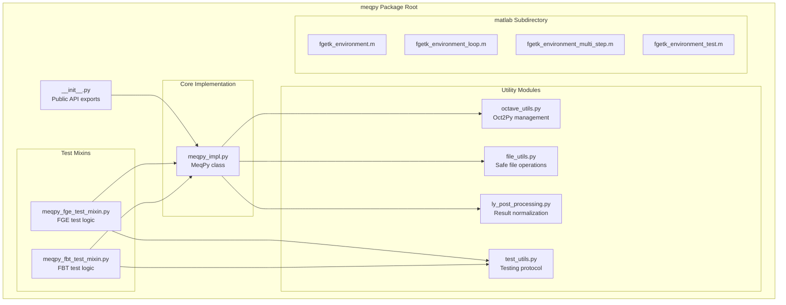
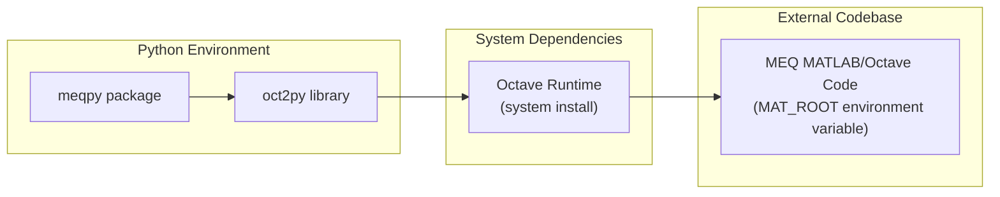
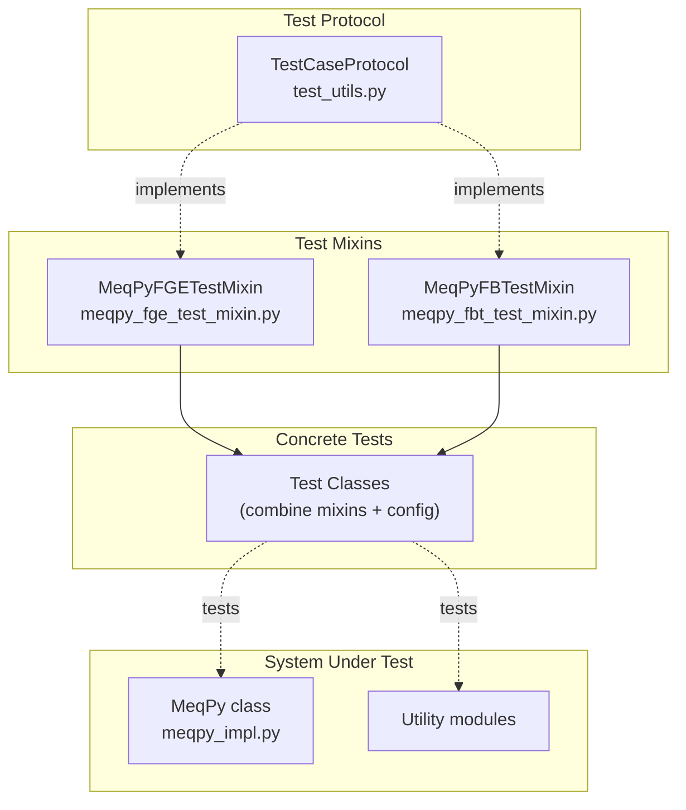
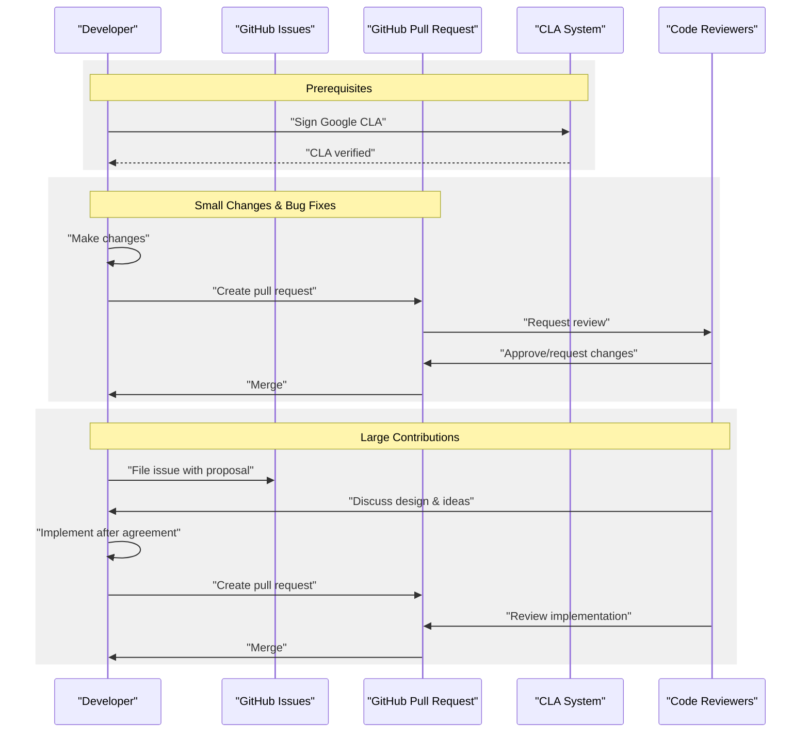
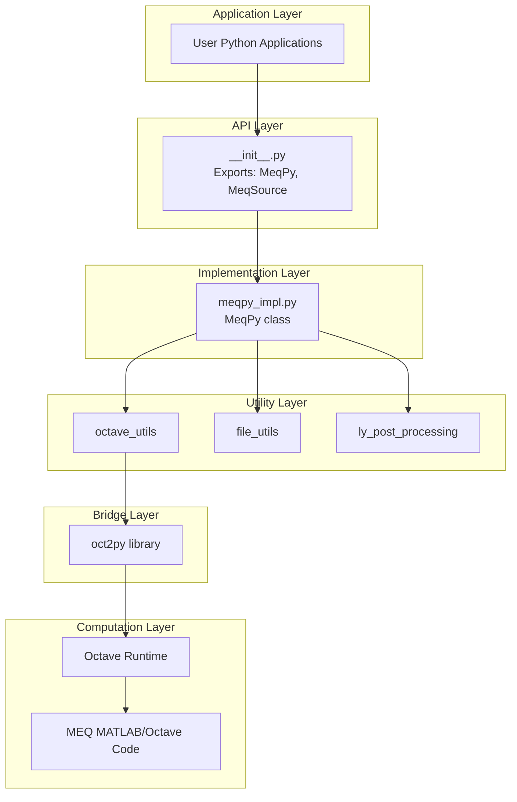

<!-- source: DeepWiki mcp.deepwiki.com · repo google-deepmind/meqpy · page 9 Developer Reference · fetched 2026-10-26 -->

# Developer Reference

<details>
<summary>Relevant source files</summary>

The following files were used as context for generating this wiki page:

- [CONTRIBUTING.md](CONTRIBUTING.md)
- [LICENSE](LICENSE)
- [pyproject.toml](pyproject.toml)

</details>


## Purpose and Scope

This section provides information for developers who want to contribute to, extend, or understand the internal architecture of MeqPy. It covers project organization, build system configuration, development environment setup, and contribution workflow at a high level.

For detailed information on specific topics:
- Project structure, build configuration, and dependency management: see [Project Structure and Build System](#9.1)
- Contribution guidelines, CLA requirements, and code review process: see [Contributing Guidelines](#9.2)
- Testing patterns and how to write tests: see [Testing Infrastructure](#7)
- Core architecture and design patterns: see [Core Architecture](#2)

---

## Package Organization

The MeqPy codebase follows a hierarchical structure with clear separation between Python implementation, utility modules, testing infrastructure, and bundled Octave/MATLAB code.

### Directory Layout



**Sources:** Architecture Diagram 6

### Module Responsibilities

| Module | Primary Responsibility | Key Classes/Functions |
|--------|----------------------|----------------------|
| `meqpy_impl.py` | Main simulation control and orchestration | `MeqPy` class |
| `octave_utils.py` | Oct2Py instance management, struct operations | `create_meq_oct2py_instance()`, `push_to_struct()`, `pull_from_struct()` |
| `file_utils.py` | Atomic file operations for data integrity | `safe_copy()` |
| `ly_post_processing.py` | Normalize MATLAB structures to Python-friendly formats | `process_ly()` |
| `test_utils.py` | Testing infrastructure protocol | `TestCaseProtocol` |
| `meqpy_fge_test_mixin.py` | Reusable FGE testing logic | `MeqPyFGETestMixin` |
| `meqpy_fbt_test_mixin.py` | Reusable FBT testing logic | `MeqPyFBTestMixin` |

The package exports a minimal public API through `__init__.py`, exposing only the `MeqPy` class and `MeqSource` enum. Internal implementation details remain private to the package.

**Sources:** Architecture Diagram 6, [pyproject.toml]()

---

## Build System and Dependencies

MeqPy uses modern Python packaging standards with `pyproject.toml` configuration and `setuptools` as the build backend.

### Build Configuration Overview

```mermaid
graph TB
    subgraph "Build System"
        PyProject["pyproject.toml"]
        BuildBackend["setuptools.build_meta"]
        Manifest["MANIFEST.in"]
    end
    
    subgraph "Package Metadata"
        Name["name: meqpy"]
        Version["version: 0.1.0"]
        License["Apache 2.0"]
        Python["requires-python: >=3.11"]
        Classifiers["classifiers:<br/>Python 3.11/3.12/3.13<br/>Science/Research"]
    end
    
    subgraph "Dependencies"
        NumPy["numpy >=1.26"]
        Oct2Py["oct2py >=5.8.0"]
        JAX["jax >=0.4"]
        AbslPy["absl-py >=2.0"]
    end
    
    subgraph "Testing"
        Pytest["pytest >=6.0"]
        TestConfig["pytest.ini_options<br/>testpaths: tests/"]
    end
    
    subgraph "Data Files"
        MatlabFiles["matlab/*.m files"]
    end
    
    PyProject --> BuildBackend
    PyProject --> Name
    PyProject --> Version
    PyProject --> License
    PyProject --> Python
    PyProject --> Classifiers
    PyProject --> NumPy
    PyProject --> Oct2Py
    PyProject --> JAX
    PyProject --> AbslPy
    PyProject --> Pytest
    PyProject --> TestConfig
    Manifest --> MatlabFiles
```



**Sources:** [pyproject.toml:1-35]()

### Python Version Requirements

MeqPy requires Python 3.11 or later. Supported versions are explicitly listed in classifiers:
- Python 3.11
- Python 3.12
- Python 3.13

**Sources:** [pyproject.toml:16-18](), [pyproject.toml:21]()

### Runtime Dependencies

| Dependency | Minimum Version | Purpose |
|------------|----------------|---------|
| `numpy` | 1.26 | Numerical array operations and data structures |
| `oct2py` | 5.8.0 | Python-Octave bridge for MEQ integration |
| `jax` | 0.4 | Data structure manipulation in `ly_post_processing` |
| `absl-py` | 2.0 | Application utilities and logging infrastructure |

These dependencies are specified in `pyproject.toml` and automatically installed with the package.

**Sources:** [pyproject.toml:22-27]()

### External System Requirements

Beyond Python dependencies, MeqPy requires two external components:



1. **Octave Runtime**: Must be installed system-wide and accessible to `oct2py`
2. **MEQ Codebase**: The MEQ MATLAB/Octave code must be installed and the `MAT_ROOT` environment variable must point to its location

**Sources:** Architecture Diagram 1, Architecture Diagram 6

---

## Testing Configuration

### Pytest Setup

Test configuration is defined in `pyproject.toml`:

```toml
[tool.pytest.ini_options]
minversion = "6.0"
addopts = "-ra -q"
testpaths = ["tests"]
```

This configures pytest to:
- Require pytest version 6.0 or later
- Show short test summary info for all except passed tests (`-ra`)
- Decrease verbosity (`-q`)
- Look for tests in the `tests/` directory

**Sources:** [pyproject.toml:30-35]()

### Test Infrastructure Architecture



The testing infrastructure uses a mixin pattern to enable code reuse. For detailed information on writing tests, see [Testing Infrastructure](#7).

**Sources:** Architecture Diagram 4

---

## Contribution Process

### Contributor License Agreement (CLA)

All contributions to MeqPy must be accompanied by a Contributor License Agreement. The CLA:
- Allows contributors (or their employers) to retain copyright
- Grants Google permission to use and redistribute contributions
- May already be on file if you've contributed to other Google projects

Check your CLA status or sign a new agreement at: https://cla.developers.google.com/

**Sources:** [CONTRIBUTING.md:9-21]()

### Contribution Workflow



**Sources:** [CONTRIBUTING.md:1-35]()

### Contribution Types

| Contribution Type | Required Process |
|------------------|------------------|
| **Small changes and bug fixes** | Submit PR directly for review |
| **Large contributions** | File issue first to discuss design and approach |
| **All submissions** | Must pass code review via GitHub PR |
| **Community conduct** | Follow [Google's Open Source Community Guidelines](https://opensource.google/conduct) |

**Sources:** [CONTRIBUTING.md:1-35]()

---

## License

MeqPy is licensed under the **Apache License, Version 2.0**. Key points:

- Open source license permitting use, modification, and distribution
- Requires preservation of copyright and license notices in distributions
- Provided "AS IS" without warranties or conditions
- Includes patent license grant from contributors
- Full license text available in [LICENSE]()

**Sources:** [LICENSE:1-202](), [pyproject.toml:9]()

---

## Code Organization Principles

### Layered Architecture



The architecture follows clear separation of concerns:
- **API Layer**: Minimal, stable public interface
- **Implementation Layer**: Core simulation orchestration
- **Utility Layer**: Focused, single-responsibility helpers
- **Bridge Layer**: Python-Octave communication
- **Computation Layer**: MEQ numerical algorithms

**Sources:** Architecture Diagram 1

### Public API Design

The public API is intentionally minimal, exposing only:
- `MeqPy` class: Main simulation control interface
- `MeqSource` enum: Data source configuration

This design allows internal refactoring without breaking user code. All other classes and functions are considered private implementation details.

**Sources:** Architecture Diagram 6

---

## File Bundling

MeqPy bundles Octave/MATLAB files with the Python package to provide additional functionality. Files in `matlab/` subdirectory include:

| File | Purpose |
|------|---------|
| `fgetk_environment.m` | Main time-dependent simulation environment |
| `fgetk_environment_loop.m` | Single-step simulation loop |
| `fgetk_environment_multi_step.m` | Multi-step batch execution |
| `fgetk_environment_test.m` | Test harness for environment simulation |

These files are packaged with the distribution using `MANIFEST.in` configuration.

**Sources:** Architecture Diagram 6, Architecture Diagram 1

---

## Extension Points

### Adding New Simulation Modes

To add a simulation mode beyond FGE and FBT:

1. Add initialization method to `MeqPy` class (e.g., `init_new_mode()`)
2. Add parameter configuration methods (e.g., `set_new_mode_parameters()`)
3. Add execution methods (e.g., `run_new_mode()`)
4. Follow L/LX/LY structure pattern for consistency

**Sources:** Architecture Diagram 2

### Adding Utility Functions

To add new utility functions:

1. Place in appropriate module (`octave_utils.py`, `file_utils.py`, etc.)
2. Ensure single responsibility and clear naming
3. Add comprehensive unit tests
4. Document with docstrings

**Sources:** Architecture Diagram 6

### Extending Test Infrastructure

To create new test mixins:

1. Implement `TestCaseProtocol` interface for assertion compatibility
2. Define abstract methods for subclasses to implement
3. Follow patterns from `MeqPyFGETestMixin` and `MeqPyFBTestMixin`
4. Document expected configuration parameters

**Sources:** Architecture Diagram 4, [pyproject.toml:30-35]()

---

## Development Environment Setup

Basic setup steps for developers:

1. Clone repository: `git clone https://github.com/google-deepmind/meqpy`
2. Install Python 3.11 or later
3. Install Octave and ensure it's in PATH
4. Set `MAT_ROOT` environment variable to MEQ installation location
5. Install in editable mode: `pip install -e .`
6. Verify setup: `pytest`

For detailed installation instructions, see [Installation and Setup](#1.1).

**Sources:** [pyproject.toml:21](), Architecture diagrams

---

## Additional Resources

For more detailed information:
- **Project structure, build configuration, packaging details**: [Project Structure and Build System](#9.1)
- **Contribution guidelines, code review process**: [Contributing Guidelines](#9.2)
- **Testing patterns and examples**: [Testing Infrastructure](#7)
- **Architecture overview**: [Core Architecture](#2)
- **Installation details**: [Installation and Setup](#1.1)

**Sources:** [CONTRIBUTING.md](), [pyproject.toml]()

---

