# Page: Overview

# Overview

<details>
<summary>Relevant source files</summary>

The following files were used as context for generating this wiki page:

- [README.md](README.md)
- [pyproject.toml](pyproject.toml)

</details>


Mishax is a utility library for mechanistic interpretability research on neural networks, particularly focused on language models. It enables inspection and modification of model internals during execution without extensive changes to the original codebase.

## Purpose and Scope

This document provides an overview of the Mishax repository, its core components, architecture, and key use cases. Mishax offers tools that allow researchers to probe model internals, modify activations during execution, and analyze model behavior at a granular level.

For detailed installation instructions, see [Installation and Setup](#1.1). For a deeper dive into the system's organization, see [Project Architecture](#1.2).

Sources: [README.md:3-5]()

## Key Components

Mishax consists of two primary utilities that can be used together to enable mechanistic interpretability research:

### AST Patcher

The `mishax.ast_patcher` module enables running code from other libraries with source-level code modifications applied at runtime. It allows:

- Insertion of instrumentation code at specific points in model execution
- Addition of probes to observe internal activations
- Intervention at arbitrary locations in model code

This approach avoids the need to fork and maintain modified versions of target libraries.

### Safe Greenlet

The `mishax.safe_greenlet` module transforms complex callback-based functions into ordinary-looking Python loops that can:

- Iterate over internal values during model execution
- Allow replacement of these values with modified versions
- Provide clean integration with JAX's functional programming paradigm

Safe Greenlet builds on the `greenlet` library to enable coroutine-like behavior that can yield control from deep within call stacks.

### Gemma Example

The repository includes an example in `mishax.examples.gemma` demonstrating instrumentation of the Gemma language model. This example showcases how the core utilities can be applied to a real-world model.

Sources: [README.md:5-11](), [pyproject.toml:19-23]()

## System Architecture

### Code Module Structure

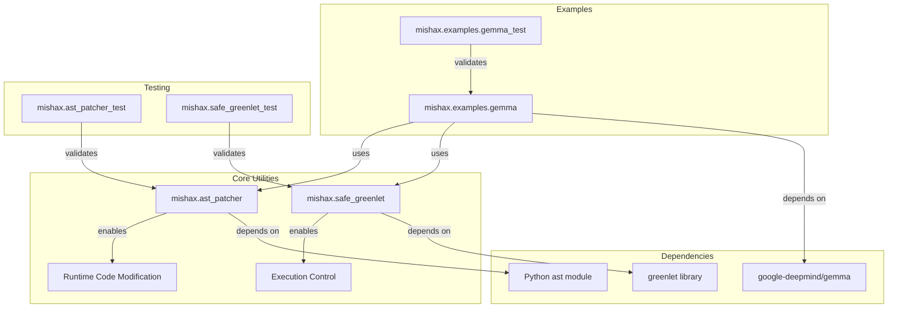

Sources: [README.md:36-43](), [pyproject.toml:19-23]()

The core utilities (`ast_patcher` and `safe_greenlet`) provide the foundation for applications like the Gemma example. The diagram shows the dependencies and relationships between the different components of the Mishax repository.

## Functional Workflow

### Model Instrumentation Process

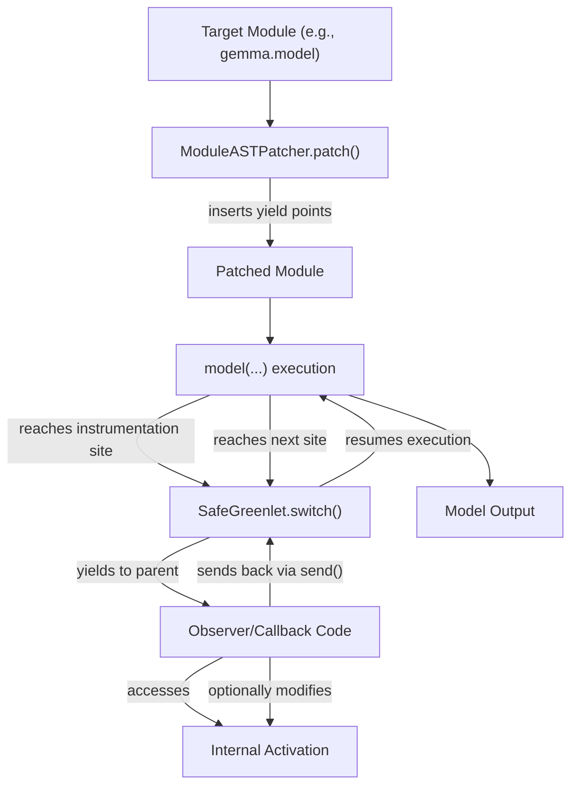

Sources: [README.md:7-9]()

The diagram illustrates how Mishax enables model instrumentation:

1. The `ModuleASTPatcher` transforms code at runtime to insert instrumentation points
2. When execution reaches these points, control yields to observer code via `SafeGreenlet`
3. Observer code can access and modify internal activations
4. Execution continues until the next instrumentation point

This workflow allows researchers to observe and modify model internals during execution without extensive code changes.

## Use Cases for Mechanistic Interpretability

Mishax supports several key research activities:

### Instrumentation Capabilities

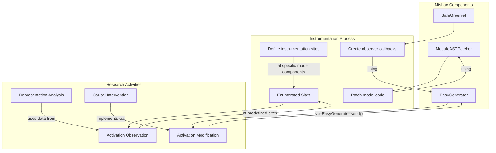

Sources: Based on functionality described in [README.md:3-11]()

This diagram shows how Mishax components enable different research activities:

1. **Activation Observation**: Accessing internal activations at various points in model execution
2. **Activation Modification**: Replacing values to test causal hypotheses
3. **Representation Analysis**: Studying the properties of learned representations
4. **Causal Intervention**: Testing how changes to internal states affect model behavior

## Installation and Quick Start

To install Mishax:

```
python3 -m pip install git+git://github.com/google-deepmind/mishax.git
```

With dependencies for the Gemma example:

```
python3 -m pip install git+git://github.com/google-deepmind/mishax.git[gemma]
```

For development:

```
python3 -m pip install git+git://github.com/google-deepmind/mishax.git[dev]
```

A Colab tutorial demonstrating Gemma instrumentation is available as referenced in [README.md:45-48]().

Sources: [README.md:17-48]()

## Related Documentation

For more detailed information about specific components:

- [AST Patcher](#2): Documentation of the runtime code modification system
- [Safe Greenlet](#3): Details on the structured concurrency tools
- [Gemma Instrumentation Example](#4): In-depth explanation of the Gemma example
- [Mechanistic Interpretability Guide](#5): Holistic guide for research applications

---

# Page: Installation and Setup

# Installation and Setup

<details>
<summary>Relevant source files</summary>

The following files were used as context for generating this wiki page:

- [README.md](README.md)
- [pyproject.toml](pyproject.toml)

</details>


This document provides comprehensive instructions for installing and setting up the Mishax library on your system. It covers basic installation, installation with specific dependencies for examples, and verification steps. For a high-level understanding of how Mishax components work together, see [Project Architecture](#1.2).

## System Requirements

Before installing Mishax, ensure your system meets the following requirements:

- Python 3.11 or higher
- Ability to create Python virtual environments
- Git (for cloning the repository)

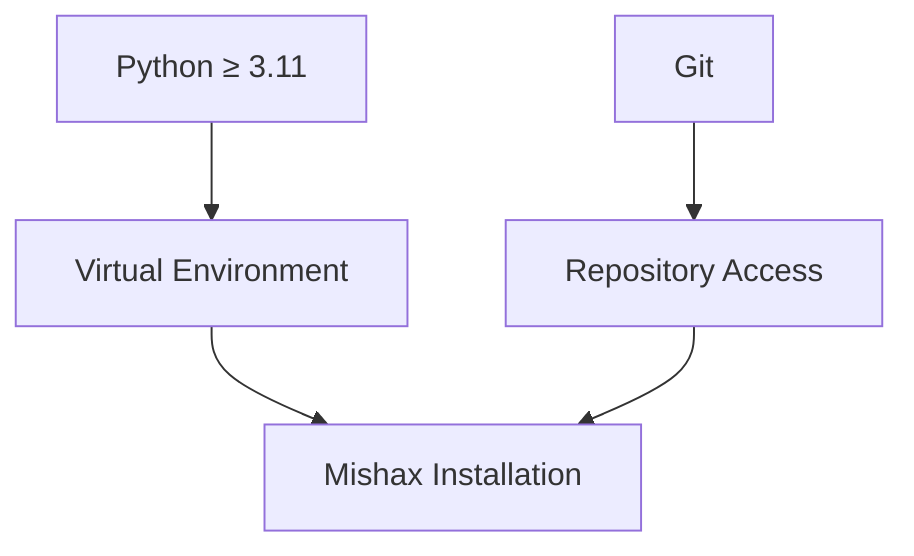

Sources: [pyproject.toml:13](), [README.md:19-23]()

## Installation Options

Mishax offers multiple installation configurations depending on your needs:

| Installation Type | Purpose | Main Dependencies |
|-------------------|---------|-------------------|
| Basic | Core functionality only | immutabledict, greenlet |
| Gemma | Includes Gemma example dependencies | jax, jaxlib, absl-py, gemma |
| Development | For contributing to Mishax | jax, jaxlib, absl-py |

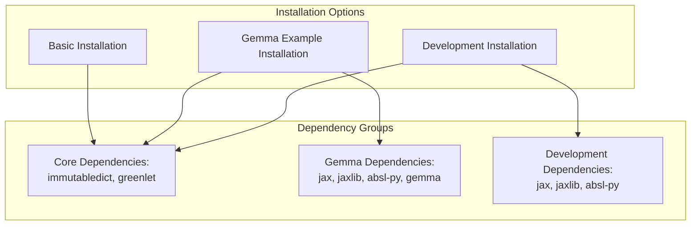

Sources: [pyproject.toml:19-23](), [README.md:17-31]()

## Basic Installation

To install the basic Mishax package with only core dependencies:

1. Create a virtual environment:
```bash
python3 -m venv $HOME/mishax-venv
```

2. Activate the virtual environment:
```bash
source $HOME/mishax-venv/bin/activate
```

3. Install Mishax from GitHub:
```bash
python3 -m pip install git+git://github.com/google-deepmind/mishax.git
```

This installation provides access to the core components: `mishax.ast_patcher` and `mishax.safe_greenlet`.

Sources: [README.md:19-23](), [pyproject.toml:19]()

## Installing with Gemma Example Dependencies

To use the Gemma instrumentation example, install Mishax with the additional Gemma dependencies:

```bash
python3 -m venv $HOME/mishax-venv
source $HOME/mishax-venv/bin/activate
python3 -m pip install git+git://github.com/google-deepmind/mishax.git[gemma]
```

This installs the following additional dependencies:
- jax
- jaxlib
- absl-py
- gemma (from GitHub)

Sources: [README.md:25-31](), [pyproject.toml:22]()

## Installing for Development

If you plan to contribute to Mishax or run the test suite:

```bash
python3 -m venv $HOME/mishax-venv
source $HOME/mishax-venv/bin/activate
python3 -m pip install git+git://github.com/google-deepmind/mishax.git[dev]
```

Sources: [README.md:35-43](), [pyproject.toml:23]()

## Package Structure After Installation

Once installed, the Mishax package provides the following main components:

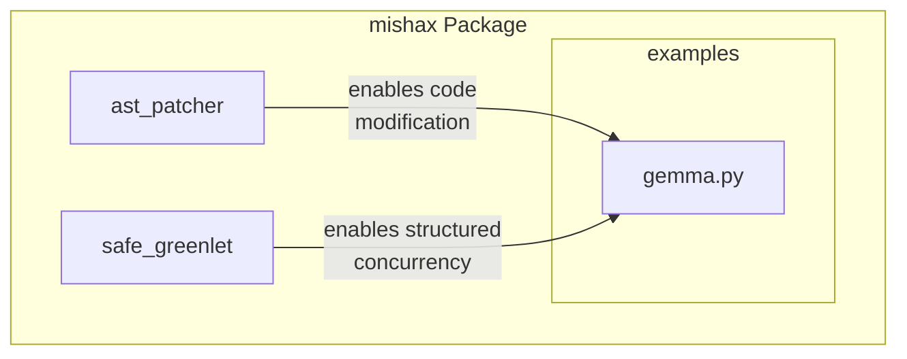

Sources: [README.md:7-11]()

## Verifying Installation

### Running Tests

To verify your installation, you can run the Mishax test suite:

```bash
python3 -m mishax.ast_patcher_test
python3 -m mishax.safe_greenlet_test
python3 -m mishax.examples.gemma_test  # requires [gemma] dependencies
```

The tests will validate that all components are functioning correctly.

Sources: [README.md:35-43]()

### Testing the Gemma Example

A Colab notebook is available for testing the Gemma instrumentation example:
[Colab Tutorial](https://colab.research.google.com/drive/1rP2cgyx0wXjVt72db7dL1la0VqUaMu0S#revisionId=0Bxemsxg8RNFNekR6VFh3MnhmRjd3QUhKSlN0cnk1YVBVeHRZPQ)

The notebook demonstrates how to use Mishax to instrument and interact with Gemma model internals.

Sources: [README.md:45-48]()

## Installation Process Flow

The complete installation process follows this sequence:

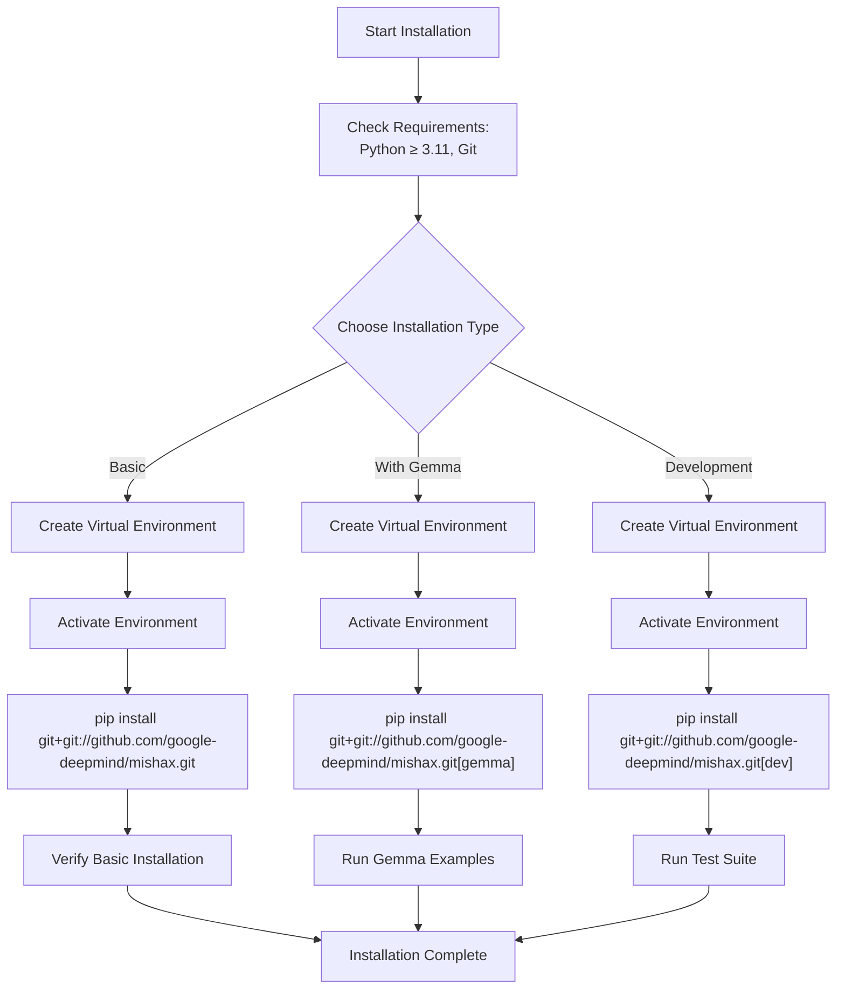

Sources: [README.md:17-43]()

## Deactivating the Environment

When you're done working with Mishax, deactivate the virtual environment:

```bash
deactivate
```

Sources: [README.md:33]()

## Troubleshooting

### Common Issues

- **Python Version**: Ensure you have Python 3.11 or higher installed
- **Path Issues**: If commands are not found, check that your virtual environment is activated
- **Dependency Conflicts**: Try creating a fresh virtual environment if you encounter dependency conflicts

If you encounter issues with the installation, check the [official GitHub repository](https://github.com/google-deepmind/mishax) for the most up-to-date information or to report issues.

Sources: [pyproject.toml:13](), [pyproject.toml:26-27]()

---

# Page: Project Architecture

# Project Architecture

<details>
<summary>Relevant source files</summary>

The following files were used as context for generating this wiki page:

- [README.md](README.md)
- [mishax/__init__.py](mishax/__init__.py)
- [pyproject.toml](pyproject.toml)

</details>


## Purpose and Scope

This document provides a comprehensive overview of the Mishax project architecture, explaining how its components work together to enable mechanistic interpretability research. It covers the structural organization of the codebase, the relationships between key components, and the functional flow of execution when using Mishax for model instrumentation.

For specific details about installing Mishax, refer to [Installation and Setup](#1.1). For in-depth documentation of individual components, see [AST Patcher](#2) and [Safe Greenlet](#3).

Sources: [README.md:3-11]()

## High-Level Architecture Overview

Mishax consists of two primary utility components that work together to enable model instrumentation:

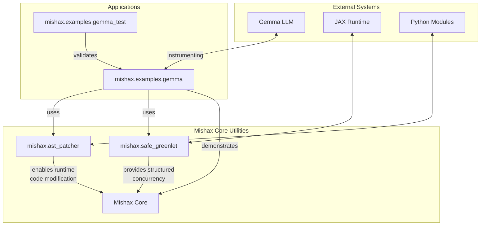

The architecture revolves around two complementary utilities:

1. **AST Patcher (`mishax.ast_patcher`)**: Enables runtime modification of Python code, allowing users to instrument existing codebases without forking them. It uses Python's Abstract Syntax Tree (AST) capabilities to modify modules at runtime.

2. **Safe Greenlet (`mishax.safe_greenlet`)**: Provides structured concurrency for deep call stacks, allowing users to transform complex functions with callbacks into simpler iterative interfaces. This makes it easier to interact with and modify internal values during execution.

3. **Example Implementation (`mishax.examples.gemma`)**: Demonstrates how both utilities can be combined to instrument the Gemma language model, providing a practical application of the architecture.

Sources: [README.md:5-11](), [pyproject.toml:18-19]()

## Functional Flow

The following diagram illustrates how Mishax operates when instrumenting a model:

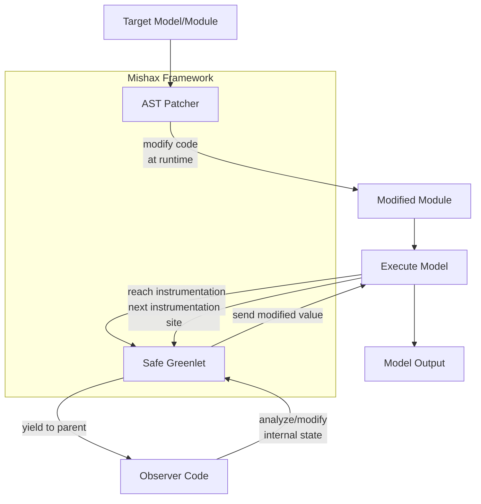

The functional flow follows these steps:

1. The AST Patcher modifies target code at runtime to insert instrumentation points
2. The modified code executes normally until an instrumentation point is reached
3. At instrumentation points, Safe Greenlet yields control to observer code
4. Observer code can analyze or modify the internal state of the model
5. Control returns to the model execution with potentially modified values
6. This cycle repeats at each instrumentation point

This approach allows for non-invasive inspection and modification of model internals during execution, making it ideal for mechanistic interpretability research.

Sources: [README.md:7-9]()

## Component Architecture

### AST Patcher

The AST Patcher component enables runtime modification of Python code:

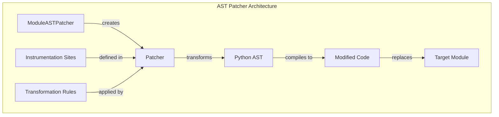

The AST Patcher works by:
1. Taking a target module and transformation specifications
2. Parsing the module's source code into an Abstract Syntax Tree (AST)
3. Applying transformations to the AST to insert instrumentation code
4. Recompiling the modified AST back into executable code
5. Replacing the original module with the modified version

This allows for precise insertion of instrumentation points without modifying the original source files.

Sources: [README.md:7](), [README.md:13-15]()

### Safe Greenlet

The Safe Greenlet component provides structured concurrency for deep call stacks:

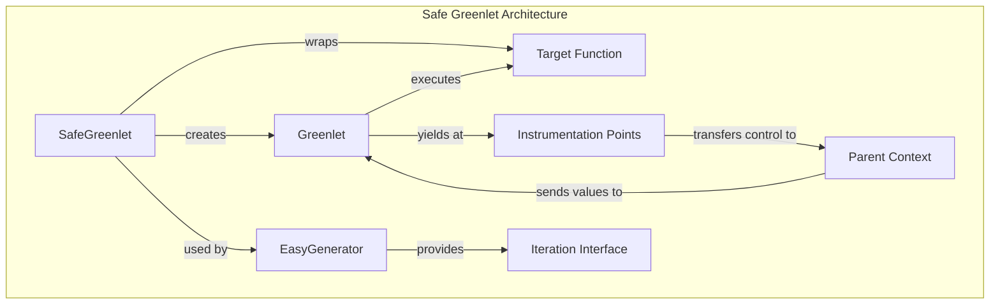

Safe Greenlet operates by:
1. Wrapping a target function in a greenlet (a lightweight cooperative thread)
2. Executing the function in the greenlet until it yields at an instrumentation point
3. Transferring control back to the parent context, which can analyze or modify state
4. Receiving modified values from the parent context and resuming execution
5. Providing an iteration interface that makes this process look like a simple Python loop

This makes it possible to interact with deep call stacks as if they were simple iterators, greatly simplifying complex instrumentation tasks.

Sources: [README.md:9](), [pyproject.toml:19]()

## Mishax for Model Instrumentation

When using Mishax for mechanistic interpretability, the components work together to instrument a model:

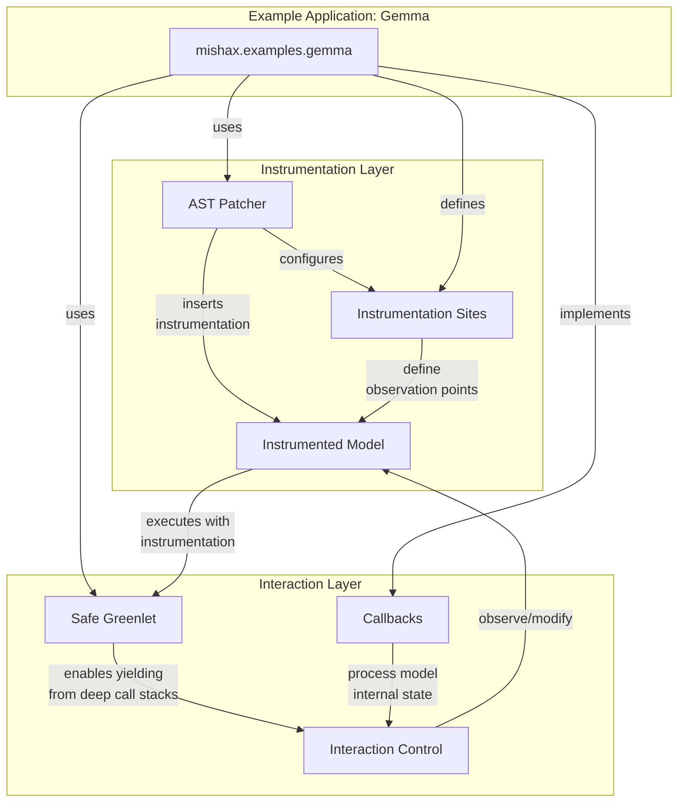

The Gemma example demonstrates this architecture by:
1. Using AST Patcher to instrument the Gemma model code
2. Defining instrumentation sites at key points in the model's computation
3. Using Safe Greenlet to interact with these sites during model execution
4. Implementing callbacks that analyze and potentially modify model activations

This layered approach separates concerns between instrumentation (code modification) and interaction (runtime behavior), providing a flexible framework for mechanistic interpretability research.

Sources: [README.md:11](), [pyproject.toml:22]()

## Neural Network Instrumentation Architecture

Mishax enables the instrumentation of various points within a neural network architecture, as demonstrated by the Gemma example:

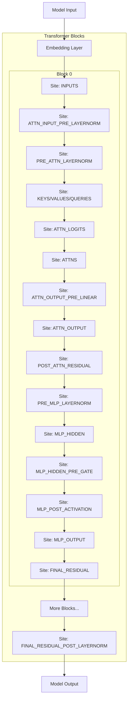

The instrumentation architecture allows for:
1. Defining specific points in the neural network computation graph where values can be observed
2. Intercepting and potentially modifying these values during execution
3. Analyzing the internal behavior of the model at different stages of computation
4. Conducting targeted interventions to test causal hypotheses about model behavior

This makes it possible to perform detailed mechanistic interpretability research on complex neural network architectures.

Sources: [README.md:11](), [pyproject.toml:22]()

## Module Structure and Dependencies

The Mishax codebase has a clean, modular structure with clear dependencies:

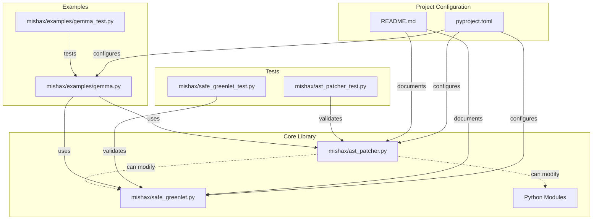

### Dependencies

The project has minimal core dependencies:

| Component | Required Dependencies |
|-----------|----------------------|
| `mishax.ast_patcher` | `immutabledict` |
| `mishax.safe_greenlet` | `greenlet` |
| `mishax.examples.gemma` | `jax`, `jaxlib`, `absl-py`, `gemma` |

The lightweight core dependencies allow for easy integration with existing projects, while the example implementation demonstrates how to use Mishax with specific model frameworks like JAX and Gemma.

Sources: [pyproject.toml:19-23](), [README.md:38-43]()

## Integration with Development Workflow

Mishax is designed to integrate smoothly into existing development workflows:

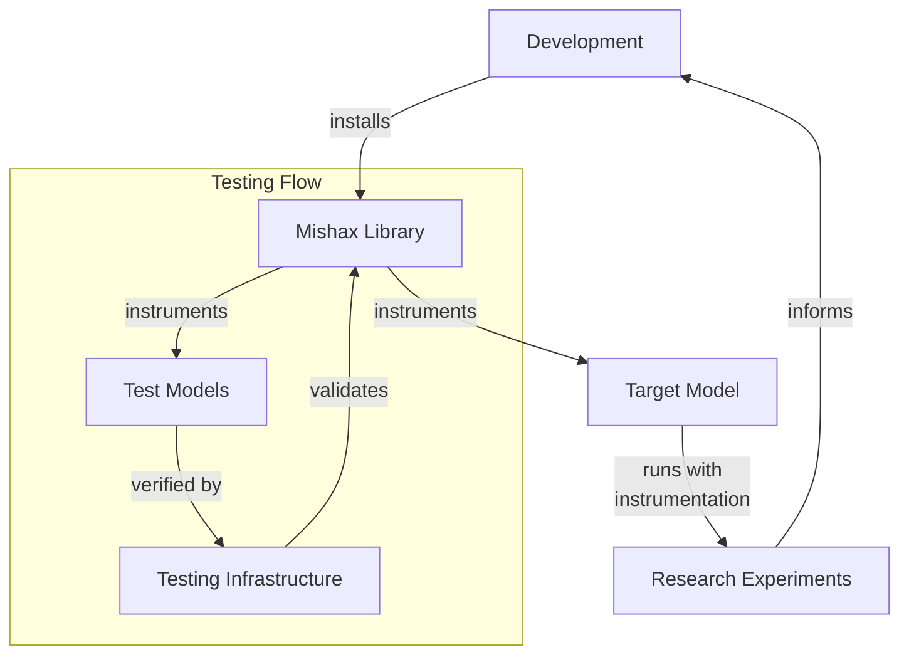

The project includes comprehensive tests for each component, allowing users to verify functionality before integrating Mishax into their projects. The clean separation of concerns between the AST Patcher and Safe Greenlet components makes it possible to use each independently or together, depending on specific research needs.

Sources: [README.md:35-43](), [README.md:45-48]()

## Summary

The Mishax architecture provides a powerful framework for mechanistic interpretability research through its two core components:

1. **AST Patcher**: Enables runtime code modification to insert instrumentation points
2. **Safe Greenlet**: Provides structured concurrency for interacting with deep call stacks

These components work together to transform complex model codebases into instrumented versions that allow for detailed inspection and modification of internal states. The architecture's layered design separates concerns between instrumentation and interaction, providing a flexible framework that can be adapted to different research needs.

The Gemma example demonstrates how this architecture can be applied to a real language model, providing a template for researchers to follow when instrumenting their own models for mechanistic interpretability research.

Sources: [README.md:3-11]()

---

# Page: AST Patcher

# AST Patcher

<details>
<summary>Relevant source files</summary>

The following files were used as context for generating this wiki page:

- [mishax/ast_patcher.py](mishax/ast_patcher.py)
- [mishax/ast_patcher_test.py](mishax/ast_patcher_test.py)

</details>


The AST Patcher is a core component of the Mishax framework that enables runtime modification of Python code by manipulating the Abstract Syntax Tree (AST). This system allows for dynamically altering module behavior without changing the original source files, making it ideal for instrumentation, debugging, and mechanistic interpretability research. For information about using the patched modules with structured concurrency, see [Safe Greenlet](#3).

## Overview

The AST Patcher provides mechanisms to modify imported Python modules by specifying code replacements as "before" and "after" patterns. These patterns are applied to the AST representation of the module's source code, generating a new version that is used at runtime. The patching occurs in memory and creates temporary files for debugger and stack trace visibility.

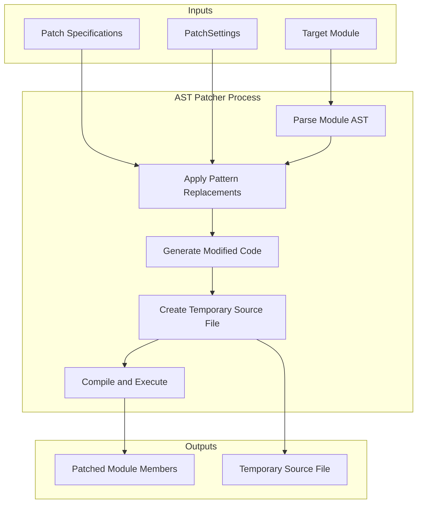

Sources: [mishax/ast_patcher.py:36-308]()

## Key Components

### ModuleASTPatcher

The core class that handles the patching process. It takes a module (either as a string name or an already-imported module), patch settings, and patch specifications for specific objects in the module.

### PatchSettings

A configuration class that controls the patching behavior:

- `prefix`: Code to add near the top of the patched module
- `allow_num_matches_upto`: Controls how many pattern matches are allowed for each patch

```mermaid
classDiagram
    class "ModuleASTPatcher" {
        +module: ModuleType|str
        -_settings: PatchSettings
        -_patches_per_object: dict
        -_updated_members: dict
        -_original_members: dict
        -_src: str
        -_path: str
        -_globals: dict
        +__init__(module, settings, **patches_per_object)
        +install()
        +is_installed(): bool
        +install_clean()
        +__call__(): ContextManager
        +updated_members: property
        +original_members: property
        +globals: property
        +src: property
        +path: property
        -_setup()
    }
    
    class "PatchSettings" {
        +prefix: str|None
        +allow_num_matches_upto: Mapping[str, int]|None
    }
    
    class "PatchError" {
        +message: str
    }
    
    ModuleASTPatcher --> PatchSettings: uses
    ModuleASTPatcher --> PatchError: may raise
```

Sources: [mishax/ast_patcher.py:36-50](), [mishax/ast_patcher.py:52-54](), [mishax/ast_patcher.py:64-108]()

## Patch Specification

Patches are specified as pairs of "before" and "after" code blocks. The "before" block represents the code to be matched, and the "after" block is the replacement code. There are two ways to specify these pairs:

1. **Alternating format**: A flat list of strings alternating between "before" and "after" code
2. **Tuple format**: A list of tuples, each containing a "before" and "after" code block

The patcher applies these patches by finding the corresponding AST patterns in the module's source code and replacing them with the patched versions.

Example patch specification:
```python
# Alternating format
patches = ["x += 2", "x += 2\nhit_patch()"]

# Tuple format
patches = [("x += 2", "x += 2\nhit_patch()")]
```

Sources: [mishax/ast_patcher.py:107-113](), [mishax/ast_patcher_test.py:79-82]()

## Installation Methods

The AST Patcher provides three ways to apply patches, with different trade-offs between flexibility and robustness:

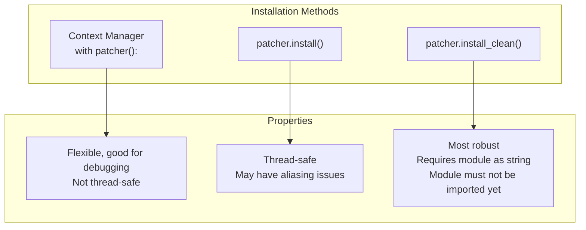

### Context Manager

Using the patcher as a context manager is the most flexible approach, suitable for prototyping and debugging:

```python
patcher = ModuleASTPatcher(my_module, **patches)
with patcher():
    # Code that uses the patched module
```

### Install Method

The `install()` method provides a thread-safe way to apply patches at any time:

```python
patcher = ModuleASTPatcher(my_module, **patches)
patcher.install()
# All subsequent code uses the patched module
```

### Install Clean Method

The `install_clean()` method is the most robust approach, applying patches when a module is first imported:

```python
patcher = ModuleASTPatcher("module.name", **patches)
patcher.install_clean()
import module.name  # Module is imported with patches applied
```

Sources: [mishax/ast_patcher.py:125-166](), [mishax/ast_patcher_test.py:164-196]()

## Patching Process

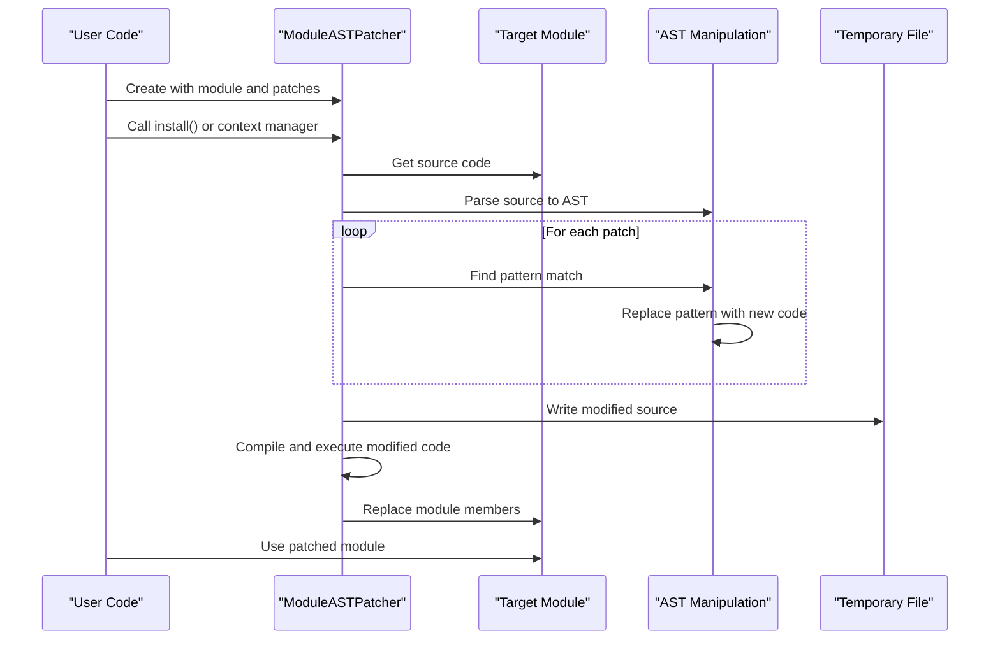

The patching process follows these steps:

1. The user creates a `ModuleASTPatcher` with a target module and patch specifications
2. The patcher retrieves the source code of the target module members
3. For each member to be patched:
   - The source code is parsed into an AST
   - Each "before" pattern is matched in the AST
   - Matched patterns are replaced with the corresponding "after" AST
4. A temporary file is created with the modified source code
5. The modified code is compiled and executed in a new environment
6. Module members are replaced with the patched versions

Sources: [mishax/ast_patcher.py:213-307]()

## Example Use Cases

### Basic Patching

```python
# Patch a function to add logging
patcher = ModuleASTPatcher(
    target_module,
    some_function=[
        "result = calculate(x, y)",
        "result = calculate(x, y)\nprint(f'Result: {result}')"
    ]
)

with patcher():
    # Calls to some_function will now print the result
    target_module.some_function(1, 2)
```

### Multiple Patches with Prefix

```python
# Add imports and patch multiple places in a module
patcher = ModuleASTPatcher(
    target_module,
    PatchSettings(prefix="import logging\nlogger = logging.getLogger(__name__)"),
    function_a=["return result", "logger.info(f'Result: {result}')\nreturn result"],
    function_b=["process(data)", "logger.debug('Processing data')\nprocess(data)"]
)

patcher.install()  # Apply patches permanently
```

### Allowing Multiple Matches

```python
# Patch all instances of a pattern
patcher = ModuleASTPatcher(
    target_module,
    PatchSettings(allow_num_matches_upto={"my_function": 5}),
    my_function=["self.value", "self.value * 2"]
)
```

Sources: [mishax/ast_patcher_test.py:72-96](), [mishax/ast_patcher_test.py:110-122](), [mishax/ast_patcher_test.py:154-162]()

## Limitations and Considerations

Using the AST Patcher introduces several important considerations:

1. **Version Dependencies**: Patches may break if the target module changes, especially changes to implementation details that patches rely on.

2. **State Changes**: If the patched module definitions affect global state during execution, these state changes will occur again when patches are applied.

3. **Threading Issues**: Using the context manager approach isn't thread-safe, as it temporarily modifies the module.

4. **Debugging Complexity**: While patched code provides proper stack traces, debugging can be more complex when working with dynamically modified code.

5. **Multiple Matches**: By default, patches must match exactly once. Use `allow_num_matches_upto` to allow multiple matches.

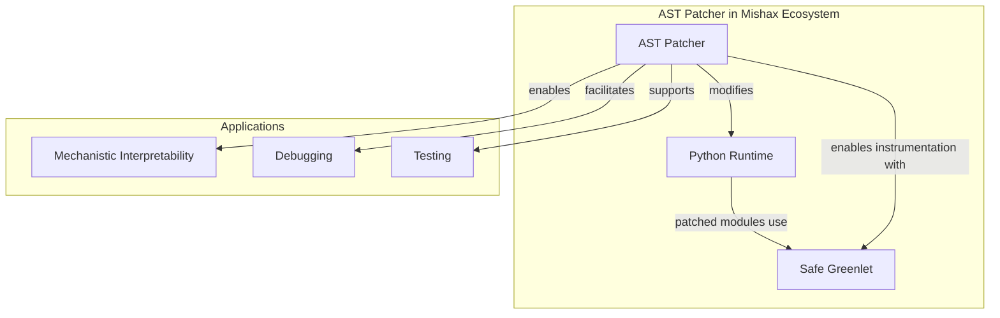

Sources: [mishax/ast_patcher.py:91-105](), [mishax/ast_patcher_test.py:142-152]()

## Integration with Other Mishax Components

The AST Patcher is designed to work seamlessly with other Mishax components, particularly Safe Greenlet for structured concurrency. This combination is powerful for instrumenting machine learning models:

1. Use AST Patcher to modify model code and insert instrumentation points
2. Use Safe Greenlet to control execution flow at those instrumentation points
3. Observe or modify internal model states as the model executes

Sources: [mishax/ast_patcher.py:16-35]()

---

# Page: AST Patcher Usage Patterns

# AST Patcher Usage Patterns

<details>
<summary>Relevant source files</summary>

The following files were used as context for generating this wiki page:

- [mishax/ast_patcher.py](mishax/ast_patcher.py)
- [mishax/ast_patcher_test.py](mishax/ast_patcher_test.py)

</details>


## Purpose and Scope

This page documents common usage patterns for the AST Patcher system in Mishax. The AST Patcher enables runtime modification of Python code by transforming the Abstract Syntax Tree (AST) of target modules. This page focuses on practical patterns for applying patches, rather than the detailed API reference (for which, see [AST Patcher API Reference](#2.2)).

## Overview of AST Patcher

The AST Patcher allows you to modify Python modules at runtime by patching their source code. This is particularly useful for instrumenting model code without modifying the original source files.

```mermaid
flowchart TD
    subgraph "AST Patcher Process"
        Target["Target Module"] --> Parse["Parse AST"]
        Parse --> Match["Match Target Patterns"]
        Match --> Replace["Replace with New Code"]
        Replace --> Compile["Compile Modified AST"]
        Compile --> Load["Load Modified Module"]
    end
```

Sources: [mishax/ast_patcher.py:61-308]()

## Basic Usage Patterns

The AST Patcher provides three primary patterns for applying patches, each with different characteristics regarding scope, thread safety, and persistence.

```mermaid
flowchart LR
    subgraph "Usage Patterns"
        direction TB
        CM["Context Manager\n(Temporary)"] 
        I["Install\n(Thread-safe)"] 
        IC["Install Clean\n(Fresh Import)"]
    end

    CM --> |"with patcher():"| T["Temporary modification\nScope: Context block\nThread-safety: No"]
    I --> |"patcher.install()"| P["Persistent modification\nScope: Global\nThread-safety: Yes"]
    IC --> |"patcher.install_clean()"| C["Clean persistent modification\nScope: Global\nRequires: Module not yet imported"]
```

Sources: [mishax/ast_patcher.py:65-87](), [mishax/ast_patcher.py:125-166]()

### Context Manager Pattern

The context manager pattern applies patches temporarily within a block of code:

```mermaid
sequenceDiagram
    participant User as "User Code"
    participant Patcher as "ModuleASTPatcher"
    participant Target as "Target Module"
    
    User->>Patcher: Create patcher(module, **patches)
    User->>Patcher: Enter context (with patcher():)
    Patcher->>Target: Apply patches
    User->>Target: Use patched module
    User->>Patcher: Exit context
    Patcher->>Target: Restore original behavior
```

Sources: [mishax/ast_patcher.py:166-172](), [mishax/ast_patcher_test.py:87-95]()

### Installation Pattern

The installation pattern applies patches persistently:

```mermaid
sequenceDiagram
    participant User as "User Code"
    participant Patcher as "ModuleASTPatcher"
    participant Target as "Target Module"
    participant Registry as "_INSTALLED_PATCHER_CONTEXTS"
    
    User->>Patcher: Create patcher(module, **patches)
    User->>Patcher: patcher.install()
    Patcher->>Registry: Register context
    Patcher->>Target: Apply patches
    Note over Target: Patches remain applied indefinitely
    User->>Target: Use patched module anytime
```

Sources: [mishax/ast_patcher.py:125-143](), [mishax/ast_patcher_test.py:83-96]()

### Clean Installation Pattern

The clean installation pattern ensures that patches are applied to a freshly imported module:

```mermaid
sequenceDiagram
    participant User as "User Code"
    participant Patcher as "ModuleASTPatcher"
    participant SysModules as "sys.modules"
    participant Target as "Target Module"
    
    User->>Patcher: Create patcher("module.name", **patches)
    User->>Patcher: patcher.install_clean()
    Patcher->>SysModules: Check module not imported
    Patcher->>Target: Import and apply patches
    Note over Target: All code sees patched version
```

Sources: [mishax/ast_patcher.py:149-164](), [mishax/ast_patcher_test.py:163-196]()

## Patch Specification Patterns

### Patch Format

Patches are specified as pairs of code snippets representing "before" and "after" states:

```mermaid
flowchart LR
    subgraph "Patch Specification"
        direction TB
        Before["Before Code\n(to match)"] --> After["After Code\n(to replace with)"]
    end

    Original["Original AST"] --> |"Find matching nodes"| Match["Matched AST Nodes"]
    Match --> |"Replace with after code"| Modified["Modified AST"]
```

Sources: [mishax/ast_patcher.py:238-294]()

There are two ways to specify patches:

1. As tuples of (before, after) code snippets
2. As a flat list alternating between before and after snippets

Sources: [mishax/ast_patcher.py:240-246]()

### Simple Statement Patches

For patching statements within a function or method:

```mermaid
flowchart LR
    subgraph "Statement Patch"
        Original["x += 2"] --> Patched["x += 2\nhit_patch()"]
    end
```

Sources: [mishax/ast_patcher_test.py:79-82]()

### Expression Patches

For patching expressions (values) within code:

```mermaid
flowchart LR
    subgraph "Expression Patch"
        Original["2"] --> Patched["FOUR"]
    end
```

Sources: [mishax/ast_patcher_test.py:112-121]()

### Using a Prefix

The prefix setting allows adding code at the top of the patched module, useful for imports or defining constants:

```mermaid
flowchart TD
    subgraph "Module with Prefix"
        Prefix["# Prefix code\nFOUR = 4"] --> |"Added at top"| Module["# Original module code\n..."]
    end
```

Sources: [mishax/ast_patcher.py:36-49](), [mishax/ast_patcher_test.py:112-116]()

## Advanced Usage Patterns

### Controlling Match Behavior

By default, the patcher requires exactly one match for each pattern. For cases where multiple matches are expected, use `allow_num_matches_upto`:

```mermaid
flowchart TD
    subgraph "Match Control"
        Config["PatchSettings(allow_num_matches_upto={'method_name': 2})"] --> Patcher["ModuleASTPatcher"]
        Patcher --> |"Allows up to 2 matches"| Patch["Patch: 'self.x' -> 'self.x + 1'"]
    end
```

Sources: [mishax/ast_patcher.py:36-49](), [mishax/ast_patcher_test.py:153-161]()

### Accessing Generated Source and Path

For debugging or introspection, you can access the generated source code and its path:

```mermaid
flowchart TD
    subgraph "Source Access"
        Patcher["patcher = ModuleASTPatcher(...)"] --> Src["patcher.src: Generated source"]
        Patcher --> Path["patcher.path: Temporary file path"]
    end
```

Sources: [mishax/ast_patcher.py:192-211](), [mishax/ast_patcher_test.py:124-140]()

## Common Usage Scenarios

### Patching Class Methods

One of the most common use cases is instrumenting class methods:

| Purpose | Before Pattern | After Pattern |
|---------|---------------|---------------|
| Add logging | `return result` | `print(f"Result: {result}")\nreturn result` |
| Count calls | `def method_name(self):` | `def method_name(self):\n    global counter\n    counter += 1` |
| Modify return value | `return x` | `return x * 2` |

Sources: [mishax/ast_patcher_test.py:71-95]()

### Patching Decorated Classes

The AST Patcher preserves decorators and metaclasses of patched classes:

```mermaid
flowchart TD
    subgraph "Decorators Preserved"
        Original["@decorator\nclass MyClass:..."] --> Patched["@decorator\nclass MyClass: # modified..."]
    end
```

Sources: [mishax/ast_patcher_test.py:100-107]()

### Error Handling

When a patch doesn't match or matches too many times, a `PatchError` is raised:

```mermaid
flowchart TD
    subgraph "Error Handling"
        Match{Match Count} --> |"= 0"| NoMatch["PatchError: No match"]
        Match --> |"> allowed"| TooMany["PatchError: Too many matches"]
        Match --> |"Within allowed range"| Success["Apply patch"]
    end
```

Sources: [mishax/ast_patcher.py:52-54](), [mishax/ast_patcher.py:270-291](), [mishax/ast_patcher_test.py:142-151]()

## Best Practices

### When to Use Each Pattern

| Pattern | Best For | Cautions |
|---------|----------|----------|
| Context Manager | Testing, debugging, temporary modifications | Not thread-safe |
| Install | Production use, applying patches at runtime | May have aliasing issues with already imported modules |
| Install Clean | Ensuring consistency across all imports | Requires module to be specified as string and not yet imported |

Sources: [mishax/ast_patcher.py:80-87](), [mishax/ast_patcher.py:125-164]()

### Pattern Combinations

You can combine patterns as needed, with the more persistent patterns taking precedence:

```mermaid
flowchart LR
    subgraph "Pattern Precedence"
        IC["install_clean()"] --> |"highest priority"| I["install()"]
        I --> |"overrides"| CM["with patcher():"]
    end
```

Sources: [mishax/ast_patcher.py:135-139](), [mishax/ast_patcher_test.py:188-196]()

### Limitations and Cautions

The AST Patcher has some important limitations to be aware of:

1. Target module changes (e.g., version upgrades) may break patches
2. Patching relies on implementation details rather than interfaces
3. Re-applying module definitions may trigger global state changes multiple times

```mermaid
flowchart TD
    subgraph "AST Patcher Limitations"
        V["Version Changes"] --> |"may break"| Patches["Patches"]
        I["Implementation Dependency"] --> |"fragile to refactoring"| Patches
        G["Global State Side Effects"] --> |"may occur multiple times"| Patches
    end
```

Sources: [mishax/ast_patcher.py:91-104]()

## Related Components

AST Patcher is typically used in conjunction with Safe Greenlet for comprehensive model instrumentation:

```mermaid
flowchart LR
    subgraph "Mishax Instrumentation"
        AST["ModuleASTPatcher"] --> |"modifies code to insert"| Yields["yield statements"]
        Yields --> |"transfer control to"| SG["SafeGreenlet"]
        SG --> |"enables interactive analysis"| Callbacks["Observation callbacks"]
    end
```

Sources: [mishax/ast_patcher.py:16-35]()

For more information on how to use AST Patcher with Safe Greenlet, see [Safe Greenlet Usage Patterns](#3.1).

---

# Page: AST Patcher API Reference

# AST Patcher API Reference

<details>
<summary>Relevant source files</summary>

The following files were used as context for generating this wiki page:

- [mishax/ast_patcher.py](mishax/ast_patcher.py)

</details>


This document provides a comprehensive API reference for the AST Patcher system in Mishax. The AST Patcher enables runtime modification of Python code by applying patches to the Abstract Syntax Tree (AST) of target modules. For usage patterns and examples, see [AST Patcher Usage Patterns](#2.1).

## Overview

The AST Patcher API allows developers to modify Python code at runtime by replacing specific portions of a module's AST with alternative implementations. This enables powerful instrumentation and modification capabilities without changing source files.

```mermaid
flowchart TD
    subgraph "AST Patcher API"
        direction TB
        MS["ModuleASTPatcher"] --> PS["PatchSettings"]
        MS --> PE["PatchError"]
        MS --> |"manages"| TF["Temporary Files"]
        MS --> |"modifies"| PM["Python Modules"]
    end
    
    subgraph "Key Operations"
        direction TB
        P["Patch"] --> |"before → after"| A["AST Transformation"]
        I["Installation"] --> |"apply changes"| M["Module Modification"]
        C["Context Management"] --> |"temporary patching"| TM["Transient Modifications"]
    end
    
    MS --> P
    MS --> I
    MS --> C
```

Sources: [mishax/ast_patcher.py:36-308]()

## Core Classes

### PatchSettings

A configuration class that controls how the AST patcher applies patches to modules.

```python
@dataclasses.dataclass(frozen=True, kw_only=True, slots=True)
class PatchSettings:
    prefix: str | None = None
    allow_num_matches_upto: Mapping[str, int] | None = None
```

| Attribute | Type | Description |
|-----------|------|-------------|
| `prefix` | `str \| None` | Optional code to add near the top of the patched module, before the patched module members themselves. |
| `allow_num_matches_upto` | `Mapping[str, int] \| None` | Maximum number of places to apply each patch, specified as a mapping from member names. If not specified, the patcher will fail if there isn't exactly one match for each patch. |

Sources: [mishax/ast_patcher.py:36-49]()

### PatchError

Exception raised when patches don't match the target source.

```python
class PatchError(ValueError):
    """Raised when patches don't match the target source."""
```

Sources: [mishax/ast_patcher.py:52-53]()

### ModuleASTPatcher

The primary class for patching Python modules at runtime.

```mermaid
classDiagram
    class ModuleASTPatcher {
        +module: types.ModuleType | str
        -_settings: PatchSettings
        -_patches_per_object: dict
        -_updated_members: immutabledict[str, object]
        -_original_members: immutabledict[str, object]
        -_src: str
        -_path: str
        -_globals: dict
        +__init__(module, settings, **patches_per_object)
        +install()
        +is_installed() bool
        +install_clean()
        +__call__() ContextManager
        +module_name property
        +updated_members property
        +original_members property
        +globals property
        +src property
        +path property
        -_setup()
    }
```

Sources: [mishax/ast_patcher.py:64-308]()

#### Constructor

```python
def __init__(
    self,
    module: types.ModuleType | str,
    settings: PatchSettings = PatchSettings(),
    /,
    **patches_per_object: str | Sequence[str] | Sequence[tuple[str, str]],
)
```

| Parameter | Type | Description |
|-----------|------|-------------|
| `module` | `types.ModuleType \| str` | The module to patch, either as a module object or module name string. |
| `settings` | `PatchSettings` | Optional configuration settings for patching behavior. |
| `**patches_per_object` | `str \| Sequence[str] \| Sequence[tuple[str, str]]` | Patches to apply, keyed by module member name. |

Sources: [mishax/ast_patcher.py:107-124]()

#### Installation Methods

The ModuleASTPatcher provides three ways to apply patches:

```mermaid
flowchart TD
    P["ModuleASTPatcher Instance"]
    
    subgraph "Installation Methods"
        CM["Context Manager: with patcher():"]
        IM["install()"]
        IC["install_clean()"]
    end
    
    P --> CM
    P --> IM
    P --> IC
    
    CM --> |"Temporary patching<br>Not threadsafe"| TM["Transient Module Modifications"]
    IM --> |"Permanent patching<br>Threadsafe"| PM["Permanent Module Modifications"]
    IC --> |"Clean import patching<br>Most reliable"| CP["Clean Patched Module Import"]
    
    TM --> |"exiting context"| UR["Unmodified Restoration"]
```

Sources: [mishax/ast_patcher.py:125-173]()

##### install()

Installs the patches on the target module permanently, ensuring all code will subsequently see the patched version.

```python
def install(self) -> None
```

This method is threadsafe and can be called at any point, but may occasionally produce incorrect results due to module aliasing.

Sources: [mishax/ast_patcher.py:125-143]()

##### is_installed()

Checks whether the patcher is currently installed.

```python
def is_installed(self) -> bool
```

Returns `True` if the patcher is installed, `False` otherwise.

Sources: [mishax/ast_patcher.py:145-147]()

##### install_clean()

Installs the patches on a freshly imported module.

```python
def install_clean(self) -> None
```

This method requires the module to be specified as a string and not already imported. It ensures all code that imports the patched module will get the patched version, avoiding aliasing issues.

Sources: [mishax/ast_patcher.py:149-164]()

#### Context Manager Usage

The ModuleASTPatcher can be used as a context manager for temporary patching.

```python
@contextlib.contextmanager
def __call__(self):
    # Implementation to temporarily patch module
```

This allows using the patcher in a `with` statement, which will apply patches while in the context and restore the original module when exiting.

Sources: [mishax/ast_patcher.py:166-173]()

#### Properties

The ModuleASTPatcher provides several properties to access internal state:

| Property | Type | Description |
|----------|------|-------------|
| `module_name` | `str` | Name of the target module. |
| `updated_members` | `immutabledict[str, object]` | Patched module members. |
| `original_members` | `immutabledict[str, object]` | Original (unpatched) module members. |
| `globals` | `dict[str, object]` | Global namespace of the patched module. |
| `src` | `str` | Source code of the patched module. |
| `path` | `str` | Path to the temporary file containing the patched source. |

Sources: [mishax/ast_patcher.py:174-211]()

## Patching Process

The AST patcher transforms code through a series of steps:

```mermaid
flowchart TB
    I["1. Initialize ModuleASTPatcher"] --> T["2. Target module and patches specified"]
    T --> S["3. _setup() method runs when properties first accessed"]
    S --> A["4. Source AST extracted from target module"]
    A --> P["5. Apply patches by replacing AST nodes"]
    P --> C["6. Compile patched AST to executable code"]
    C --> W["7. Write to temporary file for debugging"]
    W --> E["8. Execute patched code in new environment"]
    E --> R["9. Return modified module members"]
    
    subgraph "Installation Methods"
        CM["Context Manager"]
        IN["install()"]
        IC["install_clean()"]
    end
    
    R --> CM
    R --> IN
    R --> IC
```

Sources: [mishax/ast_patcher.py:213-307]()

## Patch Format

The AST patcher accepts patches in two formats:

1. **Flat Format**: A sequence of alternating "before" and "after" strings: `[before1, after1, before2, after2, ...]`
2. **Tuple Format**: A sequence of (before, after) tuples: `[(before1, after1), (before2, after2), ...]`

Each "before" string must exactly match the AST structure of a code fragment in the target module. The corresponding "after" string provides the replacement code.

Sources: [mishax/ast_patcher.py:237-253]()

### Patch Application Process

```mermaid
flowchart LR
    subgraph "Original Module"
        O["Original AST"]
    end
    
    subgraph "Patching Process"
        B["Before AST"] --> |"match"| L["Locate in Original"]
        A["After AST"] --> |"replace"| R["Replace in Original"]
    end
    
    subgraph "Patched Module"
        P["Patched AST"]
    end
    
    O --> L
    L --> R
    R --> P
```

Sources: [mishax/ast_patcher.py:283-294]()

## Error Handling

The AST patcher provides detailed error messages in the following scenarios:

1. **No Matches**: When a "before" pattern doesn't match any part of the target AST.
2. **Too Many Matches**: When a "before" pattern matches more than the allowed number of times.
3. **Expression vs Statement Mismatch**: When trying to replace an expression with statements or vice versa.

Each error includes the source code for better debugging.

Sources: [mishax/ast_patcher.py:271-291]()

## Usage Considerations

When using the AST Patcher API, consider the following:

1. **Module Changes**: Patching depends on implementation details, not interfaces. Module upgrades may break patches even if interfaces remain unchanged.
2. **Global State**: If the original module initialization modified global state, patching will cause this to happen again.
3. **Thread Safety**: The context manager is not threadsafe, while `install()` and `install_clean()` are.
4. **Debugging**: Patched code is written to temporary files for easier debugging and stacktrace visibility.

Sources: [mishax/ast_patcher.py:91-104]()

---

# Page: Safe Greenlet

# Safe Greenlet

<details>
<summary>Relevant source files</summary>

The following files were used as context for generating this wiki page:

- [mishax/safe_greenlet.py](mishax/safe_greenlet.py)
- [mishax/safe_greenlet_test.py](mishax/safe_greenlet_test.py)

</details>


Safe Greenlet is a library for structured concurrency and non-local yield operations within Python. It provides a wrapper around the [greenlet](https://greenlet.rtfd.io) library that enforces safety constraints, making it easier to write correct concurrent code, particularly in the context of JAX programs that need to remain jittable.

For information about using Safe Greenlet for mechanistic interpretability with specific models, see the [Gemma Instrumentation Example](#4).

## Overview

The Safe Greenlet library enables developers to instrument code locations deep within call stacks (such as in neural network forward passes) by providing a way to temporarily suspend execution, inspect or modify state, and then resume. Unlike traditional Python generators that require `yield` statements at every level of the call stack, Safe Greenlet allows for non-local yields from arbitrary call depths.

```mermaid
flowchart TD
    subgraph "Safe Greenlet System"
        SG["SafeGreenlet"] --> |enforces structure| YF["yield_()"]
        SG --> |wraps| G["greenlet"]
        SG --> |can be wrapped by| EG["EasyGenerator"]
        EG --> |provides simplified interface| SG
        LCM["LocalContextManager"] --> |manages context<br>per greenlet| SG
    end
    
    subgraph "Application Layer"
        APP["Application Code"] --> |uses| SG
        APP --> |calls| YF
        APP --> |may use| EG
        APP --> |uses for context<br>isolation| LCM
    end
    
    subgraph "Python Runtime"
        G --> |provides low-level<br>coroutine support| PY["Python Interpreter"]
    end
```

Sources: [mishax/safe_greenlet.py:16-96](). [mishax/safe_greenlet.py:256-318]()

## Structured Concurrency and Safety

Traditional greenlets are powerful but can make reasoning about code behavior difficult, similar to using `goto` statements. Safe Greenlet imposes structure on greenlet usage to avoid common pitfalls:

```mermaid
flowchart LR
    subgraph "Traditional Greenlets: Unrestricted Switching"
        G1["greenlet 1"] <-->|can switch| G2["greenlet 2"]
        G1 <-->|can switch| G3["greenlet 3"]
        G2 <-->|can switch| G3
        G2 <-->|can switch| G4["greenlet 4"]
        G3 <-->|can switch| G4
    end

    subgraph "SafeGreenlet: Structured Switching"
        SG1["SafeGreenlet 1"] -->|parent| SG2["SafeGreenlet 2"]
        SG2 -->|reachable child| SG3["SafeGreenlet 3"]
        SG1 -->|can switch to<br>parent or reachable child| SG2
        SG2 -->|can switch to<br>parent or reachable child| SG1
        SG2 -->|can switch to<br>parent or reachable child| SG3
        SG3 -->|can switch to<br>parent| SG2
    end
```

Sources: [mishax/safe_greenlet.py:24-64]()

### Safety Constraints

Safe Greenlet enforces three ground rules:

1. Each greenlet must have at most one child greenlet it can switch or throw to at any time (the "reachable child")
2. The context manager ensures the reachable child exits when the parent context exits
3. The calling code must ensure global state is kept consistent between subsequent switches to the same greenlet

These rules help prevent interleaving problems where cleanup code might run in the wrong order or global state becomes inconsistent.

Sources: [mishax/safe_greenlet.py:97-108]()

## Core Components

### SafeGreenlet

`SafeGreenlet` is a context-managed greenlet that extends the standard `greenlet` class while implementing the `Generator` interface. It enforces structured switching to prevent many common errors.

```python
with SafeGreenlet(some_function) as glet:
    # glet is now the reachable child of the current greenlet
    value = glet.switch()  # Switch to glet, passing control to some_function
    # When some_function yields, control returns here with the yielded value
```

Sources: [mishax/safe_greenlet.py:256-337]()

### yield_ Function

The `yield_` function allows yielding from any point in the call stack, not just from the top-level generator function:

```python
def deep_function():
    # This works from any depth in the call stack
    result = yield_(value)  # Yields value, receives result when resumed
```

Sources: [mishax/safe_greenlet.py:182-193]()

### EasyGenerator

`EasyGenerator` provides a simplified interface for sending values to and receiving values from generators:

```python
with easy_greenlet(some_function) as gen:
    value = next(gen)  # Start the generator
    gen.sendval = new_value  # Set value to send on next iteration
    next_value = next(gen)  # Resume with new_value
    final_value = gen.retval  # Get returned value after generator completes
```

Sources: [mishax/safe_greenlet.py:339-390]()

### LocalContextManager

`LocalContextManager` ensures that context managers are properly entered and exited as execution moves between greenlets:

```python
with LocalContextManager(lambda: some_context_manager()) as ctx:
    # Context is active only in this greenlet
    yield_()  # When control leaves this greenlet, context is exited
    # When control returns, context is re-entered
```

Sources: [mishax/safe_greenlet.py:409-477]()

## Usage Patterns

### Basic Yielding and Switching

```mermaid
sequenceDiagram
    participant Main as "Main Greenlet"
    participant Parent as "Parent SafeGreenlet"
    participant Child as "Child SafeGreenlet"
    
    Main->>Parent: with SafeGreenlet(parent_fn) as parent
    Main->>Parent: parent.switch()
    Parent->>Child: with SafeGreenlet(child_fn) as child
    Parent->>Child: child.switch()
    Child-->>Parent: yield_(value)
    Parent-->>Main: yield_(value)
    Main->>Parent: parent.switch(response)
    Parent->>Child: child.switch(response)
    Child-->>Parent: return result
    Parent-->>Main: return result
```

Sources: [mishax/safe_greenlet.py:75-96](), [mishax/safe_greenlet_test.py:33-46]()

### Instrumentation Pattern

One of the primary use cases for Safe Greenlet is instrumenting deep call stacks, such as those found in neural network forward passes:

```python
def instrumented_forward_pass(inputs, params):
    # ... calculation steps ...
    
    # At an instrumentation site, yield control to caller
    modified_activation = yield_(original_activation)
    
    # Resume with possibly modified activation
    # ... more calculation steps ...
```

Sources: [mishax/safe_greenlet.py:75-96]()

### Context Management for State Isolation

```mermaid
flowchart TD
    subgraph "Greenlet Tree"
        M["Main Greenlet"] --> P["Parent Greenlet"]
        P --> C1["Child Greenlet 1"]
        P --> C2["Child Greenlet 2"]
    end
    
    subgraph "Context Management"
        LC1["Local Context<br>for Parent"] -.-> P
        LC2["Local Context<br>for Child 1"] -.-> C1
        LC3["Local Context<br>for Child 2"] -.-> C2
    end
    
    C1 -->|"switch to Parent"| P
    P -->|"switch back,<br>LC2 closed temporarily,<br>LC1 maintained"| C1
```

Sources: [mishax/safe_greenlet.py:409-477](), [mishax/safe_greenlet_test.py:128-159]()

## Implementation Details

### Safe Switching Between Greenlets

SafeGreenlet restricts switching to ensure safety. A greenlet can only switch to:

1. Its parent greenlet
2. Its currently reachable child greenlet (set via the context manager)

The `_managed_switch` function enforces these constraints and handles the proper closing and reopening of local contexts when switching between greenlets.

Sources: [mishax/safe_greenlet.py:220-244]()

### Reachability Tracking

The implementation uses Python's context variables system to track the reachable child of each greenlet:

```python
_REACHABLE_CHILD = contextvars.ContextVar[
    weakref.ReferenceType['SafeGreenlet']
]('reachable_child')
```

This ensures that the safe switching constraints are enforced at runtime.

Sources: [mishax/safe_greenlet.py:137-139](), [mishax/safe_greenlet.py:196-209]()

### Generator Interface Compliance

SafeGreenlet implements the standard Generator interface (as per PEP 342), allowing it to be used like a normal generator with `next()`, `send()`, `throw()`, and `close()` methods.

Sources: [mishax/safe_greenlet.py:321-336]()

## Advanced Features

### Yield From in Greenlets

The `yield_from` function provides functionality similar to Python's built-in `yield from` statement, but works within greenlets:

```python
def delegating_greenlet():
    # Delegate to another generator or iterator
    result = yield_from(some_generator)
```

Sources: [mishax/safe_greenlet.py:488-528]()

### Avoiding Sendval References

The EasyGenerator wrapper can be configured to avoid keeping references to sent values with `avoid_sendval_refs=True`, which is useful for avoiding false positives in JAX tracer leak checking:

```python
with easy_greenlet(run_function, avoid_sendval_refs=True) as gen:
    # No references to sent values are kept beyond what the run_function needs
    gen.sendval = some_jax_array
    result = next(gen)
```

Sources: [mishax/safe_greenlet.py:339-352](), [mishax/safe_greenlet_test.py:492-516]()

## Example: A Simple Instrumentation Case

Here's a basic example of how SafeGreenlet can be used for instrumentation:

```python
def model_forward_pass(inputs):
    # Deep in the call stack...
    layer_output = compute_layer(inputs)
    
    # Yield to allow inspection/modification
    modified_output = yield_(layer_output)
    
    # Continue with possibly modified output
    return next_layer(modified_output)

with SafeGreenlet(model_forward_pass) as glet:
    # Start the forward pass
    first_output = glet.switch(model_inputs)
    
    # Inspect or modify the output
    analysis_result = analyze(first_output)
    modified_output = apply_intervention(first_output)
    
    # Resume with modified output
    final_result = glet.switch(modified_output)
```

Sources: [mishax/safe_greenlet.py:75-96]()

## Related Components

For information on how to use Safe Greenlet with AST Patcher to instrument models, see the [AST Patcher](#2) wiki page. For practical examples of Safe Greenlet in action, see the [Gemma Instrumentation Example](#4).

---

# Page: Safe Greenlet Usage Patterns

# Safe Greenlet Usage Patterns

<details>
<summary>Relevant source files</summary>

The following files were used as context for generating this wiki page:

- [mishax/safe_greenlet.py](mishax/safe_greenlet.py)
- [mishax/safe_greenlet_test.py](mishax/safe_greenlet_test.py)

</details>


## Purpose and Scope

This document outlines common usage patterns for the `safe_greenlet` system in Mishax. Safe Greenlet provides structured concurrency primitives built on top of the [greenlet](https://greenlet.rtfd.io) library, enabling non-local yields from deep within call stacks while maintaining predictable control flow. This is particularly useful for instrumenting machine learning models without modifying the entire call stack.

For detailed API reference information, see [Safe Greenlet API Reference](#3.2).

## Understanding Safe Greenlet

The `safe_greenlet` module provides a controlled subset of greenlet functionality designed to make concurrent code easier to reason about and less prone to state management errors. It enables "lightweight coroutines for in-process sequential concurrent programming" with enhanced safety guarantees.

```mermaid
flowchart TB
    subgraph "Standard Python Control Flow"
        direction TB
        Function["Deep Function Call"] --> Return["Return Value"]
    end

    subgraph "Safe Greenlet Control Flow"
        direction TB
        SGFunction["Deep Function Call"] --> |"yield_"| Parent["Parent Greenlet"]
        Parent --> |"send/switch"| SGFunction
        SGFunction --> |"yield_ again"| Parent
        Parent --> |"send/switch"| SGFunction
        SGFunction --> Return2["Return Value"]
    end

    style SGFunction stroke-width:2px
    style Parent stroke-width:2px
```

Sources: [mishax/safe_greenlet.py:16-96]()

### Key Problems Safe Greenlet Solves

Safe Greenlet addresses two key challenges when yielding from deep call stacks:

1. **Yield from any call depth**: Traditional `yield` statements can only appear directly in generator functions. Safe Greenlet's `yield_` function allows yielding from any depth in the call stack.

2. **Structured state management**: Greenlets can create complex flow control that's hard to reason about. Safe Greenlet enforces rules that make state management more predictable.

```mermaid
graph TD
    subgraph "Control Flow Problems"
        direction TB
        P1["Non-local yield"] --- P2["State management across yields"]
        P2 --- P3["Cleanup in correct order"]
        P3 --- P4["Avoiding interleaved execution"]
    end

    subgraph "Safe Greenlet Solutions"
        direction TB
        S1["yield_ function"] --- S2["SafeGreenlet context manager"]
        S2 --- S3["Structured parent-child relationships"]
        S3 --- S4["LocalContextManager"]
    end

    P1 --> S1
    P2 --> S2
    P3 --> S3 
    P4 --> S4
```

Sources: [mishax/safe_greenlet.py:75-96]()

## Basic Usage Patterns

### Creating and Running SafeGreenlets

The fundamental usage pattern for Safe Greenlet is the context manager pattern with `with` statements:

```mermaid
sequenceDiagram
    participant MainThread as "Main Thread"
    participant SGContext as "SafeGreenlet Context"
    participant SGFunction as "SafeGreenlet Function"
    
    MainThread->>SGContext: with SafeGreenlet(run_function) as glet:
    SGContext->>SGContext: __enter__() sets up parent relationship
    MainThread->>SGContext: glet.switch() 
    SGContext->>SGFunction: execute run_function
    SGFunction-->>MainThread: yield_ returns control 
    MainThread->>SGFunction: send/switch with new value
    SGFunction-->>MainThread: return final value
    MainThread->>SGContext: __exit__() ensures cleanup
```

Sources: [mishax/safe_greenlet.py:256-338](), [mishax/safe_greenlet_test.py:33-44]()

### Basic Usage Example Flow

```mermaid
flowchart TD
    A["Create SafeGreenlet with run function"] --> B["Enter SafeGreenlet context"]
    B --> C["Switch to SafeGreenlet (start run function)"]
    C --> D{"yield_ called?"}
    D -->|"Yes"| E["Control returns to parent greenlet"]
    E --> F["Parent sends value back to greenlet"]
    F --> D
    D -->|"No"| G["Run function completes"]
    G --> H["Control returns to parent with final value"]
    H --> I["Exit SafeGreenlet context (cleanup)"]
```

Sources: [mishax/safe_greenlet.py:182-193](), [mishax/safe_greenlet_test.py:33-44]()

### Using `yield_` For Non-local Yields

The `yield_` function is a key feature that allows yielding from deep within a call stack:

```mermaid
graph TD
    subgraph "Call Stack"
        MainFunc["Main Function"] --> FuncA["Function A"]
        FuncA --> FuncB["Function B"]
        FuncB --> FuncC["Function C"]
    end
    
    FuncC -->|"yield_(value)"| Parent["Parent Greenlet"]
    Parent -->|"switch/send(response)"| FuncC
    
    subgraph "Control Flow"
        YieldCall["yield_(value)"] --> CheckParent["Check if parent exists"]
        CheckParent -->|"Yes"| SwitchToParent["parent.switch(value)"]
        CheckParent -->|"No"| ReturnDefault["Return default value"]
        SwitchToParent --> ReceiveValue["Receive value from parent"]
        ReceiveValue --> ReturnToCallingFunction["Return to calling function"]
    end
```

Sources: [mishax/safe_greenlet.py:182-193]()

## Advanced Usage Patterns

### Using EasyGenerator for Simplified Interaction

The `EasyGenerator` wrapper provides a more ergonomic interface for interacting with SafeGreenlets:

```mermaid
flowchart LR
    subgraph "EasyGenerator Pattern"
        A["Create with easy_greenlet(run_function)"] --> B["Access as a generator"]
        B --> C["Set gen.sendval to value to send"]
        C --> D["Get yielded value with next(gen)"]
        D --> E["Repeat C-D as needed"]
        E --> F["Access final return value via gen.retval"]
    end
```

Sources: [mishax/safe_greenlet.py:339-406]()

### Managing Local Context with LocalContextManager

The `LocalContextManager` helps maintain greenlet-local state that is properly cleaned up when control transfers between greenlets:

```mermaid
sequenceDiagram
    participant Parent as "Parent Greenlet"
    participant Child as "Child Greenlet"
    participant Context as "LocalContextManager"
    
    Child->>Context: __enter__()
    Context->>Context: Register with current greenlet
    Child->>Parent: yield_ control
    Context->>Context: _close() temporarily
    Parent->>Child: switch back
    Context->>Context: _open() fresh context
    Child->>Context: __exit__()
    Context->>Context: Clean up and unregister
```

Sources: [mishax/safe_greenlet.py:409-478](), [mishax/safe_greenlet_test.py:128-158]()

### Yield-from Pattern with `yield_from`

The `yield_from` function allows composing generators and greenlets:

```mermaid
flowchart TD
    A["Call yield_from(iterable)"] --> B["Get first value from iterable"]
    B --> C["yield_ that value to parent"]
    C --> D["Receive value from parent"]
    D --> E["Send that value to inner iterator"]
    E --> F["Get next value from iterator"]
    F --> C
    F -->|"StopIteration"| G["Return final value"]
```

Sources: [mishax/safe_greenlet.py:480-528]()

## SafeGreenlet Structure and Restrictions

SafeGreenlet enforces three important rules to make greenlet-based code safer:

1. Each greenlet can have at most one "reachable child" at any time
2. The context manager ensures the reachable child is properly exited
3. Global state must be kept consistent between switches to the same greenlet

```mermaid
graph TD
    subgraph "SafeGreenlet Object Model"
        SG["SafeGreenlet"] -->|"has"| Parent["parent: greenlet"]
        SG -->|"maintains"| ContextToken["_context_token"]
        SG -->|"provides"| Switch["switch() method"]
        SG -->|"provides"| Throw["throw() method"]
        SG -->|"extends"| Generator["Generator interface"]
    end
    
    subgraph "Reachability Rules"
        Root["Main Greenlet"]
        Root -->|"can reach"| Child1["Child Greenlet 1"]
        Child1 -->|"can reach"| GrandChild1["Grandchild Greenlet"]
        Root -->|"can reach"| Child2["Child Greenlet 2"]
        
        Child1 -.->|"cannot reach"| Child2
        Child2 -.->|"cannot reach"| Child1
        Child2 -.->|"cannot reach"| GrandChild1
    end
```

Sources: [mishax/safe_greenlet.py:97-114](), [mishax/safe_greenlet.py:256-291]()

## Common Instrumentation Pattern

A typical pattern for using SafeGreenlet for model instrumentation:

```mermaid
sequenceDiagram
    participant User as "User Code"
    participant Model as "Model Forward Pass"
    participant SG as "SafeGreenlet"
    participant Instr as "Instrumentation Site"
    
    User->>SG: Create with easy_greenlet()
    User->>SG: Start execution
    SG->>Model: Begin forward pass
    Model->>Instr: Reach activation site
    Instr->>SG: yield_(site, activation_value)
    SG-->>User: Return (site, activation_value)
    User->>User: Analyze/modify activation
    User->>SG: Send modified activation
    SG->>Instr: Resume with modified value
    Instr->>Model: Continue execution
    Model->>SG: Complete forward pass
    SG-->>User: Return final output
```

Sources: [mishax/safe_greenlet.py:75-96]()

## Best Practices

### Ensuring Proper Cleanup

Always use SafeGreenlet as a context manager to ensure proper cleanup:

```mermaid
graph TD
    Good["with SafeGreenlet(run) as glet:
    glet.switch()"] -->|"Ensures cleanup"| Success["✓ Always cleaned up"]
    
    Bad["glet = SafeGreenlet(run)
    glet.switch()"] -->|"May leak resources"| Failure["✗ Cleanup not guaranteed"]
```

Sources: [mishax/safe_greenlet.py:256-291](), [mishax/safe_greenlet_test.py:160-216]()

### Avoiding Interleaved Execution

SafeGreenlet prevents interleaved execution through parent-child relationships:

```mermaid
graph TD
    subgraph "Safe Structure"
        A["Parent Greenlet"] -->|"switch"| B["Child Greenlet"]
        B -->|"yield_"| A
        A -->|"switch"| B
    end
    
    subgraph "Prevented Interleaving"
        C["Greenlet A"] -.->|"blocked"| E["Greenlet B"]
        D["Greenlet C"] -.->|"blocked"| E
    end
```

Sources: [mishax/safe_greenlet.py:97-114](), [mishax/safe_greenlet_test.py:97-109]()

### Managing State with LocalContextManager

Use `LocalContextManager` to isolate state between greenlets:

```mermaid
flowchart TD
    subgraph "LocalContextManager Pattern"
        A["Create LocalContextManager with context factory"] 
        --> B["Enter context in greenlet"]
        B --> C["Perform operations using context"]
        C --> D["Yield control to other greenlet"]
        D --> E["Context automatically closed"]
        F["Control returns to original greenlet"] 
        --> G["Fresh context automatically reopened"]
        G --> H["Exit context when done"]
    end
```

Sources: [mishax/safe_greenlet.py:409-478](), [mishax/safe_greenlet_test.py:128-158]()

## Common Error Scenarios and Solutions

| Error | Cause | Solution |
|-------|-------|----------|
| `RuntimeError: Target greenlet is outside its context!` | Attempting to switch to a SafeGreenlet not in a `with` block | Always use SafeGreenlet as a context manager |
| `RuntimeError: Context already exists!` | Nested context for same SafeGreenlet | Don't use the same SafeGreenlet in nested contexts |
| `RuntimeError: Target greenlet is not reachable!` | Attempting to switch to a non-child SafeGreenlet | Only switch to direct child greenlets |
| `RuntimeError: Raising StopIteration in a generator is not permitted` | Explicitly raising StopIteration | Return values instead of raising StopIteration |

Sources: [mishax/safe_greenlet.py:220-243](), [mishax/safe_greenlet_test.py:46-60](), [mishax/safe_greenlet_test.py:97-109]()

## Integration with JAX

When using SafeGreenlet with JAX, special care must be taken to avoid keeping references to tracer values:

```mermaid
flowchart TD
    A["Create SafeGreenlet with avoid_sendval_refs=True"] --> B["Set up instrumentation"]
    B --> C["Run JAX function"]
    C --> D["Yield values from JAX computation"]
    D --> E["Process values outside JAX context"]
    E --> F["Send values back to computation"]
    
    subgraph "JAX Tracer Safety"
        G["EasyGenerator boxes sent values"] --> H["yield_ unpacks boxed values"]
        H --> I["No references to original value remain"]
        I --> J["Avoids JAX tracer leaks"]
    end
```

Sources: [mishax/safe_greenlet.py:339-352](), [mishax/safe_greenlet_test.py:492-516]()

## SafeGreenlet in the Mishax Architecture

```mermaid
graph TD
    subgraph "Mishax Framework"
        direction TB
        SG["safe_greenlet"] --> Core["Mishax Core"]
        AST["ast_patcher"] --> Core
    end
    
    subgraph "Application Layer"
        direction TB
        Instr["Model Instrumentation"] --> |"uses"| Core
        Interp["Mechanistic Interpretation"] --> |"built on"| Instr
    end
    
    subgraph "Safe Greenlet Components"
        direction TB
        SGClass["SafeGreenlet class"] --> SG
        YieldFunc["yield_ function"] --> SG
        EasyGen["EasyGenerator"] --> SG
        LocalCM["LocalContextManager"] --> SG
        YieldFrom["yield_from function"] --> SG
    end
    
    SG -->|"enables"| Yield["Nonlocal yields"]
    SG -->|"provides"| Structure["Structured concurrency"]
    
    Yield -->|"used by"| Instr
    Structure -->|"used by"| Instr
```

Sources: [mishax/safe_greenlet.py:16-23]()

## Summary

Safe Greenlet provides a structured approach to using greenlet for concurrent programming with clear control flow and state management. By following the patterns described in this page, you can safely instrument deep call stacks, access and modify intermediate values, and maintain proper cleanup and error handling across yields and switches.

---

# Page: Safe Greenlet API Reference

# Safe Greenlet API Reference

<details>
<summary>Relevant source files</summary>

The following files were used as context for generating this wiki page:

- [mishax/safe_greenlet.py](mishax/safe_greenlet.py)

</details>


## Purpose and Scope

This document provides a comprehensive API reference for the Safe Greenlet system in Mishax, which enables structured concurrency and non-local yields within Python code. The Safe Greenlet system is particularly useful for instrumenting code at arbitrary call stack depths while maintaining jittability in JAX. For usage patterns and examples, see [Safe Greenlet Usage Patterns](#3.1).

## Core Components Overview

The Safe Greenlet system provides a controlled subset of the greenlet library's functionality with additional safety guarantees around structured concurrency. This allows for pausing execution at arbitrary points in a call stack, transferring control to a parent coroutine, and later resuming execution.

```mermaid
classDiagram
    class "SafeGreenlet" {
        +context_token
        +send(value)
        +throw(type, value)
        +switch()
        +close()
    }
    
    class "EasyGenerator" {
        +sendval
        +retval
        +inner_gen
        +avoid_sendval_refs
        +send(value)
        +throw(type, value)
        +close()
    }
    
    class "LocalContextManager" {
        +context_manager_fn
        +context_manager
        +glet
        +close_temporarily()
    }
    
    "SafeGreenlet" --|> "greenlet.greenlet"
    "SafeGreenlet" --|> "Generator"
    "EasyGenerator" --|> "Generator"
    "easy_greenlet()" ..> "SafeGreenlet" : creates
    "easy_greenlet()" ..> "EasyGenerator" : wraps
    "yield_()" ..> "SafeGreenlet" : interacts with
```

Sources: [mishax/safe_greenlet.py:156-407]()

## Execution Flow

```mermaid
sequenceDiagram
    participant "Parent Greenlet" as Parent
    participant "SafeGreenlet" as Child
    participant "yield_()" as Yield
    
    Parent->>+Child: Create and enter context
    note right of Child: __enter__() sets current greenlet as parent
    Child->>+Child: Begin execution
    Child->>Yield: Call yield_(value)
    Yield->>Parent: Switch to parent with value
    Parent->>Parent: Process value
    Parent->>Child: Send new value via send() or switch()
    Child->>Child: Resume from yield_()
    Child-->>-Parent: Return or raise StopIteration
    Parent->>-Child: Exit context, close greenlet if needed
```

Sources: [mishax/safe_greenlet.py:182-193](), [mishax/safe_greenlet.py:256-337]()

## Global Functions

### yield_

```python
def yield_(*args, default: Any = _NOT_PROVIDED) -> Any
```

Implements non-local yield functionality, allowing yielding to the parent greenlet from any point in the call stack. If called from the main greenlet without a default value, it raises a `RuntimeError`.

**Parameters:**
- `*args`: Values to yield to the parent greenlet (first arg if multiple provided)
- `default`: Optional default value to return if called from the main greenlet

**Returns:**
- The value sent back from the parent greenlet when switching back to this greenlet

Sources: [mishax/safe_greenlet.py:182-193]()

### yield_from

```python
def yield_from(
    iterable: Generator[Any, _SendT, _ReturnT],
    default_value_to_send: _SendT | _Sentinel = _NOT_PROVIDED,
) -> _ReturnT
```

An equivalent to Python's built-in `yield from` that can be called within a greenlet. This allows delegating to a sub-generator while preserving the yield/send semantics.

**Parameters:**
- `iterable`: A generator or iterable to delegate to
- `default_value_to_send`: Optional default value to use when yielding from the main greenlet

**Returns:**
- The return value of the delegated generator

Sources: [mishax/safe_greenlet.py:488-529]()

### easy_greenlet

```python
def easy_greenlet(
    run: Callable[..., _ReturnT] | None = None,
    avoid_sendval_refs: bool = True,
) -> ContextManager['EasyGenerator[Any, Any, _ReturnT]']
```

Creates a `SafeGreenlet` wrapped in an `EasyGenerator` for convenience. Returns a context manager that yields the wrapped generator.

**Parameters:**
- `run`: The function to execute in the greenlet
- `avoid_sendval_refs`: Whether to avoid keeping references to sent values (preventing JAX tracer leaks)

**Returns:**
- A context manager that yields an `EasyGenerator` wrapping the `SafeGreenlet`

Sources: [mishax/safe_greenlet.py:392-406]()

## SafeGreenlet Class

```python
class SafeGreenlet(greenlet.greenlet, Generator[_YieldT, _SendT, _ReturnT])
```

A context-managed greenlet that enforces structured concurrency constraints. It subclasses both `greenlet.greenlet` and `Generator`, providing the full Generator interface.

### Key Attributes

- `parent`: The greenlet that created this `SafeGreenlet` context (read-only)
- `dead`: Boolean indicating if the greenlet has finished execution

### Methods

#### __enter__ / __exit__

Allows `SafeGreenlet` to be used as a context manager, ensuring it's properly initialized and cleaned up.

```python
def __enter__(self) -> 'SafeGreenlet[_YieldT, _SendT, _ReturnT]'
def __exit__(self, *args)
```

#### send

```python
def send(self, value: _SendT) -> _YieldT
```

Sends a value to the greenlet, resuming execution. Follows the Generator protocol.

#### throw

```python
def throw(self, *args, **kwargs) -> _YieldT
```

Throws an exception into the greenlet, resuming execution from there.

#### switch

```python
def switch(self, *args, **kwargs) -> _YieldT | _ReturnT
```

Switches execution to this greenlet, optionally passing values.

#### close

```python
def close(self) -> None
```

Closes the greenlet by throwing a `GeneratorExit` exception into it.

Sources: [mishax/safe_greenlet.py:256-337]()

## EasyGenerator Class

```python
class EasyGenerator(Generator[_YieldT, _SendT, _ReturnT])
```

A wrapper around a generator that provides an easier-to-use interface. Manages the `sendval` for the next iteration and captures the `retval` from a completed generator.

### Key Attributes

- `sendval`: The value to send in the next iteration
- `retval`: The return value captured when the generator completes
- `inner_gen`: The wrapped generator
- `avoid_sendval_refs`: Boolean controlling sendval reference handling

### Methods

#### __init__

```python
def __init__(
    self,
    inner_gen: Generator[_YieldT, _SendT, _ReturnT],
    avoid_sendval_refs: bool = True,
)
```

Initializes the wrapper with the given generator and reference handling settings.

#### send / __next__ / throw / close

Standard Generator protocol methods, delegating to the wrapped generator while managing the `sendval` and `retval` attributes.

Sources: [mishax/safe_greenlet.py:339-389]()

## LocalContextManager Class

```python
class LocalContextManager(ContextManager[Any])
```

A context manager that keeps a context open only within the current greenlet. When execution switches away from the greenlet, the context is automatically closed, and reopened when execution returns.

### Methods

#### __init__

```python
def __init__(self, context_manager_fn: Callable[[], ContextManager[Any]])
```

Initializes with a function that creates a fresh context manager whenever needed.

#### __enter__ / __exit__

```python
def __enter__(self) -> Any
def __exit__(self, exc_typ=None, exc_val=None, exc_tb=None)
```

Standard context manager protocol methods, managing the greenlet-local context.

#### close_temporarily

```python
def close_temporarily(self)
```

Context manager that closes the context temporarily and reopens it when exiting. Used internally during greenlet switching.

Sources: [mishax/safe_greenlet.py:409-478]()

## Structured Concurrency Implementation

The following diagram illustrates how SafeGreenlet enforces structured concurrency constraints:

```mermaid
graph TD
    subgraph "Parent Greenlet"
        PInit["Initialize"] --> PEnter["Enter Context"]
        PEnter --> PExec["Execute"]
        PExec --> PYield["Handle Yield"]
        PYield --> PProcess["Process Value"]
        PProcess --> PSwitch["Switch Back"]
        PSwitch --> PExit["Exit Context"]
    end
    
    subgraph "Child Greenlet"
        CEnter["Enter Context"] --> CExec["Execute"]
        CExec --> CYield["yield_()"]
        CYield --> CResume["Resume"]
        CResume --> CReturn["Return/Finish"]
    end
    
    PEnter --> |"Creates and\nsets as reachable"| CEnter
    CYield --> |"Yields Value"| PYield
    PSwitch --> |"Sends Value"| CResume
    CReturn --> PExit
    
    context["_REACHABLE_CHILD\ncontext variable"] --> |"Enforces only one\nreachable child"| CEnter
    locals["_LOCAL_CONTEXTS\ncontext variable"] --> |"Manages local\ncontext lifecycle"| CExec
```

Sources: [mishax/safe_greenlet.py:137-142](), [mishax/safe_greenlet.py:196-254]()

## Safety Mechanisms

The Safe Greenlet system enforces several safety mechanisms to prevent the pitfalls of unrestricted greenlet usage:

1. **One reachable child constraint**: Each greenlet can have at most one reachable child at any time
2. **Context management**: SafeGreenlet uses the context manager protocol to ensure proper initialization and cleanup
3. **Local context switching**: The LocalContextManager ensures contexts are correctly closed and reopened during greenlet switching
4. **Managed switching**: All greenlet switching is done through _managed_switch, which enforces reachability constraints and handles context switching

```mermaid
flowchart TD
    SW["switch() / throw()"] --> MS["_managed_switch()"]
    MS --> C1{"Is target greenlet\na SafeGreenlet?"}
    C1 -- "Yes" --> C2{"Is target greenlet\nin open context?"}
    C1 -- "No" --> NG["Normal greenlet behavior"]
    
    C2 -- "Yes" --> C3{"Is target greenlet\nreachable?"}
    C2 -- "No" --> E1["Error: Target greenlet\noutside context"]
    
    C3 -- "Yes" --> LC["_close_and_reopen_local_context_managers()"]
    C3 -- "No" --> E2["Error: Target greenlet\nnot reachable"]
    
    LC --> S["Execute switch or throw"]
    S --> R["Return result or\nraise StopIteration"]
```

Sources: [mishax/safe_greenlet.py:220-254]()

## Integration with JAX

The Safe Greenlet system is designed to work well with JAX, allowing for instrumenting code at arbitrary call stack depths while maintaining jittability. The `avoid_sendval_refs` flag in EasyGenerator is particularly important for preventing false positives from JAX's tracer leak checker.

Key JAX-specific features:

1. **Value boxing**: When `avoid_sendval_refs=True`, sent values are wrapped in a `_BoxedSendVal` to ensure no references remain after values are consumed
2. **Structured concurrency**: The constraints imposed by SafeGreenlet ensure that JAX's global state isn't corrupted by interleaved greenlet execution

Sources: [mishax/safe_greenlet.py:164-179](), [mishax/safe_greenlet.py:339-389]()

---

# Page: Gemma Instrumentation Example

# Gemma Instrumentation Example

<details>
<summary>Relevant source files</summary>

The following files were used as context for generating this wiki page:

- [mishax/examples/gemma.py](mishax/examples/gemma.py)
- [mishax/examples/gemma_test.py](mishax/examples/gemma_test.py)

</details>


This page documents the Gemma instrumentation example provided in the Mishax repository. This example demonstrates how to use Mishax's core utilities to instrument the Gemma language model for mechanistic interpretability research. It covers the implementation of instrumentation sites, how to access model activations, and how to intervene in the model's forward pass.

For information on the core utilities that enable this functionality, see [AST Patcher](#2) and [Safe Greenlet](#3).

## Architecture Overview

The Gemma instrumentation example demonstrates how to combine AST patching and structured concurrency to enable real-time observation and modification of a model's internal state during execution.

```mermaid
flowchart TD
    subgraph "Mishax Core"
        AST["ast_patcher"] --> |"runtime code\nmodification"| Patch
        SG["safe_greenlet"] --> |"structured\nconcurrency"| Yield
    end
    
    subgraph "Gemma Instrumentation"
        Patch["Module Patchers"] --> |"inserts\ninstrumentation"| Sites
        Sites["Instrumentation Sites"] --> |"defines\nobservation points"| Run
        Yield["GreenletYield"] --> |"yields control\nat sites"| Callback
        Callback["Callback System"] --> |"processes/modifies\nvalues"| Run
        Run["Runtime Execution"]
    end
    
    subgraph "External"
        Gemma["Gemma Model"] <-- "instruments" --> Run
    end
```

Sources: [mishax/examples/gemma.py:16-20](), [mishax/examples/gemma.py:197-206]()

## Instrumentation Sites

The Gemma instrumentation defines specific points within the model's forward pass where values can be observed or modified. These sites are defined as an enumeration in the `Site` class.

```mermaid
flowchart TD
    Input["Model Input"] --> |"INPUTS"| Embedding["Embedding Layer"]
    Embedding --> Block["Transformer Blocks"]
    
    subgraph "Per Transformer Block"
        B_IN["ATTN_INPUT_PRE_LAYERNORM"] --> B_PRE_LN["PRE_ATTN_LAYERNORM"]
        B_PRE_LN --> B_KV["KEYS/VALUES"]
        B_PRE_LN --> B_Q["QUERIES"]
        B_KV --> B_LOG["ATTN_LOGITS"]
        B_Q --> B_LOG
        B_LOG --> B_ATTN["ATTNS"]
        B_ATTN --> B_PRE_LIN["ATTN_OUTPUT_PRE_LINEAR"]
        B_PRE_LIN --> B_OUT["ATTN_OUTPUT"]
        B_OUT --> B_POST["POST_ATTN_RESIDUAL"]
        B_POST --> B_PRE_MLP["PRE_MLP_LAYERNORM"]
        B_PRE_MLP --> B_MLP_H["MLP_HIDDEN"]
        B_PRE_MLP --> B_MLP_G["MLP_HIDDEN_PRE_GATE"]
        B_MLP_H --> B_MLP_A["MLP_POST_ACTIVATION"]
        B_MLP_G --> B_MLP_A
        B_MLP_A --> B_MLP_O["MLP_OUTPUT"]
        B_MLP_O --> B_FINAL["FINAL_RESIDUAL"]
    end
    
    Block --> FinalLN["Final LayerNorm"]
    FinalLN --> |"FINAL_RESIDUAL_POST_LAYERNORM"| Output["Model Output"]
```

The instrumentation sites are organized hierarchically, with some sites being specific to a layer and others being global. This is reflected in the `path_from_block` attribute of each site.

Sources: [mishax/examples/gemma.py:42-77]()

## Implementation Details

### Code Patching Mechanism

The Gemma instrumentation works by patching the Gemma model code at runtime using the AST patcher. Two main patchers are defined:

1. `MODULES_PATCHER`: patches the Gemma modules (e.g., Attention, FeedForward, Block)
2. `TRANSFORMER_PATCHER`: patches the main Transformer module

```mermaid
flowchart LR
    subgraph "Patching Process"
        Original["Original Gemma Code"] --> AST["AST Parsing"]
        AST --> Modify["Insert Instrumentation"]
        Modify --> Compile["Compile Modified AST"]
        Compile --> Patched["Patched Gemma Code"]
    end
    
    subgraph "Instrumentation"
        Tag["_tag() Function"] <--> Site["Site Enum"]
        Patched --> |"calls"| Tag
        Tag --> |"captures"| Value["Activation Value"]
        Tag --> |"invokes"| Callback["Callback"]
        Value --> |"passes"| Callback
        Callback --> |"returns"| Modified["Modified Value"]
        Modified --> |"replaces"| Value
    end
```

Each patch inserts a call to the `_tag` function at a specific point in the model's code. The `_tag` function takes the current module, the site, and the value at that site, and applies any registered callback to the value.

Sources: [mishax/examples/gemma.py:80-193]()

### Interaction with the Model

To interact with the model during execution, the `GreenletYield` callback is provided. This callback yields control back to the parent greenlet, allowing the parent to observe and modify values during the model's execution.

```mermaid
sequenceDiagram
    participant User as "User Code"
    participant Model as "Instrumented Model"
    participant Tag as "_tag Function"
    participant Callback as "GreenletYield"
    participant Greenlet as "Parent Greenlet"
    
    User->>Model: Apply model with callback
    
    loop For each instrumentation site
        Model->>Tag: Call _tag with value
        Tag->>Callback: Call callback
        Callback->>Greenlet: yield_(layer, site, value)
        Greenlet->>User: User receives (layer, site, value)
        User->>Greenlet: Send modified value (or None)
        Greenlet->>Callback: Return to callback
        Callback->>Tag: Return modified value
        Tag->>Model: Continue with modified value
    end
    
    Model->>User: Return final output
```

Sources: [mishax/examples/gemma.py:264-293](), [mishax/examples/gemma_test.py:133-166]()

## Using the Instrumentation

### Installation

To use the Gemma instrumentation, you first need to install the patchers. Two methods are provided:

- `install()`: Installs the patchers so that all new module instances will be instrumented
- `install_clean()`: Same as `install()`, but ensures a fresh import of the patched modules

```python
from mishax.examples import gemma
gemma.install_clean()  # Install patchers with fresh imports
```

Sources: [mishax/examples/gemma.py:197-206](), [mishax/examples/gemma_test.py:26]()

### Creating Callbacks

To interact with the model during execution, you need to create a callback that will be called at each instrumentation site. The callback should be a callable that takes three arguments:

1. `layer`: The layer index, or `None` for global sites
2. `site`: The instrumentation site
3. `value`: The value at that site

The callback should return a modified value to replace the original, or `None` to leave it unchanged.

The `GreenletYield` class is provided as a special callback that yields control back to the parent greenlet, allowing for interactive intervention.

Sources: [mishax/examples/gemma.py:209-293]()

### Setting Up Model Variables

To use a callback with a model, you need to create the appropriate variables using `vars_from_callback`:

```python
from mishax.examples import gemma
import jax

# Create the callback variables
callback_vars = gemma.vars_from_callback(gemma.GreenletYield(), model)

# Apply the model with the callback variables
model.apply(
    params | callback_vars,  # Combine model parameters with callback variables
    input_tokens,
    positions,
    cache,
    attention_mask,
    mutable=True,  # Required to collect activations
)
```

Sources: [mishax/examples/gemma.py:247-260](), [mishax/examples/gemma_test.py:134-142]()

### Using Safe Greenlet for Interaction

To interact with the model during execution, use the `safe_greenlet.easy_greenlet` context manager:

```mermaid
flowchart TD
    Start["Start Model Run"] --> Greenlet["Create easy_greenlet Context"]
    Greenlet --> Run["Run Model with GreenletYield"]
    Run --> Loop["Iterate Through Yields"]
    Loop --> Examine["Examine (layer, site, value)"]
    Examine --> Modify{"Modify Value?"}
    Modify -- "Yes" --> Set["Set run.sendval"]
    Modify -- "No" --> Continue["Continue"]
    Set --> Continue
    Continue --> More{"More Sites?"}
    More -- "Yes" --> Loop
    More -- "No" --> End["End: Get Final Output"]
```

Sources: [mishax/examples/gemma_test.py:133-166](), [mishax/examples/gemma_test.py:227-261]()

## Example: Activation Intervention

The following example demonstrates how to use the Gemma instrumentation to observe activations and perform interventions:

```python
with safe_greenlet.easy_greenlet(
    lambda: model.apply(
        params | gemma.vars_from_callback(gemma.GreenletYield(), model),
        input_tokens,
        positions,
        cache,
        attention_mask,
        mutable=True,
    ),
) as run:
    keys_layer0 = None
    
    # Iterate through all instrumentation sites
    for layer, site, value in run:
        # Store layer 0 keys
        if layer == 0 and site == gemma.Site.KEYS:
            keys_layer0 = value
        
        # Replace layer 1 keys with layer 0 keys
        elif layer == 1 and site == gemma.Site.KEYS:
            run.sendval = keys_layer0
        
        # Zero out attention outputs in layer 1
        elif layer == 1 and site == gemma.Site.ATTN_OUTPUT_PRE_LINEAR:
            run.sendval = jnp.zeros_like(value)
    
    # Access the final result and collected activations
    result, mutations = run.retval
    activations = mutations[gemma.ACTIVATIONS]
```

This example demonstrates three types of interventions:
1. Observing values at specific sites
2. Replacing values at one site with values from another site
3. Zeroing out values at a specific site

Sources: [mishax/examples/gemma_test.py:133-166](), [mishax/examples/gemma_test.py:241-261]()

## Collected Activations

When running a model with the GreenletYield callback and `mutable=True`, all activations at all sites are collected in the `ACTIVATIONS` collection. The structure of this collection matches the hierarchical nature of the instrumentation sites:

```
activations
├── layer_0
│   ├── attn
│   │   ├── Site.KEYS: [value]
│   │   ├── Site.VALUES: [value]
│   │   └── ...
│   ├── Site.ATTN_OUTPUT: [value]
│   ├── Site.POST_ATTN_RESIDUAL: [value]
│   └── ...
├── layer_1
│   ├── ...
└── Site.FINAL_RESIDUAL_POST_LAYERNORM: [value]
```

Each value is stored in a list, which can contain multiple entries if the site was visited multiple times (e.g., when using a jitted model with multiple calls).

Sources: [mishax/examples/gemma.py:80-88](), [mishax/examples/gemma_test.py:167-175](), [mishax/examples/gemma_test.py:271-275]()

## JIT Compatibility

The Gemma instrumentation is compatible with jitted models, but there are some considerations to be aware of:

1. When a jitted function is called multiple times with the same inputs, the instrumentation callbacks may only be called on the first invocation due to JIT caching.
2. With jitted models, it's important to clean up references to values after using them to avoid tracer leaks.

The example in `gemma_test.py` demonstrates how to correctly work with jitted models:

```python
# Delete values after use to avoid tracer leaks
for layer, site, value in run:
    if layer == 1 and site == gemma.Site.KEYS:
        run.sendval = keys_0
        # Clean up reference to avoid tracer leak
        keys_0 = None
    # ...
    # Clean up reference to avoid tracer leak
    del value
```

Sources: [mishax/examples/gemma_test.py:241-260](), [mishax/examples/gemma_test.py:66-74]()

## Validation Functions

The Gemma instrumentation includes validation functions to help ensure correct usage:

- `_validate_model`: Ensures that the model being used has been properly instrumented
- `_validate_callback`: Ensures that the callback is a callable that is compatible with JAX's pytree system

Sources: [mishax/examples/gemma.py:225-245]()

---

# Page: Instrumentation Sites

# Instrumentation Sites

<details>
<summary>Relevant source files</summary>

The following files were used as context for generating this wiki page:

- [mishax/examples/gemma.py](mishax/examples/gemma.py)

</details>


## Purpose and Overview

This page documents the instrumentation sites available in Mishax for accessing and modifying internal activations of a neural network model. Instrumentation sites represent specific points in a model's forward pass where values can be observed, captured, or modified. In the context of the Gemma example, these sites are strategically placed throughout the transformer architecture to enable mechanistic interpretability research.

For information about how to perform interventions at these sites, see [Activation Intervention](#4.2). For implementing custom callbacks to process data from these sites, see [Implementing Custom Callbacks](#4.3).

Sources: [mishax/examples/gemma.py:42-78]()

## Instrumentation Site Definition

In Mishax, instrumentation sites are formally defined using the `Site` enum class in the Gemma example:

```mermaid
classDiagram
    class Site {
        +ATTN_INPUT_PRE_LAYERNORM
        +PRE_ATTN_LAYERNORM
        +KEYS
        +VALUES
        +QUERIES
        +ATTN_LOGITS
        +ATTNS
        +ATTN_OUTPUT_PRE_LINEAR
        +ATTN_OUTPUT
        +POST_ATTN_RESIDUAL
        +PRE_MLP_LAYERNORM
        +MLP_HIDDEN
        +MLP_HIDDEN_PRE_GATE
        +MLP_POST_ACTIVATION
        +MLP_OUTPUT
        +FINAL_RESIDUAL
        +INPUTS
        +FINAL_RESIDUAL_POST_LAYERNORM
        +path_from_block: tuple
        +is_layer_site(): bool
    }
```

Each site is defined with two pieces of information:
1. The site name (as an enum value)
2. The path from the transformer block (if applicable)

Sites are categorized into two types:
- **Layer-specific sites**: Sites that exist within each transformer layer
- **Model-wide sites**: Sites that exist once in the entire model (e.g., model inputs)

The `is_layer_site()` method determines whether a site exists within each layer or is model-wide.

Sources: [mishax/examples/gemma.py:42-78]()

## Available Instrumentation Sites

The Gemma example defines the following instrumentation sites:

| Site | Description | Type | Path |
|------|-------------|------|------|
| `INPUTS` | Model input embeddings | Model-wide | None |
| `ATTN_INPUT_PRE_LAYERNORM` | Input to attention before layer normalization | Layer | Block |
| `PRE_ATTN_LAYERNORM` | Output of layer norm before attention | Layer | Block |
| `KEYS` | Key vectors in attention | Layer | Block→attn |
| `VALUES` | Value vectors in attention | Layer | Block→attn |
| `QUERIES` | Query vectors in attention | Layer | Block→attn |
| `ATTN_LOGITS` | Raw attention logits | Layer | Block→attn |
| `ATTNS` | Attention probabilities (after softmax) | Layer | Block→attn |
| `ATTN_OUTPUT_PRE_LINEAR` | Attention output before projection | Layer | Block→attn |
| `ATTN_OUTPUT` | Attention output after projection | Layer | Block |
| `POST_ATTN_RESIDUAL` | After residual connection post-attention | Layer | Block |
| `PRE_MLP_LAYERNORM` | Output of layer norm before MLP | Layer | Block |
| `MLP_HIDDEN` | First hidden activations in MLP | Layer | Block→mlp |
| `MLP_HIDDEN_PRE_GATE` | Second hidden activations in MLP (for gating) | Layer | Block→mlp |
| `MLP_POST_ACTIVATION` | MLP activations after GELU | Layer | Block→mlp |
| `MLP_OUTPUT` | MLP output after projection | Layer | Block |
| `FINAL_RESIDUAL` | Final output of block after residual | Layer | Block |
| `FINAL_RESIDUAL_POST_LAYERNORM` | Final layer norm output | Model-wide | None |

Sources: [mishax/examples/gemma.py:42-78](), [mishax/examples/gemma.py:96-194]()

## Instrumentation Sites in Model Architecture

The following diagram illustrates where each instrumentation site is located within a transformer block architecture:

```mermaid
flowchart TD
    Input["Input Tokens"] --> Embedding["Embedding Layer"]
    Embedding --> INPUTS["Site: INPUTS"]
    
    subgraph "Transformer Block"
        INPUTS --> ATTN_INPUT["Site: ATTN_INPUT_PRE_LAYERNORM"]
        ATTN_INPUT --> LayerNorm1["Layer Norm"]
        LayerNorm1 --> PRE_ATTN_LN["Site: PRE_ATTN_LAYERNORM"]
        
        PRE_ATTN_LN --> QKV["Q/K/V Projections"]
        QKV --> QUERIES["Site: QUERIES"]
        QKV --> KEYS["Site: KEYS"]
        QKV --> VALUES["Site: VALUES"]
        
        QUERIES & KEYS --> AttnCalc["Attention Calculation"]
        AttnCalc --> ATTN_LOGITS["Site: ATTN_LOGITS"]
        ATTN_LOGITS --> Softmax["Softmax"]
        Softmax --> ATTNS["Site: ATTNS"]
        
        ATTNS & VALUES --> AttnOut["Attention Output"]
        AttnOut --> ATTN_OUTPUT_PRE_LINEAR["Site: ATTN_OUTPUT_PRE_LINEAR"]
        ATTN_OUTPUT_PRE_LINEAR --> AttnProj["Output Projection"]
        AttnProj --> ATTN_OUTPUT["Site: ATTN_OUTPUT"]
        
        ATTN_INPUT & ATTN_OUTPUT --> Residual1["Residual Connection"]
        Residual1 --> POST_ATTN_RESIDUAL["Site: POST_ATTN_RESIDUAL"]
        
        POST_ATTN_RESIDUAL --> LayerNorm2["Layer Norm"]
        LayerNorm2 --> PRE_MLP_LN["Site: PRE_MLP_LAYERNORM"]
        
        PRE_MLP_LN --> MLPProj["MLP Projection"]
        MLPProj --> MLP_HIDDEN["Site: MLP_HIDDEN"]
        MLPProj --> MLP_HIDDEN_PRE_GATE["Site: MLP_HIDDEN_PRE_GATE"]
        
        MLP_HIDDEN --> GELU["GELU Activation"]
        GELU & MLP_HIDDEN_PRE_GATE --> Multiply["Multiply (Gating)"]
        Multiply --> MLP_POST_ACTIVATION["Site: MLP_POST_ACTIVATION"]
        
        MLP_POST_ACTIVATION --> MLPOut["MLP Output Projection"]
        MLPOut --> MLP_OUTPUT["Site: MLP_OUTPUT"]
        
        POST_ATTN_RESIDUAL & MLP_OUTPUT --> Residual2["Residual Connection"]
        Residual2 --> FINAL_RESIDUAL["Site: FINAL_RESIDUAL"]
    end
    
    FINAL_RESIDUAL --> NextBlock["Next Block or Final Layer Norm"]
    NextBlock --> FINAL_RESIDUAL_POST_LN["Site: FINAL_RESIDUAL_POST_LAYERNORM"]
    FINAL_RESIDUAL_POST_LN --> Output["Model Output"]
```

This diagram shows the flow of data through a transformer block and indicates where each instrumentation site captures or can modify values.

Sources: [mishax/examples/gemma.py:42-78](), [mishax/examples/gemma.py:96-194]()

## Implementation Details

Instrumentation sites are implemented using AST patching to insert calls to the `_tag` function at specific points in the model code. This function handles both the recording of activations and the execution of callbacks:

```mermaid
sequenceDiagram
    participant Model as "Gemma Model"
    participant AST as "AST Patcher"
    participant Tag as "_tag function"
    participant Callback as "User Callback"
    
    Model->>AST: Import module
    AST->>Model: Insert instrumentation code
    Model->>Tag: Call _tag(module, site, value)
    Tag->>Callback: Execute callback if present
    Callback-->>Tag: Return modified value (optional)
    Tag->>Model: Return possibly modified value
    Model->>Model: Continue execution
```

The AST patcher modifies two key modules:
1. `gemma.deprecated.modules` - Contains transformer block components (attention, MLP)
2. `gemma.deprecated.transformer` - Contains the overall transformer model

For each site, specific code is inserted to:
1. Call the `_tag` function with the current module, site enum, and tensor value
2. Potentially replace the value with the callback's return value
3. Record the value in the activation collection if not initializing

Sources: [mishax/examples/gemma.py:80-88](), [mishax/examples/gemma.py:96-194]()

## AST Patches for Different Sites

The following table shows which code locations are modified to insert instrumentation for each site:

| Module | Component | Site | Code Location |
|--------|-----------|------|--------------|
| modules | Attention | ATTN_OUTPUT_PRE_LINEAR | Before attn_vec_einsum |
| modules | Attention | KEYS, VALUES | After apply_rope |
| modules | Attention | QUERIES, ATTN_LOGITS | Before and after einsum |
| modules | Attention | ATTNS | After softmax |
| modules | FeedForward | MLP_HIDDEN, MLP_HIDDEN_PRE_GATE, MLP_POST_ACTIVATION | During GELU activation |
| modules | Block | ATTN_INPUT_PRE_LAYERNORM, PRE_ATTN_LAYERNORM | Before and after pre_attention_norm |
| modules | Block | ATTN_OUTPUT, POST_ATTN_RESIDUAL | Before and after residual connection |
| modules | Block | PRE_MLP_LAYERNORM | After pre_ffw_norm |
| modules | Block | MLP_OUTPUT | After mlp |
| modules | Block | FINAL_RESIDUAL | After final residual |
| transformer | Transformer | INPUTS | After embedder.encode |
| transformer | Transformer | FINAL_RESIDUAL_POST_LAYERNORM | After final_norm |

Sources: [mishax/examples/gemma.py:96-194]()

## Accessing Instrumentation Sites

There are two primary ways to interact with instrumentation sites:

1. **Using callbacks**: You can register a callback function that will be called at each instrumentation site.
2. **Using Greenlet yields**: You can use a special callback (`GreenletYield`) that yields control back to the parent greenlet.

### Callback Registration

To register a callback for instrumentation sites:

```python
def my_callback(layer, site, value):
    # Process or modify the value
    # Return a new value to replace it, or None to keep it as is
    return None

# Get variables dict to provide during model execution
variables = gemma.vars_from_callback(my_callback, model)

# Run the model with the variables
outputs = model.apply(variables, ...)
```

The `vars_from_callback` function creates a dictionary of variables that associates the callback with each instrumentation site.

Sources: [mishax/examples/gemma.py:209-260]()

### Layer-Specific vs. Model-Wide Sites

When setting up callbacks, it's important to understand which sites are layer-specific and which are model-wide:

```mermaid
graph TD
    subgraph "Layer-Specific Sites"
        LSSites["Transformer Block Sites"]
        LSSites --> |"for each layer"| Layers["Layer 0, Layer 1, ... Layer N-1"]
    end
    
    subgraph "Model-Wide Sites"
        MWSites["INPUTS<br>FINAL_RESIDUAL_POST_LAYERNORM"]
    end
    
    Callback["User Callback(layer, site, value)"]
    
    LSSites --> |"layer=0,1,...,N-1"| Callback
    MWSites --> |"layer=None"| Callback
```

For layer-specific sites, the callback receives the layer index (0-based). For model-wide sites, the layer parameter is `None`.

Sources: [mishax/examples/gemma.py:215-223](), [mishax/examples/gemma.py:251-260]()

## Using GreenletYield for Interactive Analysis

The `GreenletYield` callback is particularly useful for interactive analysis as it yields control back to the parent greenlet:

```python
# Create a GreenletYield callback
callback = gemma.GreenletYield()

# Create variables with the callback
variables = gemma.vars_from_callback(callback, model)

# Run the model with safe_greenlet
with safe_greenlet.easy_generator(lambda: model.apply(variables, ...)) as generator:
    # Interact with each instrumentation site
    for layer, site, value in generator:
        # Process value
        # Optionally modify and yield back
        yield value  # or modified_value
```

This allows for interactive inspection and modification of internal activations during model execution.

Sources: [mishax/examples/gemma.py:263-293]()

## Practical Application

Instrumentation sites enable several types of analysis and intervention:

1. **Activation Monitoring**: Record and analyze activations at different points
2. **Intervention Studies**: Modify activations to study their effect on model behavior
3. **Feature Attribution**: Investigate which neurons or attention heads are responsible for specific behaviors
4. **Mechanistic Interpretability**: Develop and test hypotheses about how the model processes information

For specific implementation examples, see the [Activation Intervention](#4.2) and [Implementing Custom Callbacks](#4.3) pages.

Sources: [mishax/examples/gemma.py:1-20]()

---

# Page: Activation Intervention

# Activation Intervention

<details>
<summary>Relevant source files</summary>

The following files were used as context for generating this wiki page:

- [mishax/examples/gemma.py](mishax/examples/gemma.py)
- [mishax/examples/gemma_test.py](mishax/examples/gemma_test.py)

</details>


## Purpose and Scope

This document explains how to intervene in model activations using the Mishax instrumentation framework. Activation intervention allows you to observe and modify internal model states during a forward pass, enabling precise control over model behavior for mechanistic interpretability research.

For information about configuring instrumentation sites, see [Instrumentation Sites](#4.1), and for implementing custom callbacks to process activations, see [Implementing Custom Callbacks](#4.3).

Sources: [mishax/examples/gemma.py:42-78](), [mishax/examples/gemma.py:209-293]()

## Intervention Architecture

Mishax enables activation intervention through a combination of AST patching and safe greenlets. The system follows this general pattern:

```mermaid
flowchart TD
    subgraph "Execution Flow"
        M["Model Forward Pass"] --> IS["Instrumentation Site"]
        IS --> |"yield activation"| CB["Callback"]
        CB --> |"return modified value"| IS
        IS --> M
    end
    
    subgraph "Implementation Components"
        VARS["vars_from_callback()"] --> |"registers callbacks at sites"| CALLBACK["Callback Collection"]
        GY["GreenletYield"]
        SC["Safe Greenlet"]
    end
    
    CB --> |"uses"| GY
    GY --> |"based on"| SC
    CALLBACK --> IS
```

Diagram: Activation Intervention Flow

Sources: [mishax/examples/gemma.py:247-260](), [mishax/examples/gemma_test.py:133-142]()

## Setting Up for Intervention

To perform activation interventions, you need to:

1. Install the patchers to instrument the model
2. Create a callback function for intervention
3. Apply the callback to the model during execution

### Installing Patchers

```python
from mishax.examples import gemma

# Install patchers to modify Gemma model code at runtime
gemma.install()
# Or use install_clean() to ensure fresh imports
gemma.install_clean()
```

Sources: [mishax/examples/gemma.py:197-206]()

### Preparing the Callback

Mishax provides the `GreenletYield` callback class which yields activations to the parent greenlet, allowing for interactive intervention:

```mermaid
classDiagram
    class Callback {
        <<interface>>
        +__call__(layer, site, value) jax.Array|None
    }
    
    class GreenletYield {
        +__call__(layer, site, value) jax.Array|None
        -_counter iterator
        +tree_flatten_with_keys() tuple
        +tree_unflatten(aux_data, children) Self
    }
    
    Callback <|-- GreenletYield
    
    class _SelectedCallback {
        +callback Callback
        +layer int|None
        +site Site
        +__call__(value) jax.Array|None
    }
    
    GreenletYield --> _SelectedCallback : "used via vars_from_callback()"
```

Diagram: Callback Class Hierarchy

Sources: [mishax/examples/gemma.py:264-293](), [mishax/examples/gemma.py:215-223]()

### Applying the Callback

To apply a callback to the model, use the `vars_from_callback` function:

```python
# Create variables with callback registration
callback_vars = gemma.vars_from_callback(gemma.GreenletYield(), model)

# Apply to model with mutable=True to collect activations
model.apply(
    params | callback_vars,  # Combine model parameters with callback variables
    *model_inputs,
    mutable=True,
)
```

The `vars_from_callback` function creates a dictionary of callbacks specialized for each instrumentation site and layer, which are provided to the model during execution.

Sources: [mishax/examples/gemma.py:247-260](), [mishax/examples/gemma_test.py:134-142]()

## Intervention Techniques

### Using `easy_greenlet` for Interactive Intervention

The `safe_greenlet.easy_greenlet` function provides a convenient way to interact with model activations:

```mermaid
flowchart LR
    subgraph "Parent Execution"
        EG["easy_greenlet()"] --> |"calls"| MODEL["Model with GreenletYield callback"]
        MODEL --> |"yields"| LOOP["for layer, site, value in run:"]
        LOOP --> |"modifies via run.sendval ="| MODEL
    end
    
    subgraph "Intervention Types"
        CP["Copy activations between layers"]
        ZA["Zero out activations"]
        MA["Modify attention patterns"]
        CUSTOM["Custom transformations"]
    end
    
    LOOP --> CP
    LOOP --> ZA
    LOOP --> MA
    LOOP --> CUSTOM
```

Diagram: Interactive Intervention Pattern

Sources: [mishax/examples/gemma_test.py:128-191](), [mishax/examples/gemma_test.py:217-291]()

### Example: Copying Activations Between Layers

This example demonstrates copying key vectors from layer 0 to layer 1:

```python
with safe_greenlet.easy_greenlet(
    lambda: model.apply(
        params | gemma.vars_from_callback(gemma.GreenletYield(), model),
        *model_inputs,
        mutable=True,
    ),
) as run:
    keys_0 = None
    for layer, site, value in run:
        if layer == 0 and site == gemma.Site.KEYS:
            keys_0 = value  # Store layer 0 keys
        elif layer == 1 and site == gemma.Site.KEYS:
            run.sendval = keys_0  # Replace layer 1 keys with layer 0 keys
```

Sources: [mishax/examples/gemma_test.py:147-156]()

### Example: Zeroing Activations

This example demonstrates zeroing out attention outputs at a specific layer:

```python
if layer == 1 and site == gemma.Site.ATTN_OUTPUT_PRE_LINEAR:
    run.sendval = jnp.zeros_like(value)
```

Sources: [mishax/examples/gemma_test.py:157-158]()

## Working with JIT-Compiled Models

When working with JIT-compiled models, there are additional considerations to prevent tracer leaks:

```mermaid
flowchart TD
    subgraph "JIT Considerations"
        JM["JIT-compiled model"]
        TL["Tracer leaks"]
        DEL["Delete unused references"]
        CACHE["JIT cache hits"]
    end
    
    JM --> |"can cause"| TL
    DEL --> |"prevents"| TL
    JM --> |"creates"| CACHE
    CACHE --> |"reduces callback invocations"| CBSKIP["Callbacks may be skipped"]
```

Diagram: JIT-specific considerations

Sources: [mishax/examples/gemma.py:265-274](), [mishax/examples/gemma_test.py:217-260]()

### Preventing Tracer Leaks

When working with JIT-compiled models, you need to be careful about tracer leaks. To prevent them:

1. Delete references to activations after using them:
   ```python
   keys_0 = value
   # Later after using keys_0:
   keys_0 = None
   ```

2. Delete the yielded value after processing:
   ```python
   for layer, site, value in run:
       # Process value
       # ...
       del value  # Necessary to avoid a tracer leak
   ```

Sources: [mishax/examples/gemma_test.py:252-253](), [mishax/examples/gemma_test.py:258-259]()

### Handling JIT Cache Hits

JIT compilation caches function outputs, which can cause callbacks to be invoked fewer times than expected. This can be an issue if you need to intervene on every forward pass. The `CallJitTransformerThrice` class in the examples demonstrates how to address this by forcing multiple executions.

Sources: [mishax/examples/gemma_test.py:65-86](), [mishax/examples/gemma_test.py:194-211]()

## Collecting Activation Values

When running a model with callbacks, activations can be collected in the `ACTIVATIONS` collection:

```python
# Run model with mutable=True to collect activations
output, mutated = model.apply(
    params | callback_vars,
    *model_inputs,
    mutable=True,
)

# Access collected activations
activations = mutated[gemma.ACTIVATIONS]

# Example: accessing keys from layer 0
layer_0_keys = activations['layer_0']['attn'][gemma.Site.KEYS][0]
```

The collected activations are organized by layer and site, and can be accessed after model execution.

Sources: [mishax/examples/gemma.py:80-88](), [mishax/examples/gemma_test.py:167-174]()

## Available Instrumentation Sites

Activation intervention can be performed at any of the instrumentation sites defined in the `Site` enum. Here's a diagram of the instrumentation sites available in a transformer block:

```mermaid
flowchart TD
    INPUTS["Site.INPUTS"] --> BLK0["Block 0"]
    
    subgraph "Block 0"
        ATTN_IN["Site.ATTN_INPUT_PRE_LAYERNORM"] --> PRE_LN["Site.PRE_ATTN_LAYERNORM"]
        PRE_LN --> KVQ["Site.KEYS/VALUES/QUERIES"]
        KVQ --> LOGITS["Site.ATTN_LOGITS"]
        LOGITS --> ATTNS["Site.ATTNS"]
        ATTNS --> ATTN_PRE_LIN["Site.ATTN_OUTPUT_PRE_LINEAR"]
        ATTN_PRE_LIN --> ATTN_OUT["Site.ATTN_OUTPUT"]
        ATTN_OUT --> POST_RES["Site.POST_ATTN_RESIDUAL"]
        POST_RES --> PRE_MLP_LN["Site.PRE_MLP_LAYERNORM"]
        PRE_MLP_LN --> MLP_H["Site.MLP_HIDDEN"]
        MLP_H --> MLP_H_PRE["Site.MLP_HIDDEN_PRE_GATE"]
        MLP_H_PRE --> MLP_POST["Site.MLP_POST_ACTIVATION"]
        MLP_POST --> MLP_OUT["Site.MLP_OUTPUT"]
        MLP_OUT --> FINAL_RES["Site.FINAL_RESIDUAL"]
    end
    
    BLK0 --> MORE["More Blocks..."]
    MORE --> FINAL["Site.FINAL_RESIDUAL_POST_LAYERNORM"]
```

Diagram: Instrumentation Sites in Transformer Architecture

Sources: [mishax/examples/gemma.py:42-78]()

## Implementation Details

### Callback Validation

The `vars_from_callback` function validates the provided callback to ensure it's a callable and that all leaves of the callback pytree are ArrayLike:

```python
def _validate_callback(callback: Callback):
  if not isinstance(callback, Callable):
    raise ValueError('Callback must be a callable.')
  if not all(
      isinstance(leaf, jax.typing.ArrayLike)
      for leaf in jax.tree.leaves(callback)
  ):
    raise ValueError(
        'Callback must be a pytree with ArrayLike leaves. Consider using'
        ' `jax.tree_util.Partial` or `flax.struct`.'
    )
```

This ensures compatibility with JAX's transformation system.

Sources: [mishax/examples/gemma.py:234-245]()

### Model Validation

The `vars_from_callback` function also validates the model to ensure it has been properly instrumented:

```python
def _validate_model(model: 'transformer.Transformer'):
  if not (
      TRANSFORMER_PATCHER.is_installed() and MODULES_PATCHER.is_installed()
  ) or isinstance(model, TRANSFORMER_PATCHER.original_members['Transformer']):
    raise RuntimeError(
        'Please install the patchers before constructing the transformer.'
    )
```

This prevents applying callbacks to models that haven't been properly instrumented.

Sources: [mishax/examples/gemma.py:225-232]()

## Table of Common Intervention Patterns

| Intervention Type | Description | Example Code |
|-------------------|-------------|-------------|
| Copy Activations | Copy activations from one layer/site to another | `if layer == target_layer and site == target_site: run.sendval = stored_activation` |
| Zero Activations | Zero out activations at a specific site | `run.sendval = jnp.zeros_like(value)` |
| Scale Activations | Multiply activations by a scalar | `run.sendval = value * scale_factor` |
| Add Noise | Add noise to activations | `run.sendval = value + jax.random.normal(key, value.shape)` |
| Replace with Constant | Replace activations with a constant value | `run.sendval = jnp.ones_like(value) * constant` |
| Selective Modification | Modify only specific dimensions or heads | `modified = value.at[..., dims].set(new_values); run.sendval = modified` |

Sources: [mishax/examples/gemma_test.py:147-161]()

---

# Page: Implementing Custom Callbacks

# Implementing Custom Callbacks

<details>
<summary>Relevant source files</summary>

The following files were used as context for generating this wiki page:

- [mishax/examples/gemma.py](mishax/examples/gemma.py)
- [mishax/examples/gemma_test.py](mishax/examples/gemma_test.py)

</details>


This document explains how to create and use custom callbacks for model instrumentation in Mishax. Callbacks are a key mechanism that allows you to observe and modify internal model activations at specified instrumentation sites. If you're looking for information about the instrumentation sites themselves, see [Instrumentation Sites](#4.1). For details on how to perform interventions, see [Activation Intervention](#4.2).

## Understanding Callbacks in Mishax

Callbacks in Mishax are functions that get called at predefined points during a model's forward pass. They provide a way to observe or modify values at specific instrumentation sites within the model.

```mermaid
flowchart TD
    subgraph "Model Execution Flow"
        Start["Model Forward Pass"] --> Site1["Site: INPUTS"]
        Site1 --> Site2["Site: ATTN_INPUT_PRE_LAYERNORM"]
        Site2 --> Site3["Site: More Sites..."]
        Site3 --> Output["Model Output"]
    end
    
    subgraph "Callback System"
        CB["Callback Function"] --> |"Observes/Modifies"| Site1
        CB --> |"Observes/Modifies"| Site2
        CB --> |"Observes/Modifies"| Site3
    end
    
    subgraph "Callback Actions"
        Observe["Observe Value"] 
        Return["Return None"] --> |"No modification"| Continue["Continue execution"]
        ReturnMod["Return new value"] --> |"Replace value"| Continue
    end
    
    CB --> Observe
    Observe --> Return
    Observe --> ReturnMod
```

Sources: [mishax/examples/gemma.py:42-88](), [mishax/examples/gemma.py:210-222]()

## Callback Interface

The callback interface in Mishax is defined as:

```mermaid
classDiagram
    class Callback {
        <<TypeAlias>>
        Called at each site and layer
        (layer, site, value) -> value or None
    }
    
    class _SelectedCallback {
        callback: Callback
        layer: int | None
        site: Site
        __call__(value) -> value or None
    }
    
    class GreenletYield {
        __call__(layer, site, value) -> value from yield_()
        tree_flatten_with_keys() -> tuple
        tree_unflatten(aux_data, children) -> Self
    }
    
    Callback <|-- GreenletYield
    Callback --> _SelectedCallback : wrapped by
```

A callback is a callable that:
1. Takes three parameters: `layer` (integer or None), `site` (a `Site` enum value), and `value` (a JAX array)
2. Returns either a modified JAX array (to replace the original value) or `None` (to leave the original value unchanged)

Sources: [mishax/examples/gemma.py:210-222](), [mishax/examples/gemma.py:263-293]()

## Creating Basic Callbacks

To create a custom callback, you need to define a function or callable class that follows the callback interface.

### Basic Callback Structure

```python
def my_callback(layer: int | None, site: gemma.Site, value: jax.Array) -> jax.Array | None:
    # Observe or modify the value
    # Return a modified value or None
    return None
```

### JAX Pytree Requirements

For callbacks to work properly with JAX's JIT compilation, they must be pytrees with JAX-compatible leaves. This means:

1. All leaves in a callback must be JAX array-like objects
2. The callback must be serializable via JAX's tree utilities

To validate your callback, Mishax uses the `_validate_callback` function:

Sources: [mishax/examples/gemma.py:234-244]()

### Handling Different Sites and Layers

Callbacks receive both the layer and site information, allowing you to implement site-specific or layer-specific logic:

```python
def layer_specific_callback(layer: int | None, site: gemma.Site, value: jax.Array) -> jax.Array | None:
    if layer == 1 and site == gemma.Site.KEYS:
        # Modify only keys in layer 1
        return modified_value
    return None
```

Sources: [mishax/examples/gemma.py:121-141]()

## Using Callbacks with Models

To use a callback with a model, you need to:
1. Create your callback function
2. Use `vars_from_callback` to create variables for your model
3. Apply these variables to your model during inference

```mermaid
flowchart LR
    CB["Custom Callback"] --> VFC["vars_from_callback()"]
    Model["Transformer Model"] --> VFC
    VFC --> Vars["Callback Variables"]
    Vars --> |"merge with"| ModelParams["Model Parameters"]
    ModelParams --> |"apply to"| ModelApply["model.apply()"]
    ModelApply --> Output["Model Output"]
```

### The vars_from_callback Function

The `vars_from_callback` function takes your callback and the model, and returns a set of variables that will invoke your callback at the appropriate sites:

```python
callback_vars = gemma.vars_from_callback(my_callback, model)
```

This function:
1. Validates the model is properly instrumented
2. Validates the callback follows the required interface
3. Creates a specialized callback for each layer and site
4. Organizes these callbacks in the structure expected by the model

Sources: [mishax/examples/gemma.py:247-260]()

### Applying Callbacks to Models

To apply your callback during model inference:

```python
output = model.apply(
    params | callback_vars,  # Merge parameters with callback variables
    input_tokens,
    positions,
    cache,
    attention_mask,
    mutable=True,  # Required to collect activations
)
```

Sources: [mishax/examples/gemma_test.py:134-142]()

## Special Callback: GreenletYield

The `GreenletYield` callback is a special type that allows interactive inspection and modification of model activations:

```mermaid
sequenceDiagram
    participant User as "User Code"
    participant SG as "SafeGreenlet"
    participant Model as "Model Execution"
    participant Callback as "GreenletYield Callback"
    
    User->>SG: Create with easy_greenlet
    SG->>Model: Start model execution
    Model->>Callback: Reach instrumentation site
    Callback->>SG: yield_(layer, site, value)
    SG->>User: yield (layer, site, value)
    User->>User: Inspect/modify value
    User->>SG: send modified value
    SG->>Callback: Return modified value
    Callback->>Model: Return modified value
    Model->>Model: Continue execution
```

This callback:
1. Is registered as a JAX pytree with special handling for JIT compilation
2. Yields control to a parent greenlet when called
3. Returns the value sent back from the parent

To use `GreenletYield`:

```python
with safe_greenlet.easy_greenlet(
    lambda: model.apply(
        params | gemma.vars_from_callback(gemma.GreenletYield(), model),
        input_tokens,
        positions,
        cache,
        attention_mask,
        mutable=True,
    ),
) as run:
    for layer, site, value in run:
        # Inspect value
        if condition:
            # Modify value
            run.sendval = modified_value
```

Sources: [mishax/examples/gemma.py:263-293](), [mishax/examples/gemma_test.py:133-161]()

## Example Use Cases

### Observing Values

This example collects activations from specific layers and sites:

```python
def observation_callback(layer, site, value):
    if layer == 1 and site == gemma.Site.KEYS:
        print(f"Layer 1 keys shape: {value.shape}")
    return None  # Return None to keep the original value
```

### Modifying Values

This example zeroes out specific activations:

```python
def zeroing_callback(layer, site, value):
    if layer == 1 and site == gemma.Site.ATTN_OUTPUT_PRE_LINEAR:
        return jnp.zeros_like(value)  # Return zeros to replace activations
    return None  # Return None for other sites
```

### Cross-Layer Intervention

This example copies activations from one layer to another:

```python
class CrossLayerCallback:
    def __init__(self):
        self.layer0_keys = None
    
    def __call__(self, layer, site, value):
        if layer == 0 and site == gemma.Site.KEYS:
            self.layer0_keys = value
            return None
        elif layer == 1 and site == gemma.Site.KEYS:
            return self.layer0_keys  # Replace layer 1 keys with layer 0 keys
        return None
```

Sources: [mishax/examples/gemma_test.py:141-161](), [mishax/examples/gemma_test.py:241-257]()

## Best Practices and Limitations

### Avoiding Tracer Leaks

When using `GreenletYield` with JIT-compiled models:
1. Delete activation values after using them in the loop
2. Set temporary variables to `None` after use

```python
for layer, site, value in run:
    # Process value
    run.sendval = processed_value
    # Avoid tracer leak
    del value
```

Sources: [mishax/examples/gemma_test.py:242-259]()

### Performance Considerations

Callbacks can impact performance, especially when:
1. Running with JIT compilation
2. Processing large arrays
3. Performing complex operations inside callbacks

### Validation Requirements

Ensure your callbacks and models meet the validation requirements:
1. Models must be instrumented before creating the transformer
2. Callbacks must be callables with JAX-compatible leaves

Sources: [mishax/examples/gemma.py:225-244]()

## Callback Application Table

| Callback Type | Use Case | Example |
|---------------|----------|---------|
| Simple function | Basic observations | Print activation shapes or statistics |
| Function returning values | Value intervention | Replace specific activations with zeros |
| Stateful class | Cross-layer intervention | Copy activations between layers |
| GreenletYield | Interactive exploration | Dynamically inspect and modify activations |

Sources: [mishax/examples/gemma.py:210-222](), [mishax/examples/gemma.py:263-293](), [mishax/examples/gemma_test.py:126-191]()

---

# Page: Mechanistic Interpretability Guide

# Mechanistic Interpretability Guide

<details>
<summary>Relevant source files</summary>

The following files were used as context for generating this wiki page:

- [README.md](README.md)
- [mishax/ast_patcher.py](mishax/ast_patcher.py)
- [mishax/examples/gemma.py](mishax/examples/gemma.py)
- [mishax/safe_greenlet.py](mishax/safe_greenlet.py)

</details>


## Purpose and Scope

This guide provides a comprehensive overview of using Mishax for mechanistic interpretability research on neural networks, particularly language models. Mechanistic interpretability aims to understand how models work internally by examining their activations and manipulating internal states during forward passes. This document covers the process of instrumenting models, capturing internal activations, and performing targeted interventions to test causal hypotheses about model behavior.

For information about the core utilities that power these capabilities, see [AST Patcher](#2) and [Safe Greenlet](#3). For a concrete implementation example, see [Gemma Instrumentation Example](#4).

Sources: [README.md:5-11]()

## Mechanistic Interpretability Overview

Mechanistic interpretability focuses on understanding neural networks by directly examining their internal mechanisms rather than treating them as black boxes. With Mishax, this involves:

1. **Instrumentation**: Inserting probe points at key locations in model code
2. **Activation capture**: Examining internal representations during execution
3. **Targeted intervention**: Modifying intermediate values to test hypotheses
4. **Causal analysis**: Analyzing how modifications affect model outputs

Mishax combines two powerful capabilities to enable this research:
- Runtime code modification via AST patching
- Structured concurrency via safe greenlets

This allows researchers to observe and modify values at any point in a model's forward pass without needing to fork and modify the original model codebase.

```mermaid
flowchart TD
    subgraph "Mechanistic Interpretability Flow"
        Input["Input"] --> Model["Neural Network"]
        Model --> Output["Output"]
        
        Instrumentation["Instrumentation Code"] -->|"Insert into"| Model
        Model -->|"Expose activations"| Observer["Observer/Researcher"]
        Observer -->|"Modify activations"| Model
    end
```

Sources: [README.md:5-9](), [mishax/examples/gemma.py:16-20]()

## Instrumentation Architecture

The Mishax instrumentation architecture consists of several key components working together:

```mermaid
flowchart TD
    subgraph "Mishax Instrumentation Architecture"
        AST["AST Patcher"] -->|"1. Modifies code at runtime"| Model["Target Model"]
        Sites["Instrumentation Sites"] -->|"2. Define observation points"| Patches["Patch Definitions"]
        Patches -->|"3. Specify code modifications"| AST
        
        Model -->|"4. Yields values at sites"| SG["Safe Greenlet"]
        SG -->|"5. Exposes values to"| Callbacks["Callbacks"]
        Callbacks -->|"6. Process/modify values"| SG
        SG -->|"7. Returns modified values"| Model
    end
```

Sources: [mishax/ast_patcher.py:64-105](), [mishax/safe_greenlet.py:16-23](), [mishax/examples/gemma.py:37-78]()

### Instrumentation Sites

Instrumentation sites define specific points in the model's computation graph where you want to observe or modify values. In the Gemma example, these are implemented as an enum:

```mermaid
classDiagram
    class Site {
        <<enum>>
        INPUTS
        ATTN_INPUT_PRE_LAYERNORM
        PRE_ATTN_LAYERNORM
        KEYS
        VALUES
        QUERIES
        ATTN_LOGITS
        ATTNS
        ATTN_OUTPUT_PRE_LINEAR
        ATTN_OUTPUT
        POST_ATTN_RESIDUAL
        PRE_MLP_LAYERNORM
        MLP_HIDDEN
        MLP_HIDDEN_PRE_GATE
        MLP_POST_ACTIVATION
        MLP_OUTPUT
        FINAL_RESIDUAL
        FINAL_RESIDUAL_POST_LAYERNORM
        
        is_layer_site() bool
        path_from_block
    }
```

Each site represents a specific tensor in the model's computation. Some sites are associated with specific layers (like attention heads or MLP blocks), while others are global (like model inputs or final outputs).

Sources: [mishax/examples/gemma.py:42-78]()

### Mapping Sites to Neural Network Architecture

The following diagram maps instrumentation sites to the standard transformer architecture:

```mermaid
flowchart TD
    Input["Input Tokens"] --> Embedding["Embedding Layer"]
    Embedding --> S1["Site: INPUTS"]
    
    subgraph "Transformer Block"
        S1 --> |"Input"| LN1["LayerNorm"]
        LN1 --> S2["Site: PRE_ATTN_LAYERNORM"]
        
        S2 --> Attn["Self-Attention"]
        Attn --> |"Keys"| S3["Site: KEYS"]
        Attn --> |"Values"| S4["Site: VALUES"]
        Attn --> |"Queries"| S5["Site: QUERIES"]
        
        S3 --> AttnCalc["Attention Calculation"]
        S4 --> AttnCalc
        S5 --> AttnCalc
        
        AttnCalc --> S6["Site: ATTN_LOGITS"]
        S6 --> AttnSoftmax["Softmax"]
        AttnSoftmax --> S7["Site: ATTNS"]
        
        S7 --> AttnOut["Attention Output"]
        AttnOut --> S8["Site: ATTN_OUTPUT"]
        
        S8 --> Add1["Add & Norm"]
        Add1 --> S9["Site: POST_ATTN_RESIDUAL"]
        
        S9 --> LN2["LayerNorm"]
        LN2 --> S10["Site: PRE_MLP_LAYERNORM"]
        
        S10 --> MLP["MLP"]
        MLP --> S11["Site: MLP_HIDDEN"]
        S11 --> Gate["Gating Function"]
        Gate --> S12["Site: MLP_HIDDEN_PRE_GATE"]
        S12 --> Act["Activation Function"]
        Act --> S13["Site: MLP_POST_ACTIVATION"]
        S13 --> MLPOut["MLP Output"]
        MLPOut --> S14["Site: MLP_OUTPUT"]
        
        S14 --> Add2["Add & Norm"]
        Add2 --> S15["Site: FINAL_RESIDUAL"]
    end
    
    S15 --> NextBlock["Next Block or Final LayerNorm"]
    NextBlock --> S16["Site: FINAL_RESIDUAL_POST_LAYERNORM"]
```

Sources: [mishax/examples/gemma.py:42-78](), [mishax/examples/gemma.py:96-182]()

## Setting Up Instrumentation

### Creating AST Patches

AST patches define how to modify the original model code to insert instrumentation. Each patch specifies:
1. Original code to match
2. Modified code with instrumentation

The Gemma example defines patches for:
- Attention module
- FeedForward module
- Block module
- Transformer module

For example, to instrument attention logits, this patch is used:

```
# Original code
'logits = jnp.einsum("BTNH,BSNH->BTNS", query_scaled, key_proj)'

# Modified code with instrumentation
'''
query_scaled = tag(self, Site.QUERIES, query_scaled)
logits = jnp.einsum("BTNH,BSNH->BTNS", query_scaled, key_proj)
logits = tag(self, Site.ATTN_LOGITS, logits)
'''
```

These patches are organized into `ModuleASTPatcher` objects that target specific modules.

Sources: [mishax/examples/gemma.py:96-194](), [mishax/ast_patcher.py:64-105]()

### Installing Patches

Patches must be installed before the target modules are imported:

```mermaid
sequenceDiagram
    participant User
    participant Patcher as "ModuleASTPatcher"
    participant Model as "Model Code"
    
    User->>Patcher: Define patches
    User->>Patcher: Call install() or install_clean()
    Patcher->>Model: Modify code at module level
    User->>User: Import model modules (if using install_clean)
    User->>User: Create model
```

The Gemma example provides two installation methods:
- `install()`: Use when modules are already imported
- `install_clean()`: Use before importing modules (preferred for cleaner patching)

Sources: [mishax/examples/gemma.py:196-206](), [mishax/ast_patcher.py:125-166]()

## Working with Callbacks

Callbacks are functions that receive values from instrumentation sites and can optionally modify them.

### Callback Types

Mishax supports different callback patterns:

```mermaid
classDiagram
    class Callback {
        <<Type Alias>>
        int|None layer
        Site site
        jax.Array value
        returns jax.Array|None
    }
    
    class _SelectedCallback {
        callback: Callback
        layer: int|None
        site: Site
        __call__(value)
    }
    
    class GreenletYield {
        __call__(layer, site, value)
        tree_flatten_with_keys()
        tree_unflatten()
    }
    
    Callback <|-- _SelectedCallback
    Callback <|-- GreenletYield
```

A callback should:
- Accept parameters for layer, site, and the JAX array value
- Return either a modified value (to replace the original) or None (to keep the original)

Sources: [mishax/examples/gemma.py:209-244]()

### Using GreenletYield for Interactive Exploration

The `GreenletYield` callback is particularly useful as it yields control back to the calling code, allowing for interactive exploration and modification:

```mermaid
sequenceDiagram
    participant Model as "Instrumented Model"
    participant GY as "GreenletYield"
    participant SG as "SafeGreenlet"
    participant User as "User Code"
    
    User->>User: Create GreenletYield callback
    User->>Model: Run with callback
    
    loop For each instrumentation site
        Model->>GY: Reach instrumentation site
        GY->>SG: yield_(layer, site, value)
        SG->>User: Yield control with (layer, site, value)
        User->>User: Analyze value
        User->>User: Optionally modify value
        User->>SG: Send back original or modified value
        SG->>GY: Return value
        GY->>Model: Continue execution with value
    end
```

Sources: [mishax/examples/gemma.py:262-293](), [mishax/safe_greenlet.py:182-193]()

## Common Workflows

### Activation Capture

```mermaid
flowchart TD
    Start["Start"] --> Setup["Set up instrumentation"]
    Setup --> Callback["Create logging callback"]
    Callback --> RunModel["Run model with callback"]
    RunModel --> StoreActivations["Store activations by layer and site"]
    StoreActivations --> Analyze["Analyze activations"]
```

### Targeted Intervention

```mermaid
flowchart TD
    Start["Start"] --> Setup["Set up instrumentation"]
    Setup --> Callback["Create intervention callback"]
    Callback --> RunModel["Run model with callback"]
    RunModel --> Intervene["Modify values at specific sites"]
    Intervene --> Compare["Compare to baseline output"]
    Compare --> Analyze["Analyze impact of intervention"]
```

### Causal Tracing

```mermaid
flowchart TD
    Start["Start"] --> BaseRun["Baseline model run"]
    BaseRun --> StoreBase["Store baseline activations"]
    StoreBase --> RunPatched["Run with patched activations"]
    RunPatched --> CompareOutputs["Compare outputs"]
    CompareOutputs --> Analyze["Identify causal paths"]
```

Sources: [mishax/examples/gemma.py:209-293]()

## Implementation Example

The following diagram shows how to implement a basic activation capture workflow using Mishax:

```mermaid
flowchart TD
    subgraph "Setup Phase"
        S1["1. Define Site enum"]
        S2["2. Create AST patches with tag() calls"]
        S3["3. Create ModuleASTPatcher objects"]
        S4["4. Install patches"]
    end
    
    subgraph "Callback Phase"
        C1["1. Define GreenletYield callback"]
        C2["2. Create vars_from_callback"]
        C3["3. Set up safe_greenlet context"]
    end
    
    subgraph "Execution Phase"
        E1["1. Create model input"]
        E2["2. Run model with callback vars"]
        E3["3. Process yielded activations"]
        E4["4. Optionally modify values"]
    end
    
    S1 --> S2 --> S3 --> S4
    S4 --> C1 --> C2 --> C3
    C3 --> E1 --> E2 --> E3 --> E4
```

Sources: [mishax/examples/gemma.py:16-293]()

## Best Practices

When using Mishax for mechanistic interpretability:

1. **Performance considerations**:
   - Cache activations when possible rather than recomputing
   - Be aware that intercepting every site can slow down execution

2. **JAX compatibility**:
   - Ensure callbacks are JAX-compatible (use JAX operations)
   - Be careful with tracer leaks when working with JAX values

3. **Patching safety**:
   - Test patches thoroughly as model code changes can break them
   - Use minimal patches focused on specific components of interest

4. **Memory management**:
   - Be mindful of memory usage when storing large activations
   - Consider using streaming approaches for large models

Sources: [mishax/examples/gemma.py:264-277](), [mishax/ast_patcher.py:90-105](), [README.md:13-15]()

## Conclusion

Mishax provides a powerful framework for mechanistic interpretability research, enabling deep inspection and modification of neural network internals without invasive code changes. By combining AST patching and structured concurrency, it allows researchers to test hypotheses about how models process information and make decisions.

For practical examples, see the [Gemma Instrumentation Example](#4), which demonstrates these techniques on a production-grade language model.

Sources: [README.md:5-11](), [mishax/examples/gemma.py:16-20]()

---

# Page: Development and Contributing

# Development and Contributing

<details>
<summary>Relevant source files</summary>

The following files were used as context for generating this wiki page:

- [.github/dependabot.yml](.github/dependabot.yml)
- [.github/workflows/ci.yml](.github/workflows/ci.yml)
- [CONTRIBUTING.md](CONTRIBUTING.md)
- [LICENSE](LICENSE)

</details>


This page provides comprehensive information for developers who wish to contribute to the Mishax project. It covers the development workflow, environment setup, testing practices, and contribution guidelines. For information about using Mishax for mechanistic interpretability research, see [Mechanistic Interpretability Guide](#5).

## Overview of Contributing Process

Contributing to Mishax follows a standard open-source workflow with some specific requirements due to its Google DeepMind origins. The diagram below illustrates the overall contribution process:

```mermaid
flowchart TD
    A["Fork Repository"] --> B["Setup Development Environment"]
    B --> C["Make Changes"]
    C --> D["Run Local Tests"]
    D -->|Tests fail| C
    D -->|Tests pass| E["Create Pull Request"]
    E --> F["Sign CLA"]
    F --> G["Code Review"]
    G -->|Changes requested| C
    G -->|Approved| H["Merge to main"]

    classDef process fill:#f9f9f9,stroke:#333,stroke-width:1px;
    class A,B,C,D,E,F,G,H process;
```

Sources: [CONTRIBUTING.md]()

## Setting Up the Development Environment

To set up your development environment for Mishax:

1. **Fork and clone the repository**:
   ```bash
   git clone https://github.com/your-username/mishax.git
   cd mishax
   ```

2. **Install with development dependencies**:
   ```bash
   pip install -e '.[dev]'
   ```

3. **For Gemma example development, install with Gemma dependencies**:
   ```bash
   pip install -e '.[gemma]'
   ```

The development environment supports Python 3.11, 3.12, and 3.13.

Sources: [.github/workflows/ci.yml:32-34]()

## Project Structure

Mishax is organized into core components and examples. Understanding this structure is essential for effective contribution:

```mermaid
graph TD
    subgraph "Core Components"
        AST["mishax.ast_patcher"] --- ASTT["mishax.ast_patcher_test"]
        SG["mishax.safe_greenlet"] --- SGT["mishax.safe_greenlet_test"]
    end
    
    subgraph "Examples"
        GE["mishax.examples.gemma"] --- GET["mishax.examples.gemma_test"]
    end
    
    subgraph "Project Configuration"
        CONF["pyproject.toml"]
        GITHUB[".github/"]
        CONTRIB["CONTRIBUTING.md"]
        LIC["LICENSE"]
        READ["README.md"]
    end
    
    AST -.-> GE
    SG -.-> GE
```

Sources: [.github/workflows/ci.yml:35-39](), [.github/workflows/ci.yml:66-67]()

## Coding Standards and Guidelines

When contributing to Mishax, adhere to these coding standards:

1. **Python Style**: Follow PEP 8 guidelines for code formatting
2. **Documentation**: Document all public functions, classes, and modules
3. **Testing**: Write tests for new functionality
4. **Type Hints**: Use type annotations for function parameters and return values

## Testing Framework

Mishax employs a straightforward testing approach with separate test modules for each main component. The testing structure mirrors the component organization:

```mermaid
graph TD
    subgraph "Unit Tests"
        ASTT["mishax.ast_patcher_test"] -->|tests| AST["ast_patcher"]
        SGT["mishax.safe_greenlet_test"] -->|tests| SG["safe_greenlet"]
    end
    
    subgraph "Integration Tests"
        GET["mishax.examples.gemma_test"] -->|tests| GE["examples.gemma"]
    end
    
    subgraph "Test Runner"
        PYRUN["python -m module_name"]
    end
    
    PYRUN -->|runs| ASTT
    PYRUN -->|runs| SGT
    PYRUN -->|runs| GET
```

To run the tests locally:

```bash
# Run ast_patcher tests
python -m mishax.ast_patcher_test

# Run safe_greenlet tests
python -m mishax.safe_greenlet_test

# Run gemma example tests
python -m mishax.examples.gemma_test
```

Sources: [.github/workflows/ci.yml:35-39](), [.github/workflows/ci.yml:66-67]()

## CI/CD Pipeline

Mishax uses GitHub Actions for continuous integration. The CI workflow runs on every push to the main branch and on all pull requests.

### CI Workflow Architecture

```mermaid
graph TD
    PR["Pull Request/Push"] --> CI["GitHub Actions CI"]
    
    subgraph "mishax-test Job"
        MT["Matrix: OS x Python"]
        MT --> |for each combination| IT["Install with [dev]"]
        IT --> RTA["Run AST Patcher Tests"]
        RTA --> RTG["Run Safe Greenlet Tests"]
    end
    
    subgraph "gemma-test Job"
        GT["Matrix: OS(Linux/Mac) x Python"]
        GT --> |for each combination| IG["Install with [gemma]"]
        IG --> RTGE["Run Gemma Tests"]
    end
    
    CI --> MT
    CI --> GT
```

The CI pipeline runs on multiple operating systems (Ubuntu, macOS, Windows) and Python versions (3.11, 3.12, 3.13) to ensure broad compatibility. For the Gemma examples, tests run only on Ubuntu and macOS with Python 3.11 and 3.12.

Sources: [.github/workflows/ci.yml:10-67]()

### Dependency Management

Mishax uses GitHub's Dependabot to automatically keep GitHub Actions dependencies up to date:

```mermaid
flowchart LR
    D["Dependabot"] -->|Weekly scan| GHA["GitHub Actions dependencies"]
    GHA -->|Updates needed| PR["Pull Request for updates"]
    PR -->|Automated tests| M["Merge if tests pass"]
```

Sources: [.github/dependabot.yml:1-13]()

## Pull Request Process

When submitting a pull request to Mishax:

1. **Create a focused PR** that addresses a specific issue or feature
2. **Ensure tests pass** on your local machine before submitting
3. **Sign the Contributor License Agreement** (CLA) if you haven't already
4. **Respond to review comments** promptly
5. **Rebase your branch** if necessary to resolve conflicts

Sources: [CONTRIBUTING.md:15-20]()

## Contributor License Agreement

All contributions to Mishax require a Contributor License Agreement (CLA):

1. Visit https://cla.developers.google.com/ to sign the CLA
2. You generally only need to submit a CLA once for all Google projects
3. The CLA is required even for small contributions

Sources: [CONTRIBUTING.md:3-13]()

## License

Mishax is licensed under the Apache License 2.0, which allows:

- Free use, modification, and distribution
- Use in proprietary software
- Patent grants

When contributing, all your submissions will be subject to the same Apache 2.0 license.

Sources: [LICENSE](), [CONTRIBUTING.md:131-137]()

## Community Guidelines

This project follows [Google's Open Source Community Guidelines](https://opensource.google/conduct). All contributors are expected to adhere to these guidelines when interacting with the community.

Sources: [CONTRIBUTING.md:23-25]()

---

# Page: Testing Framework

# Testing Framework

<details>
<summary>Relevant source files</summary>

The following files were used as context for generating this wiki page:

- [.github/dependabot.yml](.github/dependabot.yml)
- [.github/workflows/ci.yml](.github/workflows/ci.yml)
- [mishax/ast_patcher_test.py](mishax/ast_patcher_test.py)
- [mishax/examples/gemma_test.py](mishax/examples/gemma_test.py)
- [mishax/safe_greenlet_test.py](mishax/safe_greenlet_test.py)

</details>


## Purpose and Scope

This document describes the testing framework used in the Mishax project. It covers the approach, tools, and patterns used to validate the core components (`ast_patcher` and `safe_greenlet`) as well as the example implementations (such as Gemma instrumentation). For information about the CI/CD pipeline that runs these tests, see [CI/CD Pipeline](#6.2).

Sources: [.github/workflows/ci.yml:1-67]()

## Testing Architecture Overview

Mishax employs a comprehensive testing approach that validates functionality at multiple levels. The testing framework is built on Google's `absltest` and uses parameterized testing extensively to cover various scenarios with minimal code duplication.

### Test Hierarchy

```mermaid
flowchart TD
    subgraph "Testing Framework"
        ABSL["absltest + parameterized"] --> CoreTests
        CoreTests --> ASTT["AST Patcher Tests"]
        CoreTests --> SGT["Safe Greenlet Tests"]
        ABSL --> AppTests["Application Tests"]
        AppTests --> GemmaT["Gemma Example Tests"]
    end
    
    subgraph "CI/CD Integration"
        GHA["GitHub Actions"] --> TestMatrix["Test Matrix"]
        TestMatrix --> OS["OS Variations\n(Ubuntu, macOS, Windows)"]
        TestMatrix --> PY["Python Versions\n(3.11, 3.12, 3.13)"]
        OS --> TestJobs["Test Jobs"]
        PY --> TestJobs
        TestJobs --> CoreJob["mishax-test job"]
        TestJobs --> GemmaJob["gemma-test job"]
        CoreJob --> CoreTestExec["Run Core Tests"]
        GemmaJob --> GemmaTestExec["Run Gemma Tests"]
    end
    
    CoreTests -.-> CoreTestExec
    AppTests -.-> GemmaTestExec
```

Sources: [.github/workflows/ci.yml:10-67](), [mishax/ast_patcher_test.py:16-20](), [mishax/safe_greenlet_test.py:25-28](), [mishax/examples/gemma_test.py:17-19]()

## Core Test Components

The Mishax testing framework consists of several key test modules that validate different aspects of the codebase:

```mermaid
classDiagram
    class "absltest.TestCase" {
        +setUp()
        +assertEqual()
        +assertRaises()
        +etc...
    }
    
    class "parameterized.TestCase" {
        +@parameterized.parameters()
        +@parameterized.product()
    }
    
    class "AstPatcherTest" {
        +test_patch()
        +test_decorator_still_applied()
        +test_patch_expr_and_prefix()
        +test_stacktrace()
        +test_no_double_patch_by_default()
        +test_can_double_patch()
        +test_install_clean()
    }
    
    class "SafeGreenletTest" {
        +test_call_a_greenlet_that_calls_a_greenlet()
        +test_non_reentrant()
        +test_self_switch_or_throw()
        +test_during_one_greenlet_call_a_function_that_uses_another()
        +test_block_unreachable_child()
        +test_custody_belongs_to_cleanup_greenlet()
        +test_local_context()
        +test_clean_up_parricide()
        +test_no_interleaved_contexts_from_random_spawn_and_switch()
    }
    
    class "GeneratorTest" {
        +test_len_0_generators()
        +test_immediate_error_generators()
        +test_immediate_stopiteration_generators()
        +test_generator_holds_onto_sendval_unless_boxed()
        +test_error_catching_generators()
    }
    
    class "GemmaTest" {
        +test_iterate_through_unjitted_activations_and_intervene()
        +test_iterate_through_jitted_activations_and_intervene()
        +test_validate_non_pytree_callback()
        +test_validate_uninstrumented_model()
        +test_base_transformer_still_in_use()
    }
    
    "absltest.TestCase" <|-- "parameterized.TestCase"
    "parameterized.TestCase" <|-- "AstPatcherTest"
    "parameterized.TestCase" <|-- "SafeGreenletTest"
    "parameterized.TestCase" <|-- "GeneratorTest"
    "parameterized.TestCase" <|-- "GemmaTest"
```

Sources: [mishax/ast_patcher_test.py:70-198](), [mishax/safe_greenlet_test.py:31-545](), [mishax/examples/gemma_test.py:104-306]()

## Test Types and Coverage

Mishax employs several types of tests to ensure comprehensive coverage:

### Unit Tests for Core Components

The core components (`ast_patcher` and `safe_greenlet`) have dedicated test files that verify their functionality:

1. **AST Patcher Tests** (`ast_patcher_test.py`):
   - Tests code patching for different class types
   - Verifies patched code runs as expected
   - Checks proper error handling for invalid patch scenarios
   - Tests preservation of decorators and metadata
   - Validates installation and context management functionality

2. **Safe Greenlet Tests** (`safe_greenlet_test.py`):
   - Tests basic greenlet functionality
   - Verifies error handling and propagation
   - Tests structured concurrency patterns
   - Validates proper cleanup and resource management
   - Tests generator-style interfaces and behavior

### Integration Tests for Example Applications

The Gemma instrumentation example has its own test file that verifies the integration between core components and the application:

**Gemma Example Tests** (`examples/gemma_test.py`):
   - Tests activation extraction and intervention for unjitted models
   - Tests jitted model instrumentation
   - Validates proper cleanup of resources
   - Tests error handling for invalid configurations

Sources: [mishax/ast_patcher_test.py:70-198](), [mishax/safe_greenlet_test.py:31-545](), [mishax/examples/gemma_test.py:104-306]()

## Parameterized Testing

The Mishax testing framework makes extensive use of the `parameterized` library to run tests with different configurations. This approach allows testing multiple scenarios without duplicating code.

### Example from AST Patcher Tests

```
@parameterized.product(
    cls_name=[PlainClass.__name__, FancyClass.__name__], install=[True, False]
)
def test_patch(self, cls_name: str, install: bool):
    # Test code patching with different class types and installation options
```

This approach tests code patching functionality across different class types (plain classes and classes with metaclasses) and with different installation behaviors.

### Example from Gemma Tests

```
@parameterized.product(
    [
        dict(
            model=JIT_MODEL,
            visits_per_site=1,
            mutable=True,
        ),
        dict(
            model=CALL_JIT_TRANSFORMER_THRICE,
            visits_per_site=3,
            mutable=True,
        ),
        dict(
            model=CALL_JIT_TRANSFORMER_THRICE,
            visits_per_site=3,
            mutable=False,
        ),
    ],
    [
        dict(use_cache=True, attn_mask=ATTENTION_MASK),
        dict(use_cache=False, attn_mask=ATTENTION_MASK[..., :SEQ_SIZE]),
    ],
)
def test_iterate_through_jitted_activations_and_intervene(self, ...)
```

This tests model instrumentation with different model configurations, caching strategies, and mutability settings.

Sources: [mishax/ast_patcher_test.py:72-74](), [mishax/examples/gemma_test.py:193-215]()

## Test Execution Flow

The following diagram illustrates how tests are executed in the Mishax framework:

```mermaid
sequenceDiagram
    participant CI as "GitHub Actions"
    participant Job as "Test Job"
    participant Test as "Test Runner (absltest)"
    participant Module as "Test Module"
    participant SUT as "System Under Test"
    
    CI->>Job: Invoke job (mishax-test/gemma-test)
    Job->>Test: Run test module
    
    Test->>Module: Load test module
    Module->>SUT: Import system under test
    SUT-->>Module: Module ready
    
    loop For each test case
        Test->>Module: Call setUp()
        Module->>SUT: Initialize test environment
        SUT-->>Module: Environment ready
        
        Test->>Module: Run test method (with parameters)
        Module->>SUT: Exercise system functionality
        SUT-->>Module: Return results
        Module->>Test: Assert expectations
        
        Test->>Module: Call tearDown()
        Module->>SUT: Clean up resources
        SUT-->>Module: Resources released
    end
    
    Test-->>Job: Report test results
    Job-->>CI: Return job status
```

Sources: [.github/workflows/ci.yml:10-67](), [mishax/ast_patcher_test.py:70-198](), [mishax/safe_greenlet_test.py:31-545](), [mishax/examples/gemma_test.py:104-306]()

## CI Integration

Tests are run automatically via GitHub Actions in a matrix of different operating systems and Python versions:

| Job | Operating Systems | Python Versions | Tests Run |
|-----|-------------------|----------------|-----------|
| mishax-test | Ubuntu, macOS, Windows | 3.11, 3.12, 3.13 | `ast_patcher_test.py`, `safe_greenlet_test.py` |
| gemma-test | Ubuntu, macOS | 3.11, 3.12 | `examples/gemma_test.py` |

This ensures the code works correctly across different environments and Python versions.

Sources: [.github/workflows/ci.yml:10-67]()

## Testing Instrumentation Code

Testing code instrumentation presents unique challenges due to its dynamic nature. The Mishax testing framework employs several strategies to validate instrumentation correctness:

```mermaid
flowchart TD
    subgraph "Instrumentation Testing Pattern"
        Setup["1. Setup Test Environment\n- Initialize model parameters\n- Prepare test inputs"] -->
        RunInstr["2. Run Instrumented Model\nUsing safe_greenlet.easy_greenlet"] -->
        Validate["3. Validate Results\n- Check activation values\n- Verify interventions worked\n- Confirm cleanup occurred"]
    end
    
    subgraph "Test Cases"
        UnjittedTest["Test unjitted model activation access"] -->|uses| Setup
        JittedTest["Test jitted model activation access"] -->|uses| Setup
        InterventionTest["Test activation intervention"] -->|uses| Setup
        CleanupTest["Test proper resource cleanup"] -->|uses| Setup
    end
    
    UnjittedTest --> UnImpl["Implement test_iterate_through_unjitted_activations_and_intervene"]
    JittedTest --> JitImpl["Implement test_iterate_through_jitted_activations_and_intervene"]
    InterventionTest --> IntImpl["Validate activation modification in both tests"]
    CleanupTest --> CImpl["Verify activations dict contains expected values"]
    
    UnImpl -->|validates| RunInstr
    JitImpl -->|validates| RunInstr
    IntImpl -->|validates| Validate
    CImpl -->|validates| Validate
```

Sources: [mishax/examples/gemma_test.py:128-291]()

### Key Testing Patterns for Instrumentation

1. **Setup-Run-Validate Pattern**:
   - Setup test model and parameters
   - Run instrumented model with greenlet/generator pattern
   - Validate outputs and side effects

2. **Intervention Testing**:
   - Extract values at instrumentation points
   - Modify values and send them back
   - Verify the modifications affected the model's behavior

3. **Resource Cleanup Verification**:
   - Use weakrefs to track object lifecycle
   - Check that resources are properly released
   - Verify instrumentation state is cleaned up

Example from Gemma tests:
```python
with safe_greenlet.easy_greenlet(
    lambda: MODEL.apply(
        self.params | gemma.vars_from_callback(gemma.GreenletYield(), MODEL),
        TOKEN_INPUT,
        self.positions,
        self.empty_cache if use_cache else None,
        attn_mask,
        mutable=True,
    ),
) as run:
    keys_0 = None
    found_activations = []
    for layer, site, value in run:
        # Perform interventions and collect data
        # ...
        found_activations.append((layer, site))
```

This pattern allows tests to inspect and modify internal model state during execution.

Sources: [mishax/examples/gemma_test.py:133-161](), [mishax/examples/gemma_test.py:227-260]()

## Best Practices for Writing Tests

Based on the existing tests in Mishax, here are best practices for writing new tests:

1. **Use parameterized tests** to cover multiple scenarios with minimal code duplication
2. **Test both positive and negative cases** to ensure proper error handling
3. **Verify proper resource cleanup** using weakrefs and reference counting
4. **Use subtests** to organize related test cases and improve test output
5. **Test with different configurations** (e.g., jitted vs unjitted, with or without caching)
6. **Validate internal state** by accessing and modifying intermediate values

Sources: [mishax/ast_patcher_test.py:72-74](), [mishax/safe_greenlet_test.py:327-376](), [mishax/examples/gemma_test.py:193-215]()

---

# Page: CI/CD Pipeline

# CI/CD Pipeline

<details>
<summary>Relevant source files</summary>

The following files were used as context for generating this wiki page:

- [.github/dependabot.yml](.github/dependabot.yml)
- [.github/workflows/ci.yml](.github/workflows/ci.yml)

</details>


This document describes the continuous integration and continuous deployment (CI/CD) pipeline for the Mishax repository. It explains how automated testing and integration are set up across different platforms and Python versions. For information about the testing framework itself, see [Testing Framework](#6.1).

## CI Workflow Overview

Mishax uses GitHub Actions to automate testing across multiple platforms and Python versions. The CI workflow is triggered automatically on:
- Every push to the `main` branch
- Every pull request targeting the `main` branch

The workflow consists of two separate jobs that run in parallel:
1. `mishax-test`: Tests the core components (ast_patcher and safe_greenlet)
2. `gemma-test`: Tests the Gemma instrumentation example

```mermaid
flowchart TD
    subgraph "CI Workflow Trigger"
        PR["Pull Request to main"] --> Trigger
        Push["Push to main branch"] --> Trigger
        Trigger --> CI["CI Workflow"]
    end

    subgraph "Parallel Jobs"
        CI --> MishaxTest["mishax-test job"]
        CI --> GemmaTest["gemma-test job"]
    end

    subgraph "mishax-test"
        MishaxTest --> MT_Checkout["Checkout code"]
        MT_Checkout --> MT_Setup["Setup Python environment"]
        MT_Setup --> MT_Install["Install with dev dependencies"]
        MT_Install --> MT_AST["Run ast_patcher tests"]
        MT_AST --> MT_SG["Run safe_greenlet tests"]
    end

    subgraph "gemma-test"
        GemmaTest --> GT_Checkout["Checkout code"]
        GT_Checkout --> GT_Setup["Setup Python environment"]
        GT_Setup --> GT_Install["Install with gemma dependencies"]
        GT_Install --> GT_Run["Run gemma example tests"]
    end
```

Sources: [.github/workflows/ci.yml:1-9](), [.github/workflows/ci.yml:9-40](), [.github/workflows/ci.yml:41-67]()

## Test Matrix Strategy

The CI pipeline uses a matrix strategy to test the codebase under various environments. This ensures that Mishax works correctly across different operating systems and Python versions.

### Core Components Test Matrix

The `mishax-test` job runs on the following matrix:

| Operating System | Python Versions |
|------------------|----------------|
| Ubuntu (latest)  | 3.11, 3.12, 3.13 |
| macOS (latest)   | 3.11, 3.12, 3.13 |
| Windows (latest) | 3.11, 3.12, 3.13 |

### Gemma Example Test Matrix

The `gemma-test` job runs on a slightly different matrix:

| Operating System | Python Versions |
|------------------|----------------|
| Ubuntu (latest)  | 3.11, 3.12 |
| macOS (latest)   | 3.11, 3.12 |

Note that the Gemma example tests do not run on Windows and do not test Python 3.13, which reflects platform-specific limitations or compatibility issues with the Gemma dependencies.

```mermaid
graph TD
    subgraph "Test Matrix Configuration"
        Config["GitHub Actions Matrix Strategy"]
        Config --> MishaxMatrix["mishax-test matrix"]
        Config --> GemmaMatrix["gemma-test matrix"]
    end

    subgraph "mishax-test environments"
        MishaxMatrix --> MUbuntu["Ubuntu + Python 3.11/3.12/3.13"]
        MishaxMatrix --> MMacOS["macOS + Python 3.11/3.12/3.13"]
        MishaxMatrix --> MWindows["Windows + Python 3.11/3.12/3.13"]
    end

    subgraph "gemma-test environments"
        GemmaMatrix --> GUbuntu["Ubuntu + Python 3.11/3.12"]
        GemmaMatrix --> GMacOS["macOS + Python 3.11/3.12"]
    end
```

Sources: [.github/workflows/ci.yml:10-16](), [.github/workflows/ci.yml:42-48]()

## Workflow Steps

Each job in the CI workflow follows a similar sequence of steps, with minor differences depending on the job-specific requirements.

### mishax-test Job Steps

1. **Checkout code**: Fetches the repository including submodules
2. **Setup Python**: Installs the specified Python version (3.11, 3.12, or 3.13)
3. **Install CMake**: Ensures the necessary build tools are available
4. **Install dependencies**: Installs Mishax with development dependencies using `pip install -e '.[dev]'`
5. **Run ast_patcher tests**: Executes tests for the AST patcher component
6. **Run safe_greenlet tests**: Executes tests for the safe greenlet component

### gemma-test Job Steps

1. **Checkout code**: Fetches the repository including submodules
2. **Setup Python**: Installs the specified Python version (3.11 or 3.12)
3. **Install CMake**: Ensures the necessary build tools are available
4. **Install dependencies**: Installs Mishax with Gemma-specific dependencies using `pip install -e '.[gemma]'`
5. **Run gemma tests**: Executes tests for the Gemma instrumentation example

```mermaid
sequenceDiagram
    participant GH as "GitHub Actions Runner"
    participant Repo as "Mishax Repository"
    participant Pip as "Python Package Manager"
    participant Tests as "Test Runner"
    
    GH->>Repo: Checkout code with submodules
    GH->>GH: Setup Python environment
    GH->>GH: Install CMake
    
    alt mishax-test job
        GH->>Pip: Install with dev dependencies
        Pip->>Repo: pip install -e '.[dev]'
        GH->>Tests: Run ast_patcher_test
        Tests->>Repo: Execute tests in mishax.ast_patcher_test
        GH->>Tests: Run safe_greenlet_test
        Tests->>Repo: Execute tests in mishax.safe_greenlet_test
    else gemma-test job
        GH->>Pip: Install with gemma dependencies
        Pip->>Repo: pip install -e '.[gemma]'
        GH->>Tests: Run gemma_test
        Tests->>Repo: Execute tests in mishax.examples.gemma_test
    end
```

Sources: [.github/workflows/ci.yml:18-39](), [.github/workflows/ci.yml:49-67]()

## Dependency Management with Dependabot

Mishax uses GitHub's Dependabot to automatically keep GitHub Actions dependencies up to date. This ensures that the CI pipeline always uses the latest versions of actions, which helps maintain security and reliability.

### Dependabot Configuration

Dependabot is configured to:
- Monitor the GitHub Actions ecosystem for updates
- Group all actions updates into a single pull request for easier review
- Check for updates on a weekly schedule

```mermaid
flowchart LR
    subgraph "Dependabot Configuration"
        Config["dependabot.yml"]
    end

    subgraph "Weekly Process"
        Check["Check for updates"] --> Updates["Identify outdated actions"]
        Updates --> Group["Group updates together"]
        Group --> PR["Create Pull Request"]
    end

    Config --> Check
    PR --> Review["Maintainer review"]
    Review --> Merge["Merge updates"]
```

Sources: [.github/dependabot.yml:1-13]()

## Failure Handling Strategy

The CI workflow is configured with `fail-fast: false` in the matrix strategy. This means that if one environment in the matrix fails, the tests will continue to run on other environments. This approach provides more comprehensive feedback on failures across different platforms and Python versions, rather than stopping at the first failure.

This strategy helps to:
- Identify platform-specific issues
- Ensure all environment combinations are tested regardless of failures in other environments
- Provide complete test results for developers to analyze

Sources: [.github/workflows/ci.yml:13-14](), [.github/workflows/ci.yml:44-45]()