# Page: MuJoCo Menagerie Overview

# MuJoCo Menagerie Overview

<details>
<summary>Relevant source files</summary>

The following files were used as context for generating this wiki page:

- [README.md](README.md)
- [assets/agilex_piper-piper.png](assets/agilex_piper-piper.png)
- [assets/booster_t1-t1.png](assets/booster_t1-t1.png)
- [generate_gallery.py](generate_gallery.py)

</details>


MuJoCo Menagerie is a collection of high-quality models for the [MuJoCo](https://github.com/google-deepmind/mujoco) physics engine, curated by Google DeepMind. The repository provides the research and development community with well-designed robot models that work reliably out of the box. This page offers a comprehensive overview of the repository's structure, content organization, and usage patterns.

As noted in the official documentation: "A physics simulator is only as good as the model it is simulating, and in a powerful simulator like MuJoCo with many modeling options, it is easy to create 'bad' models which do not behave as expected." The goal of this collection is to address this challenge by providing carefully prepared models.

Sources: [README.md:17-25]()

## Repository Organization

MuJoCo Menagerie is organized by robot categories, with each robot model having its own directory containing all necessary files for simulation.

### Repository Structure Diagram

```mermaid
graph TD
    MuJocoMenagerie["MuJoCo Menagerie"] --> Documentation
    MuJocoMenagerie --> RobotModels
    MuJocoMenagerie --> TestFramework
    MuJocoMenagerie --> ToolsAndUtilities

    Documentation --> README["README.md"]
    Documentation --> FAQ["FAQ.md"]
    Documentation --> Contributing["CONTRIBUTING.md"]
    Documentation --> License["LICENSE"]

    RobotModels --> HumanoidRobots
    RobotModels --> QuadrupedRobots
    RobotModels --> ManipulatorArms
    RobotModels --> Grippers
    RobotModels --> MobilePlatforms
    RobotModels --> AerialRobots
    RobotModels --> Biomechanical

    HumanoidRobots --> Apollo["Apptronik Apollo"]
    HumanoidRobots --> G1["Unitree G1"]
    
    QuadrupedRobots --> Go2["Unitree Go2"]
    QuadrupedRobots --> BarkourVB["Google Barkour vB"]
    QuadrupedRobots --> ANYmalC["ANYbotics ANYmal C"]
    
    ManipulatorArms --> Panda["Franka Panda"]
    ManipulatorArms --> PiPER["AgileX PiPER"]
    
    Grippers --> ShadowHand["Shadow Hand"]
    Grippers --> LEAP["LEAP Hand"]
    
    TestFramework --> ModelTest["model_test.py"]
    
    ToolsAndUtilities --> GalleryGenerator["generate_gallery.py"]
```

Sources: [README.md:62-94]()

## Model Directory Structure

Each robot model follows a standardized directory structure that ensures consistency across the repository:

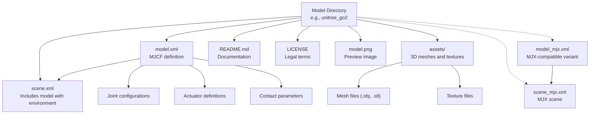

Sources: [README.md:62-99]()

The key files in each model directory serve the following purposes:

1. **`<model>.xml`**: Contains only the MJCF (MuJoCo XML) definition of the robot model itself
2. **`scene.xml`**: Includes the model plus additional elements like a ground plane and lighting
3. **`assets/`**: Directory containing 3D meshes and textures used by the model
4. **`README.md`**: Documents how the model was created and other important details
5. **`LICENSE`**: Specifies the licensing terms for the model (varies by model)
6. **`<model>_mjx.xml`**: MJX-compatible variant of the model (if available)
7. **`scene_mjx.xml`**: Scene file that loads the MJX variant (if available)

Sources: [README.md:82-99]()

## Model Categories and Inventory

MuJoCo Menagerie contains a diverse range of robot models organized into several categories:

| Category | Description | Count | Examples | MJX Support |
|----------|-------------|-------|----------|------------|
| Arms | Manipulator arms | 13 | Franka Panda, UR5e, KUKA iiwa14 | ✔️ (Panda only) |
| Humanoids | Bipedal robots | 7 | Apptronik Apollo, Unitree G1 | ✔️ (Apollo only) |
| Quadrupeds | Four-legged robots | 8 | Unitree Go2, ANYmal C, Barkour vB | ✔️ (Multiple) |
| End-effectors | Grippers and hands | 6 | Shadow Hand, Robotiq 2F85 | ✔️ (ALOHA only) |
| Mobile Manipulators | Mobile robots with arms | 6 | Hello Robot Stretch | ❌ |
| Dual Arms | Multiple arm systems | 1 | ALOHA 2 | ✔️ |
| Aerial Robots | Drones | 2 | Crazyflie 2 | ❌ |
| Biomechanical | Biological models | 1 | flybody | ❌ |
| Miscellaneous | Sensors and others | 1 | RealSense D435i | ❌ |

Sources: [README.md:169-266]()

## MJX Compatibility

MJX is a JAX-based implementation of MuJoCo that enables efficient parallel simulation and automatic differentiation. Some models in the repository have been specifically optimized for MJX with a dedicated variant.

### MJX Compatibility Flow

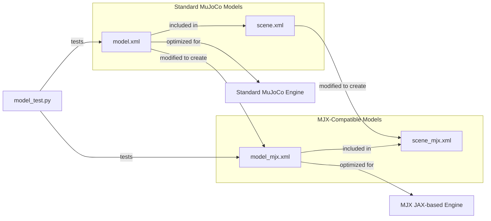

Sources: [README.md:91-94](), [README.md:169-266]()

Currently, MJX-compatible variants exist for selected models including:
- Apptronik Apollo (humanoid)
- Unitree Go2 (quadruped)
- ANYmal C (quadruped)
- Google Barkour v0 and vB (quadrupeds)
- Franka Panda (arm)
- ALOHA 2 (dual arms)

Sources: [README.md:169-266]()

## Model Quality Grading

The repository introduces a grading system to help users set proper expectations around model quality:

| Grade | Description |
|-------|-------------|
| A+ | Values are the product of proper system identification |
| A | Values are realistic, but have not been properly identified |
| B | Stable, but some values are unrealistic |
| C | Conditionally stable, can be significantly improved |

This grading system will be applied once a proper system identification toolbox is created.

Sources: [README.md:142-167]()

## Testing Framework

MuJoCo Menagerie includes a testing system to validate that models compile and simulate correctly.

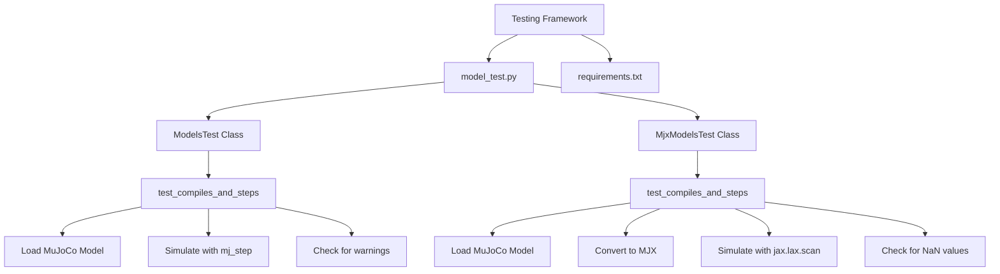

The testing framework ensures that:
1. Models can be loaded without errors
2. Simulation runs for several steps without crashing
3. No warnings are generated during compilation
4. For MJX models, conversion to MJX format works correctly
5. MJX simulations don't produce NaN values

Sources: [README.md:142-167]()

## Usage and Integration

There are multiple ways to use the models from MuJoCo Menagerie:

### Via robot-descriptions Package

The recommended approach is using the `robot_descriptions` Python package:

```python
import mujoco

# Method 1: Loading via imported module
from robot_descriptions import panda_mj_description
model = mujoco.MjModel.from_xml_path(panda_mj_description.MJCF_PATH)

# Method 2: Using the loader function
from robot_descriptions.loaders.mujoco import load_robot_description
model = load_robot_description("panda_mj_description")

# Loading a variant like a robot without its gripper
model = load_robot_description("panda_mj_description", variant="panda_nohand")
```

Sources: [README.md:102-127]()

### Via Direct Repository Clone

You can also clone the repository and use the models directly:

```bash
git clone https://github.com/google-deepmind/mujoco_menagerie.git
```

For interactive exploration, use the MuJoCo Python viewer:

```bash
python -m mujoco.viewer --mjcf mujoco_menagerie/unitree_go2/scene.xml
```

Sources: [README.md:127-141]()

### Integration with Custom Simulations

For programmatic use in your own simulations:

```python
import mujoco

# Load a model from the cloned repository
model = mujoco.MjModel.from_xml_path("path/to/mujoco_menagerie/unitree_go2/scene.xml")
data = mujoco.MjData(model)

# Simulate
for _ in range(1000):
    mujoco.mj_step(model, data)
    # Your control code here
```

## Gallery Generation

The repository includes a script to generate a gallery of model images for the README. This script, `generate_gallery.py`, renders each model in a standardized way:

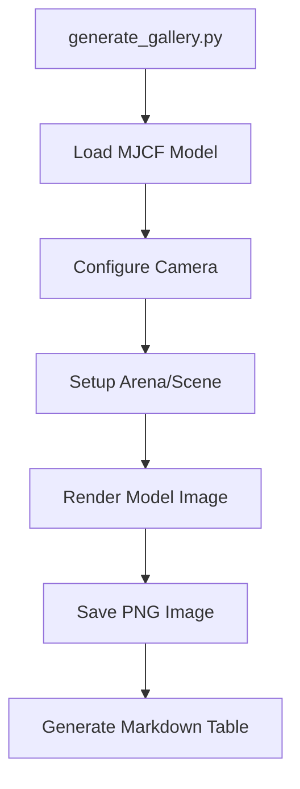

The gallery script handles camera positioning, lighting, and other rendering settings to create consistent, high-quality images of each model.

Sources: [generate_gallery.py:1-482]()

## Licensing

XML and asset files in each individual model directory are subject to different license terms. Each model subdirectory contains its own LICENSE file with specific information. License types include:

- Apache-2.0 (e.g., Apptronik Apollo, Google Barkour models)
- BSD-3-Clause (e.g., Franka Panda, Unitree models)
- BSD-2-Clause (e.g., Robotiq grippers)
- MIT (e.g., LEAP Hand, PiPER arm)

All other repository content is Copyright 2022 DeepMind Technologies Limited and licensed under the Apache License, Version 2.0.

Sources: [README.md:295-303]()

---

# Page: Installation and Usage

# Installation and Usage

<details>
<summary>Relevant source files</summary>

The following files were used as context for generating this wiki page:

- [README.md](README.md)
- [assets/agilex_piper-piper.png](assets/agilex_piper-piper.png)
- [assets/booster_t1-t1.png](assets/booster_t1-t1.png)
- [generate_gallery.py](generate_gallery.py)
- [hello_robot_stretch/README.md](hello_robot_stretch/README.md)
- [hello_robot_stretch/stretch.xml](hello_robot_stretch/stretch.xml)
- [hello_robot_stretch_3/README.md](hello_robot_stretch_3/README.md)
- [hello_robot_stretch_3/stretch.xml](hello_robot_stretch_3/stretch.xml)
- [test/model_test.py](test/model_test.py)
- [test/requirements.txt](test/requirements.txt)

</details>


This document explains how to install the MuJoCo Menagerie repository and use the high-quality robot models with MuJoCo physics engine. It covers different installation methods, basic usage patterns, and how to integrate models into your simulations.

For information about the organization and structure of the models, see [Model Organization and Structure](#1.2). For details about MJX compatibility, see [MJX Compatibility](#1.3).

## Prerequisites

Before using MuJoCo Menagerie, ensure you have the following prerequisites installed:

- **MuJoCo**: The minimum required version for each model is specified in its respective README file
- **Python** (optional): Required if you plan to use Python bindings or the MuJoCo viewer

You can install MuJoCo in one of the following ways:

- Download prebuilt binaries from the [GitHub releases page](https://github.com/google-deepmind/mujoco/releases)
- Install Python bindings via pip: `pip install mujoco`

The test framework requires additional dependencies listed in the test requirements file:

```
mujoco>=3.2.0
mujoco-mjx
absl-py
pytest-xdist
```

Sources: [README.md:52-61](), [test/requirements.txt:1-4]()

## Installation Methods

There are two primary methods to install and use MuJoCo Menagerie:

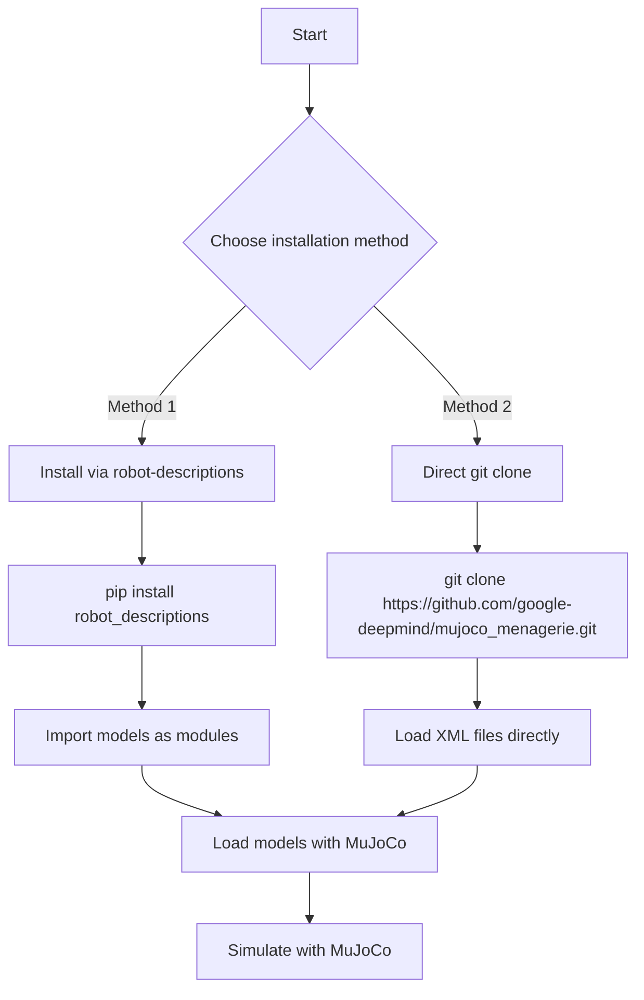

Sources: [README.md:102-139]()

### Method 1: Via `robot-descriptions` Package

The [`robot_descriptions`](https://github.com/robot-descriptions/robot_descriptions.py) package provides a convenient way to load models from MuJoCo Menagerie without manually downloading each model. This is recommended for most users.

1. Install the package:
   ```bash
   pip install robot_descriptions
   ```

2. Load models in your Python code:

   ```python
   import mujoco
   
   # Method 1: Load a specific model description as an imported module
   from robot_descriptions import panda_mj_description
   model = mujoco.MjModel.from_xml_path(panda_mj_description.MJCF_PATH)
   
   # Method 2: Directly load an instance of MjModel
   from robot_descriptions.loaders.mujoco import load_robot_description
   model = load_robot_description("panda_mj_description")
   
   # Method 3: Load a variant of the model, e.g. panda without a gripper
   model = load_robot_description("panda_mj_description", variant="panda_nohand")
   ```

Sources: [README.md:102-125]()

### Method 2: Via `git clone`

If you need direct access to model files or want to contribute to the repository, you can clone it directly:

1. Clone the repository:
   ```bash
   git clone https://github.com/google-deepmind/mujoco_menagerie.git
   ```

2. Use models directly by referencing their XML files.

Sources: [README.md:127-139]()

## Basic Usage

After installation, you can use the models in various ways depending on your needs.

### Visualizing Models

To interactively explore a model using the Python viewer:

```bash
python -m mujoco.viewer --mjcf mujoco_menagerie/unitree_go2/scene.xml
```

This command opens the MuJoCo viewer with the specified model loaded. You can manipulate the view and see how the model behaves in the physics simulation.

Sources: [README.md:137-139]()

### Loading Models in Python

To load models in your Python code:

```python
import mujoco

# Load model directly from file path
model = mujoco.MjModel.from_xml_path("path/to/mujoco_menagerie/unitree_go2/go2.xml")
data = mujoco.MjData(model)

# Step simulation
mujoco.mj_step(model, data)
```

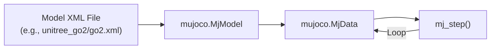

Sources: [README.md:112-125](), [test/model_test.py:70-86]()

### Understanding Model Files

Each robot model in the repository follows a standard structure:

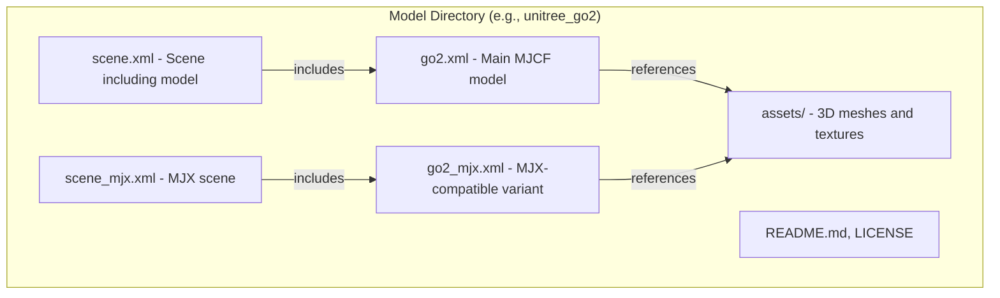

Key files:
- `<model>.xml`: The main MJCF model file (e.g., `go2.xml`)
- `scene.xml`: Includes the model with a ground plane and lighting
- `<model>_mjx.xml`: MJX-compatible version (for selected models)
- `assets/`: Directory containing meshes and textures
- `README.md`: Documentation and information about the model

Sources: [README.md:63-99]()

## Model Testing

MuJoCo Menagerie includes a testing framework to ensure models load and simulate correctly. This can help diagnose issues with custom modifications.

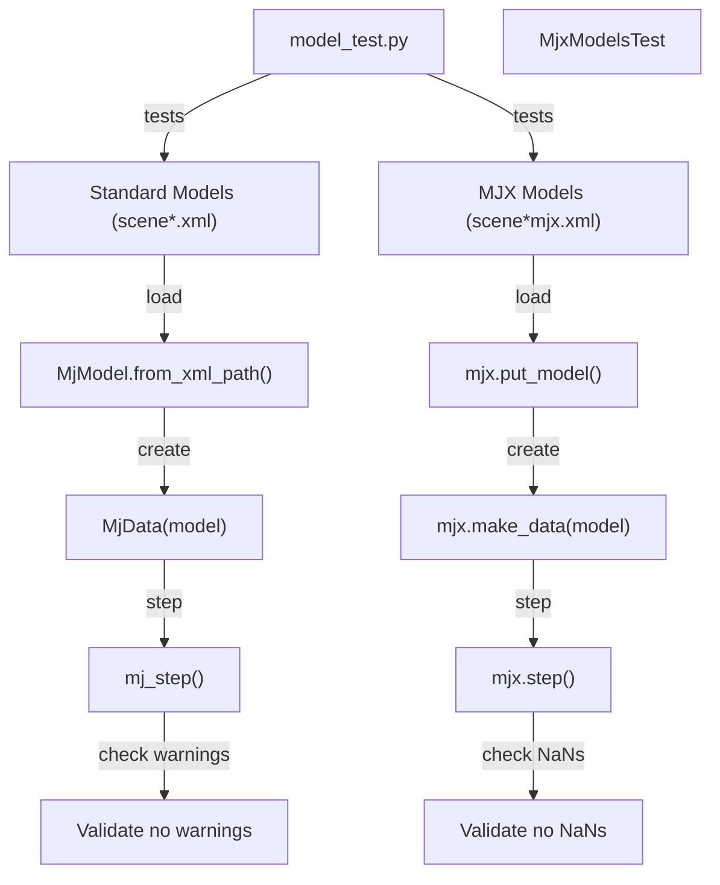

To run the tests:

```bash
cd /path/to/mujoco_menagerie
python -m test.model_test
```

Sources: [test/model_test.py:14-126]()

## Example Workflow

Here's a complete workflow example using MuJoCo Menagerie:

1. Install prerequisite: `pip install mujoco`
2. Install robot descriptions: `pip install robot_descriptions`
3. Create a simple simulation:

```python
import mujoco
import numpy as np
from robot_descriptions.loaders.mujoco import load_robot_description

# Load a model from MuJoCo Menagerie
model = load_robot_description("unitree_go2_mj_description")
data = mujoco.MjData(model)

# Set initial pose (optional)
data.qpos[:] = np.zeros(model.nq)

# Simulation loop
for i in range(1000):
    # Apply control inputs if needed
    data.ctrl[:] = np.zeros(model.nu)
    
    # Step the simulation
    mujoco.mj_step(model, data)
    
    # Get sensor data, joint positions, etc.
    joint_positions = data.qpos.copy()
    
    # Render if needed (when using with a viewer)
    # renderer.render(model, data)
```

Sources: [README.md:112-125](), [test/model_test.py:70-86]()

## Advanced Usage: Working with Hello Robot Stretch

As a concrete example, here's how to work with the Hello Robot Stretch model:

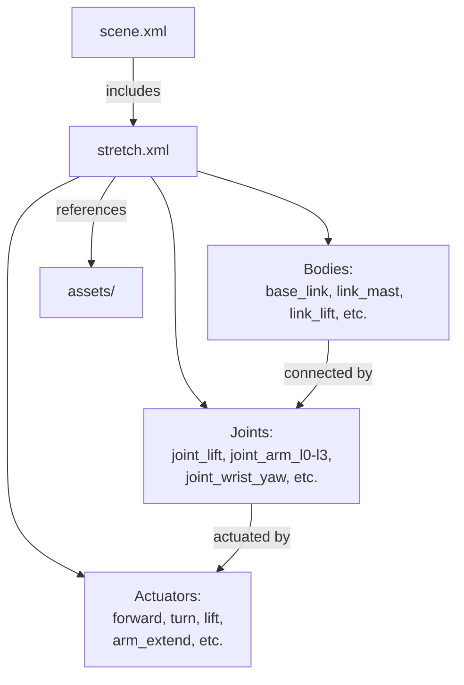

The Hello Robot Stretch model showcases a mobile manipulator with:
- Telescoping arm system (joints l0-l3)
- Gripper system with fingers
- Mobile base with wheels
- Head with cameras

To control the robot:
- Use `joint_lift` to raise/lower the lift
- Use the `extend` tendon to control the telescoping arm
- Use `joint_left_wheel` and `joint_right_wheel` for mobility
- Use `joint_wrist_yaw` and gripper joints to manipulate objects

Sources: [hello_robot_stretch/stretch.xml:1-417](), [hello_robot_stretch/README.md:1-31](), [hello_robot_stretch_3/stretch.xml:1-551](), [hello_robot_stretch_3/README.md:1-29]()

## Troubleshooting

If you encounter issues when using MuJoCo Menagerie:

1. **Model Loading Fails**: 
   - Check that you have the minimum required MuJoCo version for the model
   - Ensure asset paths are correct (models expect assets in an `assets/` subdirectory)

2. **Simulation Warnings**:
   - Run the test framework to check for warnings: `python -m test.model_test`
   - Common issues include unstable contacts or improper joint limits

3. **MJX Compatibility**:
   - Not all models have MJX-compatible versions
   - MJX-compatible models are indicated in the model tables in the README
   - Use the `*_mjx.xml` version of models for MJX compatibility

Sources: [README.md:169-267](), [test/model_test.py:68-126]()

---

# Page: Model Organization and Structure

# Model Organization and Structure

<details>
<summary>Relevant source files</summary>

The following files were used as context for generating this wiki page:

- [CONTRIBUTING.md](CONTRIBUTING.md)
- [FAQ.md](FAQ.md)
- [README.md](README.md)
- [assets/agilex_piper-piper.png](assets/agilex_piper-piper.png)
- [assets/booster_t1-t1.png](assets/booster_t1-t1.png)
- [franka_emika_panda/README.md](franka_emika_panda/README.md)
- [franka_emika_panda/mjx_panda.xml](franka_emika_panda/mjx_panda.xml)
- [franka_emika_panda/mjx_scene.xml](franka_emika_panda/mjx_scene.xml)
- [franka_emika_panda/mjx_single_cube.xml](franka_emika_panda/mjx_single_cube.xml)
- [generate_gallery.py](generate_gallery.py)

</details>


## Purpose and Scope

This document explains the standard organization and structure of models within the MuJoCo Menagerie repository. It covers the directory layout, file naming conventions, and internal structure of model files. For information about MJX compatibility specifically, see [MJX Compatibility](#1.3).

## Standard Directory Structure

The MuJoCo Menagerie repository follows a consistent organization pattern for each robot model. Every model is contained in its own dedicated directory, with standard file types and naming conventions.

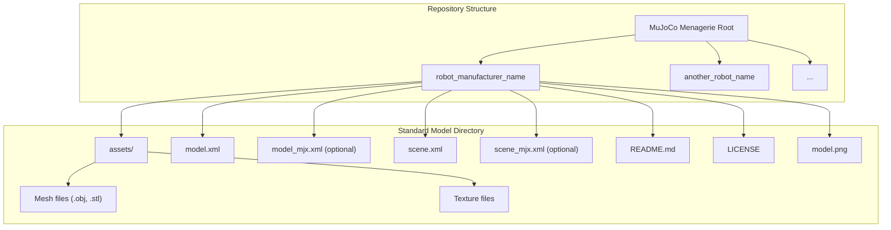

Each model directory typically contains:

- **model.xml**: The primary MJCF (MuJoCo XML) file defining the robot model
- **scene.xml**: Includes model.xml with additional environment elements like a floor and lighting
- **model_mjx.xml**: An optimized version of the model for MJX (JAX-based MuJoCo), if available
- **scene_mjx.xml**: Scene file that includes the MJX variant of the model
- **assets/**: Directory containing meshes (visual and collision) and textures
- **README.md**: Documentation on model derivation, sources, and other details
- **LICENSE**: Copyright and licensing information for the model
- **model.png**: A preview image of the model in its scene

Sources: [README.md:62-94]()

## Model File Organization

### Main Model XML Structure

The main model XML files follow a consistent structure designed for clarity and reusability. These files describe only the robot model itself without additional environment elements.

```mermaid
graph TD
    Model["model.xml"]
    
    Model --> Compiler["compiler settings"]
    Model --> Assets["asset definitions"]
    Model --> Defaults["default classes"]
    Model --> Worldbody["worldbody (robot structure)"]
    Model --> Equality["equality constraints"]
    Model --> Actuators["actuator definitions"]
    Model --> Sensors["sensor definitions (optional)"]
    Model --> Contacts["contact parameters (optional)"]
    Model --> Custom["custom parameters (optional)"]
    
    Defaults --> VisualDefaults["visual defaults"]
    Defaults --> CollisionDefaults["collision defaults"]
    Defaults --> JointDefaults["joint defaults"]
    Defaults --> ActuatorDefaults["actuator defaults"]
    
    Worldbody --> Links["robot links"]
    Worldbody --> Joints["joints"]
    Worldbody --> Geoms["geometries"]
    Worldbody --> Sites["sites"]
    
    Assets --> Meshes["mesh files"]
    Assets --> Materials["materials"]
    Assets --> Textures["textures"]
```

Key organizational principles include:

1. **Hierarchy of elements**: The robot's kinematic structure is represented as a hierarchy in the `worldbody` section
2. **Default classes**: Common properties are defined in `default` classes to reduce redundancy
3. **Separation of concerns**: Visual elements, collision geoms, and functional components are clearly distinguished

Sources: [franka_emika_panda/mjx_panda.xml:1-253](), [CONTRIBUTING.md:26-38]()

### Scene XML Structure

Scene files provide a complete simulation environment for the model by including the model file and adding environmental elements:

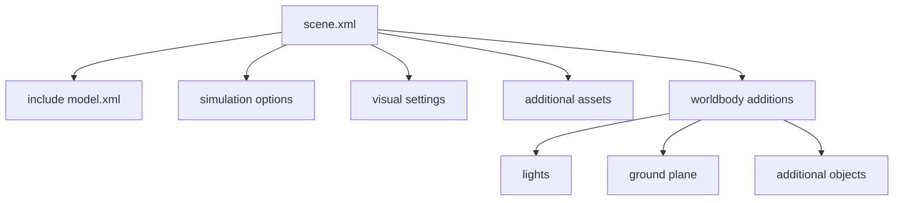

The scene files typically:
- Include the base model file
- Define simulation parameters and visual settings
- Add environmental elements like a ground plane and lighting
- Sometimes add test objects or specific configurations

Sources: [franka_emika_panda/mjx_scene.xml:1-33]()

## Common Components and Conventions

### Visual vs. Collision Geometries

Models typically separate visual and collision geometries:

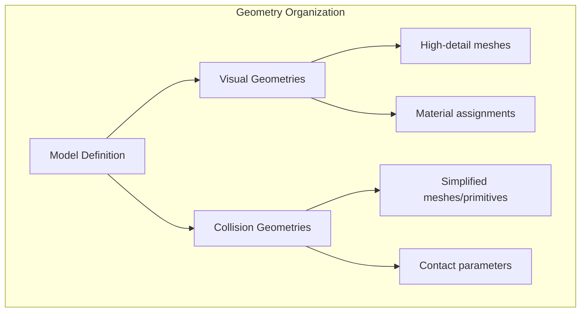

- **Visual geometries**: Higher-detail meshes used for rendering, typically marked with `contype="0" conaffinity="0"` to exclude them from physics calculations
- **Collision geometries**: Simplified representations used for physics calculations, often using primitive shapes (boxes, cylinders, etc.) or simplified meshes

Sources: [franka_emika_panda/mjx_panda.xml:14-34]()

### Default Classes

Default classes are used extensively to make models more maintainable and reduce redundancy:

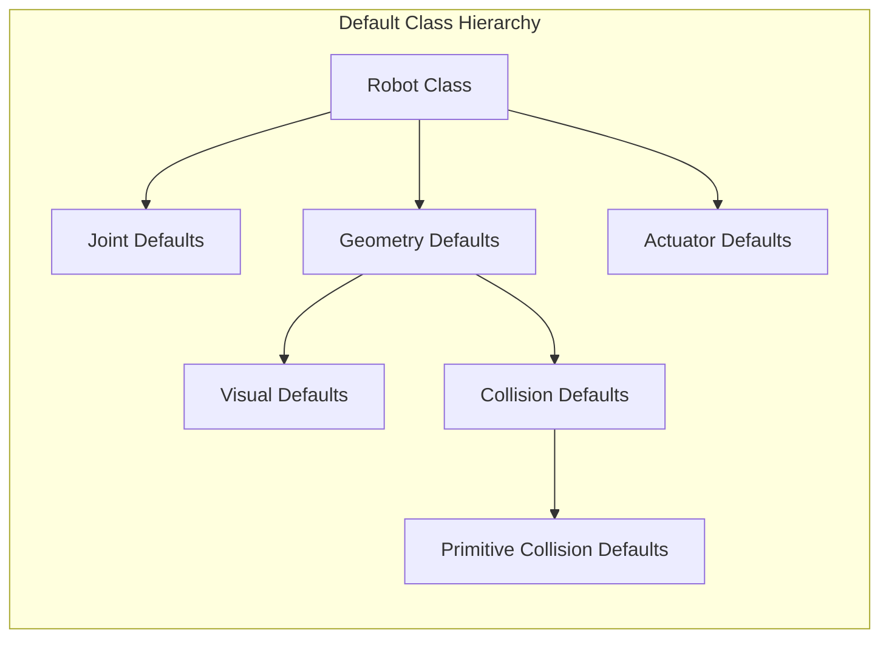

Common default classes include:
- Robot-specific defaults for joints, actuators, and materials
- Visual vs. collision geometry settings
- Specialized defaults for different components (e.g., fingers, sensors)

Sources: [franka_emika_panda/mjx_panda.xml:4-37]()

### Mesh Organization

Mesh files are organized in the assets directory and typically follow these conventions:

- Naming pattern: `linkN_[index].obj` for visual meshes, `linkN_c.obj/stl` for collision meshes
- Meshes are referenced from the XML with appropriate pathing via the `meshdir` attribute
- Some models separate meshes by component, others by link

Sources: [franka_emika_panda/mjx_panda.xml:46-116]()

## Standard Model Elements

### World Body Hierarchy

The model's kinematic structure follows a hierarchical pattern:

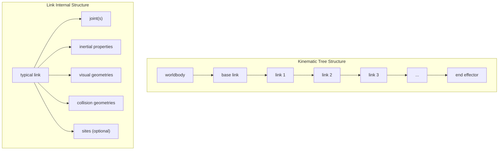

Each link typically contains:
- Joint definition (connecting to parent)
- Inertial properties (mass, center of mass, inertia)
- Visual geometries (for rendering)
- Collision geometries (for physics)
- Optional site definitions for attachments or sensors

Sources: [franka_emika_panda/mjx_panda.xml:118-252]()

### Actuator Definitions

Actuators define how control signals are mapped to forces/torques:

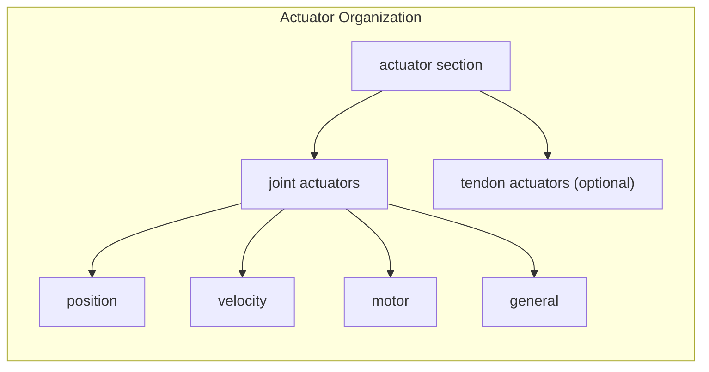

Most robot models use position actuators with appropriate control ranges and force limits.

Sources: [franka_emika_panda/mjx_panda.xml:255-272]()

### Equality Constraints

Equality constraints are used to create dependencies between joints or enforce specific relationships:

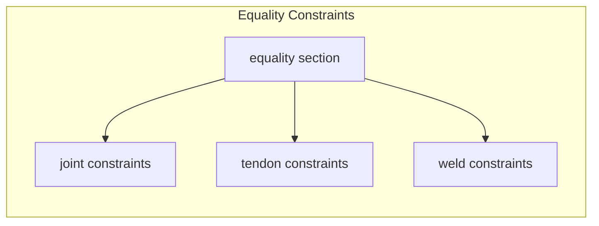

Common uses include:
- Creating mimic joints (e.g., for parallel grippers)
- Welding parts together
- Creating closed kinematic chains

Sources: [franka_emika_panda/mjx_panda.xml:255-257]()

## MJX Compatibility

Some models include MJX-compatible variants, which are optimized for the JAX-based MuJoCo implementation. These adaptations typically include:

1. Simplified collision geometries
2. Tuned solver parameters
3. Adjusted actuator parameters for stability
4. Reduced complexity in certain mechanisms

The full details of MJX compatibility are covered in [MJX Compatibility](#1.3).

Sources: [franka_emika_panda/README.md:43-53]()

## File Naming and Conventions

The repository follows consistent file naming conventions:

- Model files are named after the robot (e.g., `panda.xml`)
- MJX variants add the `_mjx` suffix (e.g., `panda_mjx.xml`)
- Scene files use `scene.xml` or `scene_mjx.xml`
- Mesh files typically follow the pattern `[link_name]_[index].[extension]`
- Collision meshes often have a `_c` suffix

These conventions help maintain consistency across the repository and make it easier to understand the purpose of each file.

Sources: [README.md:62-94](), [generate_gallery.py:372-382]()

---

# Page: MJX Compatibility

# MJX Compatibility

<details>
<summary>Relevant source files</summary>

The following files were used as context for generating this wiki page:

- [aloha/README.md](aloha/README.md)
- [aloha/aloha.xml](aloha/aloha.xml)
- [aloha/filtered_cartesian_actuators.xml](aloha/filtered_cartesian_actuators.xml)
- [aloha/joint_position_actuators.xml](aloha/joint_position_actuators.xml)
- [aloha/keyframe_ctrl.xml](aloha/keyframe_ctrl.xml)
- [aloha/keyframe_no_act.xml](aloha/keyframe_no_act.xml)
- [aloha/mjx_aloha.patch](aloha/mjx_aloha.patch)
- [aloha/mjx_filtered_cartesian_actuators.patch](aloha/mjx_filtered_cartesian_actuators.patch)
- [aloha/mjx_scene.patch](aloha/mjx_scene.patch)
- [aloha/scene.xml](aloha/scene.xml)
- [google_barkour_vb/README.md](google_barkour_vb/README.md)
- [google_barkour_vb/assets/hfield.png](google_barkour_vb/assets/hfield.png)
- [google_barkour_vb/barkour_vb.png](google_barkour_vb/barkour_vb.png)
- [google_barkour_vb/barkour_vb_mjx.xml](google_barkour_vb/barkour_vb_mjx.xml)
- [google_barkour_vb/scene.xml](google_barkour_vb/scene.xml)
- [google_barkour_vb/scene_hfield_mjx.xml](google_barkour_vb/scene_hfield_mjx.xml)
- [google_barkour_vb/scene_mjx.xml](google_barkour_vb/scene_mjx.xml)
- [hello_robot_stretch/README.md](hello_robot_stretch/README.md)
- [hello_robot_stretch/stretch.xml](hello_robot_stretch/stretch.xml)
- [hello_robot_stretch_3/README.md](hello_robot_stretch_3/README.md)
- [hello_robot_stretch_3/stretch.xml](hello_robot_stretch_3/stretch.xml)
- [test/model_test.py](test/model_test.py)
- [test/requirements.txt](test/requirements.txt)
- [unitree_go2/README.md](unitree_go2/README.md)
- [unitree_go2/go2.xml](unitree_go2/go2.xml)
- [unitree_go2/go2_mjx.png](unitree_go2/go2_mjx.png)
- [unitree_go2/go2_mjx.xml](unitree_go2/go2_mjx.xml)
- [unitree_go2/scene_mjx.xml](unitree_go2/scene_mjx.xml)

</details>


This page documents how models in the MuJoCo Menagerie repository are adapted for compatibility with MJX, the JAX-based implementation of MuJoCo. It explains the common modifications required for MJX compatibility, the file organization patterns for MJX models, and provides guidance on testing MJX compatibility.

## What is MJX?

MJX is a JAX-based implementation of the MuJoCo physics engine, which enables accelerated simulation on modern hardware (especially GPUs) and automatic differentiation capabilities. MJX provides significant performance benefits, especially for batch simulation and gradient-based optimization, but requires specific adaptations to standard MuJoCo models to ensure stability and performance.

Sources: [test/model_test.py:21-24]()

## Model File Structure

MuJoCo Menagerie includes MJX-compatible variants for several robot models. These variants follow a consistent naming pattern and organization.

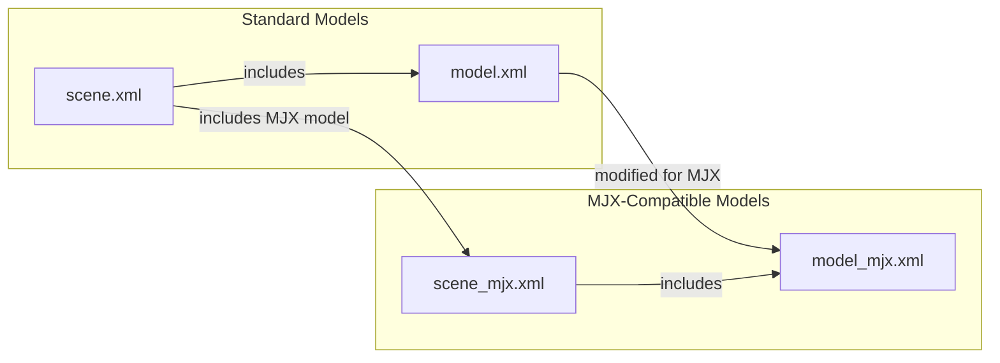

### Naming Conventions

- Standard model files: `model.xml`, `scene.xml`
- MJX-compatible model files: `model_mjx.xml`, `scene_mjx.xml`

The test framework automatically detects and tests models with `scene*mjx.xml` naming pattern.

Sources: [test/model_test.py:42-43](), [unitree_go2/README.md:39-52](), [google_barkour_vb/README.md:18-25]()

## Common Modifications for MJX Compatibility

MJX has different performance characteristics and limitations compared to the standard MuJoCo implementation. The following modifications are typically required:

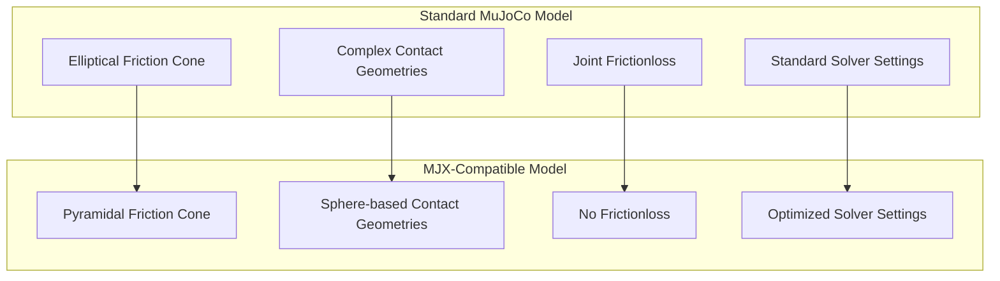

### Physics Simulation Parameters

1. **Solver Settings**
   - Reduced iteration counts for performance: `iterations="1" ls_iterations="5"`
   - Disabled Euler damping: `<flag eulerdamp="disable"/>`

2. **Contact Dynamics**
   - Changed friction cone from `elliptic` to `pyramidal`
   - Removed or reduced `impratio` settings
   - Modified `solref` and `solimp` parameters for stable contacts

3. **Joint Dynamics**
   - Removed `frictionloss` parameters

Sources: [unitree_go2/go2_mjx.xml:4-6](), [google_barkour_vb/barkour_vb_mjx.xml:4-6](), [aloha/mjx_aloha.patch:7-12]()

### Collision Geometry Simplification

MJX currently has limitations with complex collision geometries. The primary adaptation strategy is to:

1. Simplify collision meshes by replacing them with primitive shapes, especially spheres
2. Limit collision detection to essential parts of the robot
3. Use the `<mesh maxhullvert="32"/>` parameter to limit complexity of collision hulls
4. Focus collision detection on contacts between the robot and environment, rather than self-collisions

In some models, collision detection is completely disabled except for critical contact points like feet.

Sources: [unitree_go2/README.md:46-47](), [google_barkour_vb/README.md:24](), [aloha/mjx_aloha.patch:20-48]()

### Actuator Modifications

Actuator parameters often need adjustment for MJX compatibility:

1. Simplified control schemes (often using `general` actuators)
2. Adjusted gains and biases for stable control
3. Modified damping characteristics

For example, in the ALOHA model, the actuator parameters are significantly changed, with simplified damping parameters and control ranges.

Sources: [aloha/mjx_filtered_cartesian_actuators.patch:9-32](), [aloha/mjx_aloha.patch:28-29]()

## Testing MJX Compatibility

The MuJoCo Menagerie repository includes a testing framework to verify MJX compatibility of models.

```mermaid
graph TD
    subgraph "Testing Framework"
        model_test["model_test.py"]
        standard_test["ModelsTest Class"]
        mjx_test["MjxModelsTest Class"]
    end
    
    subgraph "Test Workflow"
        discover["Discover MJX Models"]
        load["Load Model"]
        convert["Convert to MJX"]
        simulate["Simulate with JAX"]
        verify["Verify No NaNs"]
    end
    
    model_test --> standard_test
    model_test --> mjx_test
    mjx_test --> discover
    discover --> load
    load --> convert
    convert --> simulate
    simulate --> verify
```

### How to Test

The testing framework automatically detects models with `scene*mjx.xml` naming patterns and runs tests to check:

1. Model loading and conversion to MJX
2. Simulation for a short period (0.1 seconds by default)
3. Checking for numerical stability (no NaN values)

To run the tests:

```bash
python test/model_test.py
```

Sources: [test/model_test.py:89-123](), [test/requirements.txt:1-4]()

## Case Studies

### Unitree Go2

The Unitree Go2 quadruped robot's MJX adaptation demonstrates several common patterns:

1. Changed friction cone from `elliptic` to `pyramidal`
2. Increased `impratio` from standard model to MJX model (100)
3. Removed `frictionloss` parameters
4. Replaced complex collision geometries with strategically placed sphere geometries
5. Reduced solver iterations for performance

The MJX model includes visualizations of collision spheres to show where contact detection occurs.

Sources: [unitree_go2/README.md:39-51](), [unitree_go2/go2_mjx.xml:4-5]()

### Google Barkour vB

The Barkour vB quadruped model's MJX adaptation shows:

1. Modified solver settings: `iterations="1" ls_iterations="5"`
2. Disabled the `eulerdamp` flag
3. Focused collision geometries only on feet-plane interactions
4. Optimized scene configuration

Sources: [google_barkour_vb/README.md:18-25](), [google_barkour_vb/barkour_vb_mjx.xml:4-6]()

### ALOHA Bimanual System

The ALOHA bimanual robot system has one of the most extensive MJX adaptations:

1. Modified contact handling by:
   - Using `<mesh maxhullvert="32"/>` to limit collision hull complexity
   - Adding primitive collision capsules to supplement mesh-based collision
   - Reorganizing collision groups and priorities
   - Simplifying the collision model for the table

2. Modified actuator parameters:
   - Changed filter dynamics parameters
   - Adjusted gains and bias values
   - Modified control ranges

Sources: [aloha/mjx_aloha.patch:7-123](), [aloha/mjx_scene.patch:7-36](), [aloha/mjx_filtered_cartesian_actuators.patch:9-33]()

## Summary Table: Common MJX Adaptations

| Feature | Standard MuJoCo | MJX Adaptation | Reason |
|---------|----------------|----------------|--------|
| Friction cone | `cone="elliptic"` | `cone="pyramidal"` | Better performance in MJX |
| Solver settings | Default iterations | `iterations="1" ls_iterations="5"` | Performance optimization |
| Damping | `eulerdamp` enabled | `<flag eulerdamp="disable"/>` | Numerical stability |
| Joint friction | Uses `frictionloss` | Remove `frictionloss` | Compatibility limitation |
| Collision geometry | Complex meshes | Simplified primitives (spheres) | Current MJX limitation |
| Contact handling | Full contact detection | Focused on critical contacts | Performance and stability |
| Actuator models | Complex dynamics | Simplified parameters | Numerical stability |

Sources: [unitree_go2/go2_mjx.xml:4-5](), [google_barkour_vb/barkour_vb_mjx.xml:4-6](), [aloha/mjx_aloha.patch:7-12]()

## Best Practices

When adapting a model for MJX compatibility:

1. **Start with core functionality**: Ensure the basic physical simulation works before adding complexity
2. **Simplify contact geometry**: Replace complex meshes with primitive shapes, especially at contact points
3. **Adjust solver parameters**: Reduce iteration counts for performance while maintaining stability
4. **Test incrementally**: Make changes one at a time and test to identify issues
5. **Validate simulation**: Ensure the MJX model produces similar behavior to the standard model

The testing framework in the repository provides an automated way to verify basic functionality, but manual testing is recommended to ensure physical behavior matches expectations.

Sources: [test/model_test.py:89-123](), [unitree_go2/README.md:39-51]()

---

# Page: Humanoid Robots

# Humanoid Robots

<details>
<summary>Relevant source files</summary>

The following files were used as context for generating this wiki page:

- [apptronik_apollo/LICENSE](apptronik_apollo/LICENSE)
- [apptronik_apollo/README.md](apptronik_apollo/README.md)
- [apptronik_apollo/apptronik_apollo.png](apptronik_apollo/apptronik_apollo.png)
- [apptronik_apollo/apptronik_apollo.xml](apptronik_apollo/apptronik_apollo.xml)
- [apptronik_apollo/apptronik_apollo_stand.png](apptronik_apollo/apptronik_apollo_stand.png)
- [apptronik_apollo/assets/ability_hand/FB_palm_ref.STL](apptronik_apollo/assets/ability_hand/FB_palm_ref.STL)
- [apptronik_apollo/assets/ability_hand/FB_palm_ref_MIR.STL](apptronik_apollo/assets/ability_hand/FB_palm_ref_MIR.STL)
- [apptronik_apollo/assets/ability_hand/idx-F1.STL](apptronik_apollo/assets/ability_hand/idx-F1.STL)
- [apptronik_apollo/assets/ability_hand/idx-F2.STL](apptronik_apollo/assets/ability_hand/idx-F2.STL)
- [unitree_g1/README.md](unitree_g1/README.md)
- [unitree_g1/g1.png](unitree_g1/g1.png)
- [unitree_g1/g1.xml](unitree_g1/g1.xml)
- [unitree_g1/g1_with_hands.xml](unitree_g1/g1_with_hands.xml)
- [unitree_g1/scene.xml](unitree_g1/scene.xml)

</details>


This document provides a comprehensive technical overview of the humanoid robot models available in the MuJoCo Menagerie repository. It covers the structure, joint configuration, actuator systems, and simulation properties of these bipedal robots designed with a structure resembling the human body. For information on quadruped robots, see [Quadruped Robots](#3), or for robotic arms, see [Manipulator Arms](#4).

## Available Models

The MuJoCo Menagerie currently includes two humanoid robot models:

1. **Apptronik Apollo** - A sophisticated humanoid with 35+ degrees of freedom (DOF)
2. **Unitree G1** - A 29 DOF humanoid with variants that include articulated hands

### Model Comparison

| Feature | Apptronik Apollo | Unitree G1 |
|---------|------------------|------------|
| Total DOF | 35+ | 29 |
| Base Joint | 6 DOF floating base | 6 DOF floating base |
| Arms | 7 DOF per arm | 7 DOF per arm |
| Legs | 6 DOF per leg | 6 DOF per leg |
| Torso | 3 DOF (yaw, roll, pitch) | 3 DOF (yaw, roll, pitch) |
| Hands | Detailed fingers | Basic or articulated (depending on variant) |
| IMU Sensors | 1 (torso) | 2 (torso and pelvis) |
| Keyframes | "stand" pose | "stand" pose |
| File | apptronik_apollo.xml | g1.xml / g1_with_hands.xml |

Sources: [apptronik_apollo/apptronik_apollo.xml:1-394](), [unitree_g1/g1.xml:1-364](), [unitree_g1/g1_with_hands.xml:1-360]()

## Apptronik Apollo

The Apptronik Apollo is a complex humanoid robot with detailed joint configuration, actuation, and sensor systems.

### Body Structure

The Apollo model has a hierarchical body structure starting with a base link that has a 6-DOF free joint, allowing unconstrained movement in space.

#### Apollo Body Hierarchy

```mermaid
graph TD
    base_link["base_link (floating_base)"] --> torso_roll_link["torso_roll_link"]
    torso_roll_link --> torso_pitch_link["torso_pitch_link"]
    torso_pitch_link --> torso_link["torso_link"]
    
    torso_link --> neck_yaw_link["neck_yaw_link"]
    neck_yaw_link --> neck_roll_link["neck_roll_link"]
    neck_roll_link --> neck_pitch_link["neck_pitch_link"]
    
    torso_link --> l_shoulder_aa_link["l_shoulder_aa_link"]
    l_shoulder_aa_link --> l_shoulder_ie_link["l_shoulder_ie_link"]
    l_shoulder_ie_link --> l_shoulder_fe_link["l_shoulder_fe_link"]
    l_shoulder_fe_link --> l_elbow_fe_link["l_elbow_fe_link"]
    l_elbow_fe_link --> l_wrist_roll_link["l_wrist_roll_link"]
    l_wrist_roll_link --> l_wrist_yaw_link["l_wrist_yaw_link"]
    l_wrist_yaw_link --> l_wrist_pitch_link["l_wrist_pitch_link"]
    
    base_link --> l_hip_ie_link["l_hip_ie_link"]
    l_hip_ie_link --> l_hip_aa_link["l_hip_aa_link"]
    l_hip_aa_link --> l_hip_fe_link["l_hip_fe_link"]
    l_hip_fe_link --> l_knee_fe_link["l_knee_fe_link"]
    l_knee_fe_link --> l_ankle_ie_link["l_ankle_ie_link"]
    l_ankle_ie_link --> l_foot_link["l_foot_link"]
```

Sources: [apptronik_apollo/apptronik_apollo.xml:76-323]()

### Joint Configuration

Apollo has a comprehensive joint configuration with these main components:

1. **Torso**: 3 DOF
   - `torso_yaw` (range: -0.829031 to 0.829031 rad)
   - `torso_roll` (range: -0.20944 to 0.20944 rad)
   - `torso_pitch` (range: -0.305433 to 1.35263 rad)

2. **Neck**: 3 DOF
   - `neck_yaw` (range: -1.65806 to 1.65806 rad)
   - `neck_roll` (range: -0.785398 to 0.785398 rad)
   - `neck_pitch` (range: -0.261799 to 0.523599 rad)

3. **Arms**: Each arm has 7 DOF
   - Shoulder: 3 DOF (aa, ie, fe)
   - Elbow: 1 DOF (fe)
   - Wrist: 3 DOF (roll, yaw, pitch)

4. **Legs**: Each leg has 6 DOF
   - Hip: 3 DOF (ie, aa, fe)
   - Knee: 1 DOF (fe)
   - Ankle: 2 DOF (ie, pd)

#### Apollo Joint Configuration Diagram

```mermaid
graph TD
    FloatingBase["floating_base (6 DOF)"] --> TorsoJoints["Torso Joints"]
    FloatingBase --> HipJoints["Hip Joints"]
    
    TorsoJoints --> torso_yaw["torso_yaw"]
    TorsoJoints --> torso_roll["torso_roll"]
    TorsoJoints --> torso_pitch["torso_pitch"]
    
    TorsoJoints --> NeckJoints["Neck Joints"]
    NeckJoints --> neck_yaw["neck_yaw"]
    NeckJoints --> neck_roll["neck_roll"]
    NeckJoints --> neck_pitch["neck_pitch"]
    
    TorsoJoints --> ShoulderJoints["Shoulder Joints"]
    ShoulderJoints --> shoulder_aa["shoulder_aa (L/R)"]
    ShoulderJoints --> shoulder_ie["shoulder_ie (L/R)"]
    ShoulderJoints --> shoulder_fe["shoulder_fe (L/R)"]
    
    ShoulderJoints --> ElbowJoints["Elbow Joints"]
    ElbowJoints --> elbow_fe["elbow_fe (L/R)"]
    
    ElbowJoints --> WristJoints["Wrist Joints"]
    WristJoints --> wrist_roll["wrist_roll (L/R)"]
    WristJoints --> wrist_yaw["wrist_yaw (L/R)"]
    WristJoints --> wrist_pitch["wrist_pitch (L/R)"]
    
    HipJoints --> hip_ie["hip_ie (L/R)"]
    HipJoints --> hip_aa["hip_aa (L/R)"]
    HipJoints --> hip_fe["hip_fe (L/R)"]
    
    HipJoints --> KneeJoints["Knee Joints"]
    KneeJoints --> knee_fe["knee_fe (L/R)"]
    
    KneeJoints --> AnkleJoints["Ankle Joints"]
    AnkleJoints --> ankle_ie["ankle_ie (L/R)"]
    AnkleJoints --> ankle_pd["ankle_pd (L/R)"]
```

Sources: [apptronik_apollo/apptronik_apollo.xml:87-318]()

### Actuator System

Apollo uses position actuators for joint control with PD (Proportional-Derivative) controllers. Each actuator specifies:

- Position gain (`kp`)
- Velocity gain (`kv`)
- Control range (matches joint range)
- Force range (limits maximum force)
- Optional damping and friction loss parameters

For example, the torso pitch actuator is defined with:
```
<position name="torso_pitch" kp="1525" kv="142" joint="torso_pitch" ctrlrange="-0.305433 1.35263" forcerange="-315 315"/>
```

#### Apollo Actuator System Diagram

```mermaid
graph LR
    PosActuator["Position Actuator"] --> JointParams["Joint Parameters<br>- Range<br>- Force Limits<br>- Damping<br>- Friction Loss"]
    PosActuator --> ActuatorParams["Actuator Parameters<br>- kp (Position Gain)<br>- kv (Velocity Gain)<br>- Control Range"]
    PosActuator --> Joint["Joint Control"]
```

Sources: [apptronik_apollo/apptronik_apollo.xml:335-380]()

### Sensors

The Apollo model includes an IMU (Inertial Measurement Unit) sensor placed on the torso that provides:
- Orientation (quaternion)
- Angular velocity (gyroscope)
- Linear acceleration (accelerometer)
- Magnetic field (magnetometer)

```xml
<sensor>
    <framequat name="IMU-orientation" objtype="site" objname="imu"/>
    <gyro name="IMU-angular-velocity" site="imu" noise="5e-4" cutoff="54.9"/>
    <accelerometer name="IMU-linear-acceleration" site="imu" noise="1e-4" cutoff="157"/>
    <magnetometer name="IMU-magnetometer" site="imu"/>
</sensor>
```

Sources: [apptronik_apollo/apptronik_apollo.xml:328-332]()

### Visual and Collision Geometry

The Apollo model uses:
- Detailed mesh files for visual representation (`class="visual_light"` and `class="visual_dark"`)
- Simplified geometric primitives (capsules, boxes) for collision detection (`class="collision"`)

### Keyframe

The model includes a predefined "stand" keyframe that provides a stable initial pose for simulations, defined in the XML file:

```xml
<keyframe>
    <key name="stand" qpos="0.0 0.0 1.01597 1.0 0.0 0.0 0.0 0.0 0.0 0.0 0.0 0.0 0.0 0.2 0.0 0.1 -0.4 0.0 0.0 0.0 -0.2 0.0 0.1 -0.4 0.0 0.0 0.0 0.08 0.1 -0.477 1.033 -0.03 -0.58 -0.08 -0.1 -0.477 1.033 0.03 -0.58" ctrl="0.0 0.0 0.0 0.0 0.0 0.0 0.08 0.1 -0.477 1.033 -0.03 -0.58 -0.08 -0.1 -0.477 1.033 0.03 -0.58 0.2 0.0 0.1 -0.4 0.0 0.0 0.0 -0.2 0.0 0.1 -0.4 0.0 0.0 0.0" />
</keyframe>
```

Sources: [apptronik_apollo/apptronik_apollo.xml:383-393]()

## Unitree G1

The Unitree G1 is a humanoid robot with 29 degrees of freedom and is available in two variants: with basic hands (g1.xml) or with articulated hands (g1_with_hands.xml).

### Body Structure

Similar to Apollo, the G1 has a hierarchical body structure starting with a 6-DOF free joint base, but with some different naming conventions and structural arrangements.

#### G1 Body Hierarchy

```mermaid
graph TD
    pelvis["pelvis (floating_base_joint)"] --> waist_yaw_link["waist_yaw_link"]
    waist_yaw_link --> waist_roll_link["waist_roll_link"]
    waist_roll_link --> torso_link["torso_link"]
    
    torso_link --> left_shoulder_pitch_link["left_shoulder_pitch_link"]
    left_shoulder_pitch_link --> left_shoulder_roll_link["left_shoulder_roll_link"]
    left_shoulder_roll_link --> left_shoulder_yaw_link["left_shoulder_yaw_link"]
    left_shoulder_yaw_link --> left_elbow_link["left_elbow_link"]
    left_elbow_link --> left_wrist_roll_link["left_wrist_roll_link"]
    left_wrist_roll_link --> left_wrist_pitch_link["left_wrist_pitch_link"]
    left_wrist_pitch_link --> left_wrist_yaw_link["left_wrist_yaw_link"]
    
    pelvis --> left_hip_pitch_link["left_hip_pitch_link"]
    left_hip_pitch_link --> left_hip_roll_link["left_hip_roll_link"]
    left_hip_roll_link --> left_hip_yaw_link["left_hip_yaw_link"]
    left_hip_yaw_link --> left_knee_link["left_knee_link"]
    left_knee_link --> left_ankle_pitch_link["left_ankle_pitch_link"]
    left_ankle_pitch_link --> left_ankle_roll_link["left_ankle_roll_link"]
```

Sources: [unitree_g1/g1.xml:66-298]()

### Joint Configuration

G1 has a comprehensive joint configuration with these main components:

1. **Waist**: 3 DOF
   - `waist_yaw_joint` (range: -2.618 to 2.618 rad)
   - `waist_roll_joint` (range: -0.52 to 0.52 rad)
   - `waist_pitch_joint` (range: -0.52 to 0.52 rad)

2. **Arms**: Each arm has 7 DOF
   - Shoulder: 3 DOF (pitch, roll, yaw)
   - Elbow: 1 DOF
   - Wrist: 3 DOF (roll, pitch, yaw)

3. **Legs**: Each leg has 6 DOF
   - Hip: 3 DOF (pitch, roll, yaw)
   - Knee: 1 DOF
   - Ankle: 2 DOF (pitch, roll)

In the articulated hands version, additional joints are available for the fingers and thumb.

Sources: [unitree_g1/g1.xml:76-295](), [unitree_g1/g1_with_hands.xml:76-288]()

### Actuator System

G1 uses position actuators for joint control with common parameters defined in the default section:

```xml
<default class="g1">
    <joint armature="0.01" frictionloss="0.3"/>
    <position kp="500" dampratio="1" inheritrange="1"/>
</default>
```

Each actuator inherits these default properties and is simply defined with:
```xml
<position class="g1" name="left_hip_pitch_joint" joint="left_hip_pitch_joint"/>
```

Sources: [unitree_g1/g1.xml:6-21](), [unitree_g1/g1.xml:303-335]()

### Sensors

The G1 model includes two IMU sensors:
- One in the torso (`imu_in_torso`)
- One in the pelvis (`imu_in_pelvis`)

Both provide angular velocity (gyroscope) and linear acceleration (accelerometer) measurements.

```xml
<sensor>
    <gyro site="imu_in_torso" name="imu-torso-angular-velocity" cutoff="34.9" noise="0.0005"/>
    <accelerometer site="imu_in_torso" name="imu-torso-linear-acceleration" cutoff="157" noise="0.01"/>
    <gyro site="imu_in_pelvis" name="imu-pelvis-angular-velocity" cutoff="34.9" noise="0.0005"/>
    <accelerometer site="imu_in_pelvis" name="imu-pelvis-linear-acceleration" cutoff="157" noise="0.01"/>
</sensor>
```

Sources: [unitree_g1/g1.xml:338-343]()

### Visual and Collision Geometry

The G1 model uses:
- Mesh files for visual representation (`class="visual"`)
- Mesh files or geometric primitives for collision detection (`class="collision"`)
- Specialized collision geometry for feet (`class="foot"`)

### Keyframe

The G1 model includes a predefined "stand" keyframe:

```xml
<keyframe>
    <key name="stand"
      qpos="
      0 0 0.79
      1 0 0 0
      0 0 0 0 0 0
      0 0 0 0 0 0
      0 0 0
      0.2 0.2 0 1.28 0 0 0
      0.2 -0.2 0 1.28 0 0 0
      "
      ctrl="
      0 0 0 0 0 0
      0 0 0 0 0 0
      0 0 0
      0.2 0.2 0 1.28 0 0 0
      0.2 -0.2 0 1.28 0 0 0
      "/>
</keyframe>
```

Sources: [unitree_g1/g1.xml:345-362]()

## Common Features and Differences

### Common Features

Both Apollo and G1 humanoid models share:

1. **Free Joint Base**: Both use a 6-DOF free joint for the base, allowing unconstrained movement
2. **Full Humanoid Structure**: Both have torso, arms, legs, and head components
3. **Position Actuators**: Both use position actuators with PD control for joint actuation
4. **IMU Sensors**: Both include IMU sensors for orientation and motion sensing
5. **Predefined Stand Poses**: Both provide keyframes for stable initial postures
6. **Mesh-Based Visuals**: Both use detailed mesh files for visual representation

### Key Differences

Notable differences between the models include:

1. **Joint Configuration**: 
   - Apollo: 35+ DOF with different joint naming conventions (ie, aa, fe)
   - G1: 29 DOF with more standard joint naming (pitch, roll, yaw)

2. **Waist Structure**:
   - Apollo: Direct connection between base and torso with 3 DOF
   - G1: More distinct waist joint system with separate links

3. **IMU Placement**:
   - Apollo: Single IMU in the torso
   - G1: Dual IMUs in torso and pelvis

4. **Hand Implementation**:
   - Apollo: Detailed hand with finger geometries
   - G1: Two variants - basic hands or articulated hands with individual finger joints

5. **Default Parameters**:
   - Apollo: Individual parameter settings for each joint
   - G1: More consistent default parameters applied across joints

Sources: [apptronik_apollo/apptronik_apollo.xml](), [unitree_g1/g1.xml](), [unitree_g1/g1_with_hands.xml]()

## Technical Implementation Details

### MJCF File Structure

Both humanoid models follow the standard MJCF file structure:

1. **Header and Compiler Settings**:
   ```xml
   <mujoco model="model_name">
       <compiler angle="radian" .../>
       <option .../>
   ```

2. **Default Parameter Blocks**:
   ```xml
   <default>
       <!-- Default parameters for joints, geoms, etc. -->
   </default>
   ```

3. **Asset Declarations**:
   ```xml
   <asset>
       <!-- Mesh files, textures, materials -->
   </asset>
   ```

4. **World Body with Robot Structure**:
   ```xml
   <worldbody>
       <body name="base_link" ...>
           <!-- Hierarchical robot structure -->
       </body>
   </worldbody>
   ```

5. **Sensors**:
   ```xml
   <sensor>
       <!-- IMU and other sensors -->
   </sensor>
   ```

6. **Actuators**:
   ```xml
   <actuator>
       <!-- Joint actuators -->
   </actuator>
   ```

7. **Keyframes**:
   ```xml
   <keyframe>
       <!-- Predefined poses -->
   </keyframe>
   ```

### Common Implementation Patterns

1. **Joint Definition with Limits**:
   ```xml
   <joint name="joint_name" axis="x y z" range="min max" actuatorfrcrange="min max" damping="val" frictionloss="val" armature="val"/>
   ```

2. **Position Actuators with PD Control**:
   ```xml
   <position name="actuator_name" kp="val" kv="val" joint="joint_name" ctrlrange="min max" forcerange="min max"/>
   ```

3. **Visual vs. Collision Geometry**:
   - Visual: Detailed meshes with no collision properties
   - Collision: Simplified geometries (capsules, boxes) for efficient physics

4. **Sensor Integration**:
   - IMU sensors defined as sites with gyro, accelerometer, and other components

Sources: [apptronik_apollo/apptronik_apollo.xml:1-394](), [unitree_g1/g1.xml:1-364]()

## Usage Guidelines

### Loading and Simulation

To use these humanoid robot models in MuJoCo simulations:

1. **Loading the Model**:
   ```python
   import mujoco
   model = mujoco.MjModel.from_xml_path('path/to/model.xml')
   data = mujoco.MjData(model)
   ```

2. **Initializing with Keyframe**:
   ```python
   # Find the "stand" keyframe
   key_id = mujoco.mj_name2id(model, mujoco.mjtObj.mjOBJ_KEY, "stand")
   # Apply the keyframe
   mujoco.mj_resetDataKeyframe(model, data, key_id)
   ```

3. **Applying Control**:
   ```python
   # Set control signals for actuators
   data.ctrl[actuator_id] = control_value
   # Step the simulation
   mujoco.mj_step(model, data)
   ```

### Scene Files

Both humanoid models have corresponding scene files that provide a complete simulation environment with ground plane and lighting:
- `apptronik_apollo/scene.xml`
- `unitree_g1/scene.xml`

These can be loaded directly to visualize the robot in a standard environment.

### Performance Considerations

1. **Complexity vs. Speed**: Both humanoid models are complex with many degrees of freedom. For performance-critical applications, consider:
   - Using the MJX-compatible versions if available
   - Simplifying collision geometry
   - Optimizing the simulation timestep

2. **Joint Damping and Armature**: Both models specify damping, friction loss, and armature parameters that affect simulation stability. Adjust these parameters cautiously if modifying the models.

3. **Control Frequency**: Due to the high DOF count, these models may require higher control frequencies for stable motion compared to simpler robots.

4. **Physical Plausibility**: When developing control algorithms, be mindful of the physical limitations encoded in the joint ranges and force limits to ensure realistic behavior.

Sources: [unitree_g1/scene.xml:1-22]()

---

# Page: Apptronik Apollo

# Apptronik Apollo

<details>
<summary>Relevant source files</summary>

The following files were used as context for generating this wiki page:

- [apptronik_apollo/LICENSE](apptronik_apollo/LICENSE)
- [apptronik_apollo/README.md](apptronik_apollo/README.md)
- [apptronik_apollo/apptronik_apollo.png](apptronik_apollo/apptronik_apollo.png)
- [apptronik_apollo/apptronik_apollo.xml](apptronik_apollo/apptronik_apollo.xml)
- [apptronik_apollo/apptronik_apollo_stand.png](apptronik_apollo/apptronik_apollo_stand.png)
- [apptronik_apollo/assets/ability_hand/FB_palm_ref.STL](apptronik_apollo/assets/ability_hand/FB_palm_ref.STL)
- [apptronik_apollo/assets/ability_hand/FB_palm_ref_MIR.STL](apptronik_apollo/assets/ability_hand/FB_palm_ref_MIR.STL)
- [apptronik_apollo/assets/ability_hand/idx-F1.STL](apptronik_apollo/assets/ability_hand/idx-F1.STL)
- [apptronik_apollo/assets/ability_hand/idx-F2.STL](apptronik_apollo/assets/ability_hand/idx-F2.STL)

</details>


This document provides technical details about the Apptronik Apollo humanoid robot model included in the MuJoCo Menagerie repository. It covers the model structure, joint system, actuation, and simulation properties of this full-body humanoid robot.

Sources: [apptronik_apollo/README.md:1-27]()

## Model Overview

The Apptronik Apollo is a full-size humanoid robot model with 34 degrees of freedom. The model implements a complete body structure including torso, head, arms with hands, and legs with feet. It features position-controlled joints with realistic physical properties and includes IMU sensor simulation.

The MuJoCo model requires MuJoCo 3.0.0 or later and is released under an Apache-2.0 License.

```mermaid
graph TD
    subgraph "Apptronik Apollo Model Structure"
        base["base_link (Floating Base)"]
        base --> torso_roll["torso_roll_link"]
        torso_roll --> torso_pitch["torso_pitch_link"]
        torso_pitch --> torso_link["torso_link"]
        
        torso_link --> neck["neck_yaw_link"]
        neck --> neck_roll["neck_roll_link"]
        neck_roll --> neck_pitch["neck_pitch_link"]
        
        torso_link --> l_shoulder["l_shoulder_aa_link"]
        l_shoulder --> l_shoulder_ie["l_shoulder_ie_link"]
        l_shoulder_ie --> l_shoulder_fe["l_shoulder_fe_link"]
        l_shoulder_fe --> l_elbow["l_elbow_fe_link"]
        l_elbow --> l_wrist_roll["l_wrist_roll_link"]
        l_wrist_roll --> l_wrist_yaw["l_wrist_yaw_link"]
        l_wrist_yaw --> l_wrist_pitch["l_wrist_pitch_link"]
        l_wrist_pitch --> l_hand["left_hand (multiple geometries)"]
        
        torso_link --> r_shoulder["r_shoulder_aa_link"]
        r_shoulder --> r_shoulder_ie["r_shoulder_ie_link"]
        r_shoulder_ie --> r_shoulder_fe["r_shoulder_fe_link"]
        r_shoulder_fe --> r_elbow["r_elbow_fe_link"]
        r_elbow --> r_wrist_roll["r_wrist_roll_link"]
        r_wrist_roll --> r_wrist_yaw["r_wrist_yaw_link"]
        r_wrist_yaw --> r_wrist_pitch["r_wrist_pitch_link"]
        r_wrist_pitch --> r_hand["right_hand (multiple geometries)"]
        
        base --> l_hip["l_hip_ie_link"]
        l_hip --> l_hip_aa["l_hip_aa_link"]
        l_hip_aa --> l_hip_fe["l_hip_fe_link"]
        l_hip_fe --> l_knee["l_knee_fe_link"]
        l_knee --> l_ankle_ie["l_ankle_ie_link"]
        l_ankle_ie --> l_foot["l_foot_link"]
        
        base --> r_hip["r_hip_ie_link"]
        r_hip --> r_hip_aa["r_hip_aa_link"]
        r_hip_aa --> r_hip_fe["r_hip_fe_link"]
        r_hip_fe --> r_knee["r_knee_fe_link"]
        r_knee --> r_ankle_ie["r_ankle_ie_link"]
        r_ankle_ie --> r_foot["r_foot_link"]
    end

    classDef joint fill:#fff,stroke:#333,stroke-width:1px;
    classDef link fill:#fff,stroke:#333,stroke-width:1px;
    
    class torso_roll,torso_pitch,neck,neck_roll,neck_pitch,l_shoulder,l_shoulder_ie,l_shoulder_fe,l_elbow,l_wrist_roll,l_wrist_yaw,l_wrist_pitch,r_shoulder,r_shoulder_ie,r_shoulder_fe,r_elbow,r_wrist_roll,r_wrist_yaw,r_wrist_pitch,l_hip,l_hip_aa,l_hip_fe,l_knee,l_ankle_ie,r_hip,r_hip_aa,r_hip_fe,r_knee,r_ankle_ie joint;
    class base,torso_link,l_hand,r_hand,l_foot,r_foot link;
```

Sources: [apptronik_apollo/apptronik_apollo.xml:1-394]()

## Physical Configuration

The Apollo model uses the following physical simulation settings:

| Parameter | Value |
|-----------|-------|
| Timestep | 0.005 |
| Integrator | implicitfast |
| Angle Units | radians |
| Euler Sequence | zyx |

The model's base position is set at height 1.0813m, and it includes a free joint to allow full 6-DOF movement in space. A default standing pose is defined in the keyframe section.

Sources: [apptronik_apollo/apptronik_apollo.xml:1-5](), [apptronik_apollo/apptronik_apollo.xml:76-88](), [apptronik_apollo/apptronik_apollo.xml:383-393]()

## Joint System

The Apollo has a comprehensive joint system that enables humanoid movement. The model includes:

- 3 torso joints (yaw, roll, pitch)
- 3 neck joints (yaw, roll, pitch)
- 7 joints per arm (shoulder ab/adduction, internal/external rotation, flexion/extension, elbow, wrist roll, yaw, and pitch)
- 6 joints per leg (hip internal/external rotation, ab/adduction, flexion/extension, knee, ankle inversion/eversion, and plantar/dorsiflexion)

```mermaid
graph LR
    subgraph "Joint Movement Capabilities"
        direction TB
        
        subgraph "Torso"
            torso_yaw["torso_yaw\n±0.829 rad"]
            torso_roll["torso_roll\n±0.209 rad"]
            torso_pitch["torso_pitch\n-0.305 to 1.353 rad"]
        end
        
        subgraph "Head/Neck"
            neck_yaw["neck_yaw\n±1.658 rad"]
            neck_roll["neck_roll\n±0.785 rad"]
            neck_pitch["neck_pitch\n-0.262 to 0.524 rad"]
        end
        
        subgraph "Left Arm"
            l_shoulder_aa["l_shoulder_aa\n-0.122 to 1.606 rad"]
            l_shoulder_ie["l_shoulder_ie\n±0.471 rad"]
            l_shoulder_fe["l_shoulder_fe\n-2.182 to 0.611 rad"]
            l_elbow_fe["l_elbow_fe\n-2.618 to 0.175 rad"]
            l_wrist_roll["l_wrist_roll\n±1.658 rad"]
            l_wrist_yaw["l_wrist_yaw\n±0.698 rad"]
            l_wrist_pitch["l_wrist_pitch\n-0.75 to 1.588 rad"]
        end
        
        subgraph "Left Leg"
            l_hip_ie["l_hip_ie\n-0.567 to 1.091 rad"]
            l_hip_aa["l_hip_aa\n-0.218 to 0.742 rad"]
            l_hip_fe["l_hip_fe\n-1.850 to 0.476 rad"]
            l_knee_fe["l_knee_fe\n0 to 2.618 rad"]
            l_ankle_ie["l_ankle_ie\n-0.654 to 0.305 rad"]
            l_ankle_pd["l_ankle_pd\n-1.571 to 0.436 rad"]
        end
    end
    
    classDef jointStyle fill:#fff,stroke:#333,stroke-width:1px;
    class torso_yaw,torso_roll,torso_pitch,neck_yaw,neck_roll,neck_pitch,l_shoulder_aa,l_shoulder_ie,l_shoulder_fe,l_elbow_fe,l_wrist_roll,l_wrist_yaw,l_wrist_pitch,l_hip_ie,l_hip_aa,l_hip_fe,l_knee_fe,l_ankle_ie,l_ankle_pd jointStyle;
```

Note: Right arm and leg joints have similar ranges but with appropriate symmetry adjustments.

Sources: [apptronik_apollo/apptronik_apollo.xml:91-243](), [apptronik_apollo/apptronik_apollo.xml:245-322]()

## Actuators

The Apollo model includes position actuators for all joints with appropriate force limits and gain parameters. Each actuator includes position limits, force ranges, damping coefficients, friction losses, and armature parameters.

| Body Part | Actuators | Force Range Example |
|-----------|-----------|---------------------|
| Neck | 3 | ±10.6 to ±34.2 N |
| Torso | 3 | ±120 to ±414 N |
| Arms (each) | 7 | ±10.6 to ±114 N |
| Legs (each) | 6 | ±120 to ±494 N |

These actuators support position control with realistic joint behavior, allowing the model to maintain stable poses and perform controlled movements.

Sources: [apptronik_apollo/apptronik_apollo.xml:335-381]()

## Sensors

The Apollo model includes a simulated IMU (Inertial Measurement Unit) located in the torso with the following sensor components:

```mermaid
graph TD
    imu["IMU (site: imu)"]
    imu --> orientation["Framequat: IMU-orientation"]
    imu --> angularVel["Gyro: IMU-angular-velocity\n(noise: 5e-4, cutoff: 54.9)"]
    imu --> accel["Accelerometer: IMU-linear-acceleration\n(noise: 1e-4, cutoff: 157)"]
    imu --> mag["Magnetometer: IMU-magnetometer"]
```

The IMU is positioned at coordinates (0.067, 0, 0.124874) relative to the torso link with orientation (0.0, 1.5708, 3.1416). This sensor provides orientation, angular velocity, linear acceleration, and magnetic field measurements.

Sources: [apptronik_apollo/apptronik_apollo.xml:101-102](), [apptronik_apollo/apptronik_apollo.xml:328-333]()

## Visual and Collision Geometry

The Apollo model includes detailed visual and collision geometries:

1. **Visual Geometry**: 
   - Uses high-quality mesh files for visual representation
   - Separated into "visual_dark" and "visual_light" components for different colored parts
   - Includes detailed hand meshes for the Ability Hand end effectors

2. **Collision Geometry**:
   - Simplified collision shapes using primitive geometries (capsules, boxes)
   - Collision meshes are optimized for efficient physics computation
   - Different collision groups for selective collision checking

```mermaid
graph TD
    subgraph "Geometry System"
        default["Default Geom Properties"]
        default --> visual["class: visual"]
        default --> collision["class: collision"]
        default --> active_adhesion["class: active_adhesion"]
        
        visual --> visual_dark["class: visual_dark\n(dark colored parts)"]
        visual --> visual_light["class: visual_light\n(light colored parts)"]
        
        collision --> collision_meshes["Collision Mesh System\n(capsules and boxes)"]
    end
```

Sources: [apptronik_apollo/apptronik_apollo.xml:6-26](), [apptronik_apollo/apptronik_apollo.xml:28-73](), [apptronik_apollo/apptronik_apollo.xml:88-90](), [apptronik_apollo/apptronik_apollo.xml:173-174]()

## Stand Pose and Default Positioning

The Apollo model includes a predefined "stand" pose in the keyframe section. This pose positions the robot in a stable standing configuration with appropriate joint angles for the torso, arms, and legs. The default position places the robot's base at height 1.0813m with a free joint allowing full movement.

| Body Part | Position in Stand Pose |
|-----------|------------------------|
| Base | (0.0, 0.0, 1.01597) with identity quaternion |
| Torso | Slight forward pitch |
| Arms | Slightly forward and out from the body |
| Legs | Knee bend with feet flat |

This keyframe provides a useful starting point for simulations with the Apollo robot.

Sources: [apptronik_apollo/apptronik_apollo.xml:76-88](), [apptronik_apollo/apptronik_apollo.xml:383-393](), [apptronik_apollo/apptronik_apollo_stand.png]()

## File Organization

The Apptronik Apollo model consists of the following key files:

1. `apptronik_apollo.xml` - Main model definition file
2. `assets/` directory - Contains mesh files and textures:
   - Body part meshes (torso, limbs, etc.)
   - Ability Hand components (located in `assets/ability_hand/`)
3. `README.md` - Documentation and changelog
4. `LICENSE` - Apache 2.0 license file

The mesh files are organized by body part, with separate files for left and right limbs, torso components, and specialized hand parts.

Sources: [apptronik_apollo/README.md:1-27](), [apptronik_apollo/apptronik_apollo.xml:28-73]()

## Changelog and Version History

The Apptronik Apollo model has been updated several times since its initial release:

| Date | Change |
|------|--------|
| 04/17/2025 | IMU position correction based on Apptroink request |
| 03/15/2025 | Fixed finger distal orientation |
| 01/21/2025 | Fixed bug in the IMU position |
| 01/09/2025 | Fixed issue #136 |
| 12/20/2024 | Initial release |

Sources: [apptronik_apollo/README.md:5-11]()

## Usage

To use the Apptronik Apollo model in MuJoCo:

1. Ensure you have MuJoCo version 3.0.0 or later installed
2. Load the model file `apptronik_apollo.xml` in your MuJoCo simulation
3. Initialize the model with the provided "stand" keyframe for a stable starting configuration
4. The model can be controlled via position control of the joint actuators

The model supports standard MuJoCo simulation workflows and can be integrated into research and development projects requiring a full humanoid robot model.

Sources: [apptronik_apollo/README.md:3-3](), [apptronik_apollo/apptronik_apollo.xml:383-393]()

---

# Page: Unitree G1

# Unitree G1

<details>
<summary>Relevant source files</summary>

The following files were used as context for generating this wiki page:

- [unitree_g1/README.md](unitree_g1/README.md)
- [unitree_g1/g1.png](unitree_g1/g1.png)
- [unitree_g1/g1.xml](unitree_g1/g1.xml)
- [unitree_g1/g1_with_hands.xml](unitree_g1/g1_with_hands.xml)
- [unitree_g1/scene.xml](unitree_g1/scene.xml)

</details>


This documentation provides detailed information about the Unitree G1 humanoid robot model implementation in the MuJoCo Menagerie repository. The model represents a comprehensive simulation of the Unitree G1 humanoid robot with accurate physical properties and joint mechanics for use with the MuJoCo physics engine.

## Overview

The Unitree G1 is a bipedal humanoid robot developed by Unitree Robotics. The MuJoCo model provides a simplified but accurate representation of the robot's physical structure and kinematic capabilities. The model requires MuJoCo 2.3.4 or later to function properly.

The repository includes two variants of the G1 model:
1. Standard model (g1.xml) with 29 degrees of freedom
2. Model with articulated hands (g1_with_hands.xml) that includes additional finger joints

Sources: [unitree_g1/README.md:1-20](), [unitree_g1/g1.xml:1-1](), [unitree_g1/g1_with_hands.xml:1-1]()

## Model Structure

The G1 model follows a hierarchical structure consisting of multiple articulated body segments. The robot features a central pelvis connected to legs, a waist system, torso, arms, and head.

### Kinematic Structure Diagram

```mermaid
graph TD
    subgraph "Unitree G1 Model Structure"
        Pelvis["Pelvis (Root)"]
        
        Pelvis --> LHip["Left Hip Chain"]
        Pelvis --> RHip["Right Hip Chain"]
        Pelvis --> Waist["Waist Chain"]
        
        LHip --> LHipPitch["Left Hip Pitch"]
        LHipPitch --> LHipRoll["Left Hip Roll"]
        LHipRoll --> LHipYaw["Left Hip Yaw"]
        LHipYaw --> LKnee["Left Knee"]
        LKnee --> LAnklePitch["Left Ankle Pitch"]
        LAnklePitch --> LAnkleRoll["Left Ankle Roll"]
        
        RHip --> RHipPitch["Right Hip Pitch"]
        RHipPitch --> RHipRoll["Right Hip Roll"]
        RHipRoll --> RHipYaw["Right Hip Yaw"]
        RHipYaw --> RKnee["Right Knee"]
        RKnee --> RAnklePitch["Right Ankle Pitch"]
        RAnklePitch --> RAnkleRoll["Right Ankle Roll"]
        
        Waist --> WaistYaw["Waist Yaw"]
        WaistYaw --> WaistRoll["Waist Roll"]
        WaistRoll --> Torso["Torso (Waist Pitch)"]
        
        Torso --> Head["Head"]
        Torso --> LArm["Left Arm Chain"]
        Torso --> RArm["Right Arm Chain"]
        
        LArm --> LShoulderPitch["L Shoulder Pitch"]
        LShoulderPitch --> LShoulderRoll["L Shoulder Roll"]
        LShoulderRoll --> LShoulderYaw["L Shoulder Yaw"]
        LShoulderYaw --> LElbow["L Elbow"]
        LElbow --> LWristRoll["L Wrist Roll"]
        LWristRoll --> LWristPitch["L Wrist Pitch"]
        LWristPitch --> LWristYaw["L Wrist Yaw"]
        
        RArm --> RShoulderPitch["R Shoulder Pitch"]
        RShoulderPitch --> RShoulderRoll["R Shoulder Roll"] 
        RShoulderRoll --> RShoulderYaw["R Shoulder Yaw"]
        RShoulderYaw --> RElbow["R Elbow"]
        RElbow --> RWristRoll["R Wrist Roll"]
        RWristRoll --> RWristPitch["R Wrist Pitch"]
        RWristPitch --> RWristYaw["R Wrist Yaw"]
    end
```

Sources: [unitree_g1/g1.xml:64-299]()

### Root Body and Base

The model's root body is the `pelvis`, positioned at a default height of 0.793m and connected to the world through a free joint (`floating_base_joint`). This allows the robot to freely move and balance in the simulation environment.

```
Body: pelvis
Position: [0, 0, 0.793]
Mass: 3.813 kg
Joint: floating_base_joint (6 DoF)
```

Sources: [unitree_g1/g1.xml:66-72]()

### Leg Structure

Each leg consists of 6 joints arranged in a kinematic chain:

| Joint | Axis | Range (rad) | Max Force (N) |
|-------|------|-------------|--------------|
| Hip Pitch | Y | -2.5307 to 2.8798 | ±88 |
| Hip Roll | X | Left: -0.5236 to 2.9671, Right: -2.9671 to 0.5236 | ±139 |
| Hip Yaw | Z | -2.7576 to 2.7576 | ±88 |
| Knee | Y | -0.087267 to 2.8798 | ±139 |
| Ankle Pitch | Y | -0.87267 to 0.5236 | ±50 |
| Ankle Roll | X | -0.2618 to 0.2618 | ±50 |

The leg design includes spherical contact points on the feet for stable ground interaction.

Sources: [unitree_g1/g1.xml:73-132](), [unitree_g1/g1.xml:133-178]()

### Torso and Waist

The waist mechanism consists of three joints that connect the pelvis to the torso:

| Joint | Axis | Range (rad) | Max Force (N) |
|-------|------|-------------|--------------|
| Waist Yaw | Z | -2.618 to 2.618 | ±88 |
| Waist Roll | X | -0.52 to 0.52 | ±50 |
| Waist Pitch | Y | -0.52 to 0.52 | ±50 |

These joints provide flexibility for upper body movement and balance control.

Sources: [unitree_g1/g1.xml:165-184](), [unitree_g1/g1.xml:185-197]()

### Arm Structure

Each arm contains 7 joints in the following configuration:

| Joint | Axis | Range (rad) | Max Force (N) |
|-------|------|-------------|--------------|
| Shoulder Pitch | Y | -3.0892 to 2.6704 | ±25 |
| Shoulder Roll | X | Left: -1.5882 to 2.2515, Right: -2.2515 to 1.5882 | ±25 |
| Shoulder Yaw | Z | -2.618 to 2.618 | ±25 |
| Elbow | Y | -1.0472 to 2.0944 | ±25 |
| Wrist Roll | X | -1.97222 to 1.97222 | ±25 |
| Wrist Pitch | Y | -1.61443 to 1.61443 | ±5 |
| Wrist Yaw | Z | -1.61443 to 1.61443 | ±5 |

The standard model includes simplified end effectors, while the model with hands includes articulated fingers.

Sources: [unitree_g1/g1.xml:185-239](), [unitree_g1/g1.xml:240-295]()

## Joint Control System

### Control Mapping Diagram

```mermaid
graph LR
    subgraph "G1 Position Control System"
        ActuatorSection["Position Actuators"]
        JointSection["Robot Joints"]
        
        ActuatorSection --> |"Maps to"| JointSection
        
        subgraph "Actuator Configuration"
            PosActuator["position class='g1'"]
            KP["kp=500"]
            DampRatio["dampratio=1"]
        end
        
        subgraph "Joint Properties"
            JointArmature["armature=0.01"]
            JointFriction["frictionloss=0.3"]
            JointLimits["Range limits"]
            JointForce["Force limits"]
        end
    end
```

Sources: [unitree_g1/g1.xml:6-21](), [unitree_g1/g1.xml:302-336]()

### Actuators

The G1 model uses position actuators for all 29 joints. Each actuator is configured with the following parameters:

- Position control with `kp=500` (stiffness)
- Damping ratio of 1 (critically damped)
- Inherit joint range limits
- Joint-specific force limits

The actuators directly correspond to the joints they control, maintaining a 1:1 mapping between actuator and joint names.

Sources: [unitree_g1/g1.xml:302-336]()

## Sensors

The model includes four IMU sensors for state estimation:

| Sensor | Location | Type | Cutoff (Hz) | Noise |
|--------|----------|------|-------------|-------|
| imu-torso-angular-velocity | Torso | Gyroscope | 34.9 | 0.0005 |
| imu-torso-linear-acceleration | Torso | Accelerometer | 157 | 0.01 |
| imu-pelvis-angular-velocity | Pelvis | Gyroscope | 34.9 | 0.0005 |
| imu-pelvis-linear-acceleration | Pelvis | Accelerometer | 157 | 0.01 |

These sensors provide orientation and acceleration data for the robot's main body segments.

Sources: [unitree_g1/g1.xml:338-343]()

## Model Variants

### Standard Model (g1.xml)

The standard G1 model features:
- 29 degrees of freedom
- Simplified hand/end effector representation
- Full leg, torso, and arm articulation

### Model with Hands (g1_with_hands.xml)

The extended model includes:
- All features of the standard model
- Articulated hands with additional joints
- Three fingers per hand (thumb, index, middle)
- 7 additional joints per hand (14 total additional DoFs)

The table below compares key differences between the variants:

| Feature | Standard (g1.xml) | With Hands (g1_with_hands.xml) |
|---------|-------------------|-------------------------------|
| Total DoF | 29 | 43 |
| End Effector | Simple | Articulated fingers |
| Finger Joints | None | 7 per hand |
| Default Mesh | left/right_rubber_hand | Hand components with fingers |

Sources: [unitree_g1/README.md:13-24](), [unitree_g1/g1.xml:232-233](), [unitree_g1/g1_with_hands.xml:52-75](), [unitree_g1/g1_with_hands.xml:246-306](), [unitree_g1/g1_with_hands.xml:361-422]()

## Usage

### Default Configuration

The model includes a default "stand" keyframe that positions the robot in a balanced standing posture:

```
key name="stand"
- Pelvis height: 0.79m
- Legs: slight bend at knees
- Arms: slightly forward and outward
```

This predefined pose can be used as a starting point for simulations.

Sources: [unitree_g1/g1.xml:345-363]()

### Scene Setup

A basic scene file (`scene.xml`) is provided that:
- Includes the G1 model
- Sets up lighting and visual elements
- Adds a ground plane for the robot to interact with

Sources: [unitree_g1/scene.xml:1-22]()

## Implementation Notes

- The model uses the `implicitfast` integrator for efficient simulation
- Visual and collision geometries are separated into different geom groups
- Foot contact points use spherical geometries with specific friction properties
- The model includes carefully tuned mass and inertia properties based on the real robot

Sources: [unitree_g1/g1.xml:4-4](), [unitree_g1/g1.xml:11-19]()

---

# Page: Quadruped Robots

# Quadruped Robots

<details>
<summary>Relevant source files</summary>

The following files were used as context for generating this wiki page:

- [agility_cassie/README.md](agility_cassie/README.md)
- [anybotics_anymal_b/README.md](anybotics_anymal_b/README.md)
- [anybotics_anymal_c/README.md](anybotics_anymal_c/README.md)
- [anybotics_anymal_c/anymal_c_mjx.xml](anybotics_anymal_c/anymal_c_mjx.xml)
- [anybotics_anymal_c/scene_mjx.xml](anybotics_anymal_c/scene_mjx.xml)
- [boston_dynamics_spot/scene.xml](boston_dynamics_spot/scene.xml)
- [boston_dynamics_spot/spot.xml](boston_dynamics_spot/spot.xml)
- [boston_dynamics_spot/spot_arm.xml](boston_dynamics_spot/spot_arm.xml)
- [google_barkour_v0/LICENSE](google_barkour_v0/LICENSE)
- [google_barkour_v0/README.md](google_barkour_v0/README.md)
- [google_barkour_v0/assets/30degree_aframe__1default.stl](google_barkour_v0/assets/30degree_aframe__1default.stl)
- [google_barkour_v0/assets/abduction.stl](google_barkour_v0/assets/abduction.stl)
- [google_barkour_v0/assets/aframe_side__1default.stl](google_barkour_v0/assets/aframe_side__1default.stl)
- [google_barkour_v0/assets/aframe_side__2default.stl](google_barkour_v0/assets/aframe_side__2default.stl)
- [google_barkour_v0/assets/body.stl](google_barkour_v0/assets/body.stl)
- [google_barkour_v0/assets/broadjump_texture.png](google_barkour_v0/assets/broadjump_texture.png)
- [google_barkour_v0/assets/cone1__1default.stl](google_barkour_v0/assets/cone1__1default.stl)
- [google_barkour_v0/barkour_v0_mjx.xml](google_barkour_v0/barkour_v0_mjx.xml)
- [google_barkour_v0/scene_mjx.xml](google_barkour_v0/scene_mjx.xml)
- [google_barkour_vb/README.md](google_barkour_vb/README.md)
- [google_barkour_vb/assets/hfield.png](google_barkour_vb/assets/hfield.png)
- [google_barkour_vb/barkour_vb.png](google_barkour_vb/barkour_vb.png)
- [google_barkour_vb/barkour_vb_mjx.xml](google_barkour_vb/barkour_vb_mjx.xml)
- [google_barkour_vb/scene.xml](google_barkour_vb/scene.xml)
- [google_barkour_vb/scene_hfield_mjx.xml](google_barkour_vb/scene_hfield_mjx.xml)
- [google_barkour_vb/scene_mjx.xml](google_barkour_vb/scene_mjx.xml)
- [robotiq_2f85/README.md](robotiq_2f85/README.md)
- [robotis_op3/op3.xml](robotis_op3/op3.xml)
- [shadow_hand/README.md](shadow_hand/README.md)
- [unitree_a1/README.md](unitree_a1/README.md)
- [unitree_go1/README.md](unitree_go1/README.md)
- [unitree_go1/go1.png](unitree_go1/go1.png)
- [unitree_go1/go1.xml](unitree_go1/go1.xml)
- [unitree_go2/README.md](unitree_go2/README.md)
- [unitree_go2/go2.xml](unitree_go2/go2.xml)
- [unitree_go2/go2_mjx.png](unitree_go2/go2_mjx.png)
- [unitree_go2/go2_mjx.xml](unitree_go2/go2_mjx.xml)
- [unitree_go2/scene_mjx.xml](unitree_go2/scene_mjx.xml)
- [universal_robots_ur5e/README.md](universal_robots_ur5e/README.md)

</details>


This page documents the quadruped robot models available in the MuJoCo Menagerie repository. These physics-based models represent four-legged robots from various manufacturers and are designed for simulation in the MuJoCo physics engine. The page covers common structures, implementation details, and specific characteristics of each robot model.

## Overview

The MuJoCo Menagerie repository includes several high-quality quadruped robot models:

1. Unitree Go2
2. Google Barkour vB
3. ANYbotics ANYmal C
4. Boston Dynamics Spot
5. Unitree A1
6. Unitree Go1
7. Google Barkour v0

Each model provides accurate physical properties, joint configurations, and visual/collision geometries necessary for realistic simulation.

### Quadruped Robot Structure

**Diagram: Common Quadruped Structure with Code Entity Names**

```mermaid
graph TD
    subgraph "Body and Leg Structure"
        base["base (root body)"] --> FL["FL_hip (Front Left)"]
        base --> FR["FR_hip (Front Right)"]
        base --> RL["RL_hip (Rear Left)"]
        base --> RR["RR_hip (Rear Right)"]

        FL --> FL_hip["FL_hip_joint (abduction)"]
        FL_hip --> FL_thigh["FL_thigh"]
        FL_thigh --> FL_thigh_joint["FL_thigh_joint (hip)"]
        FL_thigh_joint --> FL_calf["FL_calf"]
        FL_calf --> FL_calf_joint["FL_calf_joint (knee)"]
        FL_calf_joint --> FL_foot["FL_foot (contact)"]
    end
```

Sources: [unitree_go2/go2.xml:64-128](), [google_barkour_vb/barkour_vb_mjx.xml:76-116](), [anybotics_anymal_c/anymal_c_mjx.xml:104-145](), [boston_dynamics_spot/spot.xml:58-117]()

## Models Implementation

Each quadruped model features:

1. A main body with a `freejoint` for unconstrained movement in the world
2. Four legs, typically with three degrees of freedom each:
   - Hip abduction/adduction (rotation around X-axis)
   - Hip flexion/extension (rotation around Y-axis)
   - Knee flexion/extension (rotation around Y-axis)
3. Foot contact geometries with specialized friction properties
4. Sensors for joint positions, velocities, and IMU data
5. Position-controlled actuators

### Joint Naming Conventions

Different robot models use varied naming conventions for their joints:

| Robot Model | Front Left Hip | Front Left Knee | Joint Pattern |
|-------------|----------------|-----------------|---------------|
| Unitree Go2 | `FL_hip_joint` | `FL_calf_joint` | `[leg]_[segment]_joint` |
| Google Barkour vB | `abduction_front_left` | `knee_front_left` | `[joint]_[leg]` |
| ANYmal C | `LF_HAA` | `LF_KFE` | `[leg]_[joint]` |
| Boston Dynamics Spot | `fl_hx` | `fl_kn` | `[leg]_[joint]` |

Sources: [unitree_go2/go2.xml:196-200](), [google_barkour_vb/barkour_vb_mjx.xml:210-221](), [anybotics_anymal_c/anymal_c_mjx.xml:234-245](), [boston_dynamics_spot/spot.xml:161-172]()

### Actuation and Control

The quadruped models use position-controlled actuators with appropriate joint limits, gains, and force ranges. Most models use the `<general>` actuator type for Unitree and Google models or the `<position>` actuator type for ANYmal and Spot.

Example from Unitree Go2:

```
<actuator>
  <general class="abduction" name="FL_hip" joint="FL_hip_joint"/>
  <general class="hip" name="FL_thigh" joint="FL_thigh_joint"/>
  <general class="knee" name="FL_calf" joint="FL_calf_joint"/>
  <!-- Other legs... -->
</actuator>
```

Sources: [unitree_go2/go2.xml:188-200](), [google_barkour_vb/barkour_vb_mjx.xml:209-221](), [anybotics_anymal_c/anymal_c_mjx.xml:233-246](), [boston_dynamics_spot/spot.xml:160-172]()

### Sensor Configuration

Most quadruped models include a range of sensors:

```
<sensor>
  <jointpos joint="FL_hip_joint" name="abduction_front_left_pos"/>
  <jointvel joint="FL_hip_joint" name="abduction_front_left_vel"/>
  <!-- Other joint sensors... -->
  <gyro site="imu" name="gyro"/>
  <accelerometer site="imu" name="accelerometer"/>
  <framequat objtype="site" objname="imu" name="orientation"/>
</sensor>
```

Sources: [unitree_go2/go2_mjx.xml:212-242](), [google_barkour_vb/barkour_vb_mjx.xml:224-256]()

## MJX Compatibility

**Diagram: Standard vs MJX Model Structure**

```mermaid
graph LR
    subgraph "Model Variants"
        StandardModel["model.xml"] -->|optimized for| StandardEngine["Standard MuJoCo Engine"]
        MJXModel["model_mjx.xml"] -->|optimized for| MJXEngine["MJX JAX-based Engine"]
        
        StandardModel -->|modified to create| MJXModel
        StandardModel -->|included in| StandardScene["scene.xml"]
        MJXModel -->|included in| MJXScene["scene_mjx.xml"]
    end
    
    subgraph "MJX Optimizations"
        opt1["Reduced solver iterations"]
        opt2["Disabled eulerdamp flag"]
        opt3["Removed frictionloss"]
        opt4["Simplified collision (spheres)"]
        opt5["Pyramidal friction cone"]
        opt6["Limited contact pairs"]
    end
    
    MJXModel --> opt1
    MJXModel --> opt2
    MJXModel --> opt3
    MJXModel --> opt4
    MJXModel --> opt5
    MJXModel --> opt6
```

Sources: [unitree_go2/README.md:39-52](), [google_barkour_vb/README.md:17-25](), [anybotics_anymal_c/README.md:42-54]()

Several quadruped models include MJX-compatible versions optimized for the JAX-based MuJoCo engine with the following modifications:

1. **Solver settings**: Reduced iterations for better performance
   ```
   <option iterations="1" ls_iterations="4" cone="pyramidal">
     <flag eulerdamp="disable"/>
   </option>
   ```

2. **Collision geometry**: Simplified to spheres where possible
   ```
   <geom class="foot" type="sphere" size="0.0175" pos="-0.002 0 -0.213"/>
   ```

3. **Contact model**: Changed from elliptic to pyramidal friction cone, removed friction loss

4. **Contact pairs**: Limited to essential contacts (typically only foot-ground)

Sources: [unitree_go2/go2_mjx.xml:4-6](), [google_barkour_vb/barkour_vb_mjx.xml:4-6](), [anybotics_anymal_c/anymal_c_mjx.xml:4-6]()

## Model Comparison

**Diagram: Quadruped Models in the Repository**

```mermaid
graph TD
    subgraph "Quadruped Robot Models"
        Quadrupeds["Quadruped Models"] --> Unitree["Unitree Robotics"]
        Quadrupeds --> Google["Google"]
        Quadrupeds --> ANYbotics["ANYbotics"]
        Quadrupeds --> BostonDynamics["Boston Dynamics"]
        
        Unitree --> Go2["Go2"]
        Unitree --> Go1["Go1"]
        Unitree --> A1["A1"]
        
        Google --> BarkourVB["Barkour vB"]
        Google --> BarkourV0["Barkour v0"]
        
        ANYbotics --> ANYmalC["ANYmal C"]
        
        BostonDynamics --> Spot["Spot"]
        BostonDynamics --> SpotArm["Spot with arm"]
    end
```

Sources: [unitree_go2/README.md](), [unitree_go1/README.md](), [unitree_a1/README.md](), [google_barkour_vb/README.md](), [google_barkour_v0/README.md](), [anybotics_anymal_c/README.md](), [boston_dynamics_spot/spot.xml](), [boston_dynamics_spot/spot_arm.xml]()

| Robot Model | Developer | DoF | MJX Compatible | Special Features |
|-------------|-----------|-----|----------------|------------------|
| Unitree Go2 | Unitree Robotics | 12 | Yes | Latest Go series model; detailed visual meshes |
| Google Barkour vB | Google | 12 | Yes | Camera sensors, IMU, designed for agile locomotion |
| ANYmal C | ANYbotics | 12 | Yes | Rugged design, position-controlled actuators |
| Boston Dynamics Spot | Boston Dynamics | 12 | No | Optional manipulator arm attachment |
| Unitree A1 | Unitree Robotics | 12 | No | Compact research platform |
| Unitree Go1 | Unitree Robotics | 12 | No | Predecessor to Go2 model |
| Google Barkour v0 | Google | 12 | Yes | Earlier version of Barkour |

Sources: All model directories and README files

## Implementation Details

### Joint Configuration

Most quadruped robots share a similar pattern of joint configuration:

**Diagram: Joint Structure and Coordinates**

```mermaid
graph TD
    subgraph "Standard Leg Joint Configuration"
        base["Base (torso)"] --> abduction["Abduction Joint"]
        abduction --> hip["Hip Joint"]
        hip --> knee["Knee Joint"]
        knee --> foot["Foot Contact"]
        
        abduction -.- axis1["X-axis rotation"]
        hip -.- axis2["Y-axis rotation"]
        knee -.- axis3["Y-axis rotation"]
    end
```

Sources: [unitree_go2/go2.xml:9-24](), [google_barkour_vb/barkour_vb_mjx.xml:25-42](), [anybotics_anymal_c/anymal_c_mjx.xml:13-27]()

### Contact and Collision

Quadruped models use specialized contact parameters for feet to simulate the behavior of rubber:

```xml
<geom class="foot" type="sphere" size="0.0175" pos="0 0 -0.213" priority="1" 
      solimp="0.015 1 0.031" condim="6" friction="0.8 0.02 0.01"/>
```

Contact exclusions prevent unrealistic self-collisions:

```xml
<contact>
  <exclude body1="body" body2="fl_uleg"/>
  <exclude body1="body" body2="fr_uleg"/>
  <!-- Other exclusions... -->
</contact>
```

Sources: [unitree_go2/go2.xml:33-37](), [boston_dynamics_spot/spot.xml:153-157](), [anybotics_anymal_c/anymal_c_mjx.xml:220-230]()

### Default Standing Pose

Most models include a "home" keyframe defining a default standing pose:

```xml
<keyframe>
  <key name="home" qpos="0 0 0.27 1 0 0 0 0 0.9 -1.8 0 0.9 -1.8 0 0.9 -1.8 0 0.9 -1.8"
    ctrl="0 0.9 -1.8 0 0.9 -1.8 0 0.9 -1.8 0 0.9 -1.8"/>
</keyframe>
```

Sources: [unitree_go2/go2.xml:203-206](), [google_barkour_vb/scene.xml:27-38](), [anybotics_anymal_c/anymal_c_mjx.xml:248-252](), [boston_dynamics_spot/spot.xml:175-187]()

## Usage Examples

The quadruped models can be used for various simulation tasks:

1. **Standard simulation**: Load the robot model through `scene.xml`
2. **MJX-accelerated simulation**: Use the MJX-compatible version through `scene_mjx.xml`
3. **Terrain traversal**: Some models include specialized terrain scenes, e.g., `scene_hfield_mjx.xml` for the Barkour vB

Example initializing a model:

```python
import mujoco
model = mujoco.MjModel.from_xml_path("unitree_go2/scene.xml")
data = mujoco.MjData(model)
# Initialize to the home position
mujoco.mj_resetDataKeyframe(model, data, 0)  # 0 = index of 'home' keyframe
```

Sources: [unitree_go2/scene_mjx.xml](), [google_barkour_vb/scene_mjx.xml](), [google_barkour_vb/scene_hfield_mjx.xml]()

## Conclusion

The quadruped robot models in MuJoCo Menagerie provide accurate representations of real-world robots for simulation and research. The models follow consistent patterns in structure and implementation, with MJX-compatible versions available for most robots to enable efficient simulation with JAX-based acceleration.

For other robot categories in the repository, see:
- [Humanoid Robots](#2)
- [Manipulator Arms](#4)
- [Grippers and Hands](#5)

---

# Page: Unitree Go2

# Unitree Go2

<details>
<summary>Relevant source files</summary>

The following files were used as context for generating this wiki page:

- [unitree_go2/README.md](unitree_go2/README.md)
- [unitree_go2/go2.xml](unitree_go2/go2.xml)
- [unitree_go2/go2_mjx.png](unitree_go2/go2_mjx.png)
- [unitree_go2/go2_mjx.xml](unitree_go2/go2_mjx.xml)
- [unitree_go2/scene_mjx.xml](unitree_go2/scene_mjx.xml)

</details>


## Overview

This document provides technical specifications and usage information for the Unitree Go2 quadruped robot model in the MuJoCo Menagerie repository. The Go2 is a small, agile quadruped robot developed by Unitree Robotics, with this implementation being derived from the publicly available URDF description and optimized for simulation in MuJoCo physics engine. This page covers the model's structure, joint and actuator configuration, kinematic properties, and usage in both standard MuJoCo and MJX (JAX-based MuJoCo) environments.

Sources: [unitree_go2/README.md:12-18]()

## Model Architecture

The Unitree Go2 model implements a quadruped robot with 12 degrees of freedom (3 per leg). Each leg consists of three primary joints:

1. Hip abduction/adduction joint (lateral movement)
2. Hip flexion/extension joint (forward/backward movement)
3. Knee joint (leg extension/flexion)

The model is structured hierarchically, with the main body connected to four legs, and each leg having three articulated segments.

### Kinematic Structure

```mermaid
graph TD
    subgraph "Unitree Go2 Kinematic Structure"
        base["base"]
        imu["imu site"]
        base --> imu
        
        base --> FL["FL_hip"]
        base --> FR["FR_hip"]
        base --> RL["RL_hip"]
        base --> RR["RR_hip"]
        
        FL --> FL_t["FL_thigh"]
        FL_t --> FL_c["FL_calf"]
        FL_c --> FL_f["FL_foot"]
        
        FR --> FR_t["FR_thigh"]
        FR_t --> FR_c["FR_calf"]
        FR_c --> FR_f["FR_foot"]
        
        RL --> RL_t["RL_thigh"]
        RL_t --> RL_c["RL_calf"]
        RL_c --> RL_f["RL_foot"]
        
        RR --> RR_t["RR_thigh"]
        RR_t --> RR_c["RR_calf"]
        RR_c --> RR_f["RR_foot"]
    end
```

Sources: [unitree_go2/go2.xml:64-185]()

### Naming Convention

The model uses a consistent naming convention for all body parts, joints, and actuators:

- **Position prefix**: FL (Front Left), FR (Front Right), RL (Rear Left), RR (Rear Right)
- **Joint types**: hip_joint, thigh_joint, calf_joint
- **Body parts**: hip, thigh, calf, foot

Sources: [unitree_go2/go2.xml:77-184]()

## Joint Configuration

The Go2 model implements three types of joints for each leg with specific range limitations:

| Joint Type   | Axis    | Range (radians)      | Control Range     | Description                 |
|--------------|---------|----------------------|-------------------|-----------------------------|
| Abduction    | X-axis  | -1.0472 to 1.0472    | -0.9472 to 0.9472 | Lateral leg movement        |
| Hip (Front)  | Y-axis  | -1.5708 to 3.4907    | -1.4 to 2.5       | Forward/backward rotation   |
| Hip (Back)   | Y-axis  | -0.5236 to 4.5379    | -1.4 to 2.5       | Forward/backward rotation   |
| Knee         | Y-axis  | -2.7227 to -0.83776  | -2.6227 to -0.84776 | Leg extension/flexion     |

The model uses MuJoCo's `autolimits="true"` compiler flag to automatically derive proper actuator ranges from joint limits.

Sources: [unitree_go2/go2.xml:9-26](), [unitree_go2/go2_mjx.xml:10-25]()

## Actuator Configuration

The Go2 model uses 12 actuators (one for each joint) with characteristics appropriate for the specific joint types. In the standard model, actuators are implemented as motors with force limits:

```
Standard model:
- Abduction/Hip actuators: ctrlrange="-23.7 23.7"  
- Knee actuators: ctrlrange="-45.43 45.43"
```

In the MJX model, actuators use the general type with more specific controller settings:

```
MJX model:
- All actuators: forcerange="-24 24", biastype="affine", gainprm="50 0 0", biasprm="0 -50 -0.5"
```

Sources: [unitree_go2/go2.xml:188-201](), [unitree_go2/go2_mjx.xml:197-210]()

## Physical Properties

### Body Components

```mermaid
graph TD
    subgraph "Go2 Physical Components"
        base["base (6.921 kg)"]
        
        subgraph "Each Leg"
            hip["hip (0.678 kg)"]
            thigh["thigh (1.152 kg)"]
            calf["calf (0.241 kg)"]
            foot["foot"]
        end
        
        base --> hip
        hip --> thigh
        thigh --> calf
        calf --> foot
    end
```

Sources: [unitree_go2/go2.xml:65-66](), [unitree_go2/go2.xml:78-79](), [unitree_go2/go2.xml:85-86](), [unitree_go2/go2.xml:92-93]()

### Contact Properties

The model implements specialized contact properties for the feet to simulate rubber contact:

- Foot friction: 0.8 (primary), 0.02 (torsional), 0.01 (rolling)
- Softened contact parameters (solimp): "0.015 1 0.022"
- Priority: 1 (higher priority for contact handling)
- Size: 0.022 radius spheres in the standard model, 0.0175 in the MJX model

Sources: [unitree_go2/go2.xml:32-34](), [unitree_go2/go2_mjx.xml:36-37]()

## Model Variants

### Standard MuJoCo Model

The standard model (`go2.xml`) implements:
- Elliptic friction cone
- Geometric collision shapes (boxes, cylinders, spheres)
- Joint friction loss (0.2)
- Full mesh-based visual and collision geometries

Sources: [unitree_go2/go2.xml:4-200]()

### MJX-Compatible Model

The MJX model (`go2_mjx.xml`) includes optimization changes:
- Pyramidal friction cone (instead of elliptic)
- Sphere-only collision geometries (MJX limitation)
- Removed friction loss
- Modified solver parameters (iterations=1, ls_iterations=5)
- Differently tuned contact parameters

These changes ensure compatibility with MJX's current capabilities while maintaining simulation fidelity.

```mermaid
graph LR
    subgraph "Go2 Model Variants"
        standard["Standard (go2.xml)"]
        mjx["MJX (go2_mjx.xml)"]
        
        standard -->|"Modified for MJX compatibility"| mjx
        
        classDef model stroke:#333,stroke-width:1px
        class standard,mjx model
    end
```

Sources: [unitree_go2/README.md:39-51](), [unitree_go2/go2_mjx.xml:4-6]()

## Sensors

The model includes comprehensive sensors for state observation, particularly in the MJX version:

| Sensor Type      | Names                                    | Description                         |
|------------------|------------------------------------------|-------------------------------------|
| Joint Position   | `*_pos` (e.g., abduction_front_left_pos) | Current joint angles                |
| Joint Velocity   | `*_vel` (e.g., hip_front_right_vel)      | Current joint velocities            |
| IMU Gyroscope    | gyro                                     | Angular velocity of the base        |
| IMU Accelerometer| accelerometer                            | Linear acceleration of the base     |
| Orientation      | orientation                              | Quaternion frame orientation        |
| Global Position  | global_position                          | Global position of the IMU site     |
| Global Linear Vel| global_linvel                            | Global linear velocity              |
| Global Angular Vel| global_angvel                           | Global angular velocity             |

These sensors enable full state observation for control algorithms.

Sources: [unitree_go2/go2_mjx.xml:212-242]()

## Usage

### Loading the Model

The Go2 model can be included in simulations using:
- Standard model: Include `go2.xml` for full MuJoCo compatibility
- MJX model: Include `go2_mjx.xml` for JAX-based simulation

For a complete simulation environment with ground plane and lighting, use the scene files:
- `scene.xml` for standard MuJoCo
- `scene_mjx.xml` for MJX

### Home Position

The model includes a predefined "home" keyframe with the robot standing in a neutral pose:
```
Position: Height 0.27m above ground
Joint configuration: 
- All hip abduction joints: 0 radians
- All hip joints: 0.9 radians
- All knee joints: -1.8 radians
```

Sources: [unitree_go2/go2.xml:203-206](), [unitree_go2/go2_mjx.xml:245-248](), [unitree_go2/scene_mjx.xml:1-23]()

## Conversion Details

The Go2 model was derived from the original URDF description through a careful conversion process:

1. Mesh conversion from DAE to OBJ format using Blender
2. Processing with obj2mjcf utility
3. Initial MJCF generation from URDF preserving visual geometries
4. Manual refinement of the MJCF including:
   - Adding the free joint to the base
   - Extracting common properties into the default section
   - Configuring soft contacts for the feet
   - Creating scene files with ground plane and lighting

For the MJX variant, additional changes were made to ensure compatibility with JAX-based physics:
- Simplification to sphere-based collision geometry
- Modification of solver parameters
- Adaptation of the friction model

Sources: [unitree_go2/README.md:24-46]()

---

# Page: Google Barkour vB

# Google Barkour vB

<details>
<summary>Relevant source files</summary>

The following files were used as context for generating this wiki page:

- [google_barkour_v0/barkour_v0.xml](google_barkour_v0/barkour_v0.xml)
- [google_barkour_v0/scene.xml](google_barkour_v0/scene.xml)
- [google_barkour_v0/scene_barkour.xml](google_barkour_v0/scene_barkour.xml)
- [google_barkour_vb/README.md](google_barkour_vb/README.md)
- [google_barkour_vb/assets/hfield.png](google_barkour_vb/assets/hfield.png)
- [google_barkour_vb/barkour_vb.png](google_barkour_vb/barkour_vb.png)
- [google_barkour_vb/barkour_vb.xml](google_barkour_vb/barkour_vb.xml)
- [google_barkour_vb/barkour_vb_mjx.xml](google_barkour_vb/barkour_vb_mjx.xml)
- [google_barkour_vb/scene.xml](google_barkour_vb/scene.xml)
- [google_barkour_vb/scene_hfield_mjx.xml](google_barkour_vb/scene_hfield_mjx.xml)
- [google_barkour_vb/scene_mjx.xml](google_barkour_vb/scene_mjx.xml)
- [google_robot/robot.xml](google_robot/robot.xml)
- [google_robot/scene.xml](google_robot/scene.xml)
- [hello_robot_stretch/scene.xml](hello_robot_stretch/scene.xml)

</details>


## Overview

This document provides detailed information about the Google Barkour vB quadruped robot model implemented in MuJoCo XML format (MJCF). The Barkour vB is a quadruped robot developed by Google for research in agile locomotion, designed to benchmark animal-level agility capabilities. This model is part of the MuJoCo Menagerie collection and requires MuJoCo 3.0.0 or later.

For information about the earlier version of this robot, see the Google Barkour v0 documentation.

Sources: [google_barkour_vb/README.md:1-8]()

## Model Structure

The Barkour vB model consists of a central torso with four articulated legs. Each leg has three joints (abduction, hip, and knee), giving the robot a total of 12 actuated degrees of freedom plus 6 degrees of freedom for the floating base.

### Robot Architecture

```mermaid
graph TD
    subgraph "Robot Structure"
        torso["torso (free joint)"]
        torso --> leg_fl["leg_front_left"]
        torso --> leg_fr["leg_front_right"]
        torso --> leg_hl["leg_hind_left"]
        torso --> leg_hr["leg_hind_right"]
        
        %% Front Left Leg
        leg_fl --> joint_afl["abduction_front_left"]
        joint_afl --> upper_leg_fl["upper_leg_front_left"]
        upper_leg_fl --> joint_hfl["hip_front_left"]
        joint_hfl --> lower_leg_fl["lower_leg_front_left"]
        lower_leg_fl --> joint_kfl["knee_front_left"]
        
        %% Front Right Leg
        leg_fr --> joint_afr["abduction_front_right"]
        joint_afr --> upper_leg_fr["upper_leg_front_right"]
        upper_leg_fr --> joint_hfr["hip_front_right"]
        joint_hfr --> lower_leg_fr["lower_leg_front_right"]
        lower_leg_fr --> joint_kfr["knee_front_right"]
        
        %% Hind Left Leg
        leg_hl --> joint_ahl["abduction_hind_left"]
        joint_ahl --> upper_leg_hl["upper_leg_hind_left"]
        upper_leg_hl --> joint_hhl["hip_hind_left"]
        joint_hhl --> lower_leg_hl["lower_leg_hind_left"]
        lower_leg_hl --> joint_khl["knee_hind_left"]
        
        %% Hind Right Leg
        leg_hr --> joint_ahr["abduction_hind_right"]
        joint_ahr --> upper_leg_hr["upper_leg_hind_right"]
        upper_leg_hr --> joint_hhr["hip_hind_right"]
        joint_hhr --> lower_leg_hr["lower_leg_hind_right"]
        lower_leg_hr --> joint_khr["knee_hind_right"]
    end
```

Sources: [google_barkour_vb/barkour_vb.xml:66-191](), [google_barkour_vb/barkour_vb_mjx.xml:76-206]()

### Inertial Properties

The robot model's key inertial properties:

| Component | Mass (kg) | Inertia |
|-----------|-----------|---------|
| Torso | 6.04352 | diag(0.144664, 0.12027, 0.0511405) |
| Abduction links | 0.787 | diag(0.00143831, 0.00117023, 0.00100011) |
| Upper leg | 1.155 | diag(0.00562022, 0.00519471, 0.0012633) |
| Lower leg | 0.171238 | diag(0.00137406, 0.00135746, 3.05521e-05) |

Sources: [google_barkour_vb/barkour_vb_mjx.xml:79-81](), [google_barkour_vb/barkour_vb_mjx.xml:108-110](), [google_barkour_vb/barkour_vb_mjx.xml:113-115](), [google_barkour_vb/barkour_vb_mjx.xml:119-121]()

## Joint Configuration and Actuation

### Joint Properties

The robot has three types of joints per leg, each with specific range limits:

```mermaid
graph LR
    subgraph "Joint Configuration"
        abduction["Abduction Joints"]
        hip["Hip Joints"]
        knee["Knee Joints"]
        
        abduction --"range: -1.0472 to 1.0472 rad"--> limits1["±60°"]
        hip --"range: -1.54706 to 3.02902 rad"--> limits2["-88.7° to 173.6°"]
        knee --"range: 0 to 2.44346 rad"--> limits3["0° to 140°"]
    end
```

In the model, all joints have the following common properties:
- Damping: 0.024
- Armature: 0.011

The MJX version removes frictionloss for performance reasons.

Sources: [google_barkour_vb/barkour_vb.xml:14-35](), [google_barkour_vb/barkour_vb_mjx.xml:25-43]()

### Actuator Configuration

Each joint is controlled via a general actuator with the following properties:

| Joint Type | Force Range | Control Range | Gain | Bias |
|------------|-------------|---------------|------|------|
| Abduction | -18 to 18 N | -0.9472 to 0.9472 rad | 50 | -50 × θ - 0.5 |
| Hip | -18 to 18 N | -1.44706 to 2.92902 rad | 50 | -50 × θ - 0.5 |
| Knee | -18 to 18 N | 0.1 to 2.34346 rad | 50 | -50 × θ - 0.5 |

The actuators use an affine bias type to apply position control.

Sources: [google_barkour_vb/barkour_vb_mjx.xml:26-39](), [google_barkour_vb/barkour_vb_mjx.xml:209-222]()

## Sensors and Perception

The robot is equipped with multiple sensors for state estimation and control:

```mermaid
graph TD
    torso["torso"]
    imu["imu_frame (on torso)"]
    cameras["Cameras"]
    joint_sensors["Joint Sensors"]
    
    torso --> imu
    torso --> cameras
    torso --> joint_sensors
    
    imu --> gyro["gyro"]
    imu --> accel["accelerometer"]
    imu --> local_vel["local_linvel"]
    imu --> global_pos["global_position"]
    imu --> orientation["orientation/quaternion"]
    imu --> global_lin_vel["global_linvel"]
    imu --> global_ang_vel["global_angvel"]
    imu --> upvector["upvector"]
    
    cameras --> realsense["realsense/depth & rgb"]
    cameras --> oak_cam["oak/rgb"]
    
    joint_sensors --> pos_sensors["Joint Position Sensors (all 12 joints)"]
    joint_sensors --> vel_sensors["Joint Velocity Sensors (all 12 joints)"]
```

The sensors include:
- Joint position and velocity sensors for all 12 joints
- IMU with gyroscope and accelerometer
- Position and orientation tracking
- Linear and angular velocity measurements
- RGB and depth cameras (RealSense and Oak)

Sources: [google_barkour_vb/barkour_vb_mjx.xml:91-104](), [google_barkour_vb/barkour_vb_mjx.xml:224-256]()

## Visual Components and Geometry

The model uses detailed meshes for visual rendering and includes the following key visual elements:

- Torso with camera covers, neck, and handle
- Intel RealSense depth camera
- Vicon motion capture markers
- Colored leg components (different for left/right legs)
- Foot geometry with contact friction properties

```mermaid
graph TD
    subgraph "Visual Components"
        torso_visual["Torso Visual Components"]
        leg_visual["Leg Visual Components"]
        
        torso_visual --> neck["neck"]
        torso_visual --> camera_cover["camera_cover"]
        torso_visual --> handle["handle"]
        torso_visual --> realsense["intel_realsense_depth_camera"]
        torso_visual --> markers["vicon_markers (10)"]
        
        leg_visual --> abduction["abduction (gold)"]
        leg_visual --> upper_left["upper_leg_left (orange)"]
        leg_visual --> upper_right["upper_leg_right (green)"]
        leg_visual --> lower_leg["lower_leg (light blue)"]
        leg_visual --> foot["foot (blue)"]
    end
```

The foot contact points use sphere geometry with the following properties:
- Radius: 0.0175m
- Friction: [0.8, 0.02, 0.01]
- Solref: [0.015, 1, 0.031]

Sources: [google_barkour_vb/barkour_vb_mjx.xml:62-74](), [google_barkour_vb/barkour_vb_mjx.xml:14-15](), [google_barkour_vb/barkour_vb_mjx.xml:42-58]()

## MJX Compatibility

The model includes an MJX-compatible version (`barkour_vb_mjx.xml`) optimized for the JAX-based MuJoCo engine with the following modifications:

1. Solver iterations reduced for performance (iterations=1, ls_iterations=5)
2. Euler damping disabled with `<flag eulerdamp="disable"/>`
3. Frictionloss removed from joint properties
4. Collision geometry simplified and optimized for contact between feet and ground

This version is intended for use with MJX to enable more efficient simulation, particularly for reinforcement learning applications that benefit from JAX's acceleration.

Sources: [google_barkour_vb/README.md:17-25](), [google_barkour_vb/barkour_vb_mjx.xml:4-6](), [google_barkour_vb/barkour_vb_mjx.xml:11-16]()

## Scene Configuration

Two scene configurations are provided for the Barkour vB model:

1. **Standard Scene (`scene.xml`)**:
   - Basic flat ground plane with checker texture
   - Default camera positioning
   - Home position keyframe definition
   - Standard lighting and visual settings

2. **Heightfield Scene (`scene_hfield_mjx.xml`)**:
   - Uses a heightfield for uneven terrain simulation
   - MJX-compatible for accelerated simulation
   - Same visual settings as the standard scene

Both scenes include keyframe definitions for a "home" position that places the robot in a standing pose.

```mermaid
graph TD
    subgraph "Scene Configuration"
        model["barkour_vb.xml / barkour_vb_mjx.xml"]
        
        model --> scene1["scene.xml (flat terrain)"]
        model --> scene2["scene_mjx.xml (MJX optimized)"] 
        model --> scene3["scene_hfield_mjx.xml (uneven terrain)"]
        
        scene1 --> ground1["flat ground plane"]
        scene2 --> ground2["flat ground plane (MJX optimized)"]
        scene3 --> hfield["heightfield terrain"]
        
        scene1 --> keyframe1["home keyframe"]
        scene2 --> keyframe2["home keyframe"]
        scene3 --> keyframe3["home keyframe"]
    end
```

Sources: [google_barkour_vb/scene.xml:1-41](), [google_barkour_vb/scene_mjx.xml:1-39](), [google_barkour_vb/scene_hfield_mjx.xml:1-40]()

## File Structure

The Barkour vB model is organized into several files with specific purposes:

| File | Description |
|------|-------------|
| `barkour_vb.xml` | Primary model definition file |
| `barkour_vb_mjx.xml` | MJX-optimized version of the model |
| `scene.xml` | Standard simulation scene with flat ground |
| `scene_mjx.xml` | MJX-optimized scene with flat ground |
| `scene_hfield_mjx.xml` | MJX-compatible scene with heightfield terrain |
| `assets/*.stl` | Mesh files for robot geometry |
| `barkour_vb.png` | Reference image of the robot |

Each XML file serves a specific purpose in the model definition and simulation setup, allowing for flexibility in different use cases and simulation environments.

Sources: [google_barkour_vb/README.md:13-25]()

## Key Differences from Barkour v0

The Barkour vB model represents an updated version of the earlier Barkour v0 model with several notable differences:

1. **Structure**: vB has more refined leg geometry and updated mass distribution
2. **Appearance**: Visual components use different color schemes and more detailed geometries
3. **Joint Properties**: Updated joint limits and actuation properties
4. **Sensors**: Enhanced sensor suite including additional cameras and mocap markers

Sources: [google_barkour_vb/barkour_vb.xml:1-241](), [google_barkour_v0/barkour_v0.xml:1-196]()

## References

The Barkour vB model is based on research published in the paper "Barkour: Benchmarking Animal-level Agility with Quadruped Robots" (arxiv:2305.14654). The model is released under the Apache-2.0 License by DeepMind Technologies Limited.

Sources: [google_barkour_vb/README.md:27-43]()

---

# Page: ANYbotics ANYmal C

# ANYbotics ANYmal C

<details>
<summary>Relevant source files</summary>

The following files were used as context for generating this wiki page:

- [agility_cassie/README.md](agility_cassie/README.md)
- [anybotics_anymal_b/README.md](anybotics_anymal_b/README.md)
- [anybotics_anymal_c/README.md](anybotics_anymal_c/README.md)
- [anybotics_anymal_c/anymal_c_mjx.xml](anybotics_anymal_c/anymal_c_mjx.xml)
- [anybotics_anymal_c/scene_mjx.xml](anybotics_anymal_c/scene_mjx.xml)
- [robotiq_2f85/README.md](robotiq_2f85/README.md)
- [shadow_hand/README.md](shadow_hand/README.md)
- [unitree_a1/README.md](unitree_a1/README.md)
- [unitree_go1/README.md](unitree_go1/README.md)
- [universal_robots_ur5e/README.md](universal_robots_ur5e/README.md)

</details>


## 1. Overview

This document provides technical details about the ANYbotics ANYmal C quadruped robot model implementation in the MuJoCo Menagerie repository. The ANYmal C is a versatile, all-terrain quadruped robot developed by ANYbotics for industrial inspection, research, and other applications requiring robust mobility.

This documentation covers the model structure, joint configuration, actuation system, and implementation details for both standard MuJoCo and MJX-compatible versions.

Sources: [anybotics_anymal_c/README.md:6-11]()

## 2. Model Origin and Derivation

The ANYmal C model in the MuJoCo Menagerie is derived from the publicly available URDF description by ANYbotics. The conversion process involved several steps:

1. Converting mesh files from DAE to OBJ format
2. Processing OBJ files with obj2mjcf
3. Converting the URDF to MJCF
4. Adding a freejoint to the base
5. Structuring common properties in the default section
6. Adding collision exclusions between components
7. Configuring actuators based on motor specifications
8. Adding contact properties to simulate rubber feet
9. Creating scene XML with environmental elements

Additionally, a specialized MJX-compatible version was created with specific optimizations for the JAX-based MuJoCo implementation.

Sources: [anybotics_anymal_c/README.md:22-41](), [anybotics_anymal_c/README.md:42-54]()

## 3. Physical Structure

### 3.1 Robot Body Components

The ANYmal C model consists of a main body (base) and four identical legs. Each leg is composed of three segments:
- Hip segment
- Thigh segment
- Shank segment with foot

The model includes detailed visual meshes for all components, with a total of 12 actuated degrees of freedom.

```mermaid
graph TD
    subgraph "ANYmal C Physical Structure"
        Base["Base (1 DOF)"] --> LF["Left Front Leg"]
        Base --> RF["Right Front Leg"]
        Base --> LH["Left Hind Leg"]
        Base --> RH["Right Hind Leg"]
        
        LF --> LF_HIP["LF_HIP"]
        LF_HIP --> LF_THIGH["LF_THIGH"]
        LF_THIGH --> LF_SHANK["LF_SHANK"] --> LF_FOOT["LF Foot"]
        
        RF --> RF_HIP["RF_HIP"]
        RF_HIP --> RF_THIGH["RF_THIGH"]
        RF_THIGH --> RF_SHANK["RF_SHANK"] --> RF_FOOT["RF Foot"]
        
        LH --> LH_HIP["LH_HIP"]
        LH_HIP --> LH_THIGH["LH_THIGH"]
        LH_THIGH --> LH_SHANK["LH_SHANK"] --> LH_FOOT["LH Foot"]
        
        RH --> RH_HIP["RH_HIP"]
        RH_HIP --> RH_THIGH["RH_THIGH"]
        RH_THIGH --> RH_SHANK["RH_SHANK"] --> RH_FOOT["RH Foot"]
    end
```

Sources: [anybotics_anymal_c/anymal_c_mjx.xml:104-216]()

### 3.2 Joint Configuration

Each leg has three joints, providing a total of 12 actuated degrees of freedom:

| Leg | Joint | Description | Axis | Range (radians) |
|-----|-------|-------------|------|----------------|
| LF (Left Front) | HAA | Hip Abduction/Adduction | [1,0,0] | -0.72 to 0.49 |
| LF (Left Front) | HFE | Hip Flexion/Extension | [1,0,0] | -9.42 to 9.42 |
| LF (Left Front) | KFE | Knee Flexion/Extension | [1,0,0] | -9.42 to 9.42 |
| RF (Right Front) | HAA | Hip Abduction/Adduction | [1,0,0] | -0.49 to 0.72 |
| RF (Right Front) | HFE | Hip Flexion/Extension | [-1,0,0] | -9.42 to 9.42 |
| RF (Right Front) | KFE | Knee Flexion/Extension | [-1,0,0] | -9.42 to 9.42 |
| LH (Left Hind) | HAA | Hip Abduction/Adduction | [-1,0,0] | -0.72 to 0.49 |
| LH (Left Hind) | HFE | Hip Flexion/Extension | [1,0,0] | -9.42 to 9.42 |
| LH (Left Hind) | KFE | Knee Flexion/Extension | [1,0,0] | -9.42 to 9.42 |
| RH (Right Hind) | HAA | Hip Abduction/Adduction | [-1,0,0] | -0.49 to 0.72 |
| RH (Right Hind) | HFE | Hip Flexion/Extension | [-1,0,0] | -9.42 to 9.42 |
| RH (Right Hind) | KFE | Knee Flexion/Extension | [-1,0,0] | -9.42 to 9.42 |

Additionally, the base has a 6 DOF freejoint, allowing it to move freely in space.

Sources: [anybotics_anymal_c/anymal_c_mjx.xml:122-214]()

## 4. MJCF Implementation Details

### 4.1 Model Structure

The MJCF model is organized into several main sections:

```mermaid
graph TD
    subgraph "ANYmal C MJCF Structure"
        mujoco["<mujoco model='anymal_c'>"] --> compiler["<compiler>"]
        mujoco --> option["<option>"]
        mujoco --> default["<default>"]
        mujoco --> asset["<asset>"]
        mujoco --> worldbody["<worldbody>"]
        mujoco --> contact["<contact>"]
        mujoco --> actuator["<actuator>"]
        mujoco --> keyframe["<keyframe>"]
        
        default --> anymal_c_class["class='anymal_c'"]
        anymal_c_class --> visual_class["class='visual'"]
        anymal_c_class --> collision_class["class='collision'"]
        anymal_c_class --> affine_class["class='affine'"]
        
        worldbody --> base_body["<body name='base'>"]
        base_body --> leg_bodies["Leg Bodies"]
        leg_bodies --> joint_defs["Joint Definitions"]
        
        actuator --> position_actuators["Position Actuators"]
        
        asset --> materials["Materials"]
        asset --> textures["Textures"]
        asset --> meshes["Mesh Files"]
    end
```

Sources: [anybotics_anymal_c/anymal_c_mjx.xml:1-253]()

### 4.2 Default Properties

The model uses a hierarchical default class structure to organize common properties:

- `anymal_c` - Base class for all robot components
  - `visual` - Class for visual geometries with no collision
    - `visual_zflip` - Subclass for flipped visual geometries
  - `collision` - Class for collision geometries
    - `foot` - Specialized class for foot contact properties
  - `affine` - Class for actuator properties

This structure makes the model more readable and maintainable by centralizing common properties.

Sources: [anybotics_anymal_c/anymal_c_mjx.xml:8-28]()

### 4.3 Visual and Collision Geometry

The model separates visual and collision geometries:

- Visual geometries use detailed mesh files with material textures for realistic rendering
- Collision geometries use simplified primitives (spheres for feet, capsules for other parts)

The collision geometries are optimized for computational efficiency while maintaining physical accuracy.

Sources: [anybotics_anymal_c/anymal_c_mjx.xml:12-24](), [anybotics_anymal_c/anymal_c_mjx.xml:76-100]()

## 5. Actuation System

The ANYmal C model uses position-controlled actuators for all 12 joints. The actuator parameters are:

```
<position kp="100" ctrlrange="-6.28 6.28" forcerange="-80 80"/>
```

These parameters specify:
- A position gain (`kp`) of 100
- Control range of ±6.28 radians (±360 degrees)
- Force limits of ±80 units

Each actuator is directly mapped to a corresponding joint:

```mermaid
graph LR
    subgraph "Actuator to Joint Mapping"
        LF_HAA_act["LF_HAA Actuator"] -->|Controls| LF_HAA_joint["LF_HAA Joint"]
        LF_HFE_act["LF_HFE Actuator"] -->|Controls| LF_HFE_joint["LF_HFE Joint"]
        LF_KFE_act["LF_KFE Actuator"] -->|Controls| LF_KFE_joint["LF_KFE Joint"]
        
        RF_HAA_act["RF_HAA Actuator"] -->|Controls| RF_HAA_joint["RF_HAA Joint"]
        RF_HFE_act["RF_HFE Actuator"] -->|Controls| RF_HFE_joint["RF_HFE Joint"]
        RF_KFE_act["RF_KFE Actuator"] -->|Controls| RF_KFE_joint["RF_KFE Joint"]
        
        LH_HAA_act["LH_HAA Actuator"] -->|Controls| LH_HAA_joint["LH_HAA Joint"]
        LH_HFE_act["LH_HFE Actuator"] -->|Controls| LH_HFE_joint["LH_HFE Joint"]
        LH_KFE_act["LH_KFE Actuator"] -->|Controls| LH_KFE_joint["LH_KFE Joint"]
        
        RH_HAA_act["RH_HAA Actuator"] -->|Controls| RH_HAA_joint["RH_HAA Joint"]
        RH_HFE_act["RH_HFE Actuator"] -->|Controls| RH_HFE_joint["RH_HFE Joint"]
        RH_KFE_act["RH_KFE Actuator"] -->|Controls| RH_KFE_joint["RH_KFE Joint"]
    end
```

The actuator configuration is designed to closely match the actual robot's motor specifications.

Sources: [anybotics_anymal_c/anymal_c_mjx.xml:25-27](), [anybotics_anymal_c/anymal_c_mjx.xml:233-246]()

## 6. Contact Properties

### 6.1 Foot Contact

The feet use specialized contact properties to simulate rubber material:

```
<geom type="sphere" size="0.03" pos="0 0 0.02325" priority="1" solimp="0.015 1 0.031" solref="0.02 1" condim="3" friction="0.8 0.02 0.01"/>
```

These properties include:
- Sphere geometry with radius 0.03
- Priority 1 (higher priority for contacts)
- Softened contacts with specified impedance and reference parameters
- 3-dimensional contacts
- Anisotropic friction (0.8, 0.02, 0.01)

Sources: [anybotics_anymal_c/anymal_c_mjx.xml:20-22]()

### 6.2 Collision Exclusions

The model defines several collision exclusions to prevent unrealistic contacts between parts that should not interact:

1. Between base and each thigh
2. Between pairs of shanks (to prevent legs from colliding with each other)

These exclusions help prevent simulation artifacts and improve stability.

Sources: [anybotics_anymal_c/anymal_c_mjx.xml:220-230]()

## 7. MJX-Compatible Version

The repository includes a specialized version of the model for use with MJX (MuJoCo's JAX-based implementation). Key modifications include:

| Feature | Standard Model | MJX Model |
|---------|---------------|-----------|
| Solver iterations | Not specified | 1 iteration |
| Line search iterations | Not specified | 4 iterations |
| Solver type | Not specified | Newton |
| Friction cone | Elliptic | Pyramidal |
| Impact ratio | Not specified | 100 |
| Euler damping | Enabled | Disabled |
| Friction loss | Present | Removed |
| Contact dimensionality | 6 | 3 |
| Decorative geoms | All included | Some removed for performance |

These modifications are designed to optimize performance for the JAX-based implementation while maintaining physical realism.

Sources: [anybotics_anymal_c/README.md:42-54](), [anybotics_anymal_c/anymal_c_mjx.xml:4-6]()

## 8. Usage

### 8.1 Loading the Model

The model can be loaded using MuJoCo's Python API:

```python
import mujoco

# Load the scene with ANYmal C
model = mujoco.MjModel.from_xml_path('anybotics_anymal_c/scene_mjx.xml')
data = mujoco.MjData(model)

# Alternatively, load just the robot model
robot_model = mujoco.MjModel.from_xml_path('anybotics_anymal_c/anymal_c_mjx.xml')
robot_data = mujoco.MjData(robot_model)
```

Note: It's recommended to load the scene XML rather than just the robot model file.

Sources: [anybotics_anymal_c/README.md:55]()

### 8.2 Reference Pose

The model includes a "standing" keyframe with a predefined pose:

```
<keyframe>
  <key name="standing"
    qpos="0.0 0.0 0.56 1.0 0.0 0.0 0.0 0.0 0.5235987755982988 -0.7853981 0.0 0.5235987755982988 -0.7853981 0.0 -0.5235987755982988 0.7853981 0.0 -0.5235987755982988 0.7853981"/>
</keyframe>
```

This keyframe provides a stable standing configuration that can be used for initialization.

Sources: [anybotics_anymal_c/anymal_c_mjx.xml:249-252]()

### 8.3 MJX Example

The repository includes a Colab notebook demonstrating how to use the ANYmal C model with MJX for locomotion training using policy gradients:

[MJX] Use first-order policy gradients to make the ANYmal C locomote
([Colab Notebook](https://colab.research.google.com/github/google-deepmind/mujoco/blob/main/mjx/training_apg.ipynb))

Sources: [anybotics_anymal_c/README.md:17-20]()

## 9. License

The ANYmal C model is released under a BSD-3-Clause License.

Sources: [anybotics_anymal_c/README.md:57-59]()

---

# Page: Manipulator Arms

# Manipulator Arms

<details>
<summary>Relevant source files</summary>

The following files were used as context for generating this wiki page:

- [agilex_piper/README.md](agilex_piper/README.md)
- [agilex_piper/piper.xml](agilex_piper/piper.xml)
- [agilex_piper/scene.xml](agilex_piper/scene.xml)
- [franka_fr3/LICENSE](franka_fr3/LICENSE)
- [franka_fr3/README.md](franka_fr3/README.md)
- [franka_fr3/assets/link0.obj](franka_fr3/assets/link0.obj)
- [franka_fr3/assets/link0.stl](franka_fr3/assets/link0.stl)
- [franka_fr3/assets/link0_0.obj](franka_fr3/assets/link0_0.obj)
- [franka_fr3/assets/link0_1.obj](franka_fr3/assets/link0_1.obj)
- [franka_fr3/assets/link0_2.obj](franka_fr3/assets/link0_2.obj)
- [franka_fr3/assets/link0_3.obj](franka_fr3/assets/link0_3.obj)
- [franka_fr3/assets/link0_4.obj](franka_fr3/assets/link0_4.obj)
- [franka_fr3/fr3.xml](franka_fr3/fr3.xml)
- [kinova_gen3/LICENSE](kinova_gen3/LICENSE)
- [kinova_gen3/README.md](kinova_gen3/README.md)
- [kinova_gen3/assets/base_link.stl](kinova_gen3/assets/base_link.stl)
- [kinova_gen3/assets/bracelet_no_vision_link.stl](kinova_gen3/assets/bracelet_no_vision_link.stl)
- [kinova_gen3/assets/bracelet_with_vision_link.stl](kinova_gen3/assets/bracelet_with_vision_link.stl)
- [kinova_gen3/assets/forearm_link.stl](kinova_gen3/assets/forearm_link.stl)
- [kinova_gen3/assets/half_arm_1_link.stl](kinova_gen3/assets/half_arm_1_link.stl)
- [kinova_gen3/assets/half_arm_2_link.stl](kinova_gen3/assets/half_arm_2_link.stl)
- [kinova_gen3/assets/shoulder_link.stl](kinova_gen3/assets/shoulder_link.stl)
- [kinova_gen3/gen3.xml](kinova_gen3/gen3.xml)
- [trs_so_arm100/LICENSE](trs_so_arm100/LICENSE)
- [trs_so_arm100/README.md](trs_so_arm100/README.md)
- [trs_so_arm100/assets/Base.stl](trs_so_arm100/assets/Base.stl)
- [trs_so_arm100/assets/Base_Motor.stl](trs_so_arm100/assets/Base_Motor.stl)
- [trs_so_arm100/assets/Fixed_Jaw.stl](trs_so_arm100/assets/Fixed_Jaw.stl)
- [trs_so_arm100/assets/Fixed_Jaw_Collision_1.stl](trs_so_arm100/assets/Fixed_Jaw_Collision_1.stl)
- [trs_so_arm100/assets/Fixed_Jaw_Collision_2.stl](trs_so_arm100/assets/Fixed_Jaw_Collision_2.stl)
- [trs_so_arm100/assets/Fixed_Jaw_Motor.stl](trs_so_arm100/assets/Fixed_Jaw_Motor.stl)
- [trs_so_arm100/assets/Lower_Arm.stl](trs_so_arm100/assets/Lower_Arm.stl)
- [trs_so_arm100/assets/Lower_Arm_Motor.stl](trs_so_arm100/assets/Lower_Arm_Motor.stl)
- [trs_so_arm100/assets/Moving_Jaw.stl](trs_so_arm100/assets/Moving_Jaw.stl)
- [ufactory_lite6/README.md](ufactory_lite6/README.md)
- [ufactory_lite6/lite6.xml](ufactory_lite6/lite6.xml)
- [ufactory_lite6/lite6_gripper_narrow.xml](ufactory_lite6/lite6_gripper_narrow.xml)
- [ufactory_lite6/lite6_gripper_wide.xml](ufactory_lite6/lite6_gripper_wide.xml)
- [ufactory_xarm7/hand.xml](ufactory_xarm7/hand.xml)
- [ufactory_xarm7/xarm7.xml](ufactory_xarm7/xarm7.xml)
- [ufactory_xarm7/xarm7_nohand.xml](ufactory_xarm7/xarm7_nohand.xml)
- [universal_robots_ur10e/README.md](universal_robots_ur10e/README.md)
- [universal_robots_ur10e/scene.xml](universal_robots_ur10e/scene.xml)
- [universal_robots_ur10e/ur10e.png](universal_robots_ur10e/ur10e.png)
- [universal_robots_ur10e/ur10e.xml](universal_robots_ur10e/ur10e.xml)
- [universal_robots_ur5e/ur5e.xml](universal_robots_ur5e/ur5e.xml)

</details>


This document provides a comprehensive overview of the robot arm models available in the MuJoCo Menagerie repository. It covers the structure, configuration, and key features of various industrial and research manipulator arms, including their XML implementation details, actuation methods, and integration patterns. For information about grippers that can be paired with these arms, see [Grippers and Hands](#5).

## General Architecture

Manipulator arms in the MuJoCo Menagerie share a common architectural pattern while representing different commercial robot models. They typically follow a sequential kinematic chain of links connected by rotational joints, starting from a fixed base and ending with an attachment site for end-effectors.

### Common Components and Structure

```mermaid
graph TD
    BaseLink["Base Link"] --> J1["Joint 1 (Base Rotation)"]
    J1 --> L1["Link 1"]
    L1 --> J2["Joint 2 (Shoulder)"]
    J2 --> L2["Link 2"]
    L2 --> J3["Joint 3 (Elbow)"]
    J3 --> L3["Link 3"]
    L3 --> J4["Joint 4 (Wrist 1)"]
    J4 --> L4["Link 4"]
    L4 --> J5["Joint 5 (Wrist 2)"]
    J5 --> L5["Link 5"]
    L5 --> J6["Joint 6 (Wrist 3)"]
    J6 --> L6["Link 6"]
    L6 --> AttachmentSite["attachment_site (for tools/grippers)"]
```

Sources: [universal_robots_ur5e/ur5e.xml](), [universal_robots_ur10e/ur10e.xml](), [ufactory_xarm7/xarm7.xml]()

The manipulator arms in the collection typically feature either 6 or 7 degrees of freedom (DOF):

```mermaid
graph LR
    subgraph "6-DOF Configuration"
        J1_6["Joint 1<br>Base Rotation"] --> J2_6["Joint 2<br>Shoulder Lift"]
        J2_6 --> J3_6["Joint 3<br>Elbow"]
        J3_6 --> J4_6["Joint 4<br>Wrist 1"]
        J4_6 --> J5_6["Joint 5<br>Wrist 2"]
        J5_6 --> J6_6["Joint 6<br>Wrist 3"]
    end
    
    subgraph "7-DOF Configuration"
        J1_7["Joint 1<br>Base Rotation"] --> J2_7["Joint 2<br>Shoulder Lift"]
        J2_7 --> J3_7["Joint 3<br>Shoulder Roll"]
        J3_7 --> J4_7["Joint 4<br>Elbow"]
        J4_7 --> J5_7["Joint 5<br>Wrist 1"]
        J5_7 --> J6_7["Joint 6<br>Wrist 2"]
        J6_7 --> J7_7["Joint 7<br>Wrist 3"]
    end
```

Sources: [franka_fr3/fr3.xml](), [ufactory_xarm7/xarm7.xml](), [kinova_gen3/gen3.xml]()

## XML Structure and Implementation

All robot arm models in the collection adhere to common MuJoCo MJCF structure patterns with standardized component organization.

### Default Classes

The models use default classes to establish common properties for visual and collision geometries:

```mermaid
graph TD
    DefaultRoot["Default Root Class"] --> VisualClass["visual class<br>- contype=0<br>- conaffinity=0<br>- group=2"]
    DefaultRoot --> CollisionClass["collision class<br>- group=3<br>- collision properties"]
    DefaultRoot --> SiteClass["site class<br>- size<br>- group=4"]
```

Sources: [universal_robots_ur10e/ur10e.xml:28-37](), [franka_fr3/fr3.xml:7-17]()

### Actuator Types

Two primary actuator approaches are used in the manipulator arm models:

```mermaid
graph TD
    subgraph "Position-Controlled Actuators"
        PosAct["position actuator"] --> PJ["joint reference"]
        PJ --> PKP["kp (position gain)"]
        PJ --> PKV["kv (velocity gain)"]
        PJ --> PFR["forcerange (limits)"]
    end
    
    subgraph "General Actuators with Affine Bias"
        GenAct["general actuator"] --> GJ["joint reference"]
        GJ --> GBT["biastype='affine'"]
        GJ --> GGP["gainprm (gain parameters)"]
        GJ --> GBP["biasprm (bias parameters)"]
        GJ --> GFR["forcerange (limits)"]
    end
```

Sources: [universal_robots_ur10e/ur10e.xml:134-140](), [franka_fr3/fr3.xml:147-155](), [ufactory_xarm7/xarm7.xml:188-197]()

## Available Manipulator Arm Models

The MuJoCo Menagerie includes several manipulator arm models with varying characteristics. The table below provides a comparison of their key features:

| Arm Model | DOF | Actuator Type | File Path | Notable Features |
|-----------|-----|---------------|-----------|------------------|
| Universal Robots UR5e | 6 | General with affine bias | universal_robots_ur5e/ur5e.xml | Industrial collaborative robot |
| Universal Robots UR10e | 6 | General with affine bias | universal_robots_ur10e/ur10e.xml | Higher payload capacity (10kg) |
| uFactory xArm7 | 7 | General with affine bias | ufactory_xarm7/xarm7.xml | Modular arm with optional gripper |
| uFactory Lite6 | 6 | Position controlled | ufactory_lite6/lite6.xml | Compact with interchangeable grippers |
| Franka FR3 | 7 | Position controlled | franka_fr3/fr3.xml | Research-oriented collaborative arm |
| AgileX PiPER | 6 | Position controlled | agilex_piper/piper.xml | Integrated gripper design |
| Kinova Gen3 | 7 | Position controlled | kinova_gen3/gen3.xml | Integrated wrist camera |

### Universal Robots Series (UR5e, UR10e)

The Universal Robots UR5e and UR10e are widely used industrial collaborative robot arms with 6 DOF. Their joint structure follows the standard industrial 6-axis configuration.

Key implementation details:
- General actuators with affine bias control for accurate industrial motion
- Separate size classes for different joint sizes with appropriate force ranges
- Default joint range of ±6.28319 radians (±360°)
- Carefully designed collision geometries for accurate physics simulation

```xml
<general class="size3_limited" name="elbow" joint="elbow_joint"/>
```

Sources: [universal_robots_ur10e/ur10e.xml:133-140]()

### uFactory Arms (xArm7, Lite6)

The uFactory line includes both a 7-DOF arm (xArm7) and a more compact 6-DOF arm (Lite6).

#### xArm7
- 7 DOF configuration similar to human arm
- Available in versions with or without integrated gripper
- Three size classes for different joint sizes with appropriate actuation parameters

```xml
<general name="act1" joint="joint1" class="size1"/>
<general name="act2" joint="joint2" class="size1" ctrlrange="-2.059 2.0944"/>
```

Sources: [ufactory_xarm7/xarm7.xml:188-197](), [ufactory_xarm7/xarm7_nohand.xml:94-101]()

#### Lite6
- Compact 6 DOF arm with multiple gripper options
- Position-controlled actuators with size-specific force ranges
- Available with wide or narrow gripper configurations

```xml
<position joint="joint1" class="size1" ctrlrange="-6.28319 6.28319"/>
```

Sources: [ufactory_lite6/lite6.xml:102-108](), [ufactory_lite6/lite6_gripper_wide.xml:136-143](), [ufactory_lite6/lite6_gripper_narrow.xml:126-134]()

### Franka Robotics FR3

The Franka FR3 is a 7-DOF research-oriented collaborative robot arm with advanced capabilities:

- 7 DOF configuration with joint ranges chosen for human-like workspace
- Position-controlled actuators with carefully tuned parameters
- Detailed visual mesh with multiple materials for realistic appearance
- Specific joint force ranges that match the physical robot's capabilities

```xml
<position class="fr3" name="fr3_joint1" joint="fr3_joint1" kp="4500" kv="450"/>
```

Sources: [franka_fr3/fr3.xml:147-155]()

### AgileX PiPER

The AgileX PiPER is a 6-DOF arm with an integrated two-finger gripper:

- Position-controlled joints with joint-specific gains
- Built-in parallel gripper with synchronized finger movement
- Equality constraint to coordinate gripper finger movement

```xml
<position name="joint1" joint="joint1" class="piper" kp="80" kv="5"/>
<position name="gripper" joint="joint7" class="finger" kp="40" kv="5"/>
```

Sources: [agilex_piper/piper.xml:262-269]()

### Kinova Gen3

The Kinova Gen3 is a 7-DOF research robot with an integrated wrist camera:

- Two actuator classes for different joint sizes (large_actuator and small_actuator)
- Multiple predefined keyframe positions (home and retract)
- Camera positioned at the wrist for visual feedback
- Carefully tuned joint limits for specific joints

```xml
<position class="large_actuator" name="joint_1" joint="joint_1"/>
<position class="small_actuator" name="joint_7" joint="joint_7"/>
```

Sources: [kinova_gen3/gen3.xml:94-102]()

## Integration with Grippers

The manipulator arms provide standardized attachment sites for connecting grippers or tools:

```mermaid
graph TD
    ArmEndEffector["Arm End Effector Link"] --> AttachmentSite["attachment_site"]
    
    AttachmentSite --> Robotiq["Robotiq 2F85<br>Gripper"]
    AttachmentSite --> IntegratedGripper["Integrated<br>Parallel Gripper"]
    AttachmentSite --> CustomTool["Custom<br>Tool"]
    
    subgraph "Attachment Pattern"
        Body["body name='gripper_base'"] --> Pose["pos='0 0 0'<br>quat='orientation'"]
        Pose --> GripperComponents["Gripper<br>Components"]
    end
```

Sources: [universal_robots_ur10e/ur10e.xml:123](), [ufactory_xarm7/xarm7.xml:155-156](), [franka_fr3/fr3.xml:135]()

Most arms define an `attachment_site` at the end of the final link. For example, in the Universal Robots UR10e:

```xml
<site name="attachment_site" pos="0 0.1 0" quat="-1 1 0 0"/>
```

Integrated grippers (like in the uFactory xArm7) often use equality constraints to synchronize finger movements:

```xml
<equality>
    <joint joint1="left_driver_joint" joint2="right_driver_joint" polycoef="0 1 0 0 0"/>
</equality>
```

Sources: [ufactory_xarm7/xarm7.xml:184](), [agilex_piper/piper.xml:259]()

## XML Structure Patterns

### Body-Joint Hierarchy

All manipulator arms follow a consistent body-joint-body pattern for building the kinematic chain:

```xml
<body name="link1">
  <joint name="joint1" axis="0 0 1" range="min max"/>
  <geom class="visual" mesh="link1"/>
  <geom class="collision" type="capsule" size="..."/>
  <body name="link2">
    <!-- Next link in chain -->
  </body>
</body>
```

Sources: [universal_robots_ur10e/ur10e.xml:71-129](), [franka_fr3/fr3.xml:69-144]()

### Material and Visual Definitions

Many models use custom materials for realistic appearance:

```xml
<material class="ur10e" name="black" rgba="0.033 0.033 0.033 1"/>
<material class="ur10e" name="jointgray" rgba="0.278 0.278 0.278 1"/>
<material class="ur10e" name="linkgray" rgba="0.82 0.82 0.82 1"/>
<material class="ur10e" name="urblue" rgba="0.49 0.678 0.8 1"/>
```

Sources: [universal_robots_ur10e/ur10e.xml:42-45](), [franka_fr3/fr3.xml:21-27]()

### Keyframe Definitions

Predefined poses are stored using keyframes:

```xml
<keyframe>
  <key name="home" qpos="joint1_pos joint2_pos ..." ctrl="ctrl1 ctrl2 ..."/>
</keyframe>
```

Sources: [universal_robots_ur10e/ur10e.xml:142-144](), [franka_fr3/fr3.xml:157-159](), [agilex_piper/piper.xml:272-274]()

## Usage Patterns

### Basic Integration

To use a manipulator arm in a MuJoCo simulation scene:

1. Include the arm model in your scene file:
```xml
<include file="ur10e.xml"/>
```

2. Add a ground plane and other environment elements:
```xml
<geom name="floor" size="0 0 0.05" type="plane" material="groundplane"/>
```

### Controller Integration

When controlling the arms in simulation:

1. For position-controlled actuators, directly set the control values:
```python
# Set the joint positions for a 6-DOF arm
sim.data.ctrl[:6] = [0, -1.57, 1.57, -1.57, -1.57, 0]
```

2. For general actuators with affine bias, use the defined control ranges:
```python
# Check the control range and set within limits
ctrl_range = model.actuator_ctrlrange
sim.data.ctrl[0] = min(max(target_pos, ctrl_range[0][0]), ctrl_range[0][1])
```

### Gripper Attachment

When attaching a gripper to an arm:

1. Use the attachment site for correct positioning:
```xml
<body pos="attachment_site_pos" quat="attachment_site_quat">
  <!-- Gripper components -->
</body>
```

2. Match the control schemes for compatibility between arm and gripper.

## Common Design Patterns

The manipulator arm models demonstrate several recurring design patterns:

1. **Default Class Hierarchy**: Using nested default classes to define common properties for components of similar types and sizes
2. **Visual-Collision Separation**: Separating visual and collision geometries into different groups
3. **Force Range Scaling**: Defining appropriate force ranges based on joint size and position in the kinematic chain
4. **Attachment Standardization**: Using consistent attachment site definitions for interoperability with various end effectors

These patterns ensure consistency and interoperability across the manipulator arm models in the MuJoCo Menagerie.

---

# Page: Franka Emika Panda

# Franka Emika Panda

<details>
<summary>Relevant source files</summary>

The following files were used as context for generating this wiki page:

- [CONTRIBUTING.md](CONTRIBUTING.md)
- [FAQ.md](FAQ.md)
- [franka_emika_panda/README.md](franka_emika_panda/README.md)
- [franka_emika_panda/mjx_panda.xml](franka_emika_panda/mjx_panda.xml)
- [franka_emika_panda/mjx_scene.xml](franka_emika_panda/mjx_scene.xml)
- [franka_emika_panda/mjx_single_cube.xml](franka_emika_panda/mjx_single_cube.xml)

</details>


This page documents the Franka Emika Panda robot arm model implemented in MuJoCo Menagerie. It covers the model's structure, components, implementation details, and usage patterns. This documentation is specific to the MuJoCo implementation of the Franka Emika Panda model. For information about other manipulator arms in the collection, see [Manipulator Arms](#4).

## 1. Overview

The Franka Emika Panda is a 7-degree-of-freedom (7-DOF) robot arm with a two-finger gripper, designed for research and industrial applications. The MuJoCo implementation is derived from the publicly available URDF description by Franka Emika. The model requires MuJoCo 2.3.3 or later.

Sources: [franka_emika_panda/README.md:1-11]()

## 2. Model Structure

The Panda model includes both standard MuJoCo and MJX-compatible versions. Each has a corresponding scene file for visualization and testing.

```mermaid
graph TD
    subgraph "Franka Emika Panda Files"
        panda["panda.xml (Standard Model)"]
        mjx_panda["mjx_panda.xml (MJX Model)"]
        scene["scene.xml"]
        mjx_scene["mjx_scene.xml"]
        mjx_single_cube["mjx_single_cube.xml (Example)"]
        assets["assets/ (Mesh files)"]
        
        panda --> scene
        mjx_panda --> mjx_scene
        mjx_panda --> mjx_single_cube
        assets --> panda
        assets --> mjx_panda
    end
```

Sources: [franka_emika_panda/README.md:43-52](), [franka_emika_panda/mjx_scene.xml:1-3](), [franka_emika_panda/mjx_single_cube.xml:1-2]()

## 3. Kinematic Structure

The Panda arm has 7 revolute joints, plus 2 prismatic joints for the gripper fingers. The kinematic chain follows a serial structure from base to end-effector.

```mermaid
graph TD
    subgraph "Panda Kinematic Chain"
        link0["link0 (Base)"]
        link1["link1"]
        link2["link2"]
        link3["link3"]
        link4["link4"]
        link5["link5"]
        link6["link6"]
        link7["link7"]
        hand["hand"]
        left_finger["left_finger"]
        right_finger["right_finger"]
        
        link0 -->|"joint1"| link1
        link1 -->|"joint2"| link2
        link2 -->|"joint3"| link3
        link3 -->|"joint4"| link4
        link4 -->|"joint5"| link5
        link5 -->|"joint6"| link6
        link6 -->|"joint7"| link7
        link7 --> hand
        hand -->|"finger_joint1"| left_finger
        hand -->|"finger_joint2"| right_finger
    end
```

Sources: [franka_emika_panda/mjx_panda.xml:118-253]()

## 4. Joint Configuration

The Panda arm has specific joint ranges and dynamic properties defined in the model:

| Joint Name | Type | Axis | Range (radians) | Damping |
|------------|------|------|-----------------|---------|
| joint1     | revolute | Z | -2.8973 to 2.8973 | 40 |
| joint2     | revolute | Z | -1.7628 to 1.7628 | 40 |
| joint3     | revolute | Z | -2.8973 to 2.8973 | 40 |
| joint4     | revolute | Z | -3.0718 to -0.0698 | 40 |
| joint5     | revolute | Z | -2.8973 to 2.8973 | 2 |
| joint6     | revolute | Z | -0.0175 to 3.7525 | 2 |
| joint7     | revolute | Z | -2.8973 to 2.8973 | 2 |
| finger_joint1 | prismatic | Y | 0 to 0.04 | 10 |
| finger_joint2 | prismatic | Y | 0 to 0.04 | 10 |

Sources: [franka_emika_panda/mjx_panda.xml:7-8](), [franka_emika_panda/mjx_panda.xml:138-144](), [franka_emika_panda/mjx_panda.xml:159-169](), [franka_emika_panda/mjx_panda.xml:178-200](), [franka_emika_panda/mjx_panda.xml:224-236]()

## 5. Actuation System

The model uses position actuators for all joints. The arm joints use direct position control, while the gripper fingers use a mimic joint constraint.

```mermaid
graph TD
    subgraph "Actuation System"
        actuator1["actuator1 (joint1)"]
        actuator2["actuator2 (joint2)"]
        actuator3["actuator3 (joint3)"]
        actuator4["actuator4 (joint4)"]
        actuator5["actuator5 (joint5)"]
        actuator6["actuator6 (joint6)"]
        actuator7["actuator7 (joint7)"]
        actuator8["actuator8 (finger_joint1)"]
        
        equality["Equality Constraint: finger_joint1 mimics finger_joint2"]
        
        actuator1 --> joint1
        actuator2 --> joint2
        actuator3 --> joint3
        actuator4 --> joint4
        actuator5 --> joint5
        actuator6 --> joint6
        actuator7 --> joint7
        actuator8 --> finger_joint1
        finger_joint1 -->|"mimic"| finger_joint2
    end
```

Sources: [franka_emika_panda/mjx_panda.xml:255-257](), [franka_emika_panda/mjx_panda.xml:259-275]()

## 6. Gripper System

The Panda gripper consists of two parallel fingers that move symmetrically. In the standard model, a tendon is used to distribute force equally between fingers, while in MJX version, a direct position actuator is used with equality constraints:

| Feature | Standard Model | MJX Model |
|---------|---------------|-----------|
| Control Method | Tendon with position actuator | Direct joint actuation |
| Finger Movement | Synchronized via equality constraint | Synchronized via equality constraint |
| Collision Geometry | Detailed multi-box representation | Simplified geometry for performance |

Sources: [franka_emika_panda/README.md:51-52](), [franka_emika_panda/mjx_panda.xml:217-243](), [franka_emika_panda/mjx_panda.xml:255-257]()

## 7. MJX Version Modifications

The MJX-compatible version includes several optimizations for better performance with JAX-based simulation:

1. Simplified collision geometries, especially in the gripper
2. Added capsule collision geometry to the hand
3. Modified solver parameters for performance
4. Reduced actuator gains (`kp` and `kv`) for more stable simulation
5. Removed tendon in favor of direct joint actuation for the gripper
6. Added a site to the gripper for easier manipulation

Sources: [franka_emika_panda/README.md:43-52](), [franka_emika_panda/mjx_panda.xml:217-221]()

## 8. Mesh Assets

The model uses a combination of visual and collision meshes:

```mermaid
graph TD
    subgraph "Mesh Files"
        visual["Visual Mesh Files (.obj)"]
        collision["Collision Mesh Files (.stl)"]
        
        visual_link0["link0_*.obj (11 files)"]
        visual_links["link1-7 and hand, finger meshes"]
        
        collision_links["link0-7 and hand collision meshes"]
        collision_link5["link5 collision: 3 separate meshes"]
        
        visual --> visual_link0
        visual --> visual_links
        
        collision --> collision_links
        collision --> collision_link5
    end
```

Sources: [franka_emika_panda/mjx_panda.xml:47-116]()

## 9. Usage Patterns

### 9.1 Basic Scene Setup

To use the Panda model in a simulation:

1. Include either `panda.xml` (standard) or `mjx_panda.xml` (MJX-optimized)
2. Create a scene configuration with proper lighting and ground plane
3. Configure the initial joint positions

### 9.2 Attaching End-Effectors

The arm includes an attachment site for connecting custom end-effectors:

```mermaid
graph LR
    arm["Panda Arm"]
    site["attachment_site"]
    hand["Hand/Gripper"]
    
    arm --> site
    site --> hand
```

The standard method for attaching a hand to the arm is via the `attachment_site` as described in the FAQ:

```python
def attach_hand_to_arm(arm_mjcf, hand_mjcf):
    # Find attachment site on arm
    attachment_site = arm_mjcf.find("site", "attachment_site")
    
    # Handle keyframes and controller expansion
    # [...]
    
    # Attach hand to arm
    attachment_site.attach(hand_mjcf)
```

Sources: [FAQ.md:1-49]()

### 9.3 Example: Object Manipulation

The `mjx_single_cube.xml` file demonstrates a simple object manipulation setup:

1. Includes the Panda model with a standard scene
2. Adds a cube object for manipulation
3. Defines keyframes for different robot poses:
   - `home`: Default position
   - `pickup`: Position for grasping an object
   - `pickup1`: Another position in the manipulation sequence

Sources: [franka_emika_panda/mjx_single_cube.xml:1-26]()

## 10. Technical Specifications

The complete technical specifications of the model:

| Property | Value |
|----------|-------|
| Total DOF | 9 (7 arm + 2 gripper) |
| Number of Bodies | 11 |
| Number of Geoms | 70+ (visual and collision) |
| Number of Actuators | 8 |
| Mass Distribution | Realistically modeled based on manufacturer data |
| Compatible MuJoCo Version | 2.3.3+ |
| MJX Compatible | Yes, with optimizations |

Sources: [franka_emika_panda/README.md:1-57](), [franka_emika_panda/mjx_panda.xml:1-277]()

---

# Page: AgileX PiPER

# AgileX PiPER

<details>
<summary>Relevant source files</summary>

The following files were used as context for generating this wiki page:

- [agilex_piper/README.md](agilex_piper/README.md)
- [agilex_piper/piper.xml](agilex_piper/piper.xml)
- [agilex_piper/scene.xml](agilex_piper/scene.xml)

</details>


## Purpose and Scope

This document provides technical documentation for the AgileX PiPER robot arm model implemented in MuJoCo Menagerie. It covers the model's structure, kinematic chain, actuation system, and implementation details. This page focuses specifically on the MuJoCo implementation and simulation aspects of the model, not the physical hardware operation.

Sources: [agilex_piper/README.md:1-11]()

## Model Overview

The AgileX PiPER is a 6-DOF robotic manipulator with a parallel gripper end effector. The model has been derived from the publicly available URDF model in the [AgileX ROS repository](https://github.com/agilexrobotics/Piper_ros/tree/ros-noetic-no-aloha/src/piper_description/urdf) and converted to MuJoCo's MJCF format with several optimizations for physics simulation.

The model features:
- 6 revolute joints for the main arm articulation
- 2 prismatic joints for the parallel gripper
- Position-controlled actuators for each joint
- Optimized collision geometry
- Synchronized gripper fingers via an equality constraint

Sources: [agilex_piper/README.md:5-11](), [agilex_piper/piper.xml:1-5]()

## Kinematic Structure

The AgileX PiPER has a serial kinematic chain with 6 main joints plus a gripper mechanism. The diagram below illustrates the robot's kinematic structure:

```mermaid
graph TD
    subgraph "AgileX PiPER Kinematic Chain"
        base_link["base_link"]
        link1["link1"]
        link2["link2"]
        link3["link3"]
        link4["link4"]
        link5["link5"]
        link6["link6"]
        link7["link7 (left finger)"]
        link8["link8 (right finger)"]

        base_link --> |"joint1 (revolute)\nrange: -2.618 to 2.618 rad"| link1
        link1 --> |"joint2 (revolute)\nrange: 0 to 3.14 rad"| link2
        link2 --> |"joint3 (revolute)\nrange: -2.697 to 0 rad"| link3
        link3 --> |"joint4 (revolute)\nrange: -1.832 to 1.832 rad"| link4
        link4 --> |"joint5 (revolute)\nrange: -1.22 to 1.22 rad"| link5
        link5 --> |"joint6 (revolute)\nrange: -3.14 to 3.14 rad"| link6
        link6 --> |"joint7 (prismatic)\nrange: 0 to 0.035 m"| link7
        link6 --> |"joint8 (prismatic)\nrange: -0.035 to 0 m"| link8
    end
```

Sources: [agilex_piper/piper.xml:120-252]()

### Joint Configuration

The table below provides detailed information about each joint in the kinematic chain:

| Joint Name | Type     | Range (rad/m)     | Axis      | Parent Link | Child Link |
|------------|----------|-------------------|-----------|-------------|------------|
| joint1     | Revolute | -2.618 to 2.618  | [0 0 1]   | base_link   | link1      |
| joint2     | Revolute | 0 to 3.14        | [0 0 1]   | link1       | link2      |
| joint3     | Revolute | -2.697 to 0      | [0 0 1]   | link2       | link3      |
| joint4     | Revolute | -1.832 to 1.832  | [0 0 1]   | link3       | link4      |
| joint5     | Revolute | -1.22 to 1.22    | [0 0 1]   | link4       | link5      |
| joint6     | Revolute | -3.14 to 3.14    | [0 0 1]   | link5       | link6      |
| joint7     | Prismatic| 0 to 0.035       | [0 0 -1]  | link6       | link7      |
| joint8     | Prismatic| -0.035 to 0      | [0 0 1]   | link6       | link8      |

Sources: [agilex_piper/piper.xml:128-241]()

## Actuation System

The PiPER model uses position-controlled actuators for each joint, with different gain parameters depending on the joint location in the kinematic chain.

```mermaid
graph LR
    subgraph "Actuation System"
        actuator1["joint1\nPosition Control\nkp=80, kv=5"]
        actuator2["joint2\nPosition Control\nkp=80, kv=5"]
        actuator3["joint3\nPosition Control\nkp=80, kv=5"]
        actuator4["joint4\nPosition Control\nkp=40, kv=5"]
        actuator5["joint5\nPosition Control\nkp=10, kv=1.5"]
        actuator6["joint6\nPosition Control\nkp=10, kv=1.5"]
        gripper["gripper\nPosition Control\nkp=40, kv=5"]
    end
    
    actuator1 --> joint1
    actuator2 --> joint2
    actuator3 --> joint3
    actuator4 --> joint4
    actuator5 --> joint5
    actuator6 --> joint6
    gripper --> joint7
```

A notable feature is the gripper control mechanism. Although the gripper has two fingers (link7 and link8), it's controlled through a single actuator attached to joint7 (the left finger). The right finger (joint8) mirrors the position of the left finger through an equality constraint, creating synchronized parallel gripper behavior.

Sources: [agilex_piper/piper.xml:262-270](), [agilex_piper/piper.xml:258-260]()

## Physical Properties

### Collision Geometry

The model uses a mixed approach for collision detection:
- Main robot body: Simplified mesh-based collision geometries derived from the visual meshes
- Gripper fingers: Custom box collision geometries for better contact handling

### Gravity Compensation

All bodies in the model have gravity compensation enabled through the `gravcomp="1"` attribute, which helps stabilize the arm in simulation.

### Contact Handling

The model includes an explicit contact exclusion between the base_link and link1 to prevent any collision detection between these adjacent links:

```xml
<contact>
  <exclude body1="base_link" body2="link1"/>
</contact>
```

Additionally, the model uses MuJoCo's elliptic friction cones and increased `impratio` value (10) for better no-slip contacts, important for stable gripper interactions.

Sources: [agilex_piper/piper.xml:4](), [agilex_piper/piper.xml:120-252](), [agilex_piper/piper.xml:254-256]()

## Implementation Details

### Visual Model

The visual model uses a large number of mesh files to create a detailed representation of the robot:

```mermaid
graph TD
    subgraph "Visual Component Structure"
        piper["AgileX PiPER Visual Model"]
        base["base_link"]
        arm["Main Arm Links"]
        gripper["Gripper Components"]
        
        piper --> base
        piper --> arm
        piper --> gripper
        
        arm --> link1["link1: 1 mesh"]
        arm --> link2["link2: 32 meshes"]
        arm --> link3["link3: 29 meshes"]
        arm --> link4["link4: 5 meshes"]
        arm --> link5["link5: 7 meshes"]
        arm --> link6["link6: 1 mesh"]
        
        gripper --> left["link7: 1 mesh"]
        gripper --> right["link8: 1 mesh"]
    end
```

The model uses multiple materials to create a visually accurate representation of the robot, including gray, light gray, dark gray, red, white, and black components.

Sources: [agilex_piper/piper.xml:24-33](), [agilex_piper/piper.xml:34-115]()

### MuJoCo-Specific Optimizations

Several MuJoCo-specific optimizations have been applied to the model:

1. Implicit fast integrator with elliptic friction cones and increased `impratio` for stability:
   ```xml
   <option integrator="implicitfast" cone="elliptic" impratio="10"/>
   ```

2. Default classes for consistent joint, visual, and collision properties:
   ```xml
   <default class="piper">
     <joint frictionloss="0.3" armature="0.005"/>
     <position inheritrange="1" forcerange="-100 100"/>
     ...
   </default>
   ```

3. Gripper synchronization using an equality constraint:
   ```xml
   <equality>
     <joint joint1="joint8" joint2="joint7" polycoef="0 -1 0 0 0"/>
   </equality>
   ```

Sources: [agilex_piper/piper.xml:4](), [agilex_piper/piper.xml:6-21](), [agilex_piper/piper.xml:258-260]()

## Usage Examples

### Default Pose

The model includes a pre-defined home position keyframe:

```xml
<keyframe>
  <key name="home" qpos="0 1.57 -1.3485 0 0 0 0 0 " ctrl="0 1.57 -1.3485 0 0 0 0"/>
</keyframe>
```

This configuration places the arm in a neutral upright position with the gripper closed.

Sources: [agilex_piper/piper.xml:272-274]()

### Scene Configuration

The model is accompanied by a scene file (`scene.xml`) that sets up the simulation environment with:
- An included reference to the robot model
- A textured ground plane
- Appropriate lighting and skybox
- Camera position settings

This provides a complete ready-to-use simulation environment for the PiPER robot.

Sources: [agilex_piper/scene.xml:1-23]()

## Derivation Process

The model was converted from URDF to MJCF through several steps:
1. Preservation of visual geometries during URDF import
2. Conversion of OBJ files to MJCF-compatible XML with color information
3. Creation of default sections for common properties
4. Addition of gripper equality constraints
5. Manual design of collision geometries
6. Addition of contact exclusions and actuators
7. Physics parameter optimization

Sources: [agilex_piper/README.md:13-26]()

---

# Page: uFactory Arms

# uFactory Arms

<details>
<summary>Relevant source files</summary>

The following files were used as context for generating this wiki page:

- [ufactory_lite6/README.md](ufactory_lite6/README.md)
- [ufactory_lite6/lite6.xml](ufactory_lite6/lite6.xml)
- [ufactory_lite6/lite6_gripper_narrow.xml](ufactory_lite6/lite6_gripper_narrow.xml)
- [ufactory_lite6/lite6_gripper_wide.xml](ufactory_lite6/lite6_gripper_wide.xml)
- [ufactory_xarm7/hand.xml](ufactory_xarm7/hand.xml)
- [ufactory_xarm7/xarm7.xml](ufactory_xarm7/xarm7.xml)
- [ufactory_xarm7/xarm7_nohand.xml](ufactory_xarm7/xarm7_nohand.xml)

</details>


## Purpose and Scope

This document provides technical documentation for the uFactory robotic arm models in the MuJoCo Menagerie repository. It covers two specific robot arm models:

1. uFactory xArm7: A 7 degrees of freedom (DoF) robotic manipulator with an integrated gripper
2. uFactory Lite6: A 6 DoF robotic manipulator with optional gripper configurations

Both models are provided as MuJoCo XML (MJCF) files and are designed for physics-based simulation in MuJoCo.

Sources: [ufactory_xarm7/xarm7.xml](), [ufactory_lite6/lite6.xml]()

## Model Overview

### uFactory xArm7

The xArm7 is a 7-joint robotic arm with an optional parallel gripper. The model includes detailed physical properties including mass, inertia, joint limits, and actuator parameters.

#### Model Variants

The xArm7 is available in two configurations:
1. **With integrated gripper**: Full arm with two-finger parallel gripper
2. **Without gripper**: Arm only with an attachment site for custom end effectors

Sources: [ufactory_xarm7/xarm7.xml](), [ufactory_xarm7/xarm7_nohand.xml]()

### uFactory Lite6

The Lite6 is a 6-joint robotic arm available in three configurations:
1. **No gripper**: Base model with an attachment site
2. **Wide gripper**: Includes a gripper with fingers configured for gripping larger objects
3. **Narrow gripper**: Includes a gripper with fingers that can close completely for smaller objects

Sources: [ufactory_lite6/lite6.xml](), [ufactory_lite6/lite6_gripper_wide.xml](), [ufactory_lite6/lite6_gripper_narrow.xml](), [ufactory_lite6/README.md]()

## Kinematic Structure

### xArm7 Kinematic Chain

```mermaid
graph TD
    subgraph "xArm7 Structure"
        link_base["link_base"] --> |"joint1"| link1["link1"]
        link1 --> |"joint2"| link2["link2"]
        link2 --> |"joint3"| link3["link3"]
        link3 --> |"joint4"| link4["link4"]
        link4 --> |"joint5"| link5["link5"]
        link5 --> |"joint6"| link6["link6"]
        link6 --> |"joint7"| link7["link7"]
        
        link7 --> gripper_base["xarm_gripper_base_link"]
        
        gripper_base --> left_outer["left_outer_knuckle"] 
        gripper_base --> right_outer["right_outer_knuckle"]
        gripper_base --> left_inner["left_inner_knuckle"]
        gripper_base --> right_inner["right_inner_knuckle"]
        
        left_outer --> |"left_finger_joint"| left_finger["left_finger"]
        right_outer --> |"right_finger_joint"| right_finger["right_finger"]
    end
```

Sources: [ufactory_xarm7/xarm7.xml:71-165]()

### Lite6 Kinematic Chain

```mermaid
graph TD
    subgraph "Lite6 Structure"
        link_base["link_base"] --> |"joint1"| link1["link1"]
        link1 --> |"joint2"| link2["link2"]
        link2 --> |"joint3"| link3["link3"]
        link3 --> |"joint4"| link4["link4"]
        link4 --> |"joint5"| link5["link5"]
        link5 --> |"joint6"| link6["link6"]
        
        link6 --> |"Optional"| gripper_body["gripper_body"]
        
        gripper_body --> |"gripper_left_finger (slide joint)"| left_finger["left_finger"]
        gripper_body --> |"gripper_right_finger (slide joint)"| right_finger["right_finger"]
    end
```

Sources: [ufactory_lite6/lite6.xml:50-98](), [ufactory_lite6/lite6_gripper_wide.xml:60-132]()

## Joint Parameters and Actuation

### xArm7 Joint Specifications

The xArm7 uses a hierarchical class structure for joint parameters, with three different size classes that specify different damping and actuation parameters:

```mermaid
graph TD
    subgraph "xArm7 Joint Classes"
        xarm7["xarm7 base class"] --> size1["size1 class<br>joints 1-2<br>damping=10<br>gainprm=1500"]
        xarm7 --> size2["size2 class<br>joints 3-5<br>damping=5<br>gainprm=1000"] 
        xarm7 --> size3["size3 class<br>joints 6-7<br>damping=2<br>gainprm=800"]
        
        size1 --> act1["act1: joint1<br>range: ±360°<br>forcerange: ±50"]
        size1 --> act2["act2: joint2<br>range: -118° to 120°<br>forcerange: ±50"]
        
        size2 --> act3["act3: joint3<br>range: ±360°<br>forcerange: ±30"]
        size2 --> act4["act4: joint4<br>range: -11° to 225°<br>forcerange: ±30"]
        size2 --> act5["act5: joint5<br>range: ±360°<br>forcerange: ±30"]
        
        size3 --> act6["act6: joint6<br>range: -97° to 180°<br>forcerange: ±20"]
        size3 --> act7["act7: joint7<br>range: ±360°<br>forcerange: ±20"]
    end
```

Sources: [ufactory_xarm7/xarm7.xml:29-46](), [ufactory_xarm7/xarm7.xml:187-196]()

### Lite6 Joint Specifications

Similar to the xArm7, the Lite6 uses a hierarchical class structure with three size classes:

```mermaid
graph TD
    subgraph "Lite6 Joint Classes"
        lite6["lite6 base class"] --> size1["size1 class<br>joints 1-2<br>forcerange: ±50"]
        lite6 --> size2["size2 class<br>joints 3-5<br>forcerange: ±32"] 
        lite6 --> size3["size3 class<br>joint 6<br>forcerange: ±20"]
        
        size1 --> pos1["joint1<br>range: ±360°"]
        size1 --> pos2["joint2<br>range: ±150°"]
        
        size2 --> pos3["joint3<br>range: -3.5° to 300°"]
        size2 --> pos4["joint4<br>range: ±360°"]
        size2 --> pos5["joint5<br>range: ±124°"]
        
        size3 --> pos6["joint6<br>range: ±360°"]
    end
```

Sources: [ufactory_lite6/lite6.xml:6-27](), [ufactory_lite6/lite6.xml:136-142]()

## Gripper Mechanisms

### xArm7 Gripper

The xArm7 gripper is a parallel gripper with a coordinated mechanism:

1. **Finger coordination**: Uses a fixed tendon with split actuation across both fingers
2. **Contact handling**: Uses contact exclusions to prevent self-collisions
3. **Actuation**: Single gripper actuator controls both fingers through the tendon

```mermaid
graph TD
    subgraph "xArm7 Gripper Mechanism"
        gripper_actuator["gripper_actuator"] --> tendon["split tendon"]
        
        tendon --> left_driver["left_driver_joint<br>coef: 0.5"]
        tendon --> right_driver["right_driver_joint<br>coef: 0.5"]
        
        equality1["joint equality:<br>left_driver = right_driver"] --- left_driver
        equality1 --- right_driver
        
        left_driver --> left_finger["left_finger"]
        right_driver --> right_finger["right_finger"]
        
        equality2["connect equality:<br>right_finger to right_inner_knuckle"] --- right_finger
        equality3["connect equality:<br>left_finger to left_inner_knuckle"] --- left_finger
    end
```

Sources: [ufactory_xarm7/xarm7.xml:174-196](), [ufactory_xarm7/hand.xml:108-123]()

### Lite6 Grippers

The Lite6 offers two gripper configurations that use a different mechanism:

1. **Sliding motion**: Uses slide joints instead of revolute joints
2. **Mirrored action**: Uses joint equality to ensure fingers move symmetrically
3. **Control**: Single motor actuator with equality constraint

```mermaid
graph TD
    subgraph "Lite6 Gripper Variants"
        gripper_motor["motor: gripper<br>forcerange: ±10"] --> left_slide["gripper_left_finger<br>(slide joint)"]
        
        equality["joint equality:<br>right_finger = -left_finger"] --- left_slide
        equality --- right_slide["gripper_right_finger<br>(slide joint)"]
        
        subgraph "Narrow Configuration"
            narrow["Narrow finger mesh<br>Can close completely<br>Range: ±0.0081m"]
        end
        
        subgraph "Wide Configuration"
            wide["Wide finger mesh<br>For larger objects<br>Range: ±0.0081m<br>Separated collision meshes"]
        end
    end
```

Sources: [ufactory_lite6/lite6_gripper_wide.xml:106-147](), [ufactory_lite6/lite6_gripper_narrow.xml:102-138](), [ufactory_lite6/README.md:11-28]()

## Technical Details

### xArm7 Specifications

| Component | Parameter | Value |
|-----------|-----------|-------|
| Integrator | | implicitfast |
| Joint 1 | Range | ±6.28319 rad (±360°) |
| | Actuation | general, gainprm=1500, forcerange=±50 |
| Joint 2 | Range | -2.059 to 2.0944 rad (-118° to 120°) |
| | Actuation | general, gainprm=1500, forcerange=±50 |
| Joint 3 | Range | ±6.28319 rad (±360°) |
| | Actuation | general, gainprm=1000, forcerange=±30 |
| Joint 4 | Range | -0.19198 to 3.927 rad (-11° to 225°) |
| | Actuation | general, gainprm=1000, forcerange=±30 |
| Joint 5 | Range | ±6.28319 rad (±360°) |
| | Actuation | general, gainprm=1000, forcerange=±30 |
| Joint 6 | Range | -1.69297 to 3.14159 rad (-97° to 180°) |
| | Actuation | general, gainprm=800, forcerange=±20 |
| Joint 7 | Range | ±6.28319 rad (±360°) |
| | Actuation | general, gainprm=800, forcerange=±20 |
| Gripper | Control range | 0 to 255 |
| | Force range | ±50 |
| | Joint range | 0 to 0.85 rad |

Sources: [ufactory_xarm7/xarm7.xml:29-46](), [ufactory_xarm7/xarm7.xml:187-196]()

### Lite6 Specifications

| Component | Parameter | Value |
|-----------|-----------|-------|
| Integrator | | implicitfast |
| Joint 1 | Range | ±6.28319 rad (±360°) |
| | Actuation | position, forcerange=±50 |
| Joint 2 | Range | ±2.61799 rad (±150°) |
| | Actuation | position, forcerange=±50 |
| Joint 3 | Range | -0.061087 to 5.23599 rad (-3.5° to 300°) |
| | Actuation | position, forcerange=±32 |
| Joint 4 | Range | ±6.28319 rad (±360°) |
| | Actuation | position, forcerange=±32 |
| Joint 5 | Range | ±2.1642 rad (±124°) |
| | Actuation | position, forcerange=±32 |
| Joint 6 | Range | ±6.28319 rad (±360°) |
| | Actuation | position, forcerange=±20 |
| Gripper (optional) | Control range | ±10 |
| | Force range | ±10 |
| | Joint range | ±0.0081 m (slide) |

Sources: [ufactory_lite6/lite6.xml:6-27](), [ufactory_lite6/lite6.xml:136-142](), [ufactory_lite6/lite6_gripper_wide.xml:142-147]()

## Predefined Configurations

Both robots include predefined keyframe positions:

### xArm7 Home Position
- Joint positions: `0 -0.247 0 0.909 0 1.15644 0`
- With gripper: `0 -0.247 0 0.909 0 1.15644 0 0 0 0 0 0 0`

Sources: [ufactory_xarm7/xarm7.xml:199-201](), [ufactory_xarm7/xarm7_nohand.xml:103-105]()

### Lite6 Home Position
- Joint positions: `0 0 1.57 0 1.57 0`
- With gripper: `0 0 1.57 0 1.57 0 0 0`

Sources: [ufactory_lite6/lite6.xml:110-112](), [ufactory_lite6/lite6_gripper_wide.xml:149-151]()

## Usage Notes

### Model Selection

1. For applications requiring a 7-DOF arm with higher payload capacity and larger workspace, use the xArm7 model.
2. For applications requiring a more compact 6-DOF arm, use the Lite6 model.
3. The choice of gripper configuration depends on the objects being manipulated:
   - No gripper: For custom end effectors
   - Wide gripper (Lite6): For larger objects
   - Narrow gripper (Lite6): For smaller objects that require complete closure

### Gripper Actuation

- xArm7 gripper: Uses a general actuator with `ctrlrange` from 0 to 255
- Lite6 gripper: Uses a direct motor actuator with `ctrlrange` from -10 to 10

Sources: [ufactory_xarm7/xarm7.xml:195-196](), [ufactory_lite6/lite6_gripper_wide.xml:142](), [ufactory_lite6/lite6_gripper_narrow.xml:133]()

## URDF to MJCF Conversion

The Lite6 model was derived from the publicly available URDF description with the following steps:

1. Preservation of visual geometries during conversion
2. Manual editing to extract common properties into the `<default>` section
3. Addition of actuators
4. Creation of separate collision meshes for improved simulation performance

For the gripper models, additional processing was required:
1. Separation of finger components from fused bodies
2. Creation of slide joints for finger movement
3. Addition of equality constraints for synchronized movement

Sources: [ufactory_lite6/README.md:30-47]()

---

# Page: Grippers and Hands

# Grippers and Hands

<details>
<summary>Relevant source files</summary>

The following files were used as context for generating this wiki page:

- [agility_cassie/cassie.xml](agility_cassie/cassie.xml)
- [aloha/README.md](aloha/README.md)
- [aloha/aloha.xml](aloha/aloha.xml)
- [aloha/filtered_cartesian_actuators.xml](aloha/filtered_cartesian_actuators.xml)
- [aloha/joint_position_actuators.xml](aloha/joint_position_actuators.xml)
- [aloha/keyframe_ctrl.xml](aloha/keyframe_ctrl.xml)
- [aloha/keyframe_no_act.xml](aloha/keyframe_no_act.xml)
- [aloha/mjx_aloha.patch](aloha/mjx_aloha.patch)
- [aloha/mjx_filtered_cartesian_actuators.patch](aloha/mjx_filtered_cartesian_actuators.patch)
- [aloha/mjx_scene.patch](aloha/mjx_scene.patch)
- [aloha/scene.xml](aloha/scene.xml)
- [anybotics_anymal_b/anymal_b.xml](anybotics_anymal_b/anymal_b.xml)
- [anybotics_anymal_c/anymal_c.xml](anybotics_anymal_c/anymal_c.xml)
- [franka_emika_panda/hand.xml](franka_emika_panda/hand.xml)
- [franka_emika_panda/panda.xml](franka_emika_panda/panda.xml)
- [franka_emika_panda/panda_nohand.xml](franka_emika_panda/panda_nohand.xml)
- [leap_hand/README.md](leap_hand/README.md)
- [leap_hand/assets/palm_left.obj](leap_hand/assets/palm_left.obj)
- [leap_hand/assets/thumb_mp_left.obj](leap_hand/assets/thumb_mp_left.obj)
- [leap_hand/left_hand.xml](leap_hand/left_hand.xml)
- [leap_hand/right_hand.png](leap_hand/right_hand.png)
- [leap_hand/scene_left.xml](leap_hand/scene_left.xml)
- [robotiq_2f85/2f85.xml](robotiq_2f85/2f85.xml)
- [robotiq_2f85/scene.xml](robotiq_2f85/scene.xml)
- [shadow_hand/left_hand.xml](shadow_hand/left_hand.xml)
- [shadow_hand/right_hand.xml](shadow_hand/right_hand.xml)
- [shadow_hand/shadow_hand.png](shadow_hand/shadow_hand.png)
- [umi_gripper/assets/left_finger.stl](umi_gripper/assets/left_finger.stl)
- [umi_gripper/assets/left_finger_holder.stl](umi_gripper/assets/left_finger_holder.stl)
- [umi_gripper/assets/right_finger.stl](umi_gripper/assets/right_finger.stl)
- [umi_gripper/assets/right_finger_holder.stl](umi_gripper/assets/right_finger_holder.stl)
- [umi_gripper/scene.xml](umi_gripper/scene.xml)
- [umi_gripper/umi_gripper.xml](umi_gripper/umi_gripper.xml)
- [unitree_a1/a1.xml](unitree_a1/a1.xml)

</details>


This page provides documentation on the various robotic grippers and hand models available in the MuJoCo Menagerie repository. These models are designed to be physically accurate representations that can be used for simulation in the MuJoCo physics engine. The models range from simple parallel grippers to complex anthropomorphic hands with multiple degrees of freedom.

## Model Overview

The MuJoCo Menagerie repository includes the following gripper and hand models:

- **ALOHA Bimanual System**: A complete two-arm system with custom grippers
- **Shadow Hand**: A highly articulated anthropomorphic hand (left and right versions)
- **LEAP Hand**: A simplified anthropomorphic hand from Carnegie Mellon University
- **Robotiq 2F85**: An industrial parallel gripper
- **UMI Gripper**: A parallel gripper with built-in camera and positioning capabilities

Each model is implemented as a standalone MJCF (MuJoCo XML) file with its associated assets (meshes, textures) and can be integrated with robot arms or used independently.

```mermaid
graph TD
    subgraph "Grippers and Hands in MuJoCo Menagerie"
        ALOHA["ALOHA Bimanual System"]
        Shadow["Shadow Hand"]
        LEAP["LEAP Hand"]
        Robotiq["Robotiq 2F85"]
        UMI["UMI Gripper"]
    end

    ALOHA --- LeftArm["Left Arm with Gripper"]
    ALOHA --- RightArm["Right Arm with Gripper"]
    Shadow --- ShadowRight["Right Shadow Hand"]
    Shadow --- ShadowLeft["Left Shadow Hand"]
    LEAP --- LEAPRight["Right LEAP Hand"]
    LEAP --- LEAPLeft["Left LEAP Hand"]
    
    ShadowLeft --> LeftFingers["4 Fingers + Thumb\n22 DOF"]
    ShadowRight --> RightFingers["4 Fingers + Thumb\n22 DOF"] 
    LEAPLeft --> LEAPLeftFingers["3 Fingers + Thumb\n16 DOF"]
    LEAPRight --> LEAPRightFingers["3 Fingers + Thumb\n16 DOF"]
    Robotiq --> RobotiqMech["Parallel Gripper\n4-bar Linkage\n1 DOF"]
    UMI --> UMIMech["Parallel Gripper\nIntegrated Camera\n1 DOF"]
    LeftArm --> ALOHALeftGripper["Custom Gripper\n1 DOF"]
    RightArm --> ALOHARightGripper["Custom Gripper\n1 DOF"]
    
    classDef default stroke-width:1px
```

Sources: [shadow_hand/right_hand.xml](), [shadow_hand/left_hand.xml](), [leap_hand/left_hand.xml](), [robotiq_2f85/2f85.xml](), [umi_gripper/umi_gripper.xml](), [aloha/aloha.xml]()

## Common Structure

The gripper and hand models follow a common structure, with model-specific variations:

```mermaid
graph TD
    subgraph "Typical Gripper/Hand Model Structure"
        RootXML["Main XML File\n(e.g., right_hand.xml)"]
        Assets["Assets Directory"]
        MeshFiles["Mesh Files (.obj, .stl)"]
        TextureFiles["Texture Files (.png)"]
        Scene["Scene XML File"]
        
        RootXML --> Defaults["Default Classes\n- Joint Parameters\n- Visual Properties\n- Collision Properties"]
        RootXML --> WorldBody["Worldbody\n- Kinematic Tree\n- Joints\n- Geometries"]
        RootXML --> Contact["Contact Settings\n- Exclusions\n- Friction Parameters"]
        RootXML --> Tendons["Tendons\n(For Complex Hands)"]
        RootXML --> Actuators["Actuators\n- Position\n- General"]
        RootXML --> Equality["Equality Constraints\n(For Coupled Joints)"]
        
        Assets --> MeshFiles
        Assets --> TextureFiles
    end
    
    Scene --> RootXML
    
    classDef default stroke-width:1px
```

Sources: [shadow_hand/right_hand.xml](), [robotiq_2f85/2f85.xml](), [umi_gripper/umi_gripper.xml](), [leap_hand/left_hand.xml]()

### Key Components

1. **Default Classes**: Define reusable parameters for joints, geometries, and other elements
2. **Asset Definitions**: Meshes, textures, and materials
3. **Worldbody Structure**: Hierarchical arrangement of bodies, joints, and geometries
4. **Contact Settings**: Define collision behavior between components
5. **Tendon Definitions**: For complex hands, define coupled joint movements
6. **Actuator Definitions**: Define how the gripper or hand is controlled
7. **Equality Constraints**: Couple joint movements (e.g., for parallel grippers)

## Model Details

### ALOHA Bimanual System

The ALOHA (A Low-cost Open-source Haptic Array) is a bimanual robot system consisting of two arms with custom grippers. It is derived from the ViperX 300 6DOF model.

Key features:
- Two identical arms with 6 DOF each
- Custom grippers at the end of each arm
- Parallel jaw gripper design with linear actuator
- Equality constraints between left and right gripper fingers
- Integrated cameras (overhead, worms-eye, and wrist cameras)

The ALOHA gripper uses a single actuator to control both fingers, which are coupled through an equality constraint:

```xml
<equality>
  <joint joint1="left/left_finger" joint2="left/right_finger" polycoef="0 1 0 0 0"/>
  <joint joint1="right/left_finger" joint2="right/right_finger" polycoef="0 1 0 0 0"/>
</equality>
```

The system has multiple actuation modes:
1. Joint position control via `joint_position_actuators.xml`
2. Cartesian control via `filtered_cartesian_actuators.xml`
3. Specialized MJX-compatible actuation via `mjx_filtered_cartesian_actuators.xml`

Sources: [aloha/aloha.xml](), [aloha/README.md](), [aloha/joint_position_actuators.xml](), [aloha/filtered_cartesian_actuators.xml](), [aloha/mjx_filtered_cartesian_actuators.patch]()

### Shadow Hand

The Shadow Hand is a highly articulated anthropomorphic robotic hand available in both left and right-hand versions. It features 22 degrees of freedom and closely mimics human hand capabilities.

Key features:
- 5 fingers including an opposable thumb
- Complex joint hierarchy with 22 DOF
- Tendon-based coupling between joints
- Detailed collision and visual geometries
- Realistic joint limits and dynamics

The hand's kinematic structure includes:
- Wrist: 2 DOF (WRJ1, WRJ2)
- Thumb: 5 DOF (THJ1-THJ5)
- Index finger: 4 DOF (FFJ1-FFJ4)
- Middle finger: 4 DOF (MFJ1-MFJ4)
- Ring finger: 4 DOF (RFJ1-RFJ4)
- Little finger: 5 DOF (LFJ1-LFJ5, including metacarpal movement)

The hand uses tendons to couple the movement of middle and distal joints:

```xml
<tendon>
  <fixed name="rh_FFJ0">
    <joint joint="rh_FFJ2" coef="1"/>
    <joint joint="rh_FFJ1" coef="1"/>
  </fixed>
  <!-- Similar tendons for other fingers -->
</tendon>
```

Sources: [shadow_hand/right_hand.xml](), [shadow_hand/left_hand.xml]()

### LEAP Hand

The LEAP (Low-cost, Efficient, and Anthropomorphic) Hand is a robotic hand developed by Carnegie Mellon University. The MuJoCo Menagerie includes simplified versions derived from the publicly available URDF descriptions.

Key features:
- Available in left and right-hand versions
- 3 fingers plus an opposable thumb (16 DOF total)
- Simplified design compared to Shadow Hand
- Includes joint sensors for each DOF
- Realistic finger and thumb joint limits

The LEAP hand has the following joint structure:
- Index finger: 4 DOF (MCP, ROT, PIP, DIP)
- Middle finger: 4 DOF (MCP, ROT, PIP, DIP)
- Ring finger: 4 DOF (MCP, ROT, PIP, DIP)
- Thumb: 4 DOF (CMC, AXL, MCP, IPL)

Each joint has position actuators with appropriate control ranges:

```xml
<actuator>
  <!-- index -->
  <position name="if_mcp_act" joint="if_mcp" class="mcp" />
  <position name="if_rot_act" joint="if_rot" class="rot" />
  <position name="if_pip_act" joint="if_pip" class="pip" />
  <position name="if_dip_act" joint="if_dip" class="dip" />
  <!-- Similar actuators for other fingers -->
</actuator>
```

Sources: [leap_hand/left_hand.xml](), [leap_hand/README.md]()

### Robotiq 2F85 Gripper

The Robotiq 2F85 is an industrial parallel gripper with a 4-bar linkage mechanism that provides parallel movement of the gripper fingers.

Key features:
- 85mm stroke parallel gripper
- 4-bar linkage mechanism
- Single actuator controlling both fingers
- Spring elements for compliance
- Realistic friction parameters for the finger pads

The 4-bar linkage mechanism is implemented using coupled joints and equality constraints:

```xml
<equality>
  <connect anchor="0 0 0" body1="right_follower" body2="right_coupler" solimp="0.95 0.99 0.001" solref="0.005 1"/>
  <connect anchor="0 0 0" body1="left_follower" body2="left_coupler" solimp="0.95 0.99 0.001" solref="0.005 1"/>
  <joint joint1="right_driver_joint" joint2="left_driver_joint" polycoef="0 1 0 0 0" solimp="0.95 0.99 0.001"
    solref="0.005 1"/>
</equality>
```

The gripper uses a single actuator that controls both fingers through a tendon system:

```xml
<tendon>
  <fixed name="split">
    <joint joint="right_driver_joint" coef="0.5"/>
    <joint joint="left_driver_joint" coef="0.5"/>
  </fixed>
</tendon>
```

Sources: [robotiq_2f85/2f85.xml](), [robotiq_2f85/scene.xml]()

### UMI Gripper

The UMI Gripper is a parallel gripper with integrated cameras and visual markers. It has positional and rotational control capabilities.

Key features:
- Parallel gripper design
- Built-in camera ("gripper_gopro")
- ArUco marker stickers for visual tracking
- 6 DOF positioning capability (3 translation, 3 rotation)
- Single DOF gripper control

The UMI gripper has positional and rotational joints for placement:

```xml
<!-- Positional Joints -->
<joint name="gripper_joint_x" axis="1 0 0" class="gripper_slide" />
<joint name="gripper_joint_y" axis="0 0 1" class="gripper_slide" />
<joint name="gripper_joint_z" axis="0 -1 0" class="gripper_slide" />

<!-- Rotational Joints -->
<joint name="gripper_joint_rx" axis="1 0 0" class="gripper_hinge" />
<joint name="gripper_joint_ry" axis="0 0 1" class="gripper_hinge" />
<joint name="gripper_joint_rz" axis="0 -1 0" class="gripper_hinge" />
```

Sources: [umi_gripper/umi_gripper.xml](), [umi_gripper/scene.xml]()

## Integration with Robot Arms

The gripper and hand models can be integrated with robot arms to form complete manipulators. The typical integration pattern involves attaching the gripper/hand to the end-effector of a robot arm.

```mermaid
graph TD
    subgraph "Robot Arm Integration"
        ArmModel["Robot Arm Model\n(e.g., Franka Panda)"]
        EndEffector["End Effector\n(e.g., 'attachment' body)"]
        Gripper["Gripper/Hand Model"]
        
        ArmModel --> EndEffector
        EndEffector --> Gripper
    end
    
    subgraph "Integration Methods"
        Method1["Method 1:\nDirect XML inclusion"]
        Method2["Method 2:\nRuntime attachment\nusing MuJoCo API"]
        Method3["Method 3:\nComposition in\nscene XML file"]
    end
    
    Gripper --> Method1
    Gripper --> Method2
    Gripper --> Method3
    
    classDef default stroke-width:1px
```

Sources: [franka_emika_panda/panda.xml](), [franka_emika_panda/hand.xml](), [franka_emika_panda/panda_nohand.xml]()

### Integration Examples

1. **Franka Panda with Hand**: The Franka Emika Panda arm includes a simple parallel gripper. The gripper is defined in `hand.xml` and can be included in the main `panda.xml` or used separately.

2. **ALOHA Bimanual System**: The ALOHA system's XML defines both the arms and the grippers in a single file, with equality constraints coupling the fingers of each gripper.

3. **Standalone Gripper/Hand**: Models like the Shadow Hand or Robotiq 2F85 can be used standalone in a scene or attached to compatible robot arms at runtime.

## Simulation Considerations

When using these gripper and hand models, there are several important simulation considerations:

1. **Contact Settings**: Properly configured collision geometries and contact parameters are essential for realistic grasping behavior.

2. **Joint Limits and Actuator Ranges**: Each model defines appropriate joint limits and actuator control ranges that match the physical capabilities of the real hardware.

3. **MJX Compatibility**: Some models have specialized MJX-compatible versions (e.g., `mjx_aloha.xml`) that are optimized for the JAX-based MuJoCo engine.

4. **Visual vs. Collision Geometries**: Most models separate visual and collision geometries, with simplified collision meshes for computational efficiency.

```mermaid
graph LR
    subgraph "Typical Gripper Model Components"
        Visual["Visual Geometries\n(Group 2)"]
        Collision["Collision Geometries\n(Group 3)"]
        Actuators["Actuator Definitions"]
        Contacts["Contact Exclusions"]
        Defaults["Default Parameters"]
    end
    
    Visual --> DetailedMesh["Detailed Meshes\nFor Rendering"]
    Collision --> SimplifiedMesh["Simplified Meshes\nFor Physics"]
    
    Actuators --> PositionActuators["Position Control\nActuators"]
    Actuators --> GeneralActuators["General-purpose\nActuators"]
    
    Contacts --> SelfCollision["Self-Collision\nExclusions"]
    
    Defaults --> JointParams["Joint Parameters\n(Damping, Limits, etc.)"]
    Defaults --> ActuatorParams["Actuator Parameters\n(Control Range, KP, etc.)"]
    
    classDef default stroke-width:1px
```

Sources: [robotiq_2f85/2f85.xml](), [shadow_hand/right_hand.xml](), [leap_hand/left_hand.xml](), [umi_gripper/umi_gripper.xml](), [aloha/mjx_aloha.patch]()

## Common Usage Patterns

The gripper and hand models support several common usage patterns:

1. **Position Control**: Most models use position actuators to control the joint angles or finger positions.

2. **Coupled Movements**: Tendons or equality constraints are used to couple joint movements (e.g., coupled closing of gripper fingers).

3. **Scene Creation**: Scene XML files (e.g., `scene.xml`) are used to place the grippers in a simulation environment with objects to manipulate.

4. **Integration with Arms**: Grippers can be attached to compatible robot arms either directly in XML or at runtime.

5. **Keyframe Poses**: Some models define keyframe poses for standard configurations (e.g., open/closed gripper).

---

# Page: ALOHA Bimanual System

# ALOHA Bimanual System

<details>
<summary>Relevant source files</summary>

The following files were used as context for generating this wiki page:

- [aloha/README.md](aloha/README.md)
- [aloha/aloha.xml](aloha/aloha.xml)
- [aloha/filtered_cartesian_actuators.xml](aloha/filtered_cartesian_actuators.xml)
- [aloha/joint_position_actuators.xml](aloha/joint_position_actuators.xml)
- [aloha/keyframe_ctrl.xml](aloha/keyframe_ctrl.xml)
- [aloha/keyframe_no_act.xml](aloha/keyframe_no_act.xml)
- [aloha/mjx_aloha.patch](aloha/mjx_aloha.patch)
- [aloha/mjx_filtered_cartesian_actuators.patch](aloha/mjx_filtered_cartesian_actuators.patch)
- [aloha/mjx_scene.patch](aloha/mjx_scene.patch)
- [aloha/scene.xml](aloha/scene.xml)

</details>


This document provides detailed technical documentation of the ALOHA Bimanual System as implemented in the MuJoCo Menagerie repository. It covers the bimanual robot model structure, components, actuation systems, and simulation configurations. This documentation focuses on the MJCF model representation rather than the physical robot hardware details.

Sources: [aloha/README.md:1-42]()

## 1. System Overview

The ALOHA Bimanual System is a dual-arm robotic platform consisting of two Trossen ViperX 300 6DOF arms arranged in a face-to-face configuration, with custom grippers for manipulation tasks. The model requires MuJoCo 3.1.1 or later and includes:

- Two identical 6-DOF robot arms (left and right) derived from the ViperX 300
- Custom grippers with specialized finger designs
- Multiple simulated cameras for visual sensing
- Various actuation models for different control approaches
- Modeled mounting frame and table for realistic workspace simulation

The system provides implementations for both standard MuJoCo and MJX (JAX-based MuJoCo) compatibility.

### System Architecture Diagram

```mermaid
graph TD
    subgraph "ALOHA Bimanual System"
        aloha[ALOHA Model] --> leftArm["left/base_link"]
        aloha --> rightArm["right/base_link"]
        aloha --> actuationSystems["Actuation Systems"]
        aloha --> sceneElements["Scene Elements"]
        
        leftArm --> leftJoints["Left Arm Joints (6 DOF)"]
        leftArm --> leftGripper["left/gripper_base"]
        
        rightArm --> rightJoints["Right Arm Joints (6 DOF)"]
        rightArm --> rightGripper["right/gripper_base"]
        
        leftGripper --> leftFingers["left/left_finger_link + right_finger_link"]
        rightGripper --> rightFingers["right/left_finger_link + right_finger_link"]
        
        leftGripper --> leftCamera["wrist_cam_left"]
        rightGripper --> rightCamera["wrist_cam_right"]
        
        actuationSystems --> jointPos["Joint Position Actuation"]
        actuationSystems --> cartesian["Filtered Cartesian Actuation"]
        
        sceneElements --> cameras["Scene Cameras"]
        sceneElements --> table["Table and Frame"]
        
        cameras --> overheadCam["overhead_cam"]
        cameras --> wormsEyeCam["worms_eye_cam"]
    end
```

Sources: [aloha/aloha.xml:1-290](), [aloha/scene.xml:1-90]()

## 2. Model Components and Structure

The ALOHA model consists of two mirrored ViperX 300 robot arms with a kinematic chain that includes the base, shoulder, upper arm, forearm, wrist, and gripper components.

### 2.1 Kinematic Chain

Each arm follows this kinematic structure:

```mermaid
graph TD
    subgraph "Single Arm Kinematic Chain"
        base["base_link"] --> shoulder["shoulder_link"]
        shoulder --> upperArm["upper_arm_link"]
        upperArm --> upperForearm["upper_forearm_link"]
        upperForearm --> lowerForearm["lower_forearm_link"]
        lowerForearm --> wrist["wrist_link"]
        wrist --> gripper["gripper_link"]
        gripper --> gripperBase["gripper_base"]
        gripperBase --> leftFinger["left_finger_link"]
        gripperBase --> rightFinger["right_finger_link"]
        gripperBase --> wristCam["wrist_cam"]
    end
```

Sources: [aloha/aloha.xml:95-275]()

### 2.2 Joint Configuration

The ALOHA system has 14 actuated joints (7 per arm including gripper), with the following configuration:

| Joint Type | Joint Name Pattern | Axis | Range | Description |
|------------|-------------------|------|-------|-------------|
| Waist | `{left/right}/waist` | `0 0 1` | `-3.14158 3.14158` | Base rotation |
| Shoulder | `{left/right}/shoulder` | `0 1 0` | `-1.85005 1.25664` | Shoulder joint |
| Elbow | `{left/right}/elbow` | `0 1 0` | `-1.76278 1.6057` | Elbow joint |
| Forearm Roll | `{left/right}/forearm_roll` | `1 0 0` | `-3.14158 3.14158` | Forearm rotation |
| Wrist Angle | `{left/right}/wrist_angle` | `0 1 0` | `-1.8675 2.23402` | Wrist bending |
| Wrist Rotate | `{left/right}/wrist_rotate` | `1 0 0` | `-3.14158 3.14158` | Wrist rotation |
| Finger | `{left/right}/{left/right}_finger` | `0 0 -1` | `0 0.041` | Gripper finger position |

Sources: [aloha/aloha.xml:24-93]()

### 2.3 Gripper Mechanism

The ALOHA system features custom grippers with two key characteristics:

1. **Linear Actuation**: The gripper fingers move along a linear rail with a range of 0 to 0.041 meters from the center.
2. **Synchronized Movement**: Left and right fingers are coupled via an equality constraint ensuring symmetrical movement.

The finger control range (0.002m to 0.037m) represents the software limits on the real robot, while the joint range (0 to 0.041m) represents the physical limits of the rail system.

```mermaid
graph LR
    subgraph "Gripper Mechanism"
        actuator["Finger Actuator"] --> leftFinger["Left Finger Joint"]
        actuator --> rightFinger["Right Finger Joint"]
        leftFinger <--> |"Equality Constraint"| rightFinger
    end
```

Sources: [aloha/aloha.xml:51-82](), [aloha/aloha.xml:283-286]()

## 3. Actuation Systems

The ALOHA model provides two different actuation approaches, each designed for different control scenarios.

### 3.1 Joint Position Actuators

The simplest actuation system directly controls joint positions. This is defined in the `joint_position_actuators.xml` file and provides:

- Direct control of individual joint angles
- 14 total actuators (7 per arm)
- Individual PD control gains for each joint type

Sources: [aloha/joint_position_actuators.xml:1-20]()

### 3.2 Filtered Cartesian Actuators

The more sophisticated actuation system uses Cartesian space control with filtering for smoother motion. This is defined in the `filtered_cartesian_actuators.xml` file and provides:

- End-effector position and orientation control in Cartesian space
- Filtered dynamics for smoother trajectories
- Gripper actuation
- Separate actuation centers for left and right arms

This system uses MuJoCo's general actuator type with filterexact dynamics for improved control characteristics.

```mermaid
graph TD
    subgraph "Filtered Cartesian Actuation"
        actCenter["Actuation Center Sites"] --> leftSite["left/actuation_center"]
        actCenter --> rightSite["right/actuation_center"]
        
        leftSite --> leftPos["Position Control X,Y,Z"]
        leftSite --> leftRot["Rotation Control RX,RY,RZ"]
        leftSite --> leftGrip["Gripper Control"]
        
        rightSite --> rightPos["Position Control X,Y,Z"]
        rightSite --> rightRot["Rotation Control RX,RY,RZ"]
        rightSite --> rightGrip["Gripper Control"]
    end
```

Sources: [aloha/filtered_cartesian_actuators.xml:1-54]()

## 4. Sensor Configuration

The ALOHA system includes multiple cameras for visual perception during simulation.

### 4.1 Camera Placements

| Camera Name | Position | Purpose | Resolution |
|-------------|----------|---------|------------|
| `teleoperator_pov` | `0 -1.354 0.685` | Operator's view | 1280×720 |
| `collaborator_pov` | `0 1.5 0.8` | Collaborator's view | 1280×720 |
| `wrist_cam_left` | On left gripper | Left wrist view | 1280×720 |
| `wrist_cam_right` | On right gripper | Right wrist view | 1280×720 |
| `overhead_cam` | `0 -0.303794 1.02524` | Overhead scene view | 1280×720 |
| `worms_eye_cam` | `0 -0.377167 0.0316055` | Bottom-up scene view | 1280×720 |

All cameras use parameters that match Intel RealSense D405 camera specifications with a focal length of 1.93e-3 and sensor size of 3896e-6 × 2140e-6.

Sources: [aloha/aloha.xml:98-99](), [aloha/aloha.xml:152-153](), [aloha/aloha.xml:240-241](), [aloha/scene.xml:54-57]()

## 5. MJX Compatibility

The model includes MJX (JAX-based MuJoCo) compatible versions with specific modifications for improved performance and stability in the JAX environment.

### 5.1 Key Modifications for MJX

The main changes for MJX compatibility include:

1. **Collision Model Refinements**: 
   - Added primitive collision geometry (capsules) to supplement mesh-based collision
   - Modified collision types and parameters
   - Simplified contact dynamics

2. **Actuator Parameter Adjustments**:
   - Modified PD control gains
   - Adjusted filter dynamics parameters
   - Updated actuator control ranges

3. **Simulation Settings**:
   - Removed elliptic cone option
   - Adjusted impratio from 10 to 5
   - Added custom contact visualization settings
   - Set maximum number of contact points to 12

```mermaid
graph TD
    subgraph "MJX Model Modifications"
        standard["Standard Model\n(aloha.xml)"] --> mjx["MJX Model\n(mjx_aloha.xml)"]
        
        mjx --> collisionMods["Collision Modifications\n- Primitive collision shapes\n- Modified contact parameters"]
        mjx --> actuatorMods["Actuator Modifications\n- Adjusted PD gains\n- Updated filter dynamics"]
        mjx --> simSettings["Simulation Settings\n- Custom contact parameters\n- Limited contact points"]
        
        standardScene["Standard Scene\n(scene.xml)"] --> mjxScene["MJX Scene\n(mjx_scene.xml)"]
        mjxScene --> tableMods["Table Modifications\n- Simplified collision model"]
    end
```

Sources: [aloha/mjx_aloha.patch:1-123](), [aloha/mjx_scene.patch:1-39]()

## 6. Usage Examples

The ALOHA model includes predefined keyframes for initializing the robot in useful poses, such as the neutral pose.

### 6.1 Neutral Pose Configuration

The neutral pose positions both arms in a ready configuration with the following joint angles:

```
qpos: 0 -0.96 1.16 0 -0.3 0 0.0084 0.0084 (for each arm)
```

This represents a configuration where both arms are slightly bent at the elbow and the grippers are in a slightly open position.

Sources: [aloha/keyframe_ctrl.xml:1-11](), [aloha/keyframe_no_act.xml:1-8]()

## 7. Development and Modifications

The ALOHA model was derived from the ViperX 300 6DOF model with several key modifications:

1. **Dual-Arm Configuration**: Duplicated the robot tree to create left and right arms
2. **Custom Gripper Design**: Replaced default gripper with the ALOHA 2 design
3. **System Identification**: Tuned actuator gains and joint parameters using real trajectory data
4. **Frame and Environment**: Added mounting frame and table environment
5. **Sensor Configuration**: Added multiple cameras with realistic parameters

Sources: [aloha/README.md:14-24]()

## 8. Licensing and Citation

The ALOHA model is released under a BSD-3-Clause License. When using this model in academic or research work, proper citation should be provided as specified in the README.

Sources: [aloha/README.md:26-41]()

---

# Page: Shadow Hand

# Shadow Hand

<details>
<summary>Relevant source files</summary>

The following files were used as context for generating this wiki page:

- [agility_cassie/cassie.xml](agility_cassie/cassie.xml)
- [anybotics_anymal_b/anymal_b.xml](anybotics_anymal_b/anymal_b.xml)
- [anybotics_anymal_c/anymal_c.xml](anybotics_anymal_c/anymal_c.xml)
- [franka_emika_panda/hand.xml](franka_emika_panda/hand.xml)
- [franka_emika_panda/panda.xml](franka_emika_panda/panda.xml)
- [franka_emika_panda/panda_nohand.xml](franka_emika_panda/panda_nohand.xml)
- [robotiq_2f85/2f85.xml](robotiq_2f85/2f85.xml)
- [robotiq_2f85/scene.xml](robotiq_2f85/scene.xml)
- [shadow_hand/left_hand.xml](shadow_hand/left_hand.xml)
- [shadow_hand/right_hand.xml](shadow_hand/right_hand.xml)
- [shadow_hand/shadow_hand.png](shadow_hand/shadow_hand.png)
- [unitree_a1/a1.xml](unitree_a1/a1.xml)

</details>


## Purpose and Overview

This document provides technical documentation for the Shadow Hand robotic hand model implemented in the MuJoCo Menagerie. The Shadow Hand is a highly dexterous anthropomorphic robotic hand with 24 degrees of freedom (DoF) that closely mimics human hand capabilities. This documentation covers the model structure, joint system, actuation methods, and integration considerations for both left and right hand variants.

Sources: [shadow_hand/left_hand.xml:1-316](), [shadow_hand/right_hand.xml:1-317]()

## Model Structure

The Shadow Hand model consists of a complete hand-wrist-forearm assembly with anatomical equivalents to human hand structures. The hand includes a thumb and four fingers (first/index, middle, ring, and little finger) with appropriate joint configurations.

### Model Variants

The Shadow Hand is available in two variants:
- Right hand (`right_hand.xml`)
- Left hand (`left_hand.xml`)

Both models share the same structural design with appropriate mirroring of geometries and joint axes.

### Body Hierarchy

The model follows a biomimetic structure with a hierarchical arrangement of bodies:

```mermaid
graph TD
    subgraph "Hand Structure"
        Forearm["forearm"] --> Wrist["wrist"]
        Wrist --> Palm["palm"]
        
        Palm --> FF["ffknuckle (index finger)"]
        Palm --> MF["mfknuckle (middle finger)"]
        Palm --> RF["rfknuckle (ring finger)"]
        Palm --> LF["lfmetacarpal (little finger)"]
        Palm --> TH["thbase (thumb)"]
        
        FF --> FFP["ffproximal"]
        FFP --> FFM["ffmiddle"]
        FFM --> FFD["ffdistal"]
        
        MF --> MFP["mfproximal"]
        MFP --> MFM["mfmiddle"]
        MFM --> MFD["mfdistal"]
        
        RF --> RFP["rfproximal"]
        RFP --> RFM["rfmiddle"]
        RFM --> RFD["rfdistal"]
        
        LF --> LFK["lfknuckle"]
        LFK --> LFP["lfproximal"]
        LFP --> LFM["lfmiddle"]
        LFM --> LFD["lfdistal"]
        
        TH --> THP["thproximal"]
        THP --> THH["thhub"]
        THH --> THM["thmiddle"]
        THM --> THD["thdistal"]
    end
```

Sources: [shadow_hand/left_hand.xml:96-267](), [shadow_hand/right_hand.xml:96-267]()

## Physical Properties and Dimensions

The Shadow Hand model has realistically proportioned dimensions similar to an average adult human hand. The model uses the metric system with lengths in meters.

### Materials
- The model uses three main materials:
  - `black`: Main structural components (RGB: 0.16355, 0.16355, 0.16355)
  - `gray`: Secondary components (RGB: 0.80848, 0.80848, 0.80848)
  - `metallic`: Joint components (RGB: 0.9, 0.9, 0.9)

### Meshes
The visual model uses multiple detailed meshes for each component, scaled to 0.001 (millimeter to meter conversion):
- Forearm, wrist, and palm components
- Finger segments (knuckle, proximal, middle, distal)
- Thumb components
- Specialized metacarpal for little finger

Sources: [shadow_hand/left_hand.xml:76-94](), [shadow_hand/right_hand.xml:76-94]()

## Joint System

The Shadow Hand features 24 degrees of freedom across multiple joint types that closely mimic human hand biomechanics.

### Joint Types and Naming Convention

The joints follow a systematic naming convention:
- `hand_prefix`: `rh_` (right hand) or `lh_` (left hand)
- `digit_prefix`: 
  - `FF` (first/index finger)
  - `MF` (middle finger)
  - `RF` (ring finger)
  - `LF` (little finger)
  - `TH` (thumb)
- `joint_type`:
  - `J1` to `J4` for fingers
  - `J1` to `J5` for thumb
  - `WRJ1` and `WRJ2` for wrist

```mermaid
graph TD
    subgraph "Joint System"
        Wrist["Wrist Joints"]
        Fingers["Finger Joints"]
        Thumb["Thumb Joints"]
        
        Wrist --> WRJ1["WRJ1: flexion/extension"]
        Wrist --> WRJ2["WRJ2: abduction/adduction"]
        
        Fingers --> J4["J4: knuckle/abduction"]
        Fingers --> J3["J3: proximal flexion"]
        Fingers --> J2["J2: middle flexion"]
        Fingers --> J1["J1: distal flexion"]
        Fingers --> J0["J0: middle+distal (tendon coupled)"]
        
        Thumb --> THJ5["THJ5: base rotation"]
        Thumb --> THJ4["THJ4: proximal flexion"]
        Thumb --> THJ3["THJ3: hub joint"]
        Thumb --> THJ2["THJ2: middle flexion"]
        Thumb --> THJ1["THJ1: distal flexion"]
    end
```

### Joint Ranges and Properties

Each joint type has specific ranges and properties:

| Joint Type | Axis | Range (rad) | Description |
|------------|------|-------------|-------------|
| Wrist Y (WRJ2) | Y axis | -0.523599 to 0.174533 | Wrist abduction/adduction |
| Wrist X (WRJ1) | X axis | -0.698132 to 0.488692 | Wrist flexion/extension |
| Thumb Base (THJ5) | Z axis | -1.0472 to 1.0472 | Thumb rotation |
| Thumb Proximal (THJ4) | X axis | 0 to 1.22173 | Thumb proximal flexion |
| Thumb Hub (THJ3) | X axis | -0.20944 to 0.20944 | Thumb hub joint |
| Thumb Middle (THJ2) | Y axis | -0.698132 to 0.698132 | Thumb middle flexion |
| Thumb Distal (THJ1) | X axis | -0.261799 to 1.5708 | Thumb distal flexion |
| Finger Metacarpal (LFJ5) | Angled | 0 to 0.785398 | Little finger abduction |
| Finger Knuckle (J4) | Y axis | -0.349066 to 0.349066 | Finger abduction |
| Finger Proximal (J3) | X axis | -0.261799 to 1.5708 | Proximal flexion |
| Finger Middle (J2) | X axis | 0 to 1.5708 | Middle flexion |
| Finger Distal (J1) | X axis | 0 to 1.5708 | Distal flexion |

Sources: [shadow_hand/left_hand.xml:6-74](), [shadow_hand/right_hand.xml:6-74]()

## Actuation System

The Shadow Hand is controlled through position actuators that correspond directly to the joints, with additional coupled motion through tendons.

### Position Actuators

Each joint is controlled by a position actuator with specific parameters:
- Control ranges match joint ranges
- Force ranges limit the maximum applicable forces
- Spring stiffness (kp) values vary by joint type

### Tendon Coupling

Four tendons couple the middle and distal joints of each finger:
- `FFJ0`: Couples `FFJ2` (middle) and `FFJ1` (distal) of index finger
- `MFJ0`: Couples `MFJ2` (middle) and `MFJ1` (distal) of middle finger
- `RFJ0`: Couples `RFJ2` (middle) and `RFJ1` (distal) of ring finger
- `LFJ0`: Couples `LFJ2` (middle) and `LFJ1` (distal) of little finger

This coupling creates a natural, human-like curling motion when the fingers flex.

```mermaid
graph TD
    subgraph "Actuation System"
        PA["Position Actuators"]
        TA["Tendon Actuators"]
        
        PA --> WristAct["Wrist actuators:
        A_WRJ1, A_WRJ2"]
        PA --> ThumbAct["Thumb actuators:
        A_THJ1, A_THJ2, A_THJ3, A_THJ4, A_THJ5"]
        PA --> FingerAct["Direct finger actuators:
        A_FFJ3, A_FFJ4, A_MFJ3, A_MFJ4,
        A_RFJ3, A_RFJ4, A_LFJ3, A_LFJ4, A_LFJ5"]
        
        TA --> TendonAct["Tendon-coupled actuators:
        A_FFJ0, A_MFJ0, A_RFJ0, A_LFJ0"]
        
        TendonAct --> FFJ0["FFJ0 tendon:
        FFJ2 + FFJ1 joints"]
        TendonAct --> MFJ0["MFJ0 tendon:
        MFJ2 + MFJ1 joints"]
        TendonAct --> RFJ0["RFJ0 tendon:
        RFJ2 + RFJ1 joints"]
        TendonAct --> LFJ0["LFJ0 tendon:
        LFJ2 + LFJ1 joints"]
    end
```

Sources: [shadow_hand/left_hand.xml:275-316](), [shadow_hand/right_hand.xml:275-316]()

## Collision Model

The Shadow Hand includes both visual and collision geometries for accurate simulation.

### Collision Groups

- Group 2: Visual geometries (no collision)
- Group 3: Collision geometries

### Collision Geometry Types

The collision model uses a combination of:
- Primitive shapes (spheres, cylinders, boxes) for efficient collision detection
- Mesh-based collision for complex shapes
- Appropriate exclusions to prevent self-collision at connected parts

```mermaid
graph TD
    subgraph "Collision System"
        VG["Visual Geometries (Group 2)"]
        CG["Collision Geometries (Group 3)"]
        
        CG --> Primitives["Primitive Shapes:
        - Cylinders for joints
        - Boxes for palm and segments
        - Capsules for finger segments"]
        
        CG --> Meshes["Mesh-based Collision:
        - Complex shapes (fingertips)
        - Forearm collision mesh"]
        
        CG --> Exclusions["Collision Exclusions:
        - wrist-forearm
        - thumb proximal-middle"]
    end
```

Sources: [shadow_hand/left_hand.xml:64-74](), [shadow_hand/right_hand.xml:64-74](), [shadow_hand/left_hand.xml:270-273](), [shadow_hand/right_hand.xml:270-273]()

## Integration with External Systems

The Shadow Hand model is designed to be integrated with other robot systems, particularly robot arms.

### Attachment Points

- The forearm body provides a base for attaching to other systems
- The hand has appropriate transforms for correct positioning
- Site `grasp_site` is defined in the right hand model for object interaction

### Integration Examples

The Shadow Hand can be integrated with various robotic arms, like the Franka Emika Panda arm from the MuJoCo Menagerie:

```mermaid
graph LR
    subgraph "Shadow Hand Integration"
        ARM["Robot Arm (e.g., Franka Panda)"]
        HAND["Shadow Hand"]
        
        ARM -->|"attachment_site"| HAND
        
        HAND --> CONTROL["Control System"]
        CONTROL --> ARM_CONTROL["Arm Actuators"]
        CONTROL --> HAND_CONTROL["Hand Actuators"]
        
        HAND_CONTROL --> GRASP["Grasp Control"]
        ARM_CONTROL --> POSITION["Position Control"]
    end
```

Sources: [shadow_hand/right_hand.xml:117-118](), [franka_emika_panda/panda_nohand.xml:188-190]()

## Usage Considerations

### Control Interface

The Shadow Hand provides a straightforward control interface:
- 19 actuators control the 24 DoF through direct and coupled mechanisms
- Control signals are provided in joint space corresponding to desired joint positions
- The position actuators handle the conversion from control signals to forces

### Performance Optimization

For optimal performance when using the Shadow Hand in simulation:
- Use the elliptic cone option for more accurate friction modeling
- Consider the impratio setting (10) for improved computational efficiency
- Take advantage of the exclusion contacts to reduce computational load

Sources: [shadow_hand/left_hand.xml:4](), [shadow_hand/right_hand.xml:4]()

## Comparison with Other Grippers

The Shadow Hand represents a high-dexterity end effector compared to other grippers in the MuJoCo Menagerie:

| Feature | Shadow Hand | Robotiq 2F85 | LEAP Hand | Panda Gripper |
|---------|-------------|--------------|-----------|---------------|
| DoF | 24 | 1 | 16 | 1 |
| Fingers | 5 | 2 | 3 | 2 |
| Actuation Type | Position | Position | Position | Position |
| Dexterity | High | Low | Medium | Low |
| Use Cases | Complex manipulation | Simple grasping | Adaptive grasping | Simple grasping |

Sources: [shadow_hand/left_hand.xml](), [robotiq_2f85/2f85.xml](), [franka_emika_panda/hand.xml]()

---

# Page: LEAP Hand

# LEAP Hand

<details>
<summary>Relevant source files</summary>

The following files were used as context for generating this wiki page:

- [leap_hand/LICENSE](leap_hand/LICENSE)
- [leap_hand/README.md](leap_hand/README.md)
- [leap_hand/assets/palm_left.obj](leap_hand/assets/palm_left.obj)
- [leap_hand/assets/palm_right.obj](leap_hand/assets/palm_right.obj)
- [leap_hand/assets/thumb_mp_left.obj](leap_hand/assets/thumb_mp_left.obj)
- [leap_hand/left_hand.xml](leap_hand/left_hand.xml)
- [leap_hand/right_hand.png](leap_hand/right_hand.png)
- [leap_hand/right_hand.xml](leap_hand/right_hand.xml)
- [leap_hand/scene_left.xml](leap_hand/scene_left.xml)
- [leap_hand/scene_right.xml](leap_hand/scene_right.xml)

</details>


This page documents the LEAP Hand robotic hand model implemented in MuJoCo. The LEAP Hand (Low-cost, Efficient, and Anthropomorphic Hand) is a simplified robot description derived from the publicly available URDF files developed at Carnegie Mellon University. Both left and right hand models are included in the implementation.

## Overview

The LEAP Hand is a dexterous, anthropomorphic robotic hand designed for robot learning applications. The MuJoCo implementation provides a physics-based simulation model that enables realistic interaction with objects in a virtual environment. The hand consists of a palm, three fingers (index, middle, and ring), and a thumb, with a total of 16 joints and articulated actuators.

```mermaid
graph TD
    subgraph "LEAP Hand Model Structure"
        Palm["palm"]
        
        subgraph "Fingers"
            IF["Index Finger"]
            MF["Middle Finger"]
            RF["Ring Finger"]
            TH["Thumb"]
        end
        
        Palm --> IF
        Palm --> MF
        Palm --> RF
        Palm --> TH
        
        IF --> IF_Joints["4 Joints:\nmcp, rot, pip, dip"]
        MF --> MF_Joints["4 Joints:\nmcp, rot, pip, dip"]
        RF --> RF_Joints["4 Joints:\nmcp, rot, pip, dip"]
        TH --> TH_Joints["4 Joints:\ncmc, axl, mcp, ipl"]
    end
```

Sources: [leap_hand/README.md:1-14](), [leap_hand/right_hand.xml:1-63]()

## Model Specifications

### Naming Conventions

The LEAP Hand uses specific naming conventions for its body parts and joints:

- **Finger phalanges**: `{bs, px, md, ds}` denote base, proximal, middle, and distal phalanges
- **Thumb phalanges**: `{mp, bs, px, ds}` denote metacarpal, base, proximal, and distal phalanges
- **Finger joints**: `{mcp, rot, pip, dip}` denote metacarpophalangeal, rotational, proximal interphalangeal, and distal interphalangeal joints
- **Thumb joints**: `{cmc, axl, mcp, ipl}` denote carpometacarpal, axial, metacarpophalangeal, and interphalangeal joints

Each body and joint also follows a prefix naming convention that identifies which finger it belongs to:
- `if_` - index finger
- `mf_` - middle finger
- `rf_` - ring finger
- `th_` - thumb

Sources: [leap_hand/right_hand.xml:1-63]()

### Body Structure

The LEAP Hand consists of 16 distinct bodies organized hierarchically:

```mermaid
graph TD
    subgraph "LEAP Hand Body Hierarchy"
        Palm["palm"]
        
        IF_BS["if_bs (Index Base)"]
        IF_PX["if_px (Index Proximal)"]
        IF_MD["if_md (Index Middle)"]
        IF_DS["if_ds (Index Distal)"]
        
        MF_BS["mf_bs (Middle Base)"]
        MF_PX["mf_px (Middle Proximal)"]
        MF_MD["mf_md (Middle Middle)"]
        MF_DS["mf_ds (Middle Distal)"]
        
        RF_BS["rf_bs (Ring Base)"]
        RF_PX["rf_px (Ring Proximal)"]
        RF_MD["rf_md (Ring Middle)"]
        RF_DS["rf_ds (Ring Distal)"]
        
        TH_MP["th_mp (Thumb Metacarpal)"]
        TH_BS["th_bs (Thumb Base)"]
        TH_PX["th_px (Thumb Proximal)"]
        TH_DS["th_ds (Thumb Distal)"]
        
        Palm --> IF_BS
        Palm --> MF_BS
        Palm --> RF_BS
        Palm --> TH_MP
        
        IF_BS --> IF_PX
        IF_PX --> IF_MD
        IF_MD --> IF_DS
        
        MF_BS --> MF_PX
        MF_PX --> MF_MD
        MF_MD --> MF_DS
        
        RF_BS --> RF_PX
        RF_PX --> RF_MD
        RF_MD --> RF_DS
        
        TH_MP --> TH_BS
        TH_BS --> TH_PX
        TH_PX --> TH_DS
    end
```

Sources: [leap_hand/right_hand.xml:10-34](), [leap_hand/right_hand.xml:230-416]()

## Joint System

The LEAP Hand contains 16 actuated joints, each with specific movement ranges and parameters:

### Finger Joints

Each finger (index, middle, ring) has four joints with the following parameters:

| Joint Type | Prefix | Axis   | Range (radians) |
|------------|--------|--------|----------------|
| MCP        | *_mcp  | 0 0 -1 | -0.314 to 2.23 |
| Rotational | *_rot  | 0 0 -1 | -1.047 to 1.047 |
| PIP        | *_pip  | 0 0 -1 | -0.506 to 1.885 |
| DIP        | *_dip  | 0 0 -1 | -0.366 to 2.042 |

### Thumb Joints

The thumb has a different joint configuration:

| Joint Type | Prefix   | Axis   | Range (radians) |
|------------|----------|--------|----------------|
| CMC        | th_cmc   | 0 0 -1 | -0.349 to 2.094 |
| Axial      | th_axl   | 0 0 -1 | -0.349 to 2.094 |
| MCP        | th_mcp   | 0 0 -1 | -0.47 to 2.443 |
| IPL        | th_ipl   | 0 0 -1 | -1.34 to 1.88 |

Sources: [leap_hand/right_hand.xml:105-146]()

## Actuators and Sensors

The LEAP Hand implementation includes position actuators and joint position sensors for each joint.

### Actuators

Position actuators are defined for each joint with the following parameters:
- Default `kp` (proportional gain): 3.0
- Default `kv` (damping): 0.01

The actuators are organized as follows:

```mermaid
graph LR
    subgraph "Actuator System"
        IndexAct["Index Finger Actuators"]
        MiddleAct["Middle Finger Actuators"]
        RingAct["Ring Finger Actuators"]
        ThumbAct["Thumb Actuators"]
        
        IndexAct --> IF_A1["if_mcp_act"]
        IndexAct --> IF_A2["if_rot_act"]
        IndexAct --> IF_A3["if_pip_act"]
        IndexAct --> IF_A4["if_dip_act"]
        
        MiddleAct --> MF_A1["mf_mcp_act"]
        MiddleAct --> MF_A2["mf_rot_act"]
        MiddleAct --> MF_A3["mf_pip_act"]
        MiddleAct --> MF_A4["mf_dip_act"]
        
        RingAct --> RF_A1["rf_mcp_act"]
        RingAct --> RF_A2["rf_rot_act"]
        RingAct --> RF_A3["rf_pip_act"]
        RingAct --> RF_A4["rf_dip_act"]
        
        ThumbAct --> TH_A1["th_cmc_act"]
        ThumbAct --> TH_A2["th_axl_act"]
        ThumbAct --> TH_A3["th_mcp_act"]
        ThumbAct --> TH_A4["th_ipl_act"]
    end
```

### Sensors

Joint position sensors are provided for each joint to monitor the hand's state:

```mermaid
graph LR
    subgraph "Sensor System"
        IndexSen["Index Finger Sensors"]
        MiddleSen["Middle Finger Sensors"]
        RingSen["Ring Finger Sensors"]
        ThumbSen["Thumb Sensors"]
        
        IndexSen --> IF_S1["if_mcp_sensor"]
        IndexSen --> IF_S2["if_rot_sensor"]
        IndexSen --> IF_S3["if_pip_sensor"]
        IndexSen --> IF_S4["if_dip_sensor"]
        
        MiddleSen --> MF_S1["mf_mcp_sensor"]
        MiddleSen --> MF_S2["mf_rot_sensor"]
        MiddleSen --> MF_S3["mf_pip_sensor"]
        MiddleSen --> MF_S4["mf_dip_sensor"]
        
        RingSen --> RF_S1["rf_mcp_sensor"]
        RingSen --> RF_S2["rf_rot_sensor"]
        RingSen --> RF_S3["rf_pip_sensor"]
        RingSen --> RF_S4["rf_dip_sensor"]
        
        ThumbSen --> TH_S1["th_cmc_sensor"]
        ThumbSen --> TH_S2["th_axl_sensor"]
        ThumbSen --> TH_S3["th_mcp_sensor"]
        ThumbSen --> TH_S4["th_ipl_sensor"]
    end
```

Sources: [leap_hand/right_hand.xml:177-201](), [leap_hand/right_hand.xml:204-228]()

## Physical Properties

### Collision System

The LEAP Hand model includes a sophisticated collision system that prevents unrealistic self-intersections while allowing interactions with external objects. Key exclusions include:

1. Palm-to-finger collisions (except tips)
2. Base fingertip-to-base fingertip collisions

The collision system uses the `<exclude>` tag to specify which body pairs should not collide with each other:

```mermaid
graph TD
    subgraph "Collision Exclusion System"
        Palm["palm"]
        Fingers["Finger Bodies"]
        Tips["Fingertips"]
        
        Palm -- "excluded" --> Fingers
        Fingers -- "collision enabled" --> Tips
        Tips -- "collision enabled" --> Palm
        
        subgraph "Base Fingertip Exclusions"
            IF_BS["if_bs"]
            MF_BS["mf_bs"]
            RF_BS["rf_bs"]
            TH_MP["th_mp"]
            
            IF_BS -- "excluded" --> MF_BS
            IF_BS -- "excluded" --> RF_BS
            MF_BS -- "excluded" --> RF_BS
            
            TH_MP -- "excluded" --> IF_BS
            TH_MP -- "excluded" --> MF_BS
            TH_MP -- "excluded" --> RF_BS
        end
    end
```

Sources: [leap_hand/right_hand.xml:149-174]()

### Friction and Contact Properties

The model uses specific friction settings to achieve realistic behavior:

- Default friction coefficient: 0.2
- Fingertip friction coefficient: 0.5 (higher for better grasping)

The implementation uses elliptic friction cones and high impulse ratio (impratio=100) to improve simulation stability.

Sources: [leap_hand/right_hand.xml:67](), [leap_hand/right_hand.xml:88](), [leap_hand/right_hand.xml:98-103]()

## Using the LEAP Hand

The LEAP Hand can be integrated into MuJoCo simulations using the scene files provided. The model requires MuJoCo 3.1.3 or later.

### Basic Usage

To use the LEAP Hand in a MuJoCo simulation:

1. Include either `right_hand.xml` or `left_hand.xml` in your model file
2. Alternatively, use the provided scene files (`scene_right.xml` or `scene_left.xml`) for quick visualization

### Example Scene File

```xml
<mujoco model="right leap hand scene">
  <include file="right_hand.xml"/>

  <statistic center="0 0 0.1" extent=".3"/>

  <visual>
    <headlight diffuse="0.6 0.6 0.6" ambient="0.3 0.3 0.3" specular="0 0 0"/>
    <rgba haze="0.15 0.25 0.35 1"/>
    <global azimuth="35" elevation="-50"/>
  </visual>

  <asset>
    <texture type="skybox" builtin="gradient" rgb1="0.3 0.5 0.7" rgb2="0 0 0" width="512" height="3072"/>
    <texture type="2d" name="groundplane" builtin="checker" mark="edge" rgb1="0.2 0.3 0.4" rgb2="0.1 0.2 0.3"
      markrgb="0.8 0.8 0.8" width="300" height="300"/>
    <material name="groundplane" texture="groundplane" texuniform="true" texrepeat="5 5" reflectance="0.2"/>
  </asset>

  <worldbody>
    <light pos="0 0 1" dir="0 0 -1" directional="true"/>
    <geom name="floor" size="0 0 0.05" type="plane" material="groundplane"/>
  </worldbody>
</mujoco>
```

Sources: [leap_hand/scene_right.xml:1-23](), [leap_hand/scene_left.xml:1-23]()

## Implementation Details

### URDF to MJCF Conversion

The LEAP Hand was derived from publicly available URDF descriptions through a well-defined process. The key conversion steps included:

1. Starting with the URDF from [dexsuite](https://github.com/dexsuite/dex-urdf)
2. Running the model through Drake's fix_inertia tool
3. Adding MuJoCo-specific parameters
4. Adjusting joint properties, naming conventions, and visual elements
5. Creating default classes for joints and actuators
6. Simplifying fingertip meshes for better performance
7. Adding sensors and collision filters

For the left hand, similar steps were followed with some specific adjustments to ensure consistency with the right hand model.

Sources: [leap_hand/README.md:14-69]()

### Asset Organization

The model's visual appearance is defined by mesh files stored in the `assets/` directory:

- Palm mesh: `palm_right.obj` or `palm_left.obj`
- Finger meshes: `base.obj`, `proximal.obj`, `medial.obj`, `distal.obj`, `tip.obj`
- Thumb meshes: `thumb_base.obj`, `thumb_proximal.obj`, `thumb_distal.obj`, `thumb_tip.obj`

These meshes are referenced in the XML files and loaded by MuJoCo at runtime.

Sources: [leap_hand/right_hand.xml:70-83](), [leap_hand/left_hand.xml:69-82]()

## License and Attribution

The LEAP Hand model is released under the MIT License. It was originally described in the following publication:

```bibtex
@article{shaw2023leaphand,
    title = {LEAP Hand: Low-Cost, Efficient, and Anthropomorphic Hand for Robot Learning},
    author = {Shaw, Kenneth and Agarwal, Ananye and Pathak, Deepak},
    journal = {Robotics: Science and Systems (RSS)},
    year = {2023}
}
```

Sources: [leap_hand/README.md:70-85](), [leap_hand/LICENSE:1-7]()

---

# Page: Robotiq 2F85 Gripper

# Robotiq 2F85 Gripper

<details>
<summary>Relevant source files</summary>

The following files were used as context for generating this wiki page:

- [LICENSE](LICENSE)
- [robotiq_2f85_v4/2f85.png](robotiq_2f85_v4/2f85.png)
- [robotiq_2f85_v4/2f85.xml](robotiq_2f85_v4/2f85.xml)
- [robotiq_2f85_v4/LICENSE](robotiq_2f85_v4/LICENSE)
- [robotiq_2f85_v4/README.md](robotiq_2f85_v4/README.md)
- [robotiq_2f85_v4/assets/base.stl](robotiq_2f85_v4/assets/base.stl)
- [robotiq_2f85_v4/assets/base_coupling.stl](robotiq_2f85_v4/assets/base_coupling.stl)
- [robotiq_2f85_v4/assets/c-a01-85-open.stl](robotiq_2f85_v4/assets/c-a01-85-open.stl)
- [robotiq_2f85_v4/assets/coupler.stl](robotiq_2f85_v4/assets/coupler.stl)
- [robotiq_2f85_v4/assets/driver.stl](robotiq_2f85_v4/assets/driver.stl)
- [robotiq_2f85_v4/assets/follower.stl](robotiq_2f85_v4/assets/follower.stl)

</details>


This document provides technical documentation for the Robotiq 2F85 Gripper model included in the MuJoCo Menagerie repository. The Robotiq 2F85 is an 85mm adaptive two-finger gripper widely used in robotics applications. This page covers the model's structure, components, technical specifications, and usage within the MuJoCo physics engine.

## Overview

The Robotiq 2F85 Gripper is a parallel gripper with an 85mm stroke (maximum opening) designed for industrial and research applications. The MuJoCo Menagerie repository contains a simplified MJCF (MuJoCo XML) model of this gripper, derived from publicly available CAD files and URDF descriptions. The model accurately represents the gripper's geometry, kinematics, and basic dynamics properties.

Sources: [robotiq_2f85_v4/README.md:1-16]()

## Model Derivation

The model was created through the following process:

1. Downloaded original step files containing CAD information from Robotiq
2. Created an assembly file using Onshape with joint limits based on the robotiq_2f85 XML model
3. Exported the assembly to URDF using onshape-to-robot
4. Converted URDF to MJCF by loading the model in MuJoCo and exporting as XML
5. Adjusted parameters (like tendon coefficient) for simulation fidelity

A key modification was changing the tendon coefficient from 0.5 to 0.485 to ensure proper contact between fingertips during grasping.

Sources: [robotiq_2f85_v4/README.md:18-27]()

## File Structure

### Model Components

The Robotiq 2F85 model is organized into the following files:

| File | Description |
|------|-------------|
| `model.xml` | Main MJCF model file defining the gripper structure |
| `scene.xml` | Example scene file showing the gripper in a simulated environment |
| `assets/*.stl` | Mesh files for the gripper components |
| `LICENSE` | BSD-2-Clause license file |
| `2f85.png` | Reference image of the gripper |

The model uses mesh files for the various components of the gripper including the base, driver, coupler, and finger components.

Sources: [robotiq_2f85_v4/README.md:28-30](), [robotiq_2f85_v4/LICENSE:1-24]()

## Gripper Architecture

### Component Hierarchy

The following diagram illustrates the hierarchical structure of the Robotiq 2F85 gripper model:

```mermaid
graph TD
    subgraph "Robotiq 2F85 Gripper"
        Base["Base"]
        BaseCoupling["Base Coupling"]
        Driver["Driver Mechanism"]
        Coupler["Coupler"]
        LeftFinger["Left Finger"]
        RightFinger["Right Finger"]
        
        Base --> BaseCoupling
        BaseCoupling --> Driver
        Driver --> Coupler
        Coupler --> LeftFinger
        Coupler --> RightFinger
    end
    
    subgraph "Mesh Files"
        BaseMesh["base.stl"]
        BaseCouplingMesh["base_coupling.stl"]
        DriverMesh["driver.stl"]
        CouplerMesh["coupler.stl"]
        FollowerMesh["follower.stl"]
    end
    
    Base -.-> BaseMesh
    BaseCoupling -.-> BaseCouplingMesh
    Driver -.-> DriverMesh
    Coupler -.-> CouplerMesh
    LeftFinger -.-> FollowerMesh
    RightFinger -.-> FollowerMesh
```

Sources: [robotiq_2f85_v4/assets/base.stl](), [robotiq_2f85_v4/assets/base_coupling.stl](), [robotiq_2f85_v4/assets/driver.stl](), [robotiq_2f85_v4/assets/coupler.stl](), [robotiq_2f85_v4/assets/follower.stl]()

### Actuation Mechanism

The Robotiq 2F85 uses a parallel gripper mechanism with a single actuator. The actuation system employs tendons to convert the linear motion of the driver into the synchronized opening and closing of the fingers.

```mermaid
graph TD
    subgraph "Actuation System"
        Actuator["Single Actuator"]
        Driver["Driver Mechanism"]
        TendonSystem["Tendon System\n(coef = 0.485)"]
        LeftFinger["Left Finger"]
        RightFinger["Right Finger"]
        
        Actuator --> Driver
        Driver --> TendonSystem
        TendonSystem --> LeftFinger
        TendonSystem --> RightFinger
    end
    
    subgraph "Motion Range"
        Open["Open Position"]
        Closed["Closed Position"]
        Stroke["85mm Stroke"]
        
        Open --- Stroke --- Closed
    end
    
    LeftFinger -.-> Open
    RightFinger -.-> Open
    LeftFinger -.-> Closed
    RightFinger -.-> Closed
```

Note: The tendon coefficient was adjusted from 0.5 to 0.485 in the model to ensure that the fingertips make proper contact when closed.

Sources: [robotiq_2f85_v4/README.md:26-27]()

## Technical Specifications

| Parameter | Value |
|-----------|-------|
| Gripper Type | Parallel 2-Finger Adaptive |
| Maximum Opening | 85mm |
| Tendon Coefficient | 0.485 |
| License | BSD-2-Clause |
| Control | Single actuator |
| MuJoCo Compatibility | Requires MuJoCo 2.2.2 or later |

Sources: [robotiq_2f85_v4/README.md:3-12](), [robotiq_2f85_v4/README.md:26-27]()

## Scene Configuration

The repository includes a pre-configured scene file (`scene.xml`) which demonstrates the gripper in a simulated environment. This scene includes:

- The Robotiq 2F85 gripper model
- A textured groundplane
- Skybox and haze effects
- A hanging box for interaction testing

The scene can be used as a starting point for integrating the gripper into more complex simulations.

Sources: [robotiq_2f85_v4/README.md:28-30]()

## Usage Examples

### Loading the Model

To use the Robotiq 2F85 Gripper in your MuJoCo simulation, you can:

1. Load the model directly:
   ```python
   import mujoco
   model = mujoco.load_model_from_path("path/to/robotiq_2f85_v4/model.xml")
   data = mujoco.MjData(model)
   ```

2. Include it in a larger scene using the MuJoCo include directive:
   ```xml
   <include file="path/to/robotiq_2f85_v4/model.xml"/>
   ```

3. Mount it to a robot arm by connecting to the base coupling.

### Integration with Robot Arms

The Robotiq 2F85 Gripper is designed to be mounted on various robot arms. In the MuJoCo Menagerie repository, it can be combined with manipulator arm models such as:

- Franka Emika Panda (see [Franka Emika Panda](#4.1))
- Universal Robots arms
- Other compatible manipulators

## Model Details

### Key Components

The model consists of these primary components:

1. Base - The mounting point for attaching to robot arms
2. Base coupling - Connects the base to the actuation mechanism
3. Driver - The main actuated component that initiates movement
4. Coupler - Transfers motion from the driver to the fingers
5. Fingers (left and right) - The gripper fingers that make contact with objects

Each component is represented by STL mesh files in the assets directory.

Sources: [robotiq_2f85_v4/assets/base.stl](), [robotiq_2f85_v4/assets/base_coupling.stl](), [robotiq_2f85_v4/assets/driver.stl](), [robotiq_2f85_v4/assets/coupler.stl](), [robotiq_2f85_v4/assets/follower.stl]()

## License

The Robotiq 2F85 Gripper model is released under a BSD-2-Clause License. The license grants permissions for redistribution and use in source and binary forms, with or without modification, provided that copyright notices and disclaimers are preserved.

Sources: [robotiq_2f85_v4/LICENSE:1-24]()

---

# Page: Mobile Platforms

# Mobile Platforms

<details>
<summary>Relevant source files</summary>

The following files were used as context for generating this wiki page:

- [hello_robot_stretch/README.md](hello_robot_stretch/README.md)
- [hello_robot_stretch/stretch.xml](hello_robot_stretch/stretch.xml)
- [hello_robot_stretch_3/README.md](hello_robot_stretch_3/README.md)
- [hello_robot_stretch_3/stretch.xml](hello_robot_stretch_3/stretch.xml)
- [test/model_test.py](test/model_test.py)
- [test/requirements.txt](test/requirements.txt)

</details>


## Purpose and Scope

This document provides technical information about mobile robot platforms available in the MuJoCo Menagerie repository. Mobile platforms are robots with locomotion capabilities that allow them to navigate through environments, often featuring manipulators for interaction with objects. Currently, the repository includes the Hello Robot Stretch robot in two versions. For information about other robot types such as humanoids, quadrupeds, or manipulator arms, refer to their respective documentation pages ([Humanoid Robots](#2), [Quadruped Robots](#3), [Manipulator Arms](#4)).

Sources: [hello_robot_stretch/README.md:1-31](), [hello_robot_stretch_3/README.md:1-29]()

## Overview of Available Mobile Platforms

The MuJoCo Menagerie currently includes the following mobile platforms:

| Robot | Manufacturer | Versions | Main Features |
|-------|-------------|----------|--------------|
| Stretch | Hello Robot | 2, 3 | Mobile base with telescoping arm and gripper |

### Hello Robot Stretch Architecture

The Hello Robot Stretch is a mobile manipulator designed for research and service applications. It features a differential drive base, telescoping arm, and gripper for object manipulation. The robot includes multiple sensors and cameras for perception.

**Key Components of Hello Robot Stretch:**

```mermaid
graph TD
    subgraph "Hello Robot Stretch Architecture"
        Base["Mobile Base"]
        Mast["Mast"]
        LiftJoint["Lift Joint"]
        TelescopicArm["Telescopic Arm"]
        Wrist["Wrist System"]
        Gripper["Gripper"]
        Head["Head System"]
        
        Base --> Mast
        Base --> DriveTrain
        Mast --> LiftJoint
        LiftJoint --> TelescopicArm
        TelescopicArm --> Wrist
        Wrist --> Gripper
        Base --> Head
        
        DriveTrain["Differential Drive"]
        DriveTrain --> LeftWheel["Left Wheel"]
        DriveTrain --> RightWheel["Right Wheel"]
        
        Head --> HeadPan["Pan Joint"]
        Head --> HeadTilt["Tilt Joint"]
        Head --> Cameras["Cameras"]
        
        TelescopicArm --> Arm0["Arm L0 Segment"]
        TelescopicArm --> Arm1["Arm L1 Segment"]
        TelescopicArm --> Arm2["Arm L2 Segment"]
        TelescopicArm --> Arm3["Arm L3 Segment"]
        TelescopicArm --> Arm4["Arm L4 Segment"]
        
        Wrist --> WristYaw["Wrist Yaw"]
        Wrist --> WristPitch["Wrist Pitch (v3)"]
        Wrist --> WristRoll["Wrist Roll (v3)"]
        
        Gripper --> LeftFinger["Left Finger"]
        Gripper --> RightFinger["Right Finger"]
        Gripper --> SlideJoint["Slide Joint"]
    end
```

Sources: [hello_robot_stretch/stretch.xml:170-359](), [hello_robot_stretch_3/stretch.xml:219-476]()

## Model Versions

### Stretch 2
The Stretch 2 model provides a simplified robot description with a differential drive base, telescoping arm, and basic gripper. The model is based on the actual Hello Robot Stretch 2 commercial robot, with the URDF and assets provided directly by Hello Robot under the Clear BSD License.

### Stretch 3
The Stretch 3 model represents the newer version of the Hello Robot Stretch, with several enhancements:
- Improved wrist system with additional degrees of freedom (pitch and roll joints)
- Enhanced camera system
- Refined joint parameters and control
- Improved gripper design

Sources: [hello_robot_stretch/README.md:1-31](), [hello_robot_stretch_3/README.md:1-29]()

## Technical Implementation

The mobile platforms are modeled using MuJoCo's XML format (MJCF), with detailed representation of mechanics, materials, and control systems.

### Joint Hierarchy and Structure

```mermaid
flowchart TD
    subgraph "Hello Robot Stretch Joint Hierarchy"
        Root["base_link (root)"]
        FreeJoint["freejoint (6 DOF)"]
        LeftWheel["joint_left_wheel"]
        RightWheel["joint_right_wheel"]
        Lift["joint_lift"]
        ArmL0["joint_arm_l0"]
        ArmL1["joint_arm_l1"]
        ArmL2["joint_arm_l2"]
        ArmL3["joint_arm_l3"]
        WristYaw["joint_wrist_yaw"]
        HeadPan["joint_head_pan"]
        HeadTilt["joint_head_tilt"]
        GripperSlide["joint_gripper_slide"]
        GripperFingerLeft["joint_gripper_finger_left_open"]
        GripperFingerRight["joint_gripper_finger_right_open"]
        
        Root --- FreeJoint
        Root --- LeftWheel
        Root --- RightWheel
        Root --- Lift
        Lift --- ArmL0
        ArmL0 --- ArmL1
        ArmL1 --- ArmL2
        ArmL2 --- ArmL3
        ArmL3 --- WristYaw
        Root --- HeadPan
        HeadPan --- HeadTilt
        WristYaw --- GripperSlide
        GripperSlide --- GripperFingerLeft
        GripperSlide --- GripperFingerRight
        
        subgraph "Stretch 3 Additional Joints"
            WristPitch["joint_wrist_pitch"]
            WristRoll["joint_wrist_roll"]
            WristYaw --- WristPitch
            WristPitch --- WristRoll
        end
    end
```

Sources: [hello_robot_stretch/stretch.xml:170-359](), [hello_robot_stretch_3/stretch.xml:219-476]()

### Joint Types and Properties

The Stretch models use several specialized joint types:

1. **Wheel Joints**: Revolute joints for the differential drive
   ```
   <default class="wheel">
     <joint axis="0 0 -1" damping=".3"/>
     <motor ctrlrange="-1 1" gear="3" forcerange="-100 100"/>
   </default>
   ```

2. **Lift Joint**: Prismatic (slide) joint for vertical movement
   ```
   <default class="lift">
     <joint type="slide" axis="0 0 1" damping="5" range="-0.5 .6"/>
     <general ctrlrange="-0.5 .6" gainprm="300" biasprm="0 -300 -50" forcerange="-56 56"/>
   </default>
   ```

3. **Telescope Joints**: Series of prismatic joints for arm extension
   ```
   <default class="telescope">
     <joint type="slide" axis="0 0 1" damping="5" range="0 0.13"/>
     <general ctrlrange="0 0.52" gainprm="100" biasprm="0 -100 -10" forcerange="-56 56"/>
   </default>
   ```

4. **Wrist and Head Joints**: Revolute joints for orientation
   ```
   <default class="wrist">
     <joint axis="0 0 -1" range="-1.75 4" damping=".1"/>
     <general gainprm="1" biasprm="0 -1 0" ctrlrange="-1.75 4" forcerange="-5 5"/>
   </default>
   ```

5. **Gripper Joints**: Combination of revolute and prismatic joints
   ```
   <default class="finger_open">
     <joint axis="0 0 1" range="-0.6 0.6" damping=".1"/>
   </default>
   <default class="finger_slide">
     <joint type="slide" axis="1 0 0" range="-0.005 .04" damping=".1"/>
     <general gainprm="2000" biasprm="0 -2000 -200" ctrlrange="-0.005 .04"/>
   </default>
   ```

Sources: [hello_robot_stretch/stretch.xml:8-59](), [hello_robot_stretch_3/stretch.xml:8-75]()

### Actuator Configuration

The Hello Robot Stretch models utilize several types of actuators for different joints:

| Actuator Type | Joints | Description |
|--------------|---------|------------|
| Motor | Wheels | Direct motor control for wheels |
| General | Lift, arm extension, wrist | Parameterized control for complex joints |
| Position | Head pan/tilt, gripper | Position control for precise movements |

In the Stretch 2 model, these are defined as:

```
<actuator>
  <motor name="forward" tendon="forward" class="wheel"/>
  <motor name="turn" tendon="turn" class="wheel"/>
  <general name="lift" joint="joint_lift" class="lift"/>
  <general name="arm_extend" tendon="extend" class="telescope"/>
  <general name="wrist_yaw" joint="joint_wrist_yaw" class="wrist"/>
  <general name="grip" joint="joint_gripper_slide" class="finger_slide"/>
  <position name="head_pan" joint="joint_head_pan" class="head_pan"/>
  <position name="head_tilt" joint="joint_head_tilt" class="head_tilt"/>
</actuator>
```

Stretch 3 has an expanded actuator set:

```
<actuator>
  <velocity name="left_wheel_vel" joint="joint_left_wheel" class="wheel"/>
  <velocity name="right_wheel_vel" joint="joint_right_wheel" class="wheel"/>
  <position name="lift" joint="joint_lift" class="lift"/>
  <position name="arm" tendon="extend" class="telescope"/>
  <position name="wrist_yaw" joint="joint_wrist_yaw" class="wrist_yaw"/>
  <position name="wrist_pitch" joint="joint_wrist_pitch" class="wrist_pitch"/>
  <position name="wrist_roll" joint="joint_wrist_roll" class="wrist_roll"/>
  <position name="gripper" joint="joint_gripper_slide" class="finger_slide"/>
  <position name="head_pan" joint="joint_head_pan" class="head_pan"/>
  <position name="head_tilt" joint="joint_head_tilt" class="head_tilt"/>
</actuator>
```

Sources: [hello_robot_stretch/stretch.xml:407-416](), [hello_robot_stretch_3/stretch.xml:528-539]()

### Coordinated Motion through Tendons and Equality Constraints

Both Stretch models use tendons and equality constraints to coordinate joint movements:

1. **Tendons**:
   - `extend` tendon: Coordinates all telescope joints for synchronized arm extension
   - Stretch 2 also has `forward` and `turn` tendons for coordinated wheel motion

2. **Equality Constraints**:
   - Telescope joints are constrained to move together
   - Gripper finger opening is coordinated with slide motion
   ```
   <equality>
     <joint joint1="joint_arm_l0" joint2="joint_arm_l1"/>
     <joint joint1="joint_arm_l1" joint2="joint_arm_l2"/>
     <joint joint1="joint_arm_l2" joint2="joint_arm_l3"/>
     <joint joint1="joint_gripper_finger_left_open" joint2="joint_gripper_slide" polycoef="0 10 0 0 0" solref="0.005 1"/>
     <joint joint1="joint_gripper_finger_right_open" joint2="joint_gripper_slide" polycoef="0 10 0 0 0" solref="0.005 1"/>
   </equality>
   ```

Sources: [hello_robot_stretch/stretch.xml:382-405](), [hello_robot_stretch_3/stretch.xml:511-526]()

### Contact Configuration

To prevent self-collisions, the models define numerous contact exclusions between adjacent components:

```
<contact>
  <exclude body1="link_head_pan" body2="link_head"/>
  <exclude body1="link_left_wheel" body2="base_link"/>
  <exclude body1="link_right_wheel" body2="base_link"/>
  <exclude body1="link_lift" body2="link_mast"/>
  <exclude body1="link_lift" body2="link_head"/>
  <exclude body1="link_arm_l0" body2="link_arm_l4"/>
  <exclude body1="link_arm_l1" body2="link_arm_l4"/>
  <exclude body1="link_arm_l2" body2="link_arm_l4"/>
  <exclude body1="link_arm_l3" body2="link_arm_l4"/>
  <!-- Additional exclusions -->
</contact>
```

The contact exclusions prevent numerical issues during simulation and ensure that adjacent bodies don't generate collision forces when they're supposed to be connected.

Sources: [hello_robot_stretch/stretch.xml:362-379](), [hello_robot_stretch_3/stretch.xml:480-509]()

## Sensors and Perception

The Hello Robot Stretch models include several sensors:

### Cameras
- RGB and depth cameras for perception
- In Stretch 2:
  ```
  <camera name="camera_rgb" pos="0 0.015 0" quat=".5 -.5 -.5 .5"/>
  <camera name="camera_depth" quat=".5 -.5 -.5 .5"/>
  ```
- Stretch 3 adds additional cameras:
  ```
  <camera name="d405_rgb" pos="0 0 0" euler="-3.14 0 -3.14" fovy="58"/>
  <camera name="d405_depth" pos="0 0 0" euler="-3.14 0 -3.14"/>
  <camera name="nav_camera_rgb" pos="0 0 0" euler="-3.1415926 0 3.1415926" fovy="74"/>
  ```

### IMU Sensors (Stretch 3 only)
Stretch 3 adds inertial sensors:
```
<sensor>
  <gyro name="base_gyro" site="base_imu"/>
  <accelerometer name="base_accel" site="base_imu"/>
</sensor>
```

Sources: [hello_robot_stretch/stretch.xml:354-356](), [hello_robot_stretch_3/stretch.xml:371-473](), [hello_robot_stretch_3/stretch.xml:541-544]()

## Usage and Control

### Predefined Keyframes

Stretch 3 includes predefined keyframes for common configurations:
```
<keyframe>
  <key name="home" ctrl="0 0 0.6 0.1 0 0 0 0 0 0"/>
  <key name="stow" ctrl="0 0 0.23 0 3.14 -0.4 0 0 0 0"/>
</keyframe>
```

### Control Examples

To control the Hello Robot Stretch in simulation, you would typically:

1. Load the model into MuJoCo
2. Access the desired actuators
3. Apply control signals within specified ranges

The control ranges are defined in the default classes for each joint type. For example:
- Wheels: `-1 to 1` (Stretch 2) or `-6 to 6` (Stretch 3)
- Lift: `-0.5 to 0.6` (Stretch 2) or `0.0 to 1.1` (Stretch 3)
- Telescope: `0 to 0.52`
- Wrist yaw: `-1.75 to 4` (Stretch 2) or `-1.39 to 4.42` (Stretch 3)

Sources: [hello_robot_stretch_3/stretch.xml:546-549](), [hello_robot_stretch/stretch.xml:8-59](), [hello_robot_stretch_3/stretch.xml:8-75]()

## Testing and Integration

The mobile platform models are tested using the standard MuJoCo Menagerie testing framework, which ensures:
- Models compile without errors
- Simulation runs without generating warnings or NaN values
- All actuators function within their specified ranges

The test system applies random control signals within valid ranges and runs short simulation episodes to verify stability.

Sources: [test/model_test.py:14-125]()

## Conclusion

The Hello Robot Stretch models provide detailed representations of real-world mobile manipulation platforms for use in MuJoCo simulations. These models enable researchers and developers to experiment with mobile manipulation algorithms in simulation before deploying to physical robots. The models balance fidelity with computational efficiency and offer various control methods suitable for different applications.

---

# Page: Hello Robot Stretch

# Hello Robot Stretch

<details>
<summary>Relevant source files</summary>

The following files were used as context for generating this wiki page:

- [google_barkour_v0/barkour_v0.xml](google_barkour_v0/barkour_v0.xml)
- [google_barkour_v0/scene.xml](google_barkour_v0/scene.xml)
- [google_barkour_v0/scene_barkour.xml](google_barkour_v0/scene_barkour.xml)
- [google_barkour_vb/barkour_vb.xml](google_barkour_vb/barkour_vb.xml)
- [google_robot/robot.xml](google_robot/robot.xml)
- [google_robot/scene.xml](google_robot/scene.xml)
- [hello_robot_stretch/README.md](hello_robot_stretch/README.md)
- [hello_robot_stretch/scene.xml](hello_robot_stretch/scene.xml)
- [hello_robot_stretch/stretch.xml](hello_robot_stretch/stretch.xml)
- [hello_robot_stretch_3/README.md](hello_robot_stretch_3/README.md)
- [hello_robot_stretch_3/stretch.xml](hello_robot_stretch_3/stretch.xml)
- [test/model_test.py](test/model_test.py)
- [test/requirements.txt](test/requirements.txt)

</details>


This document provides technical documentation for the Hello Robot Stretch models available in the MuJoCo Menagerie repository. The Stretch is a mobile manipulation robot with a telescoping arm, designed for research and home assistance applications. The MuJoCo Menagerie includes both the Stretch 2 and Stretch 3 models, each with accurate physics simulation for algorithm development and testing.

## Model Versions

The repository contains two versions of the Hello Robot Stretch:

1. **Stretch 2** - A model of the Stretch 2 platform under the Clear BSD License
2. **Stretch 3** - An updated model with enhanced features under the Apache 2.0 License

Both models require MuJoCo 3.3.0 or later.

Sources: [hello_robot_stretch/README.md:1-26](), [hello_robot_stretch_3/README.md:1-28]()

## Mechanical Structure

### Component Hierarchy

```mermaid
graph TD
    base["base_link"] --> mast["link_mast"]
    base --> head["link_head"]
    base --> aruco_markers["ArUco markers"]
    base --> laser["laser"]
    base --> wheels["wheels (left/right)"]
    base --> lift["link_lift"]
    lift --> arm_segments["telescoping arm segments"]
    arm_segments --> wrist["link_wrist_yaw"]
    wrist --> gripper["gripper mechanism"]
    gripper --> fingers["finger joints"]
    base --> head_pan["link_head_pan"]
    head_pan --> head_tilt["link_head_tilt"]
    head_tilt --> cameras["cameras"]
```

The Hello Robot Stretch consists of these primary components:

1. **Mobile Base**: Houses electronics, battery, and differential drive system with two wheels
2. **Lift Mechanism**: Provides vertical movement of the arm assembly
3. **Telescoping Arm**: Four-segment arm that can extend and retract
4. **Wrist**: Provides rotational degrees of freedom at the end of the arm
5. **Gripper**: Two-finger gripper for manipulation tasks
6. **Head**: Pan and tilt mechanism with cameras for perception

Sources: [hello_robot_stretch/stretch.xml:170-359]()

## Joint System

The Stretch robot has several joint types that enable its movement capabilities:

### Main Joints

```mermaid
graph LR
    subgraph "Movement Joints"
        wheel_joints["Wheel Joints"] --> locomotion["Mobile Base Movement"]
        lift_joint["Lift Joint"] --> vertical["Vertical Positioning"]
        telescope_joints["Telescope Joints"] --> extension["Arm Extension"]
        wrist_joint["Wrist Joint(s)"] --> orientation["End Effector Orientation"]
        gripper_joints["Gripper Joints"] --> manipulation["Object Manipulation"]
        head_joints["Head Pan/Tilt"] --> perception["Sensor Orientation"]
    end
```

| Joint Name | Type | Axis | Range | Function |
|------------|------|------|-------|----------|
| joint_right_wheel | hinge | 0 0 -1 | - | Right wheel rotation |
| joint_left_wheel | hinge | 0 0 -1 | - | Left wheel rotation |
| joint_lift | slide | 0 0 1 | -0.5 to 0.6 | Vertical lift of arm |
| joint_arm_l0-l3 | slide | 0 0 1 | 0 to 0.13 | Telescoping arm extension |
| joint_wrist_yaw | hinge | 0 0 -1 | -1.75 to 4 | Wrist rotation |
| joint_gripper_slide | slide | 1 0 0 | -0.005 to 0.04 | Gripper opening width |
| joint_gripper_finger_*_open | hinge | 0 0 1 | -0.6 to 0.6 | Finger rotation |
| joint_head_pan | hinge | 0 0 1 | -3.9 to 1.5 | Head left/right rotation |
| joint_head_tilt | hinge | 0 0 1 | -1.53 to 0.79 | Head up/down rotation |

Sources: [hello_robot_stretch/stretch.xml:12-47](), [hello_robot_stretch/stretch.xml:214-356]()

### Joint Coupling

The Stretch model uses tendons and equality constraints to couple certain joints:

```mermaid
graph TD
    subgraph "Coupled Joints"
        forward_tendon["forward tendon"] --- left_wheel["joint_left_wheel"] & right_wheel["joint_right_wheel"]
        turn_tendon["turn tendon"] --- left_wheel & right_wheel
        extend_tendon["extend tendon"] --- telescope_joints["joint_arm_l0-l3"]
        equality_arm["arm equality constraints"] --- telescope_joints
        equality_gripper["gripper equality constraints"] --- finger_joints["finger joints"] & gripper_slide["joint_gripper_slide"]
    end
```

This coupling simplifies control by:
1. Linking the wheels for forward/turning motion
2. Ensuring all telescope segments extend uniformly
3. Coordinating gripper finger movement with slide position

Sources: [hello_robot_stretch/stretch.xml:382-405]()

## Actuator System

The Stretch model includes 8 actuators for controlling different parts of the robot:

```mermaid
graph TD
    subgraph "Actuator System"
        forward["forward actuator"] --> forward_tendon["forward tendon"]
        turn["turn actuator"] --> turn_tendon["turn tendon"]
        lift["lift actuator"] --> lift_joint["joint_lift"]
        arm_extend["arm_extend actuator"] --> extend_tendon["extend tendon"]
        wrist_yaw["wrist_yaw actuator"] --> wrist_joint["joint_wrist_yaw"]
        grip["grip actuator"] --> gripper_slide["joint_gripper_slide"]
        head_pan["head_pan actuator"] --> head_pan_joint["joint_head_pan"]
        head_tilt["head_tilt actuator"] --> head_tilt_joint["joint_head_tilt"]
    end
```

| Actuator Name | Type | Target | Control Range | Description |
|---------------|------|--------|---------------|-------------|
| forward | motor | tendon | -1 to 1 | Base forward/backward |
| turn | motor | tendon | -1 to 1 | Base turning |
| lift | general | joint | -0.5 to 0.6 | Vertical lift control |
| arm_extend | general | tendon | 0 to 0.52 | Arm extension |
| wrist_yaw | general | joint | -1.75 to 4 | Wrist yaw rotation |
| grip | general | joint | -0.005 to 0.04 | Gripper control |
| head_pan | position | joint | -3.9 to 1.5 | Head pan control |
| head_tilt | position | joint | -1.53 to 0.79 | Head tilt control |

Sources: [hello_robot_stretch/stretch.xml:407-416]()

## Contact Physics Configuration

The model includes carefully defined contact exclusions to prevent unrealistic self-collisions:

```mermaid
graph LR
    subgraph "Contact Exclusion Categories"
        wheel_base["wheel-base exclusions"]
        lift_exclusions["lift-related exclusions"]
        arm_exclusions["arm segment exclusions"]
        finger_exclusions["gripper-related exclusions"]
        head_exclusions["head-related exclusions"]
    end
```

These exclusions are essential for the telescoping arm segments, which can pass through each other in their movement range, and for other connected components that should not generate contact forces against each other.

Sources: [hello_robot_stretch/stretch.xml:362-380]()

## Sensors and Cameras

The Stretch model includes cameras for perception:

```mermaid
graph TD
    head_tilt["link_head_tilt"] --> realsense["realsense"]
    realsense --> rgb_camera["camera_rgb"]
    realsense --> depth_camera["camera_depth"]
```

In the basic Stretch 2 model:
- RGB Camera: Located in the head, accessible as "camera_rgb"
- Depth Camera: Co-located with RGB camera, accessible as "camera_depth"

Sources: [hello_robot_stretch/stretch.xml:353-356]()

## Stretch 3 Enhancements

The Stretch 3 model includes significant improvements over Stretch 2:

### Additional Joints and Features

1. **Enhanced Wrist System**:
   - Added wrist_pitch joint (range: -1.57 to 0.56)
   - Added wrist_roll joint (range: -3.14 to 3.14)
   - Improved joint parameters for better control

2. **Advanced Gripper Design**:
   - Enhanced finger geometry and contact modeling
   - More detailed rubber tips with improved contact physics
   - Added ArUco markers on fingers for tracking

3. **Enhanced Sensor System**:
   - Added D405 camera in the gripper
   - Added dedicated navigation camera in the head
   - Improved camera parameters and positioning

Sources: [hello_robot_stretch_3/stretch.xml:38-61](), [hello_robot_stretch_3/stretch.xml:339-441]()

## Usage Examples

### Basic Model Loading

```python
import mujoco
model = mujoco.MjModel.from_xml_path("hello_robot_stretch/stretch.xml")
data = mujoco.MjData(model)
```

### Scene Loading (with environment)

```python
import mujoco
model = mujoco.MjModel.from_xml_path("hello_robot_stretch/scene.xml")
data = mujoco.MjData(model)
```

### Controlling the Robot

```python
# Base movement
data.ctrl[0] = 0.5  # forward motion
data.ctrl[1] = 0.2  # turning

# Manipulator control
data.ctrl[2] = 0.3  # lift height
data.ctrl[3] = 0.4  # arm extension
data.ctrl[4] = 1.0  # wrist yaw
data.ctrl[5] = 0.02  # gripper opening

# Head control
data.ctrl[6] = 0.0  # head pan
data.ctrl[7] = -0.5  # head tilt

# Step the simulation
mujoco.mj_step(model, data)
```

Sources: [test/model_test.py:72-79](), [hello_robot_stretch/scene.xml:1-31]()

## URDF to MJCF Conversion Process

Both Stretch models were derived from original URDF files using a consistent process:

1. Processing mesh files using obj2mjcf
2. Preserving visual geometries during conversion
3. Manual editing to extract common properties into default classes
4. Adding actuators, tendons, and contact exclusions
5. Creating scene files with environment elements

This conversion process ensures accurate physics while optimizing the model for MuJoCo simulation.

Sources: [hello_robot_stretch/README.md:13-23](), [hello_robot_stretch_3/README.md:14-24]()

## Conclusion

The Hello Robot Stretch models in MuJoCo Menagerie provide accurate simulations of these versatile mobile manipulation platforms. The models feature detailed joint systems, realistic actuators, and proper contact physics. The Stretch 3 model offers enhanced capabilities with additional joints and improved sensors compared to Stretch 2.

For more information about testing these models, see the [Testing Framework](#8) page.

Sources: [test/model_test.py:68-86]()

---

# Page: Aerial Robots

# Aerial Robots

<details>
<summary>Relevant source files</summary>

The following files were used as context for generating this wiki page:

- [bitcraze_crazyflie_2/LICENSE](bitcraze_crazyflie_2/LICENSE)
- [bitcraze_crazyflie_2/README.md](bitcraze_crazyflie_2/README.md)
- [bitcraze_crazyflie_2/cf2.png](bitcraze_crazyflie_2/cf2.png)
- [bitcraze_crazyflie_2/cf2.xml](bitcraze_crazyflie_2/cf2.xml)

</details>


## Purpose and Scope

This document provides an overview of aerial robot models available in the MuJoCo Menagerie repository. These models represent unmanned aerial vehicles (UAVs) that can be simulated in the MuJoCo physics engine. Currently, the collection includes one quadrotor model, the Bitcraze Crazyflie 2. This page explains the general structure of aerial robot models and their implementation details, while specific model information can be found in the dedicated sub-pages.

For information about other robot categories, please refer to the related pages:
- For legged robots, see [Quadruped Robots](#3)
- For arm manipulators, see [Manipulator Arms](#4)
- For mobile ground robots, see [Mobile Platforms](#6)

Sources: [bitcraze_crazyflie_2/README.md:1-27]()

## Overview of Aerial Models

The aerial robot models in MuJoCo Menagerie are designed to accurately represent the physical and dynamic properties of their real-world counterparts. These models feature:

1. **Accurate Mass Properties**: Inertial parameters derived from manufacturer datasheets and academic research
2. **Detailed Mesh Geometry**: Visual and collision meshes converted from original CAD files
3. **Realistic Aerodynamics**: Basic aerodynamic effects modeled through MuJoCo's density and viscosity settings
4. **Control Interfaces**: Actuators that match the control inputs of the real robots
5. **Sensor Simulation**: Virtual sensors that correspond to on-board IMUs and other sensors

The following diagram illustrates the general structure of aerial robot models in the collection:

```mermaid
graph TD
    subgraph "Aerial Robot Model Structure"
        RobotBody["Robot Body"]
        Meshes["Visual & Collision Meshes"]
        Actuators["Actuators"]
        Sensors["Sensors"]
        Keyframes["Keyframes"]
        
        RobotBody --> FreeJoint["Free Joint (6 DOF)"]
        RobotBody --> Inertial["Inertial Properties"]
        RobotBody --> Meshes
        RobotBody --> SensorSites["Sensor Sites"]
        RobotBody --> ActuationSites["Actuation Sites"]
        
        SensorSites --> Sensors
        ActuationSites --> Actuators
        
        Actuators --> Thrust["Thrust Control"]
        Actuators --> Moments["Moment Controls"]
        
        Sensors --> IMU["IMU Sensors (Gyro, Accelerometer)"]
        Sensors --> StateEstimation["State Estimation Sensors"]
        
        Keyframes --> HoverState["Hover State"]
    end
```

Sources: [bitcraze_crazyflie_2/cf2.xml:1-133]()

## Models in Collection

### Bitcraze Crazyflie 2

The Bitcraze Crazyflie 2 is a small, lightweight quadrotor platform popular in research and education. The model in MuJoCo Menagerie is a simplified representation derived from the publicly available ROS description, converted to MJCF format.

For detailed information about this model, see [Bitcraze Crazyflie 2](#7.1).

Sources: [bitcraze_crazyflie_2/README.md:5-9]()

## Model Implementation Details

### Physics Configuration

Aerial models in MuJoCo require specific physics settings to simulate flight dynamics. These include:

- **Integration Method**: RK4 (4th-order Runge-Kutta) for numerical accuracy
- **Fluid Properties**: Air density and viscosity settings to model aerodynamic effects
- **Inertial Properties**: Carefully calibrated mass and inertia values

Example from the Crazyflie 2 configuration:

```mermaid
graph LR
    subgraph "Physics Configuration"
        Integrator["Integrator: RK4"]
        AirProperties["Air Properties:
        - Density: 1.225 kg/m³
        - Viscosity: 1.8e-5 Pa·s"]
        InertialProperties["Inertial Properties:
        - Mass: 0.027 kg
        - Diagonal Inertia: 
          [2.3951e-5, 2.3951e-5, 3.2347e-5]"]
    end
```

Sources: [bitcraze_crazyflie_2/cf2.xml:1-4](), [bitcraze_crazyflie_2/cf2.xml:71]()

### Actuation System

Aerial robots in the collection use a simplified actuation model that captures the essential control inputs while abstracting the underlying propulsion system details:

```mermaid
graph TD
    subgraph "Aerial Robot Actuation System"
        ActuationSite["Actuation Site"]
        
        ActuationSite --> ThrustActuator["Body Thrust Actuator"]
        ActuationSite --> XMomentActuator["X Moment Actuator (Roll)"]
        ActuationSite --> YMomentActuator["Y Moment Actuator (Pitch)"]
        ActuationSite --> ZMomentActuator["Z Moment Actuator (Yaw)"]
        
        ThrustActuator --> GearThrust["Gear: 0 0 1 0 0 0"]
        XMomentActuator --> GearXMoment["Gear: 0 0 0 -0.00001 0 0"]
        YMomentActuator --> GearYMoment["Gear: 0 0 0 0 -0.00001 0"]
        ZMomentActuator --> GearZMoment["Gear: 0 0 0 0 0 -0.00001"]
        
        ThrustActuator --> RangeThrust["Range: 0 to 0.35"]
        XMomentActuator --> RangeXMoment["Range: -1 to 1"]
        YMomentActuator --> RangeYMoment["Range: -1 to 1"]
        ZMomentActuator --> RangeZMoment["Range: -1 to 1"]
    end
```

This actuation system provides four control inputs:
1. **Body Thrust**: Vertical force along the body's z-axis
2. **X Moment**: Roll control (rotation around x-axis)
3. **Y Moment**: Pitch control (rotation around y-axis) 
4. **Z Moment**: Yaw control (rotation around z-axis)

Sources: [bitcraze_crazyflie_2/cf2.xml:117-122](), [bitcraze_crazyflie_2/README.md:22]()

### Sensor System

Aerial robot models include simulated sensors that correspond to the real robot's onboard sensing capabilities:

```mermaid
graph TD
    subgraph "Aerial Robot Sensor System"
        IMUSite["IMU Site"]
        
        IMUSite --> Gyroscope["Gyroscope
        (Angular Velocity)"]
        
        IMUSite --> Accelerometer["Accelerometer
        (Linear Acceleration)"]
        
        IMUSite --> FrameQuaternion["Frame Quaternion
        (Orientation)"]
    end
```

These sensors provide:
- **Gyroscope**: Angular velocity measurements around the three body axes
- **Accelerometer**: Linear acceleration measurements along the three body axes
- **Frame Quaternion**: Orientation of the robot relative to the world frame

Sources: [bitcraze_crazyflie_2/cf2.xml:124-128]()

### Mesh and Visual Representation

Aerial robot models include detailed mesh representations for both visual rendering and collision detection:

| Component Type | Purpose | Implementation |
|----------------|---------|----------------|
| Visual Meshes | Rendering for visualization | Separate meshes with materials for different components |
| Collision Meshes | Physics collision detection | Simplified geometry for computational efficiency |

The meshes are typically converted from CAD files through a process involving:
1. Conversion from original format (e.g., DAE) to OBJ format
2. Processing with tools like obj2mjcf
3. Organization into visual and collision components

Sources: [bitcraze_crazyflie_2/README.md:15-17](), [bitcraze_crazyflie_2/cf2.xml:18-66](), [bitcraze_crazyflie_2/cf2.xml:73-111]()

## Model Usage

### Keyframe States

Aerial models include predefined keyframe states that can be used to initialize the simulation in a stable configuration:

| Keyframe | Description | Parameters |
|----------|-------------|------------|
| hover | Stable hover position | Position: (0, 0, 0.1), Orientation: (1, 0, 0, 0), Control: (0.26487, 0, 0, 0) |

These keyframes provide convenient starting points for simulations and demonstrations.

Sources: [bitcraze_crazyflie_2/cf2.xml:130-132]()

### Control Interfaces

To control aerial robots in simulation, users can apply control signals to the actuators:

- **Direct Control**: Setting actuator values directly (e.g., thrust and moments)
- **Higher-Level Control**: Implementing feedback controllers that compute actuator values based on desired position, velocity, or attitude

Example control mapping for the Crazyflie 2:

| Control Input | Actuator | Effect |
|---------------|----------|--------|
| body_thrust | Vertical force | Controls altitude |
| x_moment | Roll torque | Controls lateral motion |
| y_moment | Pitch torque | Controls forward/backward motion |
| z_moment | Yaw torque | Controls heading |

Sources: [bitcraze_crazyflie_2/cf2.xml:117-122]()

## Development and Maintenance

### Model Creation Process

The aerial robot models are created through a systematic process:

1. **Source Acquisition**: Obtaining CAD files or URDF descriptions from manufacturers or public repositories
2. **Mesh Processing**: Converting and simplifying meshes for MuJoCo compatibility
3. **Parameter Identification**: Setting accurate mass, inertia, and actuation parameters
4. **Model Validation**: Testing the model behavior against real-world data
5. **Documentation**: Creating comprehensive documentation of the model's properties and usage

Sources: [bitcraze_crazyflie_2/README.md:15-23]()

### Licensing

Aerial robot models in the collection are typically released under open-source licenses. For example, the Bitcraze Crazyflie 2 model is released under the MIT License, which allows for free use, modification, and distribution.

Sources: [bitcraze_crazyflie_2/LICENSE:1-10](), [bitcraze_crazyflie_2/README.md:25-27]()

---

# Page: Bitcraze Crazyflie 2

# Bitcraze Crazyflie 2

<details>
<summary>Relevant source files</summary>

The following files were used as context for generating this wiki page:

- [bitcraze_crazyflie_2/LICENSE](bitcraze_crazyflie_2/LICENSE)
- [bitcraze_crazyflie_2/README.md](bitcraze_crazyflie_2/README.md)
- [bitcraze_crazyflie_2/cf2.png](bitcraze_crazyflie_2/cf2.png)
- [bitcraze_crazyflie_2/cf2.xml](bitcraze_crazyflie_2/cf2.xml)

</details>


## Purpose and Scope

This document provides detailed technical information about the Bitcraze Crazyflie 2 quadrotor model implemented in MuJoCo Menagerie. It covers the model's structure, physical properties, actuation system, and sensing capabilities, specifically focusing on the MJCF representation used for simulation in MuJoCo. This documentation is intended for users who want to understand or utilize the Crazyflie 2 model for robotics research and simulation.

Sources: [bitcraze_crazyflie_2/README.md:1-14]()

## Model Overview

The Bitcraze Crazyflie 2 is a small, lightweight quadrotor drone model that has been converted from the publicly available ROS description to MuJoCo's MJCF format. The model requires MuJoCo 2.2.2 or later for proper operation. It features a detailed visual representation with collision meshes, accurate inertial properties, and a simplified actuation system.

Key specifications:
- Mass: 0.027 kg (27 grams)
- Inertia tensor (diagonal): [2.3951e-5, 2.3951e-5, 3.2347e-5] kg⋅m²
- Origin-centered inertial frame

The model uses the RK4 integrator with standard atmospheric properties:
- Air density: 1.225 kg/m³
- Air viscosity: 1.8e-5 Pa⋅s

Sources: [bitcraze_crazyflie_2/README.md:5-9](), [bitcraze_crazyflie_2/cf2.xml:1-4](), [bitcraze_crazyflie_2/cf2.xml:71]()

## Model Structure

### Physical Components

The Crazyflie 2 model consists of a single rigid body with detailed visual and collision meshes. The model includes:
- 7 visual mesh components with different materials for realistic appearance
- 32 collision mesh components for accurate physical interaction
- A free joint allowing full 6-DOF motion
- Attachment sites for sensors and actuators

The model's physical structure is defined as follows:

```mermaid
graph TD
    subgraph "Crazyflie 2 Model Structure"
        CF2["cf2 body"]
        FJ["freejoint"]
        VM["Visual Meshes (7)"]
        CM["Collision Meshes (32)"]
        IMU["imu site"]
        ACT["actuation site"]
        
        CF2 --> FJ
        CF2 --> VM
        CF2 --> CM
        CF2 --> IMU
        CF2 --> ACT
    end
```

Sources: [bitcraze_crazyflie_2/cf2.xml:68-114]()

### Mesh Components

The model uses multiple mesh files to represent both visual appearance and collision geometry:
- Visual meshes (7 components): Represent different parts of the drone with various materials
- Collision meshes (32 components): Used for physical interaction simulation

Materials used in the visual representation include:
- `propeller_plastic`: For the propellers
- `medium_gloss_plastic`: For certain body components 
- `polished_gold`: For metallic-appearing elements
- `body_frame_plastic`: For the main frame
- And others for detailed visual fidelity

Sources: [bitcraze_crazyflie_2/cf2.xml:17-66](), [bitcraze_crazyflie_2/cf2.xml:73-79]()

## Actuation System

The Crazyflie 2 model uses a simplified actuation approach, with four actuators representing the combined effects of the four propellers:

1. `body_thrust`: Represents the total thrust force along the z-axis (0 to 0.35 N)
2. `x_moment`: Controls roll rotation (-1 to 1, scaled by 1e-5 Nm)
3. `y_moment`: Controls pitch rotation (-1 to 1, scaled by 1e-5 Nm)
4. `z_moment`: Controls yaw rotation (-1 to 1, scaled by 1e-5 Nm)

All actuators are attached to the "actuation" site located at the drone's center of mass.

```mermaid
graph TD
    subgraph "Crazyflie 2 Actuation System"
        ACT["actuation site"]
        
        BT["body_thrust motor
        (z-axis force)"]
        
        XM["x_moment motor
        (roll control)"]
        
        YM["y_moment motor
        (pitch control)"]
        
        ZM["z_moment motor
        (yaw control)"]
        
        ACT --> BT
        ACT --> XM
        ACT --> YM
        ACT --> ZM
    end
```

The actuation system is designed to represent the combined effect of the four physical motors and propellers rather than modeling them individually, which simplifies the model while preserving accurate dynamic behavior.

Sources: [bitcraze_crazyflie_2/cf2.xml:117-122](), [bitcraze_crazyflie_2/README.md:22]()

## Sensing Capabilities

The model includes three sensor types attached to the "imu" site:

1. `body_gyro`: Gyroscope sensor for angular velocity measurement
2. `body_linacc`: Accelerometer for linear acceleration measurement
3. `body_quat`: Quaternion sensor for orientation measurement

These sensors simulate the IMU (Inertial Measurement Unit) capabilities of the physical Crazyflie 2 drone, providing feedback necessary for stabilization and control algorithms.

```mermaid
graph TD
    subgraph "Crazyflie 2 Sensing System"
        IMU["imu site"]
        GYRO["body_gyro
        (angular velocity)"]
        ACC["body_linacc
        (linear acceleration)"]
        QUAT["body_quat
        (orientation)"]
        
        IMU --> GYRO
        IMU --> ACC
        IMU --> QUAT
    end
```

Sources: [bitcraze_crazyflie_2/cf2.xml:124-128]()

## Model Usage and Keyframes

The model includes a predefined "hover" keyframe that positions the drone at a height of 0.1 meters with appropriate control inputs to maintain stable hovering:
- Position: [0, 0, 0.1]
- Orientation: [1, 0, 0, 0] (quaternion)
- Control values: [0.26487, 0, 0, 0]

This keyframe can be used as a starting point for simulation or to reset the drone to a stable hovering state.

Sources: [bitcraze_crazyflie_2/cf2.xml:130-132]()

## Model Conversion Process

The Crazyflie 2 model was converted from URDF to MJCF format through the following process:

1. Converting DAE mesh files to OBJ format using Blender
2. Processing the OBJ files with obj2mjcf tool
3. Adding a freejoint and lighting elements
4. Setting inertial properties based on the manufacturer's datasheet and MIT's system identification research
5. Adding thrust and moment actuators at the inertial frame
6. Creating a scene file with environmental elements

```mermaid
graph LR
    subgraph "URDF to MJCF Conversion Process"
        URDF["ROS URDF Description"]
        DAE["DAE Mesh Files"]
        OBJ["OBJ Mesh Files"]
        MJCF["MuJoCo MJCF Model"]
        SCENE["Scene XML"]
        
        URDF --> DAE
        DAE -->|"Blender"| OBJ
        OBJ -->|"obj2mjcf"| MJCF
        MJCF -->|"Add freejoint,
        inertia, actuators"| MJCF
        MJCF --> SCENE
    end
```

Sources: [bitcraze_crazyflie_2/README.md:15-24]()

## Complete Model Diagram

```mermaid
graph TD
    subgraph "Bitcraze Crazyflie 2 Model"
        CF2["cf2 body"]
        
        subgraph "Physical Components"
            FJ["freejoint"]
            INERTIA["inertial
            mass=0.027kg
            diaginertia=[2.4e-5,2.4e-5,3.2e-5]"]
            VM["Visual Meshes (7)"]
            CM["Collision Meshes (32)"]
        end
        
        subgraph "Attachment Sites"
            IMU["imu site"]
            ACT["actuation site"]
        end
        
        subgraph "Actuators"
            BT["body_thrust
            (0 to 0.35N)"]
            XM["x_moment
            (-1 to 1)"]
            YM["y_moment
            (-1 to 1)"]
            ZM["z_moment
            (-1 to 1)"]
        end
        
        subgraph "Sensors"
            GYRO["body_gyro"]
            ACC["body_linacc"]
            QUAT["body_quat"]
        end
        
        CF2 --> FJ
        CF2 --> INERTIA
        CF2 --> VM
        CF2 --> CM
        CF2 --> IMU
        CF2 --> ACT
        
        ACT --> BT
        ACT --> XM
        ACT --> YM
        ACT --> ZM
        
        IMU --> GYRO
        IMU --> ACC
        IMU --> QUAT
    end
```

Sources: [bitcraze_crazyflie_2/cf2.xml:1-133]()

## License

The Bitcraze Crazyflie 2 model is released under the MIT License, allowing for free use, modification, and distribution with proper attribution.

Sources: [bitcraze_crazyflie_2/LICENSE:1-9](), [bitcraze_crazyflie_2/README.md:25-27]()

---

# Page: Testing Framework

# Testing Framework

<details>
<summary>Relevant source files</summary>

The following files were used as context for generating this wiki page:

- [hello_robot_stretch/README.md](hello_robot_stretch/README.md)
- [hello_robot_stretch/stretch.xml](hello_robot_stretch/stretch.xml)
- [hello_robot_stretch_3/README.md](hello_robot_stretch_3/README.md)
- [hello_robot_stretch_3/stretch.xml](hello_robot_stretch_3/stretch.xml)
- [test/model_test.py](test/model_test.py)
- [test/requirements.txt](test/requirements.txt)

</details>


## Purpose and Scope

The Testing Framework provides an automated validation system for all robot models in the MuJoCo Menagerie repository. It ensures that each model can be properly loaded, compiled, and simulated without errors or warnings. The framework includes separate testing processes for both standard MuJoCo models and models compatible with MJX (the JAX-based implementation of MuJoCo).

Sources: [test/model_test.py:14-15]()

## Framework Overview

The testing system consists of two primary components:

1. A model discovery mechanism that automatically locates all robot models in the repository
2. Testing classes that validate both standard MuJoCo models and MJX-compatible models

### Testing Framework Architecture

```mermaid
graph TD
    subgraph "Testing Framework Components"
        ModelDiscovery["Model Discovery"] --> ModelXMLs[["_MODEL_XMLS"]]
        ModelDiscovery --> MJXModelXMLs[["_MJX_MODEL_XMLS"]]
        
        ModelXMLs --> ModelsTest["ModelsTest Class"]
        MJXModelXMLs --> MjxModelsTest["MjxModelsTest Class"]
        
        ModelsTest --> MuJoCoTest["Standard MuJoCo Testing"]
        MjxModelsTest --> MJXTest["MJX-specific Testing"]
        
        ConfigParams["Global Parameters"] --> MAX_SIM_TIME["_MAX_SIM_TIME: 0.1s"]
        ConfigParams --> NOISE_SCALE["_NOISE_SCALE: 1.0"] 
    end
```

Sources: [test/model_test.py:29-33](), [test/model_test.py:42-48]()

## Model Discovery

The testing framework automatically discovers models to test by scanning the repository structure. It uses a root directory reference and pattern matching to find model XML files.

### Directory Scanning Logic

```mermaid
flowchart TD
    A["Root Directory Detection<br>_ROOT_DIR"] --> B["Find Model Directories<br>_MODEL_DIRS"]
    B --> C["Locate Scene XML Files<br>_get_xmls() function"]
    C --> D["Standard Scene XMLs<br>scene*.xml"]
    C --> E["MJX Scene XMLs<br>scene*mjx.xml"]
    D --> F["_MODEL_XMLS list"]
    E --> G["_MJX_MODEL_XMLS list"]
```

Sources: [test/model_test.py:29-33](), [test/model_test.py:35-43]()

The model discovery process functions as follows:

1. The framework identifies the root directory of the repository
2. It collects all top-level directories as potential model directories
3. For each directory, it searches for:
   - Standard scene files matching the pattern `scene*.xml`
   - MJX-compatible scene files matching the pattern `scene*mjx.xml`
4. The discovery results are stored in two lists for testing:
   - `_MODEL_XMLS` for standard MuJoCo models
   - `_MJX_MODEL_XMLS` for MJX-compatible models

Sources: [test/model_test.py:35-43]()

## Test Classes

The testing framework defines two main test classes that handle different types of model validation:

### ModelsTest Class

The `ModelsTest` class validates standard MuJoCo models by:

1. Loading the model XML file
2. Creating an MjData instance
3. Running simulation steps with pseudorandom control inputs
4. Checking for any MuJoCo warnings that occurred during simulation

```python
class ModelsTest(parameterized.TestCase):
    """Tests that MuJoCo models load and do not emit warnings."""
    
    @parameterized.named_parameters(_MODEL_XMLS)
    def test_compiles_and_steps(self, xml_path: pathlib.Path) -> None:
        # Load the model, run simulation, check for warnings
```

Sources: [test/model_test.py:68-86]()

### MjxModelsTest Class

The `MjxModelsTest` class validates MJX-compatible models by:

1. Loading the model XML file
2. Converting it to an MJX model
3. Running simulation steps using JAX's scan operation
4. Checking for NaN values in the simulation results

```python
class MjxModelsTest(parameterized.TestCase):
    """Tests that MJX models load and do not return NaNs."""
    
    @parameterized.named_parameters(_MJX_MODEL_XMLS)
    def test_compiles_and_steps(self, xml_path: pathlib.Path) -> None:
        # Load model, convert to MJX, run simulation, check for NaNs
```

Sources: [test/model_test.py:89-123]()

## Simulation Process

### Standard MuJoCo Simulation Test

For standard MuJoCo models, the testing process follows this sequence:

```mermaid
sequenceDiagram
    participant Test as "test_compiles_and_steps"
    participant MuJoCo as "MuJoCo"
    participant Model as "MjModel"
    participant Data as "MjData"
    
    Test->>MuJoCo: mujoco.MjModel.from_xml_path(xml_path)
    MuJoCo-->>Test: model
    Test->>MuJoCo: mujoco.MjData(model)
    MuJoCo-->>Test: data
    
    loop while data.time < _MAX_SIM_TIME
        Test->>Test: _pseudorandom_ctrlnoise(model, data, i, _NOISE_SCALE)
        Test->>MuJoCo: mujoco.mj_step(model, data)
        MuJoCo-->>Test: updated data
    end
    
    Test->>Data: Check data.warning.number
    alt Warnings present
        Test->>Test: self.fail(warning_info)
    end
```

Sources: [test/model_test.py:72-86]()

### MJX Simulation Test

For MJX-compatible models, the testing process differs to account for JAX's functional programming approach:

```mermaid
sequenceDiagram
    participant Test as "test_compiles_and_steps"
    participant MuJoCo as "MuJoCo"
    participant MJX as "MJX"
    participant JAX as "JAX"
    
    Test->>MuJoCo: mujoco.MjModel.from_xml_path(xml_path)
    MuJoCo-->>Test: model
    Test->>MJX: mjx.put_model(model)
    MJX-->>Test: mjx_model
    Test->>MJX: mjx.make_data(model)
    MJX-->>Test: mjx_data
    
    Test->>Test: Create step function with random controls
    Test->>JAX: jax.lax.scan(step, (data, random_key), (), length)
    JAX-->>Test: (final_data, _), _
    
    Test->>Test: self.assertFalse(jp.isnan(data.qpos).any())
```

Sources: [test/model_test.py:93-123]()

## Control Input Generation

Both test classes use techniques to generate control inputs to exercise the models during testing:

### Pseudorandom Control for Standard MuJoCo

The standard MuJoCo test uses a deterministic pseudorandom control input generator based on the Halton sequence:

```mermaid
flowchart LR
    A["_pseudorandom_ctrlnoise()"] --> B["Check actuator_ctrllimited"]
    B --> C{"Limited?"}
    C -->|Yes| D["Use control range limits"]
    C -->|No| E["Use default range (-1, 1)"]
    D --> F["Apply Halton sequence noise"]
    E --> F
    F --> G["Set data.ctrl values"]
```

Sources: [test/model_test.py:51-65]()

### Random Control for MJX

The MJX test uses JAX's random number generation to create control inputs:

```python
# Control range determination
ctrlrange = jp.where(
    model.actuator_ctrllimited[:, None],
    model.actuator_ctrlrange,
    jp.array([-10.0, 10.0]),
)

# Random control generation in step function
ctrl = jax.random.uniform(
    key,
    shape=(model.nu,),
    minval=ctrlrange[:, 0],
    maxval=ctrlrange[:, 1],
)
```

Sources: [test/model_test.py:97-111]()

## Test Parameters

The testing framework uses several global parameters to configure the testing process:

| Parameter | Value | Description |
|-----------|-------|-------------|
| `_MAX_SIM_TIME` | 0.1 | Maximum simulation duration in seconds |
| `_NOISE_SCALE` | 1.0 | Scale factor for pseudorandom control noise |

Sources: [test/model_test.py:46-48]()

## Dependencies

The testing framework has several dependencies specified in the requirements file:

| Dependency | Version | Purpose |
|------------|---------|---------|
| mujoco | >=3.2.0 | Core MuJoCo physics engine |
| mujoco-mjx | - | JAX-based implementation of MuJoCo |
| absl-py | - | Google's Abseil Python Common Libraries (for testing utilities) |
| pytest-xdist | - | Pytest plugin for distributed testing |

Sources: [test/requirements.txt:1-4]()

## Usage in the Repository

To run the tests, you would typically:

1. Install the required dependencies:
   ```bash
   pip install -r test/requirements.txt
   ```

2. Run the tests:
   ```bash
   python -m test.model_test
   ```

The tests will automatically discover all models in the repository and validate them according to the standards described above.

Sources: [test/model_test.py:125-126]()

## Integration with Repository Structure

The testing framework is designed to work with the standard model directory structure in the MuJoCo Menagerie repository:

```mermaid
flowchart TD
    subgraph "Repository Structure"
        Root["Repository Root"] --> ModelDirs["Model Directories"]
        ModelDirs --> ModelA["robot_model_1/"]
        ModelDirs --> ModelB["robot_model_2/"]
        ModelDirs --> ModelC["..."]
        
        ModelA --> SceneA["scene.xml"]
        ModelA --> SceneMjxA["scene_mjx.xml (optional)"]
        ModelA --> ModelXmlA["model.xml"]
        ModelA --> AssetsA["assets/"]
        
        ModelB --> SceneB["scene.xml"]
        ModelB --> ModelXmlB["model.xml"]
        ModelB --> AssetsB["assets/"]
    end
    
    subgraph "Testing Integration"
        Discovery["Model Discovery"] --> |Scans| Root
        Discovery --> Tests["Test Classes"]
        Tests --> |Validates| SceneA
        Tests --> |Validates| SceneB
        Tests --> |Validates| SceneMjxA
    end
```

The testing framework is structured to automatically adapt to new models added to the repository without requiring changes to the test code itself, as long as the new models follow the established directory structure pattern.

Sources: [test/model_test.py:29-43](), [hello_robot_stretch/README.md:6-11](), [hello_robot_stretch_3/README.md:6-12]()

---

# Page: Contributing

# Contributing

<details>
<summary>Relevant source files</summary>

The following files were used as context for generating this wiki page:

- [CONTRIBUTING.md](CONTRIBUTING.md)
- [FAQ.md](FAQ.md)
- [README.md](README.md)
- [assets/agilex_piper-piper.png](assets/agilex_piper-piper.png)
- [assets/booster_t1-t1.png](assets/booster_t1-t1.png)
- [franka_emika_panda/README.md](franka_emika_panda/README.md)
- [franka_emika_panda/mjx_panda.xml](franka_emika_panda/mjx_panda.xml)
- [franka_emika_panda/mjx_scene.xml](franka_emika_panda/mjx_scene.xml)
- [franka_emika_panda/mjx_single_cube.xml](franka_emika_panda/mjx_single_cube.xml)
- [generate_gallery.py](generate_gallery.py)

</details>


This page provides guidelines for contributing to the MuJoCo Menagerie repository. It covers the contribution process, model standards, testing requirements, and legal considerations. MuJoCo Menagerie is a collection of high-quality robot models for the MuJoCo physics engine, curated by Google DeepMind.

## Purpose and Scope of Contributions

MuJoCo Menagerie aims to be a community-driven collection of high-quality robot models that continuously improves over time. The repository welcomes three primary types of contributions:

1. **Bug fixes** for existing models
2. **Improvements** to model realism (e.g., through system identification)
3. **New models** that expand the collection

All contributions must adhere to [Google's Open Source Community Guidelines](https://opensource.google/conduct).

Sources: [CONTRIBUTING.md:1-12](), [README.md:143-167]()

## Contribution Process

The contribution process follows a standard open-source workflow with some specific requirements to ensure model quality.

### Diagram: Contribution Workflow

```mermaid
flowchart TD
    A["Initial Contact"] -->|"Open issue"| B["Issue Discussion"]
    B -->|"Reach agreement"| C["Work on Changes"]
    C -->|"Complete implementation"| D["Submit PR"]
    D -->|"Review process"| E["Address Feedback"]
    E -->|"Approval"| F["Merge"]
    
    subgraph "Before Starting Work"
        A
        B
    end
    
    subgraph "Implementation Phase"
        C
        D
        E
        F
    end
    
    G["Run Tests Locally"] -->|"Ensure passing"| D
    H["Format XML Files"] -->|"Follow style guide"| D
    I["Sign CLA"] -->|"Legal requirement"| D
```

Sources: [CONTRIBUTING.md:14-24]()

### Initial Contact

Before starting work on any contribution, especially major ones, first open an issue in the [GitHub repository](https://github.com/google-deepmind/mujoco_menagerie/issues). This helps:

- Coordinate efforts and avoid duplicate work
- Ensure your contribution aligns with the repository's goals
- Get early feedback on your approach

Only begin implementation after reaching an agreement on the proposed changes.

Sources: [CONTRIBUTING.md:17-20]()

### Pull Request Submission

Once you've completed your implementation:

1. Ensure all tests pass locally
2. Format your XML files according to the style guidelines
3. Submit a [pull request](https://github.com/google-deepmind/mujoco_menagerie/pulls)
4. Sign the Contributor License Agreement (CLA) if you haven't already
5. Address any feedback during the review process

Sources: [CONTRIBUTING.md:22-24](), [CONTRIBUTING.md:67-77]()

## Model Quality Standards

MuJoCo Menagerie maintains a grading system to help users understand the quality of each model. This system emphasizes the goal of making models as realistic as possible over time.

### Model Quality Grading

| Grade | Description |
|-------|-------------|
| A+    | Values are the product of proper system identification |
| A     | Values are realistic, but have not been properly identified |
| B     | Stable, but some values are unrealistic |
| C     | Conditionally stable, can be significantly improved |

Sources: [README.md:155-161]()

## XML Style Guidelines

Consistency in MJCF (XML) files is important for readability and maintainability of the repository. The following diagram illustrates key style elements:

### Diagram: XML Style Structure

```mermaid
flowchart TD
    XML["MJCF File Structure"] --> Indentation["2-space indentation"]
    XML --> DefaultClasses["Use default classes"]
    XML --> AttributeOrder["Preserve attribute ordering"]
    XML --> SceneFile["Include scene.xml"]
    
    DefaultClasses --> ReduceRedundancy["Reduces redundancies in kinematic tree"]
    AttributeOrder --> OrderElements["compiler → asset → default classes → worldbody → actuators"]
    
    Formatting["XML Formatting"] --> VSCode["Use Visual Studio Code"]
    Formatting --> RedHatExt["With Red Hat XML extension"]
    
    VSCode --> Settings["Extension Settings:"]
    Settings --> S1["Enforce quote style → preferred"]
    Settings --> S2["Max line width → 120"]
    Settings --> S3["Preserve attribute line breaks → OFF"]
    Settings --> S4["Space Before Empty Close Tag → OFF"]
```

Sources: [CONTRIBUTING.md:27-51]()

### Key Style Points

1. Use 2-space indentation
2. Make use of default classes to reduce redundancies in the kinematic tree
3. Follow consistent attribute ordering:
   - compiler
   - asset and default class definitions
   - worldbody and actuators
4. Always include a `scene.xml` that includes the model

### Formatting Tool

The repository uses Visual Studio Code with the XML Language Support by Red Hat extension for consistent formatting. Configure the extension with these settings:

- Enforce quote style: preferred
- Max line width: 120
- Preserve attribute line breaks: OFF
- Space Before Empty Close Tag: OFF

After configuration, format documents using the "Format Document" command.

Sources: [CONTRIBUTING.md:39-51]()

## Model Directory Structure

All models in the MuJoCo Menagerie follow a consistent directory structure to ensure ease of use and integration.

### Diagram: Model Directory Structure

```mermaid
graph TD
    ModelDir["Robot Model Directory"] --> Assets["assets/"]
    ModelDir --> ModelXML["model.xml"]
    ModelDir --> SceneXML["scene.xml"]
    ModelDir --> License["LICENSE"]
    ModelDir --> ReadmeMD["README.md"]
    ModelDir --> MJXModel["model_mjx.xml (optional)"]
    ModelDir --> MJXScene["scene_mjx.xml (optional)"]
    ModelDir --> ModelPNG["model.png"]
    
    Assets --> Meshes["Mesh files (.obj/.stl)"]
    Assets --> Textures["Texture files"]
    
    ModelXML --> KinematicTree["Robot kinematic tree"]
    ModelXML --> NoOtherEntities["No other entities in tree"]
    
    SceneXML --> IncludeModel["Includes model.xml"]
    SceneXML --> Environment["Plane, light sources, etc."]
    
    MJXModel --> MJXCompatibility["MJX-compatible version"]
    MJXScene --> IncludeMJXModel["Includes model_mjx.xml"]
    
    ReadmeMD --> ModelDescription["Model description"]
    ReadmeMD --> DerivationSteps["URDF → MJCF steps"]
    
    License --> CopyrightInfo["Copyright and license info"]
```

Sources: [README.md:63-99](), [franka_emika_panda/README.md:1-54]()

### Key Components

- `assets/`: Contains 3D meshes (.stl or .obj) used for visual and collision purposes
- `model.xml`: The main MJCF definition of the model (contains only the robot, no environment)
- `scene.xml`: Includes `model.xml` and adds environment elements like a plane and light source
- `LICENSE`: Describes the copyright and licensing terms for the model
- `README.md`: Contains detailed documentation of how the model was generated
- `model_mjx.xml` and `scene_mjx.xml`: Optional MJX-compatible versions (when available)
- `model.png`: A rendered image of the model in its scene

Sources: [README.md:82-99](), [franka_emika_panda/README.md:42-54]()

## Testing Contributions

Before submitting a pull request, you should verify that your model passes the basic tests. The testing framework ensures that models can be loaded and simulated without stability issues.

### Diagram: Testing Process

```mermaid
flowchart TD
    LocalTest["Run Local Tests"] -->|"pytest test/"| TestExecution["Test Execution"]
    TestExecution --> ModelsTest["ModelsTest Class"]
    TestExecution --> MjxModelsTest["MjxModelsTest Class (for MJX models)"]
    
    ModelsTest --> CompileAndSteps["test_compiles_and_steps()"]
    CompileAndSteps --> LoadModel["Load MuJoCo Model"]
    CompileAndSteps --> Simulate["Simulate with mj_step"]
    CompileAndSteps --> CheckWarnings["Check for warnings"]
    
    MjxModelsTest --> MjxCompileAndSteps["test_compiles_and_steps()"]
    MjxCompileAndSteps --> LoadMjxModel["Load MuJoCo Model"]
    MjxCompileAndSteps --> ConvertToMjx["Convert to MJX"]
    MjxCompileAndSteps --> SimulateMjx["Simulate with jax.lax.scan"]
    MjxCompileAndSteps --> CheckNaN["Check for NaN values"]
    
    PullRequest["Pull Request Submission"] --> CITesting["GitHub CI Testing"]
    CITesting --> SameTests["Same tests run in CI environment"]
```

Sources: [CONTRIBUTING.md:53-65]()

### Running Tests Locally

To test your changes locally before submitting a PR:

```bash
pytest test/
```

This tests all models by:
1. Loading each model
2. Simulating it for a fixed duration
3. Checking for simulation instabilities

The same tests will run on GitHub CI when you open your PR.

Sources: [CONTRIBUTING.md:55-65]()

## MJX Compatibility

Some models in the repository have MJX-compatible versions. MJX is a JAX-based implementation of MuJoCo that enables GPU acceleration and automatic differentiation.

### Diagram: MJX Model Relationship

```mermaid
graph LR
    subgraph "Standard MuJoCo Models"
        StandardModel["model.xml"]
        StandardScene["scene.xml"]
    end
    
    subgraph "MJX-Compatible Models"
        MJXModel["model_mjx.xml"]
        MJXScene["scene_mjx.xml"]
    end
    
    StandardModel -->|"optimized for"| StandardEngine["Standard MuJoCo Engine"]
    MJXModel -->|"optimized for"| MJXEngine["MJX JAX-based Engine"]
    
    StandardModel -->|"modified to create"| MJXModel
    StandardScene -->|"modified to create"| MJXScene
    
    StandardModel -->|"included in"| StandardScene
    MJXModel -->|"included in"| MJXScene
```

Sources: [README.md:89-95](), [franka_emika_panda/README.md:43-54](), [franka_emika_panda/mjx_panda.xml:1-258](), [franka_emika_panda/mjx_scene.xml:1-33]()

### MJX Model Creation Process

When creating an MJX-compatible version of a model, common adaptations include:

1. Modifying collision geometries (often simplifying to reduce computational load)
2. Tuning solver parameters for performance
3. Adjusting actuator parameters for more stable simulation
4. Adding necessary sites for functionality
5. Modifying tendons and actuators as needed

Sources: [franka_emika_panda/README.md:46-54]()

## Contributor License Agreement

Contributions to the MuJoCo Menagerie repository must be accompanied by a Contributor License Agreement (CLA). This gives Google permission to use and redistribute your contributions as part of the project.

### CLA Process

1. Visit [https://cla.developers.google.com/](https://cla.developers.google.com) to see your current agreements or sign a new one.
2. You generally only need to submit a CLA once, so if you've already submitted one for another Google project, you likely don't need to do it again.

Sources: [CONTRIBUTING.md:67-77]()

## Gallery Generation

The repository includes a script to generate a gallery of model images for the README. While not directly related to contributing new models, understanding this process can be helpful if you're submitting a PR that should be reflected in the gallery.

### Diagram: Gallery Generation Process

```mermaid
flowchart TD
    GalleryScript["generate_gallery.py"] --> LoadModels["Load Model XMLs"]
    LoadModels --> RenderImages["Render Images with MuJoCo"]
    RenderImages --> ProcessImages["Process Image Data"]
    ProcessImages --> GenerateMarkdown["Generate Markdown Table"]
    GenerateMarkdown --> GalleryOutput["gallery.md Output"]
```

Sources: [generate_gallery.py:1-482]()