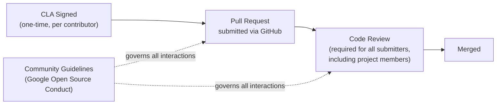
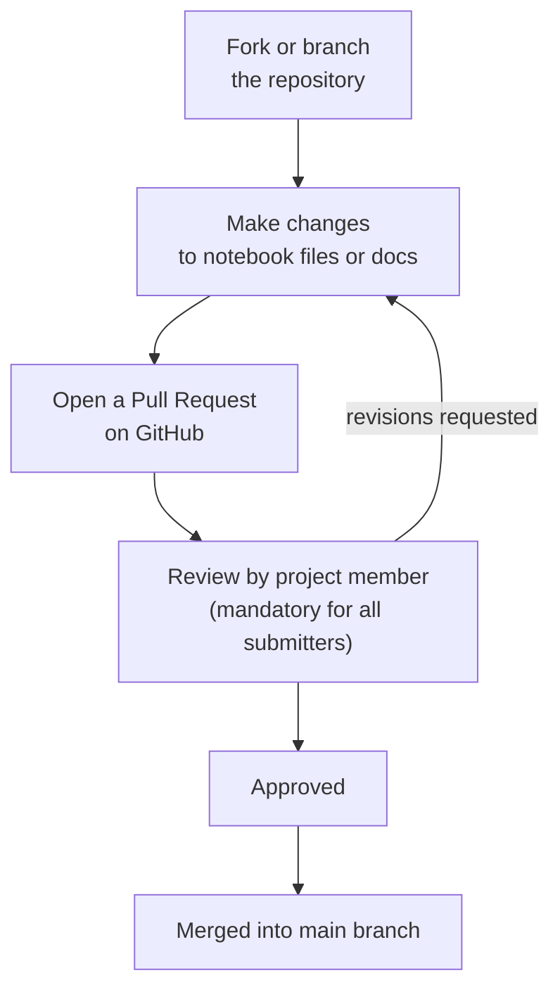

<!-- source: DeepWiki mcp.deepwiki.com · repo google-deepmind/neural-processes · page 4 Contributing · fetched 2026-10-26 -->

# Contributing

Relevant source files

The following files were used as context for generating this wiki page:

- [CONTRIBUTING.md](CONTRIBUTING.md)

This page describes the process for contributing changes to the `neural-processes` repository. It covers the Contributor License Agreement (CLA) requirement, the pull request and code review workflow, and the community conduct guidelines. For information about the project itself, see page [1](#1). For licensing terms, see page [5](#5).

---

## Overview

The contribution workflow has three mandatory components:

**Sources:** [CONTRIBUTING.md:1-29]()

---

## Contributor License Agreement

Before a contribution can be accepted, a Contributor License Agreement must be on file. The CLA grants the project permission to use and redistribute the contribution; copyright remains with the contributor or their employer.

| Situation | Action Required |
|---|---|
| First-time contributor to any Google project | Sign a new CLA |
| Already signed a CLA for another Google project | No action needed |
| Contributor employed by a company | Company may need to sign a corporate CLA |

The CLA is a one-time requirement per contributor, not per pull request or per repository.

**Sources:** [CONTRIBUTING.md:7-16]()

---

## Pull Requests and Code Review

All changes — including those from project members — must go through a GitHub pull request and receive a review before merging. There are no exceptions for maintainers or committers.

The files most likely to be changed in a contribution are:

| File | Description |
|---|---|
| `conditional_neural_process.ipynb` | CNP implementation (TensorFlow/Keras) |
| `attentive_neural_process.ipynb` | NP and ANP implementation (PyTorch) |
| `README.md` | Project overview and citations |

**Sources:** [CONTRIBUTING.md:18-23]()

---

## Community Guidelines

All participants in the project — contributors, reviewers, and maintainers — are expected to follow [Google's Open Source Community Guidelines](https://opensource.google.com/conduct). This applies to pull request discussions, issue comments, and all other project interactions.

**Sources:** [CONTRIBUTING.md:25-29]()

---

