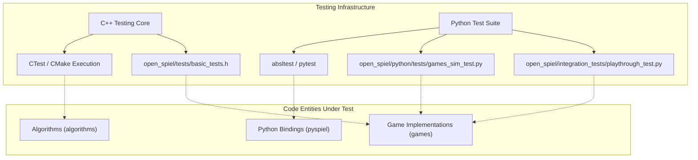

<!-- source: DeepWiki mcp.deepwiki.com · repo google-deepmind/open_spiel · page 10 Testing and Validation · fetched 2026-10-26 -->

# Testing and Validation

Relevant source files

The following files were used as context for generating this wiki page:

- [open_spiel/game_parameters.cc](open_spiel/game_parameters.cc)
- [open_spiel/game_parameters.h](open_spiel/game_parameters.h)
- [open_spiel/game_transforms/add_noise.cc](open_spiel/game_transforms/add_noise.cc)
- [open_spiel/game_transforms/cached_tree.cc](open_spiel/game_transforms/cached_tree.cc)
- [open_spiel/game_transforms/coop_to_1p.cc](open_spiel/game_transforms/coop_to_1p.cc)
- [open_spiel/game_transforms/misere.cc](open_spiel/game_transforms/misere.cc)
- [open_spiel/game_transforms/normal_form_extensive_game.cc](open_spiel/game_transforms/normal_form_extensive_game.cc)
- [open_spiel/game_transforms/restricted_nash_response.cc](open_spiel/game_transforms/restricted_nash_response.cc)
- [open_spiel/game_transforms/restricted_nash_response.h](open_spiel/game_transforms/restricted_nash_response.h)
- [open_spiel/game_transforms/restricted_nash_response_test.cc](open_spiel/game_transforms/restricted_nash_response_test.cc)
- [open_spiel/game_transforms/turn_based_simultaneous_game.cc](open_spiel/game_transforms/turn_based_simultaneous_game.cc)
- [open_spiel/game_transforms/turn_based_simultaneous_game.h](open_spiel/game_transforms/turn_based_simultaneous_game.h)
- [open_spiel/game_transforms/turn_based_simultaneous_game_test.cc](open_spiel/game_transforms/turn_based_simultaneous_game_test.cc)
- [open_spiel/game_transforms/zerosum.cc](open_spiel/game_transforms/zerosum.cc)
- [open_spiel/integration_tests/playthrough_test.py](open_spiel/integration_tests/playthrough_test.py)
- [open_spiel/spiel.cc](open_spiel/spiel.cc)
- [open_spiel/spiel.h](open_spiel/spiel.h)
- [open_spiel/tests/basic_tests.cc](open_spiel/tests/basic_tests.cc)
- [open_spiel/tests/basic_tests.h](open_spiel/tests/basic_tests.h)
- [open_spiel/utils/tensor_view_test.cc](open_spiel/utils/tensor_view_test.cc)

## Purpose and Scope

This page provides an overview of OpenSpiel's comprehensive testing infrastructure, which ensures the correctness, robustness, and regression-free evolution of game implementations, algorithms, and multi-language bindings. Because OpenSpiel combines a high-performance C++ core with an extensive Python interface, its validation strategy spans unit tests, randomized simulation harnesses, exact game-tree checks, and serialized playthrough comparisons.

For deep technical details on specific testing domains, refer to the following child pages:
- [C++ Testing Framework](#10.1) — Detailed coverage of `basic_tests.h` utilities, `RandomSimTest`, action struct tests, and CTest integration.
- [Python Testing Suite](#10.2) — Detailed coverage of `games_sim_test.py`, `api_test.py`, C++/Python equivalence, and pytest execution.
- [Integration Tests and Playthroughs](#10.3) — Detailed coverage of the playthrough recording system, `generate_playthrough.py`, and regression testing pipelines.

Sources: [open_spiel/tests/basic_tests.h:15-53](), [open_spiel/integration_tests/playthrough_test.py:15-25]()

---

## Testing Architecture Overview

OpenSpiel employs a multi-tiered testing strategy. C++ components are validated directly via unit tests integrated into CMake/CTest, while Python components leverage Abseil-based test runners (`absltest`) to execute simulation loops and verify bindings.

Sources: [open_spiel/tests/basic_tests.h:30-80](), [open_spiel/python/tests/games_sim_test.py:71-110](), [open_spiel/integration_tests/playthrough_test.py:73-96]()

---

## 10.1 C++ Testing Framework

The C++ testing layer provides fundamental validation utilities for game mechanics, cloning, serialization, and undo operations. Game developers write unit tests utilizing headers defined in `open_spiel/tests/basic_tests.h`, which provide functions like `LoadGameTest()`, `RandomSimTest()`, and `TestSerializeDeserialize()` [open_spiel/tests/basic_tests.h:33-81]().

For detailed documentation on C++ testing utilities, simulation routines, and CTest configuration, see [C++ Testing Framework](#10.1).

Sources: [open_spiel/tests/basic_tests.h:33-81]()

---

## 10.2 Python Testing Suite

Python tests bridge the C++ core and Python environment via the `pyspiel` module, validating that game APIs, tensor allocations, and algorithms behave identically across language boundaries [open_spiel/python/tests/games_sim_test.py:15-40](). The test suite uses parameterized test cases over registered games to ensure broad coverage without boilerplate duplication.

For detailed documentation on `games_sim_test.py`, `api_test.py`, and C++/Python equivalence checks, see [Python Testing Suite](#10.2).

Sources: [open_spiel/python/tests/games_sim_test.py:15-40]()

---

## 10.3 Integration Tests and Playthroughs

Integration tests and playthroughs guarantee long-term stability and catch regressions in game state transitions [open_spiel/integration_tests/playthrough_test.py:15-30](). The playthrough system (`generate_playthrough.py`) records sequences of actions and expected string outputs, allowing automated tests to verify that game rules have not changed unexpectedly over time.

For detailed documentation on the playthrough format, `generate_playthrough.py`, and regression verification, see [Integration Tests and Playthroughs](#10.3).

Sources: [open_spiel/integration_tests/playthrough_test.py:15-30]()

---

