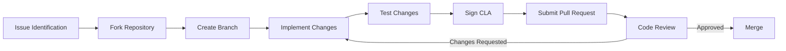
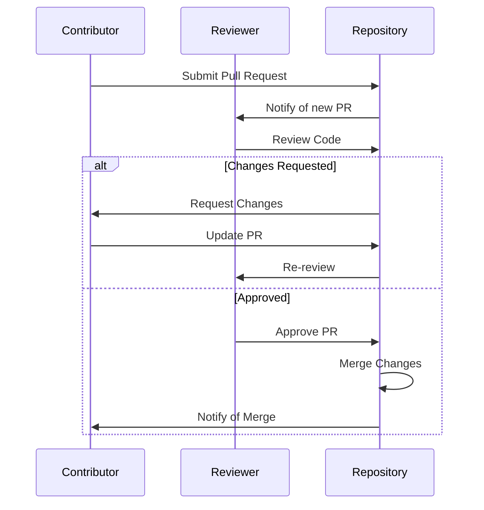
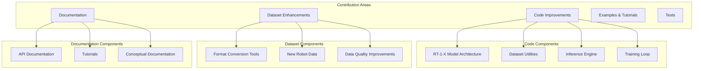
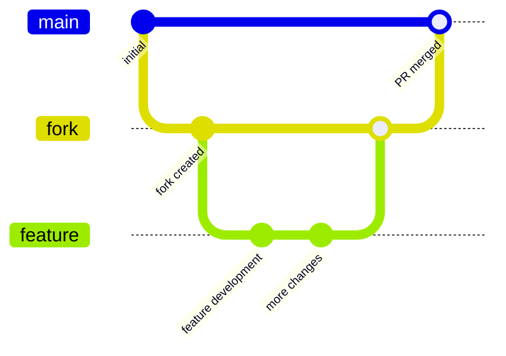
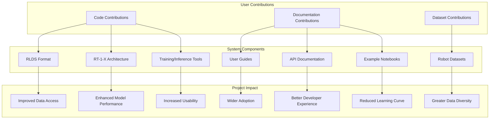

<!-- source: DeepWiki mcp.deepwiki.com · repo google-deepmind/open_x_embodiment · page 5 Contributing · fetched 2026-10-26 -->

# Contributing

<details>
<summary>Relevant source files</summary>

The following files were used as context for generating this wiki page:

- [CONTRIBUTING.md](CONTRIBUTING.md)
- [LICENSE](LICENSE)

</details>


This page outlines how to contribute to the Open X-Embodiment project. It provides information about the contribution process, requirements, and guidelines to ensure smooth collaboration. For information about using the project's features and components, please refer to the [Using RT-1-X](#4) page.

## Overview of Contribution Process

The Open X-Embodiment project welcomes contributions from the community. Contributions can range from code improvements and bug fixes to documentation enhancements and dataset additions. The following diagram outlines the general contribution process:



Sources: [CONTRIBUTING.md:1-25]()

## Contributor License Agreement

Before your contributions can be accepted, you must sign a Contributor License Agreement (CLA). This agreement allows the project maintainers to use and redistribute your contributions as part of the project while you retain the copyright to your contribution.

Key points about the CLA:

- Sign the CLA at [https://cla.developers.google.com/](https://cla.developers.google.com)
- You generally only need to submit a CLA once, even if you contribute to different Google projects
- Both individual contributors and company/organization contributors must sign the CLA

Sources: [CONTRIBUTING.md:3-13]()

## Code Review Process

All submissions to the Open X-Embodiment project require code review, including submissions from project members. The review process ensures code quality, consistency, and alignment with project goals.

The pull request process works as follows:



Sources: [CONTRIBUTING.md:15-20]()

## Contribution Areas

The Open X-Embodiment project has several components where contributions are welcome. The following diagram shows the main areas where you can contribute:



## Setting Up Development Environment

To contribute to the Open X-Embodiment project, you'll need to set up your development environment. The following steps will help you get started:

1. **Fork the repository**: Navigate to [https://github.com/google-deepmind/open_x_embodiment](https://github.com/google-deepmind/open_x_embodiment) and click the "Fork" button.

2. **Clone your fork**:
   ```bash
   git clone https://github.com/YOUR_USERNAME/open_x_embodiment.git
   cd open_x_embodiment
   ```

3. **Set up the upstream remote**:
   ```bash
   git remote add upstream https://github.com/google-deepmind/open_x_embodiment.git
   ```

4. **Install dependencies**:
   Follow the installation instructions in the project documentation to set up your environment.

## Contribution Guidelines

### Code Style and Standards

When contributing code to the Open X-Embodiment project, please follow these guidelines:

- Adhere to the existing code style in the project
- Write clear, concise code with appropriate comments
- Include docstrings for functions, classes, and modules
- Follow Python PEP 8 style guidelines for Python code

### Documentation Standards

Good documentation is essential for the project's usability. When contributing documentation:

- Use clear, concise language
- Include examples where appropriate
- Ensure accuracy and completeness
- Update documentation when modifying code functionality

### Testing Requirements

For code contributions, appropriate testing is important:

- Write unit tests for new functionality
- Ensure existing tests pass with your changes
- Consider edge cases and error handling in your tests

## Pull Request Process

When you're ready to submit your contribution, follow these steps:

1. **Ensure your fork is up to date**:
   ```bash
   git fetch upstream
   git checkout main
   git merge upstream/main
   ```

2. **Create a new branch for your changes**:
   ```bash
   git checkout -b your-feature-branch
   ```

3. **Make your changes and commit them**:
   ```bash
   git add .
   git commit -m "Clear description of your changes"
   ```

4. **Push your changes to your fork**:
   ```bash
   git push origin your-feature-branch
   ```

5. **Create a pull request**:
   - Go to your fork on GitHub
   - Click "New pull request"
   - Select your branch and provide a clear description of your changes
   - Submit the pull request

The following diagram illustrates the relationship between your fork, the upstream repository, and the branches involved:



## Community Guidelines

The Open X-Embodiment project follows Google's Open Source Community Guidelines. These guidelines promote a respectful and inclusive community environment. Key principles include:

- Be respectful and constructive in communications
- Focus on what is best for the community
- Show courtesy and respect toward other community members

For the complete guidelines, refer to [Google's Open Source Community Guidelines](https://opensource.google/conduct).

Sources: [CONTRIBUTING.md:22-25]()

## Licensing Information

The Open X-Embodiment project is licensed under the Apache License 2.0. This license allows you to:

- Use the code for commercial or non-commercial purposes
- Modify the code and create derivative works
- Distribute the original or modified code

When contributing to the project, your contributions will be subject to the same license. By submitting a contribution, you agree that your work will be licensed under the Apache License 2.0.

Key points to remember:
- Include license and copyright notices in any files you modify
- Document any significant changes you make to files

For the complete license text, refer to the [LICENSE]() file in the repository.

Sources: [LICENSE:1-203]()

## Getting Help

If you need assistance with the contribution process, consider the following resources:

- Open an issue on the GitHub repository with questions
- Refer to the project documentation
- Review existing pull requests and issues for examples and common challenges

## Contribution Impact

Your contributions to the Open X-Embodiment project can have significant impact across various components of the system, as illustrated in the following diagram:



Thank you for considering contributing to the Open X-Embodiment project. Your contributions help advance robotics research and development by improving the accessibility and utility of diverse robotics datasets and models.