# Page: Open X-Embodiment Overview

# Open X-Embodiment Overview

<details>
<summary>Relevant source files</summary>

The following files were used as context for generating this wiki page:

- [README.md](README.md)
- [colabs/Open_X_Embodiment_Datasets.ipynb](colabs/Open_X_Embodiment_Datasets.ipynb)
- [imgs/teaser.png](imgs/teaser.png)

</details>


This page provides a high-level overview of the Open X-Embodiment project, which aims to unify diverse robotic datasets into a common format and provide models that can learn from this unified data. It explains the key components, system architecture, and relationships between different parts of the project. For detailed information about accessing and using specific datasets, see [Datasets](#2), and for information about using the RT-1-X model, see [Using RT-1-X](#4).

## Purpose and Problem Statement

Open X-Embodiment addresses a key challenge in robotics: the fragmentation of robotic data across different formats, embodiments, and tasks. The project provides:

1. A unified framework for diverse robotic datasets in a common format
2. Pre-trained models (RT-1-X) that can transfer knowledge across different robot embodiments
3. Tools and examples for working with these datasets and models

By standardizing diverse robotic datasets and creating models that can generalize across different robots, Open X-Embodiment enables more effective cross-embodiment learning and reduces the need for robot-specific data collection.

Sources: [README.md:4-7]()

## System Architecture Overview

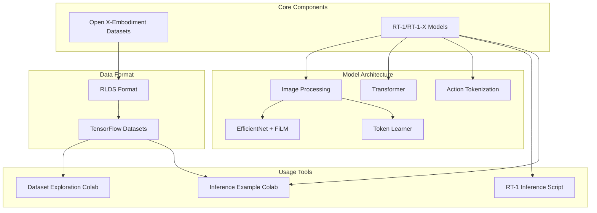

Sources: [README.md:5-7](), [README.md:23-37]()

## Dataset System

Open X-Embodiment provides a large collection of robotic datasets from diverse sources, all converted into a unified format. This standardization enables researchers to train models across different robot embodiments and tasks.

### Dataset Format

All datasets follow the RLDS (Reinforcement Learning Datasets) episode format, which structures robotic data into episodes containing:

- Observations (images, robot state)
- Actions (robot commands)
- Rewards
- Task information

This unified format makes it easier to consume data from different robots and tasks for training and inference.

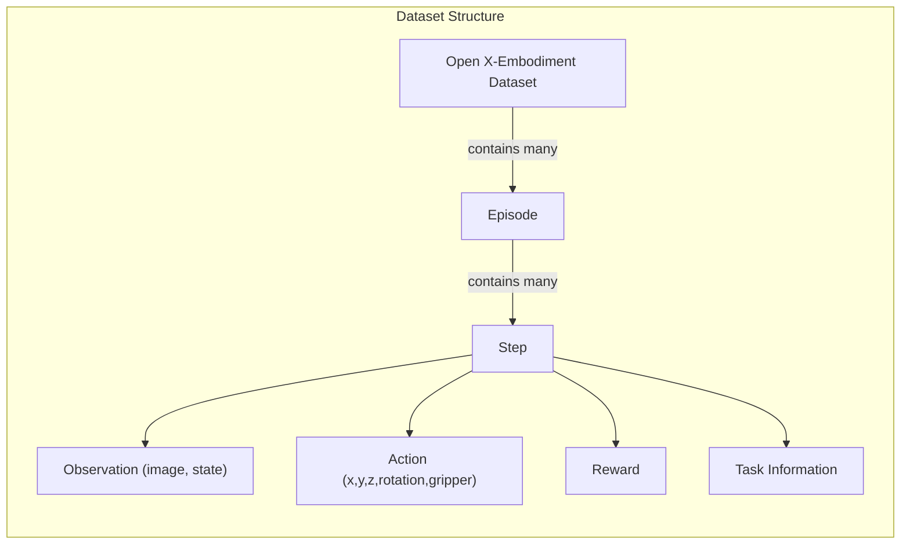

Sources: [README.md:11-13]()

### Dataset Access and Exploration

Datasets can be accessed using TensorFlow Datasets (`tfds`) or by directly downloading from Google Cloud Storage. The project provides a Colab notebook for exploring and visualizing the datasets.

Sources: [README.md:15-17](), [README.md:47-55]()

## RT-1-X Model System

RT-1-X (Robotics Transformer 1-X) is a model trained on the Open X-Embodiment dataset that can generalize across different robot embodiments. It takes visual input and natural language task descriptions and outputs robot actions.

### Model Architecture

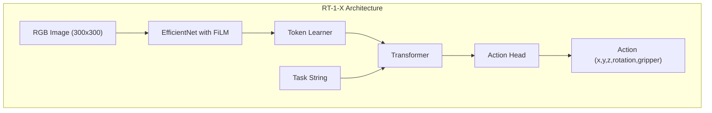

Sources: [README.md:26-32](), [README.md:33-37]()

### Input and Output Space

The model operates with the following input and output spaces:

**Input Space:**
- RGB image from robot workspace camera
- Task string (natural language description)

**Output Space:**
- 7-dimensional action space:
  - Position (x, y, z)
  - Orientation (roll, pitch, yaw)
  - Gripper opening value

Sources: [README.md:26-32](), [README.md:33-37]()

## Data Flow During Inference

The following diagram illustrates how data flows through the system during inference:

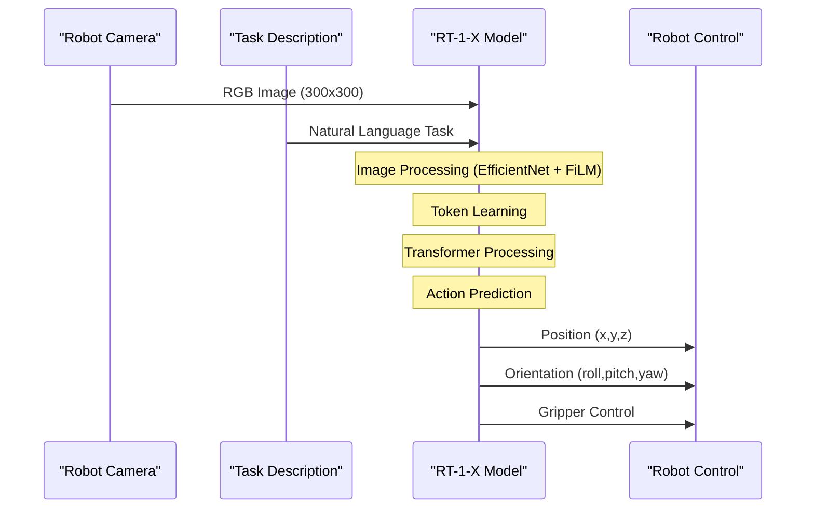

Sources: [README.md:26-32](), [README.md:33-37]()

## Components and Tools

The following table outlines the key components and tools available in the Open X-Embodiment project:

| Component | Description | Access Method |
|-----------|-------------|---------------|
| Datasets | Collection of robotic datasets in RLDS format | `tfds.load(dataset_name)` or direct download |
| Dataset Colab | Notebook for exploring and visualizing datasets | GitHub repository |
| RT-1-X TensorFlow Checkpoint | Pre-trained model for inference | Inference Colab |
| RT-1-X JAX Checkpoint | Alternative checkpoint format | Direct download via `gsutil` |
| Inference Example Script | Python script for running inference with RT-1-X | GitHub repository |

Sources: [README.md:11-21](), [README.md:23-43]()

## Dataset and Model Relationship

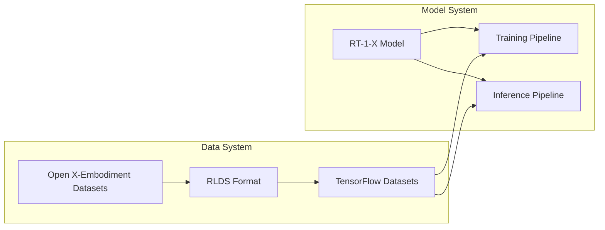

Sources: [README.md:11-21](), [README.md:23-43]()

## Citation and License

When using Open X-Embodiment, proper citation is requested for both the overall project and the specific datasets used. The project is released under the Apache License 2.0 for software and Creative Commons Attribution 4.0 for other materials.

Sources: [README.md:59-73]()

---

# Page: Datasets

# Datasets

<details>
<summary>Relevant source files</summary>

The following files were used as context for generating this wiki page:

- [README.md](README.md)
- [colabs/Open_X_Embodiment_Datasets.ipynb](colabs/Open_X_Embodiment_Datasets.ipynb)

</details>


## Purpose and Scope

The Open X-Embodiment datasets provide a standardized collection of robotics data from diverse sources, unified in the RLDS (Reinforcement Learning Datasets) format. This document provides an overview of these datasets, their structure, and their role within the Open X-Embodiment system. For detailed information about the dataset format, see [Dataset Format and Structure](#2.1). For instructions on accessing and using the datasets, see [Accessing and Using Datasets](#2.2).

## Dataset Organization

Open X-Embodiment aims to provide all open-sourced robotic data in a unified format for downstream consumption. The data is structured using the RLDS episode format, which organizes robot interactions as sequences of episodes and steps.

Dataset Organizational Structure:
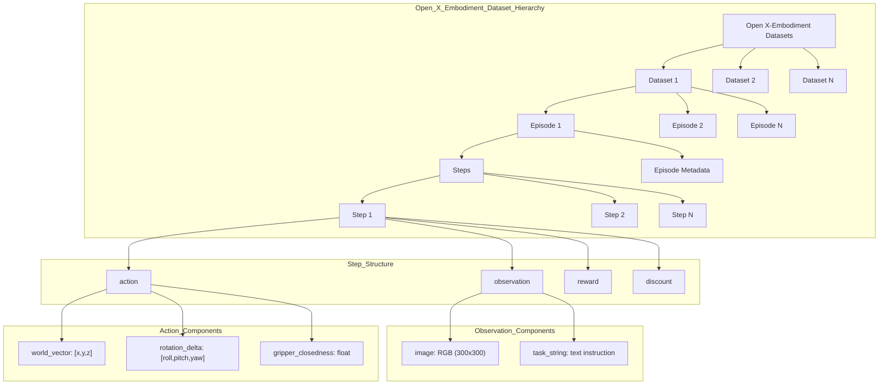

Sources:
- [README.md:11-13]()
- [README.md:25-37]()

## RLDS Format Details

The RLDS format provides a standardized structure for reinforcement learning datasets. In the context of Open X-Embodiment, this format includes:

### Data Components

| Component | Description | Data Type |
|-----------|-------------|-----------|
| Episodes | Collection of episode sequences | List of episodes |
| Episode Metadata | Additional information about the episode | Varies by dataset |
| Steps | Sequence of timesteps in an episode | List of steps |
| Observation | What the robot perceives at a given timestep | Dictionary |
| - image | RGB image from robot's workspace camera | 300x300x3 tensor |
| - task_string | Natural language instruction | String |
| Action | The robot's action at that timestep | Dictionary |
| - world_vector | Position coordinates (x, y, z) | 3-element vector |
| - rotation_delta | Rotation angles (roll, pitch, yaw) | 3-element vector |
| - gripper_closedness | Value indicating gripper state | Float |
| Reward | Reward received (if applicable) | Float |
| Discount | Value used in reinforcement learning (if applicable) | Float |

Sources:
- [README.md:11-13]()
- [README.md:25-37]()

## Observation and Action Spaces

### Observation Space

The observation space in the datasets consists of:

1. **RGB Image**: A 300x300 pixel image from the robot's workspace camera, capturing the current state of the environment.
2. **Task String**: A natural language instruction describing the task to be performed (e.g., "pick up the blue block").

The image provides visual information about the current state, while the task string communicates what action the robot should perform. The model currently does not use additional camera sources such as wrist cameras, in-hand cameras, or depth information.

### Action Space

The action space consists of seven variables representing the gripper movement:

1. **Position (x, y, z)**: 3D coordinates for the gripper's position.
2. **Rotation (roll, pitch, yaw)**: Rotation angles for the gripper.
3. **Gripper Openness**: A value indicating how open or closed the gripper should be.

Each variable can represent either an absolute value, a delta change, or a velocity, depending on the specific dataset and robot controller.

Sources:
- [README.md:25-31]()
- [README.md:33-37]()

## Dataset Integration with RT-1-X

The datasets serve as the foundation for training and evaluating the RT-1-X model. The following diagram illustrates the data flow from datasets to model training and inference:

Dataset to RT-1-X Pipeline:
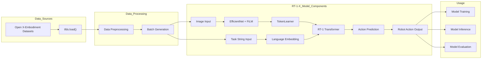

Sources:
- [README.md:25-37]()
- [README.md:37-41]()

## Accessing Datasets

The datasets can be accessed using TensorFlow Datasets (TFDS):

```python
import tensorflow_datasets as tfds

# Load a specific dataset
dataset = tfds.load('dataset_name')

# Iterate through episodes
for episode in dataset:
    # Access steps in the episode
    steps = episode['steps']
    
    # Process each step
    for step in steps:
        observation = step['observation']
        action = step['action']
        
        # Access specific components
        image = observation['image']
        task_string = observation['task_string']
```

If you encounter issues loading a dataset with `tfds.load()`, you can download it manually:

```bash
gsutil -m cp -r gs://gdm-robotics-open-x-embodiment/{dataset_name} ~/tensorflow_datasets/
```

After downloading, you can use the regular `tfds.load({dataset_name})` command to access the dataset.

Sources:
- [README.md:15-17]()
- [README.md:47-57]()

## Available Datasets

A comprehensive list of all datasets included in the Open X-Embodiment project, along with their metadata, can be found in the [dataset spreadsheet](https://docs.google.com/spreadsheets/d/1rPBD77tk60AEIGZrGSODwyyzs5FgCU9Uz3h-3_t2A9g/edit#gid=0) referenced in the README. These datasets come from various research institutions and cover a wide range of robotic platforms and tasks.

For exploring and visualizing the datasets, the Open X-Embodiment project provides a self-contained [Dataset Exploration Colab](https://colab.research.google.com/github/google-deepmind/open_x_embodiment/blob/main/colabs/Open_X_Embodiment_Datasets.ipynb) that demonstrates:

1. How to visualize episodes from each dataset
2. How to create batches of data ready for training and inference
3. How to process observation and action data

Sources:
- [README.md:15-17]()
- [README.md:19-21]()

---

# Page: Dataset Format and Structure

# Dataset Format and Structure

<details>
<summary>Relevant source files</summary>

The following files were used as context for generating this wiki page:

- [README.md](README.md)
- [colabs/Open_X_Embodiment_Datasets.ipynb](colabs/Open_X_Embodiment_Datasets.ipynb)

</details>


## Purpose and Overview

This document details the standardized format and structure of datasets in the Open X-Embodiment project. It explains the RLDS (Robotics Learning Data Storage) format, episode structure, and data organization used to unify diverse robotic datasets. For information on how to download and use these datasets, see [Accessing and Using Datasets](#2.2).

## RLDS Format Overview

All Open X-Embodiment datasets use the RLDS format, which provides a consistent structure for robotics learning data. As stated in the documentation: "Each data set is represented as a sequence of episodes, where each episode is represented using the RLDS episode format."

Sources: [README.md:13]()

The RLDS format is implemented through TensorFlow Datasets (TFDS) and organizes data in a hierarchical structure, allowing for consistent representation across diverse robot types and task domains.

Title: RLDS Dataset Structure Hierarchy
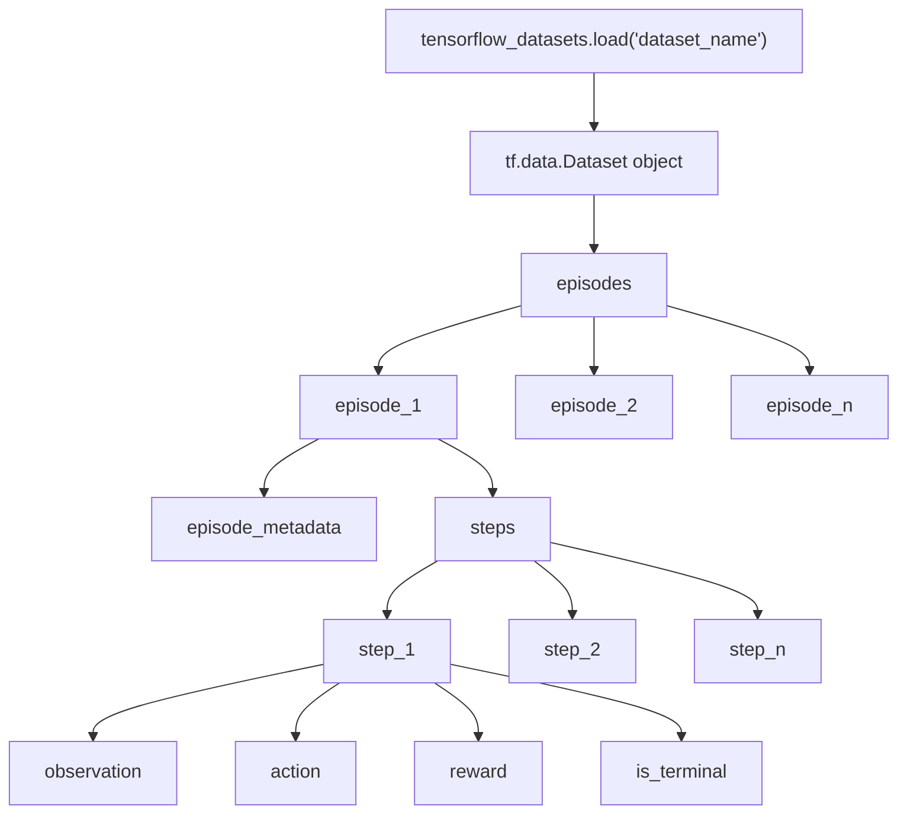

Sources: [README.md:11-13]()

## Episode Structure

An episode represents a complete sequence of robot interactions for a specific task. Each episode contains:

1. **Metadata**: Information about the episode
2. **Steps**: A sequence of interaction steps

Each step in an episode contains several components:

Title: Episode Step Data Structure
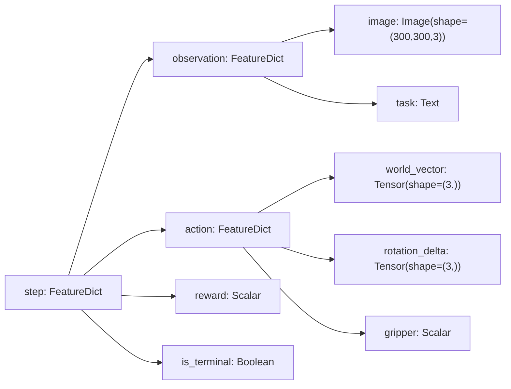

Sources: [README.md:25-35]()

### Observation Space

The observation space consists of the following components:

| Component | Description | Data Type | Shape |
|-----------|-------------|-----------|-------|
| image | RGB image from workspace camera | uint8 tensor | (300, 300, 3) |
| task | Text description of the task | string | Variable length |

The observation space captures what the robot perceives at each step. As noted in the documentation: "The model takes as input a RGB image from the robot workspace camera and a task string describing the task that the robot is supposed to perform."

Sources: [README.md:27-29]()

### Action Space

The action space includes seven variables for gripper movement:

| Component | Description | Data Type | Shape |
|-----------|-------------|-----------|-------|
| world_vector | Position (x, y, z) | float tensor | (3,) |
| rotation_delta | Rotation (roll, pitch, yaw) | float tensor | (3,) |
| gripper | Gripper opening state | float scalar | Single value |

Each variable can represent either "the absolute value, the delta change to the dimension value or the velocity of the dimension."

Sources: [README.md:35-36]()

## Data Organization and Storage

The Open X-Embodiment datasets are structured as TensorFlow Datasets (TFDS) and stored in Google Cloud Storage. The datasets are organized hierarchically:

Title: Dataset Organization Structure
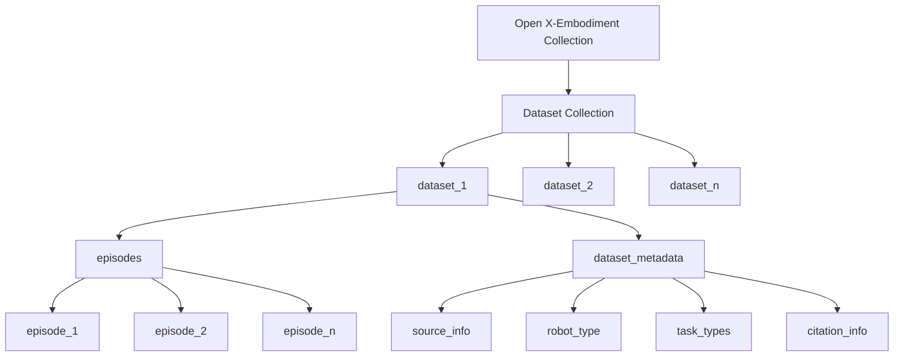

Sources: [README.md:21]()

A list of all included datasets and their metadata is available in a dataset spreadsheet referenced in the documentation. This includes information about the source, robot type, tasks performed, and citation details.

## Accessing Dataset Entries

The typical data access pattern follows this flow:

Title: Dataset Access Flow
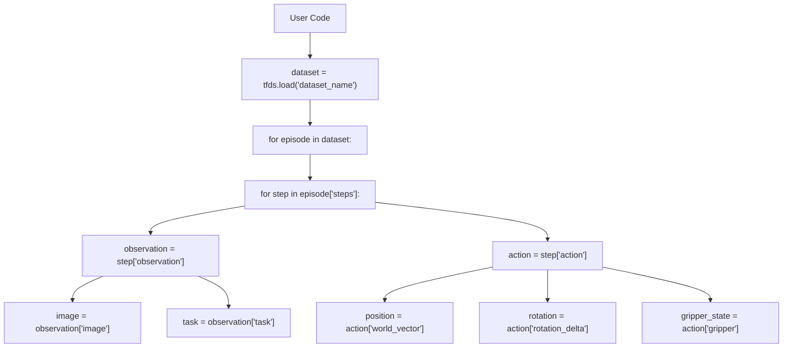

Sources: [README.md:38]()

If a dataset cannot be found using the standard `tfds.load()` method, it can be downloaded manually using gsutil:

```
gsutil -m cp -r gs://gdm-robotics-open-x-embodiment/{dataset_name} ~/tensorflow_datasets/
```

After downloading, the dataset can be accessed using the regular `tfds.load({dataset_name})` command.

Sources: [README.md:47-57]()

## Example Dataset Exploration

The Open X-Embodiment project provides a colab notebook for dataset exploration that demonstrates:
- How to visualize episodes from each dataset
- How to create batches of data ready for training and inference

This notebook serves as a practical guide to working with the dataset format and structure described in this document.

Sources: [README.md:15-17]()

## Summary

The RLDS format provides a standardized structure for robot learning datasets in the Open X-Embodiment project. This unified format enables easier consumption of diverse robotic data for downstream tasks, particularly for cross-embodiment learning. The hierarchical organization of datasets into episodes and steps, with standardized observation and action spaces, allows for consistent handling of data regardless of the robot type or task domain.

---

# Page: Accessing and Using Datasets

# Accessing and Using Datasets

<details>
<summary>Relevant source files</summary>

The following files were used as context for generating this wiki page:

- [README.md](README.md)
- [colabs/Open_X_Embodiment_Datasets.ipynb](colabs/Open_X_Embodiment_Datasets.ipynb)

</details>


This document provides comprehensive instructions for accessing, downloading, and utilizing the Open X-Embodiment datasets. It covers the practical aspects of working with these datasets, including how to load them using TensorFlow Datasets, troubleshooting common issues, and basic usage patterns. For information about the internal structure and format of the datasets, see [Dataset Format and Structure](#2.1).

## Dataset Availability

The Open X-Embodiment project provides multiple robotics datasets in a unified format, making them accessible for training and research. All datasets are stored in the RLDS (Reinforcement Learning Datasets) format, which standardizes the representation of robotic data.

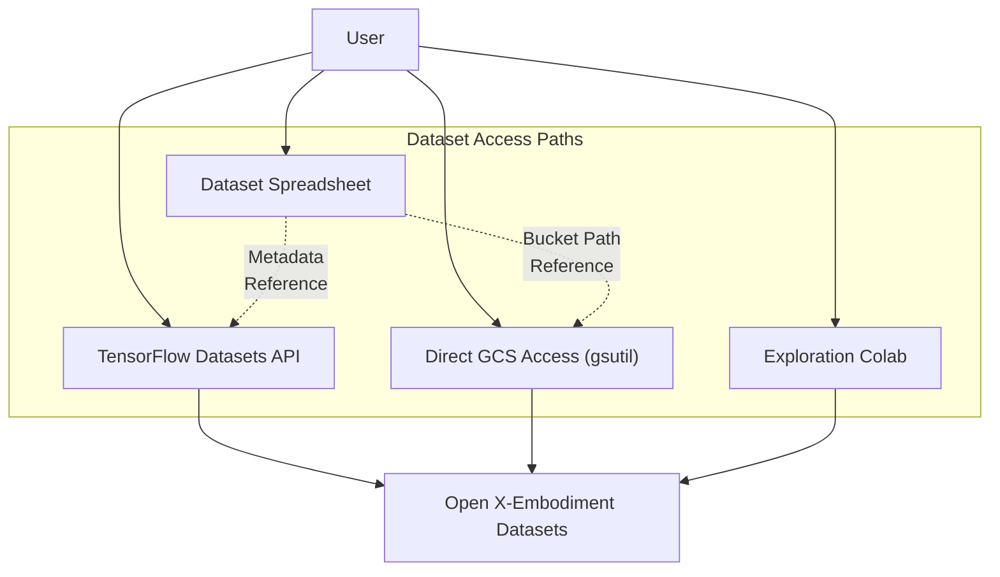

### Available Datasets

A comprehensive list of available datasets and their metadata is maintained in a public spreadsheet. This resource provides details such as dataset size, robot type, task categories, and citation information.

To explore the available datasets, refer to the [dataset spreadsheet](https://docs.google.com/spreadsheets/d/1rPBD77tk60AEIGZrGSODwyyzs5FgCU9Uz3h-3_t2A9g/edit#gid=0) mentioned in the README.

Sources: [README.md:19-21]()

## Accessing Datasets

There are two primary methods for accessing the Open X-Embodiment datasets:

1. **Using TensorFlow Datasets (TFDS)**: The recommended approach for most use cases
2. **Direct download using gsutil**: Alternative method for manual access

### Using TensorFlow Datasets

The datasets are registered with TensorFlow Datasets, allowing for straightforward loading with the `tfds.load()` function:

```python
import tensorflow_datasets as tfds

# Load a specific dataset
dataset = tfds.load('dataset_name')

# Iterate through episodes
for episode in dataset:
    # Process episode data
    ...
```

Sources: [README.md:47-57]()

### Direct Download with gsutil

If you encounter issues with the TFDS API, you can download datasets directly from Google Cloud Storage:

```bash
gsutil -m cp -r gs://gdm-robotics-open-x-embodiment/{dataset_name} ~/tensorflow_datasets/
```

After downloading, you can use the regular `tfds.load()` function to access the dataset.

Sources: [README.md:53-57]()

## Dataset Access Workflow

The following diagram illustrates the typical workflow for accessing and using the Open X-Embodiment datasets:

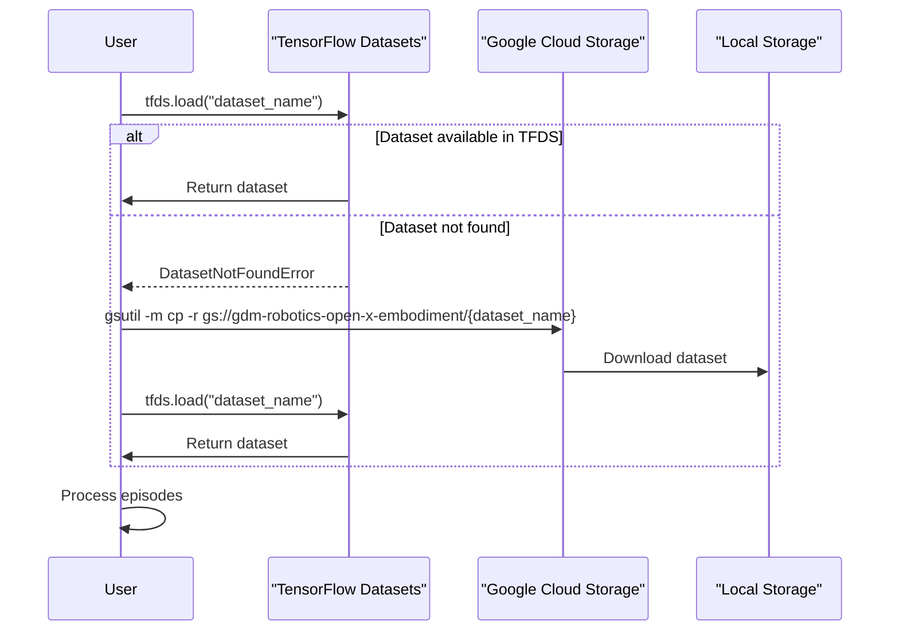

Sources: [README.md:47-57]()

## Troubleshooting Dataset Access

### Dataset Not Found Error

If you encounter a `DatasetNotFoundError` when attempting to load a dataset:

```
tensorflow_datasets.core.registered.DatasetNotFoundError: Dataset {dataset_name} not found.
```

Follow these steps:

1. Download the dataset manually using gsutil:
   ```bash
   gsutil -m cp -r gs://gdm-robotics-open-x-embodiment/{dataset_name} ~/tensorflow_datasets/
   ```

2. Try loading the dataset again using `tfds.load()`.

Sources: [README.md:47-57]()

## Working with Datasets

Once you've successfully loaded a dataset, you can work with it using standard TensorFlow data processing techniques.

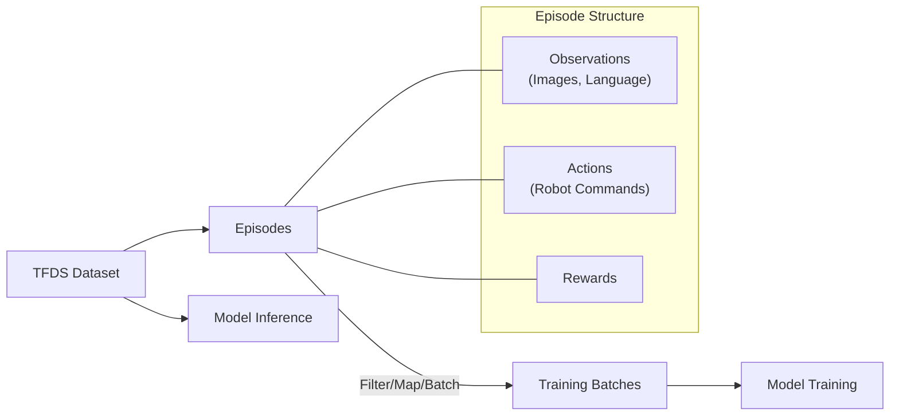

### Dataset Exploration

The project provides a self-contained Colab notebook that demonstrates:

1. How to visualize episodes from each dataset
2. How to create data batches ready for training and inference
3. Basic data exploration techniques

This notebook serves as a practical guide for getting started with the datasets.

You can access the exploration notebook at: [Open_X_Embodiment_Datasets.ipynb](https://colab.research.google.com/github/google-deepmind/open_x_embodiment/blob/main/colabs/Open_X_Embodiment_Datasets.ipynb)

Sources: [README.md:15-17]()

### Data Format and Usage

The datasets follow the RLDS episode format, where each episode contains sequences of:

- **Observations**: RGB images from the robot's workspace camera
- **Actions**: Robot movement commands (typically 7-dimensional vectors)
- **Task strings**: Natural language descriptions of tasks
- **Rewards**: Feedback signals (when available)

Each episode represents a complete sequence of interactions for a specific task.

Sources: [README.md:11-13](), [README.md:25-31]()

## Example Usage

Below is a basic example of how to load and iterate through a dataset:

```python
import tensorflow_datasets as tfds

# Load a specific dataset
dataset = tfds.load('bridge_dataset_torch')

# Take a few episodes for exploration
for episode_idx, episode in enumerate(dataset.take(3)):
    print(f"Episode {episode_idx}:")
    
    # Access step data
    for step_idx, step in enumerate(episode['steps']):
        # Access observation data (usually contains image)
        observation = step['observation']
        
        # Access action data (robot commands)
        action = step['action']
        
        # Process or visualize as needed
        # ...
```

For complete examples of data processing and visualization, refer to the exploration Colab notebook.

## Data Integration into Training and Inference

The following diagram illustrates how the datasets integrate into the training and inference pipelines of the RT-1-X model:

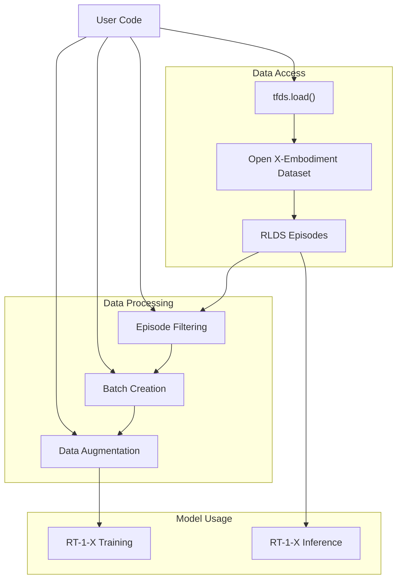

Sources: [README.md:37-38]()

## Citation and Usage Policies

When using the Open X-Embodiment datasets in research, please cite the appropriate papers:

1. The main Open X-Embodiment paper for overall usage
2. The specific dataset papers for any individual datasets used

The [dataset spreadsheet](https://docs.google.com/spreadsheets/d/1rPBD77tk60AEIGZrGSODwyyzs5FgCU9Uz3h-3_t2A9g/edit#gid=0) contains citation information for each dataset.

Sources: [README.md:59-61]()

## Conclusion

The Open X-Embodiment datasets provide a standardized way to access diverse robotic data for research and development. By following the access methods outlined in this document, you can efficiently work with these datasets for training models, running inference, or conducting research.

For a detailed explanation of the dataset internal format and structure, refer to [Dataset Format and Structure](#2.1). For examples of using these datasets with the RT-1-X model, see [Inference Examples](#4.1) and [Training Examples](#4.2).

Sources: [README.md:5-7]()

---

# Page: RT-1-X Model

# RT-1-X Model

<details>
<summary>Relevant source files</summary>

The following files were used as context for generating this wiki page:

- [README.md](README.md)
- [models/rt1.py](models/rt1.py)
- [models/rt1_inference_example.py](models/rt1_inference_example.py)

</details>


This document provides a technical overview of the RT-1-X model architecture and capabilities. RT-1-X is a robotics transformer model designed to map visual inputs and language instructions to robot actions, enabling generalization across different robots and tasks. For details about using the RT-1-X model for inference or training, see [Using RT-1-X](#4).

## Overview

RT-1-X is an evolution of the RT-1 (Robotics Transformer) model, with improvements as described in the RT-X paper (https://arxiv.org/abs/2310.08864). The model takes RGB camera images and natural language instructions as input and outputs robot action parameters.

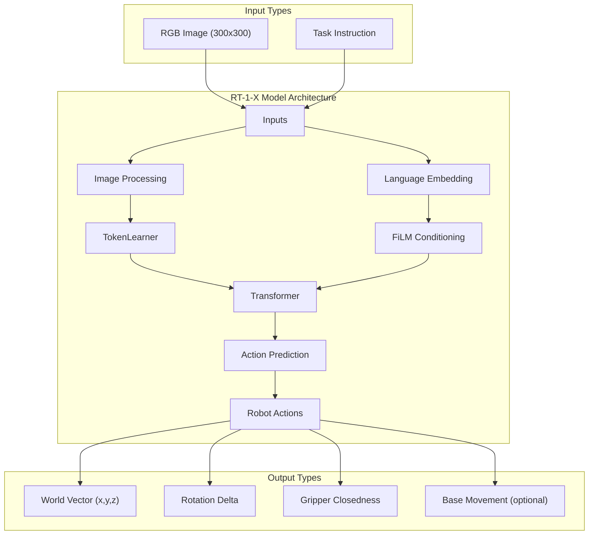

Sources: [models/rt1.py:357-552](), [README.md:23-37]()

## Model Architecture

The RT-1-X model consists of several key components that process visual and language inputs to produce robot actions:

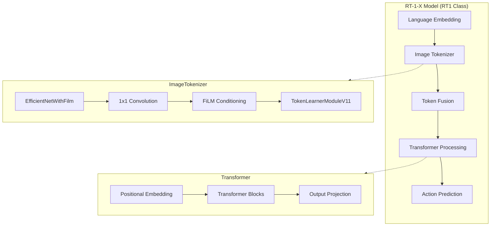

Sources: [models/rt1.py:357-482](), [models/rt1.py:114-189](), [models/rt1.py:71-111]()

### Main Components

The RT-1-X model (`RT1` class) integrates the following core components:

1. **Image Tokenizer**: Processes RGB images using EfficientNet with FiLM conditioning and TokenLearner
2. **Transformer**: Processes the sequence of image tokens and optional action tokens  
3. **Action Tokenization**: Converts model outputs to robot action parameters

The model can be configured with various parameters:
- Number of transformer layers (default: 8)
- Layer size (default: 128)
- Number of attention heads (default: 8)
- Vocabulary size for action discretization (default: 256)
- Number of image tokens (default: 8)
- Number of action tokens (default: 11)

Sources: [models/rt1.py:357-382](), [models/rt1_inference_example.py:153-164]()

## Image Processing Pipeline

The image processing pipeline transforms raw RGB images into tokens that can be processed by the transformer architecture:

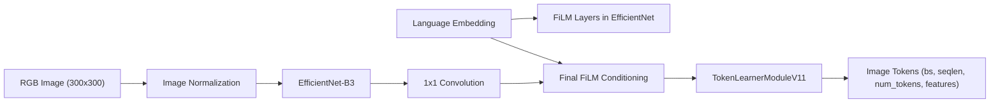

The image processing steps are:

1. **Image Normalization**: Scales image to match EfficientNet requirements
2. **EfficientNet-B3 with FiLM**: Processes the image with language conditioning via FiLM layers
3. **1x1 Convolution**: Projects features to the desired dimension
4. **Final FiLM Conditioning**: Another conditioning layer after feature projection
5. **Token Learner**: Reduces spatial dimensions into a fixed number of tokens

The `TokenLearnerModuleV11` module uses a MLP with GELU activation to implement spatial attention, which transforms the spatial features into a fixed number of tokens that can be processed by the transformer.

Sources: [models/rt1.py:114-189](), [models/rt1.py:192-254]()

## Action System

The RT-1-X model outputs a set of action parameters that control the robot. These actions are tokenized for the model to predict and then detokenized during inference:

### Action Space

The action space consists of the following dimensions:

| Action Component | Shape | Range | Description |
|------------------|-------|-------|-------------|
| terminate_episode | (3,) | [0,1,2] | Mode selection (0: terminate, 1: arm+gripper, 2: base) |
| world_vector | (3,) | [-2.0, 2.0] | Position in world coordinates (x,y,z) |
| rotation_delta | (3,) | [-π/2, π/2] | Rotation change in radians |
| gripper_closedness_action | (1,) | [-1.0, 1.0] | Gripper state (closed to open) |
| base_displacement_vertical_rotation | (1,) | [-π, π] | Base rotation |
| base_displacement_vector | (2,) | [-1.0, 1.0] | Base movement vector |

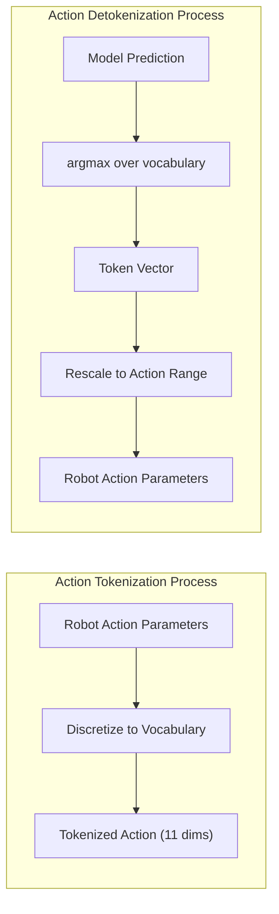

The action tokenization process:
1. Takes continuous action values and clips them to predefined ranges
2. Normalizes values to [0,1] range
3. Scales to the vocabulary size and converts to integer tokens

During inference, the model outputs logits over the vocabulary for each action dimension, which are then converted back to continuous action values.

Sources: [models/rt1.py:257-354](), [README.md:33-37]()

## Inference Process

The inference process with RT-1-X follows this sequence:

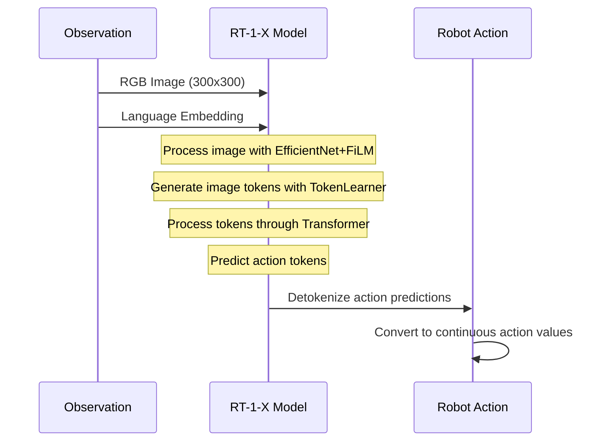

The RT-1-X inference implementation:

1. Takes an observation containing an RGB image and language embedding
2. Processes the image through the image tokenizer
3. Runs the transformer to predict action tokens
4. Detokenizes the action predictions
5. Returns a dictionary with continuous action values

The policy uses a sequence length (history window) of observations to make predictions, though in the default configuration the model doesn't use action history (controlled by the `include_prev_timesteps_actions` parameter).

Sources: [models/rt1_inference_example.py:23-145](), [models/rt1.py:384-482]()

## Model Configuration

The RT-1-X model can be configured with different parameters than the original RT-1 model:

| Parameter | RT-1 | RT-1-X | Description |
|-----------|------|--------|-------------|
| world_vector_range | (-1.0, 1.0) | (-2.0, 2.0) | Range for world position values |
| num_image_tokens | 8 | 81 | Number of image tokens |
| vocab_size | 256 | 512 | Size of action vocabulary |
| layer_size | 128 | 256 | Size of transformer layers |

The RT-1-X model also uses Token Learner to reduce the spatial dimensions of image features to a fixed number of tokens, which allows for more efficient processing in the transformer.

Sources: [models/rt1_inference_example.py:153-164](), [models/rt1.py:357-382]()

## Integration with Open X-Embodiment

RT-1-X is designed to work with the Open X-Embodiment datasets, which provide robotic data in a unified RLDS format. The model serves as a bridge between the standardized datasets and robot control systems, enabling transfer learning across different robot embodiments.

```mermaid
flowchart LR
    subgraph "Data Pipeline"
        RLDS["RLDS Datasets"] --> DataLoader["TensorFlow Datasets"]
        DataLoader --> TrainingLoop["Training Loop"]
    end
    
    subgraph "RT-1-X"
        ImageTokenizer["RT1.image_tokenizer"] --> Transformer["RT1.Transformer"]
        Transformer --> ActionPred["Action Prediction"]
    end
    
    subgraph "Deployment"
        RT1Policy["RT1Policy Class"] --> RobotActions["Robot Control System"]
    end
    
    TrainingLoop --> RT-1-X
    RT-1-X --> RT1Policy
```

The RT-1-X model checkpoint is available for download and can be used for inference using the provided example script. For more details about using RT-1-X for inference or training, refer to [Using RT-1-X](#4).

Sources: [README.md:23-43](), [models/rt1_inference_example.py:1-182]()

---

# Page: Model Architecture

# Model Architecture

<details>
<summary>Relevant source files</summary>

The following files were used as context for generating this wiki page:

- [models/efficientnet.py](models/efficientnet.py)
- [models/film_conditioning.py](models/film_conditioning.py)
- [models/rt1.py](models/rt1.py)
- [models/token_learner.py](models/token_learner.py)

</details>


This document provides a detailed explanation of the RT-1-X model architecture, which serves as the core intelligence system for mapping visual and language inputs to robot actions in the Open X-Embodiment project. This page focuses on the internal structure and components of the model, while details about the image processing pipeline and action system can be found in [Image Processing Pipeline](#3.2) and [Action System](#3.3) respectively.

## Overview

RT-1-X (Robotics Transformer 1-X) is a transformer-based model designed for robotic control that enables cross-embodiment learning and generalization. The model processes visual inputs with language instructions to produce robot actions directly, in an end-to-end fashion.

```mermaid
flowchart TD
    subgraph "RT-1-X Architecture"
        direction TB
        Input["Input Layer"] --> IT["Image Tokenizer"]
        Input --> LE["Language Embedding"]
        IT --> Tokens["Image Tokens"]
        LE --> Context["Context Vector"]
        Context --> IT
        Tokens --> Transformer["Transformer"]
        AT["Action Tokenizer"] --> Transformer
        Transformer --> AO["Action Output"]
    end
```

Sources: [models/rt1.py:358-482]()

## Core Components

The RT-1-X architecture consists of three primary components:

1. **Image Tokenizer**: Processes images using EfficientNet with FiLM conditioning and optionally Token Learner
2. **Transformer**: Processes the tokenized inputs with multi-head self-attention
3. **Action System**: Handles tokenization and detokenization of robot actions

```mermaid
classDiagram
    class RT1 {
        +num_layers: int
        +layer_size: int
        +num_heads: int
        +vocab_size: int
        +tokenize_image()
        +__call__()
    }
    
    class ImageTokenizer {
        +num_tokens: int
        +num_features: int
        +use_token_learner: bool
        +__call__()
    }
    
    class EfficientNetWithFilm {
        +config: Any
        +__call__()
    }
    
    class FilmConditioning {
        +num_channels: int
        +__call__()
    }
    
    class TokenLearnerModuleV11 {
        +num_tokens: int
        +bottleneck_dim: int
        +__call__()
    }
    
    class Transformer {
        +num_layers: int
        +layer_size: int
        +num_heads: int
        +__call__()
    }
    
    class TransformerBlock {
        +layer_size: int
        +num_heads: int
        +ffn_option: FFNOptions
        +__call__()
    }
    
    RT1 *-- ImageTokenizer
    RT1 *-- Transformer
    ImageTokenizer *-- EfficientNetWithFilm
    ImageTokenizer *-- FilmConditioning
    ImageTokenizer *-- TokenLearnerModuleV11
    Transformer *-- TransformerBlock
```

Sources: [models/rt1.py:358-482](), [models/rt1.py:114-190](), [models/rt1.py:71-111](), [models/rt1.py:28-68]()

## Image Tokenization Process

The image tokenization process converts raw RGB images into tokens that can be processed by the transformer. This process involves several steps:

```mermaid
flowchart LR
    Image["RGB Image\n(300x300)"] --> Normalize["Image\nNormalization"]
    Normalize --> EN["EfficientNet\nBackbone"]
    NL["Natural Language\nEmbedding"] --> FC1["FiLM\nConditioning"]
    EN --> FC1
    FC1 --> Conv["1x1 Conv\n(to num_features)"]
    Conv --> FC2["Final FiLM\nConditioning"]
    NL --> FC2
    FC2 --> TL["Token Learner\n(Optional)"]
    TL --> Tokens["Image Tokens\n(num_tokens x num_features)"]
```

Sources: [models/rt1.py:114-190](), [models/efficientnet.py:581-643](), [models/film_conditioning.py:10-39](), [models/token_learner.py:66-126]()

### EfficientNet with FiLM

The image encoding backbone is an EfficientNet-B3 architecture modified with Feature-wise Linear Modulation (FiLM) conditioning layers that incorporate language context. The EfficientNet backbone consists of multiple MBConv blocks arranged in a specific pattern.

```mermaid
flowchart TD
    Input["Input Image"] --> Stem["Stem\n3x3 Conv + BN + Activation"]
    Stem --> MBConv1["MBConv Block 1\n+ FiLM"]
    MBConv1 --> MBConv2["MBConv Block 2\n+ FiLM"]
    MBConv2 --> MBConvN["...\nMore MBConv Blocks + FiLM"]
    MBConvN --> Head["Head\n1x1 Conv + BN + Activation"]
    
    subgraph "MBConv Block"
        ExpConv["Expansion Conv\n(if expand_ratio > 1)"] --> DepthConv["Depthwise Conv"]
        DepthConv --> SE["Squeeze-Excite\n(if use_se = true)"]
        SE --> ProjConv["Projection Conv"]
        ProjConv --> SDrop["Stochastic Depth\n(if needed)"]
        SDrop --> ResConn["Residual Connection\n(if applicable)"]
    end
    
    Context["Language Context"] --> Film["FiLM Conditioning\n(γx + β)"]
    MBConv1 --> Film
```

Sources: [models/efficientnet.py:387-505](), [models/efficientnet.py:327-383](), [models/efficientnet.py:581-643]()

### FiLM Conditioning

FiLM conditioning modulates the feature maps from convolutional layers based on language context. It applies an affine transformation to each channel:

```
output = (1 + γ) * input + β
```

where γ and β are learned from the language context. This mechanism allows the visual processing to be conditioned on language instructions.

Sources: [models/film_conditioning.py:10-39]()

### Token Learner

Token Learner reduces the spatial dimensions of the feature map into a fixed number of tokens, creating a more compact representation:

```mermaid
flowchart LR
    FeatMap["Feature Map\n(h x w x c)"] --> LayerNorm["Layer Normalization"]
    LayerNorm --> MLP["MLP Block\n(gelu activation)"]
    MLP --> Reshape["Reshape to\n[bs, h*w, num_tokens]"]
    Reshape --> Transpose["Transpose to\n[bs, num_tokens, h*w]"]
    Transpose --> Softmax["Softmax\n(spatial attention)"]
    Softmax --> Einsum["Weighted Sum\n(einsum operation)"]
    FeatMap --> Reshape2["Reshape to\n[bs, h*w, c]"]
    Reshape2 --> Einsum
    Einsum --> Tokens["Output Tokens\n[bs, num_tokens, c]"]
```

Sources: [models/token_learner.py:66-126](), [models/rt1.py:192-254]()

## Transformer Architecture

The transformer processes the tokenized inputs to predict actions. It consists of multiple transformer blocks with multi-head self-attention.

```mermaid
flowchart TD
    Tokens["Input Tokens"] --> PosEmb["Positional Embedding"]
    PosEmb --> Block1["Transformer Block 1"]
    Block1 --> Block2["Transformer Block 2"]
    Block2 --> BlockN["...\nMore Transformer Blocks"]
    BlockN --> Output["Output Layer\n(Dense to vocab_size)"]
    
    subgraph "Transformer Block"
        LN1["Layer Norm"] --> MHA["Multi-Head\nSelf-Attention"]
        MHA --> ResConn1["Residual Connection"]
        ResConn1 --> LN2["Layer Norm"]
        LN2 --> FFN["Feed-Forward Network"]
        FFN --> ResConn2["Residual Connection"]
    end
```

Sources: [models/rt1.py:71-111](), [models/rt1.py:28-68]()

### Transformer Block Details

Each transformer block consists of:

1. **Multi-Head Self-Attention**: Processes relationships between tokens
2. **Feed-Forward Network**: Processes each token individually

The feed-forward network can be configured with different options, including:
- Linear: Simple linear projection
- SwiGLU: Gated linear unit with swish activation (default)

Sources: [models/rt1.py:28-68]()

## Action Processing

The model processes actions with tokenization and detokenization systems. Actions include:

| Action Component | Description | Range |
|------------------|-------------|-------|
| terminate_episode | Episode termination mode | Discrete (0, 1, 2) |
| world_vector | 3D position in world coordinates | [-1.0, 1.0] or [-2.0, 2.0] |
| rotation_delta | Rotation changes | [-π/2, π/2] |
| gripper_closedness_action | Gripper state | [-1.0, 1.0] |
| base_displacement_vertical_rotation | Base rotation | [-π, π] |
| base_displacement_vector | Base movement | [-1.0, 1.0] |

During inference, the model generates tokenized actions which are then detokenized into robot control commands.

Sources: [models/rt1.py:257-354]()

## Model Configuration

Key configuration parameters for the RT-1-X model:

| Parameter | Default Value | Description |
|-----------|---------------|-------------|
| num_layers | 8 | Number of transformer layers |
| layer_size | 128 | Size of attention layers |
| num_heads | 8 | Number of attention heads |
| feed_forward_hidden_size | 512 | Size of FFN hidden layer |
| feed_forward_output_size | 512 | Size of FFN output |
| vocab_size | 256 | Vocabulary size for tokenization |
| num_image_tokens | 8 | Number of image tokens |
| num_action_tokens | 11 | Number of action tokens |
| image_num_features | 512 | Feature dimension of image tokens |

Sources: [models/rt1.py:358-382]()

## Data Flow During Inference

```mermaid
sequenceDiagram
    participant Image as RGB Image
    participant Language as Task Instruction
    participant IT as ImageTokenizer
    participant T as Transformer
    participant A as Action System
    
    Image->>IT: 300x300 RGB image
    Language->>IT: Natural language embedding
    IT->>IT: EfficientNet processing
    IT->>IT: FiLM conditioning
    IT->>IT: Token Learner (optional)
    IT->>T: Image tokens
    Note over T: Process with self-attention
    T->>A: Output logits
    A->>A: Detokenize actions
    A->>A: Convert to robot commands
```

Sources: [models/rt1.py:396-482](), [models/rt1.py:311-354]()

## Full Model Implementation

The RT-1 class in `rt1.py` ties all these components together. It:

1. Initializes the image tokenizer and transformer
2. Processes images and language context
3. Combines image tokens with action tokens
4. Runs the transformer to predict next actions
5. Handles token caching for inference

The overall architecture enables end-to-end learning from raw images and language instructions to robot actions.

Sources: [models/rt1.py:358-552]()

---

# Page: Image Processing Pipeline

# Image Processing Pipeline

<details>
<summary>Relevant source files</summary>

The following files were used as context for generating this wiki page:

- [models/efficientnet.py](models/efficientnet.py)
- [models/film_conditioning.py](models/film_conditioning.py)
- [models/rt1.py](models/rt1.py)
- [models/token_learner.py](models/token_learner.py)

</details>


## Purpose and Scope

This document details the image processing pipeline of the RT-1/RT-1-X model architecture, focusing on how robot camera images are processed, tokenized, and conditioned with language instructions before being fed into the transformer model. The pipeline's primary purpose is to convert high-dimensional visual inputs (RGB images) into a compact set of contextualized tokens that effectively capture the visual information needed for robotic tasks.

For details on how these tokens are used by the transformer model, see [RT-1-X Model](#3.1). For information about the action prediction system, see [Action System](#3.3).

## Pipeline Overview

```mermaid
flowchart TB
    subgraph "Image Processing Pipeline"
        Image["RGB Image\n(300x300x3)"] --> Normalize["Normalization"]
        Normalize --> EfficientNet["EfficientNet-B3\nwith FiLM"]
        
        Language["Natural Language\nEmbedding"] --> FiLMConditioning["FiLM Conditioning\nLayers"]
        FiLMConditioning --> EfficientNet
        
        EfficientNet --> Projection["1x1 Convolution\n(Feature Projection)"]
        Projection --> FinalFiLM["Final FiLM Layer"]
        Language --> FinalFiLM
        
        FinalFiLM --> TokenLearner["Token Learner\n(Spatial Attention)"]
        TokenLearner --> Output["Image Tokens\n(8 tokens × 512 features)"]
    end
```

Sources: [models/rt1.py:114-189](), [models/efficientnet.py:581-643]()

## Image Tokenization Process

The image tokenization process follows these steps:

1. **Input Preparation**: The model receives RGB images of size 300×300×3 and language embeddings.
2. **Image Normalization**: Images are normalized using pre-defined mean and standard deviation values.
3. **EfficientNet with FiLM**: The normalized images are processed by an EfficientNet-B3 backbone with FiLM conditioning layers applied at each block.
4. **Feature Projection**: A 1×1 convolution projects features to a specified dimension (typically 512).
5. **Final FiLM Conditioning**: Another FiLM conditioning layer is applied after projection.
6. **Token Learning**: The Token Learner module converts spatial features into a fixed number of tokens (typically 8).

### Detailed Component Architecture

```mermaid
graph TD
    subgraph "ImageTokenizer Class"
        Input["Input: image, context_input"]
        Reshape["Reshape to [bs*seqlen, 300, 300, 3]"]
        Normalize["Normalize using MEAN_RGB, STDDEV_RGB"]
        Backbone["EfficientNetWithFilm"]
        Projection["1x1 Conv to num_features"]
        FiLM["FilmConditioning"]
        TokenLearner["TokenLearnerModuleV11"]
        Reshape2["Reshape to [bs, seqlen, num_tokens, features]"]
        Output["Output: Tokenized Image Representation"]
        
        Input --> Reshape --> Normalize --> Backbone
        Input --context--> Backbone
        Backbone --> Projection --> FiLM
        Input --context--> FiLM
        FiLM --> TokenLearner --> Reshape2 --> Output
    end
```

Sources: [models/rt1.py:114-189]()

## EfficientNet with FiLM Conditioning

The backbone of the image processing pipeline is an EfficientNet-B3 model enhanced with Feature-wise Linear Modulation (FiLM) conditioning. This architecture allows the model to modulate visual features based on language instructions.

### EfficientNet Architecture

EfficientNet-B3 is a convolutional neural network designed for high accuracy with constrained computational resources. The model consists of:

- Initial Stem block
- Seven blocks of MBConv layers with varying configurations
- Head layer for feature aggregation

Each MBConv block can include:
- Expansion phase (1×1 convolution)
- Depthwise convolution
- Squeeze-and-Excite attention
- Projection phase

### FiLM Conditioning Integration

FiLM conditioning is applied after each MBConv block in the EfficientNet architecture to incorporate language information. The conditioning mechanism works by:

1. Generating scale (γ) and shift (β) parameters from the language embedding
2. Applying these parameters element-wise to the convolutional features: y = (1 + γ) * x + β

```mermaid
graph TD
    subgraph "EfficientNetWithFilm"
        Input["Image Input"]
        Context["Language Context"]
        Stem["Stem Block"]
        
        subgraph "MBConv Blocks"
            MBConv1["MBConv Block 1"]
            MBConv2["MBConv Block 2"]
            MBConvN["MBConv Block N"]
        end
        
        FiLM1["FilmConditioning 1"]
        FiLM2["FilmConditioning 2"]
        FiLMN["FilmConditioning N"]
        
        Head["Head Block"]
        Output["Feature Output"]
        
        Input --> Stem --> MBConv1 --> FiLM1 --> MBConv2 --> FiLM2 --> MBConvN --> FiLMN --> Head --> Output
        Context ---> FiLM1
        Context ---> FiLM2
        Context ---> FiLMN
    end
```

Sources: [models/efficientnet.py:581-643](), [models/film_conditioning.py:10-39]()

### FiLM Conditioning Implementation

The `FilmConditioning` class applies feature-wise linear modulation to convolutional feature maps:

```mermaid
graph LR
    subgraph "FilmConditioning"
        ConvFeatures["Conv Features\n[B, H, W, C]"]
        Context["Context\n[B, context_size]"]
        
        ZeroProj1["Dense Layer\n(zero-initialized)"]
        ZeroProj2["Dense Layer\n(zero-initialized)"]
        
        Scale["Scale Parameter γ"]
        Shift["Shift Parameter β"]
        
        Apply["Apply: y = (1+γ)×x + β"]
        
        Output["Conditioned Features\n[B, H, W, C]"]
        
        Context --> ZeroProj1 --> Scale
        Context --> ZeroProj2 --> Shift
        ConvFeatures --> Apply
        Scale --> Apply
        Shift --> Apply
        Apply --> Output
    end
```

Sources: [models/film_conditioning.py:10-39]()

## Token Learner Module

The Token Learner module converts spatially-structured convolutional features into a fixed number of tokens through a learned spatial attention mechanism. This significantly reduces the number of tokens that need to be processed by the transformer while preserving the most relevant visual information.

### Token Learner Architecture

```mermaid
graph TD
    subgraph "TokenLearnerModuleV11"
        Input["Input Features\n[bs, h, w, c]"]
        Reshape1["Reshape to [bs, h*w, c]"]
        LayerNorm["Layer Normalization"]
        
        subgraph "MLP Block"
            Dense1["Dense Layer → bottleneck_dim"]
            GELU["GELU Activation"]
            Dropout1["Dropout"]
            Dense2["Dense Layer → num_tokens"]
            Dropout2["Dropout"] 
        end
        
        Reshape2["Reshape to [bs, h*w, num_tokens]"]
        Transpose["Transpose to [bs, num_tokens, h*w]"]
        Softmax["Softmax (Spatial Attention)"]
        
        MatrixMul["Matrix Multiplication\n(einsum: ...si,...id->...sd)"]
        
        Output["Output Tokens\n[bs, num_tokens, c]"]
        
        Input --> Reshape1 --> LayerNorm --> Dense1 --> GELU --> Dropout1 --> Dense2 --> Dropout2
        Dense2 --> Reshape2 --> Transpose --> Softmax
        Softmax --> MatrixMul
        Reshape1 --"Original Features"--> MatrixMul
        MatrixMul --> Output
    end
```

Sources: [models/token_learner.py:66-126]()

### Operation Details

The TokenLearnerModuleV11 follows these steps:
1. Reshapes input features to merge spatial dimensions
2. Applies layer normalization
3. Uses an MLP with GELU activation to compute attention weights
4. Applies softmax to get a spatial attention map for each token
5. Performs a weighted combination of features according to the attention maps

This produces a fixed number of tokens (default: 8), each capturing information from different spatial regions of the input based on learned attention patterns.

## Integration with RT-1 Model

The image processing pipeline is integrated into the RT-1/RT-1-X architecture through the `ImageTokenizer` class, which is called by the main `RT1` model class.

```mermaid
graph TD
    subgraph "RT1 Model Flow"
        Inputs["Inputs:\n- RGB Images\n- Language Embeddings\n- Actions"]
        
        subgraph "Image Processing"
            ImageTokenizer["ImageTokenizer"]
            EfficientNet["EfficientNetWithFilm"]
            TokenLearner["TokenLearnerModuleV11"]
        end
        
        ActionTokenize["Action Tokenization"]
        
        TokenConcatenation["Token Concatenation"]
        
        TransformerBlock["Transformer\nProcessing"]
        
        Output["Action Predictions"]
        
        Inputs --> ImageTokenizer
        ImageTokenizer --> EfficientNet --> TokenLearner
        Inputs --"Language"--> EfficientNet
        TokenLearner --> TokenConcatenation
        Inputs --"Actions"--> ActionTokenize --> TokenConcatenation
        TokenConcatenation --> TransformerBlock --> Output
    end
```

Sources: [models/rt1.py:358-551]()

## Implementation Details

### Key Configuration Parameters

| Parameter | Default Value | Description |
|-----------|---------------|-------------|
| `num_tokens` | 8 | Number of tokens extracted per image by Token Learner |
| `num_features` | 512 | Dimensionality of feature vectors for each token |
| `use_token_learner` | True | Whether to use Token Learner or simpler pooling |
| `image_size` | 300×300 | Input image resolution for EfficientNet-B3 |

Sources: [models/rt1.py:369-375]()

### Normalization Constants

Images are normalized using the following constants:

```
MEAN_RGB = [0.485, 0.456, 0.406]
STDDEV_RGB = [0.229, 0.224, 0.225]
```

Sources: [models/efficientnet.py:19-20]()

## Usage in RT-1/RT-1-X Model

In the context of the full RT-1/RT-1-X architecture:

1. **Temporal Sequence Handling**: The image tokenizer processes a sequence of images (batch × sequence_length × height × width × channels)
2. **Token Integration**: Image tokens are concatenated with action tokens 
3. **Transformer Processing**: The combined tokens are processed by a transformer with causal attention
4. **Action Prediction**: The transformer outputs action token predictions for robotic control

The image tokenization step is critical for enabling the transformer to effectively process visual information while keeping computational requirements manageable.

Sources: [models/rt1.py:389-394](), [models/rt1.py:446-466]()

## Pipeline Execution Flow

The complete image processing pipeline execution can be traced in the `tokenize_image` method of the `RT1` class:

1. Image and language embedding inputs are received
2. Language embedding is reshaped to match the batch size of flattened image sequence
3. `ImageTokenizer` processes the images using the language context
4. The resulting tokens are used in the transformer model alongside action tokens

This ensures that visual information is properly conditioned on language instructions and efficiently encoded before transformer processing.

Sources: [models/rt1.py:389-394]()

---

# Page: Action System

# Action System

<details>
<summary>Relevant source files</summary>

The following files were used as context for generating this wiki page:

- [models/rt1.py](models/rt1.py)
- [models/rt1_inference_example.py](models/rt1_inference_example.py)

</details>


This page documents the action system used in the RT-1/RT-1-X models, focusing on how the model represents, processes, and outputs robot actions. The action system is responsible for converting between continuous robot control signals and the tokenized representation used by the transformer model. This page explains the action structure, tokenization/detokenization process, and how actions flow through the system during both training and inference.

For information about the overall RT-1-X model architecture, see [RT-1-X Model](#3) and [Model Architecture](#3.1). For details on image processing, see [Image Processing Pipeline](#3.2).

## Action Structure

The RT-1/RT-1-X action system uses a unified action representation that can control different robot embodiments. Each action consists of multiple components that together specify robot movement in 3D space:

| Action Component | Shape | Value Range | Description |
|------------------|-------|-------------|-------------|
| `terminate_episode` | (3,) | Discrete modes | Mode 0: terminate episode<br>Mode 1: arm + gripper<br>Mode 2: base |
| `world_vector` | (3,) | [-1.0, 1.0] (RT-1)<br>[-2.0, 2.0] (RT-1-X) | 3D positional offset in world coordinates |
| `rotation_delta` | (3,) | [-π/2, π/2] | Rotation changes around each axis |
| `gripper_closedness_action` | (1,) | [-1.0, 1.0] | Gripper control (-1: open, 1: closed) |
| `base_displacement_vertical_rotation` | (1,) | [-π, π] | Base rotation |
| `base_displacement_vector` | (2,) | [-1.0, 1.0] | 2D base movement vector |

This action space supports both manipulation (arm + gripper) and navigation (base movement) for different robot embodiments.

Sources: [models/rt1.py:257-307](). [models/rt1_inference_example.py:162-163]()

## Action Tokenization Process

The action tokenization process converts continuous robot actions into discrete tokens that can be processed by the transformer model. This is essential for treating action prediction as a sequence modeling problem.

### Tokenization Diagram

```mermaid
flowchart LR
    subgraph "Input Actions"
        A1["terminate_episode (3,)"]
        A2["world_vector (3,)"]
        A3["rotation_delta (3,)"]
        A4["gripper_closedness_action (1,)"]
        A5["base_displacement_vertical_rotation (1,)"]
        A6["base_displacement_vector (2,)"]
    end

    subgraph "Processing Steps"
        P1["Clip to range"]
        P2["Normalize to [0,1]"]
        P3["Scale to vocab_size-1"]
        P4["Convert to int32"]
    end

    subgraph "Output"
        O1["Tokenized Actions (11,)"]
    end

    A1 --> |"One-hot to argmax"| O1
    A2 --> P1
    A3 --> P1
    A4 --> P1
    A5 --> P1
    A6 --> P1
    
    P1 --> P2
    P2 --> P3
    P3 --> P4
    P4 --> O1
```

The tokenization function `tokenize_action` performs the following steps:
1. For `terminate_episode`, convert the one-hot representation to a class index
2. For continuous actions, clip values to their respective ranges
3. Normalize values to [0,1] based on their min/max bounds
4. Scale to [0, vocab_size-1] for token representation
5. Convert to integer tokens
6. Concatenate all tokens into a single vector

Sources: [models/rt1.py:257-308]()

## Action Detokenization Process

The detokenization process converts discrete tokens back into continuous robot action values that can be executed by a robot.

### Detokenization Diagram

```mermaid
flowchart LR
    subgraph "Input"
        I1["Tokenized Actions (11,)"]
    end

    subgraph "Processing Steps"
        P1["Convert to float"]
        P2["Rescale from vocab"]
        P3["Denormalize to original range"]
    end

    subgraph "Output Actions"
        O1["terminate_episode (3,)"]
        O2["world_vector (3,)"]
        O3["rotation_delta (3,)"]
        O4["gripper_closedness_action (1,)"]
        O5["base_displacement_vertical_rotation (1,)"]
        O6["base_displacement_vector (2,)"]
    end

    I1 --> |"First token"| P4["Convert to one-hot"]
    P4 --> O1
    
    I1 --> |"Tokens 1-3"| P1
    I1 --> |"Tokens 4-6"| P1
    I1 --> |"Token 7"| P1
    I1 --> |"Token 8"| P1
    I1 --> |"Tokens 9-10"| P1
    
    P1 --> P2
    P2 --> P3
    
    P3 --> O2
    P3 --> O3
    P3 --> O4
    P3 --> O5
    P3 --> O6
```

The detokenization function `detokenize_action` performs the following steps:
1. For `terminate_episode`, convert the token back to a one-hot vector
2. For continuous actions, convert tokens to float
3. Normalize by the vocabulary size
4. Scale back to original range using the min/max bounds
5. Construct action dictionary with all components

Sources: [models/rt1.py:311-354]()

## Action Integration in RT-1-X Model

Actions are integrated into the RT-1-X model architecture in a specific way to enable action prediction based on visual and language inputs.

### Action Flow in RT-1-X

```mermaid
flowchart TD
    subgraph "Inputs"
        I1["Image Tokens"]
        I2["Action Tokens (previous)"]
    end
    
    subgraph "Transformer Processing"
        T1["Concatenate Tokens"]
        T2["Apply Attention Mask"]
        T3["Transformer Processing"]
        T4["Generate Action Predictions"]
    end
    
    subgraph "Output"
        O1["Action Tokens (predicted)"]
        O2["Detokenized Actions"]
    end
    
    I1 --> T1
    I2 --> |"Optional input"| T1
    
    T1 --> T2
    T2 --> T3
    T3 --> T4
    T4 --> O1
    O1 --> O2
```

Key aspects of action integration:
1. **Handling previous actions**: The model can optionally include previous timestep actions through the `include_prev_timesteps_actions` flag
2. **Action masking**: Special attention mask prevents the model from "cheating" by looking at future actions
3. **Concatenation with image tokens**: Action tokens are concatenated with image tokens to form the input sequence
4. **Action prediction**: The model predicts the next action tokens, which are then detokenized

Sources: [models/rt1.py:357-482](), [models/rt1.py:511-551]()

## Attention Masking for Actions

The RT-1-X model uses a specialized attention masking mechanism that prevents information leakage between actions and ensures proper autoregressive prediction.

### Attention Mask Diagram

```mermaid
flowchart LR
    subgraph "Mask Construction"
        M1["Create default triangular mask"]
        M2["Identify action token positions"]
        M3["Apply special masking rules"]
    end
    
    subgraph "Masking Rules"
        R1["Mask previous step actions"]
        R2["Mask current step action dimensions"]
        R3["Mask action tokens when predicting image tokens"]
    end
    
    M1 --> M3
    M2 --> R1
    M2 --> R2
    M2 --> R3
    
    R1 --> M3
    R2 --> M3
    R3 --> M3
    
    M3 --> OUT["Final Attention Mask"]
```

The attention mask ensures:
1. Actions from previous steps are properly masked based on the `include_prev_timesteps_actions` setting
2. Autoregressive behavior within action dimensions (each action dimension only depends on previous dimensions)
3. Image token predictions can't depend on action tokens in certain configurations

This masking is crucial for proper training and prediction of action sequences.

Sources: [models/rt1.py:484-551]()

## Action Inference

During inference, the RT-1 model generates actions in response to visual and language inputs. The `RT1Policy` class handles this process.

### Inference Process

```mermaid
sequenceDiagram
    participant Obs as Observation
    participant Model as RT-1-X Model
    participant Token as Action Tokenizer
    participant Action as Robot Action
    
    Obs->>Model: Image (300x300)
    Obs->>Model: Language Embedding
    Model->>Model: Process through transformer
    Model->>Token: Output logits
    Token->>Token: Extract final timestep tokens
    Token->>Token: Get action tokens after image tokens
    Token->>Token: Apply softmax & argmax
    Token->>Action: Detokenize
    
    Note over Action: world_vector
    Note over Action: rotation_delta
    Note over Action: gripper_closedness_action
    Note over Action: base movement
```

The inference process in `RT1Policy._run_action_inference` performs:
1. Processes the input observation (image and language embedding)
2. Applies the RT-1-X model to generate output logits
3. Extracts the action tokens for the final timestep
4. Detokenizes the action tokens to continuous robot actions
5. Handles special cases like the `terminate_episode` action

Sources: [models/rt1_inference_example.py:71-145]()

## World Vector Range Adaptation

One important difference between RT-1 and RT-1-X is the range of the `world_vector` component:
- RT-1 uses range [-1.0, 1.0]
- RT-1-X uses range [-2.0, 2.0]

This expanded range in RT-1-X allows for larger movement commands, important for generalization across different robot embodiments with varying workspace sizes.

Sources: [models/rt1.py:292-294](), [models/rt1_inference_example.py:162-163]()

## Integration with RT-1-X Architecture

The action system is tightly integrated with the overall RT-1-X architecture.

```mermaid
graph TD
    subgraph "RT-1-X Architecture"
        subgraph "Image Processing"
            I1["Image Tokenizer"]
            I2["EfficientNet + FiLM"]
            I3["Token Learner"]
        end
        
        subgraph "Action System"
            A1["tokenize_action()"]
            A2["detokenize_action()"]
            A3["Action Attention Masking"]
        end
        
        subgraph "Core Transformer"
            T1["Transformer Layers"]
            T2["Self-Attention"]
            T3["FFN"]
        end
    end
    
    I1 --> I2
    I2 --> I3
    I3 --> T1
    
    A1 --> T1
    T1 --> A2
    A3 --> T1
```

The action system is not an isolated component but works together with:
1. The image tokenization system that provides visual tokens
2. The transformer that processes the combined token sequence
3. The language embedding system that provides task context

Sources: [models/rt1.py:357-482]()

---

# Page: Using RT-1-X

# Using RT-1-X

<details>
<summary>Relevant source files</summary>

The following files were used as context for generating this wiki page:

- [README.md](README.md)
- [colabs/Minimal_example_for_running_inference_using_RT_1_X_TF_using_tensorflow_datasets.ipynb](colabs/Minimal_example_for_running_inference_using_RT_1_X_TF_using_tensorflow_datasets.ipynb)
- [models/rt1_inference_example.py](models/rt1_inference_example.py)

</details>


This guide provides practical instructions for using the RT-1-X model within the Open X-Embodiment project. It covers the basics of loading the model, running inference, and interpreting the model's outputs. For details about the model architecture, see [RT-1-X Model](#3) and [Model Architecture](#3.1).

## Overview of RT-1-X

RT-1-X is a robotics transformer model that can map visual inputs and language instructions to robot actions. It's designed to enable zero-shot generalization across different robots and tasks. The model takes RGB images from a robot's workspace camera along with natural language task descriptions and produces control actions that a robot can execute.

```mermaid
graph TD
    subgraph "RT-1-X Usage Flow"
        Input["Inputs"]
        Process["Processing"]
        Output["Outputs"]
        
        Input --> |"RGB Image (300x300)"| Process
        Input --> |"Natural Language Instruction"| Process
        Process --> |"World Vector (x,y,z)"| Output
        Process --> |"Rotation (roll,pitch,yaw)"| Output
        Process --> |"Gripper Control"| Output
        Process --> |"Base Movement (optional)"| Output
    end
```

Sources: [README.md:25-37](), [models/rt1_inference_example.py:1-3]()

## Getting Started

### Model Input and Output

RT-1-X accepts two primary inputs:

1. **RGB Images**: Images from a robot workspace camera (resized to 300x300 pixels)
2. **Task Instructions**: Natural language descriptions converted to embeddings

The model outputs action dimensions including:

- World vector coordinates (x, y, z)
- Rotation deltas (roll, pitch, yaw) 
- Gripper opening parameter
- Optional base movement parameters

```mermaid
sequenceDiagram
    participant Input as "Observation Input"
    participant Model as "RT1Policy"
    participant Output as "Action Output"
    
    Note over Input: RGB image (300x300)
    Note over Input: Natural language embedding
    
    Input->>Model: observation dictionary
    
    Note over Model: Image preprocessing
    Note over Model: Forward pass through RT-1-X
    Note over Model: Detokenize action prediction
    
    Model->>Output: Action dictionary
    
    Note over Output: world_vector coordinates
    Note over Output: rotation_delta values
    Note over Output: gripper_closedness
    Note over Output: terminate_episode signal
```

Sources: [README.md:25-37](), [models/rt1_inference_example.py:116-145]()

## Model Setup and Initialization

To use RT-1-X, you first need to download and load the model checkpoint.

### Downloading the Checkpoint

The JAX checkpoint can be downloaded with:

```
gsutil -m cp -r gs://gdm-robotics-open-x-embodiment/open_x_embodiment_and_rt_x_oss/rt_1_x_jax .
```

### Initializing the RT1Policy

The primary interface for using RT-1-X is the `RT1Policy` class, which handles loading the model and running inference.

```mermaid
classDiagram
    class RT1Policy {
        +__init__(checkpoint_path, model, variables, seqlen, rng)
        +action(observation)
        -_run_action_inference(observation, rng)
        -_run_action_inference_jit
        +model
        +variables
        +seqlen
        +rng
    }
    
    class RT1 {
        +num_image_tokens
        +num_action_tokens
        +layer_size
        +vocab_size
        +world_vector_range
    }
    
    RT1Policy --> RT1: uses
```

The initialization process requires specifying:
- Path to the model checkpoint
- Model configuration parameters like sequence length and token counts
- Optional random seed for reproducibility

Sources: [models/rt1_inference_example.py:23-69](), [models/rt1_inference_example.py:148-169]()

## Running Inference

### Preparing Observations

Before passing to the model, observations must be properly formatted:

1. **Images**: Resize to 300x300 pixels and normalize to [0,1] range
2. **Natural Language**: Convert text to embeddings of dimension 512

Example observation format:
```
observation = {
    'image': image_array,  # Shape (15, 300, 300, 3)
    'natural_language_embedding': embedding_array  # Shape (15, 512)
}
```

### Getting Actions

With a properly formatted observation, you can obtain robot actions using the `action` method:

```python
action = policy.action(observation)
```

The returned action is a dictionary containing:
- `world_vector`: Position in 3D space (x, y, z)
- `rotation_delta`: Changes in orientation (roll, pitch, yaw)
- `gripper_closedness`: Gripper control parameter
- `terminate_episode`: Signal to end the current episode

Sources: [models/rt1_inference_example.py:116-145](), [models/rt1_inference_example.py:170-177]()

## Implementation Details

### Internal Process Flow

When you call `policy.action()`, the following steps occur:

1. The observation is preprocessed (image resizing, normalization)
2. The policy calls the JIT-compiled `_run_action_inference` function
3. The model produces tokenized action predictions
4. Actions are detokenized into usable values
5. Final action dictionary is returned

```mermaid
flowchart TD
    subgraph "RT1Policy.action()"
        A["Preprocess observation"]
        B["Call _run_action_inference_jit"]
        C["Get actions from device"]
        D["Validate terminate_episode"]
        E["Return action dictionary"]
        
        A --> B
        B --> C
        C --> D
        D --> E
    end
    
    subgraph "_run_action_inference()"
        F["Prepare action tokens"]
        G["Add batch dimension"]
        H["Run model.apply()"]
        I["Extract action logits"]
        J["Convert to probabilities"]
        K["Get action tokens"]
        L["Detokenize actions"]
        
        F --> G --> H --> I --> J --> K --> L
    end
    
    B -.-> F
```

Sources: [models/rt1_inference_example.py:71-114]()

### Model Configuration for RT-1-X

The RT-1-X model has specific configuration parameters that differ from the base RT-1 model:

| Parameter | RT-1-X Value | Description |
|-----------|-------------|-------------|
| num_image_tokens | 81 | Number of image tokens after token learner |
| num_action_tokens | 11 | Number of tokens for representing actions |
| layer_size | 256 | Size of transformer layers |
| vocab_size | 512 | Vocabulary size for action tokenization |
| use_token_learner | True | Enables token learner for image token reduction |
| world_vector_range | (-2.0, 2.0) | Range for world vector values (expanded from original RT-1) |

Sources: [models/rt1_inference_example.py:148-169]()

## Examples

### Basic Inference Example

Here's a minimal example of how to initialize the RT-1-X model and run inference:

```python
# Initialize the model
rt1x_model = rt1.RT1(
    num_image_tokens=81,
    num_action_tokens=11,
    layer_size=256,
    vocab_size=512,
    use_token_learner=True,
    world_vector_range=(-2.0, 2.0),
)

# Create the policy
policy = RT1Policy(
    checkpoint_path="path/to/checkpoint",
    model=rt1x_model,
    seqlen=15,
)

# Create a test observation
obs = {
    'image': np.ones((15, 300, 300, 3)),  # Placeholder image
    'natural_language_embedding': np.ones((15, 512)),  # Placeholder embedding
}

# Get predicted action
action = policy.action(obs)
```

### Using the Inference Colab

For a more comprehensive example, you can try the inference colab that demonstrates:
- Loading the RT-1-X TensorFlow checkpoint
- Running inference on offline episodes
- Visualizing the predicted actions alongside ground truth actions

The colab is available at:
[https://colab.research.google.com/github/google-deepmind/open_x_embodiment/blob/main/colabs/Minimal_example_for_running_inference_using_RT_1_X_TF_using_tensorflow_datasets.ipynb](https://colab.research.google.com/github/google-deepmind/open_x_embodiment/blob/main/colabs/Minimal_example_for_running_inference_using_RT_1_X_TF_using_tensorflow_datasets.ipynb)

Sources: [README.md:37-37](), [models/rt1_inference_example.py:148-177]()

## Integration with Robot Systems

When integrating RT-1-X into a real robot system, keep in mind:

1. **Input Preparation**: Ensure proper image resizing (300x300) and normalization (values in [0,1])
2. **Execution Frequency**: The model is designed to run at approximately 3 Hz (every 333 milliseconds)
3. **Camera Requirements**: The model uses only RGB images from a workspace camera (no wrist/in-hand cameras or depth data)
4. **Task Communication**: All task information must be conveyed through the natural language instruction

```mermaid
graph LR
    subgraph "Robot System Integration"
        A["Camera"] --> |"RGB Image"|B["Image Processing"]
        C["Language Input"] --> |"Text"|D["Text Embedding"]
        
        B --> E["RT-1-X Model"]
        D --> E
        
        E --> F["Action Controller"]
        F --> G["Robot Hardware"]
    end
```

Sources: [README.md:25-31]()

## Troubleshooting

### Common Issues

1. **Model Output Shape Mismatch**: Ensure your observation format matches the expected input shapes
2. **Invalid Actions**: If the model outputs invalid actions, check your image preprocessing and make sure values are properly normalized
3. **Low Performance**: Make sure you're using the correct checkpoint and model configuration for RT-1-X

For issues with accessing datasets (which might be needed for training or more advanced inference), see [Accessing and Using Datasets](#2.2).

Sources: [README.md:45-57]()

---

# Page: Inference Examples

# Inference Examples

<details>
<summary>Relevant source files</summary>

The following files were used as context for generating this wiki page:

- [colabs/Minimal_example_for_running_inference_using_RT_1_X_TF_using_tensorflow_datasets.ipynb](colabs/Minimal_example_for_running_inference_using_RT_1_X_TF_using_tensorflow_datasets.ipynb)
- [models/rt1_inference_example.py](models/rt1_inference_example.py)

</details>


This page provides detailed guidance on running inference with the RT-1-X model in the Open X-Embodiment framework. It covers how to initialize the inference policy, prepare inputs, execute inference, and interpret the model outputs. For information about training the model, see [Training Examples](#4.2).

## Inference Process Overview

The RT-1-X inference pipeline transforms robot observations and language instructions into executable robot actions. The process follows a well-defined sequence of operations that handle input preprocessing, model inference, and output detokenization.

```mermaid
flowchart LR
    subgraph "Input"
        image["Image (300x300)"]
        nlp["Natural Language Embedding"]
    end

    subgraph "RT1Policy"
        preprocess["Preprocess Inputs"]
        inference["Run Inference"]
        detokenize["Detokenize Action"]
    end

    subgraph "Output"
        action["Robot Action"]
        wv["World Vector (x,y,z)"]
        rot["Rotation Delta"]
        grip["Gripper State"]
        term["Terminate Flag"]
    end

    image --> preprocess
    nlp --> preprocess
    preprocess --> inference
    inference --> detokenize
    detokenize --> action
    action --> wv
    action --> rot
    action --> grip
    action --> term
```

Sources: [models/rt1_inference_example.py:71-145]()

## RT1Policy Class

The core component for inference is the `RT1Policy` class, which encapsulates the loaded model and provides methods for running inference.

```mermaid
classDiagram
    class RT1Policy {
        +model: RT1
        +variables: dict
        +seqlen: int
        +rng: PRNGKey
        +__init__(checkpoint_path, model, variables, seqlen, rng)
        +action(observation): dict
        -_run_action_inference(observation, rng): dict
    }
    
    class RT1 {
        +num_image_tokens: int
        +num_action_tokens: int
        +vocab_size: int
        +world_vector_range: tuple
    }
    
    RT1Policy --> RT1: uses
```

Sources: [models/rt1_inference_example.py:23-145]()

### Initialization

The `RT1Policy` class is initialized with the following parameters:

- `checkpoint_path`: Path to a saved model checkpoint
- `model`: An RT-1 model instance
- `variables`: Optional pre-loaded model variables (alternative to checkpoint_path)
- `seqlen`: Sequence length for observations (default: 15)
- `rng`: JAX random number generator key

Either `checkpoint_path` or `variables` must be provided to initialize the policy.

```python
policy = RT1Policy(
    checkpoint_path='path/to/checkpoint',
    model=rt1.RT1(...),
    seqlen=15
)
```

Sources: [models/rt1_inference_example.py:26-69]()

### Running Inference

Inference is performed by calling the `action()` method with an observation dictionary. This method:

1. Makes a copy of the observation
2. Removes string data like natural language instructions
3. Preprocesses the image (resize to 300x300 and normalize)
4. Calls the JAX-optimized inference function
5. Post-processes the output

Sources: [models/rt1_inference_example.py:116-145]()

## Input Format

The RT-1-X model expects observations in a specific format:

| Input Key | Type | Shape | Description |
|-----------|------|-------|-------------|
| `image` | Float32 | (H, W, 3) | RGB image from robot camera |
| `natural_language_embedding` | Float32 | (seqlen, 512) | Embedding of the text instruction |
| `natural_language_instruction` | String | - | Text instruction (removed during inference) |

The image is automatically resized to 300x300 and normalized to [0,1] range during preprocessing.

Sources: [models/rt1_inference_example.py:116-132](), [models/rt1_inference_example.py:172-175]()

## Internal Inference Process

```mermaid
flowchart TD
    subgraph "Preprocessing"
        A["Input Observation"] --> B["Remove String Data"]
        B --> C["Resize Image (300x300)"]
        C --> D["Normalize Image [0,1]"]
    end
    
    subgraph "Model Application"
        D --> E["Add Batch Dimension"]
        E --> F["Create Zero Action Tokens"]
        F --> G["Apply RT-1 Model"]
        G --> H["Extract Action Logits"]
    end
    
    subgraph "Post-processing"
        H --> I["Softmax to Get Probabilities"]
        I --> J["Argmax for Token Selection"]
        J --> K["Detokenize Action Tokens"]
        K --> L["Format Final Action"]
    end
    
    L --> M["Return Action Dictionary"]
```

The key inference steps include:

1. The model processes images with an EfficientNet backbone with FiLM conditioning
2. Token Learner reduces image tokens to a manageable number (default: 81)
3. A transformer processes the combined tokens to predict action tokens
4. Action tokens are detokenized into continuous physical actions

Sources: [models/rt1_inference_example.py:71-114]()

## Output Format

The inference process produces a structured action dictionary:

| Output Key | Type | Description |
|------------|------|-------------|
| `world_vector` | Float32 array | (x, y, z) position in world coordinates |
| `rotation_delta` | Float32 array | Rotation change for the end effector |
| `gripper` | Float32 array | Gripper state (open/closed) |
| `terminate_episode` | Int array | Flag indicating episode completion |

The output values are scaled according to the `world_vector_range` parameter of the model, which defines the bounds of the action space (typically [-2.0, 2.0] for RT-1-X).

Sources: [models/rt1_inference_example.py:108-113]()

## Example Usage

Here's a complete example of initializing the RT-1-X model and running inference:

```python
# Initialize the RT-1-X model
rt1x_model = rt1.RT1(
    num_image_tokens=81,
    num_action_tokens=11,
    layer_size=256,
    vocab_size=512,
    use_token_learner=True,
    world_vector_range=(-2.0, 2.0),
)

# Create the policy
policy = RT1Policy(
    checkpoint_path="path/to/checkpoint",
    model=rt1x_model,
    seqlen=15,
)

# Create an observation
observation = {
    'image': numpy_image,  # Shape: (H, W, 3)
    'natural_language_embedding': language_embedding,  # Shape: (15, 512)
    'natural_language_instruction': "pick up the cup"  # Will be removed during inference
}

# Run inference
action = policy.action(observation)

# Use the action
world_vector = action['world_vector']
rotation_delta = action['rotation_delta']
gripper_state = action['gripper']
```

Sources: [models/rt1_inference_example.py:148-177]()

## Command-Line Inference

The repository includes a command-line script for running inference with a pre-trained RT-1-X model.

```bash
python models/rt1_inference_example.py --checkpoint_path=/path/to/checkpoint
```

This script:
1. Initializes an RT-1-X model with standard parameters
2. Creates an RT1Policy using the specified checkpoint
3. Runs inference on a test observation
4. Prints the resulting action

Sources: [models/rt1_inference_example.py:148-181]()

## Implementation Details

### Input Preprocessing

The `action()` method of `RT1Policy` handles input preparation:
- Removes string data that JAX cannot process
- Resizes images to 300x300 using TensorFlow's image resize
- Normalizes pixel values to [0,1] range

Sources: [models/rt1_inference_example.py:116-132]()

### Core Inference Function

The main inference logic is implemented in the `_run_action_inference()` method, which is JIT-compiled for efficiency:

1. Zero action tokens are created for historical context
2. Observations are batched for model processing
3. The model is applied to get output logits
4. Logits are reshaped and sliced to extract action predictions
5. Softmax is applied to get token probabilities
6. The most likely tokens are selected using argmax
7. Tokens are detokenized into physical actions

Sources: [models/rt1_inference_example.py:71-114]()

## Troubleshooting

Common issues when running inference:

1. **Checkpoint Loading Errors**: Ensure the checkpoint path is correct and the checkpoint is compatible with the model architecture.

2. **Image Format Issues**: The model expects RGB images of shape (H, W, 3). Ensure images are properly formatted before passing to the model.

3. **Action Range Mismatch**: RT-1-X uses a world vector range of (-2.0, 2.0) instead of the (-1.0, 1.0) used in vanilla RT-1. Ensure your model is configured with the correct range.

4. **Invalid Termination Actions**: The code includes logic to handle invalid termination flags by defaulting to a valid mode.

Sources: [models/rt1_inference_example.py:140-145]()

---

# Page: Training Examples

# Training Examples

<details>
<summary>Relevant source files</summary>

The following files were used as context for generating this wiki page:

- [colabs/Minimal_Training_Example.ipynb](colabs/Minimal_Training_Example.ipynb)
- [colabs/Open_X_Embodiment_Datasets.ipynb](colabs/Open_X_Embodiment_Datasets.ipynb)

</details>


## Purpose and Scope

This document provides guidance and examples for training models using the Open X-Embodiment datasets. It covers the training architecture, process, and configurations necessary to train or fine-tune RT-1-X models for robotic control tasks. For information about running inference with pre-trained models, see [Inference Examples](#4.1). For details about the dataset structure, see [Dataset Format and Structure](#2.1).

## Training Architecture

The training system in Open X-Embodiment connects robotics datasets in RLDS format with the RT-1-X model architecture through a standardized training pipeline. The diagram below illustrates the high-level architecture of the training system:

```mermaid
flowchart TD
    subgraph "Data Pipeline"
        RLDS["RLDS Datasets"] --> DataLoader["Dataset Loader"]
        DataLoader --> Preprocessing["Preprocessing"]
        Preprocessing --> BatchGenerator["Batch Generator"]
    end

    subgraph "Model Components"
        ImageEncoder["Image Encoder (EfficientNet)"]
        LanguageEncoder["Language Encoder"]
        TokenLearner["Token Learner"]
        Transformer["Transformer"]
        ActionHead["Action Head"]
    end

    subgraph "Training Loop"
        BatchGenerator --> TrainingStep["Training Step"]
        TrainingStep --> LossComputation["Loss Computation"]
        LossComputation --> Optimization["Optimizer Step"]
        Optimization --> Metrics["Metrics Logging"]
        Metrics --> Checkpointing["Model Checkpointing"]
    end

    BatchGenerator --> ImageEncoder
    BatchGenerator --> LanguageEncoder
    ImageEncoder --> TokenLearner
    TokenLearner --> Transformer
    LanguageEncoder --> Transformer
    Transformer --> ActionHead
    ActionHead --> LossComputation
```

Sources: System architecture diagrams from the provided context

## Training Process Overview

Training an RT-1-X model involves the following sequence of operations:

```mermaid
sequenceDiagram
    participant Dataset as RLDS Dataset
    participant Loader as Data Loader
    participant Model as RT-1-X Model
    participant Trainer as Training Loop
    participant Checkpoint as Checkpointing

    Dataset->>Loader: Load episodes
    Loader->>Loader: Preprocess observations
    Loader->>Loader: Tokenize actions
    Loader->>Model: Feed batches
    Note over Model: Process images through EfficientNet
    Note over Model: Apply Token Learner
    Note over Model: Process language input
    Note over Model: Run Transformer
    Note over Model: Predict action tokens
    Model->>Trainer: Forward pass output
    Trainer->>Trainer: Calculate loss
    Trainer->>Model: Backpropagate gradients
    Trainer->>Trainer: Update optimizer
    Trainer->>Trainer: Log metrics
    Trainer->>Checkpoint: Save checkpoints
```

Sources: System architecture diagrams from the provided context

## Data Preparation and Input Pipeline

The training pipeline converts RLDS format datasets into batches suitable for model training:

```mermaid
flowchart LR
    subgraph "RLDS Dataset"
        Episodes["Episodes"]
        Episodes --> Observations["Observations (Images, State)"]
        Episodes --> Actions["Actions"]
        Episodes --> LanguageInstructions["Language Instructions"]
    end

    subgraph "Preprocessing"
        ImagePrep["Image Preprocessing"]
        ActionTokenization["Action Tokenization"]
        LanguageEmbedding["Language Embedding"]
    end

    subgraph "Training Input"
        ImageBatch["Image Batch"]
        ActionBatch["Action Batch"]
        LanguageBatch["Language Batch"]
    end

    Observations --> ImagePrep
    Actions --> ActionTokenization
    LanguageInstructions --> LanguageEmbedding
    
    ImagePrep --> ImageBatch
    ActionTokenization --> ActionBatch
    LanguageEmbedding --> LanguageBatch
```

Sources: System architecture diagrams from the provided context

## Model Training Configuration

Training an RT-1-X model requires configuration of several key components:

| Component | Description |
|-----------|-------------|
| Dataset Configuration | Specifies which datasets to use, sampling strategies, and preprocessing operations |
| Model Architecture | Defines the model structure, including encoder types, token learner settings, and transformer configuration |
| Training Hyperparameters | Learning rate, batch size, optimizer settings, and training schedule |
| Action Space | Defines the action space representation and tokenization scheme |
| Evaluation Metrics | Specifies metrics to track during training |

Sources: System architecture diagrams from the provided context

## Training Execution Flow

The following diagram illustrates the control flow during model training:

```mermaid
stateDiagram-v2
    [*] --> Initialize
    Initialize --> LoadDataset
    LoadDataset --> CreateModel
    CreateModel --> ConfigureTraining
    ConfigureTraining --> TrainingLoop
    
    state TrainingLoop {
        [*] --> LoadBatch
        LoadBatch --> ForwardPass
        ForwardPass --> ComputeLoss
        ComputeLoss --> Backpropagation
        Backpropagation --> UpdateWeights
        UpdateWeights --> LogMetrics
        LogMetrics --> CheckpointDecision
        
        CheckpointDecision --> LoadBatch: Continue training
        CheckpointDecision --> [*]: Epoch complete
    }
    
    TrainingLoop --> EvaluateModel: After epochs
    EvaluateModel --> TrainingLoop: Continue training
    EvaluateModel --> [*]: Training complete
```

Sources: System architecture diagrams from the provided context

## Training Components and Code Structure

The RT-1-X training system consists of several key components that work together:

```mermaid
classDiagram
    class DataLoader {
        load_datasets()
        preprocess_observations()
        tokenize_actions()
        generate_batches()
    }
    
    class RT1XModel {
        image_encoder
        language_encoder
        token_learner
        transformer
        action_head
        forward()
    }
    
    class Trainer {
        model
        optimizer
        loss_fn
        train_step()
        evaluate()
        save_checkpoint()
    }
    
    class TrainingConfig {
        batch_size
        learning_rate
        train_steps
        checkpoint_interval
    }
    
    DataLoader --> Trainer: provides data
    RT1XModel --> Trainer: processes data
    TrainingConfig --> Trainer: configures training
```

Sources: System architecture diagrams from the provided context

## Performance Optimization

Training RT-1-X models involves significant computational resources. The following considerations can help optimize training performance:

1. **Hardware Requirements**:
   - GPU memory requirements scale with batch size and model size
   - Multi-GPU training can accelerate the process

2. **Dataset Optimization**:
   - Caching preprocessed data can reduce training time
   - Strategic dataset sampling can improve convergence

3. **Model Configuration**:
   - Smaller EfficientNet variants reduce memory usage
   - Token Learner parameters affect computational efficiency

4. **Distributed Training**:
   - Model parallelism for large models
   - Data parallelism for large datasets

Sources: System architecture diagrams from the provided context

## Common Issues and Troubleshooting

When training RT-1-X models, you may encounter these common issues:

| Issue | Potential Cause | Recommended Solution |
|-------|-----------------|----------------------|
| Out of Memory Errors | Batch size too large | Reduce batch size or use gradient accumulation |
| Poor Convergence | Learning rate issues | Adjust learning rate or use a schedule |
| Overfitting | Insufficient data | Apply regularization or data augmentation |
| Slow Training | Inefficient data pipeline | Enable caching or optimize preprocessing |
| Action Space Mismatch | Misconfigured action tokenization | Verify action space configuration |

Sources: System architecture diagrams from the provided context

## Example Training Workflow

A typical workflow for training an RT-1-X model consists of these steps:

1. **Configure the training environment**:
   - Set up hardware (GPUs)
   - Install dependencies
   - Configure dataset access

2. **Prepare the configuration**:
   - Define model architecture
   - Set training hyperparameters
   - Configure dataset sampling

3. **Execute training**:
   - Run the training script
   - Monitor metrics and convergence
   - Save checkpoints periodically

4. **Evaluate model performance**:
   - Run evaluation metrics
   - Analyze performance on validation data
   - Fine-tune if necessary

5. **Export the trained model**:
   - Convert to deployment format
   - Validate on test scenarios

Sources: System architecture diagrams from the provided context

## Cross-Embodiment Considerations

Training models across different robot embodiments requires special considerations:

```mermaid
flowchart TD
    subgraph "Multi-Embodiment Training"
        DatasetA["Dataset A (Robot Type 1)"]
        DatasetB["Dataset B (Robot Type 2)"]
        DatasetC["Dataset C (Robot Type 3)"]
        
        DatasetA --> Sampler["Dataset Sampler"]
        DatasetB --> Sampler
        DatasetC --> Sampler
        
        Sampler --> ActionSpaceNormalizer["Action Space Normalizer"]
        ActionSpaceNormalizer --> BatchGen["Batch Generator"]
        BatchGen --> TrainingLoop["Training Loop"]
    end
    
    subgraph "Embodiment-Specific Modules"
        TrainingLoop --> SharedEncoder["Shared Encoders"]
        TrainingLoop --> SharedTransformer["Shared Transformer"]
        TrainingLoop --> EmbodimentSpecificHeads["Embodiment-Specific Action Heads"]
    end
```

Sources: System architecture diagrams from the provided context

## Conclusion

This document has provided an overview of training examples and processes for the RT-1-X model using Open X-Embodiment datasets. By following the architecture and configurations outlined here, researchers and developers can train robotic control models that leverage the diverse data available in the project.

For information on using trained models for inference, refer to [Inference Examples](#4.1). For details about the datasets themselves, see [Datasets](#2).

---

# Page: Contributing

# Contributing

<details>
<summary>Relevant source files</summary>

The following files were used as context for generating this wiki page:

- [CONTRIBUTING.md](CONTRIBUTING.md)
- [LICENSE](LICENSE)

</details>


This page outlines how to contribute to the Open X-Embodiment project. It provides information about the contribution process, requirements, and guidelines to ensure smooth collaboration. For information about using the project's features and components, please refer to the [Using RT-1-X](#4) page.

## Overview of Contribution Process

The Open X-Embodiment project welcomes contributions from the community. Contributions can range from code improvements and bug fixes to documentation enhancements and dataset additions. The following diagram outlines the general contribution process:

```mermaid
flowchart LR
    issue["Issue Identification"]
    fork["Fork Repository"]
    branch["Create Branch"]
    develop["Implement Changes"]
    test["Test Changes"]
    cla["Sign CLA"]
    pr["Submit Pull Request"]
    review["Code Review"]
    merge["Merge"]

    issue --> fork
    fork --> branch
    branch --> develop
    develop --> test
    test --> cla
    cla --> pr
    pr --> review
    review -->|Approved| merge
    review -->|Changes Requested| develop
```

Sources: [CONTRIBUTING.md:1-25]()

## Contributor License Agreement

Before your contributions can be accepted, you must sign a Contributor License Agreement (CLA). This agreement allows the project maintainers to use and redistribute your contributions as part of the project while you retain the copyright to your contribution.

Key points about the CLA:

- Sign the CLA at [https://cla.developers.google.com/](https://cla.developers.google.com)
- You generally only need to submit a CLA once, even if you contribute to different Google projects
- Both individual contributors and company/organization contributors must sign the CLA

Sources: [CONTRIBUTING.md:3-13]()

## Code Review Process

All submissions to the Open X-Embodiment project require code review, including submissions from project members. The review process ensures code quality, consistency, and alignment with project goals.

The pull request process works as follows:

```mermaid
sequenceDiagram
    participant Contributor
    participant Reviewer
    participant Repository

    Contributor->>Repository: Submit Pull Request
    Repository->>Reviewer: Notify of new PR
    Reviewer->>Repository: Review Code
    
    alt Changes Requested
        Repository->>Contributor: Request Changes
        Contributor->>Repository: Update PR
        Repository->>Reviewer: Re-review
    else Approved
        Reviewer->>Repository: Approve PR
        Repository->>Repository: Merge Changes
        Repository->>Contributor: Notify of Merge
    end
```

Sources: [CONTRIBUTING.md:15-20]()

## Contribution Areas

The Open X-Embodiment project has several components where contributions are welcome. The following diagram shows the main areas where you can contribute:

```mermaid
graph TD
    subgraph "Contribution Areas"
        code["Code Improvements"]
        datasets["Dataset Enhancements"]
        docs["Documentation"]
        examples["Examples & Tutorials"]
        tests["Tests"]
    end
    
    subgraph "Code Components"
        code --> modelArch["RT-1-X Model Architecture"]
        code --> dataUtils["Dataset Utilities"]
        code --> inference["Inference Engine"]
        code --> training["Training Loop"]
    end
    
    subgraph "Dataset Components"
        datasets --> formatConv["Format Conversion Tools"]
        datasets --> newData["New Robot Data"]
        datasets --> dataQuality["Data Quality Improvements"]
    end
    
    subgraph "Documentation Components"
        docs --> apiDocs["API Documentation"]
        docs --> tutorials["Tutorials"]
        docs --> conceptDocs["Conceptual Documentation"]
    end
```

## Setting Up Development Environment

To contribute to the Open X-Embodiment project, you'll need to set up your development environment. The following steps will help you get started:

1. **Fork the repository**: Navigate to [https://github.com/google-deepmind/open_x_embodiment](https://github.com/google-deepmind/open_x_embodiment) and click the "Fork" button.

2. **Clone your fork**:
   ```bash
   git clone https://github.com/YOUR_USERNAME/open_x_embodiment.git
   cd open_x_embodiment
   ```

3. **Set up the upstream remote**:
   ```bash
   git remote add upstream https://github.com/google-deepmind/open_x_embodiment.git
   ```

4. **Install dependencies**:
   Follow the installation instructions in the project documentation to set up your environment.

## Contribution Guidelines

### Code Style and Standards

When contributing code to the Open X-Embodiment project, please follow these guidelines:

- Adhere to the existing code style in the project
- Write clear, concise code with appropriate comments
- Include docstrings for functions, classes, and modules
- Follow Python PEP 8 style guidelines for Python code

### Documentation Standards

Good documentation is essential for the project's usability. When contributing documentation:

- Use clear, concise language
- Include examples where appropriate
- Ensure accuracy and completeness
- Update documentation when modifying code functionality

### Testing Requirements

For code contributions, appropriate testing is important:

- Write unit tests for new functionality
- Ensure existing tests pass with your changes
- Consider edge cases and error handling in your tests

## Pull Request Process

When you're ready to submit your contribution, follow these steps:

1. **Ensure your fork is up to date**:
   ```bash
   git fetch upstream
   git checkout main
   git merge upstream/main
   ```

2. **Create a new branch for your changes**:
   ```bash
   git checkout -b your-feature-branch
   ```

3. **Make your changes and commit them**:
   ```bash
   git add .
   git commit -m "Clear description of your changes"
   ```

4. **Push your changes to your fork**:
   ```bash
   git push origin your-feature-branch
   ```

5. **Create a pull request**:
   - Go to your fork on GitHub
   - Click "New pull request"
   - Select your branch and provide a clear description of your changes
   - Submit the pull request

The following diagram illustrates the relationship between your fork, the upstream repository, and the branches involved:

```mermaid
gitGraph
    commit id: "initial"
    branch fork
    checkout fork
    commit id: "fork created"
    branch feature
    checkout feature
    commit id: "feature development"
    commit id: "more changes"
    checkout fork
    merge feature
    checkout main
    merge fork id: "PR merged"
```

## Community Guidelines

The Open X-Embodiment project follows Google's Open Source Community Guidelines. These guidelines promote a respectful and inclusive community environment. Key principles include:

- Be respectful and constructive in communications
- Focus on what is best for the community
- Show courtesy and respect toward other community members

For the complete guidelines, refer to [Google's Open Source Community Guidelines](https://opensource.google/conduct).

Sources: [CONTRIBUTING.md:22-25]()

## Licensing Information

The Open X-Embodiment project is licensed under the Apache License 2.0. This license allows you to:

- Use the code for commercial or non-commercial purposes
- Modify the code and create derivative works
- Distribute the original or modified code

When contributing to the project, your contributions will be subject to the same license. By submitting a contribution, you agree that your work will be licensed under the Apache License 2.0.

Key points to remember:
- Include license and copyright notices in any files you modify
- Document any significant changes you make to files

For the complete license text, refer to the [LICENSE]() file in the repository.

Sources: [LICENSE:1-203]()

## Getting Help

If you need assistance with the contribution process, consider the following resources:

- Open an issue on the GitHub repository with questions
- Refer to the project documentation
- Review existing pull requests and issues for examples and common challenges

## Contribution Impact

Your contributions to the Open X-Embodiment project can have significant impact across various components of the system, as illustrated in the following diagram:

```mermaid
graph TD
    subgraph "User Contributions"
        codeContrib["Code Contributions"]
        docContrib["Documentation Contributions"]
        dataContrib["Dataset Contributions"]
    end
    
    subgraph "System Components"
        codeContrib --> dataFormat["RLDS Format"]
        codeContrib --> modelArch["RT-1-X Architecture"]
        codeContrib --> trainInfer["Training/Inference Tools"]
        
        docContrib --> userGuides["User Guides"]
        docContrib --> apiDocs["API Documentation"]
        docContrib --> examples["Example Notebooks"]
        
        dataContrib --> robotData["Robot Datasets"]
    end
    
    subgraph "Project Impact"
        dataFormat --> dataAccess["Improved Data Access"]
        modelArch --> modelPerf["Enhanced Model Performance"]
        trainInfer --> usability["Increased Usability"]
        
        userGuides --> adoption["Wider Adoption"]
        apiDocs --> devExp["Better Developer Experience"]
        examples --> learnCurve["Reduced Learning Curve"]
        
        robotData --> diversity["Greater Data Diversity"]
    end
```

Thank you for considering contributing to the Open X-Embodiment project. Your contributions help advance robotics research and development by improving the accessibility and utility of diverse robotics datasets and models.