# Page: Overview

# Overview

<details>
<summary>Relevant source files</summary>

The following files were used as context for generating this wiki page:

- [README.md](README.md)
- [img/gpt_meta_prompt.png](img/gpt_meta_prompt.png)
- [img/workflow.png](img/workflow.png)

</details>


This document provides a comprehensive introduction to OPRO (Optimizing PROmpts), a framework that uses Large Language Models (LLMs) as optimizers for prompt engineering and other optimization tasks. OPRO implements the methods described in the research paper "Large Language Models as Optimizers" and provides tools for both prompt optimization and evaluation, as well as demonstrations of LLMs as optimizers for other domains such as linear regression and traveling salesman problems.

For detailed information about the methodology behind prompt optimization, see [Purpose and Methodology](#1.1). For specifics on the system components, see [Key Components](#1.2).

Sources: [README.md:1-7]()

## System Architecture

OPRO consists of several key components that work together to enable LLM-based optimization. The system is designed to use one LLM (the optimizer) to generate improved versions of prompts or solutions, which are then evaluated by another LLM (the scorer).

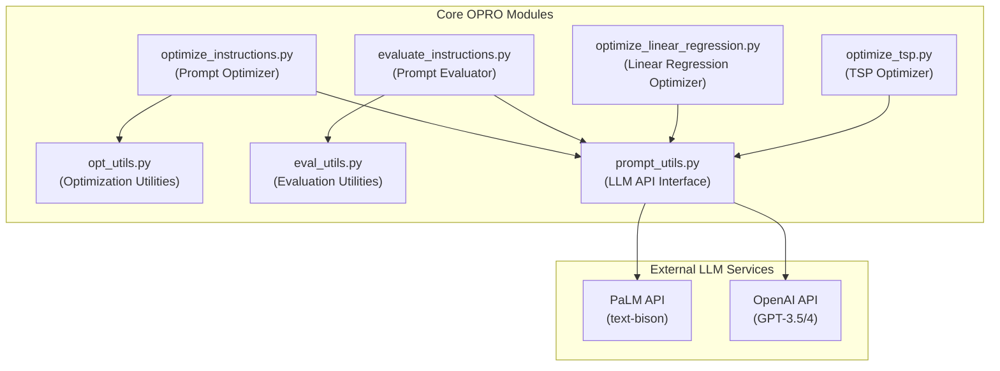

**System Components Diagram**

Sources: [README.md:27-51]()

## Optimization Workflow

The core workflow of OPRO involves an iterative process where an optimizer LLM generates candidate solutions that are evaluated and refined over multiple iterations.

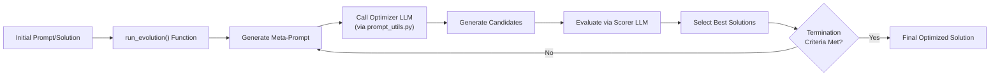

**OPRO Optimization Process**

Sources: [README.md:27-35]()

## Key Features and Capabilities

OPRO supports several types of optimization tasks:

| Optimization Task | Implementation File | Description |
|-------------------|---------------------|-------------|
| Prompt Optimization | `optimize_instructions.py` | Optimizes prompts/instructions for LLMs to improve performance on various tasks |
| Prompt Evaluation | `evaluate_instructions.py` | Evaluates prompt performance using different LLMs on benchmark datasets |
| Linear Regression | `optimize_linear_regression.py` | Uses LLMs to optimize parameters for linear regression models |
| Traveling Salesman Problem | `optimize_tsp.py` | Uses LLMs to find optimal routes for the traveling salesman problem |

Sources: [README.md:27-51]()

## Supported Models and Datasets

### LLM Support

OPRO currently supports two main LLM providers:

1. Google PaLM API (text-bison)
2. OpenAI API (GPT-3.5-turbo, GPT-4)

The system is designed to be extensible, allowing developers to add support for other models by implementing appropriate interfaces in the `prompt_utils.py` file.

### Benchmark Datasets

OPRO evaluates prompt performance on several benchmark datasets:

- GSM8K (Grade School Math problems)
- MMLU (Massive Multitask Language Understanding)
- BBH (Big-Bench Hard)
- MultiArith (Arithmetic word problems)
- AQuA (Algebraic Question Answering)

Sources: [README.md:54-56]()

## System Interactions

The following diagram illustrates how the different components of OPRO interact during the prompt optimization process:

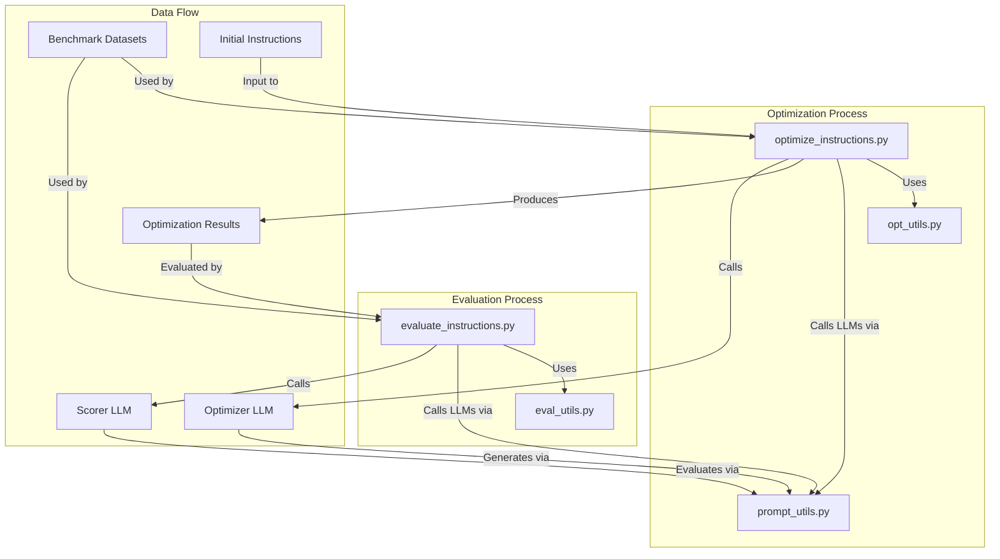

**OPRO Component Interactions**

Sources: [README.md:25-44]()

## Getting Started

To use OPRO, you need to install Python 3.10.13 or compatible and the following dependencies:
- absl-py (2.0.0)
- google.generativeai (0.1.0)
- immutabledict (3.0.0)
- openai (0.27.2)

Basic usage examples:

1. **Prompt Optimization:**
   ```
   python optimize_instructions.py --optimizer="gpt-3.5-turbo" --scorer="text-bison"
   --instruction_pos="Q_begin" --dataset="gsm8k" --task="train"
   ```

2. **Prompt Evaluation:**
   ```
   python evaluate_instructions.py --scorer="text-bison" --dataset="gsm8k" 
   --task="test" --instruction_pos="Q_begin" --evaluate_training_fold=false 
   --evaluate_test_fold=true
   ```

3. **Linear Regression and TSP Optimization:**
   Use `optimize_linear_regression.py` and `optimize_tsp.py` respectively.

**Note:** Using PaLM or OpenAI APIs may incur costs. It's recommended to start with smaller datasets or fewer optimization steps before scaling up.

Sources: [README.md:14-23](), [README.md:27-51](), [README.md:59-61]()

## Conclusion

OPRO represents a novel approach to optimization by leveraging the reasoning capabilities of Large Language Models. Instead of traditional optimization algorithms, OPRO uses one LLM to generate optimized solutions and another to evaluate them. This approach has shown promising results across different domains, from prompt engineering to solving classical optimization problems like linear regression and traveling salesman.

For more detailed information on specific components, refer to the dedicated sections in this wiki.

Sources: [README.md:1-7]()

---

# Page: Purpose and Methodology

# Purpose and Methodology

<details>
<summary>Relevant source files</summary>

The following files were used as context for generating this wiki page:

- [README.md](README.md)
- [img/gpt_meta_prompt.png](img/gpt_meta_prompt.png)
- [img/workflow.png](img/workflow.png)

</details>


This document explains the core concept of using Large Language Models (LLMs) as optimizers in the OPRO framework and details the methodology behind prompt optimization. For information about the key components that implement this methodology, see [Key Components](#1.2).

## Core Concept: LLMs as Optimizers

OPRO (Optimizing PROmpts) introduces a novel approach that leverages the reasoning capabilities of Large Language Models to perform optimization tasks. Rather than using traditional optimization algorithms, OPRO uses LLMs' ability to understand, reason about, and generate solutions for various problems.

In this framework, LLMs serve two distinct roles:
1. **Optimizer LLM**: Acts as the optimization algorithm, generating candidate solutions
2. **Scorer LLM**: Evaluates the quality of the generated solutions

This dual-role architecture enables an iterative optimization process where solutions are continuously improved based on feedback.

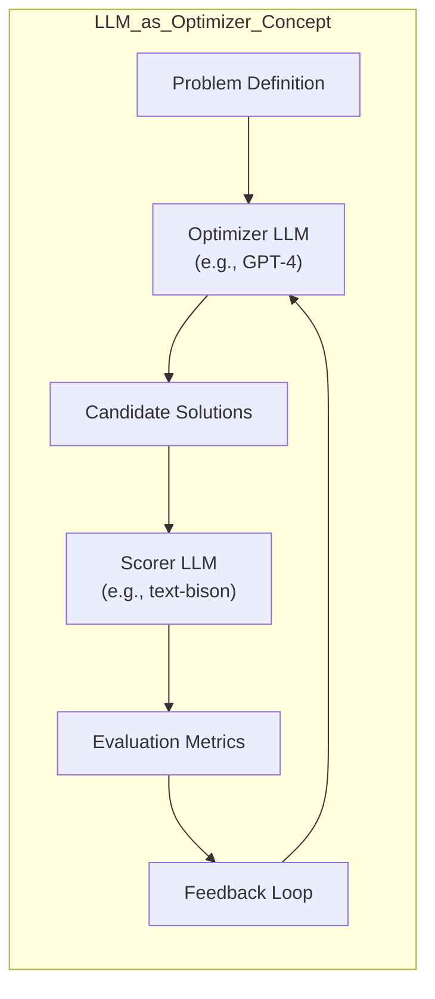

Sources: [README.md:5-7]()

## Optimization Methodology

The OPRO methodology follows an evolution-inspired approach where solutions (such as prompts) are iteratively refined through a structured feedback loop. The process begins with an initial solution and improves it over multiple iterations.

Key aspects of the methodology include:

1. **Meta-prompting**: Using a structured prompt to instruct the optimizer LLM on how to generate improved solutions
2. **Few-shot learning**: Providing examples of successful optimizations to guide the model
3. **Iterative refinement**: Continuously improving solutions based on evaluation results
4. **Domain flexibility**: Applying the same methodology to different optimization problems

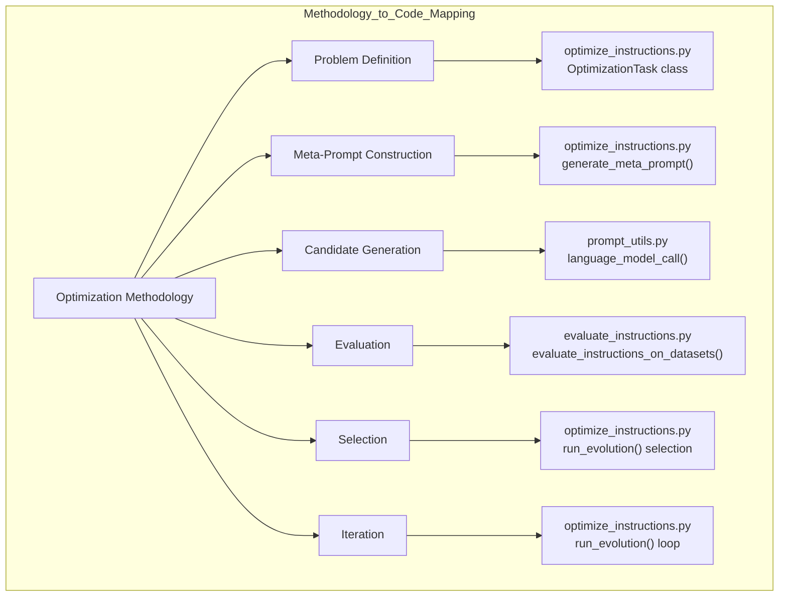

Sources: [README.md:27-35](), [README.md:37-44]()

## Meta-Prompt Structure

The meta-prompt is central to OPRO's methodology. It instructs the optimizer LLM on how to perform optimization tasks and contains several key components:

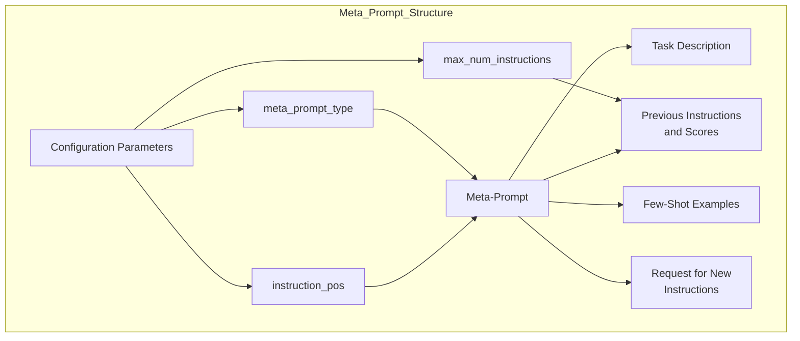

The meta-prompt construction is controlled by several key parameters:

| Parameter | Description | Impact |
|-----------|-------------|--------|
| `instruction_pos` | Position of instructions (e.g., beginning of query) | Determines how the optimized instructions are integrated with the task |
| `meta_prompt_type` | Type of meta-prompt used | Affects how the optimizer is guided |
| `max_num_instructions` | Maximum number of previous instructions to include | Controls how much history is provided to the optimizer |
| `few_shot_selection_criteria` | Criteria for selecting few-shot examples | Determines which examples are shown to the optimizer |

Sources: [README.md:32-34]()

## Optimization Workflow

The complete workflow in OPRO involves several stages from initializing the optimization to producing the final optimized solution:

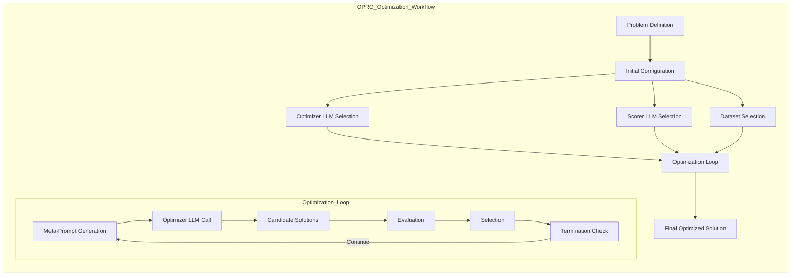

The workflow implementation in code follows these steps:
1. Define optimization parameters via command-line arguments
2. Initialize the optimizer and scorer LLMs
3. Load the appropriate dataset
4. Enter the optimization loop (`run_evolution()`)
5. Generate meta-prompts and candidate solutions
6. Evaluate candidates using the scorer LLM
7. Select the best-performing candidates
8. Repeat until termination criteria are met

Sources: [README.md:27-35]()

## Application Domains

While OPRO was primarily designed for prompt optimization, its methodology is domain-agnostic and can be applied to various optimization problems:

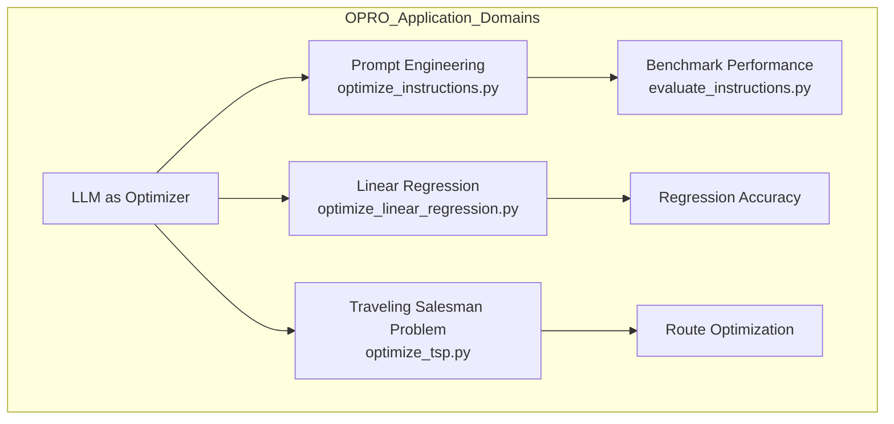

Each application domain follows the same core methodology but adapts it to the specific optimization task:

1. **Prompt Optimization**: Optimizes instructions for language models to improve their performance on specific tasks like GSM8K, MMLU, BBH, and other benchmarks
2. **Linear Regression**: Finds optimal coefficients for linear regression models
3. **Traveling Salesman Problem**: Discovers optimal routes for the classic TSP problem

Sources: [README.md:27-51]()

## Technical Implementation

At a technical level, OPRO implements its optimization methodology through a set of Python modules that handle different aspects of the process:

| Component | File | Purpose |
|-----------|------|---------|
| Instruction Optimization | optimize_instructions.py | Implements the optimization process for prompts/instructions |
| Instruction Evaluation | evaluate_instructions.py | Evaluates the performance of optimized instructions |
| Linear Regression Optimization | optimize_linear_regression.py | Applies the methodology to linear regression problems |
| TSP Optimization | optimize_tsp.py | Applies the methodology to traveling salesman problems |
| Prompt Utilities | prompt_utils.py | Handles interactions with LLM APIs |
| Optimization Utilities | opt_utils.py | Provides utility functions for the optimization process |
| Evaluation Utilities | eval_utils.py | Provides utility functions for the evaluation process |

The system is designed to be modular, allowing for:
- Support for different LLMs (currently text-bison and GPT models)
- Integration with various benchmarks and datasets
- Extension to new optimization problems beyond the examples provided

Sources: [README.md:27-51](), [README.md:55-56]()

---

# Page: Key Components

# Key Components

<details>
<summary>Relevant source files</summary>

The following files were used as context for generating this wiki page:

- [README.md](README.md)
- [opro/evaluation/evaluate_instructions.py](opro/evaluation/evaluate_instructions.py)
- [opro/optimization/optimize_instructions.py](opro/optimization/optimize_instructions.py)

</details>


This document provides an overview of the main components that make up the OPRO (Optimizing PROmpts) system. It describes the core modules, their functions, and how they interact to enable Language Models (LLMs) to serve as optimizers for prompt engineering and other optimization tasks. For specific details about the optimization methodology, see [Purpose and Methodology](#1.1), and for in-depth information about the optimization and evaluation systems, see [Optimization System](#2) and [Evaluation System](#3) respectively.

## System Architecture Overview

The OPRO system consists of two primary subsystems - the Optimization System and the Evaluation System - supported by utility modules that facilitate interaction with external LLM APIs.

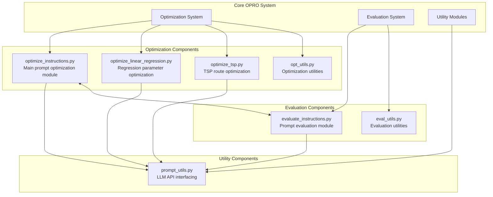

Sources: [README.md:25-51](), [opro/optimization/optimize_instructions.py:1-43](), [opro/evaluation/evaluate_instructions.py:1-39]()

## Core Components: Code Structure Mapping

The following diagram maps the conceptual components to the actual code files and their primary classes and functions:

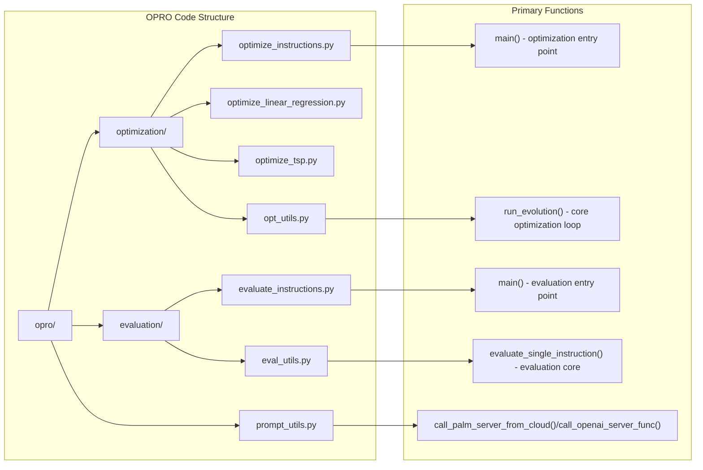

Sources: [README.md:25-51](), [opro/optimization/optimize_instructions.py:104-801](), [opro/evaluation/evaluate_instructions.py:98-766]()

## Optimization System

The Optimization System is responsible for using LLMs to generate improved prompts or solutions to optimization problems. It consists of the following key components:

1. **Instruction Optimizer (`optimize_instructions.py`)**: 
   - Main entry point for prompt optimization
   - Configures the optimization process (optimizer LLM, scorer LLM, datasets)
   - Manages the optimization loop through `run_evolution`
   - Generates meta-prompts that guide the optimizer LLM

2. **Domain-Specific Optimizers**:
   - **Linear Regression Optimizer (`optimize_linear_regression.py`)**: Optimizes regression parameters
   - **TSP Optimizer (`optimize_tsp.py`)**: Optimizes routes for the Traveling Salesman Problem

3. **Optimization Utilities (`opt_utils.py`)**:
   - Contains the `run_evolution` function that implements the core optimization loop
   - Handles meta-prompt generation and instruction evaluation
   - Provides data loading and preprocessing functions

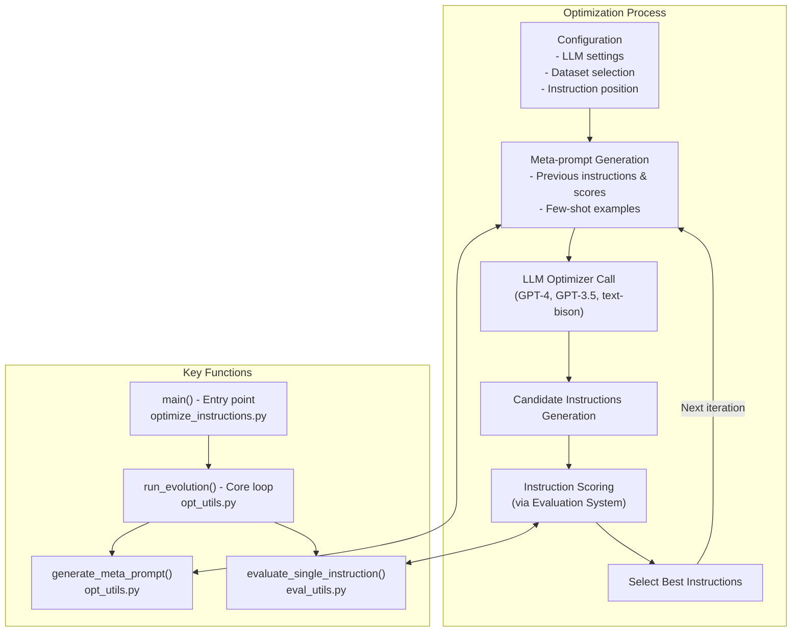

Sources: [opro/optimization/optimize_instructions.py:104-800](), [README.md:27-35]()

## Evaluation System

The Evaluation System assesses the performance of prompts/instructions using LLMs on various benchmark datasets. Its components include:

1. **Instruction Evaluator (`evaluate_instructions.py`)**:
   - Entry point for evaluating instructions
   - Configures the evaluation process (scorer LLM, datasets, metrics)
   - Evaluates instructions on various benchmarks
   - Outputs performance metrics and detailed results

2. **Evaluation Utilities (`eval_utils.py`)**:
   - Contains the `evaluate_single_instruction` function that implements the core evaluation logic
   - Handles prompt formatting and answer extraction
   - Calculates accuracy and other performance metrics
   - Provides dataset loading and processing functions

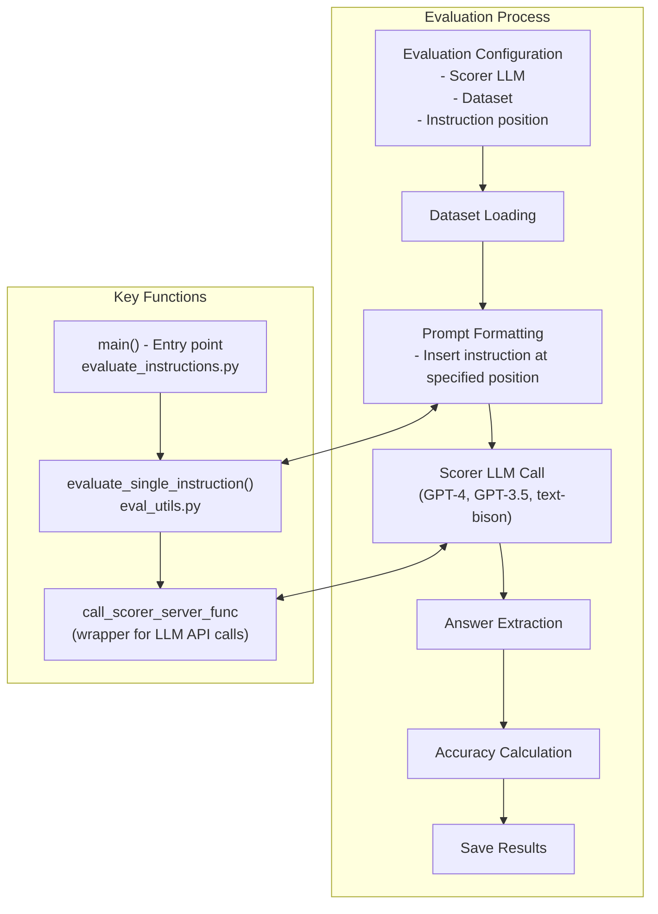

Sources: [opro/evaluation/evaluate_instructions.py:98-766](), [README.md:37-44]()

## Utility Components

The Utility Components provide common functionality used by both the Optimization and Evaluation systems:

1. **Prompt Utilities (`prompt_utils.py`)**:
   - Provides standardized interfaces to different LLM APIs (PaLM, OpenAI)
   - Implements retry logic and error handling for API calls
   - Contains prompt formatting and processing functions

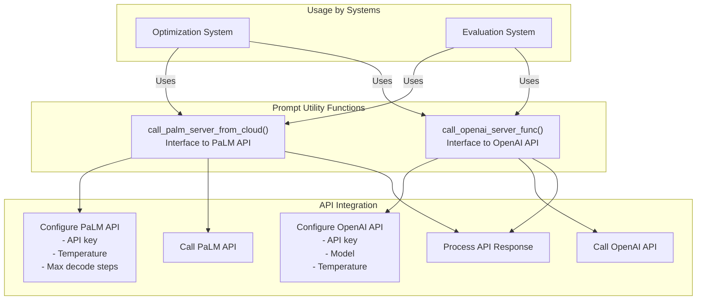

Sources: [opro/optimization/optimize_instructions.py:59-60](), [opro/evaluation/evaluate_instructions.py:57-59](), [README.md:54-56]()

## Data Flow in OPRO System

The following diagram illustrates how data flows through the OPRO system during a typical prompt optimization process:

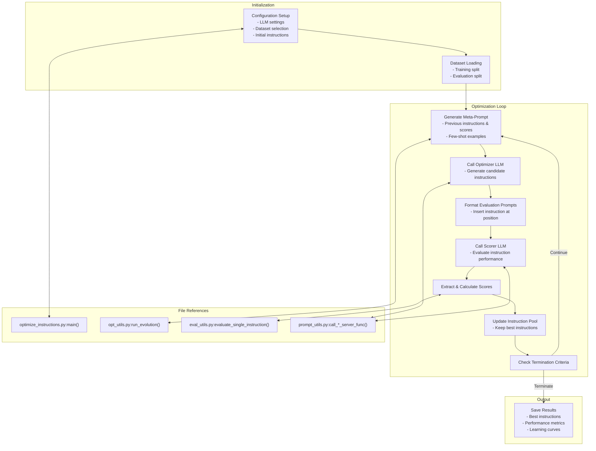

Sources: [opro/optimization/optimize_instructions.py:699-799](), [opro/evaluation/evaluate_instructions.py:681-742]()

## Benchmark Dataset Integration

OPRO supports several benchmark datasets for instruction optimization and evaluation:

| Dataset | Task Types | Used For | File Location |
|---------|------------|----------|--------------|
| GSM8K | Mathematical reasoning | Training & evaluation of problem-solving instructions | data/gsm_data/ |
| MMLU | Multiple choice Q&A across subjects | Training & evaluation of domain-specific instructions | data/MMLU-data/ |
| BBH (Big-Bench Hard) | Various reasoning tasks | Evaluation of reasoning capabilities | data/BIG-Bench-Hard-data/ |
| MultiArith | Arithmetic problems | Evaluation of math instructions | data/MultiArith.json |
| AQuA | Algebraic word problems | Evaluation of algebraic reasoning | data/AQuA-data/ |

The integration of these datasets is handled by various utility functions in the evaluation and optimization systems.

Sources: [opro/evaluation/evaluate_instructions.py:125-142](), [opro/optimization/optimize_instructions.py:113-118]()

## Meta-Prompt Structure

The meta-prompt is a critical component that guides the optimizer LLM in generating improved instructions. Its structure includes:

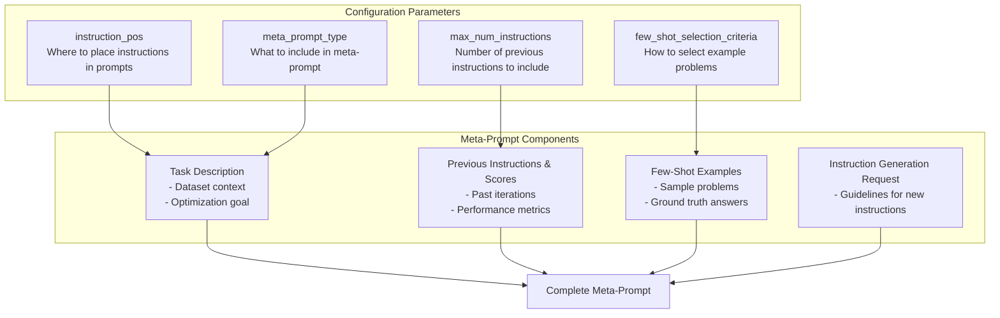

Sources: [opro/optimization/optimize_instructions.py:730-786]()

This overview of key components provides a foundation for understanding how the OPRO system functions. The subsequent sections in this wiki dive deeper into specific aspects of the system, including detailed explanations of the optimization and evaluation processes.

---

# Page: Optimization System

# Optimization System

<details>
<summary>Relevant source files</summary>

The following files were used as context for generating this wiki page:

- [opro/optimization/opt_utils.py](opro/optimization/opt_utils.py)
- [opro/optimization/optimize_instructions.py](opro/optimization/optimize_instructions.py)
- [opro/optimization/optimize_linear_regression.py](opro/optimization/optimize_linear_regression.py)
- [opro/optimization/optimize_tsp.py](opro/optimization/optimize_tsp.py)

</details>


The Optimization System is the core component of OPRO (Optimizing PROmpts) that enables using Language Models (LLMs) as optimizers. This system provides mechanisms for both prompt optimization and domain-specific optimization tasks like linear regression and traveling salesman problems. The system leverages LLMs' ability to generate and refine solutions through iterative improvements guided by a fitness function.

For a general overview of OPRO, see [Overview](#1). For details on evaluating optimization results, see [Evaluation System](#3).

## System Architecture

The Optimization System consists of several interrelated components that work together to improve solutions iteratively. The primary components include an optimizer LLM, a scorer LLM (for prompt optimization), meta-prompt templates, and utility functions for running the optimization process.

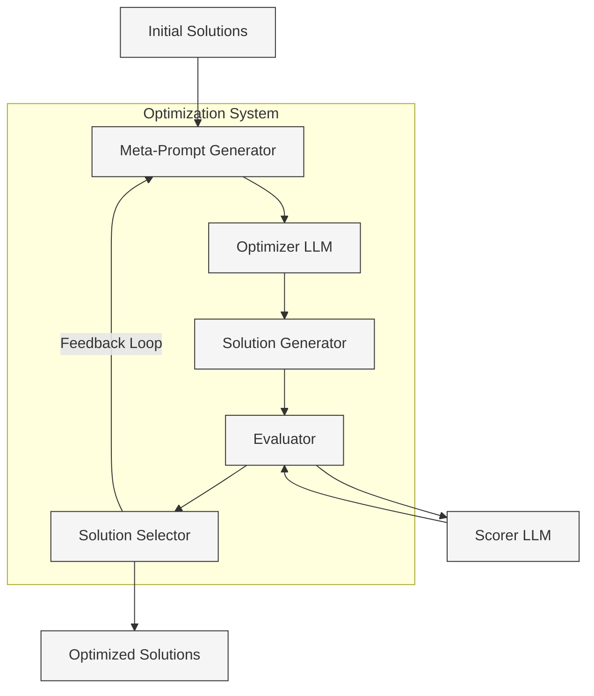

Sources: [opro/optimization/optimize_instructions.py:103-104](), [opro/optimization/opt_utils.py:338-343]()

## Optimization Process

The optimization process follows a general pattern across all optimization types:

1. **Initialize Solutions**: Start with initial solutions (instructions, parameters, routes)
2. **Generate Meta-Prompt**: Create a prompt that includes previous solutions and their scores
3. **Generate New Solutions**: Use the optimizer LLM to propose new solutions
4. **Evaluate Solutions**: Assess the quality of new solutions
5. **Update Solution Set**: Keep the best solutions for the next iteration
6. **Repeat**: Continue the process until termination criteria are met

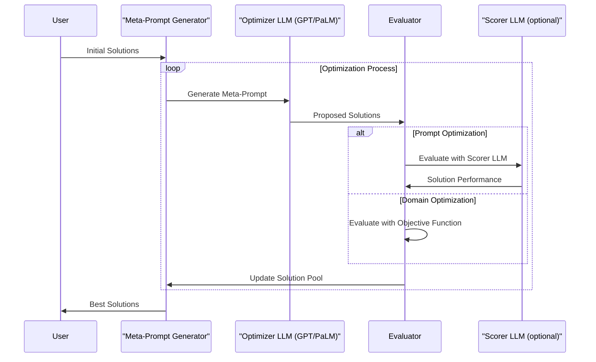

Sources: [opro/optimization/opt_utils.py:338-800](), [opro/optimization/optimize_instructions.py:104-799]()

## Meta-Prompt Structure

The meta-prompt is a crucial component that guides the optimizer LLM in generating improved solutions. It typically contains:

1. **Task Description**: Explanation of the optimization task
2. **Previous Solutions**: List of previously generated solutions with scores
3. **Few-Shot Examples**: Example problems (for prompt optimization)
4. **Instructions**: Direction for generating new solutions

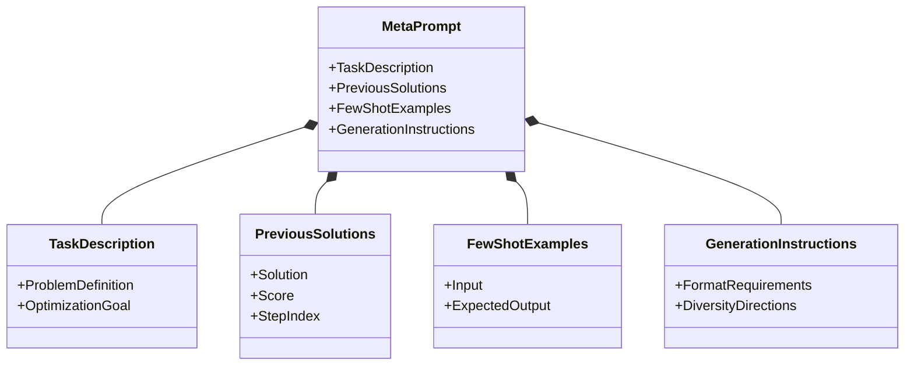

Sources: [opro/optimization/opt_utils.py:90-106](), [opro/optimization/opt_utils.py:173-186](), [opro/optimization/optimize_tsp.py:254-291]()

## Optimization Types

The system supports different types of optimization problems, each with specialized implementations:

### Instruction Optimization

Instruction optimization improves prompts for language models to enhance their performance on specific tasks. This process involves:

1. Generating candidate instructions using an optimizer LLM
2. Evaluating the instructions with a scorer LLM on a dataset
3. Collecting the best instructions for the next iteration

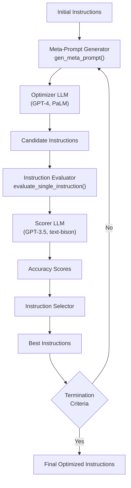

Sources: [opro/optimization/optimize_instructions.py:104-799](), [opro/optimization/opt_utils.py:338-1035]()

### Linear Regression Optimization

Linear regression optimization uses LLMs to find optimal parameters (w, b) that minimize the residual sum of squares:

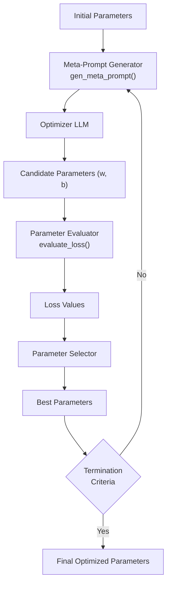

Sources: [opro/optimization/optimize_linear_regression.py:169-424]()

### Traveling Salesman Problem Optimization

TSP optimization uses LLMs to find optimal routes that minimize the total travel distance:

```mermaid
flowchart TD
    A["Initial Routes"] --> B["Meta-Prompt Generator<br>gen_meta_prompt()"]
    B --> C["Optimizer LLM"]
    C --> D["Candidate Routes"]
    D --> E["Route Evaluator<br>evaluate_distance()"]
    E --> F["Distance Values"]
    F --> G["Route Selector"]
    G --> H["Best Routes"]
    H --> I{"Termination<br>Criteria"}
    I -->|"No"| B
    I -->|"Yes"| J["Final Optimized Route"]
```

Sources: [opro/optimization/optimize_tsp.py:172-425]()

## Core Components

### Optimizer Module

The optimizer module is responsible for generating improved solutions based on previous attempts:

```mermaid
classDiagram
    class OptimizerModule {
        +optimizer_llm_name
        +optimizer_llm_dict
        +call_optimizer_server_func()
        +optimizer_llm_temperature
    }
    
    class LLMType {
        +GPT-3.5-turbo
        +GPT-4
        +text-bison
    }
    
    class Temperature {
        +initial_value
        +temperature_schedule
        +temperature_end
    }
    
    OptimizerModule --> LLMType
    OptimizerModule --> Temperature
```

Sources: [opro/optimization/optimize_instructions.py:108-153](), [opro/optimization/optimize_instructions.py:300-353](), [opro/optimization/optimize_linear_regression.py:109-156](), [opro/optimization/optimize_tsp.py:109-156]()

### Scorer Module (for Prompt Optimization)

The scorer module evaluates the quality of generated instructions:

```mermaid
classDiagram
    class ScorerModule {
        +scorer_llm_name
        +scorer_llm_dict
        +call_scorer_server_func()
    }
    
    class LLMType {
        +GPT-3.5-turbo
        +GPT-4
        +text-bison
    }
    
    class EvaluationParams {
        +batch_size
        +num_servers
        +temperature
        +max_decode_steps
    }
    
    ScorerModule --> LLMType
    ScorerModule --> EvaluationParams
```

Sources: [opro/optimization/optimize_instructions.py:246-299]()

### Utility Functions

The system includes various utility functions for optimization:

| Function | Purpose | File Path |
|---------|---------|-----------|
| `gen_meta_prompt()` | Generates meta-prompts for optimization | [opro/optimization/opt_utils.py:90-336]() |
| `run_evolution()` | Runs the evolutionary optimization process | [opro/optimization/opt_utils.py:338-1035]() |
| `evaluate_single_instruction()` | Evaluates the performance of a single instruction | [opro/evaluation/eval_utils.py]() |
| `evaluate_loss()` | Calculates loss for linear regression | [opro/optimization/optimize_linear_regression.py:169-171]() |
| `evaluate_distance()` | Calculates distance for TSP | [opro/optimization/optimize_tsp.py:172-185]() |
| `extract_string_in_square_brackets()` | Extracts solutions from LLM outputs | [opro/optimization/opt_utils.py:33-38]() |
| `parse_tag_content()` | Parses tagged content from LLM outputs | [opro/optimization/opt_utils.py:41-44]() |

Sources: [opro/optimization/opt_utils.py:33-1035](), [opro/optimization/optimize_linear_regression.py:169-248](), [opro/optimization/optimize_tsp.py:172-302]()

## Configuration Options

The optimization system offers various configuration options:

### Shared Configuration Parameters

| Parameter | Description | Default |
|-----------|-------------|---------|
| `optimizer` | The LLM used for optimization (text-bison, gpt-3.5-turbo, gpt-4) | gpt-3.5-turbo |
| `temperature` | Temperature for LLM sampling | 1.0 |
| `max_decode_steps` | Maximum number of tokens in LLM response | 1024 |
| `num_steps` | Maximum number of optimization steps | Varies |
| `max_num_pairs` | Maximum number of previous solutions in meta-prompt | 20 |

### Instruction Optimization Parameters

| Parameter | Description | Default |
|-----------|-------------|---------|
| `scorer` | The LLM used for scoring instructions | text-bison |
| `dataset` | Dataset to optimize instructions for (gsm8k, mmlu, bbh) | gsm8k |
| `task` | Specific task within the dataset | train |
| `instruction_pos` | Position of the instruction (A_begin, Q_begin, Q_end, before_Q) | A_begin |
| `meta_prompt_type` | Type of meta-prompt (both_instructions_and_exemplars, instructions_only) | both_instructions_and_exemplars |
| `train_ratio` | Proportion of data used for training | 0.8 for MMLU, 0.035 for GSM8K, 0.2 for BBH |
| `few_shot_selection_criteria` | How to select few-shot examples | random |

Sources: [opro/optimization/optimize_instructions.py:55-101](), [opro/optimization/optimize_linear_regression.py:49-57](), [opro/optimization/optimize_tsp.py:52-64]()

## Usage Examples

### Command-line Example for Instruction Optimization

```bash
python optimize_instructions.py \
    --optimizer="gpt-3.5-turbo" --scorer="text-bison" \
    --instruction_pos="A_begin" --dataset="gsm8k" --task="train" \
    --palm_api_key="<your_key>" --openai_api_key="<your_key>"
```

### Command-line Example for Linear Regression Optimization

```bash
python optimize_linear_regression.py \
    --optimizer="text-bison" \
    --palm_api_key="<your_key>"
```

### Command-line Example for TSP Optimization

```bash
python optimize_tsp.py \
    --optimizer="gpt-4" \
    --openai_api_key="<your_key>" \
    --starting_algorithm="farthest_insertion"
```

Sources: [opro/optimization/optimize_instructions.py:14-42](), [opro/optimization/optimize_linear_regression.py:14-27](), [opro/optimization/optimize_tsp.py:14-27]()

## Code Map

This diagram maps the main function calls and data flow in the optimization system:

```mermaid
graph TD
    subgraph "optimize_instructions.py"
        A["main()"] --> B["run_evolution()"]
        B --> C["gen_meta_prompt()"]
        C --> D["call_optimizer_server_func()"]
        D --> E["evaluate_single_instruction()"]
    end
    
    subgraph "optimize_linear_regression.py"
        F["main()"] --> G["gen_meta_prompt()"]
        G --> H["call_optimizer_server_func()"]
        H --> I["extract_string_in_square_brackets()"]
        I --> J["evaluate_loss()"]
    end
    
    subgraph "optimize_tsp.py"
        K["main()"] --> L["gen_meta_prompt()"]
        L --> M["call_optimizer_server_func()"]
        M --> N["extract_string()"]
        N --> O["evaluate_distance()"]
    end
    
    subgraph "opt_utils.py"
        P["run_evolution()"] --> Q["gen_meta_prompt()"] 
        Q --> R["gen_ins_and_score_pairs_substr()"]
        P --> S["evaluate_single_instruction()"]
    end
```

Sources: [opro/optimization/optimize_instructions.py:104-799](), [opro/optimization/optimize_linear_regression.py:60-423](), [opro/optimization/optimize_tsp.py:60-429](), [opro/optimization/opt_utils.py:338-1035]()

## Key Takeaways

1. **LLMs as Optimizers**: The system uses LLMs not just for language tasks but as general optimizers that can improve solutions through iterative refinement.

2. **Meta-Prompt Design**: The meta-prompt structure is crucial for effective optimization, providing the LLM with context about previous solutions and their performance.

3. **Versatility**: The same fundamental approach works for diverse optimization problems, from prompt engineering to mathematical optimization and combinatorial optimization.

4. **Evaluation Integration**: The system integrates tightly with the evaluation module to assess solution quality and guide the optimization process.

5. **Configurability**: The system offers extensive configuration options to adapt to different optimization scenarios and requirements.

---

# Page: Instruction Optimization

# Instruction Optimization

<details>
<summary>Relevant source files</summary>

The following files were used as context for generating this wiki page:

- [img/gpt_meta_prompt.png](img/gpt_meta_prompt.png)
- [img/workflow.png](img/workflow.png)
- [opro/optimization/opt_utils.py](opro/optimization/opt_utils.py)
- [opro/optimization/optimize_instructions.py](opro/optimization/optimize_instructions.py)

</details>


## Purpose and Scope

This document provides a detailed technical overview of the instruction optimization system within OPRO. The system is designed to automatically discover and refine effective instructions (prompts) that improve language model performance on specific tasks. Instruction optimization serves as a core functionality of OPRO, enabling the systematic search for optimal prompts through an evolutionary approach using language models themselves as optimizers.

For information about other types of optimization supported by OPRO, such as linear regression optimization or traveling salesman problem optimization, see [Domain-specific Optimization](#2.2).

Sources: [opro/optimization/optimize_instructions.py:14-42]()

## System Overview

Instruction optimization in OPRO follows an evolutionary process where language models are used to both generate candidate instructions and evaluate their effectiveness. The system iteratively refines instructions through a feedback loop, measuring performance improvements to guide the optimization process.

```mermaid
flowchart TD
    subgraph "Instruction Optimization Workflow"
        A["Initial Instructions"] --> B["Evaluate Instructions"]
        B --> C["Generate Meta-prompt"]
        C --> D["Generate New Instructions\n(Optimizer LLM)"]
        D --> E["Evaluate New Instructions\n(Scorer LLM)"]
        E --> F["Select Best Instructions"]
        F --> G{"Termination Criteria Met?"}
        G -->|"No"| C
        G -->|"Yes"| H["Final Optimized Instructions"]
    end
```

Sources: [opro/optimization/optimize_instructions.py:104-116](), [opro/optimization/opt_utils.py:338-344]()

## Key Components

The instruction optimization system consists of several key components that work together to discover effective instructions:

```mermaid
graph TD
    subgraph "Instruction Optimization Components"
        OI["optimize_instructions.py\nMain entry point"] --> OU["opt_utils.py\nOptimization utilities"]
        OU --> RUN["run_evolution()\nCore optimization loop"]
        OU --> META["gen_meta_prompt()\nMeta-prompt generation"]
        OU --> EVAL["evaluate_single_instruction()\nInstruction evaluation"]
        
        RUN --> META
        RUN --> EVAL
        
        OPT["Optimizer LLM\n(e.g., GPT-4, text-bison)"] --> RUN
        SCO["Scorer LLM\n(e.g., text-bison, GPT-3.5)"] --> RUN
        
        DATA["Dataset\n(e.g., GSM8K, MMLU, BBH)"] --> EVAL
    end
```

Sources: [opro/optimization/optimize_instructions.py:59-68](), [opro/optimization/opt_utils.py:32-45]()

### Main Optimization Loop

The core of instruction optimization is implemented in `run_evolution()`, which orchestrates the iterative process of instruction generation, evaluation, and selection:

1. Evaluation of initial instructions
2. Iterative generation of new instructions using the optimizer LLM
3. Evaluation of new instructions using the scorer LLM
4. Selection of best instructions based on performance
5. Periodic evaluation on validation set to measure generalization

Sources: [opro/optimization/opt_utils.py:338-401](), [opro/optimization/opt_utils.py:798-799]()

### Meta-Prompt Generation

Meta-prompts guide the optimizer LLM in generating effective instructions. Two main types are supported:

1. **Both Instructions and Exemplars**: Includes previous instructions with their scores and dataset examples (suitable for fine-tuned optimizers)
2. **Instructions Only**: Includes only previous instructions and their scores (suitable for pre-trained optimizers)

The meta-prompt structure varies based on the optimizer LLM, instruction position, and whether few-shot examples are included.

```mermaid
graph TD
    subgraph "Meta-Prompt Structure"
        A["gen_meta_prompt()"] --> B["Previous Instructions\nwith Scores"]
        A --> C["Few-shot Examples\n(Optional)"]
        A --> D["Request for New Instructions"]
        
        B --> E["Instruction Position\n(before_Q, Q_begin, Q_end, A_begin)"]
        C --> F["Few-shot Selection Criteria\n(random, accumulative_most_frequent, etc.)"]
        D --> G["Optimizer-specific Formatting"]
    end
```

Sources: [opro/optimization/opt_utils.py:90-153](), [opro/optimization/opt_utils.py:684-724]()

### Instruction Evaluation

Generated instructions are evaluated on the training set using the scorer LLM. The evaluation process:

1. Combines instructions with examples from the dataset based on the instruction position
2. Sends the prompts to the scorer LLM
3. Parses responses and computes accuracy scores
4. Saves detailed evaluation results

Periodically, instructions are also evaluated on a validation set to measure generalization performance.

Sources: [opro/optimization/opt_utils.py:905-935](), [opro/optimization/opt_utils.py:980-1009]()

## Instruction Positions

The system supports four different positions for placing instructions in prompts:

```mermaid
graph TD
    subgraph "Instruction Position Options"
        A["Instruction Positions"] --> B["before_Q\n(Before the question)"]
        A --> C["Q_begin\n(At the beginning of the question)"]
        A --> D["Q_end\n(At the end of the question)"]
        A --> E["A_begin\n(At the beginning of the answer)"]
        
        subgraph "Example Format"
            F["before_Q: <INS>Instruction</INS>\nQ: Question\nA:"]
            G["Q_begin: Q: <INS>Instruction</INS>\nQuestion\nA:"]
            H["Q_end: Q: Question\n<INS>Instruction</INS>\nA:"]
            I["A_begin: Q: Question\nA: <INS>Instruction</INS>"]
        end
    end
```

Sources: [opro/optimization/opt_utils.py:140-148](), [opro/optimization/optimize_instructions.py:174-184]()

## Configuration Parameters

The instruction optimization system offers extensive configuration options to control the optimization process.

### LLM Configuration

Two language models are used in the optimization process:
1. **Scorer LLM**: Evaluates the effectiveness of instructions
2. **Optimizer LLM**: Generates new instruction candidates

Both can be configured with parameters such as temperature, maximum decoding steps, and batch size.

| Parameter | Description | Typical Values |
|-----------|-------------|----------------|
| scorer_llm_name | Name of the LLM used for evaluation | text-bison, gpt-3.5-turbo, gpt-4 |
| optimizer_llm_name | Name of the LLM used for generation | text-bison, gpt-3.5-turbo, gpt-4 |
| temperature | Randomness in generation | 0.0 (evaluation), 1.0 (generation) |
| max_decode_steps | Maximum output length | 512-1024 tokens |

Sources: [opro/optimization/optimize_instructions.py:246-298](), [opro/optimization/optimize_instructions.py:301-353]()

### Optimization Parameters

Parameters that control the evolutionary optimization process:

| Parameter | Description | Default Value |
|-----------|-------------|---------------|
| num_search_steps | Number of optimization iterations | 200 |
| num_generated_instructions_in_each_step | Instructions to generate per step | 8 |
| old_instruction_score_threshold | Minimum score to keep instructions | 0.0-0.3 |
| max_num_instructions | Maximum instructions in meta-prompt | 20 |
| meta_prompt_type | Type of meta-prompt to use | both_instructions_and_exemplars |
| few_shot_selection_criteria | How to select few-shot examples | random |
| eval_interval | Steps between validation evaluations | 3 |

Sources: [opro/optimization/optimize_instructions.py:681-736](), [opro/optimization/opt_utils.py:710-724]()

## Datasets and Task Support

The system supports optimization for multiple benchmark datasets:

1. **GSM8K**: Grade school math problems
2. **MMLU**: Massive Multitask Language Understanding benchmark with multiple categories
3. **BBH**: BIG-Bench Hard tasks

Each dataset has specific configurations and processing requirements. The system appropriately handles different task types:
- Multiple-choice tasks
- Boolean tasks (yes/no, true/false)
- Numerical output tasks

Sources: [opro/optimization/optimize_instructions.py:113-157](), [opro/optimization/opt_utils.py:404-408]()

## Usage Example

Instruction optimization can be initiated using the command-line interface provided by `optimize_instructions.py`:

```
python optimize_instructions.py \
    --optimizer="gpt-3.5-turbo" --scorer="text-bison" \
    --instruction_pos="A_begin" --dataset="gsm8k" --task="train"
```

The process requires:
1. API keys for the selected LLMs
2. Initial instructions defined in the script
3. Dataset selection
4. Configuration of optimization parameters

Sources: [opro/optimization/optimize_instructions.py:14-42]()

## Data Flow During Optimization

The following diagram illustrates the detailed data flow during the instruction optimization process:

```mermaid
sequenceDiagram
    participant Config as "Configuration"
    participant Optimizer as "run_evolution()"
    participant MetaPrompt as "gen_meta_prompt()"
    participant OptimizerLLM as "Optimizer LLM"
    participant ScorerLLM as "Scorer LLM"
    participant Storage as "Results Storage"
    
    Config->>Optimizer: Initialize parameters
    Optimizer->>ScorerLLM: Evaluate initial instructions
    
    loop For each search step
        Optimizer->>MetaPrompt: Generate meta-prompt
        MetaPrompt-->>Optimizer: Meta-prompt with previous instructions
        Optimizer->>OptimizerLLM: Send meta-prompt
        OptimizerLLM-->>Optimizer: Generated instruction candidates
        Optimizer->>ScorerLLM: Evaluate new instructions
        ScorerLLM-->>Optimizer: Accuracy scores
        Optimizer->>Storage: Save results
        
        alt Every eval_interval steps
            Optimizer->>ScorerLLM: Evaluate on validation set
            ScorerLLM-->>Optimizer: Validation scores
            Optimizer->>Storage: Save validation results
        end
    end
```

Sources: [opro/optimization/opt_utils.py:338-1036]()

## Output and Results

The optimization process generates several outputs:

1. **Optimized Instructions**: The best-performing instructions discovered
2. **Performance Metrics**: Accuracy scores on training and validation sets
3. **Detailed Evaluation Results**: Per-example performance data
4. **Meta-Prompts**: The prompts used to generate new instructions
5. **Optimization Trace**: The history of instructions and scores throughout the process

Results are saved to the specified output directory, with detailed evaluation results for each instruction.

Sources: [opro/optimization/optimize_instructions.py:221-237](), [opro/optimization/opt_utils.py:1012-1035]()

## Implementation Details

### Few-Shot Example Selection

The system supports several strategies for selecting few-shot examples to include in meta-prompts:

1. **accumulative_most_frequent**: Selects examples that were most frequently answered incorrectly across all previous instructions
2. **current_most_frequent**: Selects examples that are most frequently answered incorrectly by the current set of instructions
3. **random**: Randomly selects examples from the training set
4. **constant**: Uses the same examples across all iterations

Sources: [opro/optimization/opt_utils.py:587-688]()

### Instruction Processing

Generated instructions undergo preprocessing to:
1. Extract instructions from LLM outputs based on formatting markers
2. Remove duplicates and previously evaluated instructions
3. Filter out invalid instructions (too long, containing numbers for certain tasks, etc.)

Sources: [opro/optimization/opt_utils.py:732-824]()

## Related Components

For more details on specific aspects of the OPRO system, refer to:

- [Evaluation System](#3) for details on how instructions are evaluated
- [Meta-prompt Design](#6) for more information on meta-prompt structure and design
- [Domain-specific Optimization](#2.2) for other optimization capabilities in OPRO

---

# Page: Domain-specific Optimization

# Domain-specific Optimization

<details>
<summary>Relevant source files</summary>

The following files were used as context for generating this wiki page:

- [opro/optimization/optimize_linear_regression.py](opro/optimization/optimize_linear_regression.py)
- [opro/optimization/optimize_tsp.py](opro/optimization/optimize_tsp.py)

</details>


This document describes how the OPRO (Optimizing PROmpts) framework extends beyond prompt optimization to solve problems in specific domains through the use of Large Language Models (LLMs) as optimizers. While [Instruction Optimization](#2.1) focuses on improving prompts for LLMs, domain-specific optimization demonstrates how the same methodology can be applied to traditional optimization problems from other fields.

## Overview of Domain-specific Optimization

OPRO's domain-specific optimization modules implement a general framework where LLMs are used to iteratively improve solutions to optimization problems. The system currently supports two example domains:

1. Linear Regression - Finding optimal parameters for linear models
2. Traveling Salesman Problem (TSP) - Finding optimal routes that visit all points

Both implementations follow a similar pattern: using meta-prompts to communicate problem context and previous solutions to an LLM, which then generates improved solution candidates.

```mermaid
flowchart TD
    A["Problem Definition"] --> B["Meta-prompt Generation\n(gen_meta_prompt)"]
    B --> C["LLM Optimizer\n(call_optimizer_server_func)"]
    C --> D["Solution Candidates\n(parse_output/extract_string)"]
    D --> E["Evaluation Function\n(evaluate_loss/evaluate_distance)"]
    E --> F["Best Solution Selection"]
    F --> G{"Termination\nCriteria Met?"}
    G -->|No| B
    G -->|Yes| H["Final Optimized Solution"]
```

**General Domain-specific Optimization Process**

Sources: [opro/optimization/optimize_linear_regression.py:160-166](), [opro/optimization/optimize_tsp.py:160-166](), [opro/optimization/optimize_linear_regression.py:341-407](), [opro/optimization/optimize_tsp.py:374-425]()

## Linear Regression Optimization

The linear regression optimization module demonstrates how LLMs can be used to find optimal parameters for a linear model of the form y = wx + b, where the goal is to minimize the sum of squared residuals.

### Configuration and Implementation

The linear regression optimizer accepts several configuration parameters:

| Parameter | Description | Default |
|-----------|-------------|---------|
| num_points | Number of data points in regression problem | 50 |
| w_true, b_true | True parameter values (for evaluation) | 15, 14 |
| max_num_steps | Maximum optimization iterations | 500 |
| num_reps | Number of repeated runs | 5 |
| max_num_pairs | Maximum examples in meta-prompt | 20 |
| num_input_decimals | Decimal precision for input parameters | 0 |
| num_output_decimals | Decimal precision for output values | 0 |
| num_generated_points_in_each_step | Number of candidates per step | 8 |

Sources: [opro/optimization/optimize_linear_regression.py:61-70]()

### Optimization Process

```mermaid
flowchart TD
    A["Linear Regression Problem"] --> B["Generate Initial (w,b) Pairs"]
    B --> C["Compute Loss Function\n(evaluate_loss)"]
    C --> D["Create Meta-prompt\n(gen_meta_prompt)"]
    D --> E["LLM Optimizer\n(call_optimizer_server_func)"]
    E --> F["Parse (w,b) Candidates\n(parse_output)"]
    F --> G["Evaluate Loss\n(evaluate_loss)"]
    G --> H{"Better\nSolution?"}
    H -->|Yes| I["Update Best Solution Set"]
    I --> J{"Termination?"}
    J -->|No| D
    J -->|Yes| K["Final (w,b) Parameters"]
    H -->|No| J
```

**Linear Regression Optimization Workflow**

Sources: [opro/optimization/optimize_linear_regression.py:170-172](), [opro/optimization/optimize_linear_regression.py:173-237](), [opro/optimization/optimize_linear_regression.py:276-410]()

### Meta-prompt Structure

The linear regression meta-prompt includes:

1. Task description: Minimizing a function with two input variables (w, b)
2. Previous (w, b) pairs and their function values in descending order
3. Request for a new (w, b) pair with lower function value

Example meta-prompt format:
```
Now you will help me minimize a function with two input variables w, b. I have some (w, b) pairs and the function values at those points. The pairs are arranged in descending order based on their function values, where lower values are better.

input:
w=10, b=15
value:
2500

input:
w=12, b=14
value:
1800

...

Give me a new (w, b) pair that is different from all pairs above, and has a function value lower than any of the above. Do not write code. The output must end with a pair [w, b], where w and b are numerical values.
```

Sources: [opro/optimization/optimize_linear_regression.py:173-237]()

## Traveling Salesman Problem Optimization

The TSP optimization module demonstrates how LLMs can be used to find the shortest possible route that visits all points exactly once and returns to the origin point.

### Configuration and Implementation

The TSP optimizer accepts several configuration parameters:

| Parameter | Description | Default |
|-----------|-------------|---------|
| num_points | Number of points/cities in the TSP | 100 |
| num_steps | Maximum optimization iterations | 500 |
| max_num_pairs | Maximum examples in meta-prompt | 10 |
| num_decimals | Decimal precision for distances | 0 |
| num_starting_points | Number of initial routes | 5 |
| num_decode_per_step | Number of candidates per step | 8 |
| starting_algorithm | Algorithm to generate initial solutions | farthest_insertion |

Sources: [opro/optimization/optimize_tsp.py:67-74](), [opro/optimization/optimize_tsp.py:63-64]()

### Optimization Process

```mermaid
flowchart TD
    A["TSP Problem\n(Point Coordinates)"] --> B["Generate Initial Routes\n(solve_tsp)"]
    B --> C["Calculate Route Distances\n(evaluate_distance)"]
    C --> D["Create Meta-prompt\n(gen_meta_prompt)"]
    D --> E["LLM Optimizer\n(call_optimizer_server_func)"]
    E --> F["Parse Route Candidates\n(extract_string)"]
    F --> G["Evaluate Distances\n(evaluate_distance)"]
    G --> H{"Better\nSolution?"}
    H -->|Yes| I["Update Best Solution Set"]
    I --> J{"Termination?"}
    J -->|No| D
    J -->|Yes| K["Final Optimized Route"]
    H -->|No| J
```

**TSP Optimization Workflow**

Sources: [opro/optimization/optimize_tsp.py:172-185](), [opro/optimization/optimize_tsp.py:254-291](), [opro/optimization/optimize_tsp.py:374-425]()

### Meta-prompt Structure

The TSP meta-prompt includes:

1. Coordinates of all points
2. Previous routes and their total distances in descending order
3. Request for a new route with shorter distance

Example meta-prompt format:
```
You are given a list of points with coordinates below:
(0): (45, 23), (1): (-12, 85), (2): (67, -34), ...

Below are some previous traces and their lengths. The traces are arranged in descending order based on their lengths, where lower values are better.

<trace> 0,4,7,2,9,5,1,8,3,6 </trace>
length:
1250

<trace> 0,3,6,9,5,1,8,4,2,7 </trace>
length:
1180

...

Give me a new trace that is different from all traces above, and has a length lower than any of the above. The trace should traverse all points exactly once. The trace should start with '<trace>' and end with </trace>.
```

Sources: [opro/optimization/optimize_tsp.py:254-291]()

## Common Components and Integration

Both domain-specific optimization examples share several key components:

```mermaid
graph TD
    A["OPRO Domain-specific Optimization"] --> B["Linear Regression\n(optimize_linear_regression.py)"]
    A --> C["TSP\n(optimize_tsp.py)"]
    
    B --> D["Meta-prompt Generation"]
    B --> E["Solution Evaluation"]
    B --> F["Output Parsing"]
    
    C --> G["Meta-prompt Generation"]
    C --> H["Solution Evaluation"]
    C --> I["Output Parsing"]
    
    J["LLM Integration"] --> K["OpenAI API\n(call_openai_server_func)"]
    J --> L["PaLM API\n(call_palm_server_from_cloud)"]
    
    B --> J
    C --> J
```

**Component Relationships in Domain-specific Optimization**

Sources: [opro/optimization/optimize_linear_regression.py:82-143](), [opro/optimization/optimize_tsp.py:82-143]()

### LLM Integration

Both optimization modules support multiple LLM providers:

1. **OpenAI models**: GPT-3.5-turbo and GPT-4
2. **Google PaLM models**: text-bison

Configuration parameters for the LLMs include:
- Temperature (controlling randomness)
- Maximum decode steps (limiting response length)
- Batch size (for processing multiple solutions)

Sources: [opro/optimization/optimize_linear_regression.py:108-156](), [opro/optimization/optimize_tsp.py:108-156]()

### Shared Patterns

Both domain-specific optimization examples illustrate key patterns:

1. **Meta-prompt Evolution**: Meta-prompts incorporate better solutions as they are found
2. **Solution History Management**: Tracking all tried solutions and their scores
3. **Iterative Refinement**: Using the same LLM repeatedly with updated context
4. **Evaluation Functions**: Domain-specific functions to calculate objective values

Sources: [opro/optimization/optimize_linear_regression.py:341-407](), [opro/optimization/optimize_tsp.py:374-425]()

## Usage Example

To run a domain-specific optimization, use the respective Python script with appropriate API keys:

```bash
# For linear regression optimization
python optimize_linear_regression.py --optimizer="text-bison" --palm_api_key="your_key"

# For TSP optimization
python optimize_tsp.py --optimizer="gpt-4" --openai_api_key="your_key" --starting_algorithm="farthest_insertion"
```

Sources: [opro/optimization/optimize_linear_regression.py:14-27](), [opro/optimization/optimize_tsp.py:14-27]()

## Extending to Other Domains

The pattern demonstrated by these examples can be extended to other optimization problems by:

1. Defining a suitable meta-prompt for the problem domain
2. Implementing a domain-specific evaluation function
3. Creating appropriate parsing logic for LLM-generated solutions
4. Following the iterative optimization loop structure

---

# Page: Optimization Utilities

# Optimization Utilities

<details>
<summary>Relevant source files</summary>

The following files were used as context for generating this wiki page:

- [opro/optimization/opt_utils.py](opro/optimization/opt_utils.py)

</details>


## Purpose and Scope

This document details the utility functions and helpers used in the OPRO optimization process. These utilities provide the foundational components for generating meta-prompts, executing evolutionary optimization algorithms, and managing the prompt optimization workflow.

For information about how these utilities are used to optimize instructions/prompts for language models, see [Instruction Optimization](#2.1). For details on domain-specific applications like linear regression and traveling salesman problem optimization, see [Domain-specific Optimization](#2.2).

Sources: [opro/optimization/opt_utils.py:14-14]()

## Core Utility Functions

The optimization utilities provide several helper functions that support the prompt optimization process:

| Function | Purpose |
|----------|---------|
| `extract_string_in_square_brackets` | Extracts content enclosed in square brackets from a string |
| `parse_tag_content` | Extracts content between specified XML-like tags (e.g., `<TEXT>...</TEXT>`) |
| `_bucketize_float` | Converts a float between 0 and 1 into a discrete bucket number |
| `gen_ins_and_score_pairs_substr` | Generates a formatted string of instruction-score pairs for meta-prompts |
| `gen_meta_prompt` | Creates the meta-prompt for instruction rewriting/optimization |
| `run_evolution` | Executes the evolutionary optimization process |

These utilities collectively support the iterative refinement of prompts through LLM-guided optimization.

Sources: [opro/optimization/opt_utils.py:33-45](), [opro/optimization/opt_utils.py:47-49]()

## Meta-Prompt Generation

The `gen_meta_prompt` function is a critical component that constructs prompts used to guide the optimizer LLM in generating improved instructions.

### Meta-Prompt Structure

```mermaid
flowchart TD
    subgraph "gen_meta_prompt function"
        A["Create meta_prompt string"] --> B["Add previous instructions\nwith their scores"]
        B --> C{"few_shot_qa_pairs\nenabled?"}
        C -->|"Yes"| D["Add exemplars from dataset"]
        C -->|"No"| E["Skip exemplars"]
        D --> F["Add instruction generation request"]
        E --> F
    end

    subgraph "Meta-Prompt Components"
        MP1["Task description"]
        MP2["Previous instructions\nwith scores"]
        MP3["Few-shot exemplars\n(optional)"]
        MP4["Generation request"]
    end

    F --> MP1
    F --> MP2
    F --> MP3
    F --> MP4
```

The meta-prompt contains:
1. Task description tailored to the optimizer LLM
2. Previous instructions with their performance scores
3. Optional few-shot exemplars from the dataset
4. A specific request for generating new, improved instructions

Meta-prompt generation supports different LLMs (e.g., GPT-3.5/4, PaLM/text-bison) and can be configured based on:
- Where instructions should be positioned (`instruction_pos`)
- Whether to include few-shot examples
- How to display scores (bucketed or raw)
- The type of meta-prompt (instructions only or instructions with exemplars)

Sources: [opro/optimization/opt_utils.py:90-335]()

## Instruction-Score Pair Generation

The `gen_ins_and_score_pairs_substr` function creates formatted strings containing previous instructions and their scores for inclusion in meta-prompts:

```mermaid
flowchart LR
    A["Instructions and\nscores list"] --> B["Sort by score"]
    B --> C["Apply threshold filter"]
    C --> D["Format each instruction\nwith its score"]
    D --> E["Return formatted string"]

    subgraph "Input Parameters"
        P1["old_instructions_and_scores"]
        P2["old_instruction_score_threshold"]
        P3["max_num_instructions"]
        P4["num_score_buckets"]
    end

    P1 --> A
    P2 --> C
    P3 --> B
    P4 --> D
```

This function supports:
- Filtering instructions by score threshold
- Limiting the number of instructions included
- Optionally bucketing scores into discrete values

Sources: [opro/optimization/opt_utils.py:52-87]()

## Evolutionary Optimization Process

The `run_evolution` function implements the core optimization workflow:

```mermaid
flowchart TD
    A["Initialize configuration"] --> B["Evaluate initial instructions"]
    B --> C["Start evolution loop"]
    
    C --> D["Generate meta-prompt"]
    D --> E["Call optimizer LLM"]
    E --> F["Extract new instructions"]
    F --> G["Evaluate new instructions"]
    G --> H["Update instruction pool"]
    H --> I{"Termination\ncondition met?"}
    I -->|"No"| D
    I -->|"Yes"| J["Return optimized instructions"]
    
    subgraph "Evaluation Components"
        G1["evaluate_single_instruction"]
        G2["Track wrong questions"]
        G3["Calculate average score"]
    end
    
    G --> G1
    G1 --> G2
    G1 --> G3
```

The evolution process:
1. Starts with initial instructions
2. In each step:
   - Generates a meta-prompt using previous instructions and their scores
   - Uses the optimizer LLM to generate new candidate instructions
   - Evaluates new instructions on the training data
   - Optionally evaluates on few-shot examples
3. Periodically evaluates on a separate evaluation set
4. Saves results and configurations throughout the process

Sources: [opro/optimization/opt_utils.py:338-1035]()

## Key Configuration Parameters

The evolutionary optimization process accepts numerous configuration parameters:

| Parameter Category | Description | Examples |
|-------------------|-------------|----------|
| **Experimental Setup** | Basic evolution parameters | `num_search_steps`, `old_instruction_score_threshold` |
| **LLM Configuration** | LLM-specific settings | `scorer_llm_dict`, `optimizer_llm_dict`, `optimizer_llm_temperature` |
| **Dataset Configuration** | Dataset-related settings | `dataset_name`, `task_name`, `train_index`, `eval_index` |
| **Meta-prompt Configuration** | Meta-prompt generation parameters | `instruction_pos`, `few_shot_qa_pairs`, `meta_prompt_type` |
| **Evaluation Settings** | How to evaluate instructions | `evaluate_in_parallel`, `extract_final_answer_by_prompting_again` |
| **Storage Configuration** | Where to save results | `save_folder`, `result_by_instruction_folder` |

Sources: [opro/optimization/opt_utils.py:338-401]()

## Optimization Data Flow

```mermaid
flowchart LR
    A["Initial Instructions"] --> B["run_evolution"]
    
    subgraph "Configuration"
        C1["LLM Settings"]
        C2["Dataset Settings"]
        C3["Meta-prompt Settings"]
    end
    
    C1 --> B
    C2 --> B
    C3 --> B
    
    B --> D["gen_meta_prompt"]
    D --> E["Optimizer LLM"]
    E --> F["New Instructions"]
    F --> G["evaluate_single_instruction"]
    G --> H["Instruction Scores"]
    H --> I["Update Pool"]
    I --> J{"Continue\nEvolution?"}
    J -->|"Yes"| D
    J -->|"No"| K["Optimized Instructions"]
    
    subgraph "Tracked Data"
        T1["old_instructions_and_scores"]
        T2["meta_prompts"]
        T3["detailed_results_df_by_instruction_dict"]
        T4["wrong_questions_from_start_counter"]
    end
    
    I --> T1
    D --> T2
    G --> T3
    G --> T4
    T1 --> D
    T4 --> D
```

The optimization process maintains several data structures to track progress:
- `old_instructions_and_scores`: Instructions and their performance scores
- `meta_prompts`: Generated meta-prompts for each step
- `detailed_results_df_by_instruction_dict`: Detailed evaluation results
- `wrong_questions_from_start_counter`: Counter for questions answered incorrectly
- `instruction_score_dict`: Dictionary mapping instructions to their scores

Sources: [opro/optimization/opt_utils.py:430-448](), [opro/optimization/opt_utils.py:1012-1035]()

## Few-Shot Example Selection

The optimization process can use various strategies to select few-shot examples for instruction refinement:

```mermaid
flowchart TD
    A["few_shot_selection_criteria"] --> B{"Selection strategy"}
    
    B -->|"accumulative_most_frequent"| C["Select questions answered\nwrong most frequently\nacross all steps"]
    
    B -->|"current_most_frequent"| D["Select questions answered\nwrong most frequently\nby current instructions"]
    
    B -->|"constant"| E["Use fixed set of\nrandom examples"]
    
    B -->|"random"| F["Select random examples\nfor each step"]
    
    C --> G["few_shot_index_list"]
    D --> G
    E --> G
    F --> G
    
    G --> H["gen_meta_prompt"]
```

These selection strategies help focus the instruction optimization on examples that are particularly challenging for the current set of instructions.

Sources: [opro/optimization/opt_utils.py:587-688]()

## Implementation Considerations

The optimization utilities handle several practical implementation concerns:

1. **Instruction Deduplication**: Uses MD5 hashing to avoid re-evaluating previously seen instructions
2. **Error Handling**: Implements retries and sleep times for API calls
3. **Result Persistence**: Saves results incrementally throughout the optimization process
4. **Temperature Scheduling**: Supports linear temperature increase for the optimizer LLM
5. **Instruction Filtering**: Skips instructions that are too long or contain undesirable elements
6. **Parallelization**: Supports parallel evaluation of instructions

Sources: [opro/optimization/opt_utils.py:786-798](), [opro/optimization/opt_utils.py:731-784](), [opro/optimization/opt_utils.py:803-823]()

## Integration with Evaluation System

The optimization utilities integrate closely with the evaluation system through the `eval_utils` module:

```mermaid
flowchart LR
    subgraph "Optimization System"
        A["run_evolution"]
        B["gen_meta_prompt"]
    end
    
    subgraph "Evaluation System"
        C["evaluate_single_instruction"]
        D["instruction_to_filename"]
        E["polish_sentence"]
    end
    
    A --> B
    A --> C
    A --> D
    A --> E
    
    F["LLM API Calls"] --> A
    C --> F
```

The optimization process uses the evaluation system to:
1. Calculate performance scores for instructions
2. Format and process instructions
3. Load and prepare dataset examples
4. Handle LLM API interactions

Sources: [opro/optimization/opt_utils.py:29-29](), [opro/optimization/opt_utils.py:523-542](), [opro/optimization/opt_utils.py:906-925]()

---

# Page: Evaluation System

# Evaluation System

<details>
<summary>Relevant source files</summary>

The following files were used as context for generating this wiki page:

- [opro/evaluation/eval_utils.py](opro/evaluation/eval_utils.py)
- [opro/evaluation/evaluate_instructions.py](opro/evaluation/evaluate_instructions.py)
- [opro/evaluation/metrics.py](opro/evaluation/metrics.py)

</details>


The Evaluation System is a core component of OPRO that systematically assesses instruction (prompt) performance across various benchmark datasets using different language models (LLMs). This page documents the architecture, workflow, and configuration options of the evaluation framework. For information about the optimization process that generates instructions to be evaluated, see [Optimization System](#2).

## Overview

The Evaluation System takes instructions as input, applies them to problems from various datasets, and measures how well language models perform when given these instructions. This allows researchers to quantitatively compare the effectiveness of different prompting strategies.

```mermaid
graph TD
    subgraph "Evaluation System Core"
        EI["evaluate_instructions.py"]
        EU["eval_utils.py"]
        M["metrics.py"]
        
        EI -->|"uses"| EU
        EU -->|"uses"| M
    end
    
    subgraph "External LLMs"
        PaLM["call_palm_server_from_cloud()"]
        OpenAI["call_openai_server_func()"]
    end
    
    subgraph "Benchmark Datasets"
        MMLU["MMLU"]
        BBH["BBH"]
        GSM8K["GSM8K"]
        MultiArith["MultiArith"]
        AQuA["AQuA"]
    end
    
    EI -->|"calls"| PaLM
    EI -->|"calls"| OpenAI
    
    MMLU -->|"loaded into"| EI
    BBH -->|"loaded into"| EI
    GSM8K -->|"loaded into"| EI
    MultiArith -->|"loaded into"| EI
    AQuA -->|"loaded into"| EI
    
    EI -->|"outputs"| Results["CSV Results"]
```

Sources: [opro/evaluation/evaluate_instructions.py:1-40](), [opro/evaluation/eval_utils.py:14-29]()

## Key Components

The Evaluation System consists of three primary components:

1. **Evaluate Instructions Module** (`evaluate_instructions.py`): The main script that orchestrates the evaluation process.
2. **Evaluation Utilities** (`eval_utils.py`): Helper functions for prompt generation, accuracy calculation, and response processing.
3. **Metrics Module** (`metrics.py`): Specialized functions for answer normalization and metric calculations.

### Evaluate Instructions Module

This is the entry point for evaluation, handling:
- Command-line arguments for configuration
- Dataset loading and preprocessing
- API setup for language model access
- Instruction evaluation with accuracy calculations
- Result storage and reporting

### Evaluation Utilities

Contains functions that:
- Generate prompts with instructions positioned appropriately
- Evaluate instructions across datasets
- Process model responses
- Calculate accuracy metrics
- Handle various answer formats (multiple-choice, numeric, boolean)

### Metrics Module

Specializes in:
- Normalizing model predictions for consistent comparison
- Extracting final answers from verbose model outputs
- Handling different answer formats (text, numbers, choices)

Sources: [opro/evaluation/evaluate_instructions.py:41-61](), [opro/evaluation/eval_utils.py:30-46](), [opro/evaluation/metrics.py:14-29]()

## Evaluation Workflow

```mermaid
flowchart TD
    A["Input Instructions"] --> B["Load Dataset"]
    B --> C["Configure LLM"]
    C --> D["Generate Prompts"]
    D --> E["Call LLM"]
    E --> F["Process Responses"]
    F --> G["Calculate Accuracy"]
    G --> H["Save Results"]
    
    subgraph "Configuration Parameters"
        I["Dataset & Task"]
        J["Instruction Position"]
        K["Scorer Model"]
        L["Evaluation Folds"]
    end
    
    I -->|"influences"| B
    I -->|"influences"| D
    J -->|"determines"| D
    K -->|"determines"| C
    L -->|"determines"| B
```

Sources: [opro/evaluation/evaluate_instructions.py:97-118](), [opro/evaluation/evaluate_instructions.py:536-546]()

## Instruction Positioning

The system supports placing instructions in different positions within the prompt:

| Position | Description | Example |
| --- | --- | --- |
| `before_Q` | Instruction placed before the question | `{instruction}\nQ: {question}\n\nA:` |
| `Q_begin` | Instruction placed at the beginning of the question | `Q: {instruction}\n{question}\n\nA:` |
| `Q_end` | Instruction placed at the end of the question | `Q: {question}\n{instruction}\n\nA:` |
| `A_begin` | Instruction placed at the beginning of the answer | `Q: {question}\n\nA: {instruction}` |

Sources: [opro/evaluation/eval_utils.py:164-259]()

## Supported Datasets

The Evaluation System supports several benchmark datasets:

| Dataset | Description | Answer Type |
| --- | --- | --- |
| MMLU | Multiple-choice questions across 57 subjects | Multiple-choice |
| BBH | Collection of 27 challenging tasks | Multiple-choice, Boolean, Numeric |
| GSM8K | Elementary-level math problems | Numeric |
| MultiArith | Simple arithmetic word problems | Numeric |
| AQuA | Algebra question answering | Multiple-choice |

The system handles these different answer types appropriately during evaluation.

Sources: [opro/evaluation/evaluate_instructions.py:125-176](), [opro/evaluation/evaluate_instructions.py:386-525]()

## Integration with Language Models

```mermaid
flowchart TD
    subgraph "Evaluation System"
        EI["evaluate_instructions.py"]
        EU["eval_utils.py"]
        
        EI -->|"calls"| EU
    end
    
    subgraph "Language Model APIs"
        PB["text-bison-001"]
        GPT35["gpt-3.5-turbo"]
        GPT4["gpt-4"]
    end
    
    subgraph "Prompt Utilities"
        PALM["call_palm_server_from_cloud()"]
        OPENAI["call_openai_server_func()"]
    end
    
    EI -->|"configures"| PALM
    EI -->|"configures"| OPENAI
    
    PALM -->|"calls"| PB
    OPENAI -->|"calls"| GPT35
    OPENAI -->|"calls"| GPT4
    
    EU -->|"uses response from"| PALM
    EU -->|"uses response from"| OPENAI
```

Sources: [opro/evaluation/evaluate_instructions.py:178-302]()

## Result Processing and Metrics

The system calculates accuracy metrics based on the LLM's response compared to the ground truth:

1. **Initial Response Processing** - Extracts answers from model responses
2. **Answer Normalization** - Standardizes both model answers and ground truth
3. **Accuracy Calculation** - Determines if answers match based on type:
   - For multiple-choice: Checks if the selected option matches
   - For numeric: Compares values after normalization
   - For boolean: Handles various boolean formats (yes/no, true/false)

```mermaid
flowchart LR
    A["Raw LLM Response"] --> B["Extract Answer"]
    B --> C["Normalize Answer"]
    D["Ground Truth"] --> E["Normalize Ground Truth"]
    C --> F["Compare Answers"]
    E --> F
    F --> G["Calculate Accuracy"]
    
    subgraph "Answer Types"
        H["Multiple-Choice"]
        I["Numeric"]
        J["Boolean"]
        K["Text"]
    end
    
    H -->|"influences"| C
    I -->|"influences"| C
    J -->|"influences"| C
    K -->|"influences"| C
```

Sources: [opro/evaluation/eval_utils.py:379-490](), [opro/evaluation/metrics.py:188-340]()

## Usage Example

To use the Evaluation System, run the `evaluate_instructions.py` script with appropriate parameters:

```bash
python evaluate_instructions.py \
    --scorer="text-bison" --dataset="gsm8k" \
    --task="test" --instruction_pos="Q_begin" \
    --evaluate_training_fold=false --evaluate_test_fold=true \
    --openai_api_key="<your_key>" --palm_api_key="<your_key>"
```

The system allows evaluating multiple instructions simultaneously:

```python
instructions_to_evaluate = [
    "",  # Baseline - no instruction
    "Let's think step by step.",
    "Take a deep breath and work on this problem step-by-step."
]
```

Results are written to `outputs/scorer-outputs/` as CSV files containing:
- Raw prompts
- Model responses
- Extracted answers
- Ground truth
- Accuracy scores

Sources: [opro/evaluation/evaluate_instructions.py:14-39](), [opro/evaluation/evaluate_instructions.py:97-104](), [opro/evaluation/evaluate_instructions.py:222-236]()

## Advanced Features

### Parallel Evaluation

The system can evaluate instructions in parallel using multithreading to improve throughput:

```python
def _prompt_a_list_in_parallel(raw_prompts_flattened, num_servers, call_server_local_func):
    # Create batches
    # Assign server indices
    # Create thread pool
    # Process batches in parallel
    # Collect results
```

### Answer Extraction

The system can perform a two-step prompting process to better extract final answers:
1. Initial prompt with the instruction and question
2. Follow-up prompt adding "So the final answer is" to extract a concise answer

Sources: [opro/evaluation/eval_utils.py:647-698](), [opro/evaluation/eval_utils.py:714-747]()

## Configuration Parameters

| Parameter | Description | Options |
| --- | --- | --- |
| `scorer` | LLM to use for evaluation | text-bison, gpt-3.5-turbo, gpt-4 |
| `dataset` | Benchmark dataset | mmlu, bbh, gsm8k, multiarith, aqua |
| `task` | Task within the dataset | Varies by dataset |
| `instruction_pos` | Where to place instruction | before_Q, Q_begin, Q_end, A_begin |
| `evaluate_training_fold` | Whether to evaluate on training data | true, false |
| `evaluate_test_fold` | Whether to evaluate on test data | true, false |
| `palm_api_key` | API key for PaLM | Required for PaLM models |
| `openai_api_key` | API key for OpenAI | Required for OpenAI models |

Sources: [opro/evaluation/evaluate_instructions.py:63-95]()

The Evaluation System plays a crucial role in the OPRO framework by providing quantitative feedback on instruction performance, which can then guide the [Instruction Optimization](#2.1) process to find more effective prompting strategies.

---

# Page: Instruction Evaluation

# Instruction Evaluation

<details>
<summary>Relevant source files</summary>

The following files were used as context for generating this wiki page:

- [opro/evaluation/eval_utils_test.py](opro/evaluation/eval_utils_test.py)
- [opro/evaluation/evaluate_instructions.py](opro/evaluation/evaluate_instructions.py)

</details>


## Purpose and Scope

This document covers the instruction evaluation system within OPRO, which is designed to assess the effectiveness of prompt instructions across various language models and benchmark datasets. The evaluation system measures how different instructions affect model performance on specific tasks, providing quantitative metrics to compare instruction effectiveness. For information about optimizing instructions, see [Instruction Optimization](#2.1).

The instruction evaluation system is a core component that enables the measurement of instruction quality, which is essential for the prompt optimization workflow.

Sources: [opro/evaluation/evaluate_instructions.py:14-39]()

## System Overview

The instruction evaluation system takes a set of instructions, applies them to prompts in specific positions, runs these prompts through a language model (scorer LLM), and measures the accuracy of the responses. The system supports multiple datasets, model providers, and evaluation configurations.

```mermaid
flowchart TD
    subgraph "Instruction Evaluation System"
        A["Instructions to Evaluate"] --> B["Dataset Selection"]
        B --> C["Configure Scorer LLM"]
        C --> D["Position Instructions in Prompts"]
        D --> E["Generate Prompts"]
        E --> F["Call Scorer LLM"]
        F --> G["Process Responses"]
        G --> H["Calculate Accuracy"]
        H --> I["Save Results"]
    end
    
    subgraph "External Components"
        J["PaLM API"] -.-> F
        K["OpenAI API"] -.-> F
        L["Benchmark Datasets"] -.-> B
    end
```

Sources: [opro/evaluation/evaluate_instructions.py:96-106](), [opro/evaluation/evaluate_instructions.py:537-548]()

## Supported Components

### Language Models (Scorer LLMs)

The evaluation system can use the following language models as scorers:

| Model Name | Provider | API Used |
|------------|----------|----------|
| text-bison | Google | PaLM API |
| gpt-3.5-turbo | OpenAI | OpenAI API |
| gpt-4 | OpenAI | OpenAI API |

Configuration parameters for scorer models include temperature, maximum decode steps, and batch size.

Sources: [opro/evaluation/evaluate_instructions.py:178-193](), [opro/evaluation/evaluate_instructions.py:238-294]()

### Benchmark Datasets

The system supports multiple benchmark datasets for evaluating instruction performance:

| Dataset | Description | Task Types |
|---------|-------------|------------|
| MMLU | Massive Multitask Language Understanding | Multiple-choice tasks across categories (STEM, humanities, social sciences, etc.) |
| BBH | Big-Bench Hard | Various tasks (boolean expressions, causal judgment, date understanding, etc.) |
| GSM8K | Grade School Math 8K | Numerical problem-solving |
| MultiArith | Multi-step Arithmetic | Numerical problem-solving |
| AQuA | Algebra Question Answering | Multiple-choice algebra problems |

Sources: [opro/evaluation/evaluate_instructions.py:125-134](), [opro/evaluation/evaluate_instructions.py:387-525]()

## Instruction Positioning

The system allows instructions to be placed in different positions within the prompt:

```mermaid
graph TD
    subgraph "Instruction Positioning Options"
        A["before_Q: Before the question"] 
        B["Q_begin: At the beginning of the question"]
        C["Q_end: At the end of the question"]
        D["A_begin: At the beginning of the answer"]
    end
    
    subgraph "Example"
        E["[INSTRUCTION] Question: What is 2+2?"] --> |"Q_begin"| F["Model Response"]
        G["Question: What is 2+2? [INSTRUCTION]"] --> |"Q_end"| F
        H["[INSTRUCTION]\nQuestion: What is 2+2?"] --> |"before_Q"| F
        I["Question: What is 2+2?\nAnswer: [INSTRUCTION]"] --> |"A_begin"| F
    end
```

Sources: [opro/evaluation/evaluate_instructions.py:195-204]()

## Evaluation Process

### Workflow

The evaluation process follows these steps:

1. **Configuration**: Set up the scorer LLM, dataset, instruction position, and other parameters
2. **Data Loading**: Load the specified benchmark dataset
3. **Train/Test Split**: Optionally split the dataset into training and test folds
4. **Instruction Application**: Position the instructions within the prompts
5. **Model Inference**: Send the prompts to the scorer LLM
6. **Response Processing**: Extract answers from model responses
7. **Accuracy Calculation**: Compute accuracy based on task type
8. **Result Storage**: Save detailed results to CSV files

Sources: [opro/evaluation/evaluate_instructions.py:554-765]()

### Task Type Handling

The system handles different types of tasks:

```mermaid
flowchart TD
    A["Task Type Detection"] --> B{"Task Category"}
    B -->|"Multiple Choice"| C["Symbol/Text Matching\n(A, B, C, D)"]
    B -->|"Boolean"| D["Yes/No/True/False Matching"]
    B -->|"Numerical"| E["Number Extraction"]
    
    C --> F["Accuracy Calculation"]
    D --> F
    E --> F
```

Each task type has specific evaluation methods to extract and compare answers with the ground truth.

Sources: [opro/evaluation/evaluate_instructions.py:477-525](), [opro/evaluation/eval_utils_test.py:176-302]()

## Command-line Usage

The evaluation system can be run from the command line with various parameters:

```
python evaluate_instructions.py \
    --scorer="text-bison" --dataset="gsm8k" \
    --task="test" --instruction_pos="Q_begin" \
    --evaluate_training_fold=false --evaluate_test_fold=true \
    --openai_api_key="<your_key>" --palm_api_key="<your_key>"
```

Key parameters include:
- `--scorer`: Model to use (text-bison, gpt-3.5-turbo, gpt-4)
- `--dataset`: Dataset to evaluate on
- `--task`: Specific task within the dataset
- `--instruction_pos`: Position to place the instruction
- `--evaluate_training_fold`/`--evaluate_test_fold`: Which data splits to evaluate

Sources: [opro/evaluation/evaluate_instructions.py:16-39](), [opro/evaluation/evaluate_instructions.py:63-95]()

## Output and Results

Results are saved to CSV files with detailed information on each evaluated example:

| Column | Description |
|--------|-------------|
| index_in_raw_dataset | Original index of the example |
| prompt | Full prompt sent to the model |
| response | Raw model response |
| ground_truth | Correct answer |
| prediction | Extracted answer from model response |
| accuracy | Binary score (1 for correct, 0 for incorrect) |

The system calculates and outputs average accuracy percentages for the evaluated instructions.

Sources: [opro/evaluation/evaluate_instructions.py:700-765]()

## Internal Implementation Details

### Accuracy Calculation

The evaluation system uses sophisticated matching techniques to determine if a model's answer is correct:

1. **Multiple-choice tasks**: Matches answer symbols (A/B/C/D) or their corresponding text
2. **Boolean tasks**: Handles variations of yes/no, true/false responses
3. **Numerical tasks**: Extracts and compares numerical answers

The system handles various formats of responses, including answers with punctuation, case differences, and partial matches.

Sources: [opro/evaluation/eval_utils_test.py:62-302]()

### Error Handling and Retries

To handle temporary API failures, the system implements retry logic with configurable maximum retries and sleep time between attempts.

Sources: [opro/evaluation/evaluate_instructions.py:698-699](), [opro/evaluation/evaluate_instructions.py:734-735]()

## Integration with OPRO System

The instruction evaluation system serves as a critical component in the OPRO framework, providing feedback for the optimization process:

```mermaid
flowchart LR
    subgraph "OPRO Framework"
        A["Optimization System"] --> B["Generate Candidate Instructions"]
        B --> C["Instruction Evaluation System"]
        C --> D["Calculate Instruction Scores"]
        D --> E["Selection/Refinement"]
        E --> B
    end
    
    subgraph "evaluate_instructions.py"
        F["instruction_pos"] --> G["Position Instruction"]
        H["Scorer LLM"] --> I["Call Model API"]
        J["Datasets"] --> K["Load and Prepare Data"]
        G --> L["Generate Complete Prompt"]
        I --> M["Process Response"]
        K --> L
        L --> I
        M --> N["Calculate Accuracy"]
    end
    
    C -.-> F
    C -.-> H
    C -.-> J
    N -.-> D
```

Sources: [opro/evaluation/evaluate_instructions.py:41-60]()

---

# Page: Evaluation Utilities

# Evaluation Utilities

<details>
<summary>Relevant source files</summary>

The following files were used as context for generating this wiki page:

- [opro/evaluation/eval_utils.py](opro/evaluation/eval_utils.py)
- [opro/evaluation/metrics.py](opro/evaluation/metrics.py)

</details>


The Evaluation Utilities module provides tools and functions for assessing Language Model (LLM) performance when given specific prompts or instructions. These utilities focus on processing model responses, normalizing predictions, and calculating accuracy metrics across various benchmark datasets. This page documents the core components, workflow, and functionality of the evaluation system in OPRO.

For information about how these utilities are used to evaluate specific instructions across different benchmarks, see [Instruction Evaluation](#3.1).

## Core Components

The evaluation system consists of two main utility files:
- `eval_utils.py`: Contains functions for prompting models, processing responses, and calculating accuracy
- `metrics.py`: Provides specialized normalization and parsing functions for different answer formats

### Evaluation Workflow

The overall workflow for evaluating instructions using the evaluation utilities follows this pattern:

```mermaid
flowchart TD
    A["Data Input"] --> B["Generate Prompts"]
    B --> C["Call LLM API"]
    C --> D["Process Responses"]
    D --> E["Extract Answers"]
    E --> F["Normalize Predictions"]
    F --> G["Calculate Accuracy"]
    G --> H["Return Results"]
```

Sources: [opro/evaluation/eval_utils.py:536-863]()

## Prompt Generation

The system can generate prompts with instructions positioned in different ways relative to the question and answer parts. This is crucial for testing different instruction placement strategies.

```mermaid
flowchart TD
    subgraph "gen_prompt() Function"
        D["Data"] --> P["Prompt Generation"]
        I["Instruction"] --> P
        IP["instruction_pos"] --> P
        
        P --> |"before_Q"| P1["Instruction\nQ: Question\nA:"]
        P --> |"Q_begin"| P2["Q: Instruction\nQuestion\nA:"]
        P --> |"Q_end"| P3["Q: Question\nInstruction\nA:"]
        P --> |"A_begin"| P4["Q: Question\nA: Instruction"]
    end
```

The `gen_prompt` function supports four instruction positions:
- `before_Q`: Instruction appears before the question
- `Q_begin`: Instruction appears at the beginning of the question
- `Q_end`: Instruction appears at the end of the question 
- `A_begin`: Instruction appears at the beginning of the answer

Sources: [opro/evaluation/eval_utils.py:164-259]()

## Answer Normalization

A critical component of the evaluation system is the normalization of model predictions to enable accurate comparison with ground truth answers. The prediction normalization flow handles various answer formats:

```mermaid
flowchart TD
    A["Raw Prediction"] --> B["Remove Next Question Text"]
    B --> C["Extract Answer Part"]
    C --> D["Remove Trailing Punctuation"]
    D --> E{Answer Type?}
    
    E -->|"Multiple Choice"| F["Extract Bracketed Choice"]
    E -->|"Numeric"| G["Strip Units & Format Numbers"]
    E -->|"Boolean"| H["Normalize to true/false"]
    E -->|"Text"| I["Keep First Sentence"]
    
    F --> J["Normalized Prediction"]
    G --> J
    H --> J
    I --> J
```

The system can detect answer patterns like:
- "The answer is X"
- "X is the answer"
- "The final answer is X"
- Multiple choice formats like "(A)", "(B)", etc.
- Numeric answers with units or different formats

Sources: [opro/evaluation/metrics.py:188-342](), [opro/evaluation/eval_utils.py:765-819]()

## Accuracy Calculation

The evaluation utilities include sophisticated methods to calculate accuracy across different question types:

```mermaid
flowchart TD
    TA["True Answer"] --> AC["Accuracy Calculation"]
    PA["Predicted Answer"] --> AC
    
    AC --> |"Multiple Choice"| MC["Extract Choice Text\nCompare Symbols or Text"]
    AC --> |"Boolean"| BC["Compare Boolean Values\nHandling Various Formats"]
    AC --> |"Numeric"| NC["Compare Numeric Values\nAllow Decimal Precision"]
    AC --> |"Text"| TC["Exact Match or\nContent Inclusion"]
    
    MC --> ACC["Final Accuracy"]
    BC --> ACC
    NC --> ACC
    TC --> ACC
```

The `_get_accuracy` function handles different answer types:
- For multiple choice, it can match by choice symbol (A/B/C/D) or by the actual text of the choice
- For boolean questions, it handles various formats (true/false, yes/no, valid/invalid)
- For numeric questions, it compares the numeric values with appropriate precision
- It can optionally treat answers as correct if the true answer is included in the prediction

Sources: [opro/evaluation/eval_utils.py:381-490](), [opro/evaluation/eval_utils.py:499-533]()

## Supported Datasets

The evaluation utilities support several benchmark datasets with specialized handling for each:

| Dataset | Type | Format | Special Handling |
|---------|------|--------|------------------|
| MMLU | Multiple choice | A/B/C/D format | Extracts choices with formatting |
| BBH (Big-Bench Hard) | Various | Multiple formats | Task-specific extraction |
| GSM8K | Math problems | Numerical answers | Extracts final number |
| MultiArith | Arithmetic | Numerical answers | Extracts numerical solutions |
| AQuA | Algebra | A/B/C/D/E format | Multiple choice extraction |

Sources: [opro/evaluation/eval_utils.py:262-285](), [opro/evaluation/eval_utils.py:868-916]()

## Main Evaluation Function

The primary function for evaluating instructions is `evaluate_single_instruction`, which handles the entire pipeline from prompt generation to accuracy calculation.

```mermaid
flowchart TD
    subgraph "evaluate_single_instruction()"
        A["Inputs:\n- data\n- instruction\n- dataset_name\n- instruction_pos"] --> B["Generate Prompts"]
        B --> C["Call LLM API"]
        C --> D["Process Raw Responses"]
        
        D --> E{Extract Again?}
        E -->|"Yes"| F["Second Prompting Round"]
        E -->|"No"| G["Parse Raw Responses"]
        F --> G
        
        G --> H["Calculate Accuracy"]
        H --> I["Return Results DataFrame"]
    end
```

Key parameters for this function include:
- `data`: The dataset to evaluate on
- `instruction`: The instruction text to evaluate
- `eval_index_all`: Which examples to evaluate
- `call_server_func`: Function to call the LLM
- `instruction_pos`: Where to position the instruction
- `extract_final_answer_by_prompting_again`: Whether to use a second round of prompting to extract cleaner answers

The function returns a DataFrame with detailed results including:
- Raw prompts and responses
- Parsed answers
- True answers
- Accuracy scores

Sources: [opro/evaluation/eval_utils.py:536-863]()

## Normalization Techniques

The `metrics.py` module contains specialized functions for normalizing predictions:

```mermaid
flowchart TD
    subgraph "Prediction Normalization"
        RawIn["Raw Text Input"] --> Del["Parse Answer Delimiters"]
        Del --> FP["Filter Next Questions"]
        FP --> TP["Trim Punctuation"]
        
        TP --> ANT{Answer Type}
        ANT -->|"Numeric"| NT["Numeric Treatment:\n- Strip units\n- Convert words to numbers\n- Format decimals"]
        ANT -->|"Boolean"| BT["Boolean Treatment:\n- Convert to true/false\n- Handle yes/no format"]
        ANT -->|"Multiple Choice"| MT["Choice Extraction:\n- Extract bracketed symbols\n- Match choice text"]
        
        NT --> Out["Normalized Prediction"]
        BT --> Out
        MT --> Out
    end
```

The system uses pattern matching to identify common formats like:
- `FINAL_ANSWER_BEHIND_PATTERNS`: "answer is ", "answer: ", etc.
- `FINAL_ANSWER_AHEAD_PATTERNS`: "is the correct answer", "is the final answer", etc.
- Mathematical expressions with formats like "= X" or "X pounds"

Sources: [opro/evaluation/metrics.py:188-342](), [opro/evaluation/metrics.py:66-76]()

## Parallel Evaluation

The evaluation utilities support parallel processing of predictions for efficiency:

```mermaid
flowchart TD
    subgraph "Parallel Evaluation"
        A["Raw Prompts"] --> B["Group by Batch Size"]
        B --> C["Distribute Across Servers"]
        C --> D["Process in Parallel"]
        D --> E["Collect Results"]
    end
```

The parallel evaluation uses Python's multiprocessing to distribute prompts across multiple servers, which significantly speeds up the evaluation process when dealing with large datasets.

Sources: [opro/evaluation/eval_utils.py:647-697]()

## Conclusion

The Evaluation Utilities module provides a robust system for evaluating Language Model performance on various tasks. It handles the complexities of prompt generation, answer normalization, and accuracy calculation across different dataset formats and question types. These utilities are essential for measuring the effectiveness of different instructions and prompt formats in the OPRO system.

---

# Page: Datasets

# Datasets

<details>
<summary>Relevant source files</summary>

The following files were used as context for generating this wiki page:

- [data/README.md](data/README.md)

</details>


This document provides an overview of the benchmark datasets used in the OPRO (Optimizing PROmpts) system for training and evaluation of language model instructions. These datasets serve as the foundation for measuring the effectiveness of optimized prompts across various reasoning tasks. For information about how these datasets are utilized in the evaluation process, see [Evaluation System](#3).

Sources: [data/README.md:1-31]()

## Benchmark Datasets Overview

OPRO includes several standard benchmarks that test different aspects of language model capabilities. Each dataset has been selected to evaluate specific reasoning skills and provide a comprehensive assessment of prompt optimization effectiveness.

The following table summarizes the benchmark datasets included in the repository:

| Dataset | Focus Area | Source |
|---------|------------|--------|
| GSM8K | Multi-step math reasoning | [github.com/openai/grade-school-math](https://github.com/openai/grade-school-math) |
| MMLU | 57 subjects across STEM, humanities, etc. | [github.com/hendrycks/test](https://github.com/hendrycks/test) (test split only) |
| BBH | 23 challenging reasoning tasks | [github.com/suzgunmirac/BIG-Bench-Hard](https://github.com/suzgunmirac/BIG-Bench-Hard) |
| MultiArith | Multi-step arithmetic word problems | Not specified |
| AQuA | Algebraic reasoning | [github.com/google-deepmind/AQuA](https://github.com/google-deepmind/AQuA) |

Sources: [data/README.md:3-24]()

## Dataset Integration in OPRO

### Dataset Flow in Evaluation Pipeline

The following diagram illustrates how datasets are integrated into the OPRO evaluation system:

```mermaid
graph TD
    subgraph "Evaluation Pipeline"
        evaluate_instructions["evaluate_instructions.py"] --> load_dataset["Load Dataset Function"]
        load_dataset --> configure_llm["Configure Scorer LLM"]
        configure_llm --> generate_prompts["Generate Prompts"]
        generate_prompts --> call_llm["Call Scorer LLM"]
        call_llm --> process_responses["Process Responses"]
        process_responses --> calculate_accuracy["Calculate Accuracy"]
        calculate_accuracy --> save_results["Save Results"]
    end
    
    subgraph "Dataset Sources"
        GSM8K["data/gsm8k/"]
        MMLU["data/mmlu/"]
        BBH["data/bbh/"]
        MultiArith["data/multiarith/"]
        AQuA["data/aqua/"]
    end
    
    GSM8K --> load_dataset
    MMLU --> load_dataset
    BBH --> load_dataset
    MultiArith --> load_dataset
    AQuA --> load_dataset
```

Sources: [data/README.md:3-24]()

### Dataset Usage in Optimization Loop

Datasets play a crucial role in the instruction optimization process, providing problems against which candidate instructions are evaluated.

```mermaid
flowchart LR
    subgraph "Optimization Process"
        Config["Configuration Parameters"] --> OptimizationSetup["optimization_setup"]
        OptimizationSetup --> DatasetSelection["dataset_selection"]
        DatasetSelection --> RunEvolution["run_evolution function"]
        RunEvolution --> GenerateInstructions["generate_instructions"]
        GenerateInstructions --> EvaluateInstructions["evaluate_instructions"]
        EvaluateInstructions --> ResultStorage["optimization_results"]
        ResultStorage -->|"Feedback loop"| GenerateInstructions
    end
    
    subgraph "Dataset Integration"
        DatasetSelection --> DataLoader["dataset_loader"]
        DataLoader --> TrainExamples["training_examples"]
        DataLoader --> EvalExamples["evaluation_examples"]
        TrainExamples --> GenerateInstructions
        EvalExamples --> EvaluateInstructions
    end
```

Sources: [data/README.md:1-31]()

## Dataset Details

### GSM8K (Grade School Math 8K)

GSM8K contains approximately 8,500 grade school math word problems that require multi-step reasoning. Problems in this dataset test a model's ability to:
- Parse relevant numerical information
- Apply appropriate mathematical operations
- Perform step-by-step problem solving
- Arrive at precise numerical answers

Example problems include arithmetic operations, percentages, ratios, and basic algebra presented as word problems.

Sources: [data/README.md:5-7]()

### Massive Multitask Language Understanding (MMLU)

MMLU evaluates language models across 57 different subjects spanning STEM, humanities, social sciences, and more. The benchmark tests both factual knowledge and problem-solving abilities.

Note: Only the test split is included in the repository due to file size limitations. According to the README, the headroom for prompt optimization was observed to be relatively small for MMLU (usually <10% improvement across the four main categories) compared to other benchmarks.

Sources: [data/README.md:9-14]()

### Big-Bench Hard (BBH)

BBH consists of 23 challenging tasks selected from the larger Big-Bench benchmark. These tasks were chosen specifically because they proved difficult for large language models while remaining relatively easy for humans.

The tasks in BBH cover diverse reasoning skills including:
- Logical reasoning
- Multi-step reasoning
- Linguistic understanding
- Common sense reasoning
- Mathematical reasoning

Sources: [data/README.md:16-18]()

### MultiArith

MultiArith focuses on multi-step arithmetic word problems. Each problem requires performing a sequence of arithmetic operations to arrive at the correct answer. This benchmark tests a model's ability to:
- Extract numerical information from text
- Determine the appropriate sequence of operations
- Perform accurate calculations

Sources: [data/README.md:20]()

### AQuA (Algebraic Question Answering)

AQuA contains algebraic word problems that test a model's ability to:
- Translate natural language into algebraic expressions
- Apply algebraic rules and principles
- Reason through multi-step algebraic problems

Sources: [data/README.md:22-24]()

## Data Directory Structure

The datasets are organized in the `data/` directory of the repository. All benchmark datasets are stored in their respective subdirectories:

```
data/
├── README.md         # Information about included datasets
├── gsm8k/            # GSM8K dataset files
├── mmlu/             # MMLU test split
├── bbh/              # Big-Bench Hard dataset
├── multiarith/       # MultiArith dataset
└── aqua/             # AQuA dataset
```

Sources: [data/README.md:1-3]()

## Dataset Usage Considerations

When using these datasets in the OPRO system, it's important to consider:

1. **Dataset Selection**: Choose datasets appropriate for the specific reasoning capabilities you want to optimize.

2. **Evaluation Metrics**: Different datasets may require different evaluation approaches (exact match, numeric equivalence, etc.).

3. **Split Usage**: Typically, a portion of each dataset is used for optimization, while a separate portion is reserved for final evaluation to prevent overfitting.

4. **Attribution**: All copyrights for the benchmark datasets belong to their original authors, as noted in the repository's data README.

Sources: [data/README.md:26-28]()

## Dataset Integration with Optimization

The following diagram illustrates how datasets are used in the complete OPRO optimization workflow:

```mermaid
graph TD
    subgraph "Dataset Preparation"
        dataset_files["Dataset Files\nin data/ Directory"] --> dataset_loaders["Dataset Loading Functions"]
        dataset_loaders --> train_test_split["Train/Test Split"]
    end
    
    subgraph "Optimization Loop"
        optimizer_config["Optimizer Configuration"] --> run_optimization["run_optimization Function"]
        train_test_split --> task_examples["Task Examples"]
        task_examples --> meta_prompt["Meta-Prompt Generation"]
        meta_prompt --> optimizer_llm["Optimizer LLM Call"]
        optimizer_llm --> candidate_instructions["Candidate Instructions"]
        candidate_instructions --> evaluate_instructions["evaluate_instructions.py"]
        train_test_split --> evaluation_examples["Evaluation Examples"]
        evaluation_examples --> evaluate_instructions
        evaluate_instructions --> instruction_scores["Instruction Scores"]
        instruction_scores --> selection_function["Selection Function"]
        selection_function --> next_generation["Next Generation Instructions"]
        next_generation -->|"Feedback loop"| meta_prompt
    end
    
    subgraph "Final Evaluation"
        best_instructions["Best Instructions"] --> final_evaluation["Final Evaluation"]
        holdout_examples["Holdout Examples"] --> final_evaluation
        final_evaluation --> performance_metrics["Performance Metrics"]
    end
    
    selection_function --> best_instructions
    train_test_split --> holdout_examples
```

Sources: [data/README.md:1-31]()

---

# Page: Available Benchmarks

# Available Benchmarks

<details>
<summary>Relevant source files</summary>

The following files were used as context for generating this wiki page:

- [data/README.md](data/README.md)

</details>


## Purpose and Scope

This document provides a detailed overview of the benchmark datasets included in the OPRO repository. These benchmarks serve as standard evaluation datasets for testing the effectiveness of prompt optimization techniques and language model performance. For information about how these datasets are used in the optimization and evaluation processes, see [Dataset Usage](#4.2).

## Overview of Benchmarks

The OPRO repository includes five prominent benchmark datasets that cover various reasoning and problem-solving tasks. These benchmarks are commonly used in the field of language model evaluation and represent diverse challenges that assess different aspects of language model capabilities.

| Benchmark | Type | Source | Description |
|-----------|------|--------|-------------|
| GSM8K | Mathematical Reasoning | OpenAI | Grade school math word problems requiring multi-step reasoning |
| MMLU | Multitask Knowledge | Hendrycks et al. | Diverse tasks spanning 57 subjects across STEM, humanities, and more |
| BBH | Reasoning | BIG-Bench | Hard subset of BIG-Bench tasks focusing on challenging reasoning problems |
| MultiArith | Arithmetic | - | Multi-step arithmetic word problems |
| AQuA | Algebraic Reasoning | DeepMind | Algebra word problems requiring analytical problem-solving |

Sources: [data/README.md:3-28]()

## Benchmark Integration in OPRO

The following diagram illustrates how benchmarks are integrated into the OPRO evaluation system:

```mermaid
flowchart TD
    subgraph "Benchmarks"
        GSM["GSM8K\n(data/gsm8k)"]
        MMLU["MMLU\n(data/mmlu)"]
        BBH["BBH\n(data/bbh)"]
        MultiArith["MultiArith\n(data/multiarith)"]
        AQuA["AQuA\n(data/aqua)"]
    end
    
    subgraph "Evaluation System"
        EvalInstr["evaluate_instructions.py"]
        EvalUtils["eval_utils.py"]
    end
    
    subgraph "Optimization System"
        OptInstr["optimize_instructions.py"]
    end
    
    GSM --> EvalInstr
    MMLU --> EvalInstr
    BBH --> EvalInstr
    MultiArith --> EvalInstr
    AQuA --> EvalInstr
    
    EvalInstr --> EvalUtils
    EvalInstr --> OptInstr
```

Sources: [data/README.md:3-28]()

## Benchmark Categories and Task Types

The benchmarks cover a range of cognitive tasks and reasoning capabilities:

```mermaid
graph TD
    subgraph "Benchmark Categories"
        A["Math and Logic"]
        B["Multi-Task Knowledge"]
        C["Reasoning"]
    end
    
    subgraph "Specific Benchmarks"
        GSM["GSM8K\n(Grade School Math)"]
        MMLU["MMLU\n(57 subjects)"]
        BBH["BBH\n(BIG-Bench Hard)"]
        MA["MultiArith\n(Arithmetic)"]
        AQ["AQuA\n(Algebra QA)"]
    end
    
    A --> GSM
    A --> MA
    A --> AQ
    B --> MMLU
    C --> BBH
    C --> GSM
    C --> AQ
```

Sources: [data/README.md:3-28]()

## Detailed Benchmark Descriptions

### GSM8K (Grade School Math 8K)

GSM8K is a dataset of grade school math word problems that require multi-step reasoning to solve. These problems are designed to test a model's ability to break down complex mathematical problems into steps and apply arithmetic operations correctly.

**Source:** Downloaded from OpenAI's grade-school-math repository
**Location in Codebase:** `data/gsm8k/`

**Example Usage in OPRO:**
- Used to evaluate instruction optimization effectiveness for mathematical reasoning tasks
- Serves as a benchmark for step-by-step problem-solving capabilities

Sources: [data/README.md:5-7]()

### MMLU (Massive Multitask Language Understanding)

MMLU is a comprehensive benchmark covering 57 subjects across STEM, humanities, social sciences, and more. It tests a model's ability to perform well across diverse domains of knowledge.

**Source:** Downloaded from Hendrycks' test repository
**Location in Codebase:** `data/mmlu/`

**Note:** The OPRO repository only includes the test split due to file size limitations. The authors observed that prompt optimization provided smaller improvements on MMLU (usually <10% for the four categories) compared to other benchmarks.

Sources: [data/README.md:9-14]()

### BBH (Big-Bench Hard)

BBH is a challenging subset of tasks from the BIG-Bench collection. These tasks are specifically selected to be difficult for current language models and focus on complex reasoning abilities.

**Source:** Downloaded from BIG-Bench-Hard repository
**Location in Codebase:** `data/bbh/`

**Example Usage in OPRO:**
- Tests the limits of instruction optimization techniques
- Evaluates model performance on particularly challenging reasoning tasks

Sources: [data/README.md:16-18]()

### MultiArith

MultiArith consists of multi-step arithmetic word problems. These problems require the model to understand the problem statement, extract the relevant numbers, and perform a sequence of arithmetic operations to arrive at the answer.

**Location in Codebase:** `data/multiarith/`

**Example Usage in OPRO:**
- Evaluates straightforward arithmetic reasoning capabilities
- Tests ability to follow multi-step procedures in mathematical contexts

Sources: [data/README.md:20]()

### AQuA (Algebraic Question Answering)

AQuA contains algebra word problems that require analytical problem-solving skills. These problems test a model's ability to translate natural language descriptions into algebraic expressions and solve them correctly.

**Source:** Downloaded from Google DeepMind's AQuA repository
**Location in Codebase:** `data/aqua/`

**Example Usage in OPRO:**
- Tests algebraic reasoning and problem formulation
- Evaluates performance on translating text to mathematical formulations

Sources: [data/README.md:22-24]()

## Benchmark Data Structure and Access

The following diagram illustrates how benchmark data is structured and accessed within the OPRO system:

```mermaid
flowchart LR
    subgraph "Data Directory"
        DataDir["data/"]
        GSM["gsm8k/"]
        MMLU["mmlu/"]
        BBH["bbh/"]
        MA["multiarith/"]
        AQ["aqua/"]
    end
    
    subgraph "Data Loading"
        EvalInstr["evaluate_instructions.py"]
        DataLoad["load_dataset()"]
    end
    
    DataDir --> GSM & MMLU & BBH & MA & AQ
    
    GSM & MMLU & BBH & MA & AQ --> DataLoad
    DataLoad --> EvalInstr
    
    subgraph "Evaluation Process"
        Config["Configure Dataset"]
        Process["Process Examples"]
        Eval["Evaluate Performance"]
    end
    
    EvalInstr --> Config --> Process --> Eval
```

Sources: [data/README.md:3-28]()

## Copyright and Attribution

All benchmark datasets included in the OPRO repository maintain their original copyrights, which belong to the original benchmark authors. The datasets are included for research purposes to facilitate prompt optimization and evaluation.

Sources: [data/README.md:27-30]()

## Benchmark Selection Considerations

When selecting which benchmark to use for evaluation or optimization in OPRO, consider the following factors:

| Consideration | Description |
|---------------|-------------|
| Task Type | Select benchmarks that match your target application domain (math, general knowledge, reasoning) |
| Optimization Headroom | Some benchmarks (like MMLU) show less improvement from prompt optimization than others |
| Complexity | Benchmarks like GSM8K and BBH test complex multi-step reasoning |
| Scope | MMLU tests breadth of knowledge across many domains |
| Specificity | MultiArith and AQuA focus on specific mathematical capabilities |

Sources: [data/README.md:3-28]()

---

# Page: Dataset Usage

# Dataset Usage

<details>
<summary>Relevant source files</summary>

The following files were used as context for generating this wiki page:

- [data/README.md](data/README.md)
- [opro/evaluation/evaluate_instructions.py](opro/evaluation/evaluate_instructions.py)
- [opro/optimization/optimize_instructions.py](opro/optimization/optimize_instructions.py)

</details>


This page documents how benchmark datasets are loaded, processed, and used within the OPRO (Optimizing PROmpts) system for both instruction optimization and evaluation purposes. For information about what benchmark datasets are available, see [Available Benchmarks](#4.1).

## Dataset Overview

OPRO relies on benchmark datasets to drive both the optimization and evaluation of language model instructions. The system supports several standardized benchmarks which are used to measure instruction effectiveness and guide the optimization process.

```mermaid
flowchart TD
    subgraph "Dataset Selection & Loading"
        DS["Dataset Selection"]
        DL["Dataset Loading"]
    end

    subgraph "Data Processing"
        SP["Train-Test Split"]
        TP["Task-specific Processing"]
    end

    subgraph "Dataset Usage"
        EU["Evaluation Usage"]
        OU["Optimization Usage"]
    end

    DS --> DL
    DL --> SP
    SP --> TP
    TP --> EU
    TP --> OU

    classDef default fill:white,stroke:black
```

Sources: [opro/evaluation/evaluate_instructions.py:555-628](), [opro/optimization/optimize_instructions.py:607-636]()

## Dataset Loading

The OPRO system loads datasets from the `data` directory based on the specified dataset name and task. The primary function for loading is handled within the evaluation and optimization modules.

### Dataset Path Structure

```mermaid
flowchart TD
    RD["ROOT_DATA_FOLDER_PATH"] --> GSM["gsm_data\n(GSM8K)"]
    RD --> MMLU["MMLU-data\n(MMLU)"]
    RD --> BBH["BIG-Bench-Hard-data\n(BBH)"]
    RD --> MA["MultiArith.json\n(MultiArith)"]
    RD --> AQUA["AQuA.json\n(AQuA)"]

    classDef default fill:white,stroke:black
```

Sources: [opro/evaluation/evaluate_instructions.py:61-63](), [opro/evaluation/evaluate_instructions.py:209-220](), [opro/optimization/optimize_instructions.py:63](), [opro/optimization/optimize_instructions.py:211-219]()

### Dataset Format by Benchmark

Each dataset has a specific format and loading mechanism:

| Dataset | Format | Loading Method | Content Structure |
|---------|--------|---------------|-------------------|
| MMLU | CSV | `pd.read_csv()` | Multiple choice questions across various subjects |
| BBH | JSON | `load_bbh_task_data()` | 27 challenging reasoning tasks |
| GSM8K | TSV | `pd.read_csv(sep="\t")` | Grade school math word problems |
| MultiArith | JSON | `json.load()` | Multi-step arithmetic word problems |
| AQuA | JSON | `read_jsonl()` | Algebraic word problems |

Sources: [opro/evaluation/evaluate_instructions.py:559-628](), [opro/optimization/optimize_instructions.py:607-636]()

## Dataset Splitting

OPRO splits datasets into training and test subsets to support both optimization (training) and evaluation (testing) processes.

### Splitting Process

```mermaid
flowchart TD
    RD["Raw Dataset"] --> SPLIT["Train-Test Split"]
    SPLIT --> TR["Training Set"]
    SPLIT --> TS["Test Set"]
    
    TR --> OPT["Used for Optimization"]
    TR --> EVAL1["Optional Training Fold Evaluation"]
    TS --> EVAL2["Test Evaluation"]
    
    subgraph "Split Parameters"
        SR["train_ratio"]
        RS["random_seed=0"]
    end
    
    SR --> SPLIT
    RS --> SPLIT

    classDef default fill:white,stroke:black
```

Sources: [opro/evaluation/evaluate_instructions.py:646-671](), [opro/optimization/optimize_instructions.py:650-670]()

### Dataset-Specific Split Ratios

Different datasets use different split ratios depending on their intended use:

| Dataset | Training Ratio | Evaluation Ratio | Test Ratio |
|---------|----------------|------------------|------------|
| MMLU | 0.8 | 0.2 | 0.0 |
| GSM8K | 0.035 | 0.0 | 0.965 |
| BBH | 0.2 | 0.0 | 0.8 |
| MultiArith/AQuA | Varies | Varies | Varies |

Sources: [opro/optimization/optimize_instructions.py:640-649]()

## Dataset Usage in Evaluation

Datasets provide the basis for evaluating instruction effectiveness across different tasks and language models.

### Evaluation Workflow

```mermaid
flowchart TD
    DS["Dataset Selection"] --> SP["Data Split"]
    SP --> TR["Training Fold"]
    SP --> TS["Test Fold"]
    TR --> EVAL["evaluate_single_instruction()"]
    TS --> EVAL
    EVAL --> RES["Evaluation Results"]
    
    subgraph "Evaluation Parameters"
        INST["instruction"]
        BATCH["batch_size"]
        SCORER["call_scorer_server_func"]
        POS["instruction_pos"]
        MC["is_multiple_choice"]
        NUM["prediction_treat_as_number"]
        BOOL["prediction_treat_as_bool"]
    end
    
    INST --> EVAL
    BATCH --> EVAL
    SCORER --> EVAL
    POS --> EVAL
    MC --> EVAL
    NUM --> EVAL
    BOOL --> EVAL
    
    RES --> SAVE["Save Results"]

    classDef default fill:white,stroke:black
```

Sources: [opro/evaluation/evaluate_instructions.py:680-741]()

### Task-Specific Evaluation

OPRO supports different evaluation methods depending on the task type:

| Task Type | Examples | Evaluation Method |
|-----------|----------|------------------|
| Multiple Choice | MMLU, parts of BBH, AQuA | Match selected option |
| Boolean | Parts of BBH | Match yes/no or true/false |
| Numerical | GSM8K, MultiArith, parts of BBH | Extract and compare numerical answers |

Sources: [opro/evaluation/evaluate_instructions.py:627-635]()

## Dataset Usage in Optimization

Datasets play a crucial role in the instruction optimization process, providing examples for meta-prompt generation and evaluation of instruction effectiveness.

### Optimization Data Flow

```mermaid
flowchart TD
    DS["Dataset"] --> SPLIT["Train-Test Split"]
    SPLIT --> TS["Training Set"]
    TS --> FS["Few-Shot Selection"]
    FS --> MP["Meta-Prompt Generation"]
    MP --> OPT["Optimizer LLM"]
    OPT --> GI["Generated Instructions"]
    GI --> EVAL["Evaluation on Training Set"]
    EVAL --> SC["Score Calculation"]
    SC --> UP["Update Meta-Prompt"]
    UP --> MP
    
    subgraph "Few-Shot Selection Criteria"
        RAND["random"]
        AMF["accumulative_most_frequent"]
        CMF["current_most_frequent"]
        CONST["constant"]
    end
    
    RAND --> FS
    AMF --> FS
    CMF --> FS
    CONST --> FS

    classDef default fill:white,stroke:black
```

Sources: [opro/optimization/optimize_instructions.py:738-796]()

### Meta-Prompt Construction

The meta-prompt used for optimization includes:
1. Previous instructions and their scores
2. Few-shot examples from the dataset
3. Instructions for generating new candidates

```mermaid
flowchart TD
    MP["Meta-Prompt"] --> PI["Previous Instructions Section"]
    MP --> FSE["Few-Shot Examples Section"]
    MP --> RI["Request for New Instructions"]
    
    subgraph "Meta-Prompt Parameters"
        MT["meta_prompt_type"]
        MN["max_num_instructions"]
        NS["num_score_buckets"]
        FS["few_shot_selection_criteria"]
        NF["num_few_shot_questions"]
    end
    
    MT --> MP
    MN --> PI
    NS --> PI
    FS --> FSE
    NF --> FSE

    classDef default fill:white,stroke:black
```

Sources: [opro/optimization/optimize_instructions.py:738-795]()

## Task-Specific Dataset Handling

OPRO handles different types of tasks differently based on their characteristics and evaluation requirements.

### Task Classification

```mermaid
flowchart TD
    TASK["Task"] --> MC["Multiple Choice Tasks"]
    TASK --> BOOL["Boolean Tasks"]
    TASK --> NUM["Numerical Output Tasks"]
    
    subgraph "Multiple Choice Tasks"
        MMLU["MMLU"]
        BBHMC["BBH Multiple Choice\n(e.g., logical_deduction)"]
        AQUA["AQuA"]
    end
    
    subgraph "Boolean Tasks"
        BBHBOOL["BBH Boolean\n(e.g., boolean_expressions)"]
    end
    
    subgraph "Numerical Output Tasks"
        GSM["GSM8K"]
        MA["MultiArith"]
        BBHNUM["BBH Numerical\n(e.g., multistep_arithmetic)"]
    end
    
    MC --> MMLU
    MC --> BBHMC
    MC --> AQUA
    BOOL --> BBHBOOL
    NUM --> GSM
    NUM --> MA
    NUM --> BBHNUM

    classDef default fill:white,stroke:black
```

Sources: [opro/evaluation/evaluate_instructions.py:471-525](), [opro/optimization/optimize_instructions.py:543-583]()

### Task Type Detection

OPRO automatically detects the task type and applies the appropriate evaluation methods:

| Variable | Function | Code Path |
|----------|----------|-----------|
| `is_multiple_choice` | Determines if the task is multiple choice | `task_name in multiple_choice_tasks` |
| `prediction_treat_as_number` | Determines if the answer should be numeric | Based on task type |
| `prediction_treat_as_bool` | Determines if the answer is boolean | `task_name in boolean_tasks` |

Sources: [opro/evaluation/evaluate_instructions.py:630-635]()

## Practical Dataset Usage Examples

### Example 1: Evaluating Instructions on GSM8K Dataset

To evaluate instruction effectiveness on the GSM8K dataset:

```
python evaluate_instructions.py \
    --scorer="text-bison" --dataset="gsm8k" \
    --task="test" --instruction_pos="Q_begin" \
    --evaluate_training_fold=false --evaluate_test_fold=true \
    --openai_api_key="<your_key>" --palm_api_key="<your_key>"
```

Sources: [opro/evaluation/evaluate_instructions.py:14-39]()

### Example 2: Optimizing Instructions for GSM8K Dataset

To optimize instructions for the GSM8K dataset:

```
python optimize_instructions.py \
    --optimizer="gpt-3.5-turbo" --scorer="text-bison" \
    --instruction_pos="A_begin" --dataset="gsm8k" --task="train"
```

Sources: [opro/optimization/optimize_instructions.py:14-42]()

## Dataset Configuration Parameters

Key dataset configuration parameters:

| Parameter | Description | Example Value |
|-----------|-------------|---------------|
| `dataset` | The benchmark dataset to use | `"gsm8k"`, `"mmlu"`, `"bbh"` |
| `task` | The specific task within the dataset | `"train"`, `"STEM"`, `"boolean_expressions"` |
| `instruction_pos` | Where to place the instruction | `"A_begin"`, `"Q_begin"`, `"Q_end"` |
| `train_ratio` | Portion of data used for training | `0.035` for GSM8K, `0.8` for MMLU |
| `few_shot_selection_criteria` | How to select examples | `"random"`, `"accumulative_most_frequent"` |
| `num_few_shot_questions` | Number of examples to include | `3` |

Sources: [opro/optimization/optimize_instructions.py:739-795](), [opro/evaluation/evaluate_instructions.py:655-671]()

By understanding the dataset usage patterns in OPRO, users can effectively customize the system for different optimization and evaluation scenarios across various benchmarks and language models.

---

# Page: Usage Examples

# Usage Examples

<details>
<summary>Relevant source files</summary>

The following files were used as context for generating this wiki page:

- [README.md](README.md)
- [opro/evaluation/evaluate_instructions.py](opro/evaluation/evaluate_instructions.py)
- [opro/optimization/optimize_instructions.py](opro/optimization/optimize_instructions.py)

</details>


This document provides practical examples of how to use the OPRO (Optimizing PROmpts) framework. These examples demonstrate how to leverage the system's capabilities for prompt optimization, prompt evaluation, and specialized optimization tasks. For a conceptual overview of how OPRO works, see [Overview](#1).

## Command-line Usage

OPRO provides several command-line scripts for different optimization and evaluation tasks. Below are examples of how to use these scripts with various parameters.

### Prompt Optimization

```mermaid
flowchart LR
    A["Configure Parameters"] --> B["Set Initial Instructions"]
    B --> C["Run optimize_instructions.py"]
    C --> D["Results saved to\noutputs/optimization-results/"]
    D --> E["Best Instructions"]
```

The basic command to optimize instructions is:

```
python optimize_instructions.py --optimizer="gpt-3.5-turbo" --scorer="text-bison" --instruction_pos="Q_begin" --dataset="gsm8k" --task="train" --palm_api_key="<your_palm_api_key>" --openai_api_key="<your_openai_api_key>"
```

Key parameters:
- `--optimizer`: The LLM used to generate new instructions (e.g., "gpt-3.5-turbo", "gpt-4", "text-bison")
- `--scorer`: The LLM used to evaluate instructions (e.g., "text-bison", "gpt-3.5-turbo", "gpt-4")
- `--instruction_pos`: Where to place the instruction ("before_Q", "Q_begin", "Q_end", "A_begin")
- `--dataset`: The dataset to use ("gsm8k", "mmlu", "bbh")
- `--task`: The specific task within the dataset (e.g., "train", "test", or specific task name for BBH)
- `--meta_prompt_type`: "both_instructions_and_exemplars" or "instructions_only"

You can modify the initial instructions to optimize by editing the `initial_instructions` variable in [opro/optimization/optimize_instructions.py:710-714]().

Sources: [README.md:25-35](), [opro/optimization/optimize_instructions.py:14-42](), [opro/optimization/optimize_instructions.py:710-714]()

### Prompt Evaluation

```mermaid
flowchart LR
    A["Configure Instructions\nto Evaluate"] --> B["Set Evaluation Parameters"]
    B --> C["Run evaluate_instructions.py"]
    C --> D["Results saved to\noutputs/scorer-outputs/"]
    D --> E["Accuracy Metrics"]
```

To evaluate instructions with a model:

```
python evaluate_instructions.py --scorer="text-bison" --dataset="gsm8k" --task="test" --instruction_pos="Q_begin" --evaluate_training_fold=false --evaluate_test_fold=true --palm_api_key="<your_palm_api_key>"
```

Key parameters:
- `--scorer`: The LLM used for evaluation
- `--dataset`: The dataset to evaluate on
- `--task`: The specific task to evaluate
- `--instruction_pos`: Where the instruction is positioned
- `--evaluate_training_fold`: Whether to evaluate on training data (true/false)
- `--evaluate_test_fold`: Whether to evaluate on test data (true/false)

You can customize the instructions to evaluate by modifying the `instructions_to_evaluate` list in [opro/evaluation/evaluate_instructions.py:100-104]().

Sources: [README.md:37-44](), [opro/evaluation/evaluate_instructions.py:14-35](), [opro/evaluation/evaluate_instructions.py:100-104]()

### Other Optimization Tasks

OPRO also supports using LLMs for other optimization tasks:

#### Linear Regression

```
python optimize_linear_regression.py --optimizer="gpt-3.5-turbo" --palm_api_key="<your_palm_api_key>" --openai_api_key="<your_openai_api_key>"
```

#### Traveling Salesman Problem

```
python optimize_tsp.py --optimizer="gpt-3.5-turbo" --palm_api_key="<your_palm_api_key>" --openai_api_key="<your_openai_api_key>"
```

Sources: [README.md:46-51]()

## Optimization Workflow

The following diagram illustrates the typical workflow when using OPRO for prompt optimization:

```mermaid
flowchart TD
    A["Initial Instructions"] --> B["run_evolution"]
    B --> C["Generate Meta-Prompt"]
    C --> D["Optimizer LLM\n(e.g., GPT-4)"]
    D --> E["Generate Candidate\nInstructions"]
    E --> F["Scorer LLM\n(e.g., text-bison)"]
    F --> G["Evaluate Instructions"]
    G --> H["Select Best Instructions"]
    H --> I{"Termination\nCriteria Met?"}
    I -->|"No"| C
    I -->|"Yes"| J["Final Optimized Instructions"]
```

Sources: [opro/optimization/optimize_instructions.py:736-799]()

## Data Flow in OPRO

```mermaid
flowchart LR
    subgraph "Input Configuration"
        A["Command-line Arguments"]
        B["Initial Instructions"]
        C["Dataset Selection"]
    end

    subgraph "Optimization Process"
        D["Optimizer LLM"]
        E["Data Loading"]
        F["Meta-Prompt Generation"]
        G["Instruction Generation"]
        H["Scorer LLM"]
        I["Instruction Evaluation"]
    end

    subgraph "Output Results"
        J["Optimized Instructions"]
        K["Performance Metrics"]
        L["Result Files"]
    end

    A --> D
    B --> F
    C --> E
    D --> G
    E --> F
    F --> G
    G --> H
    H --> I
    I --> J
    I --> K
    J --> L
    K --> L
```

Sources: [opro/optimization/optimize_instructions.py](), [opro/evaluation/evaluate_instructions.py]()

## Supported Models and Datasets

### Models

OPRO currently supports the following LLM providers:

```mermaid
flowchart TD
    A["OPRO Models"] --> B["PaLM API"]
    A --> C["OpenAI API"]
    B --> D["text-bison"]
    C --> E["gpt-3.5-turbo"]
    C --> F["gpt-4"]
```

To use these models, you need to provide the appropriate API keys.

### Datasets

The system supports the following datasets:

| Dataset | Description | Available Tasks |
|---------|-------------|-----------------|
| GSM8K | Grade school math word problems | train, test |
| MMLU | Massive Multitask Language Understanding | STEM, humanities, social sciences, other |
| BBH | BIG-Bench Hard | 27 different reasoning tasks |
| MultiArith | Multi-step arithmetic problems | self |
| AQuA | Algebraic word problems | self |

Sources: [README.md:54-56](), [opro/evaluation/evaluate_instructions.py:125-176]()

## Integration Examples

You can also use OPRO as a library in your own code. Below are examples of how to integrate the optimization capabilities.

### Basic Integration Example

To use OPRO for prompt optimization in your code:

1. Import the necessary modules:
```python
from opro.optimization import opt_utils
from opro import prompt_utils
```

2. Configure the optimization parameters:
```python
evolution_kwargs = {
    "num_search_steps": 50,
    "initial_instructions": ["Let's solve the problem."],
    "instruction_pos": "Q_begin",
    "dataset_name": "gsm8k",
    # Additional parameters...
}
```

3. Run the optimization:
```python
opt_utils.run_evolution(**evolution_kwargs)
```

Sources: [opro/optimization/optimize_instructions.py:736-799]()

### Customized Evaluation

To evaluate instructions with custom parameters:

```python
from opro.evaluation import eval_utils

results_df = eval_utils.evaluate_single_instruction(
    data=raw_data,
    instruction="Let's think step by step.",
    eval_index_all=test_index,
    batch_size=1,
    call_server_func=call_scorer_func,
    dataset_name="gsm8k",
    instruction_pos="Q_begin",
    # Additional parameters...
)
```

Sources: [opro/evaluation/evaluate_instructions.py:714-735]()

## Precautions and Best Practices

1. **API Costs**: Be aware that calling the PaLM or OpenAI APIs for optimization and evaluation can incur significant costs. Start with smaller datasets or fewer optimization steps to estimate costs before scaling up.

2. **Model Selection**: Different models have different strengths. GPT-4 generally performs better as an optimizer, while models like text-bison can be more cost-effective as scorers.

3. **Instruction Position**: The position of the instruction (`instruction_pos`) can significantly impact performance. Experiment with different positions to find what works best for your task.

4. **Initial Instructions**: The quality of initial instructions can affect the optimization process. Start with reasonable instructions based on prior knowledge about the task.

5. **Optimization Steps**: More optimization steps generally lead to better results, but with diminishing returns. Balance the number of steps with API costs.

Sources: [README.md:59-61]()

## Output Interpretation

OPRO saves results to specific directories:

- Optimization results: `outputs/optimization-results/`
- Evaluation results: `outputs/scorer-outputs/`

Each run creates a timestamped directory with detailed results for each instruction and optimization step.

The optimization process outputs:
- Individual instruction performance in CSV files
- Optimization trajectory showing how scores improve over time
- The final set of optimized instructions

Evaluation outputs include:
- Accuracy metrics for each instruction
- Detailed response data
- Configuration information

Sources: [opro/optimization/optimize_instructions.py:221-238](), [opro/evaluation/evaluate_instructions.py:227-237]()

---

# Page: Command-line Examples

# Command-line Examples

<details>
<summary>Relevant source files</summary>

The following files were used as context for generating this wiki page:

- [README.md](README.md)
- [opro/evaluation/evaluate_instructions.py](opro/evaluation/evaluate_instructions.py)
- [opro/optimization/optimize_instructions.py](opro/optimization/optimize_instructions.py)

</details>


This page provides practical examples of using the OPRO (Optimizing PRompts) system from the command line. It covers how to run the key scripts for prompt optimization, evaluation, and other optimization tasks through the command-line interface. For information about integrating OPRO into other projects, see [Integration Examples](#5.2).

## Overview of Command-line Usage

OPRO provides several command-line scripts that allow you to optimize prompts and evaluate their performance. The two main scripts are:

1. `optimize_instructions.py` - For optimizing prompts using language models as optimizers
2. `evaluate_instructions.py` - For evaluating the performance of prompts on various datasets

Additionally, OPRO includes specialized optimization scripts for:

3. `optimize_linear_regression.py` - For optimizing linear regression parameters
4. `optimize_tsp.py` - For optimizing solutions to traveling salesman problems

```mermaid
flowchart TD
    subgraph "OPRO Command-line Interface"
        A["optimize_instructions.py"] --> B["Prompt Optimization"]
        C["evaluate_instructions.py"] --> D["Prompt Evaluation"]
        E["optimize_linear_regression.py"] --> F["Linear Regression Optimization"]
        G["optimize_tsp.py"] --> H["TSP Optimization"]
        
        B --> I["Optimized Prompts"]
        D --> J["Evaluation Results"]
        F --> K["Optimized Parameters"]
        H --> L["Optimized Routes"]
    end
```

Sources: [README.md:26-51]()

## Prerequisites and Setup

Before using the OPRO command-line tools, ensure you have:

1. Installed Python 3.10.13 or compatible version
2. Installed required dependencies:
   - absl-py (2.0.0)
   - google.generativeai (0.1.0)
   - immutabledict (3.0.0)
   - openai (0.27.2)
3. Obtained necessary API keys:
   - OpenAI API key (for GPT models)
   - PaLM API key (for text-bison model)

The repository path structure is important to understand for command-line usage:

```mermaid
flowchart TD
    A["OPRO Repository Root"] --> B["opro/"]
    A --> C["data/"]
    A --> D["outputs/"]
    
    B --> E["optimization/"]
    B --> F["evaluation/"]
    
    E --> G["optimize_instructions.py"]
    E --> H["optimize_linear_regression.py"]
    E --> I["optimize_tsp.py"]
    E --> J["opt_utils.py"]
    
    F --> K["evaluate_instructions.py"]
    F --> L["eval_utils.py"]
    
    C --> M["MMLU-data/"]
    C --> N["BIG-Bench-Hard-data/"]
    C --> O["gsm_data/"]
    
    D --> P["optimization-results/"]
    D --> Q["scorer-outputs/"]
```

Sources: [README.md:14-23](), [opro/optimization/optimize_instructions.py:49-51](), [opro/evaluation/evaluate_instructions.py:47-50]()

## Prompt Optimization Examples

### Basic Usage

The simplest way to run prompt optimization is:

```
python optimize_instructions.py --optimizer="gpt-3.5-turbo" --scorer="text-bison" \
    --instruction_pos="Q_begin" --dataset="gsm8k" --task="train" \
    --palm_api_key="<your_palm_api_key>" --openai_api_key="<your_openai_api_key>"
```

This example:
- Uses GPT-3.5-Turbo as the optimizer model
- Uses text-bison as the scorer model
- Places the instruction at the beginning of each question
- Uses the GSM8K dataset, train split
- Requires both PaLM and OpenAI API keys

Sources: [README.md:26-35](), [opro/optimization/optimize_instructions.py:14-42]()

### Workflow and Output

When you run the prompt optimization, the following process occurs:

```mermaid
flowchart TB
    A["Initial Prompt"] --> B["optimize_instructions.py"]
    B --> C["Generate Meta-prompt"]
    C --> D["Call Optimizer LLM"]
    D --> E["Generate Candidate Instructions"]
    E --> F["Evaluate Instructions"]
    F --> G["Select Best Instructions"]
    G -->|"Continue"| C
    G -->|"Finished"| H["Output Results"]
    
    subgraph "Output Files"
        H --> I["optimization-results/
        {DATASET}-{TASK}-s-{SCORER}-o-{OPTIMIZER}-{DATETIME}/"]
        I --> J["result_by_instruction/"]
    end
```

The results are saved to the `outputs/optimization-results/` directory with a timestamp and experiment details in the folder name.

Sources: [opro/optimization/optimize_instructions.py:222-238](), [opro/optimization/optimize_instructions.py:799]()

### Customizing Optimization Parameters

You can customize your optimization run by editing key parameters in the script before running:

```python
# Edit initial instructions
initial_instructions = [
    "Let's solve the problem.",
    # "",
    # "The answer is",
]

# Edit evaluation settings
train_ratio = 0.035  # For GSM8K
eval_ratio = 0  

# Other parameters that can be edited
num_generated_instructions_in_each_step = 8
num_search_steps = 200
few_shot_selection_criteria = "random"
```

These parameters can be found in [opro/optimization/optimize_instructions.py:710-722]()

Sources: [opro/optimization/optimize_instructions.py:644-722]()

### Parameter Reference

| Parameter | Flag | Description | Example Values |
|-----------|------|-------------|----------------|
| Optimizer | `--optimizer` | The model that generates new prompts | `"gpt-3.5-turbo"`, `"gpt-4"`, `"text-bison"` |
| Scorer | `--scorer` | The model that evaluates prompt performance | `"text-bison"`, `"gpt-3.5-turbo"`, `"gpt-4"` |
| Dataset | `--dataset` | Dataset to optimize prompts for | `"gsm8k"`, `"mmlu"`, `"bbh"` |
| Task | `--task` | Specific task within the dataset | `"train"`, `"test"`, `"STEM"` |
| Instruction position | `--instruction_pos` | Where to place the prompt | `"before_Q"`, `"Q_begin"`, `"Q_end"`, `"A_begin"` |
| Meta-prompt type | `--meta_prompt_type` | What to include in the meta-prompt | `"both_instructions_and_exemplars"`, `"instructions_only"` |

Sources: [opro/optimization/optimize_instructions.py:65-101](), [opro/optimization/optimize_instructions.py:174-184]()

## Prompt Evaluation Examples

### Basic Usage

To evaluate the performance of prompts, use the `evaluate_instructions.py` script:

```
python evaluate_instructions.py --scorer="text-bison" --dataset="gsm8k" \
    --task="test" --instruction_pos="Q_begin" \
    --evaluate_training_fold=false --evaluate_test_fold=true \
    --palm_api_key="<your_palm_api_key>"
```

This example:
- Uses text-bison as the scorer model
- Evaluates on the GSM8K dataset, test split
- Places the instruction at the beginning of each question
- Evaluates only the test fold (not training fold)
- Requires a PaLM API key

Sources: [README.md:37-44](), [opro/evaluation/evaluate_instructions.py:14-39]()

### Evaluation Process

The evaluation process follows this workflow:

```mermaid
flowchart TB
    A["Instructions to Evaluate"] --> B["evaluate_instructions.py"]
    B --> C["Load Dataset"]
    C --> D["Initialize Scorer Model"]
    D --> E["Generate Prompts with Instructions"]
    E --> F["Call Scorer LLM for Each Prompt"]
    F --> G["Process Responses"]
    G --> H["Calculate Accuracy Metrics"]
    H --> I["Save Results"]
    
    subgraph "Output Files"
        I --> J["scorer-outputs/
        {DATASET}-{TASK}-s-{SCORER}-{DATETIME}/"]
        J --> K["{TASK_NAME}/"]
        K --> L["TEST-{INSTRUCTION_FILENAME}.csv"]
    end
```

The results are saved to the `outputs/scorer-outputs/` directory with experiment details in the folder name.

Sources: [opro/evaluation/evaluate_instructions.py:222-236](), [opro/evaluation/evaluate_instructions.py:736-742]()

### Specifying Instructions to Evaluate

You can specify which instructions to evaluate by modifying the `instructions_to_evaluate` list in the script:

```python
instructions_to_evaluate = [
    "",
    "Let's think step by step.",
    "Take a deep breath and work on this problem step-by-step.",
]
```

This allows you to compare the performance of different prompts on the same dataset.

Sources: [opro/evaluation/evaluate_instructions.py:100-104]()

### Evaluation Parameters

| Parameter | Flag | Description | Example Values |
|-----------|------|-------------|----------------|
| Scorer | `--scorer` | The model used for evaluation | `"text-bison"`, `"gpt-3.5-turbo"`, `"gpt-4"` |
| Dataset | `--dataset` | Dataset to evaluate on | `"gsm8k"`, `"mmlu"`, `"bbh"`, `"multiarith"`, `"aqua"` |
| Task | `--task` | Specific task within the dataset | `"train"`, `"test"`, `"STEM"` |
| Instruction position | `--instruction_pos` | Where to place the prompt | `"before_Q"`, `"Q_begin"`, `"Q_end"`, `"A_begin"` |
| Evaluate training fold | `--evaluate_training_fold` | Whether to evaluate on training data | `true`, `false` |
| Evaluate test fold | `--evaluate_test_fold` | Whether to evaluate on test data | `true`, `false` |

Sources: [opro/evaluation/evaluate_instructions.py:63-95](), [opro/evaluation/evaluate_instructions.py:175-184]()

## Other Optimization Tasks

OPRO can be used to optimize tasks beyond prompt engineering. Here are examples of other optimization tasks:

### Linear Regression Optimization

To optimize parameters for a linear regression model:

```
python optimize_linear_regression.py --optimizer="gpt-3.5-turbo" \
    --openai_api_key="<your_openai_api_key>"
```

### Traveling Salesman Problem Optimization

To optimize routes for a traveling salesman problem:

```
python optimize_tsp.py --optimizer="gpt-3.5-turbo" \
    --openai_api_key="<your_openai_api_key>"
```

Both scripts follow similar patterns to the prompt optimization but are specialized for their respective domains.

Sources: [README.md:46-51]()

## Common Command-line Patterns

The following diagram illustrates the common pattern for all OPRO command-line tools:

```mermaid
flowchart LR
    A["Python Script"] --> B["Required Arguments"]
    B --> C["Optional Arguments"]
    C --> D["API Keys"]
    
    subgraph "Required Arguments"
        B1["--optimizer or --scorer"]
        B2["--dataset"]
    end
    
    subgraph "Optional Arguments"
        C1["--instruction_pos"]
        C2["--task"]
        C3["--meta_prompt_type"]
    end
    
    subgraph "API Keys"
        D1["--palm_api_key"]
        D2["--openai_api_key"]
    end
    
    B --> B1
    B --> B2
    C --> C1
    C --> C2
    C --> C3
    D --> D1
    D --> D2
```

Sources: [README.md:26-51](), [opro/optimization/optimize_instructions.py:65-101](), [opro/evaluation/evaluate_instructions.py:63-95]()

## Precautions and Best Practices

### API Cost Considerations

Running OPRO command-line tools can incur significant API costs, especially when using commercial LLMs like GPT-4. Consider these best practices:

1. Start with a smaller dataset or fewer optimization steps for initial testing
2. Use the `train_ratio` parameter to limit the number of examples processed
3. Consider using local, self-served models when possible
4. Monitor your API usage carefully

Sources: [README.md:59-61]()

### Error Handling and Retries

The evaluation script includes retry functionality for when API calls fail:

```python
# Maximum number of retries when API calls fail
max_retry = 5
# Sleep time between retries (in seconds)
sleep_time = 180
```

These settings can be found in [opro/evaluation/evaluate_instructions.py:698-699]() and can be adjusted if you're experiencing timeouts or rate limits.

Sources: [opro/evaluation/evaluate_instructions.py:698-699](), [opro/evaluation/evaluate_instructions.py:733-734]()

## Code-to-Command Mapping

This diagram illustrates how command-line arguments map to internal code components:

```mermaid
flowchart TD
    subgraph "Command-line Arguments"
        A1["--optimizer"]
        A2["--scorer"]
        A3["--dataset"]
        A4["--task"]
        A5["--instruction_pos"]
        A6["--meta_prompt_type"]
        A7["--palm_api_key"]
        A8["--openai_api_key"]
    end
    
    subgraph "Internal Components"
        B1["optimizer_llm_name"]
        B2["scorer_llm_name"]
        B3["dataset_name"]
        B4["task_name"]
        B5["instruction_pos"]
        B6["meta_prompt_type"]
        B7["palm.configure()"]
        B8["openai.api_key"]
        
        C1["call_optimizer_server_func"]
        C2["call_scorer_server_func"]
        C3["raw_data"]
        C4["tasks_all"]
        C5["opt_utils.run_evolution()"]
        C6["evaluate_single_instruction()"]
    end
    
    A1 --> B1 --> C1
    A2 --> B2 --> C2
    A3 --> B3 --> C3
    A4 --> B4 --> C4
    A5 --> B5 --> C5
    A5 --> B5 --> C6
    A6 --> B6 --> C5
    A7 --> B7
    A8 --> B8
```

Sources: [opro/optimization/optimize_instructions.py:105-111](), [opro/evaluation/evaluate_instructions.py:118-123]()

## Conclusion

The command-line interface for OPRO provides a flexible way to run prompt optimization and evaluation experiments. By using the examples in this guide, you can quickly get started with optimizing prompts for different tasks and datasets, as well as using language models as optimizers for other problem domains.

---

# Page: Integration Examples

# Integration Examples

<details>
<summary>Relevant source files</summary>

The following files were used as context for generating this wiki page:

- [opro/optimization/optimize_instructions.py](opro/optimization/optimize_instructions.py)
- [opro/optimization/optimize_linear_regression.py](opro/optimization/optimize_linear_regression.py)
- [opro/optimization/optimize_tsp.py](opro/optimization/optimize_tsp.py)

</details>


This page provides detailed guidance on how to integrate OPRO's optimization capabilities into your own projects. While [Command-line Examples](#5.1) shows how to use OPRO directly via the command line, this page focuses on how to incorporate OPRO's functionality programmatically into other systems and applications.

## Overview of Integration Approaches

OPRO provides several optimization modules that can be integrated into external projects. The main optimization capabilities include:

1. **Instruction/Prompt Optimization** - Optimizing prompts for language models
2. **Linear Regression Optimization** - Finding optimal parameters for linear regression
3. **Traveling Salesman Problem (TSP) Optimization** - Finding optimal routes for TSP

Each module follows a similar integration pattern, requiring:
- Configuration of optimization parameters
- Setup of LLM API access (OpenAI or PaLM)
- Implementation of objective functions
- Handling of optimization results

```mermaid
flowchart TD
    subgraph "External Project"
        EP["Application Code"]
        CF["Configuration Settings"]
        OJ["Objective Function"]
    end
    
    subgraph "OPRO Integration"
        OP["Optimization Process"]
        LLM["LLM Interface"]
        MP["Meta-Prompt Generation"]
        RS["Result Handling"]
    end
    
    EP --> CF
    CF --> OP
    EP --> OJ
    OJ --> OP
    OP --> LLM
    LLM --> MP
    MP --> RS
    RS --> EP
```

Sources: [opro/optimization/optimize_instructions.py:42-190](), [opro/optimization/optimize_linear_regression.py:60-101](), [opro/optimization/optimize_tsp.py:66-109]()

## Common Integration Components

All OPRO optimization modules share these common integration components:

| Component | Purpose | Example Configuration |
|-----------|---------|------------------------|
| LLM API Configuration | Set up access to language model APIs | API keys for OpenAI/PaLM |
| Optimizer Selection | Choose which LLM to use as optimizer | "text-bison", "gpt-3.5-turbo", "gpt-4" |
| Meta-prompt Generation | Create prompts for the optimizer | Functions to structure optimization requests |
| Result Parsing | Extract optimization results | Functions to parse LLM outputs |
| Output Handling | Process and use optimization results | Save or apply optimized solutions |

Sources: [opro/optimization/optimize_instructions.py:95-117](), [opro/optimization/optimize_linear_regression.py:72-94](), [opro/optimization/optimize_tsp.py:76-93]()

## LLM API Integration

OPRO supports integration with two main LLM providers:

```mermaid
flowchart LR
    subgraph "OPRO Optimization Functions"
        OI["optimize_instructions.py"]
        OLR["optimize_linear_regression.py"]
        OTSP["optimize_tsp.py"]
    end
    
    subgraph "LLM API Integration Layer"
        PU["prompt_utils.py"]
        
        subgraph "OpenAI Integration"
            OAIC["call_openai_server_func"]
        end
        
        subgraph "PaLM Integration"
            PALMC["call_palm_server_from_cloud"]
        end
    end
    
    subgraph "External LLM Services"
        OpenAI["OpenAI API"]
        PaLM["PaLM API"]
    end
    
    OI --> PU
    OLR --> PU
    OTSP --> PU
    
    PU --> OAIC
    PU --> PALMC
    
    OAIC --> OpenAI
    PALMC --> PaLM
```

The API integration follows this pattern in all optimization modules:

```python
# For OpenAI models
if model_name in {"gpt-3.5-turbo", "gpt-4"}:
    openai.api_key = openai_api_key
    call_model_func = functools.partial(
        prompt_utils.call_openai_server_func,
        model=model_name,
        max_decode_steps=max_decode_steps,
        temperature=temperature
    )
# For PaLM models
else:
    palm.configure(api_key=palm_api_key)
    call_model_func = functools.partial(
        prompt_utils.call_palm_server_from_cloud,
        model="text-bison-001",
        max_decode_steps=max_decode_steps,
        temperature=temperature
    )
```

Sources: [opro/optimization/optimize_instructions.py:190-209](), [opro/optimization/optimize_linear_regression.py:108-156](), [opro/optimization/optimize_tsp.py:111-159]()

## Instruction Optimization Integration

The instruction optimization module can be integrated to optimize prompts for specific tasks. This is particularly useful for applications that heavily rely on LLM interactions.

### Integration Workflow

```mermaid
flowchart TD
    subgraph "External Application"
        Task["Task Definition"]
        Dataset["Dataset Access"]
        Eval["Evaluation Criteria"]
    end
    
    subgraph "OPRO Instruction Optimization"
        OI["optimize_instructions.py"]
        RUN["run_evolution Function"]
        EU["Optimization Utilities"]
        INS["Initial Instructions"]
        CFG["Optimization Configuration"]
    end
    
    Task --> OI
    Dataset --> OI
    Eval --> OI
    INS --> RUN
    CFG --> RUN
    OI --> RUN
    RUN --> EU
    
    RUN --> Optimized["Optimized Instructions"]
    Optimized --> "External Application"
```

### Key Integration Parameters

The main integration points for instruction optimization include:

1. **Dataset Selection**: Connect your dataset to the optimization process
   ```python
   # Dataset configuration
   dataset_name = "your_dataset"
   task_name = "your_task"
   # Load or configure your dataset
   raw_data = load_your_dataset()
   ```

2. **Instruction Position**: Specify where instructions should be placed
   ```python
   instruction_pos = "A_begin"  # Options: "before_Q", "Q_begin", "Q_end", "A_begin"
   ```

3. **Initial Instructions**: Provide starting instructions for optimization
   ```python
   initial_instructions = ["Let's solve the problem."]
   ```

4. **Optimizer Configuration**: Configure the optimization process
   ```python
   evolution_kwargs = {
       "num_search_steps": 200,
       "old_instruction_score_threshold": 0.3,
       "scorer_llm_dict": scorer_llm_dict,
       "optimizer_llm_dict": optimizer_llm_dict,
       # Other configuration parameters
   }
   ```

5. **Running the Optimization**: Execute the optimization process
   ```python
   from opro.optimization import opt_utils
   opt_utils.run_evolution(**evolution_kwargs)
   ```

Sources: [opro/optimization/optimize_instructions.py:734-799]()

## Linear Regression Optimization Integration

The linear regression optimization module demonstrates how to use LLMs to optimize numerical parameters. This can be integrated into applications that require parameter tuning.

### Integration Workflow

```mermaid
flowchart TD
    subgraph "External Application"
        TaskDef["Regression Task Definition"]
        DataAccess["Data Access"]
        LossFunc["Loss Function"]
    end
    
    subgraph "OPRO Linear Regression Optimization"
        OLR["optimize_linear_regression.py"]
        MP["gen_meta_prompt Function"]
        EP["extract_string_in_square_brackets"]
        PO["parse_output"]
        EL["evaluate_loss"]
    end
    
    TaskDef --> OLR
    DataAccess --> OLR
    LossFunc --> EL
    
    OLR --> MP
    MP --> "Optimizer LLM"
    "Optimizer LLM" --> EP
    EP --> PO
    PO --> EL
    EL --> OLR
    
    OLR --> Optimized["Optimized Parameters"]
    Optimized --> "External Application"
```

### Key Integration Components

The integration for linear regression optimization includes:

1. **Data Generation**: Create or load your data
   ```python
   X = np.arange(num_points).astype(float) + 1
   y = X * w_true + b_true + np.random.randn(num_points)
   ```

2. **Meta-prompt Generation**: Generate prompts for the optimizer
   ```python
   meta_prompt = gen_meta_prompt(
       old_value_pairs_set,
       X,
       y,
       num_input_decimals=num_input_decimals,
       num_output_decimals=num_output_decimals,
       max_num_pairs=max_num_pairs
   )
   ```

3. **Optimizer Calling**: Send prompts to the LLM optimizer
   ```python
   raw_outputs = call_optimizer_server_func(meta_prompt)
   ```

4. **Result Parsing**: Parse the optimization results
   ```python
   parsed_output = parse_output(
       extract_string_in_square_brackets(string)
   )
   ```

5. **Evaluation**: Evaluate the quality of optimization results
   ```python
   z = evaluate_loss(X, y, w, b)
   ```

Sources: [opro/optimization/optimize_linear_regression.py:169-268](), [opro/optimization/optimize_linear_regression.py:342-368]()

## Traveling Salesman Problem Optimization Integration

The TSP optimization module shows how to optimize combinatorial problems and can be integrated into route planning or scheduling applications.

### Integration Workflow

```mermaid
flowchart TD
    subgraph "External Application"
        ProbDef["TSP Problem Definition"]
        CoordData["Coordinate Data"]
        DistFunc["Distance Function"]
    end
    
    subgraph "OPRO TSP Optimization"
        OTSP["optimize_tsp.py"]
        GMP["gen_meta_prompt Function"]
        ES["extract_string"]
        ED["evaluate_distance"]
    end
    
    ProbDef --> OTSP
    CoordData --> OTSP
    DistFunc --> ED
    
    OTSP --> GMP
    GMP --> "Optimizer LLM"
    "Optimizer LLM" --> ES
    ES --> ED
    ED --> OTSP
    
    OTSP --> Optimized["Optimized Route"]
    Optimized --> "External Application"
```

### Key Integration Components

The integration for TSP optimization includes:

1. **Problem Definition**: Define the TSP problem
   ```python
   x = np.random.uniform(low=-100, high=100, size=num_points)
   y = np.random.uniform(low=-100, high=100, size=num_points)
   ```

2. **Meta-prompt Generation**: Generate prompts for the optimizer
   ```python
   meta_prompt = gen_meta_prompt(
       old_value_pairs_set,
       x,
       y,
       max_num_pairs=max_num_pairs
   )
   ```

3. **Result Extraction**: Extract routes from optimizer outputs
   ```python
   parsed_output = extract_string(string)
   ```

4. **Distance Evaluation**: Evaluate the route distances
   ```python
   dis = evaluate_distance(x, y, trace, num_decimals)
   ```

Sources: [opro/optimization/optimize_tsp.py:172-186](), [opro/optimization/optimize_tsp.py:254-301]()

## Custom Optimization Task Integration

OPRO's design allows for integration of custom optimization tasks by following a common pattern. This section outlines how to create your own optimization module.

### Integration Architecture

```mermaid
flowchart TD
    subgraph "Natural Language Space"
        description["Task Description"]
        constraints["Optimization Constraints"]
        objectives["Optimization Objectives"]
    end
    
    subgraph "Code Entity Space"
        meta_prompt["gen_meta_prompt Function"]
        evaluation["evaluate_objective Function"]
        parsing["parse_llm_output Function"]
        optimization["run_optimization Function"]
    end
    
    description --> meta_prompt
    constraints --> meta_prompt
    constraints --> evaluation
    objectives --> evaluation
    
    meta_prompt --> optimization
    evaluation --> optimization
    parsing --> optimization
```

### Implementation Steps

1. **Define the Objective Function**: Create a function to evaluate solutions
   ```python
   def evaluate_objective(solution_parameters, problem_data):
       # Calculate and return objective value
       return objective_value
   ```

2. **Create Meta-prompt Generator**: Create a function to generate prompts
   ```python
   def gen_meta_prompt(previous_solutions, problem_data, max_solutions=10):
       # Generate meta-prompt for the optimizer
       return meta_prompt
   ```

3. **Implement Parser**: Create a function to parse optimizer outputs
   ```python
   def parse_output(optimizer_output):
       # Extract and parse the solution
       return parsed_solution
   ```

4. **Implement Optimization Loop**: Create the main optimization function
   ```python
   def run_optimization(problem_data, optimizer_config, num_steps=100):
       # Initialize solution tracking
       previous_solutions = []
       
       # Optimization loop
       for step in range(num_steps):
           # Generate meta-prompt
           meta_prompt = gen_meta_prompt(previous_solutions, problem_data)
           
           # Call optimizer
           optimizer_outputs = call_optimizer_func(meta_prompt)
           
           # Parse outputs
           parsed_solutions = [parse_output(output) for output in optimizer_outputs]
           
           # Evaluate solutions
           for solution in parsed_solutions:
               objective_value = evaluate_objective(solution, problem_data)
               previous_solutions.append((solution, objective_value))
               
       # Return best solution
       return sorted(previous_solutions, key=lambda x: x[1])[0]
   ```

5. **Configure LLM Integration**: Set up the LLM API integration
   ```python
   def setup_optimizer(optimizer_name, api_key):
       # Configure LLM API access
       if optimizer_name in ["gpt-3.5-turbo", "gpt-4"]:
           openai.api_key = api_key
           return prompt_utils.call_openai_server_func
       else:
           palm.configure(api_key=api_key)
           return prompt_utils.call_palm_server_from_cloud
   ```

Sources: [opro/optimization/optimize_instructions.py:744-799](), [opro/optimization/optimize_linear_regression.py:169-268](), [opro/optimization/optimize_tsp.py:172-310]()

## Integration Best Practices

When integrating OPRO optimization modules into your projects, consider these best practices:

1. **API Key Management**: Securely manage API keys for LLM services
   ```python
   # Use environment variables or secure storage
   openai_api_key = os.environ.get("OPENAI_API_KEY")
   palm_api_key = os.environ.get("PALM_API_KEY")
   ```

2. **Error Handling**: Implement robust error handling for LLM API calls
   ```python
   try:
       optimizer_output = call_optimizer_server_func(meta_prompt)
   except Exception as e:
       logging.error(f"Optimizer call failed: {e}")
       # Implement fallback strategy
   ```

3. **Optimization Parameter Tuning**: Tune optimization parameters for your specific task
   ```python
   # Example parameters to tune
   num_search_steps = 200  # Number of optimization iterations
   temperature = 1.0  # LLM temperature
   max_num_pairs = 20  # Maximum examples in meta-prompt
   ```

4. **Result Persistence**: Save optimization results for analysis and reuse
   ```python
   # Save results to JSON
   with open(results_json_path, "w") as f:
       json.dump(results_dict, f, indent=4)
   ```

5. **Meta-prompt Design**: Carefully design meta-prompts for your specific task
   ```python
   # Clear task description
   meta_prompt = "You are optimizing parameters for the following task: [task description]"
   
   # Include previous solutions
   meta_prompt += "\n\nPrevious solutions and their performance:\n"
   for solution, performance in previous_solutions:
       meta_prompt += f"\nSolution: {solution}, Performance: {performance}"
   
   # Clear request for improvement
   meta_prompt += "\n\nProvide a new solution that improves upon the previous best performance."
   ```

Sources: [opro/optimization/optimize_instructions.py:214-233](), [opro/optimization/optimize_linear_regression.py:210-236](), [opro/optimization/optimize_tsp.py:356-425]()

## Complete Integration Example

This section showcases a complete integration example that ties together all the components discussed above.

```mermaid
flowchart TD
    subgraph "External Application"
        EA["Application Logic"]
        TP["Task Parameters"]
        OC["Optimization Criteria"]
    end
    
    subgraph "OPRO Integration"
        subgraph "LLM Configuration"
            LC["API Key Setup"]
            OS["Optimizer Selection"]
        end
        
        subgraph "Optimization Process"
            MP["Meta-prompt Generation"]
            OP["call_optimizer_server_func"]
            RP["Result Parsing"]
            EV["Evaluation"]
        end
        
        subgraph "Result Handling"
            SA["Solution Application"]
            PE["Performance Evaluation"]
        end
    end
    
    EA --> TP
    TP --> MP
    OC --> EV
    
    LC --> OP
    OS --> OP
    MP --> OP
    OP --> RP
    RP --> EV
    EV --> SA
    EV --> PE
    SA --> EA
    PE --> EA
```

### Integration Pseudocode

```python
# 1. Import necessary modules
from opro import prompt_utils
from opro.optimization import opt_utils

# 2. Configure LLM API access
def setup_optimizer(optimizer_name, api_key):
    if optimizer_name in ["gpt-3.5-turbo", "gpt-4"]:
        import openai
        openai.api_key = api_key
        return prompt_utils.call_openai_server_func
    else:
        import google.generativeai as palm
        palm.configure(api_key=api_key)
        return prompt_utils.call_palm_server_from_cloud

# 3. Define optimization problem
def define_problem():
    problem_data = {
        "parameters": [...],
        "constraints": [...],
        "initial_solutions": [...]
    }
    return problem_data

# 4. Generate meta-prompt
def create_meta_prompt(previous_solutions, problem_data):
    meta_prompt = "Task description...\n\n"
    meta_prompt += "Previous solutions:\n"
    for solution, performance in previous_solutions:
        meta_prompt += f"Solution: {solution}, Performance: {performance}\n"
    meta_prompt += "\nProvide a better solution."
    return meta_prompt

# 5. Parse results
def parse_solution(llm_output):
    # Extract solution from LLM output
    return parsed_solution

# 6. Evaluate solution
def evaluate_solution(solution, problem_data):
    # Calculate solution performance
    return performance_score

# 7. Optimization loop
def run_optimization(problem_data, optimizer_func, num_steps=100):
    previous_solutions = problem_data["initial_solutions"]
    
    for step in range(num_steps):
        # Generate meta-prompt
        meta_prompt = create_meta_prompt(previous_solutions, problem_data)
        
        # Get optimizer suggestions
        llm_outputs = optimizer_func(meta_prompt)
        
        # Parse and evaluate solutions
        for output in llm_outputs:
            solution = parse_solution(output)
            if solution:
                performance = evaluate_solution(solution, problem_data)
                previous_solutions.append((solution, performance))
        
        # Sort by performance
        previous_solutions.sort(key=lambda x: x[1])
    
    # Return best solution
    return previous_solutions[0]

# 8. Main integration function
def integrate_opro_optimization(optimizer_name, api_key):
    # Setup optimizer
    optimizer_func = setup_optimizer(optimizer_name, api_key)
    
    # Define problem
    problem_data = define_problem()
    
    # Run optimization
    best_solution, best_performance = run_optimization(problem_data, optimizer_func)
    
    # Apply solution
    apply_solution(best_solution)
    
    return best_solution, best_performance
```

Sources: [opro/optimization/optimize_instructions.py:104-395](), [opro/optimization/optimize_linear_regression.py:60-323](), [opro/optimization/optimize_tsp.py:66-365]()

---

# Page: Meta-prompt Design

# Meta-prompt Design

<details>
<summary>Relevant source files</summary>

The following files were used as context for generating this wiki page:

- [img/gpt_meta_prompt.png](img/gpt_meta_prompt.png)
- [img/workflow.png](img/workflow.png)
- [opro/optimization/opt_utils.py](opro/optimization/opt_utils.py)

</details>


## Introduction

Meta-prompt design is a critical component of the OPRO (Optimizing PROmpts) framework, as it defines how the system communicates with the optimizer language model (LLM) to generate improved prompts. This document provides a detailed explanation of meta-prompt structure, configuration options, and how meta-prompts drive the optimization process. 

For information about the overall optimization system, see [Optimization System](#2).

## What is a Meta-prompt?

In OPRO, a meta-prompt is a specially structured prompt given to an optimizer LLM that instructs it to generate new and improved prompts. The meta-prompt contains information about previous instructions, their performance scores, example problems, and guidance on how to create better instructions.

```mermaid
flowchart TD
    A["Meta-prompt"] --> B["Task Description"]
    A --> C["Previous Instructions with Scores"]
    A --> D["Few-shot Examples"]
    A --> E["Request for New Instructions"]
    
    B --> F["Explains what the optimizer should do"]
    C --> G["Shows past performance data"]
    D --> H["Provides context with example problems"]
    E --> I["Explicit request for improved instructions"]
```

Sources: [opro/optimization/opt_utils.py:90-139]()

## Meta-prompt Components

A meta-prompt typically consists of the following components:

1. **Task Description**: Explains the task to the optimizer LLM
2. **Previous Instructions with Scores**: Shows previously tried instructions and their performance
3. **Few-shot Examples** (optional): Provides examples from the dataset
4. **Request for New Instructions**: Explicitly asks for improved instructions

### Meta-prompt Types

OPRO supports two primary types of meta-prompts, controlled by the `meta_prompt_type` parameter:

| Type | Description | Best Used For |
|------|-------------|--------------|
| `both_instructions_and_exemplars` | Includes both previous instructions with scores and examples from the dataset | Fine-tuned optimizers |
| `instructions_only` | Includes only previous instructions with scores | Pre-trained optimizers |

Sources: [opro/optimization/opt_utils.py:150-158](), [opro/optimization/opt_utils.py:161-335]()

## Instruction Positioning

A key aspect of meta-prompt design is specifying where the instruction should be positioned relative to the question and answer. OPRO supports four positions:

```mermaid
flowchart TD
    subgraph "Instruction Positioning Options"
        A["instruction_pos parameter"] --> B["before_Q"]
        A --> C["Q_begin"]
        A --> D["Q_end"]
        A --> E["A_begin"]
    end

    B --> F["Instruction appears before the question"]
    C --> G["Instruction appears at the beginning of the question"]
    D --> H["Instruction appears at the end of the question"]
    E --> I["Instruction appears at the beginning of the answer"]
```

Sources: [opro/optimization/opt_utils.py:140-149](), [opro/optimization/opt_utils.py:221-232]()

## Meta-prompt Generation

The `gen_meta_prompt()` function is responsible for generating meta-prompts in OPRO:

```mermaid
flowchart TD
    A["gen_meta_prompt()"] --> B["Process Parameters"]
    B --> C{"Select Meta-prompt Type"}
    
    C -->|"both_instructions_and_exemplars"| D["Generate Task Description"]
    C -->|"instructions_only"| J["Generate Pre-trained Optimizer Format"]
    
    D --> E["Add Previous Instructions"]
    E --> F{"Include Few-shot QA Pairs?"}
    F -->|"Yes"| G["Add Example QA Pairs"]
    F -->|"No"| H["Skip Examples"]
    G --> I["Add Request for New Instruction"]
    H --> I
    
    J --> K["Format with Task Description"]
    K --> L["Add Previous Instructions"]
    L --> M["Format for Pre-trained Model"]
```

Sources: [opro/optimization/opt_utils.py:90-335]()

### Key Parameters for Meta-prompt Generation

| Parameter | Description | Default |
|-----------|-------------|---------|
| `old_instructions_and_scores` | List of (instruction, score, step) tuples | Required |
| `instruction_pos` | Where to place instruction: before_Q, Q_begin, Q_end, A_begin | Required |
| `optimizer_llm_name` | Name of the LLM used for optimization | Required |
| `old_instruction_score_threshold` | Minimum score for including old instructions | 0.1 |
| `max_num_instructions` | Maximum number of instructions to include | 1000 |
| `meta_prompt_type` | Type of meta-prompt | "both_instructions_and_exemplars" |
| `few_shot_qa_pairs` | Whether to include example QA pairs | False |
| `include_qa` | Whether to format with "Q:" and "A:" | True |
| `instructions_before_exemplars` | Order of instructions and exemplars | True |
| `num_score_buckets` | Number of buckets for discretizing scores | inf |

Sources: [opro/optimization/opt_utils.py:90-139]()

## Meta-prompt in the Optimization Process

Meta-prompts are used in an iterative optimization process, as shown below:

```mermaid
flowchart TB
    A["Start with Initial Instructions"] --> B["Generate Meta-prompt"]
    B --> C["Call Optimizer LLM"]
    C --> D["Parse Generated Instructions"]
    D --> E["Evaluate New Instructions"]
    E --> F["Update Instruction Pool"]
    F --> G{"Termination Criteria Met?"}
    G -->|"No"| B
    G -->|"Yes"| H["Return Best Instructions"]
    
    subgraph "run_evolution() function"
    B
    C
    D
    E
    F
    G
    end
```

Sources: [opro/optimization/opt_utils.py:338-1035]()

### Selection of Few-shot Examples

OPRO offers several strategies for selecting few-shot examples to include in meta-prompts:

| Strategy | Description |
|----------|-------------|
| `accumulative_most_frequent` | Select questions that have been answered incorrectly most frequently across all iterations |
| `current_most_frequent` | Select questions that are answered incorrectly most often by currently shown instructions |
| `constant` | Use the same fixed set of examples for all iterations |
| `random` | Randomly select examples in each iteration |

Sources: [opro/optimization/opt_utils.py:587-688]()

## Example Meta-prompt Structure

For GPT models, a meta-prompt might look like:

```
Your task is to generate the instruction <INS>.
Below are some previous instructions with their scores.
The score ranges from 0 to 100.

text:
Solve step by step, showing all your work.
score:
75

text:
Break down the problem into smaller parts and solve each part.
score:
82

The following exemplars show how to apply your text...

input:
<INS>
Q: If John has 5 apples and gives 2 to Mary, how many does he have left?
A:

output:
John has 5 - 2 = 3 apples left.

Generate an instruction that is different from all the instructions <INS> above,
and has a higher score than all the instructions <INS> above.
The instruction should begin with <INS> and end with </INS>.
The instruction should be concise, effective, and generally applicable to all problems above.
```

For Text-Bison:

```
I have some texts along with their corresponding scores.
The texts are arranged in ascending order based on their scores,
where higher scores indicate better quality.

text:
Solve step by step, showing all your work.
score:
75

...

Write your new text that is different from the old ones and
has a score as high as possible. Write the text in square brackets.
```

Sources: [opro/optimization/opt_utils.py:161-296]()

## Best Practices for Meta-prompt Design

### 1. Tailor to Your Optimizer LLM

Different LLMs require different formats:

```mermaid
flowchart LR
    A["Optimizer LLM Type"] --> B["GPT-3.5/GPT-4"]
    A --> C["Text-Bison"]
    
    B --> D["Use <INS>...</INS> format"]
    B --> E["Explicit instructions"]
    
    C --> F["Use [square brackets] format"]
    C --> G["More concise instructions"]
```

Sources: [opro/optimization/opt_utils.py:163-204]()

### 2. Balance Information and Length

- Include enough previous instructions to provide guidance but not so many that the meta-prompt becomes too long
- Set appropriate values for `old_instruction_score_threshold` and `max_num_instructions` to control the number of examples

### 3. Strategic Few-shot Selection

- Choose few-shot examples that highlight the challenges your instructions should address
- Experiment with different selection strategies (`few_shot_selection_criteria`)
- Consider using a strategy like `current_most_frequent` to focus on examples that are still challenging

Sources: [opro/optimization/opt_utils.py:587-688]()

## Meta-prompt Configuration in Code

The meta-prompt design is configured through parameters passed to the `run_evolution()` function:

```mermaid
flowchart TD
    A["run_evolution()"] --> B["meta_prompt_type"]
    A --> C["instruction_pos"]
    A --> D["few_shot_qa_pairs"]
    A --> E["few_shot_selection_criteria"]
    A --> F["meta_prompt_instructions_before_exemplars"]
    A --> G["num_score_buckets"]
    A --> H["max_num_instructions"]
    
    B --> I["Type of meta-prompt to generate"]
    C --> J["Where to position the instruction"]
    D --> K["Whether to include few-shot examples"]
    E --> L["How to select few-shot examples"]
    F --> M["Order of instructions and examples"]
    G --> N["Discretization of scores"]
    H --> O["Maximum number of instructions to include"]
```

Sources: [opro/optimization/opt_utils.py:338-401]()

## Conclusion

Meta-prompt design is a crucial aspect of OPRO that directly impacts the quality of optimized prompts. By carefully configuring the structure and content of meta-prompts, you can guide the optimizer LLM to generate increasingly effective instructions. The flexibility of OPRO's meta-prompt system allows for adaptation to different tasks, datasets, and optimizer models.

For practical examples of using this meta-prompt system, see [Usage Examples](#5).

---

# Page: Contributing

# Contributing

<details>
<summary>Relevant source files</summary>

The following files were used as context for generating this wiki page:

- [.gitignore](.gitignore)
- [CONTRIBUTING.md](CONTRIBUTING.md)
- [LICENSE](LICENSE)

</details>


This page provides comprehensive information on how to contribute to the OPRO (Optimizing PROmpts) project. It outlines the prerequisites, process, and best practices for making contributions to enhance and extend the capabilities of the OPRO framework. For information about the overall system architecture and components, see [Overview](#1).

## Prerequisites for Contributing

Before contributing to the OPRO project, there are several important prerequisites that must be addressed.

### Contributor License Agreement

All contributions to OPRO must be accompanied by a Contributor License Agreement (CLA). This agreement ensures that the project has the necessary permissions to use and redistribute your contributions.

- If you or your employer have already signed the Google CLA for another project, you may not need to sign it again
- Visit the [Google CLA portal](https://cla.developers.google.com) to check your current agreements or sign a new one

### Community Guidelines

The OPRO project follows Google's Open Source Community Guidelines, which establish expectations for conduct and collaboration within the project. Familiarize yourself with these guidelines before contributing.

Sources: [CONTRIBUTING.md:21-24]()

## Contribution Process

The diagram below illustrates the standard workflow for contributing to the OPRO project:

```mermaid
flowchart LR
    A["Fork Repository"] --> B["Clone Locally"]
    B --> C["Create Branch"]
    C --> D["Make Changes"]
    D --> E["Run Tests"]
    E --> F["Submit Pull Request"]
    F --> G["Code Review"]
    G --> |"Approved"| H["Merge to Main"]
    G --> |"Changes Requested"| D
```

### Code Reviews

All submissions to the OPRO project require review, including those from project members. The review process ensures code quality and consistency throughout the codebase.

- Pull requests are used for the code review process
- Reviewers may request changes or clarification before approving
- Once approved, contributions can be merged into the main codebase

Sources: [CONTRIBUTING.md:28-33]()

## Contributing to Different System Components

The diagram below shows the main components of OPRO where contributions can be made:

```mermaid
flowchart TD
    subgraph "OPRO Framework Components"
        A["Optimization System"] --> A1["Instruction Optimization"]
        A --> A2["Domain-specific Optimization"]
        A --> A3["Optimization Utilities"]
        
        B["Evaluation System"] --> B1["Instruction Evaluation"]
        B --> B2["Evaluation Utilities"]
        
        C["Dataset Integration"] --> C1["Benchmark Adapters"]
        C --> C2["Dataset Utilities"]
        
        D["Meta-prompt Design"] --> D1["Meta-prompt Templates"]
        D --> D2["Optimization Strategies"]
    end
    
    E["Contributor"] --> A
    E --> B
    E --> C
    E --> D
```

### Key Areas for Contribution

The table below outlines the primary areas where contributions to OPRO are particularly valuable:

| Component | Description | Relevant Files |
|-----------|-------------|----------------|
| Optimization System | Enhancing LLM optimization capabilities | `optimize_instructions.py`, `optimize_linear_regression.py`, `optimize_tsp.py` |
| Evaluation System | Improving evaluation methodologies | `evaluate_instructions.py`, `eval_utils.py` |
| Dataset Integration | Adding support for new benchmarks | Dataset-specific files in the repository |
| Meta-prompt Design | Refining optimization prompt templates | `prompt_utils.py` |
| Documentation | Improving technical documentation | Wiki pages and README files |
| Testing | Expanding test coverage | Test files throughout the codebase |

Sources: System architecture diagrams

## Best Practices for Contributors

Follow these best practices when contributing to OPRO:

1. **Understand the architecture**: Familiarize yourself with the overall system architecture (see [Overview](#1) and [Optimization System](#2)) before making changes
2. **Follow code style**: Maintain consistency with the existing codebase
3. **Document your changes**: Include clear documentation for any new features or modifications
4. **Write tests**: Add appropriate tests for new functionality
5. **Keep changes focused**: Each contribution should address a specific issue or feature

```mermaid
graph TD
    subgraph "Contribution Best Practices"
        A["Understand\nArchitecture"] --> B["Plan Changes"]
        B --> C["Implement Solution"]
        C --> D["Write Tests"]
        D --> E["Document Changes"]
        E --> F["Submit PR"]
    end
    
    subgraph "Code Entity Space"
        G["optimize_instructions.py"]
        H["evaluate_instructions.py"]
        I["opt_utils.py"]
        J["eval_utils.py"]
        K["prompt_utils.py"]
    end
    
    C --> G
    C --> H
    C --> I
    C --> J
    C --> K
```

## Contribution Submission Workflow

The following diagram illustrates the detailed process from identifying an issue to having your contribution merged:

```mermaid
flowchart TB
    A["Identify Issue/Feature"] --> B["Fork Repository"]
    B --> C["Create Feature Branch"]
    C --> D["Implement Changes"]
    D --> E["Run Local Tests"]
    E --> |"Tests Pass"| F["Create Pull Request"]
    E --> |"Tests Fail"| D
    F --> G["Code Review Process"]
    G --> |"Changes Requested"| H["Address Feedback"]
    H --> G
    G --> |"Approved"| I["Merge to Main Branch"]
    
    subgraph "Code Entity Space"
        J["Main OPRO Modules"]
        J1["optimize_instructions.py"]
        J2["evaluate_instructions.py"]
        J3["optimize_linear_regression.py"]
        J4["optimize_tsp.py"]
        
        K["Utility Modules"]
        K1["opt_utils.py"]
        K2["eval_utils.py"]
        K3["prompt_utils.py"]
        
        J --> J1
        J --> J2
        J --> J3
        J --> J4
        
        K --> K1
        K --> K2
        K --> K3
    end
    
    D --> J
    D --> K
```

Sources: [CONTRIBUTING.md]()

## License Information

All contributions to OPRO are subject to the Apache License 2.0. By submitting contributions, you agree that your work will be licensed under this license.

Key licensing terms to be aware of:
- You retain copyright to your contributions
- Your contributions will be available under the Apache License 2.0
- Any modifications to files should carry notices stating that you changed the files

Sources: [LICENSE](), [CONTRIBUTING.md:130-137]()

## Getting Help

If you have questions about contributing to OPRO, you can:
- Open an issue in the GitHub repository
- Review existing documentation and examples
- Refer to the [Overview](#1) section for general information about the project

Following these guidelines will help ensure a smooth contribution process and facilitate the integration of your improvements into the OPRO framework.