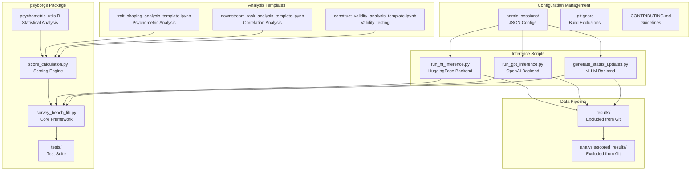

<!-- source: DeepWiki mcp.deepwiki.com · repo google-deepmind/personality_in_llms · page 8 Development and Contributing · fetched 2026-10-26 -->

# Development and Contributing

<details>
<summary>Relevant source files</summary>

The following files were used as context for generating this wiki page:

- [.gitignore](.gitignore)
- [CONTRIBUTING.md](CONTRIBUTING.md)
- [psyborgs/tests/__init__.py](psyborgs/tests/__init__.py)

</details>


This document provides guidance for developers and contributors working on the Personality Traits in Large Language Models research platform. It covers project structure, development environment setup, coding standards, testing procedures, and contribution workflows.

For information about system configuration and experiment setup, see [Configuration and Experiment Setup](#6). For details about the core PsyBORGS framework architecture, see [PsyBORGS Framework](#3).

## Project Architecture for Developers

The codebase is organized into several key development areas, each with specific responsibilities and coding patterns.

### Core Development Components



Sources: [.gitignore:1-29](), [psyborgs/tests/__init__.py:1](), [CONTRIBUTING.md:1-26]()

### Development Workflow Mapping

```mermaid
flowchart LR
    subgraph "Development Phase"
        FORK["Fork Repository<br/>github.com/google-deepmind/personality_in_llms"]
        CLONE["Local Clone<br/>git clone"]
        SETUP["Environment Setup<br/>pip install -e ."]
    end
    
    subgraph "Code Development"
        EDIT_CORE["Edit Core Files<br/>psyborgs/*.py"]
        EDIT_SCRIPTS["Edit Inference Scripts<br/>run_*.py"]
        EDIT_ANALYSIS["Edit Analysis Templates<br/>*.ipynb"]
        WRITE_TESTS["Write Tests<br/>psyborgs/tests/"]
    end
    
    subgraph "Local Testing"
        RUN_TESTS["pytest psyborgs/tests/"]
        CHECK_LINT["Code Quality Checks"]
        TEST_NOTEBOOKS["Validate Notebooks"]
    end
    
    subgraph "Contribution Process"
        COMMIT["git commit<br/>Descriptive Messages"]
        PUSH["git push origin feature-branch"]
        PR["GitHub Pull Request<br/>Code Review Required"]
    end
    
    subgraph "Review Process"
        CLA["Contributor License Agreement<br/>cla.developers.google.com"]
        REVIEW["Code Review<br/>Google Guidelines"]
        MERGE["Merge to Main<br/>After Approval"]
    end
    
    FORK --> CLONE
    CLONE --> SETUP
    SETUP --> EDIT_CORE
    SETUP --> EDIT_SCRIPTS
    SETUP --> EDIT_ANALYSIS
    EDIT_CORE --> WRITE_TESTS
    EDIT_SCRIPTS --> WRITE_TESTS
    EDIT_ANALYSIS --> WRITE_TESTS
    WRITE_TESTS --> RUN_TESTS
    RUN_TESTS --> CHECK_LINT
    CHECK_LINT --> TEST_NOTEBOOKS
    TEST_NOTEBOOKS --> COMMIT
    COMMIT --> PUSH
    PUSH --> PR
    PR --> CLA
    CLA --> REVIEW
    REVIEW --> MERGE
```



Sources: [CONTRIBUTING.md:1-26]()

## Project Structure

The repository follows a standard Python package structure with additional components for research workflows:

| Directory/File | Purpose | Development Notes |
|---|---|---|
| `psyborgs/` | Core Python package | Main development focus for framework code |
| `psyborgs/tests/` | Test suite | All new code should include tests |
| `run_hf_inference.py` | HuggingFace inference script | Entry point for local model inference |
| `run_gpt_inference.py` | OpenAI inference script | Entry point for API-based inference |
| `generate_status_updates.py` | Status generation script | Entry point for content generation tasks |
| `admin_sessions/` | Experiment configurations | JSON files defining test parameters |
| `analysis/` | Jupyter notebook templates | Research analysis workflows |
| `results/` | Output data directory | Excluded from version control |
| `analysis/scored_results/` | Processed analysis data | Excluded from version control |

Sources: [.gitignore:26-28](), [psyborgs/tests/__init__.py:1]()

## Development Environment Setup

### Required Dependencies

The project requires a Python environment with specific dependencies for different components:

- **Core Framework**: Python 3.8+, pandas, numpy, scipy
- **HuggingFace Integration**: transformers, accelerate, torch
- **OpenAI Integration**: openai Python client
- **vLLM Integration**: vllm, outlines
- **Statistical Analysis**: R environment with psychometric packages
- **Jupyter Analysis**: jupyter, matplotlib, seaborn

### Installation for Development

```bash
# Clone the repository
git clone https://github.com/google-deepmind/personality_in_llms.git
cd personality_in_llms

# Install in development mode
pip install -e .

# Install additional development dependencies
pip install pytest black flake8 jupyter
```

For complete dependency information, see [Dependencies and Environment Setup](#2.1).

Sources: [.gitignore:1-29]()

## Code Organization Standards

### Core Framework Development

The `psyborgs` package contains the core framework components:

| Module | Primary Classes/Functions | Development Focus |
|---|---|---|
| `survey_bench_lib.py` | `AdministrationSession`, `PayloadSpec` | Test administration logic |
| `score_calculation.py` | Scoring functions, data processing | Psychometric calculations |
| `psychometric_utils.R` | Statistical analysis functions | R-based reliability metrics |

### Inference Script Development

Each inference script follows a consistent pattern:

| Script | Key Functions | Backend Integration |
|---|---|---|
| `run_hf_inference.py` | Model loading, batch processing | HuggingFace transformers |
| `run_gpt_inference.py` | API calls, rate limiting | OpenAI API client |
| `generate_status_updates.py` | Content generation, constrained output | vLLM + Outlines |

### Analysis Template Development

Jupyter notebooks serve as analysis templates with standardized sections:

| Template | Analysis Type | Key Outputs |
|---|---|---|
| `trait_shaping_analysis_template.ipynb` | Psychometric validation | Reliability coefficients |
| `downstream_task_analysis_template.ipynb` | Correlation analysis | Trait-behavior relationships |
| `construct_validity_analysis_template.ipynb` | Validity assessment | Cross-measure validation |

Sources: [.gitignore:1-29]()

## Testing Framework

### Test Structure

The testing framework is organized under `psyborgs/tests/`:

```mermaid
graph TD
    subgraph "Test Organization"
        TESTS["psyborgs/tests/"]
        INIT["__init__.py<br/>Test Package"]
        UNIT["Unit Tests<br/>Individual Functions"]
        INTEGRATION["Integration Tests<br/>Component Interaction"]  
        SYSTEM["System Tests<br/>End-to-End Workflows"]
    end
    
    subgraph "Test Coverage Areas"
        CORE_TESTS["Core Framework Tests<br/>survey_bench_lib.py"]
        SCORE_TESTS["Scoring Tests<br/>score_calculation.py"]
        INFERENCE_TESTS["Inference Tests<br/>run_*.py scripts"]
    end
    
    subgraph "Test Execution"
        PYTEST["pytest Command<br/>Test Runner"]
        CI["Continuous Integration<br/>Automated Testing"]
        LOCAL["Local Development<br/>Pre-commit Testing"]
    end
    
    TESTS --> INIT
    INIT --> UNIT
    INIT --> INTEGRATION
    INIT --> SYSTEM
    
    UNIT --> CORE_TESTS
    INTEGRATION --> SCORE_TESTS
    SYSTEM --> INFERENCE_TESTS
    
    CORE_TESTS --> PYTEST
    SCORE_TESTS --> PYTEST
    INFERENCE_TESTS --> PYTEST
    
    PYTEST --> CI
    PYTEST --> LOCAL
```



Sources: [psyborgs/tests/__init__.py:1]()

### Running Tests

```bash
# Run all tests
pytest psyborgs/tests/

# Run specific test modules
pytest psyborgs/tests/test_survey_bench_lib.py

# Run tests with coverage
pytest --cov=psyborgs psyborgs/tests/
```

## Contribution Process

### Contributor License Agreement

All contributions require a signed Contributor License Agreement (CLA). This is a one-time requirement that applies across Google's open source projects.

1. Visit [cla.developers.google.com](https://cla.developers.google.com)
2. Sign the appropriate CLA (individual or corporate)
3. The CLA status will be automatically checked on pull requests

### Code Review Requirements

All submissions, including those from project members, require code review through GitHub pull requests:

| Review Criteria | Requirements |
|---|---|
| **Code Quality** | Follows Python PEP 8 standards |
| **Testing** | New code includes appropriate tests |
| **Documentation** | Functions and classes have docstrings |
| **Functionality** | Changes don't break existing features |
| **Research Integrity** | Statistical methods are scientifically sound |

### Pull Request Process

1. **Create Feature Branch**: `git checkout -b feature/your-feature-name`
2. **Implement Changes**: Follow coding standards and include tests
3. **Local Testing**: Run full test suite before submitting
4. **Submit PR**: Include clear description of changes and rationale
5. **Address Review Feedback**: Respond to reviewer comments promptly
6. **Merge**: After approval, changes are merged to main branch

Sources: [CONTRIBUTING.md:1-26]()

## Community Guidelines

This project follows [Google's Open Source Community Guidelines](https://opensource.google/conduct), which emphasize:

- **Respectful Communication**: Professional and constructive interactions
- **Inclusive Environment**: Welcoming to contributors from all backgrounds  
- **Collaborative Development**: Focus on improving the research platform
- **Scientific Rigor**: Maintaining high standards for psychometric research

### Getting Help

- **Issues**: Use GitHub Issues for bug reports and feature requests
- **Discussions**: Use GitHub Discussions for questions and general discussion
- **Documentation**: Refer to wiki pages for detailed system information
- **Code Examples**: Check existing scripts and notebooks for patterns

Sources: [CONTRIBUTING.md:22-25]()

## File Organization Patterns

### Version Control Exclusions

The `.gitignore` file defines important exclusions for development:

| Excluded Pattern | Reason | Development Impact |
|---|---|---|
| `__pycache__/`, `*.pyc` | Python bytecode | Keep repository clean |
| `results/` | Experimental outputs | Prevent large data commits |
| `analysis/scored_results/` | Processed analysis data | Separate data from code |
| `.vscode/settings.json` | IDE configurations | Personal development settings |
| `build/`, `dist/`, `*.egg-info/` | Package build artifacts | Clean packaging |

This structure ensures that only source code and configuration files are version-controlled, while data outputs and build artifacts remain local to each development environment.

Sources: [.gitignore:1-29]()