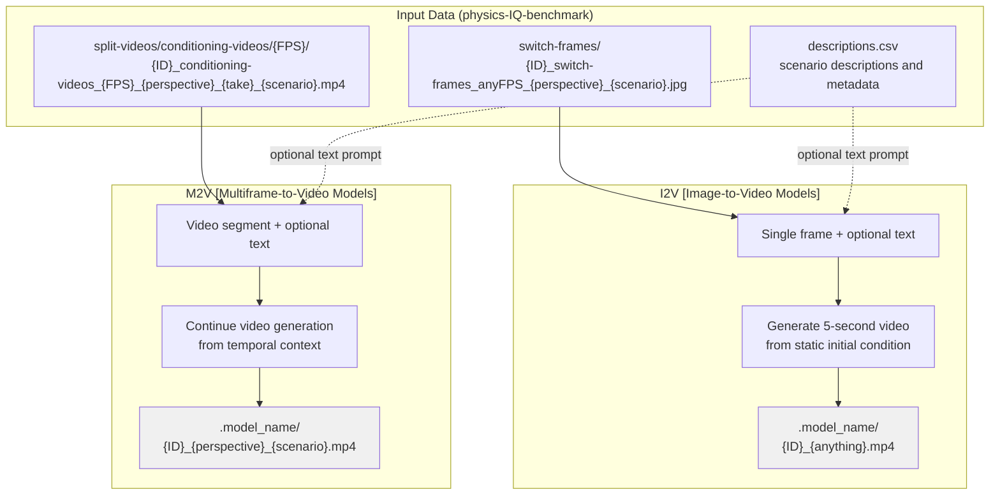
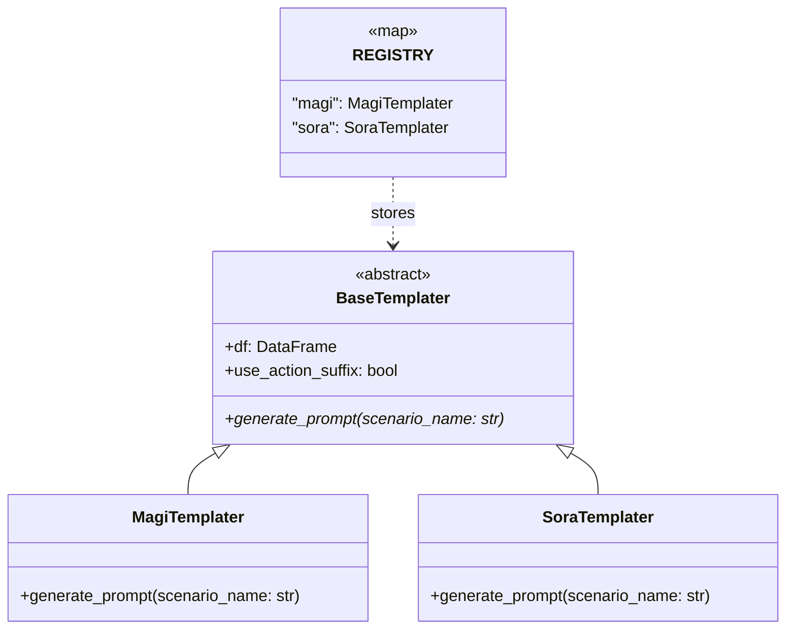

<!-- source: DeepWiki mcp.deepwiki.com · repo google-deepmind/physics-IQ-benchmark · page 3 Video Generation · fetched 2026-10-26 -->

# Video Generation

Relevant source files

The following files were used as context for generating this wiki page:

- [README.md](README.md)
- [descriptions/best_practice/descriptions_base.csv](descriptions/best_practice/descriptions_base.csv)
- [physiq/generate_descriptions.py](physiq/generate_descriptions.py)

This page provides instructions for generating videos that can be evaluated by the Physics-IQ benchmark. It covers the requirements and conventions that generative video models must follow to produce outputs compatible with the evaluation pipeline, including the prompt generation system and specific model workflows.

For information about evaluating generated videos, see [Evaluation Pipeline](#4). For dataset structure and downloading, see [Dataset](#2).

---

## Overview

The Physics-IQ benchmark supports two types of generative video models, each with distinct input requirements and workflows. Models must generate videos that adhere to strict naming conventions and output formats to enable automated evaluation.

### Model Type Comparison

**Model Selection Impact**: The leaderboard shows multiframe models achieve significantly higher scores (top: 56.0% - 64.5%) compared to i2v models (top: ~30-40%), indicating that temporal context provides substantial advantages for physical realism.

Sources: [README.md:36-82](), [README.md:94-108]()

---

## Image-to-Video Models (#3.1)

Image-to-video (i2v) models generate videos from a single static frame as the initial condition. This represents a challenging evaluation mode, as models must infer all physical properties and dynamics from a single image.

### Input Requirements
- **Initial Frame**: `physics-IQ-benchmark/switch-frames/` (198 JPEG images).
- **Text Description**: Generated via `physiq/generate_descriptions.py` using a model-specific templater.

### Generation Process
1. **Load Frame**: Use the image corresponding to the target `{ID}`.
2. **Apply Prompt**: Use the "best-practice prompt" (bpp) generated for your specific model.
3. **Generate**: Produce a video starting exactly from the state shown in the switch-frame.
4. **Enforce Duration**: The output must be exactly **5 seconds**.

For detailed requirements on input handling and naming, see [Image-to-Video Models](#3.1).

Sources: [README.md:76-89](), [physiq/generate_descriptions.py:42-59]()

---

## Multiframe-to-Video Models (#3.2)

Multiframe-to-video models (also called video-to-video or v2v) generate videos using a short video segment as conditioning input. This provides temporal context about object motion, velocities, and physical properties.

### Input Requirements
- **Conditioning Frames**: `split-videos/conditioning-videos/{FPS}/` (198 MP4 files).
- **FPS Selection**: 8, 16, 24, or 30 FPS.

### Generation Process
1. **Conditioning**: Provide the first 3 seconds of the scenario to the model.
2. **Extension**: Generate the subsequent 5 seconds of physical motion.
3. **Post-Processing**: The evaluation pipeline expects the final **5-second** segment. If your model outputs the full 8 seconds (3s conditioning + 5s generated), you must trim the conditioning segment.

For details on FPS options and segment removal, see [Multiframe-to-Video Models](#3.2).

Sources: [README.md:94-108](), [README.md:67-69]()

---

## Output Requirements and Naming Conventions (#3.3)

All generated videos must adhere to strict requirements to enable automated evaluation. The evaluation pipeline validates these constraints before processing.

### Naming and Structure
- **Directory**: Must start with a dot (e.g., `.my-model-name/`).
- **Files**: Exactly 198 MP4 files.
- **Prefix**: Each file must start with a 4-digit zero-padded ID (e.g., `0001_...`).

### Video Constraints
- **Duration**: Exactly 5 seconds. The `trim_videos.py` utility can be used to ensure this.
- **Format**: `.mp4` container.

For the full specification and directory layout, see [Output Requirements and Naming Conventions](#3.3).

Sources: [README.md:84-89](), [README.md:154-157]()

---

## Prompt Generation (Templater System) (#3.4)

Physics-IQ uses a pluggable templater system to generate prompts tailored to specific models. This ensures that models are evaluated using their "best-practice" prompt formats.

### The Templater Subsystem

### Key Components
- **`generate_descriptions.py`**: The CLI tool to produce model-specific CSV files.
- **Best-Practice Prompts (bpp)**: Recommended for the Verified benchmark to maximize model performance.
- **Action Suffix**: An optional descriptive suffix (e.g., "...The grabber tools release the ball") appended to the base description.

For instructions on adding new model templaters and using the generation script, see [Prompt Generation (Templater System)](#3.4).

Sources: [physiq/generate_descriptions.py:25-66](), [physiq/templater.py:22-50]()

---

