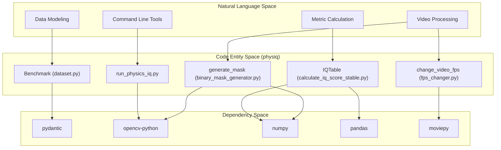
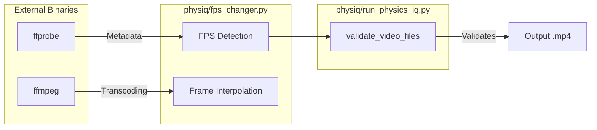

<!-- source: DeepWiki mcp.deepwiki.com · repo google-deepmind/physics-IQ-benchmark · page 8.1 Dependencies and Environment Setup · fetched 2026-10-26 -->

# Dependencies and Environment Setup

<details>
<summary>Relevant source files</summary>

The following files were used as context for generating this wiki page:

- [.python-version](.python-version)
- [pylock.toml](pylock.toml)
- [pyproject.toml](pyproject.toml)

</details>


This page documents the external Python packages and system requirements for the Physics-IQ benchmark. The project uses a modern Python stack managed via `pyproject.toml`, supporting the `uv` package manager for reproducible environments.

---

## Core Dependency Stack

The Physics-IQ benchmark relies on a standard scientific Python stack for video processing, numerical analysis, and data modeling. These are defined in the `[project.dependencies]` section of `pyproject.toml`.

| Dependency | Purpose | Key Usage Locations |
| :--- | :--- | :--- |
| `opencv-python` | Video I/O, background subtraction, and frame manipulation. | `binary_mask_generator.py`, `fps_changer.py` |
| `numpy` | Array operations for masks and metrics. | `calculate_and_write_metrics_to_csv.py` |
| `pandas` | Tabular data management and CSV result aggregation. | `calculate_iq_score_stable.py`, `aggregate_runs_from_csvs.py` |
| `pydantic` | Data validation and settings management. | `dataset.py` (Benchmark/Scene models) |
| `moviepy` | High-level video editing and FPS conversion. | `fps_changer.py` |
| `scipy` | Scientific computing (used by scikit-learn/pandas). | Internal dependency for metrics |
| `scikit-learn` | Machine learning utilities for data processing. | Internal dependency |
| `matplotlib` | Data visualization and plotting. | `plot_settings.py` |

**Sources:** [pyproject.toml:7-24]()

---

## System Architecture and Code Entities

The following diagram bridges the functional requirements of the benchmark to the specific code entities and their underlying library dependencies.

### Entity Relationship Diagram


**Sources:** [pyproject.toml:7-24](), [physiq/dataset.py:1-50](), [physiq/binary_mask_generator.py:1-30]()

---

## Optional Dependencies (Extras)

The project defines two optional dependency groups in `pyproject.toml` to keep the core installation lightweight.

### 1. Development (`dev`)
Used for code quality, testing, and interactive development.
*   **pytest**: The primary testing framework. Includes custom markers `e2e` and `ffmpeg` [pyproject.toml:68-71]().
*   **black / isort**: Code formatting and import sorting.
*   **jupyter / ipywidgets**: Support for running notebooks and interactive visualization.

### 2. Submission (`submission`)
Required for uploading results to the official leaderboard.
*   **boto3**: The AWS SDK for Python, used by `submit_verified.py` to upload results to S3-compatible storage.

**Sources:** [pyproject.toml:26-36](), [physiq/submit_verified.py:1-20]()

---

## External Requirements: FFmpeg

While many dependencies are Python-based, the system has a hard requirement for **FFmpeg** and **ffprobe**. These must be installed on the system and available in the `PATH`.

### Data Flow for Video Normalization


**Implementation Details:**
*   `fps_changer.py` shells out to FFmpeg for high-performance transcoding [physiq/fps_changer.py:1-50]().
*   `run_physics_iq.py` uses FFmpeg/ffprobe to verify that generated videos meet the strict 5-second duration and specific FPS requirements [physiq/run_physics_iq.py:1-100]().

**Sources:** [pyproject.toml:70](), [physiq/fps_changer.py:1-40](), [physiq/run_physics_iq.py:1-50]()

---

## Environment Setup with `uv`

The benchmark uses `uv` for high-performance dependency resolution. A `pylock.toml` file is provided to ensure consistent environments across different machines.

### Recommended Installation Steps

1.  **Install uv**:
    ```bash
    curl -LsSf https://astral.sh/uv/install.sh | sh
    ```

2.  **Create Environment and Install Core Dependencies**:
    ```bash
    uv venv
    source .venv/bin/activate
    uv sync
    ```

3.  **Install Submission Tools (Optional)**:
    ```bash
    uv sync --extra submission
    ```

4.  **Install Dev Tools (Optional)**:
    ```bash
    uv sync --extra dev
    ```

**Sources:** [pyproject.toml:48-55](), [pylock.toml:1-5]()

---

## Dependency-to-Function Mapping

The following table maps core Python libraries to the critical functions they support within the Physics-IQ codebase.

| Library | Function / Class | Role in Physics-IQ |
| :--- | :--- | :--- |
| `pydantic` | `Benchmark`, `Scene` | Validates `data.yaml` metadata integrity [physiq/dataset.py:20-100]() |
| `cv2` | `VideoCapture`, `VideoWriter` | Reads generated frames and writes binary masks [physiq/binary_mask_generator.py:40-80]() |
| `numpy` | `logical_and`, `logical_or` | Computes Intersection over Union (IoU) for masks [physiq/calculate_and_write_metrics_to_csv.py:50-120]() |
| `pandas` | `DataFrame.groupby` | Aggregates per-frame metrics into per-scenario scores [physiq/calculate_iq_score_stable.py:150-200]() |
| `joblib` | `hash` | Generates integrity hashes for result CSVs to prevent tampering [physiq/calculate_iq_score_stable.py:40-60]() |

**Sources:** [physiq/dataset.py:1-100](), [physiq/binary_mask_generator.py:1-100](), [physiq/calculate_iq_score_stable.py:1-200]()

---

