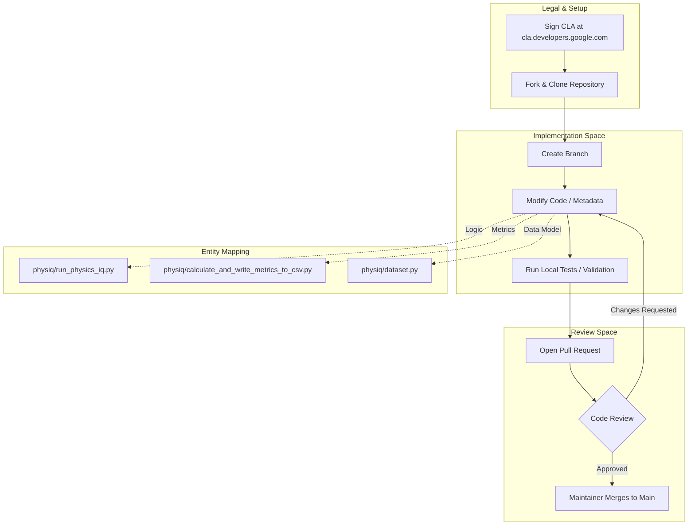
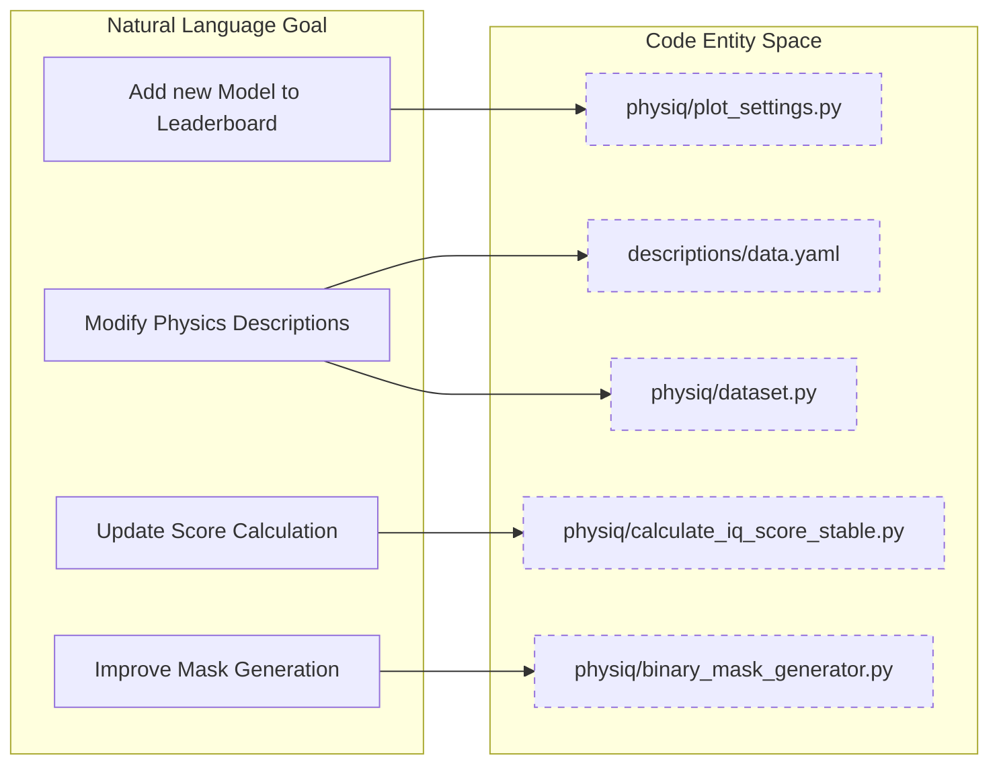

<!-- source: DeepWiki mcp.deepwiki.com · repo google-deepmind/physics-IQ-benchmark · page 8.3 Contributing Guidelines and License · fetched 2026-10-26 -->

# Contributing Guidelines and License

Relevant source files

The following files were used as context for generating this wiki page:

- [CONTRIBUTING.md](CONTRIBUTING.md)
- [LICENSE](LICENSE)
- [physiq/__init__.py](physiq/__init__.py)

## Purpose and Scope

This page documents the legal and procedural requirements for contributing to the Physics-IQ benchmark project. It covers the dual-licensing model, the mandatory Contributor License Agreement (CLA), code review workflows, and community standards. These guidelines apply to all components of the repository, including the evaluation pipeline, data models, and documentation.

---

## License Information

The Physics-IQ benchmark project utilizes a dual-licensing model to distinguish between executable code and benchmark assets.

| Component | License | Details |
| :--- | :--- | :--- |
| **Software Components** | [Apache License, Version 2.0](https://www.apache.org/licenses/LICENSE-2.0) | Applies to all `.py` scripts, configuration files, and build logic. |
| **Other Materials** | [Creative Commons Attribution 4.0 International (CC-BY 4.0)](https://creativecommons.org/licenses/by/4.0) | Applies to documentation, benchmark metadata, and non-software assets. |

**Important Note:** This is not an official Google product [LICENSE:7-7](). All software and materials are distributed on an "AS IS" BASIS, WITHOUT WARRANTIES OR CONDITIONS OF ANY KIND [LICENSE:6-6]().

Sources: [LICENSE:1-7](), [physiq/__init__.py:1-14]()

---

## Contributor License Agreement (CLA)

All contributions must be accompanied by a Contributor License Agreement. This gives the project permission to use and redistribute your contributions while allowing you (or your employer) to retain the copyright [CONTRIBUTING.md:5-9]().

### CLA Requirements
*   **Sign-up**: Head to [https://cla.developers.google.com/](https://cla.developers.google.com) to sign the agreement [CONTRIBUTING.md:8-9]().
*   **Persistence**: You generally only need to submit a CLA once; if you have signed it for another Google project, it likely applies here as well [CONTRIBUTING.md:11-13]().

Sources: [CONTRIBUTING.md:3-13]()

---

## Contribution Workflow and Code Reviews

All submissions, including those by project members, require review via GitHub Pull Requests [CONTRIBUTING.md:17-18]().

### Development Lifecycle

### Review Criteria
1.  **Functional Correctness**: Ensure changes do not break the core evaluation pipeline in `run_physics_iq.py`.
2.  **Metric Integrity**: Modifications to `calculate_and_write_metrics_to_csv.py` or `calculate_iq_score_stable.py` must maintain the variance-normalized scoring logic.
3.  **Data Consistency**: Changes to dataset metadata must be reflected in `physiq/dataset.py` models.
4.  **Style**: Code should follow existing patterns, such as the `REGISTRY` pattern used in `physiq/physiq_verified.py`.

Sources: [CONTRIBUTING.md:15-20](), [physiq/run_physics_iq.py:1-50](), [physiq/physiq_verified.py:1-50]()

---

## Community Guidelines

This project follows [Google's Open Source Community Guidelines](https://opensource.google/conduct) [CONTRIBUTING.md:24-25](). Contributors are expected to:
*   Be respectful and inclusive.
*   Focus on constructive feedback during code reviews.
*   Maintain a professional environment in all project communications.

Sources: [CONTRIBUTING.md:22-25]()

---

## Practical Contribution Map

The following diagram bridges the high-level contribution types to specific code entities within the repository.

### System-to-Code Entity Mapping

### Component Responsibility Matrix

| Contribution Area | Primary Code Entities | Key Functions/Classes |
| :--- | :--- | :--- |
| **Dataset Metadata** | `physiq/dataset.py` | `Benchmark`, `Scene`, `get_benchmark()` |
| **Scoring Logic** | `physiq/calculate_iq_score_stable.py` | `IQTable`, `compute_final_score_stable()` |
| **Verification** | `physiq/submit_verified.py` | `_validate_card()`, `_validate_run_dir()` |
| **Prompts** | `physiq/physiq_verified.py` | `BaseTemplater`, `VerifiedTemplater` |
| **Metrics** | `physiq/calculate_and_write_metrics_to_csv.py` | `process_videos()`, `weighted_spatial_iou_v1()` |

Sources: [physiq/dataset.py:28-60](), [physiq/calculate_iq_score_stable.py:34-80](), [physiq/submit_verified.py:125-180](), [physiq/physiq_verified.py:30-100](), [physiq/calculate_and_write_metrics_to_csv.py:100-250]()

---

