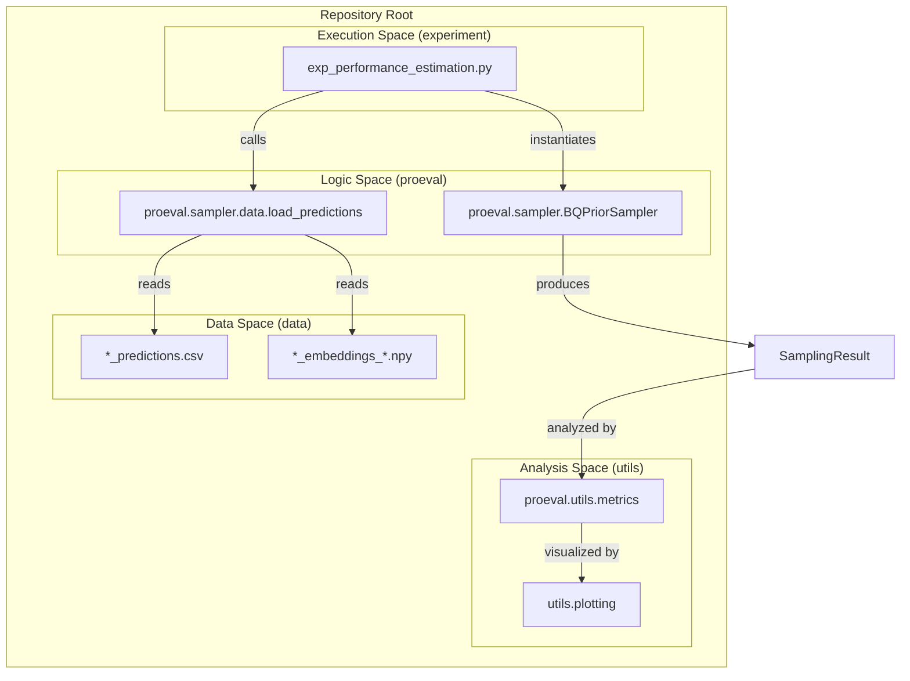
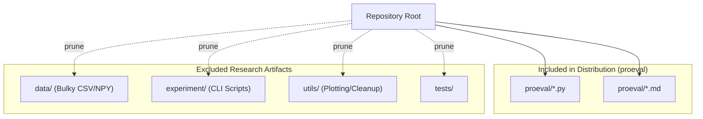

<!-- source: DeepWiki mcp.deepwiki.com · repo google-deepmind/proeval · page 1.2 Repository Structure & Package Layout · fetched 2026-10-26 -->

# Repository Structure & Package Layout

Relevant source files

The following files were used as context for generating this wiki page:

- [.gitignore](.gitignore)
- [MANIFEST.in](MANIFEST.in)
- [pyproject.toml](pyproject.toml)
- [setup.cfg](setup.cfg)

This page details the physical and logical organization of the ProEval repository. It distinguishes between the core `proeval` Python package—intended for distribution and integration—and the surrounding research artifacts, experiment harnesses, and data assets used to produce the results in the ProEval paper.

## Top-Level Directory Layout

The repository is divided into four primary directories. While `proeval/` contains the library code, the other directories provide the context and data necessary to replicate experiments.

| Directory | Purpose |
| :--- | :--- |
| `proeval/` | The core Python package containing samplers, generators, and evaluators. |
| `experiment/` | CLI scripts for running performance estimation and failure discovery benchmarks. |
| `data/` | Benchmark datasets, pre-computed LLM predictions, and text embeddings. |
| `utils/` | Shared research utilities for plotting, metrics calculation, and data cleanup. |

### Data Flow and Component Interaction

The following diagram illustrates how these top-level directories interact during a typical research workflow, such as running a Bayesian Quadrature (BQ) experiment.

**ProEval System Data Flow**

**Sources:** `pyproject.toml:100-103`(), `MANIFEST.in:8-15`()

---

## Package Build & Distribution Logic

ProEval uses a modern Python packaging stack governed by `pyproject.toml` and `MANIFEST.in`. A critical distinction is made between the **distributed library** and the **research environment**.

### Build Configuration (`pyproject.toml`)
The build system uses `setuptools` [pyproject.toml:1-3](). The configuration defines several optional dependency groups to keep the core installation lightweight:
*   `encoder`: Required for the `QuestionEncoder` and TPF-mode samplers (requires `torch`) [pyproject.toml:54-57]().
*   `topics`: Required for `TopicAwareGenerator` (requires `bertopic` and `hdbscan`) [pyproject.toml:58-62]().
*   `datasets`: Required for HuggingFace dataset integration in the evaluator [pyproject.toml:63-66]().
*   `plotting`: Required for the research visualization scripts in `utils/` [pyproject.toml:67-71]().

### Inclusion/Exclusion Rules
To prevent the distribution of bulky artifacts (like large `.npy` embedding files or experimental logs), the `MANIFEST.in` and `pyproject.toml` explicitly prune non-library code from the source distribution (sdist) and wheels.

**Package Inclusion Diagram**

| Mechanism | Targeted Entities | Role |
| :--- | :--- | :--- |
| `MANIFEST.in` | `data`, `experiment`, `utils`, `tests` | Uses `prune` to remove directories from sdist [MANIFEST.in:12-15](). |
| `MANIFEST.in` | `*.npy`, `*.csv` | Uses `global-exclude` to strip data files [MANIFEST.in:16-17](). |
| `pyproject.toml` | `data*`, `experiment*`, `utils*` | Uses `tool.setuptools.packages.find.exclude` for wheels [pyproject.toml:103](). |
| `.gitignore` | `results/`, `data/checkpoints` | Prevents local artifacts from entering version control [.gitignore:219-221](). |

**Sources:** `MANIFEST.in:1-22`(), `pyproject.toml:97-104`(), `setup.cfg:11-38`()

---

## Directory Details

### 1. `proeval/` (The Core Package)
This is the only directory installed when running `pip install .`.
*   `sampler/`: Contains the Bayesian Quadrature logic, including `BQPriorSampler` and `BQEncoderSampler`.
*   `generator/`: Contains the `TopicAwareGenerator` for proactive failure discovery.
*   `evaluator/`: Logic for interacting with LLM APIs (e.g., `OpenRouterClient`) and managing local CSV checkpoints.
*   `encoder/`: Neural network definitions for the TPF feature space.
*   `utils/`: Internal library utilities like `metrics.py` [setup.cfg:41-43]().

### 2. `experiment/` (Research Harness)
Contains standalone scripts that orchestrate the `proeval` library to reproduce paper results.
*   `exp_performance_estimation.py`: The main entry point for evaluating BQ against baselines like Importance Sampling.
*   `exp_failure_discovery.py`: Runs the proactive generation loop.
*   `exp_train_encoder.py`: Handles the training of the neural encoder across benchmarks.

### 3. `data/` (Benchmark Assets)
Stores the raw and processed data used by the samplers.
*   `*_predictions.csv`: Matrices of model performance (1 for error, 0 for correct).
*   `*_embeddings_*.npy`: Pre-computed vector representations of questions.
*   **Note:** These are excluded from the Python package to keep the install size minimal [MANIFEST.in:12,16]().

### 4. `utils/` (Research Utilities)
Supporting code that is not part of the core API but essential for the research workflow.
*   `plotting.py`: Matplotlib/Seaborn configurations for generating paper-ready figures [pyproject.toml:67-71]().
*   `fix_all_errors.py`: A utility to retry failed LLM API calls stored in CSVs.

**Sources:** `pyproject.toml:53-88`(), `setup.cfg:11-26`(), `MANIFEST.in:11-15`()

---

