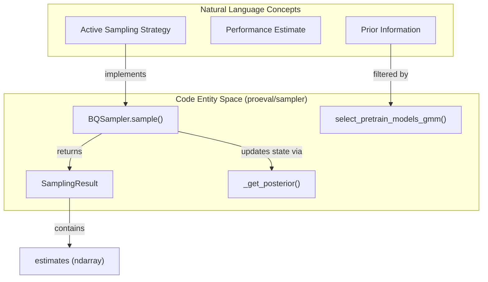
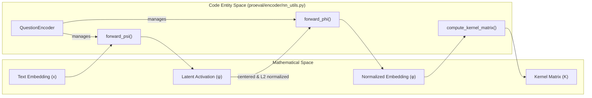

<!-- source: DeepWiki mcp.deepwiki.com · repo google-deepmind/proeval · page 10 Glossary · fetched 2026-10-26 -->

# Glossary

Relevant source files

The following files were used as context for generating this wiki page:

- [README.md](README.md)
- [data/README.md](data/README.md)
- [experiment/README.md](experiment/README.md)
- [proeval/README.md](proeval/README.md)
- [proeval/encoder/nn_utils.py](proeval/encoder/nn_utils.py)
- [proeval/evaluator/predictor.py](proeval/evaluator/predictor.py)
- [proeval/generator/core.py](proeval/generator/core.py)
- [proeval/sampler/__init__.py](proeval/sampler/__init__.py)
- [proeval/sampler/baselines.py](proeval/sampler/baselines.py)
- [proeval/sampler/bq.py](proeval/sampler/bq.py)

This page provides definitions for codebase-specific terminology, mathematical abbreviations, and domain concepts used throughout the ProEval repository. It serves as a technical reference for understanding the implementation details of Bayesian Quadrature (BQ) sampling and proactive failure discovery.

## Core Concepts & Abbreviations

### BQ (Bayesian Quadrature)
A method for numerical integration that treats the integral of a function as a Bayesian inference problem. In ProEval, BQ is used to estimate the average performance (e.g., accuracy or error rate) of a model across a benchmark by modeling the model's binary success/failure labels with a Gaussian Process (GP).
*   **Implementation**: `proeval.sampler.bq` [proeval/sampler/bq.py:15-56]()
*   **Key Classes**: `BQSampler` [proeval/sampler/bq.py:214-214](), `BQPriorSampler` [proeval/sampler/bq.py:249-249]()

### GP Feature Setups (SF, RPF, TPF)
The codebase categorizes experiments and samplers based on the features used by the Gaussian Process surrogate:

| Term | Full Name | Kernel | Description |
| :--- | :--- | :--- | :--- |
| **SF** | Score Features | Linear | Uses predictions/scores from *other* models as features. [proeval/sampler/bq.py:20-22]() |
| **RPF** | Raw Prompt Features | Matérn 2.5 | Uses raw text embeddings (e.g., OpenAI `text-embedding-3-large`) as features. [proeval/sampler/bq.py:22-25]() |
| **TPF** | Tuned Prompt Features | Matérn 2.5 | Uses embeddings from a trained `QuestionEncoder` that maps text to a performance-aware latent space. [proeval/sampler/bq.py:26-28]() |

**Sources**: [proeval/sampler/bq.py:15-56](), [experiment/README.md:12-19]()

### SS (Superlevel Set) Acquisition
A proactive acquisition function designed to discover failure cases. It selects samples where the GP posterior indicates a high probability of the model failing (label = 1).
*   **Formula**: $SS(x) = \mathbb{1}(\mu_t(x) + \beta \cdot \sigma_t(x) \geq \lambda) \times k_t(x, x)$
*   **Code Pointer**: `ss_acquisition_batch` [proeval/generator/core.py:80-156]()

### Problem Settings
ProEval evaluates transferability across three distinct data-splitting scenarios:
*   **`new_pair`**: The target model and benchmark pair is held out; other benchmarks for this model and other models for this benchmark are available. [experiment/README.md:24-24]()
*   **`new_benchmark`**: The entire target benchmark is held out from training. [experiment/README.md:25-25]()
*   **`new_model`**: The target model is entirely unseen across all benchmarks. [experiment/README.md:26-26]()

---

## Technical Entities & Code Mapping

### Sampler Subsystem
The sampling logic bridges the gap between raw benchmark data and the Bayesian estimation of error rates.

**Natural Language to Code Entity Map: Sampling**

**Sources**: [proeval/sampler/bq.py:214-247](), [proeval/sampler/bq.py:74-123](), [proeval/sampler/pretrain_selector.py:101-168]()

### Neural Encoder Subsystem
The encoder transforms text embeddings into $\phi$ (phi) embeddings used for the TPF setup.

**Natural Language to Code Entity Map: Encoder**

**Sources**: [proeval/encoder/nn_utils.py:57-142](), [proeval/encoder/nn_utils.py:144-200]()

---

## Glossary Table

| Term | Definition | Code Reference |
| :--- | :--- | :--- |
| **Budget** | The maximum number of samples (labels) the sampler is allowed to acquire. | [proeval/sampler/bq.py:230-230]() |
| **GMM Selector** | A Gaussian Mixture Model used to cluster reference models by performance profile to select the best prior. | [proeval/sampler/pretrain_selector.py:101-101]() |
| **Integral Variance** | The variance of the BQ mean estimate; used to determine if the sampler should "abstain". | [proeval/sampler/bq.py:84-87](), [proeval/sampler/bq.py:112-121]() |
| **Jitter** | Small values added to the diagonal of a matrix to ensure Cholesky decomposition stability. | [proeval/encoder/nn_utils.py:31-54]() |
| **Noise Variance** | A GP hyperparameter representing observation noise; higher values lead to smoother estimates. | [proeval/sampler/bq.py:220-220]() |
| **Phi ($\phi$)** | The output of the `QuestionEncoder`, which is centered and L2-normalized onto a unit sphere. | [proeval/encoder/nn_utils.py:126-141]() |
| **Seed Pool** | A pre-existing set of labeled examples used for "offline" failure discovery experiments. | [experiment/README.md:127-127]() |
| **TSS** | Topic-aware Superlevel Set; a generation strategy combining topic modeling with SS acquisition. | [proeval/generator/core.py:54-54]() |

**Sources**: [proeval/sampler/bq.py:74-123](), [proeval/encoder/nn_utils.py:31-141](), [proeval/sampler/pretrain_selector.py:101-168](), [experiment/README.md:12-127]()