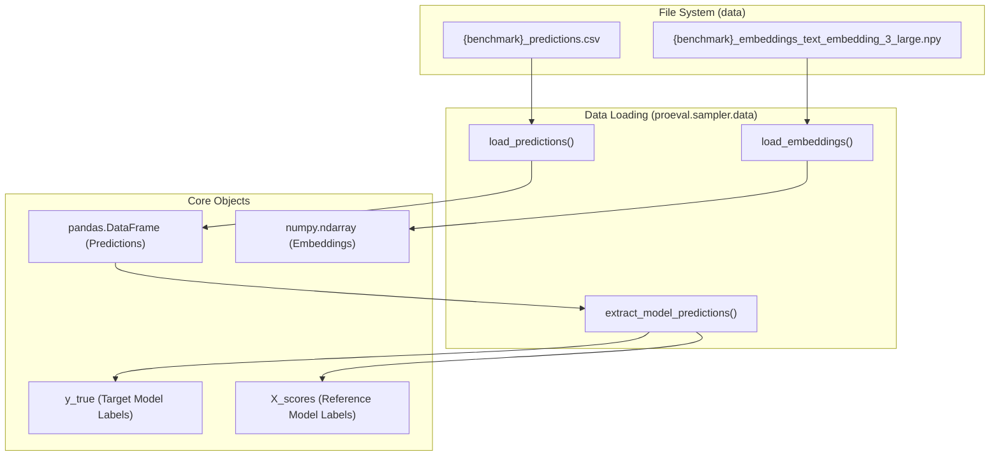
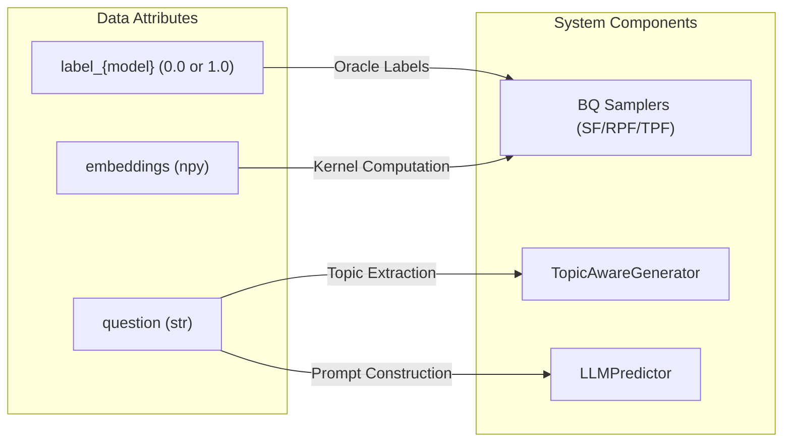

<!-- source: DeepWiki mcp.deepwiki.com · repo google-deepmind/proeval · page 6 Benchmark Datasets · fetched 2026-10-26 -->

# Benchmark Datasets

Relevant source files

The following files were used as context for generating this wiki page:

- [data/README.md](data/README.md)
- [data/dices_predictions.csv](data/dices_predictions.csv)
- [data/gsm8k_predictions.csv](data/gsm8k_predictions.csv)
- [data/jigsaw_predictions.csv](data/jigsaw_predictions.csv)
- [data/mmlu_predictions.csv](data/mmlu_predictions.csv)
- [data/strategyqa_predictions.csv](data/strategyqa_predictions.csv)
- [data/svamp_predictions.csv](data/svamp_predictions.csv)

The ProEval framework bundles eight evaluation benchmarks in the `data/` directory to validate its performance estimation and failure discovery capabilities. These datasets span multiple domains, including mathematical reasoning, safety, toxicity detection, and visual question answering. Each benchmark includes a set of unique questions, ground truth labels, and a comprehensive matrix of predictions from up to 16 modern Large Language Models (LLMs).

## Dataset Overview

The benchmarks are stored as CSV files for model predictions and NPY files for pre-computed text embeddings. The row counts in the table below refer to unique evaluation examples (questions).

| Dataset | Domain | # Rows | # Models | Label Type |
| :--- | :--- | :--- | :--- | :--- |
| `gsm8k` | Math reasoning | ~1,319 | 16 | Binary |
| `svamp` | Math word problems | 700 | 16 | Binary |
| `mmlu` | Multi-task knowledge | ~1,534 | 16 | Binary |
| `strategyqa` | Yes/no reasoning | ~1,603 | 16 | Binary |
| `gqa` | Visual question answering | ~2,000 | 14 | Binary |
| `jigsaw` | Toxicity detection | ~1,500 | 16 | Binary |
| `dices` | Safety rating | ~1,500 | 16 | Continuous |
| `dices_t2i` | Text-to-image safety | ~1,500 | 14 | Continuous |

Sources: [data/README.md:22-31](), [data/README.md:88-90]()

## Data Structures and Code Integration

The `proeval` package interacts with these datasets primarily through the `proeval.sampler.data` module. This module provides utilities to load the prediction matrices and associated embeddings into memory for use by the Bayesian Quadrature (BQ) samplers.

### Natural Language to Code Entity Mapping

The following diagram illustrates how the benchmark data files are mapped to internal Python objects used by the system.

**Benchmark Data Flow**

Sources: [proeval/sampler/data.py:12-70](), [data/README.md:13-18]()

## Usage in Samplers and Evaluators

The datasets serve two distinct roles in the ProEval ecosystem:

1.  **Evaluation Ground Truth**: For the `BQPriorSampler` and `BQEncoderSampler`, the `label_<model>` columns provide the ground truth error scores (0.0 for correct, 1.0 for error) used to simulate an "oracle" during active sampling experiments.
2.  **Failure Discovery Context**: For the `TopicAwareGenerator`, the `question` and `ground_truth` columns provide the context needed to extract topics (via BERTopic) and generate hard examples for proactive testing.

**Relationship between Benchmark Data and System Components**

Sources: [proeval/sampler/data.py:86-110](), [proeval/generator/topic_generator.py:44-70](), [data/README.md:57-63]()

## Child Pages

For more technical details on the data formats and the specific models included in the benchmarks, refer to the following sub-pages:

*   **[Predictions CSV Format & Evaluated Models](#6.1)**: Detailed reference for the `*_predictions.csv` schema, including shared columns (`index`, `question`, `ground_truth`), per-model column groups, and the 16-model roster.
*   **[Pre-computed Embeddings (.npy Files)](#6.2)**: Documentation for the `OpenAI text-embedding-3-large` embeddings, array shapes, and how they are utilized in RPF and TPF sampling modes.

Sources: [data/README.md:40-91](), [data/README.md:118-125]()

---

