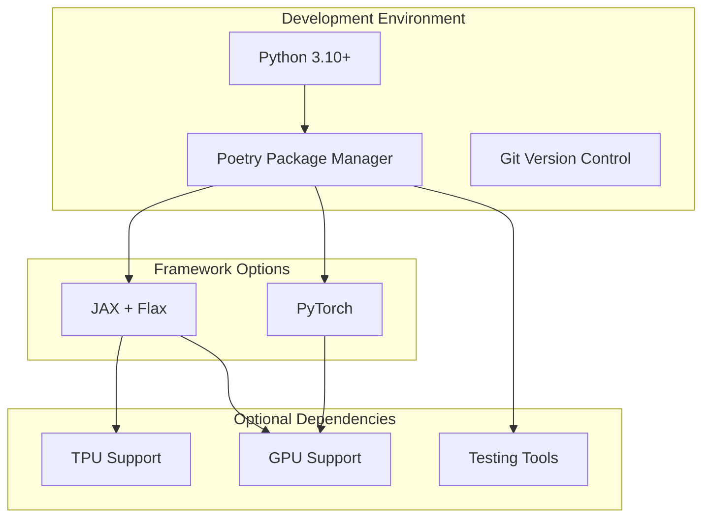
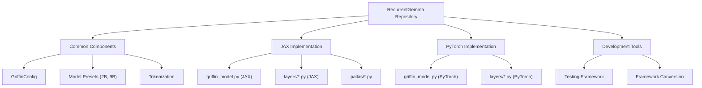
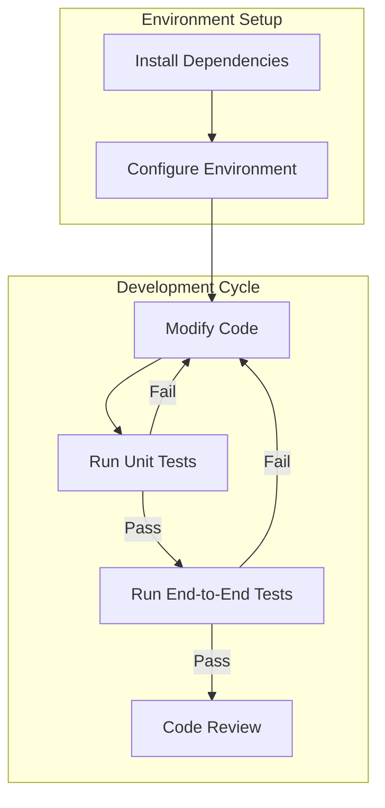
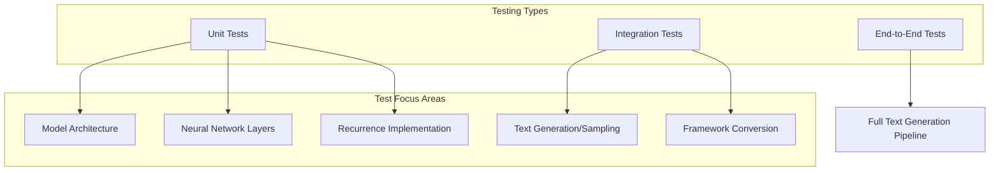
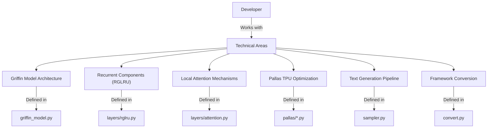

<!-- source: DeepWiki mcp.deepwiki.com · repo google-deepmind/recurrentgemma · page 6 Development · fetched 2026-10-26 -->

# Development

<details>
<summary>Relevant source files</summary>

The following files were used as context for generating this wiki page:

- [CONTRIBUTING.md](CONTRIBUTING.md)
- [LICENSE](LICENSE)
- [pyproject.toml](pyproject.toml)

</details>


This page provides essential information for developers working with the RecurrentGemma repository. It covers the development environment, project structure, and key considerations for developers. For specific installation instructions, see [Installation](#6.1), and for contribution guidelines, see [Contributing](#6.2).

## Development Environment

RecurrentGemma is built with Python 3.10+ and uses [Poetry](https://python-poetry.org) for dependency management. The codebase supports both JAX and PyTorch implementations of the Griffin model architecture.



The project uses a flexible dependency system that allows developers to install only the components they need. Core dependencies are required, while framework-specific dependencies (JAX/PyTorch) can be installed separately.

Sources: [pyproject.toml:18-36]()

## Project Structure

RecurrentGemma is organized into parallel implementations with shared configuration components. The repository structure reflects this dual-framework approach while maintaining common components.



The project structure is designed to maintain parallel implementations while sharing common configuration and architecture components. This approach allows developers to work with their preferred framework while ensuring compatibility.

Sources: Based on system architecture diagrams

## Development Workflow

Developing for RecurrentGemma requires understanding the relationship between components and the testing workflow. The diagram below illustrates the typical development workflow:



Note that as stated in the [Contributing](#6.2) guidelines, the project is currently not accepting external PRs.

Sources: Based on repository structure and [CONTRIBUTING.md:1-4]()

## Dependencies Management

RecurrentGemma uses Poetry for managing dependencies, with a flexible system that allows installing different subsets based on development needs.

### Core Dependencies

These are required for all RecurrentGemma installations:

| Dependency | Version | Purpose |
|------------|---------|---------|
| Python | ≥ 3.10 | Core language |
| absl-py | ~1.4.0 | Command-line utilities |
| sentencepiece | ≥ 0.2.0 | Tokenization |
| numpy | ≥ 2.2.1 | Numerical operations |
| einops | ≥ 0.7.0 | Tensor operations |
| jaxtyping | ≥ 0.2.28 | Type hints for JAX |
| typeguard | ≥ 2.13.3 | Runtime type checking |

### Optional Dependencies

These dependencies are grouped into "extras" that can be installed based on your development focus:

| Extra | Dependencies | Purpose |
|-------|-------------|---------|
| jax | jax (~0.5.0), orbax-checkpoint (0.5.7), flax (≥ 0.10.3) | JAX/Flax implementation |
| torch | torch (≥ 2.2.0) | PyTorch implementation |
| test | pytest (≥ 8.0.0) | Testing framework |
| full | All of the above | Complete development environment |

Sources: [pyproject.toml:18-36]()

## Installation for Development

For development purposes, you'll typically want to install the repository with all extras:

```bash
# Clone the repository
git clone https://github.com/google-deepmind/recurrentgemma.git
cd recurrentgemma

# Install with Poetry (all dependencies)
poetry install --extras "full"

# For JAX-only development
poetry install --extras "jax"

# For PyTorch-only development
poetry install --extras "torch"

# For testing
poetry install --extras "test"
```

See [Installation](#6.1) for more detailed instructions.

Sources: [pyproject.toml:32-36]()

## Testing Framework

Testing RecurrentGemma components is essential for maintaining quality. The project uses `pytest` for testing both JAX and PyTorch implementations.



When developing new components or modifying existing ones, ensure that you run the relevant tests to verify that your changes don't break existing functionality.

Sources: [pyproject.toml:30]()

## Development Best Practices

When working with RecurrentGemma, consider these best practices:

1. **Framework Consistency**: Ensure compatibility between JAX and PyTorch implementations when modifying shared components.

2. **Type Checking**: Use the provided type hints and typeguard to ensure type correctness, especially for tensor operations.

3. **Optimization Awareness**: Be aware of the performance implications, especially for the recurrent components and TPU-optimized kernels.

4. **Testing**: Write comprehensive tests for both implementations when adding new features.

5. **Documentation**: Update documentation when changing the public API or behavior.

## Legal Considerations

RecurrentGemma is released under the Apache 2.0 License. Any contributions to the codebase must comply with this license.

Note: As stated in the CONTRIBUTING.md file, external pull requests are currently not being accepted, but future contributors should be aware of the licensing requirements.

Sources: [LICENSE:1-203](), [CONTRIBUTING.md:1-4]()

## Technical Development Areas

When developing RecurrentGemma, you'll likely work with these key technical areas:



Understanding these core technical areas is essential for effective development in the RecurrentGemma codebase.

Sources: Based on system architecture diagrams

---

