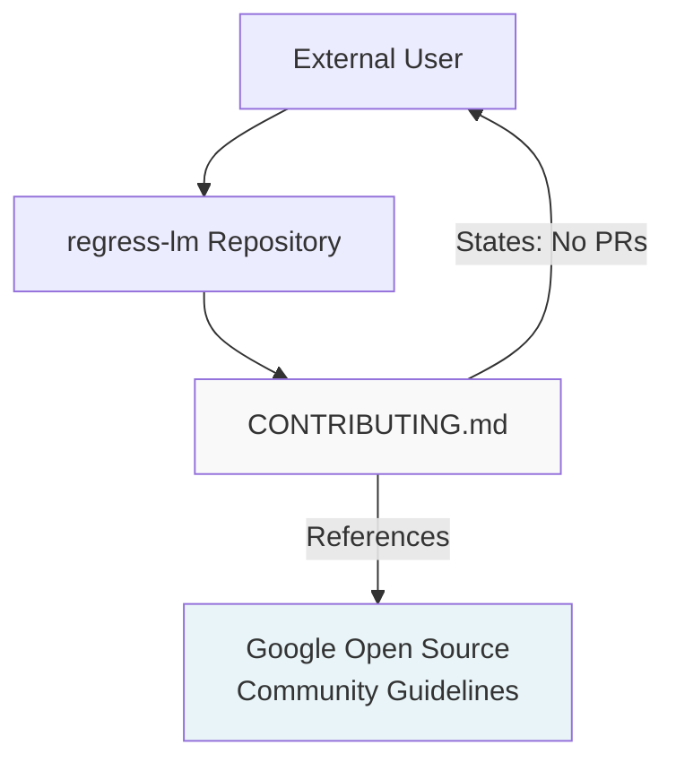
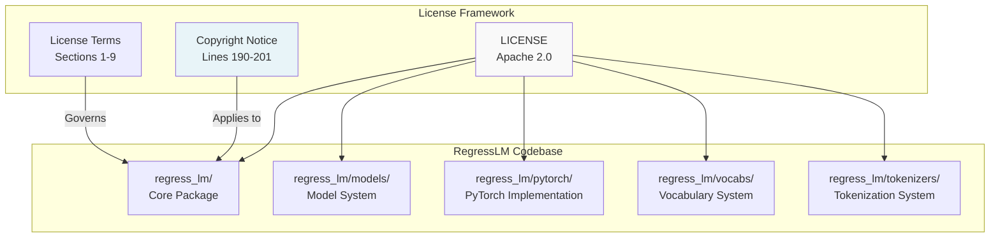
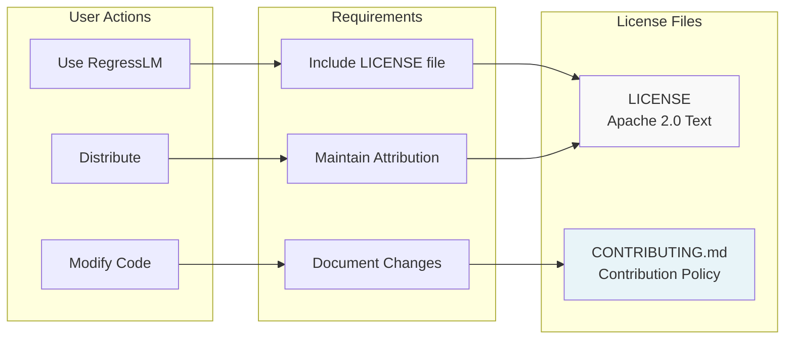

<!-- source: DeepWiki mcp.deepwiki.com · repo google-deepmind/regress-lm · page 8 Contributing and License · fetched 2026-10-26 -->

# Contributing and License

<details>
<summary>Relevant source files</summary>

The following files were used as context for generating this wiki page:

- [CONTRIBUTING.md](CONTRIBUTING.md)
- [LICENSE](LICENSE)

</details>


This document covers the contribution policies and licensing terms for the RegressLM project. It provides essential information for users who want to understand how to interact with the project and the legal framework governing its use and distribution.

## Contributing Guidelines

### Current Contribution Policy

The RegressLM project currently operates with a closed contribution model. As specified in [CONTRIBUTING.md:3](), the project does not accept pull requests at this time.

| Contribution Type | Status | Details |
|-------------------|--------|---------|
| Pull Requests | Not Accepted | Project currently closed to external contributions |
| Issue Reports | Not Specified | No explicit policy documented |
| Feature Requests | Not Specified | No explicit policy documented |

### Community Standards

The project adheres to [Google's Open Source Community Guidelines](https://opensource.google/conduct) as stated in [CONTRIBUTING.md:7-8](). These guidelines establish the expected behavior and interactions within the project community.

#### Contribution Workflow Structure



**Contribution Policy Structure**

Sources: [CONTRIBUTING.md:1-9]()

## License Information

### Apache License 2.0

The RegressLM project is licensed under the Apache License 2.0, as documented in the [LICENSE]() file. This is a permissive open-source license that provides significant freedoms for use, modification, and distribution.

#### Key License Permissions

| Permission | Description | License Section |
|------------|-------------|-----------------|
| Use | Use the software for any purpose | Section 2 |
| Modify | Create derivative works | Section 2 |
| Distribute | Distribute original or modified versions | Section 4 |
| Patent Grant | Use any patents contributed by authors | Section 3 |
| Private Use | Use privately without disclosure | Implied |

#### Key License Requirements

| Requirement | Description | License Section |
|-------------|-------------|-----------------|
| License Inclusion | Include copy of license with distributions | Section 4(a) |
| State Changes | Document modifications to files | Section 4(b) |
| Preserve Notices | Maintain copyright and attribution notices | Section 4(c) |
| Include NOTICE | Include NOTICE file if present | Section 4(d) |

### License Coverage Structure



**Apache License 2.0 Coverage Across Codebase**

Sources: [LICENSE:1-201]()

### License Application Details

#### Copyright and Attribution

The license includes standard Apache 2.0 copyright notice template in [LICENSE:190-196]():

```
Licensed under the Apache License, Version 2.0 (the "License");
you may not use this file except in compliance with the License.
You may obtain a copy of the License at

    http://www.apache.org/licenses/LICENSE-2.0
```

#### Warranty and Liability Disclaimers

Key disclaimers as specified in [LICENSE:144-175]():

- **No Warranty**: Software provided "AS IS" without warranties ([LICENSE:144-152]())
- **Limitation of Liability**: Contributors not liable for damages ([LICENSE:154-164]())
- **User Responsibility**: Users assume risks of using the software ([LICENSE:151-152]())

### Practical Implications

#### For Users

- **Freedom to Use**: Can use RegressLM for commercial or personal projects
- **Modification Rights**: Can modify the code to suit specific needs
- **Distribution Rights**: Can distribute original or modified versions
- **Attribution Required**: Must include license and attribution notices

#### For Developers

- **Current Contribution Status**: External contributions not accepted
- **Future Contributions**: Would be subject to Apache License 2.0 terms if policy changes
- **Community Standards**: Must follow Google's Open Source Community Guidelines



**License Compliance Requirements**

Sources: [LICENSE:90-130](), [CONTRIBUTING.md:1-9]()