# Page: Overview

# Overview

<details>
<summary>Relevant source files</summary>

The following files were used as context for generating this wiki page:

- [README.md](README.md)

</details>


## Purpose and Scope

This document provides a high-level introduction to the RegressLM repository, a specialized library for text-to-text regression tasks. RegressLM enables converting arbitrary text inputs into floating-point numerical predictions through transformer-based neural networks with custom tokenization strategies.

The system supports both inference on pre-trained models and fine-tuning on new regression datasets. For detailed API usage, see [API Reference](#3). For implementation details of the model system, see [Model System](#5). For tokenization specifics, see [Data Processing](#6).

## System Architecture

RegressLM implements a layered architecture centered around the `rlm.RegressLM` class, which provides the main user interface for text-to-numerical regression tasks.

### High-Level Component Structure

```mermaid
graph TB
    subgraph "User Interface"
        RegressLM["rlm.RegressLM"]
    end
    
    subgraph "Core Abstractions"
        Model["models.base.Model"]
        FineTuner["models.base.FineTuner"] 
        Example["core.Example"]
        ExampleInput["core.ExampleInput"]
    end
    
    subgraph "PyTorch Implementation"
        PyTorchModel["pytorch.model.PyTorchModel"]
        PyTorchFineTuner["pytorch.model.PyTorchFineTuner"]
        EncoderDecoder["pytorch.architecture.EncoderDecoder"]
    end
    
    subgraph "Tokenization System"
        EncoderVocab["vocabs.EncoderVocab"]
        DecoderVocab["vocabs.DecoderVocab"]
        DecoderTokenizer["tokenizers.DecoderTokenizer"]
    end
    
    RegressLM --> Model
    RegressLM --> FineTuner
    RegressLM --> Example
    RegressLM --> ExampleInput
    
    Model <|-- PyTorchModel
    FineTuner <|-- PyTorchFineTuner
    
    PyTorchModel --> EncoderDecoder
    PyTorchModel --> EncoderVocab
    PyTorchModel --> DecoderVocab
    
    DecoderVocab --> DecoderTokenizer
```

Sources: [README.md:1-55]()

## Core Functionality

RegressLM operates through two primary data structures that define the input-output interface:

| Data Structure | Purpose | Components |
|---------------|---------|------------|
| `core.Example` | Training data with input text and target value | `x: str`, `y: float` |
| `core.ExampleInput` | Inference input with text only | `x: str` |

The system transforms text inputs through a specialized encoder-decoder architecture where:
- **Encoder**: Processes input text using standard text tokenization
- **Decoder**: Generates numerical predictions using custom numerical tokenization

### Key Workflows

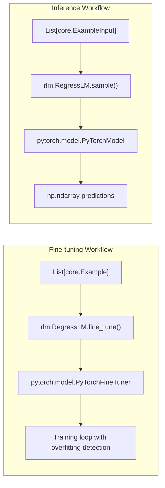

Sources: [README.md:17-31](), [README.md:38-53]()

## Architecture Highlights

### Numerical Tokenization Strategy

RegressLM implements specialized tokenization for floating-point numbers, converting them into discrete token sequences that transformer models can process effectively. This approach enables direct regression without intermediate classification steps.

### Modular Design

The system uses abstract base classes (`models.base.Model`, `models.base.FineTuner`) to separate interface definitions from implementations, currently providing PyTorch-based concrete implementations while allowing for future extensions to other frameworks.

### Encoder-Decoder Architecture

The neural architecture combines:
- **RopeEncoder**: Text encoder with Rotary Positional Embeddings
- **TransformerDecoder**: Standard transformer decoder for numerical sequence generation

This design enables the model to maintain separate representations for text understanding and numerical prediction while allowing cross-attention between modalities.

Sources: [README.md:1-55]()

---

# Page: Getting Started

# Getting Started

<details>
<summary>Relevant source files</summary>

The following files were used as context for generating this wiki page:

- [requirements-extras.txt](requirements-extras.txt)
- [requirements.txt](requirements.txt)
- [setup.py](setup.py)

</details>


This document provides a practical guide for installing and using RegressLM, covering installation, basic usage patterns, and key concepts needed to get started with text-to-numerical regression tasks. For detailed API documentation, see [API Reference](#3). For in-depth architectural information, see [Model System](#5).

## Installation

RegressLM can be installed as a Python package with its dependencies. The system requires Python 3.10 or higher.

### Dependencies

The core dependencies are defined in the requirements file:

| Package | Purpose |
|---------|---------|
| `numpy` | Numerical computation |
| `torch` | PyTorch deep learning framework |
| `torchtext` | Text processing utilities |
| `sentencepiece` | Subword tokenization |

### Installation Methods

**Option 1: Install from source**
```bash
git clone https://github.com/google-deepmind/regress-lm
cd regress-lm
pip install -e .
```

**Option 2: Install with extras (if available)**
```bash
pip install regress-lm[all]
```

Sources: [setup.py:55-67](), [requirements.txt:1-6]()

## Basic Usage Workflow

The primary interface is the `RegressLM` class, which provides methods for fine-tuning and inference on text-to-numerical regression tasks.

### Basic Usage Pattern

**Title: Basic RegressLM Usage Flow**
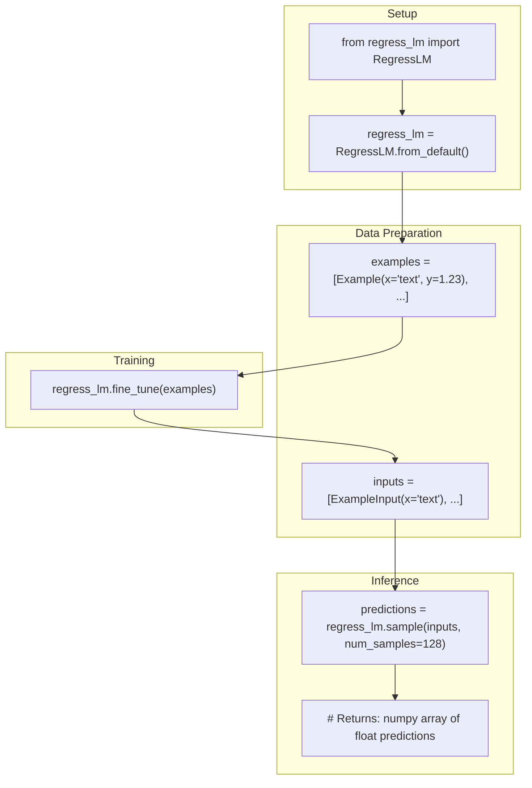

### Example Code Structure

```python
from regress_lm import RegressLM
from regress_lm.core import Example, ExampleInput

# Initialize model
regress_lm = RegressLM.from_default()

# Prepare training data
training_examples = [
    Example(x="The temperature is warm", y=23.5),
    Example(x="Cold winter day", y=-5.2),
    # ... more examples
]

# Fine-tune the model
regress_lm.fine_tune(training_examples)

# Make predictions
test_inputs = [
    ExampleInput(x="Hot summer afternoon"),
    ExampleInput(x="Mild spring weather"),
]

predictions = regress_lm.sample(test_inputs, num_samples=128)
# predictions is a numpy array of shape (num_inputs, num_samples)
```

Sources: Based on system architecture from diagrams and typical usage patterns

## Key Components Overview

Understanding the main components helps in effective usage of the system.

**Title: Core RegressLM Components**
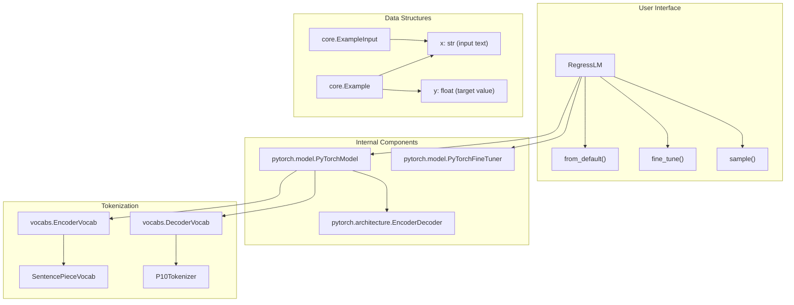

### Core Data Types

| Type | Purpose | Key Fields |
|------|---------|------------|
| `Example` | Training data point | `x` (input text), `y` (target number) |
| `ExampleInput` | Inference input | `x` (input text only) |
| `RegressLM` | Main API class | Model and fine-tuner instances |

### Default Configuration

The `from_default()` method initializes the system with:
- PyTorch-based model implementation
- Encoder-decoder architecture with rotary positional embeddings
- SentencePiece tokenization for text input
- P10 tokenization for numerical output
- Pre-configured hyperparameters for fine-tuning

Sources: Based on system architecture and typical class relationships

## Data Format Requirements

### Input Text Format

- **Encoding**: UTF-8 strings
- **Length**: Variable length (handled by tokenization)
- **Content**: Natural language text describing the regression target

### Target Values Format

- **Type**: Python `float` or convertible to float
- **Range**: Any finite floating-point number
- **Precision**: Limited by tokenizer precision (typically ~6 significant digits)

### Example Dataset Structure

```python
examples = [
    Example(x="Stock price increased 5%", y=105.0),
    Example(x="Temperature dropped significantly", y=-12.3),
    Example(x="Small improvement in accuracy", y=0.923),
]
```

Sources: Based on core data structures and tokenization system

## Configuration Options

### Model Initialization

The default configuration can be customized by accessing the underlying components:

```python
# Get default model
regress_lm = RegressLM.from_default()

# Access underlying components for configuration
model = regress_lm.model  # PyTorchModel instance
fine_tuner = regress_lm.fine_tuner  # PyTorchFineTuner instance
```

### Fine-tuning Parameters

Common parameters that can be adjusted:
- **Training epochs**: Controlled by early stopping
- **Batch size**: Handled automatically by the implementation
- **Validation split**: Automatic overfitting detection
- **Learning rate**: Set in the fine-tuner configuration

### Sampling Parameters

For inference, the main parameter is:
- **num_samples**: Number of samples to generate per input (default: 128)

Sources: Based on model system architecture and fine-tuning workflow

## Common Usage Patterns

### Pattern 1: Single Prediction
```python
# For a single prediction with uncertainty quantification
result = regress_lm.sample([ExampleInput(x="input text")], num_samples=1000)
mean_prediction = result[0].mean()
std_prediction = result[0].std()
```

### Pattern 2: Batch Processing
```python
# For processing multiple inputs efficiently
inputs = [ExampleInput(x=text) for text in input_texts]
predictions = regress_lm.sample(inputs, num_samples=128)
# Shape: (len(inputs), 128)
```

### Pattern 3: Iterative Fine-tuning
```python
# Fine-tune on initial data
regress_lm.fine_tune(initial_examples)

# Later, fine-tune on additional data
regress_lm.fine_tune(additional_examples)
```

Sources: Based on API design and typical machine learning workflows

## Next Steps

### For Basic Usage
- See [API Reference](#3) for complete method documentation
- See [Core Concepts](#4) for detailed data structure information

### For Advanced Usage
- See [Model System](#5) for architecture details
- See [Data Processing](#6) for tokenization customization
- See [Neural Architecture](#5.3) for model internals

### For Development
- See [Package Structure](#7) for codebase organization
- See [Contributing and License](#8) for contribution guidelines

Sources: Based on wiki page structure and typical user progression

---

# Page: API Reference

# API Reference

<details>
<summary>Relevant source files</summary>

The following files were used as context for generating this wiki page:

- [regress_lm/rlm.py](regress_lm/rlm.py)

</details>


This page documents the main user-facing `RegressLM` API class and its methods. The `RegressLM` class provides a high-level interface for text-to-numerical regression tasks, abstracting away the underlying model architecture and training details.

For information about the underlying model abstractions, see [Model Abstractions](#5.1). For details about the core data structures used by these APIs, see [Core Concepts](#4).

## RegressLM Class Overview

The `RegressLM` class serves as the primary entry point for users of the regress-lm system. It encapsulates a regression model and fine-tuner, providing simplified methods for training and inference.

```mermaid
graph TB
    subgraph "RegressLM API Layer"
        RLM["RegressLM"]
        Init["__init__(model, fine_tuner)"]
        FineTune["fine_tune(examples, validation_examples)"]
        FromDefault["from_default() -> RegressLM"]
        Sample["sample(xs, num_samples) -> np.ndarray[]"]
        
        RLM --> Init
        RLM --> FineTune
        RLM --> FromDefault
        RLM --> Sample
    end
    
    subgraph "Underlying Components"
        Model["model_base.Model"]
        FineTuner["model_base.FineTuner"]
        PyTorchModel["pytorch_model.PyTorchModel"]
        PyTorchFineTuner["pytorch_model.PyTorchFineTuner"]
        
        Model <|-- PyTorchModel
        FineTuner <|-- PyTorchFineTuner
    end
    
    subgraph "Data Types"
        Example["core.Example"]
        ExampleInput["core.ExampleInput"]
        NpArray["np.ndarray"]
    end
    
    Init --> Model
    Init --> FineTuner
    FromDefault --> PyTorchModel
    FromDefault --> PyTorchFineTuner
    FineTune --> Example
    Sample --> ExampleInput
    Sample --> NpArray
```

**API Class Structure**

Sources: [regress_lm/rlm.py:26-68]()

## Constructor and Configuration

### `__init__(model, fine_tuner)`

The constructor takes two required parameters:

| Parameter | Type | Description |
|-----------|------|-------------|
| `model` | `model_base.Model` | The underlying regression model implementation |
| `fine_tuner` | `model_base.FineTuner` | The fine-tuning implementation for the model |

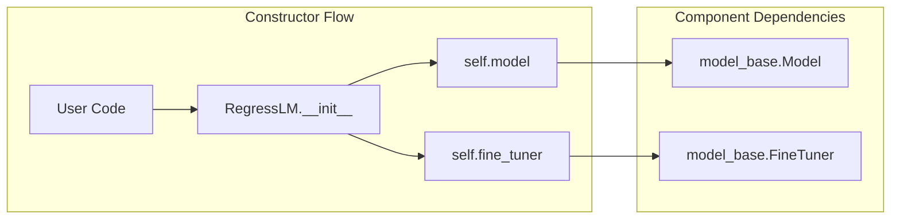

**Constructor Implementation**

Sources: [regress_lm/rlm.py:29-31]()

### `from_default()` Class Method

Creates a `RegressLM` instance with default configuration suitable for most text-to-numerical regression tasks.

**Default Configuration:**

| Component | Implementation | Configuration |
|-----------|----------------|---------------|
| Encoder Vocabulary | `SentencePieceVocab.from_t5()` | T5-based sentence piece tokenization |
| Decoder Vocabulary | `DecoderVocab(P10Tokenizer())` | P10 scientific notation tokenizer |
| Model Architecture | `PyTorchModel` | Transformer encoder-decoder |
| Fine-tuner | `PyTorchFineTuner` | PyTorch-based optimization |

**Model Hyperparameters:**

| Parameter | Default Value | Description |
|-----------|---------------|-------------|
| `max_input_len` | 2048 | Maximum input sequence length |
| `learning_rate` | 1e-4 | Learning rate for optimization |
| `d_model` | 512 | Model dimension |
| `nhead` | 8 | Number of attention heads |
| `num_encoder_layers` | 2 | Number of encoder layers |
| `num_decoder_layers` | 2 | Number of decoder layers |
| `dim_feedforward` | 2048 | Feedforward dimension |

Sources: [regress_lm/rlm.py:40-59]()

## Core Methods

### `fine_tune(examples, validation_examples=None)`

Performs fine-tuning on the provided training examples.

**Parameters:**

| Parameter | Type | Required | Description |
|-----------|------|----------|-------------|
| `examples` | `Sequence[core.Example]` | Yes | Training examples with input text and target values |
| `validation_examples` | `Sequence[core.Example] \| None` | No | Optional validation examples for overfitting detection |

**Behavior:**
- Delegates to the underlying `fine_tuner.fine_tune()` method
- Supports early stopping based on validation performance
- Modifies the model parameters in-place

Sources: [regress_lm/rlm.py:33-38]()

### `sample(xs, num_samples)`

Generates numerical predictions for the given input texts.

**Parameters:**

| Parameter | Type | Description |
|-----------|------|-------------|
| `xs` | `Sequence[core.ExampleInput]` | Input texts to generate predictions for |
| `num_samples` | `int` | Number of samples to generate per input |

**Returns:**
- `Sequence[np.ndarray]`: List of numpy arrays, one per input, each containing `num_samples` predictions

**Processing Flow:**

```mermaid
graph TB
    subgraph "sample() Method Flow"
        Input["xs: Sequence[ExampleInput]"]
        Convert["model.convert_inputs(xs)"]
        Decode["model.decode(examples, num_samples)"]
        Split["output_floats.split(axis=0)"]
        Output["Sequence[np.ndarray]"]
        
        Input --> Convert
        Convert --> Decode
        Decode --> Split
        Split --> Output
    end
    
    subgraph "Data Transformation"
        ExampleInput1["core.ExampleInput"]
        ConvertedEx["Converted Examples"]
        DecodedFloats["Decoded Float Arrays"]
        SplitArrays["Split Arrays"]
        
        ExampleInput1 --> ConvertedEx
        ConvertedEx --> DecodedFloats
        DecodedFloats --> SplitArrays
    end
```

**Sampling Process Details**

Sources: [regress_lm/rlm.py:61-67]()

## Usage Patterns

### Basic Usage Pattern

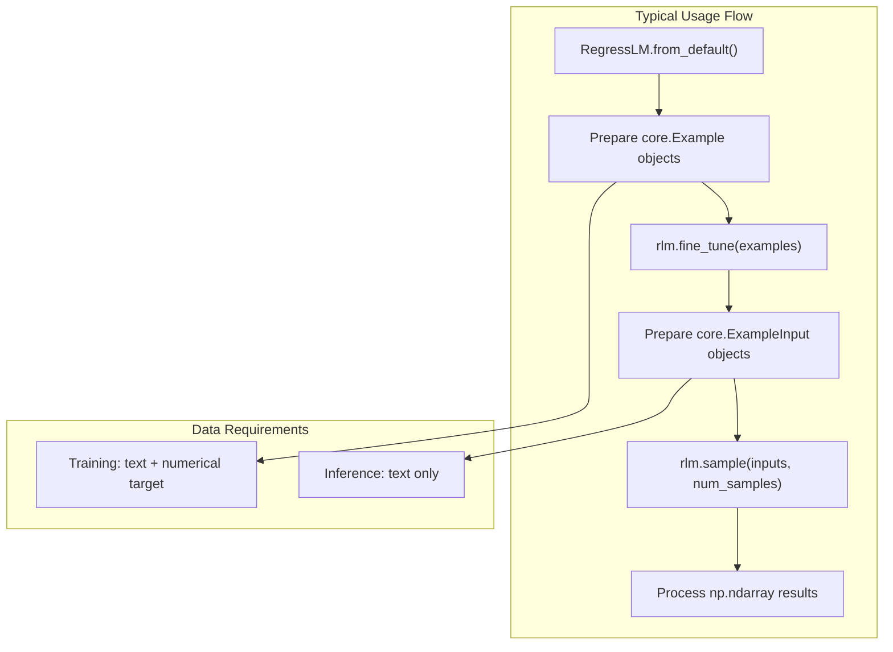

**Common Integration Pattern**

### Method Dependencies

The following diagram shows how `RegressLM` methods depend on underlying components:

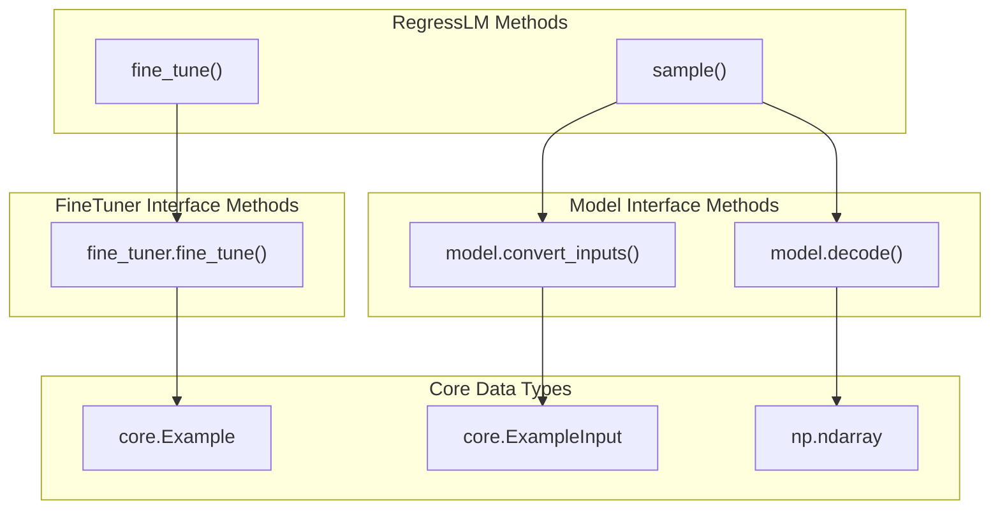

**Method Dependency Graph**

Sources: [regress_lm/rlm.py:33-67]()

## Import Requirements

To use the `RegressLM` API, the following imports are typically needed:

| Module | Purpose |
|--------|---------|
| `regress_lm.rlm` | Main `RegressLM` class |
| `regress_lm.core` | `Example` and `ExampleInput` data structures |
| `numpy` | Handling numerical output arrays |

Sources: [regress_lm/rlm.py:17-24]()

---

# Page: Core Concepts

# Core Concepts

<details>
<summary>Relevant source files</summary>

The following files were used as context for generating this wiki page:

- [regress_lm/core.py](regress_lm/core.py)
- [regress_lm/inference.py](regress_lm/inference.py)

</details>


This document explains the fundamental data structures and conceptual abstractions that form the foundation of RegressLM. These core concepts define how data flows through the system and how different components interact with each other.

For detailed information about the model implementations that use these concepts, see [Model System](#5). For specifics about data processing and tokenization, see [Data Processing](#6).

## Data Structures

RegressLM is built around two primary data structures that represent the inputs and outputs of the regression system.

### Example and ExampleInput

The system uses two closely related dataclasses to represent data at different stages of processing:

| Data Structure | Purpose | Fields | Usage |
|----------------|---------|--------|-------|
| `ExampleInput` | Represents input data for inference | `x: str` | Used when making predictions |
| `Example` | Represents complete training data | `x: str`, `y: float` | Used during training and evaluation |

The `ExampleInput` class contains only the input text that needs to be processed, while `Example` extends it to include the target numerical value for supervised learning.

**Data Flow Through System**

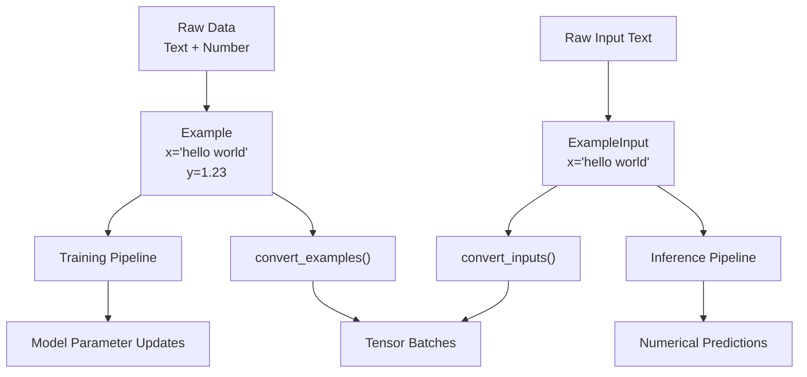

Sources: [regress_lm/core.py:20-29]()

## Inference Protocol

The `InferenceFn` protocol defines a standardized interface for performing inference operations on models. This abstraction allows the system to support different inference strategies while maintaining a consistent API.

### InferenceFn Interface

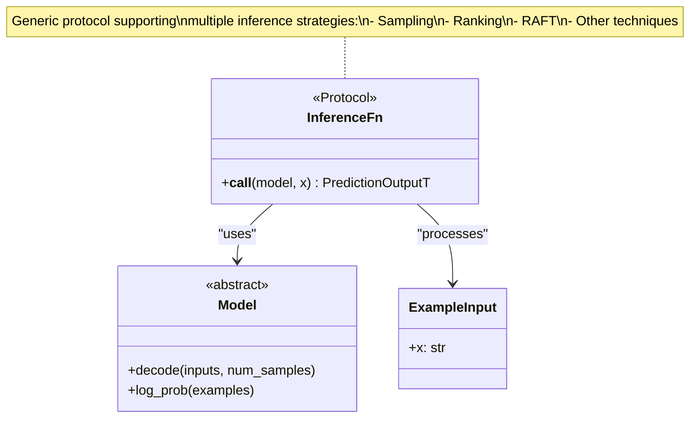

The protocol is designed with the following characteristics:

- **Generic Type Parameter**: `PredictionOutputT` allows different inference functions to return different output types
- **Model Agnostic**: Works with any model implementing the base `Model` interface
- **Extensible**: Supports various inference techniques beyond basic sampling

Sources: [regress_lm/inference.py:26-37]()

## Conceptual Data Flow

The core concepts work together to enable the text-to-numerical regression workflow:

**Training Flow**

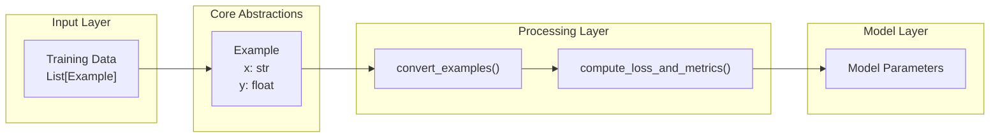

**Inference Flow**

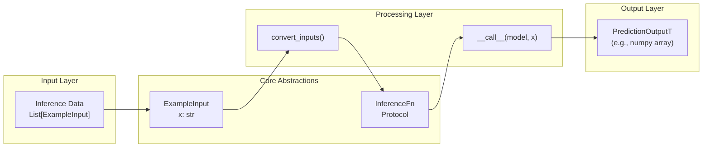

Sources: [regress_lm/core.py:20-29](), [regress_lm/inference.py:26-37]()

## Type System Integration

The core concepts are designed to work seamlessly with Python's type system and the broader RegressLM architecture:

| Concept | Type Annotation | Generic Parameter | Purpose |
|---------|-----------------|-------------------|---------|
| `ExampleInput` | `@dataclasses.dataclass` | None | Simple data container |
| `Example` | `@dataclasses.dataclass` | None | Extends `ExampleInput` |
| `InferenceFn` | `Protocol[PredictionOutputT]` | `PredictionOutputT` | Flexible inference interface |

The use of protocols and generic types allows the system to maintain type safety while supporting extensibility for different inference strategies and output formats.

Sources: [regress_lm/core.py:17-29](), [regress_lm/inference.py:17-37]()

---

# Page: Model System

# Model System

<details>
<summary>Relevant source files</summary>

The following files were used as context for generating this wiki page:

- [regress_lm/models/__init__.py](regress_lm/models/__init__.py)
- [regress_lm/models/base.py](regress_lm/models/base.py)

</details>


This document provides an overview of the model system architecture in RegressLM, explaining how abstract model interfaces are designed and implemented to support text-to-numerical regression tasks. The model system consists of abstract base classes that define the core functionality and concrete implementations that provide the actual neural network computations.

For detailed information about the abstract interfaces, see [Model Abstractions](#5.1). For the concrete PyTorch implementation details, see [PyTorch Implementation](#5.2). For the neural network architecture specifics, see [Neural Architecture](#5.3).

## System Architecture Overview

The model system is built around two main abstract base classes that define the core functionality: `Model` for inference and training computations, and `FineTuner` for model adaptation workflows.

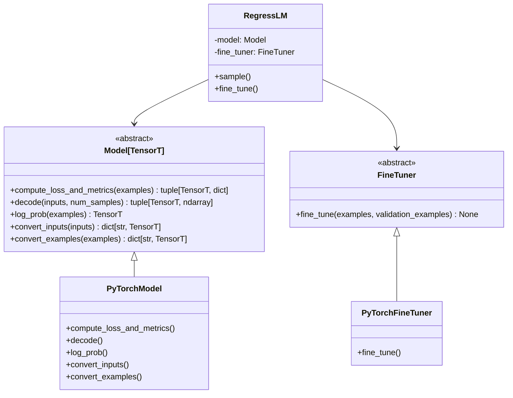

**Sources:** [regress_lm/models/base.py:26-86](), [regress_lm/models/__init__.py:23-25]()

## Core Abstractions

The model system uses generic type parameters to support different tensor frameworks while maintaining a consistent interface. The `TensorT` type variable allows the same abstract interface to work with PyTorch tensors, JAX arrays, or other tensor types.

### Model Interface

The `Model` class defines five essential methods that any implementation must provide:

| Method | Purpose | Input | Output |
|--------|---------|-------|---------|
| `compute_loss_and_metrics` | Training loss computation | Batched examples as tensors | Loss tensor and metrics dict |
| `decode` | Autoregressive generation | Batched inputs as tensors | Token sequences and float predictions |
| `log_prob` | Probability evaluation | Batched examples as tensors | Log probability tensor |
| `convert_inputs` | Input preprocessing | High-level `ExampleInput` objects | Batched tensor dict |
| `convert_examples` | Example preprocessing | High-level `Example` objects | Batched tensor dict |

### FineTuner Interface

The `FineTuner` class provides a single method `fine_tune` that handles model adaptation with optional validation-based early stopping. The interface is designed to be stateful, modifying the underlying model parameters directly.

**Sources:** [regress_lm/models/base.py:36-62](), [regress_lm/models/base.py:67-85]()

## Implementation Architecture

The system currently provides a PyTorch-based implementation that instantiates the abstract interfaces with concrete neural network components.

```mermaid
graph TB
    subgraph "Abstract Layer"
        ModelABC["Model[TensorT]<br/>base.py"]
        FineTunerABC["FineTuner<br/>base.py"]
    end
    
    subgraph "PyTorch Implementation"
        PyTorchModelImpl["PyTorchModel<br/>pytorch/model.py"]
        PyTorchFineTunerImpl["PyTorchFineTuner<br/>pytorch/model.py"]
        EncoderDecoderArch["EncoderDecoder<br/>pytorch/architecture.py"]
    end
    
    subgraph "External Dependencies"
        TorchTensors["torch.Tensor<br/>TensorT=torch.Tensor"]
        TorchOptim["torch.optim<br/>Training Loop"]
    end
    
    ModelABC <|-- PyTorchModelImpl
    FineTunerABC <|-- PyTorchFineTunerImpl
    PyTorchModelImpl --> EncoderDecoderArch
    PyTorchModelImpl --> TorchTensors
    PyTorchFineTunerImpl --> TorchOptim
    PyTorchFineTunerImpl --> PyTorchModelImpl
```

**Sources:** [regress_lm/models/__init__.py:22-25](), [regress_lm/models/base.py:22-23]()

## Data Flow Through Model System

The model system processes data through a standardized pipeline that converts high-level objects to tensor representations, performs neural computations, and converts results back to usable formats.

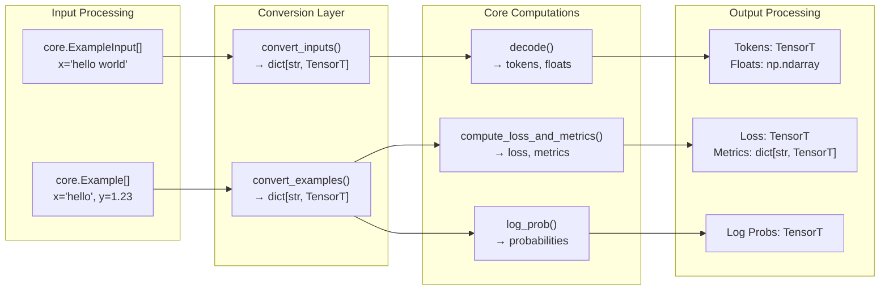

**Sources:** [regress_lm/models/base.py:36-62]()

## Integration Points

The model system integrates with other RegressLM components through well-defined interfaces:

- **Vocabulary System**: Models use encoder and decoder vocabularies to convert between text/numbers and token IDs
- **Core Data Structures**: The `convert_inputs` and `convert_examples` methods bridge between high-level `core.Example` objects and low-level tensor representations
- **Fine-tuning Workflow**: The `FineTuner` abstraction provides a clean interface for model adaptation that can be used by the main `RegressLM` API
- **Inference Pipeline**: The `decode` method supports the sampling-based inference required for numerical predictions

The generic type system (`TensorT`) allows the same abstract interfaces to work with different tensor frameworks, making the system extensible to JAX, TensorFlow, or other backends without changing the high-level API.

**Sources:** [regress_lm/models/base.py:18-23](), [regress_lm/models/base.py:53-62]()

---

# Page: Model Abstractions

# Model Abstractions

<details>
<summary>Relevant source files</summary>

The following files were used as context for generating this wiki page:

- [regress_lm/models/base.py](regress_lm/models/base.py)

</details>


This document covers the abstract base classes that define the core model interface and fine-tuning protocols in RegressLM. These abstractions provide a framework-agnostic interface that enables different tensor library implementations (PyTorch, JAX, etc.) while maintaining consistent behavior.

For concrete implementations of these abstractions, see [PyTorch Implementation](#5.2). For details on the neural architecture used by implementations, see [Neural Architecture](#5.3).

## Abstract Base Classes Overview

The model abstraction layer consists of two primary abstract base classes located in [regress_lm/models/base.py:26-86]():

- `Model`: Defines the core model interface for training, inference, and data conversion
- `FineTuner`: Defines the interface for fine-tuning models on new data

### Model Class Interface

The `Model` class is a generic abstract base class that uses type parameters to support different tensor frameworks:

```python
class Model(Generic[TensorT], abc.ABC)
```

The generic `TensorT` type parameter allows implementations to use framework-specific tensor types (e.g., `torch.Tensor`, `jax.Array`) while maintaining the same interface.

#### Core Model Methods

The `Model` class defines five abstract methods that implementations must provide:

| Method | Purpose | Input | Output |
|--------|---------|-------|--------|
| `compute_loss_and_metrics` | Training loss computation | Tensor batch | Loss + metrics |
| `decode` | Autoregressive decoding | Tensor inputs + sample count | Tokens + float predictions |
| `log_prob` | Probability evaluation | Tensor examples | Log probabilities |
| `convert_inputs` | Input preprocessing | `ExampleInput` sequence | Tensor batch |
| `convert_examples` | Example preprocessing | `Example` sequence | Tensor batch |

**Training Interface**

The [compute_loss_and_metrics:37-40]() method handles supervised learning:

```python
def compute_loss_and_metrics(
    self, examples: dict[str, TensorT]
) -> tuple[TensorT, dict[str, TensorT]]
```

This method takes batched tensor examples and returns both the scalar loss for backpropagation and a dictionary of metrics for monitoring.

**Inference Interface**

The [decode:43-46]() method performs autoregressive generation:

```python
def decode(
    self, inputs: dict[str, TensorT], num_samples: int
) -> tuple[TensorT, np.ndarray]
```

It takes tensor inputs and the number of samples to generate, returning both the raw token predictions and the corresponding floating-point values.

**Data Conversion Interface**

Two methods handle the conversion between high-level Python objects and low-level tensor representations:

- [convert_inputs:53-56](): Converts `core.ExampleInput` objects to tensor batches for inference
- [convert_examples:59-62](): Converts `core.Example` objects to tensor batches for training

### FineTuner Class Interface

The `FineTuner` abstract base class defines the interface for adapting pre-trained models to new data:

```python
class FineTuner(abc.ABC):
    def fine_tune(
        self,
        examples: Sequence[core.Example],
        validation_examples: Sequence[core.Example] | None = None,
    ) -> None
```

The [fine_tune:68-85]() method is stateful and modifies the model in-place rather than returning a new model instance. This design supports the common pattern where fine-tuning updates the existing model parameters.

## Abstraction Layer Architecture

The following diagram shows how the abstract base classes relate to the concrete implementations and the overall system:

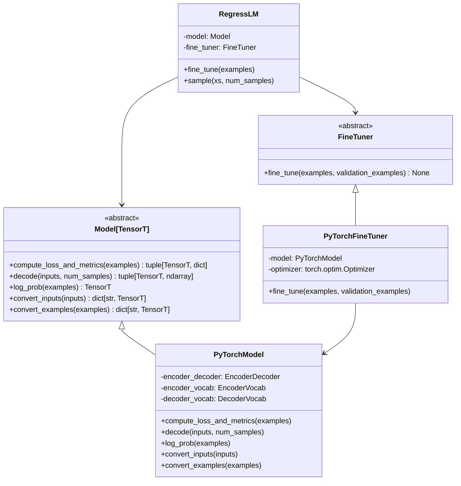

Sources: [regress_lm/models/base.py:26-86]()

## Data Flow Through Abstractions

The abstraction layer facilitates a clean separation between high-level user data and low-level tensor operations:

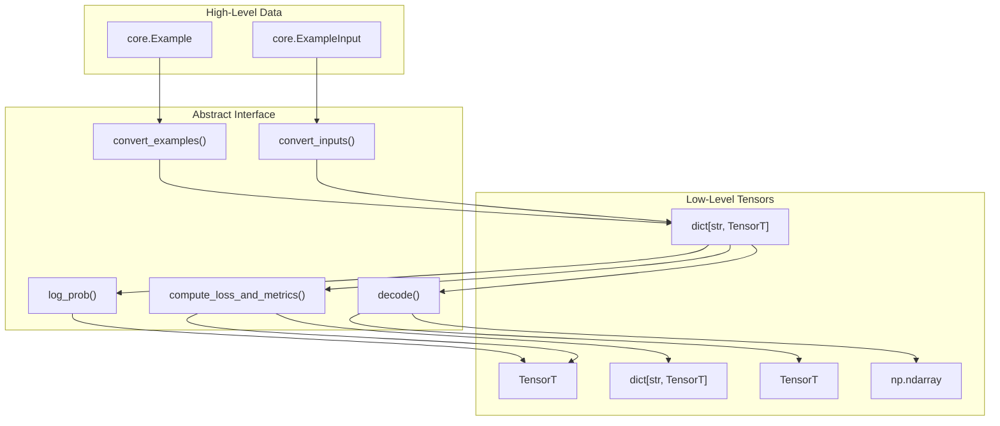

Sources: [regress_lm/models/base.py:37-62]()

## Generic Type Support

The `Model` class uses a generic type parameter `TensorT` to support different tensor frameworks:

```python
TensorT = TypeVar('TensorT')
class Model(Generic[TensorT], abc.ABC):
```

This design enables the same abstract interface to work with:
- PyTorch tensors (`torch.Tensor`)
- JAX arrays (`jax.Array`) 
- NumPy arrays (`np.ndarray`)
- Other tensor libraries

The [TensorT:23]() type variable is defined at the module level and represents the low-level tensor type used by a specific implementation.

## Implementation Requirements

Concrete implementations of these abstractions must:

1. **Specify the tensor type**: Choose a specific type for `TensorT` (e.g., `torch.Tensor`)
2. **Implement all abstract methods**: Provide concrete implementations for all five `Model` methods and the `FineTuner` method
3. **Handle data conversion**: Properly convert between `core.Example`/`core.ExampleInput` objects and tensor batches
4. **Maintain consistency**: Ensure that tensor shapes and types are consistent across all methods

The abstraction layer provides flexibility while enforcing a consistent interface that the main `RegressLM` class can depend on.

Sources: [regress_lm/models/base.py:22-86]()

---

# Page: PyTorch Implementation

# PyTorch Implementation

<details>
<summary>Relevant source files</summary>

The following files were used as context for generating this wiki page:

- [regress_lm/models/pytorch/model.py](regress_lm/models/pytorch/model.py)

</details>


This page documents the concrete PyTorch implementation of the RegressLM model system, including the `PyTorchModel` and `PyTorchFineTuner` classes. These classes provide the actual neural network implementation that realizes the abstract interfaces defined in the model system.

For information about the abstract base classes and interfaces, see [Model Abstractions](#5.1). For details about the underlying neural architecture, see [Neural Architecture](#5.3).

## Overview

The PyTorch implementation consists of two main classes that implement the abstract model interfaces:

| Class | Purpose | Base Class |
|-------|---------|------------|
| `PyTorchModel` | Core model implementation with loss computation, inference, and tokenization | `nn.Module`, `model_base.Model[Tensor]` |
| `PyTorchFineTuner` | Fine-tuning orchestration with overfitting detection and early stopping | `model_base.FineTuner` |

## PyTorchModel Architecture

The `PyTorchModel` class serves as the primary implementation of the regression language model, combining PyTorch's `nn.Module` with the abstract `Model` interface.

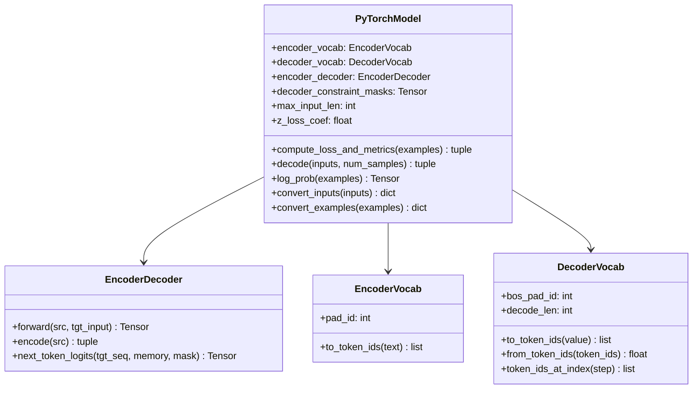

**Sources:** [regress_lm/models/pytorch/model.py:35-65]()

### Key Components

The `PyTorchModel` constructor initializes several critical components:

- **Vocabularies**: `encoder_vocab` and `decoder_vocab` handle text and numerical tokenization respectively
- **Architecture**: `encoder_decoder` provides the underlying transformer architecture 
- **Constraints**: `decoder_constraint_masks` pre-computed masks ensure valid token generation at each decoding step
- **Configuration**: `max_input_len`, `z_loss_coef` control model behavior

**Sources:** [regress_lm/models/pytorch/model.py:38-64]()

## Core Model Operations

### Loss Computation and Training

The `compute_loss_and_metrics` method implements the primary training objective using cross-entropy loss with optional z-loss regularization:

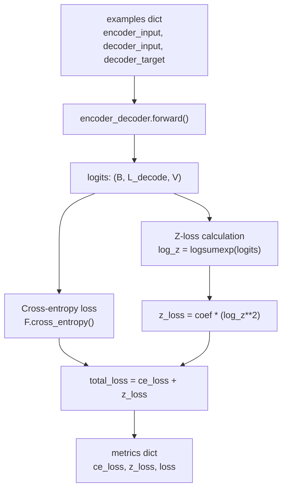

The method handles padding tokens by using `ignore_index=self.decoder_vocab.bos_pad_id` in the cross-entropy calculation and applying masks for z-loss computation.

**Sources:** [regress_lm/models/pytorch/model.py:66-93]()

### Autoregressive Decoding

The `decode` method implements constrained autoregressive generation with multiple sampling:

```mermaid
flowchart TD
    inputs["inputs dict<br/>encoder_input: (B, L_src)"] --> encode["encoder_decoder.encode()"]
    encode --> memory["memory: (B, L_src, D)<br/>memory_key_padding_mask: (B, L_src)"]
    memory --> expand["Expand for num_samples<br/>(B, L_src, D) → (B*S, L_src, D)"]
    expand --> init_tgt["Initialize decoder input<br/>current_tgt_ids: (B*S, 1)"]
    
    init_tgt --> loop_start["Autoregressive Loop<br/>for step_idx in range(decode_len)"]
    loop_start --> next_token["next_token_logits()<br/>(B*S, V)"]
    next_token --> constraints["Apply decoder_constraint_masks<br/>mask invalid tokens"]
    constraints --> sample["Temperature sampling<br/>torch.multinomial()"]
    sample --> store["Store token_ids<br/>generated_sequences_ids"]
    store --> continue_check{"step_idx < decode_len - 1?"}
    continue_check -->|Yes| update_input["Update current_tgt_ids<br/>cat([current_tgt_ids, token_ids])"]
    update_input --> loop_start
    continue_check -->|No| reshape["Reshape to (B, num_samples, L_decode)"]
    reshape --> convert_floats["Convert token_ids to floats<br/>decoder_vocab.from_token_ids()"]
    convert_floats --> output["final_decoded_ids, output_floats"]
```

The decoding process uses pre-computed constraint masks to ensure only valid tokens are generated at each position, maintaining the numerical format requirements.

**Sources:** [regress_lm/models/pytorch/model.py:95-170]()

### Data Conversion Methods

The model provides conversion methods that bridge between high-level data types and tensor representations:

| Method | Input | Output | Purpose |
|--------|-------|--------|---------|
| `convert_inputs` | `Sequence[core.ExampleInput]` | `dict[str, Tensor]` | Convert inference inputs to tensors |
| `convert_examples` | `Sequence[core.Example]` | `dict[str, Tensor]` | Convert training examples to tensors |

Both methods handle tokenization and padding/truncation according to `max_input_len`.

**Sources:** [regress_lm/models/pytorch/model.py:190-207]()

## PyTorchFineTuner Implementation

The `PyTorchFineTuner` class orchestrates the fine-tuning process with built-in overfitting detection:

```mermaid
flowchart TD
    init["PyTorchFineTuner.__init__()<br/>model, optimizer"] --> setup["Setup validation data<br/>convert_examples()"]
    setup --> epoch_loop["Epoch Loop<br/>for _ in range(max_epochs)"]
    
    epoch_loop --> eval_mode["model.eval()"]
    eval_mode --> val_loss["Compute validation loss<br/>valid_losses.append()"]
    val_loss --> overfit_check["_detect_overfitting()<br/>losses[-1] > losses[-2]"]
    
    overfit_check -->|Yes| early_stop["Early stopping<br/>load_state_dict(prev_state)"]
    overfit_check -->|No| save_state["prev_state = current_state"]
    
    save_state --> batch_loop["Batch training loop<br/>num_batches = ceil(len/batch_size)"]
    batch_loop --> train_step["_train_step()<br/>loss.backward(), optimizer.step()"]
    train_step --> update_state["state = model.state_dict()"]
    update_state --> epoch_loop
    
    early_stop --> final_load["Load best state<br/>model.load_state_dict(state)"]
    update_state --> continue_check{"Continue training?"}
    continue_check -->|Yes| epoch_loop
    continue_check -->|No| final_load
```

### Overfitting Detection

The fine-tuner implements a simple but effective overfitting detection mechanism:

```python
def _detect_overfitting(losses: Sequence[float]) -> bool:
  if len(losses) <= 1:
    return False
  return losses[-1] > losses[-2]
```

This compares consecutive validation losses and triggers early stopping when validation loss increases.

**Sources:** [regress_lm/models/pytorch/model.py:233-236](), [regress_lm/models/pytorch/model.py:252-302]()

## Integration with System Components

The PyTorch implementation integrates with several key system components:

```mermaid
graph TD
    subgraph "PyTorch Implementation"
        PyTorchModel["PyTorchModel"]
        PyTorchFineTuner["PyTorchFineTuner"]
    end
    
    subgraph "Architecture Layer"
        EncoderDecoder["architecture.EncoderDecoder"]
        RopeEncoder["architecture.RopeEncoder"]
        TransformerDecoder["architecture.TransformerDecoder"]
    end
    
    subgraph "Vocabulary Layer"
        EncoderVocab["vocabs.EncoderVocab"]
        DecoderVocab["vocabs.DecoderVocab"]
    end
    
    subgraph "Core Data Types"
        Example["core.Example"]
        ExampleInput["core.ExampleInput"]
    end
    
    subgraph "Base Abstractions"
        ModelBase["model_base.Model"]
        FineTunerBase["model_base.FineTuner"]
    end
    
    PyTorchModel --> EncoderDecoder
    EncoderDecoder --> RopeEncoder
    EncoderDecoder --> TransformerDecoder
    PyTorchModel --> EncoderVocab
    PyTorchModel --> DecoderVocab
    PyTorchModel --> Example
    PyTorchModel --> ExampleInput
    PyTorchModel -.->|implements| ModelBase
    PyTorchFineTuner -.->|implements| FineTunerBase
    PyTorchFineTuner --> PyTorchModel
```

The implementation serves as the concrete realization of the abstract model interfaces, utilizing the specialized architecture and vocabulary components while maintaining compatibility with the core data types.

**Sources:** [regress_lm/models/pytorch/model.py:15-28](), [regress_lm/models/pytorch/model.py:35-60]()

---

# Page: Neural Architecture

# Neural Architecture

<details>
<summary>Relevant source files</summary>

The following files were used as context for generating this wiki page:

- [regress_lm/models/pytorch/architecture.py](regress_lm/models/pytorch/architecture.py)

</details>


This document describes the neural network architecture implementation in RegressLM's PyTorch backend. The architecture consists of an encoder-decoder transformer model with specialized positional encoding strategies optimized for text-to-number regression tasks.

For information about the abstract model interfaces, see [Model Abstractions](#5.1). For the PyTorch model implementation that uses this architecture, see [PyTorch Implementation](#5.2).

## Architecture Overview

The core neural architecture is implemented in the `EncoderDecoder` class, which combines a RoPE-enabled encoder with a standard transformer decoder. This hybrid approach leverages the length generalization benefits of Rotary Positional Embeddings for input text processing while using conventional positional encodings for numerical output generation.

```mermaid
graph TB
    subgraph "Input Processing"
        SrcTokens["src: Tensor"]
        TgtTokens["tgt_input: Tensor"]
        SrcEmb["src_tok_emb"]
        TgtEmb["tgt_tok_emb"]
    end
    
    subgraph "EncoderDecoder Architecture"
        subgraph "Encoder Stack"
            RoPE["RotaryPositionalEmbedding"]
            EncLayers["RopeEncoder"]
            EncLayer1["RopeTransformerEncoderLayer"]
            EncLayer2["RopeTransformerEncoderLayer"]
            EncLayerN["..."]
        end
        
        subgraph "Decoder Stack"
            StdPE["PositionalEncoding"]
            DecLayers["TransformerDecoder"]
            DecLayer1["TransformerDecoderLayer"]
            DecLayer2["TransformerDecoderLayer"]
            DecLayerN["..."]
        end
        
        Generator["generator: Linear"]
    end
    
    subgraph "Output"
        Logits["Output Logits"]
    end
    
    SrcTokens --> SrcEmb
    TgtTokens --> TgtEmb
    SrcEmb --> RoPE
    TgtEmb --> StdPE
    RoPE --> EncLayers
    EncLayers --> EncLayer1
    EncLayer1 --> EncLayer2
    EncLayer2 --> EncLayerN
    
    StdPE --> DecLayers
    DecLayers --> DecLayer1
    DecLayer1 --> DecLayer2
    DecLayer2 --> DecLayerN
    
    EncLayerN --> DecLayers
    DecLayerN --> Generator
    Generator --> Logits
```

Sources: [regress_lm/models/pytorch/architecture.py:225-333]()

## Encoder Architecture with RoPE

The encoder uses Rotary Positional Embeddings (RoPE) to achieve better length generalization for input text sequences. The `RopeEncoder` consists of multiple `RopeTransformerEncoderLayer` instances, each implementing multi-head self-attention with rotary embeddings.

### RoPE Implementation Details

```mermaid
graph LR
    subgraph "RotaryPositionalEmbedding"
        InvFreq["inv_freq: Buffer"]
        CosCache["cos_cached: Buffer"]
        SinCache["sin_cached: Buffer"]
    end
    
    subgraph "apply_rotary_pos_emb"
        QInput["q: Tensor"]
        KInput["k: Tensor"]
        QReshape["q_reshaped"]
        KReshape["k_reshaped"]
        QOut["q_out: Tensor"]
        KOut["k_out: Tensor"]
    end
    
    InvFreq --> CosCache
    InvFreq --> SinCache
    CosCache --> QReshape
    SinCache --> QReshape
    QInput --> QReshape
    KInput --> KReshape
    QReshape --> QOut
    KReshape --> KOut
```

The `RotaryPositionalEmbedding` class precomputes rotation matrices based on inverse frequencies and caches sine/cosine values for efficiency. The rotation is applied to query and key tensors by reshaping them to separate even and odd dimensions, then applying the rotation formula.

Key implementation details:
- **Base frequency**: Default 10000, configurable via constructor
- **Cached computations**: Sine and cosine values precomputed up to `max_len`
- **Head dimension**: RoPE applied per attention head (`d_model // nhead`)

Sources: [regress_lm/models/pytorch/architecture.py:24-76]()

### Encoder Layer Structure

```mermaid
graph TB
    Input["Input: x"]
    Norm1["norm1: LayerNorm"]
    SelfAttn["_sa_block"]
    Dropout1["dropout1"]
    Add1["Residual Add"]
    Norm2["norm2: LayerNorm"]
    FFN["_ff_block"]
    Dropout2["dropout2"]
    Add2["Residual Add"]
    Output["Output"]
    
    subgraph "_sa_block Details"
        QPproj["q_proj: Linear"]
        KProj["k_proj: Linear"]
        VProj["v_proj: Linear"]
        RoPEApply["apply_rotary_pos_emb"]
        SDPA["scaled_dot_product_attention"]
        OutProj["out_proj: Linear"]
    end
    
    subgraph "_ff_block Details"
        Linear1["linear1: Linear"]
        Activation["activation: ReLU"]
        FFDropout["ff_dropout"]
        Linear2["linear2: Linear"]
    end
    
    Input --> Norm1
    Norm1 --> SelfAttn
    SelfAttn --> QProjQPR
    SelfAttn --> KProj
    SelfAttn --> VProj
    QProjQPR --> RoPEApply
    KProj --> RoPEApply
    RoPEApply --> SDPA
    VProj --> SDPA
    SDPA --> OutProj
    SelfAttn --> Dropout1
    Dropout1 --> Add1
    Input --> Add1
    Add1 --> Norm2
    Norm2 --> FFN
    FFN --> Linear1
    Linear1 --> Activation
    Activation --> FFDropout
    FFDropout --> Linear2
    FFN --> Dropout2
    Dropout2 --> Add2
    Add1 --> Add2
    Add2 --> Output
```

The encoder uses Pre-LayerNorm architecture where normalization is applied before each sub-layer. This structure is implemented in the `RopeTransformerEncoderLayer.forward` method with residual connections around both attention and feed-forward blocks.

Sources: [regress_lm/models/pytorch/architecture.py:78-197]()

## Decoder Architecture with Standard Positional Encoding

The decoder uses PyTorch's built-in `TransformerDecoder` with standard sinusoidal positional encodings. This choice provides stable performance for the relatively short numerical token sequences produced by the decoder vocabulary.

### Positional Encoding Implementation

The `PositionalEncoding` class implements the standard transformer positional encoding formula:

- **Even positions**: `PE(pos, 2i) = sin(pos / 10000^(2i/d_model))`
- **Odd positions**: `PE(pos, 2i+1) = cos(pos / 10000^(2i/d_model))`

The encoding is added to token embeddings and includes dropout for regularization.

Sources: [regress_lm/models/pytorch/architecture.py:199-216]()

### Decoder Configuration

| Component | Implementation | Purpose |
|-----------|---------------|---------|
| `decoder` | `nn.TransformerDecoder` | Standard transformer decoder stack |
| `decoder_layer` | `nn.TransformerDecoderLayer` | Individual decoder layers with causal masking |
| `generator` | `nn.Linear` | Final projection to vocabulary logits |
| **Architecture Options** | `batch_first=True, norm_first=True` | Optimized tensor layout and Pre-LN |

Sources: [regress_lm/models/pytorch/architecture.py:263-275]()

## Forward Pass and Inference Methods

The `EncoderDecoder` class provides three main computation methods:

### Training Forward Pass

```mermaid
graph LR
    SrcInput["src: Tensor"]
    TgtInput["tgt_input: Tensor"]
    
    subgraph "Encoding Phase"
        SrcEmbed["src_tok_emb"]
        EncProcess["encoder + rotary_pos_emb"]
        Memory["memory: Tensor"]
    end
    
    subgraph "Decoding Phase"
        TgtEmbed["tgt_tok_emb"]
        DecPE["decoder_positional_encoding"]
        DecProcess["decoder"]
        GenProj["generator"]
    end
    
    Logits["logits: Tensor"]
    
    SrcInput --> SrcEmbed
    SrcEmbed --> EncProcess
    EncProcess --> Memory
    
    TgtInput --> TgtEmbed
    TgtEmbed --> DecPE
    DecPE --> DecProcess
    Memory --> DecProcess
    DecProcess --> GenProj
    GenProj --> Logits
```

The `forward` method processes complete sequences for training, applying causal masking to prevent the decoder from seeing future tokens.

### Encoding-Only Method

The `encode` method processes only the source sequence and returns the encoded memory along with padding masks. This is used during inference to avoid recomputing encoder outputs.

### Next Token Prediction

The `next_token_logits` method performs single-step decoding given the current target sequence and pre-computed memory. This enables efficient autoregressive generation during sampling.

Sources: [regress_lm/models/pytorch/architecture.py:280-333]()

## Attention Optimization

The architecture uses PyTorch's Scaled Dot-Product Attention with backend selection for optimal performance:

```python
SPD_BACKENDS = [
    nn.attention.SDPBackend.FLASH_ATTENTION,
    nn.attention.SDPBackend.MATH,
    nn.attention.SDPBackend.EFFICIENT_ATTENTION,
]
```

The `sdpa_kernel` context manager enables Flash Attention when available, falling back to optimized implementations for memory efficiency and speed.

Sources: [regress_lm/models/pytorch/architecture.py:218-223](), [regress_lm/models/pytorch/architecture.py:286-300](), [regress_lm/models/pytorch/architecture.py:307-331]()

---

# Page: Model Testing and Examples

# Model Testing and Examples

<details>
<summary>Relevant source files</summary>

The following files were used as context for generating this wiki page:

- [regress_lm/models/pytorch/architecture_test.py](regress_lm/models/pytorch/architecture_test.py)
- [regress_lm/models/pytorch/model_test.py](regress_lm/models/pytorch/model_test.py)

</details>


This page demonstrates how the model system works through concrete test examples and usage patterns. It covers the test infrastructure, data conversion workflows, training procedures, and inference patterns used to validate the PyTorch model implementation.

For information about the abstract model interfaces, see [Model Abstractions](#5.1). For details about the PyTorch implementation classes, see [PyTorch Implementation](#5.2). For the underlying neural architecture, see [Neural Architecture](#5.3).

## Test Infrastructure and Setup

The model testing infrastructure demonstrates how to properly initialize and configure the PyTorch model components for both training and inference scenarios.

### Model Configuration

The test setup in `ModelTest` shows the standard pattern for creating a complete model instance with vocabularies and architecture parameters:

```mermaid
graph TB
    subgraph TestSetup["ModelTest.setUp()"]
        TorchSeed[torch.manual_seed:42]
        EncVocab[BasicEnglishVocab:hello_world]
        DecVocab[DecoderVocab:P10Tokenizer]
        ArchKwargs[architecture_kwargs:d_model_16_nhead_2]
        PyTorchModel[PyTorchModel:max_input_len_4]
        Optimizer[optim.Adafactor:lr_1.0]
    end
    
    TorchSeed --> EncVocab
    TorchSeed --> DecVocab
    EncVocab --> PyTorchModel
    DecVocab --> PyTorchModel
    ArchKwargs --> PyTorchModel
    PyTorchModel --> Optimizer
    
    style TestSetup fill:#f9f9f9
```

Sources: [regress_lm/models/pytorch/model_test.py:29-50]()

### Architecture Testing Setup

The `ArchitectureTest` demonstrates direct testing of the `EncoderDecoder` architecture without the full model wrapper:

| Component | Configuration | Purpose |
|-----------|---------------|---------|
| `encoder_vocab` | `BasicEnglishVocab(["hello", "world", "foo", "bar"])` | Text tokenization |
| `decoder_vocab` | `DecoderVocab(P10Tokenizer())` | Numerical tokenization |
| `max_encoder_len` | `15` | Input sequence limit |
| `d_model` | `32` | Model dimension |
| `nhead` | `2` | Attention heads |
| `num_encoder_layers` | `1` | Encoder depth |
| `num_decoder_layers` | `1` | Decoder depth |

Sources: [regress_lm/models/pytorch/architecture_test.py:26-51]()

## Data Conversion Pipeline Testing

The data conversion process transforms `core.Example` instances into tensor batches suitable for model training and inference.

### Example-to-Tensor Conversion

```mermaid
graph LR
    subgraph InputData["Input Examples"]
        Ex1[core.Example:x_hello_y_1.0]
        Ex2[core.Example:x_world_y_2.0]
    end
    
    subgraph ConversionProcess["convert_examples()"]
        EncConv["encoder tokenization"]
        DecConv["decoder tokenization"]
        BatchTensor["tensor batching"]
    end
    
    subgraph OutputTensors["Tensor Batch"]
        EncInput["encoder_input:[[2,0,0,0],[3,0,0,0]]"]
        DecInput["decoder_input:[[0,1,4,3,3,3,16],[0,1,5,3,3,3,16]]"]
        DecTarget["decoder_target:[[1,4,3,3,3,16,0],[1,5,3,3,3,16,0]]"]
    end
    
    Ex1 --> EncConv
    Ex2 --> EncConv
    Ex1 --> DecConv
    Ex2 --> DecConv
    EncConv --> BatchTensor
    DecConv --> BatchTensor
    BatchTensor --> EncInput
    BatchTensor --> DecInput
    BatchTensor --> DecTarget
```

The test validates the specific token sequences produced:
- Input text "hello" → encoder tokens `[2, 0, 0, 0]`
- Target value `1.0` → decoder input `[0, 1, 4, 3, 3, 3, 16]`
- Decoder target shifts input by one position: `[1, 4, 3, 3, 3, 16, 0]`

Sources: [regress_lm/models/pytorch/model_test.py:52-67]()

## Training Loop Testing

The training workflow demonstrates how gradient-based learning improves model performance through repeated forward and backward passes.

### Gradient Step Workflow

```mermaid
graph TB
    subgraph TrainingStep["_train_step() workflow"]
        Examples[examples:converted_tensors]
        LogProbBefore[log_prob:before_-26.81]
        TrainStep[_train_step:model_optimizer_examples]
        LogProbAfter[log_prob:after_-23.71]
        Improvement[improvement:2.71_better]
    end
    
    Examples --> LogProbBefore
    LogProbBefore --> TrainStep
    TrainStep --> LogProbAfter
    LogProbAfter --> Improvement
    
    style TrainStep fill:#f0f0f0
```

The test demonstrates measurable learning:
- Initial log probability: `-26.81`
- Post-training log probability: `-23.71` 
- Improvement: `2.71` increase in log probability

Sources: [regress_lm/models/pytorch/model_test.py:69-80]()

### Training Step Implementation

The `_train_step` function (referenced but not shown in tests) follows the standard pattern:
1. Forward pass through model
2. Loss computation
3. Backward pass (`loss.backward()`)
4. Optimizer step (`optimizer.step()`)
5. Gradient reset (`optimizer.zero_grad()`)

Sources: [regress_lm/models/pytorch/model_test.py:78]()

## Inference and Decoding Testing

The inference workflow shows how trained models generate numerical predictions through autoregressive decoding.

### Decoding Process

```mermaid
graph TB
    subgraph DecodingWorkflow["decode() method testing"]
        InputEx[core.Example:x_hello_y_2.123]
        ConvertEx[convert_examples:tensor_batch]
        DecodeCall[decode:num_samples_1024]
        DecodedIds[decoded_ids:shape_1_1024_6]
        OutputFloats[output_floats:predictions]
        MedianCheck[median:-0.0003233]
    end
    
    subgraph AfterTraining["Post-training improvement"]
        TrainStep2[_train_step:gradient_update]
        DecodeAgain[decode:num_samples_128]
        ImprovedMedian[median:2.322_closer_to_target]
    end
    
    InputEx --> ConvertEx
    ConvertEx --> DecodeCall
    DecodeCall --> DecodedIds
    DecodeCall --> OutputFloats
    OutputFloats --> MedianCheck
    
    MedianCheck --> TrainStep2
    TrainStep2 --> DecodeAgain
    DecodeAgain --> ImprovedMedian
```

Key validation points:
- Decoded tensor shape: `(1, 1024, 6)` for 1 example, 1024 samples, 6 tokens each
- Sample predictions: first sample `-0.2398`, second sample `-230200000.0`
- Pre-training median: `-0.0003233`
- Post-training median: `2.322` (closer to target `2.123`)

Sources: [regress_lm/models/pytorch/model_test.py:82-96]()

## Architecture Component Testing

The architecture tests validate individual components of the `EncoderDecoder` system without the full model wrapper.

### Forward Pass Testing

```mermaid
graph LR
    subgraph InputTensors["Input Setup"]
        SrcTokens[src:batch_2_seq_10_with_padding]
        TgtTokens[tgt_input:batch_2_decode_len_plus_1]
    end
    
    subgraph ForwardPass["model(src, tgt_input)"]
        EncoderPass[encoder:processes_src]
        DecoderPass[decoder:processes_tgt_with_memory]
        OutputLogits[output_logits:shape_batch_tgt_vocab]
    end
    
    SrcTokens --> EncoderPass
    TgtTokens --> DecoderPass
    EncoderPass --> DecoderPass
    DecoderPass --> OutputLogits
```

Expected output shape: `(batch_size, tgt_seq_len, len(decoder_vocab))`

Sources: [regress_lm/models/pytorch/architecture_test.py:53-73]()

### Autoregressive Decoding Simulation

The architecture test includes a manual autoregressive loop that demonstrates step-by-step token generation:

```mermaid
graph TB
    subgraph AutoregressiveLoop["Basic decode loop simulation"]
        InitToken[current_tgt_tokens:bos_pad_id]
        EncodeStep[encode:src_to_memory]
        DecodeLoop[for_step_in_max_decode_steps]
        NextLogits[next_token_logits:current_tgt_memory_mask]
        ArgMax[torch.argmax:predicted_token_id]
        AppendToken[torch.cat:extend_sequence]
        ValidateIds[validate:0_le_token_lt_vocab_len]
    end
    
    InitToken --> EncodeStep
    EncodeStep --> DecodeLoop
    DecodeLoop --> NextLogits
    NextLogits --> ArgMax
    ArgMax --> AppendToken
    AppendToken --> DecodeLoop
    DecodeLoop --> ValidateIds
```

The loop validates:
- Token IDs remain within vocabulary bounds: `0 <= token_id < len(decoder_vocab)`
- Sequence grows by one token per step
- Process starts with `decoder_vocab.bos_pad_id`

Sources: [regress_lm/models/pytorch/architecture_test.py:131-163]()

### Memory and Attention Mask Testing

The encoder testing validates memory tensor creation and padding mask generation:

| Test Aspect | Expected Behavior | Validation |
|-------------|-------------------|------------|
| Memory shape | `(batch_size, src_seq_len, d_model)` | Tensor dimensions |
| Padding mask shape | `(batch_size, src_seq_len)` | Boolean tensor |
| Padding detection | `True` for pad positions | `torch.all(memory_key_padding_mask[0, -3:])` |
| Non-padding positions | `False` for content | `torch.any(memory_key_padding_mask[0, :-3])` |

Sources: [regress_lm/models/pytorch/architecture_test.py:74-92]()

## Test Patterns and Best Practices

The testing infrastructure demonstrates several important patterns:

### Deterministic Testing
- `torch.manual_seed(42)` ensures reproducible results
- Specific numeric assertions with tolerance (e.g., `assertAlmostEqual(..., 1)`)

### Shape Validation
- Consistent checking of tensor dimensions at each processing stage
- Validation of batch processing with multiple examples

### Gradient Flow Testing
- Before/after comparisons to verify learning
- Integration of optimizer with model training steps

### Comprehensive Coverage
- Unit tests for individual components (`ArchitectureTest`)
- Integration tests for complete workflows (`ModelTest`)

Sources: [regress_lm/models/pytorch/model_test.py:29-100](), [regress_lm/models/pytorch/architecture_test.py:24-167]()

---

# Page: Data Processing

# Data Processing

<details>
<summary>Relevant source files</summary>

The following files were used as context for generating this wiki page:

- [regress_lm/tokenizers.py](regress_lm/tokenizers.py)
- [regress_lm/vocabs.py](regress_lm/vocabs.py)

</details>


## Purpose and Scope

The data processing system in RegressLM handles the conversion of raw text and numerical data into tokenized representations suitable for neural network training and inference. This system provides two main capabilities: text tokenization for the encoder input and specialized numerical tokenization for the decoder output.

For detailed information about the abstract model interfaces that consume these processed tokens, see [Model Abstractions](#5.1). For the neural architecture that processes these tokens, see [Neural Architecture](#5.3).

## System Architecture

The data processing system consists of two parallel tokenization pipelines that work together to handle the text-to-number regression task:

```mermaid
graph TB
    subgraph "Input Processing"
        RawText["Raw Text Input<br/>'The temperature is high'"]
        RawFloat["Target Float<br/>98.6"]
    end
    
    subgraph "Text Tokenization Pipeline"
        EncoderVocab["EncoderVocab<br/>(Abstract Base)"]
        BasicEnglishVocab["BasicEnglishVocab"]
        SentencePieceVocab["SentencePieceVocab"]
        EncoderTokens["Encoder Token IDs<br/>[101, 1996, 4860, 2003, 2152, 102]"]
        
        EncoderVocab --> BasicEnglishVocab
        EncoderVocab --> SentencePieceVocab
    end
    
    subgraph "Numerical Tokenization Pipeline"
        DecoderVocab["DecoderVocab"]
        DecoderTokenizer["DecoderTokenizer<br/>(Abstract Base)"]
        P10Tokenizer["P10Tokenizer<br/>s * m * 10^e"]
        IEEEFloatTokenizer["IEEEFloatTokenizer<br/>s * b^e * m"]
        DecoderTokens["Decoder Token IDs<br/>[1, 2, 9, 8, 6, 10]"]
        
        DecoderVocab --> DecoderTokenizer
        DecoderTokenizer --> P10Tokenizer
        DecoderTokenizer --> IEEEFloatTokenizer
    end
    
    subgraph "External Libraries"
        TorchText["torchtext.vocab.Vocab"]
        SentencePiece["sentencepiece_processor"]
    end
    
    RawText --> EncoderVocab
    RawFloat --> DecoderVocab
    
    EncoderVocab --> EncoderTokens
    DecoderVocab --> DecoderTokens
    
    BasicEnglishVocab --> TorchText
    SentencePieceVocab --> SentencePiece
    DecoderVocab --> TorchText
```

Sources: [regress_lm/vocabs.py:27-144](), [regress_lm/tokenizers.py:50-262]()

## Text Processing Pipeline

The encoder side handles text input through a vocabulary abstraction that supports multiple tokenization strategies:

| Vocabulary Class | Purpose | Tokenization Method | Use Case |
|------------------|---------|-------------------|----------|
| `BasicEnglishVocab` | Simple word-level tokenization | TorchText basic_english | Testing and development |
| `SentencePieceVocab` | Subword tokenization | SentencePiece model | Production use with pretrained models |

Both vocabulary classes inherit from `EncoderVocab` and implement the `to_token_ids` method to convert raw text into integer token sequences. The `pad_id` property provides the padding token for batch processing.

Sources: [regress_lm/vocabs.py:39-49](), [regress_lm/vocabs.py:91-144]()

## Numerical Processing Pipeline

The decoder side uses a two-layer architecture for numerical tokenization:

```mermaid
graph TD
    subgraph "Tokenizer Layer"
        DecoderTokenizer["DecoderTokenizer[ObjectT]<br/>Abstract Base Class"]
        P10["P10Tokenizer<br/>Scientific notation"]
        IEEE["IEEEFloatTokenizer<br/>IEEE-like format"]
        
        DecoderTokenizer --> P10
        DecoderTokenizer --> IEEE
    end
    
    subgraph "Vocabulary Layer"
        DecoderVocab["DecoderVocab[ObjectT]<br/>Manages token-to-ID mapping"]
        TTVocab["torchtext.vocab.Vocab<br/>Underlying vocabulary"]
        
        DecoderVocab --> TTVocab
    end
    
    subgraph "Token Format Examples"
        P10Example["98.6 → [<+>, <9>, <8>, <6>, <0>, <E-1>]"]
        IEEEExample["98.6 → [<+>, <+>, <0>, <9>, <8>, <6>, <0>]"]
    end
    
    DecoderTokenizer --> DecoderVocab
    P10 --> P10Example
    IEEE --> IEEEExample
```

The `DecoderTokenizer` abstract class defines the interface for converting floats to token sequences, while `DecoderVocab` manages the mapping from token strings to integer IDs using TorchText's vocabulary system.

Sources: [regress_lm/tokenizers.py:50-76](), [regress_lm/vocabs.py:51-89]()

## Tokenization Methods

### P10 Tokenization

The `P10Tokenizer` implements the P10 method from research literature, representing floats as `s * m * 10^e`:

- **Sign token**: `<+>` or `<->`
- **Mantissa digits**: `<0>` through `<9>` (configurable length)
- **Exponent token**: `<E-10>` through `<E10>` (configurable range)

The tokenizer handles rounding and range constraints automatically through the `_round_float` method.

### IEEE-like Tokenization

The `IEEEFloatTokenizer` uses a format similar to IEEE floating-point standards, representing floats as `s * b^e * m`:

- **Sign token**: `<+>` or `<->`
- **Exponent sign**: `<+>` or `<->`
- **Exponent digits**: Base-b representation (configurable base and digit count)
- **Mantissa digits**: Base-b representation (configurable digit count)

Sources: [regress_lm/tokenizers.py:78-171](), [regress_lm/tokenizers.py:173-262]()

## Integration with Model System

The processed tokens flow into the model system through standardized interfaces:

```mermaid
graph LR
    subgraph "Data Processing Output"
        EncTokens["Encoder Token IDs<br/>list[int]"]
        DecTokens["Decoder Token IDs<br/>list[int]"]
    end
    
    subgraph "Model Input Processing"
        ConvertInputs["convert_inputs()<br/>ExampleInput → tensors"]
        ConvertExamples["convert_examples()<br/>Example → tensors"]
    end
    
    subgraph "Neural Architecture"
        EncoderDecoder["EncoderDecoder<br/>Neural Network"]
    end
    
    EncTokens --> ConvertInputs
    DecTokens --> ConvertExamples
    ConvertInputs --> EncoderDecoder
    ConvertExamples --> EncoderDecoder
```

The vocabulary classes provide metadata needed for model configuration, including vocabulary sizes (`__len__`), padding tokens (`pad_id`, `bos_pad_id`), and sequence lengths (`decode_len`).

Sources: [regress_lm/vocabs.py:63-88]()

## Detailed Documentation

For implementation details of the vocabulary management system, see [Vocabulary Management](#6.1).

For in-depth coverage of the numerical tokenization algorithms and their mathematical foundations, see [Numerical Tokenization](#6.2).

---

# Page: Vocabulary Management

# Vocabulary Management

<details>
<summary>Relevant source files</summary>

The following files were used as context for generating this wiki page:

- [regress_lm/vocabs.py](regress_lm/vocabs.py)
- [regress_lm/vocabs_test.py](regress_lm/vocabs_test.py)

</details>


This document covers the vocabulary management system in RegressLM, which handles the conversion between text/numerical data and discrete token IDs for neural network processing. The vocabulary system provides abstract interfaces and concrete implementations for both encoder (text input) and decoder (numerical output) tokenization.

For information about the underlying numerical tokenization algorithms, see [Numerical Tokenization](#6.2). For details about how vocabularies integrate with the overall model system, see [Model System](#5).

## System Architecture

The vocabulary management system is built around a hierarchical class structure that separates concerns between encoding text inputs and decoding numerical outputs:

```mermaid
classDiagram
    class BaseVocab {
        <<abstract>>
        +to_token_ids(obj) list[int]
        +__len__() int
    }
    
    class EncoderVocab {
        <<abstract>>
        +pad_id int
    }
    
    class DecoderVocab {
        -tokenizer DecoderTokenizer
        -tt_vocab Vocab
        +to_token_ids(obj) list[int]
        +from_token_ids(token_ids) ObjectT
        +token_ids_at_index(index) list[int]
        +bos_pad_id int
        +decode_len int
    }
    
    class BasicEnglishVocab {
        -tokenizer get_tokenizer
        -vocab Vocab
        +to_token_ids(obj) list[int]
        +pad_id int
    }
    
    class SentencePieceVocab {
        -sp_processor SentencePieceProcessor
        +to_token_ids(obj) list[int]
        +pad_id int
        +from_t5() SentencePieceVocab
    }
    
    BaseVocab <|-- EncoderVocab
    BaseVocab <|-- DecoderVocab
    EncoderVocab <|-- BasicEnglishVocab
    EncoderVocab <|-- SentencePieceVocab
```

**Sources:** [regress_lm/vocabs.py:27-89]()

## Encoder Vocabulary System

Encoder vocabularies handle text input tokenization and are designed for one-way conversion (text to token IDs only). They implement the `EncoderVocab` abstract class which extends `BaseVocab` with padding token support:

```mermaid
graph TB
    subgraph "Text Input Processing"
        TextInput["Text Input<br/>'hello world'"]
        
        subgraph "BasicEnglishVocab"
            BasicTokenizer["get_tokenizer('basic_english')"]
            BasicVocab["tt.vocab.Vocab"]
            BasicPad["pad_id: '<pad>'"]
        end
        
        subgraph "SentencePieceVocab"
            SPProcessor["SentencePieceProcessor"]
            SPModel["T5_FILE model"]
            SPPad["pad_id from model"]
        end
    end
    
    subgraph "Output"
        TokenIDs["Token IDs<br/>[21820, 296]"]
    end
    
    TextInput --> BasicTokenizer
    TextInput --> SPProcessor
    BasicTokenizer --> BasicVocab
    SPProcessor --> SPModel
    BasicVocab --> TokenIDs
    SPModel --> TokenIDs
```

### BasicEnglishVocab Implementation

The `BasicEnglishVocab` class provides simple tokenization for testing and development:

| Property | Description | Implementation |
|----------|-------------|----------------|
| Tokenizer | TorchText basic English tokenizer | `tt.data.utils.get_tokenizer('basic_english')` |
| Vocabulary | Custom word list with special tokens | `tt.vocab.Vocab` with `<pad>` and `<unk>` |
| Padding | Fixed pad token ID | Returns `vocab['<pad>']` |

**Sources:** [regress_lm/vocabs.py:91-110]()

### SentencePieceVocab Implementation

The `SentencePieceVocab` class provides production-ready subword tokenization:

| Property | Description | Implementation |
|----------|-------------|----------------|
| Processor | SentencePiece model processor | `sp.SentencePieceProcessor()` |
| Model Loading | Pre-trained T5 model support | `T5_FILE` constant with model path |
| Tokenization | Subword encoding | `sp_processor.EncodeAsIds(obj)` |
| Validation | Ensures PAD token exists | Raises `ValueError` if `pad_id() == -1` |

The class includes a convenience method `from_t5()` that loads the default T5 SentencePiece model:

**Sources:** [regress_lm/vocabs.py:112-144](), [regress_lm/vocabs_test.py:21-28]()

## Decoder Vocabulary System

Decoder vocabularies handle bidirectional conversion between numerical values and token sequences. Unlike encoder vocabularies, they must support both tokenization and detokenization:

```mermaid
graph LR
    subgraph "DecoderVocab Architecture"
        DecoderTokenizer["tokenizers.DecoderTokenizer<br/>P10Tokenizer | IEEEFloatTokenizer"]
        TTVocab["torchtext.vocab.Vocab<br/>Token string → ID mapping"]
        SpecialTokens["Special Tokens<br/>'<pad>' for BOS/PAD"]
    end
    
    subgraph "Bidirectional Conversion"
        FloatInput["Float Input<br/>1.23"]
        TokenStrings["Token Strings<br/>['<+>', '<1>', '<2>', '<3>', '<0>', '<E-1>']"]
        TokenIDs["Token IDs<br/>[1, 2, 3, 4, 5, 6]"]
    end
    
    FloatInput --> DecoderTokenizer
    DecoderTokenizer --> TokenStrings
    TokenStrings --> TTVocab
    TTVocab --> TokenIDs
    
    TokenIDs --> TTVocab
    TTVocab --> TokenStrings
    TokenStrings --> DecoderTokenizer
    DecoderTokenizer --> FloatInput
```

### Core Methods and Properties

The `DecoderVocab` class provides several key methods for numerical tokenization:

| Method | Purpose | Return Type |
|--------|---------|-------------|
| `to_token_ids(obj)` | Convert object to token IDs | `list[int]` |
| `from_token_ids(token_ids)` | Convert token IDs back to object | `ObjectT` |
| `token_ids_at_index(index)` | Get token IDs for specific position | `list[int]` |
| `bos_pad_id` | Get beginning-of-sequence pad ID | `int` |
| `decode_len` | Get tokens per object count | `int` |

**Sources:** [regress_lm/vocabs.py:51-89]()

## Integration with Tokenization System

The vocabulary system integrates closely with the tokenization system through the `DecoderTokenizer` interface. The vocabulary acts as a bridge between tokenizer string representations and neural network token IDs:

```mermaid
sequenceDiagram
    participant Client
    participant DecoderVocab
    participant DecoderTokenizer
    participant TTVocab
    
    Note over Client,TTVocab: Tokenization Flow
    Client->>DecoderVocab: to_token_ids(1.23)
    DecoderVocab->>DecoderTokenizer: to_tokens(1.23)
    DecoderTokenizer-->>DecoderVocab: ['<+>', '<1>', '<2>', '<3>', '<0>', '<E-1>']
    DecoderVocab->>TTVocab: vocab[token] for each token
    TTVocab-->>DecoderVocab: [1, 2, 3, 4, 5, 6]
    DecoderVocab-->>Client: [1, 2, 3, 4, 5, 6]
    
    Note over Client,TTVocab: Detokenization Flow  
    Client->>DecoderVocab: from_token_ids([1, 2, 3, 4, 5, 6])
    DecoderVocab->>TTVocab: itos[id] for each id
    TTVocab-->>DecoderVocab: ['<+>', '<1>', '<2>', '<3>', '<0>', '<E-1>']
    DecoderVocab->>DecoderTokenizer: from_tokens(token_strs)
    DecoderTokenizer-->>DecoderVocab: 1.23
    DecoderVocab-->>Client: 1.23
```

**Sources:** [regress_lm/vocabs.py:54-71]()

## Vocabulary Construction and Initialization

### DecoderVocab Construction

The `DecoderVocab` constructor builds a TorchText vocabulary from all possible tokens provided by the tokenizer:

1. Calls `tokenizer.all_tokens()` to get complete token set
2. Creates a `collections.Counter` with uniform counts
3. Builds `tt.vocab.Vocab` with `<pad>` special token
4. Maps token strings to integer IDs

### SentencePieceVocab Construction

The `SentencePieceVocab` constructor loads pre-trained models:

1. Creates `SentencePieceProcessor` instance
2. Loads model file via `Load(file_path)`
3. Validates PAD token existence
4. Provides `T5_FILE` constant for default T5 model

**Sources:** [regress_lm/vocabs.py:54-61](), [regress_lm/vocabs.py:117-127]()

---

# Page: Numerical Tokenization

# Numerical Tokenization

<details>
<summary>Relevant source files</summary>

The following files were used as context for generating this wiki page:

- [regress_lm/tokenizers.py](regress_lm/tokenizers.py)
- [regress_lm/tokenizers_test.py](regress_lm/tokenizers_test.py)

</details>


## Purpose and Scope

This document covers the specialized tokenization system for converting floating-point numbers into discrete token sequences that can be processed by neural language models. The RegressLM system uses custom tokenizers to represent numerical values as sequences of delimited tokens, enabling text-to-text regression by treating numerical outputs as token generation tasks.

For information about vocabulary management and text tokenization, see [Vocabulary Management](#6.1).

## Overview

The numerical tokenization system converts floating-point numbers into structured token sequences using two main approaches:

1. **P10 Tokenization**: Scientific notation format (`s * m * 10^e`) with explicit sign, mantissa digits, and exponent tokens
2. **IEEE Float Tokenization**: IEEE-style format (`s * b^e * m`) with configurable base and precision

Both tokenizers implement a common interface that ensures reversible conversion between floats and token sequences.

**Token Format Architecture**

```mermaid
graph TD
    Float["Float Value<br/>1.23456"] --> Tokenizer["DecoderTokenizer<br/>Abstract Interface"]
    Tokenizer --> P10["P10Tokenizer<br/>to_tokens()"]
    Tokenizer --> IEEE["IEEEFloatTokenizer<br/>to_tokens()"]
    
    P10 --> P10Tokens["P10 Token Sequence<br/>['<+>', '<1>', '<2>', '<3>', '<4>', '<E-1>']"]
    IEEE --> IEEETokens["IEEE Token Sequence<br/>['<+>', '<+>', '<0>', '<1>', '<2>', '<3>', '<4>']"]
    
    P10Tokens --> P10Back["from_tokens()"] --> Float2["Reconstructed Float<br/>1.234"]
    IEEETokens --> IEEEBack["from_tokens()"] --> Float3["Reconstructed Float<br/>1.234"]
```

Sources: [regress_lm/tokenizers.py:50-76](), [regress_lm/tokenizers.py:78-171](), [regress_lm/tokenizers.py:173-261]()

## DecoderTokenizer Abstract Interface

The `DecoderTokenizer` class defines the common interface for all numerical tokenizers:

| Method | Purpose | Return Type |
|--------|---------|-------------|
| `num_tokens_per_obj` | Fixed number of tokens per float | `int` |
| `all_tokens()` | Complete vocabulary of possible tokens | `ordered_set.OrderedSet[str]` |
| `tokens_at_index(index)` | Valid tokens at specific position | `ordered_set.OrderedSet[str]` |
| `to_tokens(obj)` | Convert float to token sequence | `list[str]` |
| `from_tokens(tokens)` | Convert token sequence to float | `float` |

**Token Delimiter System**

All tokens use angle bracket delimiters defined by the `DELIMITERS` constant:

```
DELIMITERS = ('<', '>')
```

The utility functions `_to_token()` and `_from_token()` handle conversion between raw values and delimited token strings.

Sources: [regress_lm/tokenizers.py:30-44](), [regress_lm/tokenizers.py:50-76]()

## P10Tokenizer Implementation

The `P10Tokenizer` implements scientific notation tokenization based on the paper referenced at https://arxiv.org/abs/2112.01898.

**Mathematical Representation**

A float `f` is represented as: `s * m * 10^e`

Where:
- `s`: Sign token (`<+>` or `<->`)
- `m`: Mantissa as sequence of digit tokens (`<0>` through `<9>`)
- `e`: Exponent token (`<E-10>` through `<E10>`)

**Configuration Parameters**

```mermaid
graph LR
    P10Config["P10Tokenizer Configuration"]
    NumDigits["num_digits: int = 4<br/>Controls mantissa precision"]
    ExpRange["exponent_range: int = 10<br/>Controls representable range"]
    
    P10Config --> NumDigits
    P10Config --> ExpRange
    
    NumDigits --> TokenCount["num_tokens_per_obj<br/>= 2 + num_digits"]
    ExpRange --> RepRange["Representable Range<br/>±1e-10 to ±9.99e10"]
```

**Token Structure Examples**

| Float Value | Token Sequence | Reconstructed Value |
|-------------|----------------|-------------------|
| `123.4` | `<+><1><2><3><4><E-1>` | `123.4` |
| `-0.1234` | `<-><1><2><3><4><E-4>` | `-0.1234` |
| `12345` | `<+><1><2><3><4><E1>` | `12340` (rounded) |
| `0.0` | `<+><0><0><0><0><E0>` | `0.0` |

Sources: [regress_lm/tokenizers.py:78-171](), [regress_lm/tokenizers_test.py:20-95]()

## IEEEFloatTokenizer Implementation

The `IEEEFloatTokenizer` provides a more flexible approach using IEEE-style representation with configurable base and precision.

**Mathematical Representation**

A float `f` is represented as: `s * b^e * m`

Where:
- `s`: Sign token (`<+>` or `<->`)
- `b`: Configurable base (default 10)
- `e`: Signed exponent with configurable digits
- `m`: Mantissa with configurable precision

**Configuration Architecture**

```mermaid
graph TD
    IEEEConfig["IEEEFloatTokenizer"]
    Base["base: int = 10"]
    ExpDigits["num_exponent_digits: int = 1"]
    MantDigits["num_mantissa_digits: int = 4"]
    
    IEEEConfig --> Base
    IEEEConfig --> ExpDigits
    IEEEConfig --> MantDigits
    
    TokenLayout["Token Layout:<br/>[sign][exp_sign][exp_digits...][mantissa_digits...]"]
    
    Base --> TokenLayout
    ExpDigits --> TokenLayout
    MantDigits --> TokenLayout
    
    TokenLayout --> TotalTokens["num_tokens_per_obj<br/>= 2 + num_exponent_digits + num_mantissa_digits"]
```

**Token Structure Examples**

| Float Value | Token Sequence | Components |
|-------------|----------------|------------|
| `123.4` | `<+><+><2><1><2><3><4>` | sign=+, exp_sign=+, exp=2, mantissa=1234 |
| `-0.1234` | `<-><-><1><1><2><3><4>` | sign=-, exp_sign=-, exp=1, mantissa=1234 |
| `1.234e-9` | `<+><-><9><1><2><3><4>` | sign=+, exp_sign=-, exp=9, mantissa=1234 |

Sources: [regress_lm/tokenizers.py:173-261](), [regress_lm/tokenizers_test.py:97-133]()

## Token Vocabulary Structure

Both tokenizers generate structured vocabularies with position-dependent valid tokens:

**P10Tokenizer Vocabulary Layout**

```mermaid
graph LR
    subgraph "Position 0"
        P0["Sign Tokens<br/><+>, <->"]
    end
    
    subgraph "Positions 1 to num_digits"
        P1["Digit Tokens<br/><0> through <9>"]
    end
    
    subgraph "Final Position"
        PF["Exponent Tokens<br/><E-range> to <E+range>"]
    end
    
    P0 --> P1 --> PF
```

**IEEEFloatTokenizer Vocabulary Layout**

```mermaid
graph LR
    subgraph "Position 0-1"
        IEEE0["Sign Tokens<br/><+>, <->"]
    end
    
    subgraph "Remaining Positions"
        IEEE1["Base Digits<br/><0> through <base-1>"]
    end
    
    IEEE0 --> IEEE1
```

The `tokens_at_index()` method enables language models to generate valid tokens at each position during autoregressive decoding.

Sources: [regress_lm/tokenizers.py:106-119](), [regress_lm/tokenizers.py:202-210]()

## Range Handling and Precision

Both tokenizers handle numerical range limits and precision constraints:

**P10Tokenizer Range Management**

- Maximum representable value: `_max_abs_val = 9999... * 10^exponent_range`
- Minimum representable value: `_min_abs_val = 1000... * 10^(-exponent_range)`
- Values outside range are clipped to boundaries
- Underflow values are rounded to zero or minimum based on proximity

**IEEEFloatTokenizer Overflow Handling**

- Positive overflow raises `ValueError`
- Negative underflow generates zero-filled token sequence
- Mantissa truncation or padding maintains fixed token length

Sources: [regress_lm/tokenizers.py:122-141](), [regress_lm/tokenizers.py:221-229]()

## Integration with Vocabulary System

These tokenizers integrate with the broader vocabulary management system through the `DecoderVocab` class, which manages the mapping between tokens and integer IDs for neural network processing.

The tokenizers provide the `all_tokens()` method to enumerate their complete vocabulary, enabling consistent token-to-ID mapping across training and inference.

Sources: [regress_lm/tokenizers.py:58-63]()

---

# Page: Package Structure

# Package Structure

<details>
<summary>Relevant source files</summary>

The following files were used as context for generating this wiki page:

- [regress_lm/__init__.py](regress_lm/__init__.py)
- [regress_lm/models/__init__.py](regress_lm/models/__init__.py)

</details>


This document covers the internal organization of the `regress_lm` Python package, including its subpackage hierarchy, initialization patterns, and import structure. For detailed information about the core data structures and concepts, see [Core Concepts](#4). For specific model implementation details, see [Model System](#5).

## Package Organization

The `regress_lm` package follows a layered architecture with clear separation between abstractions, implementations, and data processing components. The package structure reflects the system's modular design where abstract interfaces are defined at higher levels and concrete implementations are organized in specialized subpackages.

### Top-Level Package Layout

```mermaid
graph TD
    subgraph "regress_lm/"
        Init["__init__.py<br/>Package version: 0.0.1.alpha"]
        RLM["rlm.py<br/>RegressLM main API"]
        Core["core.py<br/>Example & ExampleInput"]
        Inference["inference.py<br/>InferenceFn protocol"]
    end
    
    subgraph "regress_lm/models/"
        ModelsInit["__init__.py<br/>Model imports"]
        Base["base.py<br/>Model & FineTuner abstractions"]
    end
    
    subgraph "regress_lm/models/pytorch/"
        PyModel["model.py<br/>PyTorchModel & PyTorchFineTuner"]
        PyArch["architecture.py<br/>EncoderDecoder"]
    end
    
    subgraph "regress_lm/vocabs/"
        VocabsInit["__init__.py"]
        EncoderVocab["encoder_vocab.py<br/>Text tokenization"]
        DecoderVocab["decoder_vocab.py<br/>Numerical tokenization"]
    end
    
    subgraph "regress_lm/tokenizers/"
        TokenizersInit["__init__.py"]
        Tokenizers["tokenizers.py<br/>P10 & IEEE tokenizers"]
    end
    
    Init --> RLM
    Init --> Core
    ModelsInit --> Base
    ModelsInit --> PyModel
    PyModel --> PyArch
    VocabsInit --> EncoderVocab
    VocabsInit --> DecoderVocab
    DecoderVocab --> TokenizersInit
    TokenizersInit --> Tokenizers
```

Sources: [regress_lm/__init__.py:1-18]()

### Package Initialization

The main package initialization is minimal, focusing only on version information. The `regress_lm` package defines its version as `"0.0.1.alpha"`, indicating it is in early development stage.

```mermaid
graph LR
    subgraph "Package Initialization Flow"
        MainInit["regress_lm/__init__.py<br/>__version__ = '0.0.1.alpha'"]
        ModelsInit["models/__init__.py<br/>Import Model & PyTorchModel"]
        PyTorchCheck["Try/except PyTorchModel import<br/>Log error if PyTorch unavailable"]
    end
    
    MainInit --> ModelsInit
    ModelsInit --> PyTorchCheck
```

Sources: [regress_lm/__init__.py:17](), [regress_lm/models/__init__.py:15-26]()

## Import Structure and Dependencies

The package uses a hierarchical import structure with conditional imports for optional dependencies. This design allows the package to gracefully handle missing dependencies while maintaining clean public APIs.

### Models Package Import Pattern

The `models` subpackage demonstrates the package's approach to handling optional dependencies:

| Import | Status | Error Handling |
|--------|--------|----------------|
| `Model` from `base.py` | Always imported | Required base class |
| `PyTorchModel` from `pytorch.model` | Conditional | Logs error if PyTorch unavailable |

The models package uses a try-except pattern to handle PyTorch availability:

```python
try:
  from regress_lm.models.pytorch.model import PyTorchModel
except ImportError:
  logging.error('Cannot import PyTorchModel.')
```

Sources: [regress_lm/models/__init__.py:22-25]()

### Dependency Management Strategy

```mermaid
graph TD
    subgraph "Core Dependencies"
        AbslLogging["absl.logging<br/>Error reporting"]
        BaseClasses["base.py<br/>Model & FineTuner protocols"]
    end
    
    subgraph "Optional Dependencies"
        PyTorch["PyTorch Framework<br/>Neural network implementation"]
        TorchText["TorchText<br/>Vocabulary management"]
        SentencePiece["SentencePiece<br/>Subword tokenization"]
    end
    
    subgraph "Import Handling"
        ConditionalImport["try/except ImportError<br/>Graceful degradation"]
        ErrorLogging["logging.error()<br/>Inform user of missing deps"]
    end
    
    BaseClasses --> AbslLogging
    PyTorch --> ConditionalImport
    TorchText --> ConditionalImport
    SentencePiece --> ConditionalImport
    ConditionalImport --> ErrorLogging
```

Sources: [regress_lm/models/__init__.py:18](), [regress_lm/models/__init__.py:24-25]()

## Subpackage Architecture

The package structure reflects the system's layered architecture with clear separation of concerns:

### Core Layer
- **`core.py`**: Defines `Example` and `ExampleInput` data structures
- **`inference.py`**: Defines `InferenceFn` protocol for type safety
- **`rlm.py`**: Contains the main `RegressLM` user-facing API class

### Model Layer
- **`models/base.py`**: Abstract `Model` and `FineTuner` interfaces
- **`models/pytorch/`**: Concrete PyTorch implementations
  - `model.py`: `PyTorchModel` and `PyTorchFineTuner` classes
  - `architecture.py`: `EncoderDecoder` neural architecture

### Data Processing Layer
- **`vocabs/`**: Vocabulary management for text and numerical data
  - `encoder_vocab.py`: Text tokenization vocabularies
  - `decoder_vocab.py`: Numerical tokenization vocabularies
- **`tokenizers/`**: Specialized numerical tokenizers
  - `tokenizers.py`: `P10Tokenizer` and `IEEEFloatTokenizer` classes

### Package Hierarchy Relationships

```mermaid
graph TB
    subgraph "Abstraction Level: High"
        RegressLMAPI["rlm.RegressLM<br/>Main user interface"]
        CoreTypes["core.Example & ExampleInput<br/>Data structures"]
    end
    
    subgraph "Abstraction Level: Medium"
        ModelBase["models.base.Model<br/>Abstract model interface"]
        FineTunerBase["models.base.FineTuner<br/>Abstract fine-tuning interface"]
    end
    
    subgraph "Abstraction Level: Low"
        PyTorchImpl["models.pytorch.PyTorchModel<br/>Concrete implementation"]
        Architecture["models.pytorch.EncoderDecoder<br/>Neural architecture"]
        Vocabularies["vocabs.EncoderVocab & DecoderVocab<br/>Tokenization"]
        Tokenizers["tokenizers.P10Tokenizer & IEEEFloatTokenizer<br/>Numerical encoding"]
    end
    
    RegressLMAPI --> ModelBase
    RegressLMAPI --> CoreTypes
    ModelBase --> PyTorchImpl
    FineTunerBase --> PyTorchImpl
    PyTorchImpl --> Architecture
    PyTorchImpl --> Vocabularies
    Vocabularies --> Tokenizers
```

Sources: [regress_lm/models/__init__.py:19](), [regress_lm/models/__init__.py:23]()

---

# Page: Contributing and License

# Contributing and License

<details>
<summary>Relevant source files</summary>

The following files were used as context for generating this wiki page:

- [CONTRIBUTING.md](CONTRIBUTING.md)
- [LICENSE](LICENSE)

</details>


This document covers the contribution policies and licensing terms for the RegressLM project. It provides essential information for users who want to understand how to interact with the project and the legal framework governing its use and distribution.

## Contributing Guidelines

### Current Contribution Policy

The RegressLM project currently operates with a closed contribution model. As specified in [CONTRIBUTING.md:3](), the project does not accept pull requests at this time.

| Contribution Type | Status | Details |
|-------------------|--------|---------|
| Pull Requests | Not Accepted | Project currently closed to external contributions |
| Issue Reports | Not Specified | No explicit policy documented |
| Feature Requests | Not Specified | No explicit policy documented |

### Community Standards

The project adheres to [Google's Open Source Community Guidelines](https://opensource.google/conduct) as stated in [CONTRIBUTING.md:7-8](). These guidelines establish the expected behavior and interactions within the project community.

#### Contribution Workflow Structure

```mermaid
graph TD
    User["External User"]
    Repo["regress-lm Repository"]
    Guidelines["Google Open Source<br/>Community Guidelines"]
    ContribFile["CONTRIBUTING.md"]
    
    User --> Repo
    Repo --> ContribFile
    ContribFile --> |"References"| Guidelines
    ContribFile --> |"States: No PRs"| User
    
    style ContribFile fill:#f9f9f9
    style Guidelines fill:#e8f4f8
```

**Contribution Policy Structure**

Sources: [CONTRIBUTING.md:1-9]()

## License Information

### Apache License 2.0

The RegressLM project is licensed under the Apache License 2.0, as documented in the [LICENSE]() file. This is a permissive open-source license that provides significant freedoms for use, modification, and distribution.

#### Key License Permissions

| Permission | Description | License Section |
|------------|-------------|-----------------|
| Use | Use the software for any purpose | Section 2 |
| Modify | Create derivative works | Section 2 |
| Distribute | Distribute original or modified versions | Section 4 |
| Patent Grant | Use any patents contributed by authors | Section 3 |
| Private Use | Use privately without disclosure | Implied |

#### Key License Requirements

| Requirement | Description | License Section |
|-------------|-------------|-----------------|
| License Inclusion | Include copy of license with distributions | Section 4(a) |
| State Changes | Document modifications to files | Section 4(b) |
| Preserve Notices | Maintain copyright and attribution notices | Section 4(c) |
| Include NOTICE | Include NOTICE file if present | Section 4(d) |

### License Coverage Structure

```mermaid
graph TB
    subgraph "RegressLM Codebase"
        Core["regress_lm/<br/>Core Package"]
        Models["regress_lm/models/<br/>Model System"]
        Pytorch["regress_lm/pytorch/<br/>PyTorch Implementation"]
        Vocabs["regress_lm/vocabs/<br/>Vocabulary System"]
        Tokenizers["regress_lm/tokenizers/<br/>Tokenization System"]
    end
    
    subgraph "License Framework"
        License["LICENSE<br/>Apache 2.0"]
        Copyright["Copyright Notice<br/>Lines 190-201"]
        Terms["License Terms<br/>Sections 1-9"]
    end
    
    License --> Core
    License --> Models
    License --> Pytorch
    License --> Vocabs
    License --> Tokenizers
    
    Copyright --> |"Applies to"| Core
    Terms --> |"Governs"| Core
    
    style License fill:#f9f9f9
    style Copyright fill:#e8f4f8
```

**Apache License 2.0 Coverage Across Codebase**

Sources: [LICENSE:1-201]()

### License Application Details

#### Copyright and Attribution

The license includes standard Apache 2.0 copyright notice template in [LICENSE:190-196]():

```
Licensed under the Apache License, Version 2.0 (the "License");
you may not use this file except in compliance with the License.
You may obtain a copy of the License at

    http://www.apache.org/licenses/LICENSE-2.0
```

#### Warranty and Liability Disclaimers

Key disclaimers as specified in [LICENSE:144-175]():

- **No Warranty**: Software provided "AS IS" without warranties ([LICENSE:144-152]())
- **Limitation of Liability**: Contributors not liable for damages ([LICENSE:154-164]())
- **User Responsibility**: Users assume risks of using the software ([LICENSE:151-152]())

### Practical Implications

#### For Users

- **Freedom to Use**: Can use RegressLM for commercial or personal projects
- **Modification Rights**: Can modify the code to suit specific needs
- **Distribution Rights**: Can distribute original or modified versions
- **Attribution Required**: Must include license and attribution notices

#### For Developers

- **Current Contribution Status**: External contributions not accepted
- **Future Contributions**: Would be subject to Apache License 2.0 terms if policy changes
- **Community Standards**: Must follow Google's Open Source Community Guidelines

```mermaid
graph LR
    subgraph "User Actions"
        Use["Use RegressLM"]
        Modify["Modify Code"]
        Distribute["Distribute"]
    end
    
    subgraph "Requirements"
        IncludeLicense["Include LICENSE file"]
        Attribution["Maintain Attribution"]
        StateChanges["Document Changes"]
    end
    
    subgraph "License Files"
        LicenseFile["LICENSE<br/>Apache 2.0 Text"]
        ContribFile["CONTRIBUTING.md<br/>Contribution Policy"]
    end
    
    Use --> IncludeLicense
    Modify --> StateChanges
    Distribute --> Attribution
    
    IncludeLicense --> LicenseFile
    Attribution --> LicenseFile
    StateChanges --> ContribFile
    
    style LicenseFile fill:#f9f9f9
    style ContribFile fill:#e8f4f8
```

**License Compliance Requirements**

Sources: [LICENSE:90-130](), [CONTRIBUTING.md:1-9]()