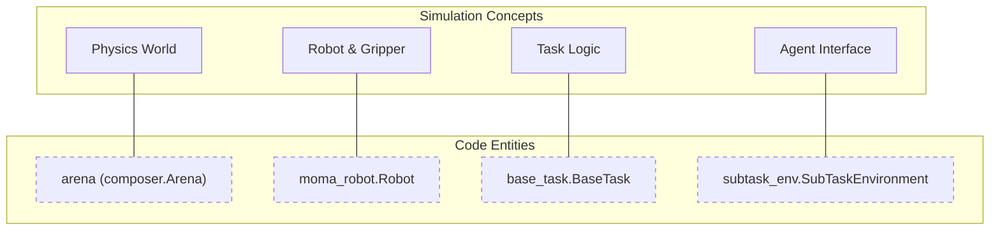
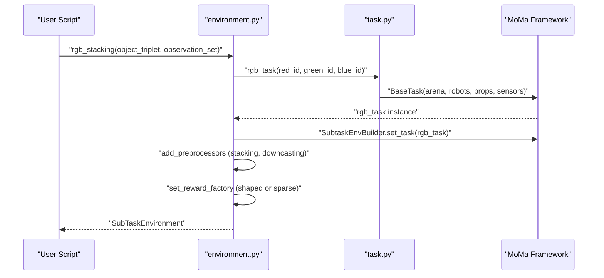

<!-- source: DeepWiki mcp.deepwiki.com · repo google-deepmind/rgb_stacking · page 2 Simulation Environment · fetched 2026-10-26 -->

# Simulation Environment

Relevant source files

The following files were used as context for generating this wiki page:

- [rgb_stacking/environment.py](rgb_stacking/environment.py)
- [rgb_stacking/task.py](rgb_stacking/task.py)

The RGB stacking environment is a high-fidelity robotic simulation built using the [MuJoCo](https://mujoco.org) physics engine and the DeepMind [Modular Manipulation (MoMa)](https://github.com/google-deepmind/dm_robotics) framework [[rgb_stacking/environment.py:37-39]()] [[rgb_stacking/task.py:39-42]()]. 

The environment features a Sawyer robot arm equipped with a Robotiq 2F-85 gripper and an FTS-300 force-torque sensor. The robot's objective is to interact with three colored objects (Red, Green, and Blue) within a basket workspace, specifically aiming to stack the red object on top of the blue one [[rgb_stacking/environment.py:18-22]()].

### System Architecture
The environment is structured as a `SubTaskEnvironment` [[rgb_stacking/environment.py:141]()] which wraps a `BaseTask` [[rgb_stacking/task.py:118-175]()]. This separation allows the physical simulation (robot, arena, props) to remain constant while different reward functions and observation sets are swapped in for different research stages (e.g., state-based RL vs. vision-based imitation learning).

#### Relationship between Code Entities
The following diagram illustrates how the high-level simulation concepts map to specific classes and factory functions within the codebase.

**Entity Mapping: Simulation to Code**

Sources: [[rgb_stacking/task.py:33-52]()] [[rgb_stacking/environment.py:37-38]()]

---

### Key Components

#### Task Construction
The physical scene is assembled in `task.py`. This includes the `RGBBasket` workspace, the `sawyer` robot arm, and the `rgb_object` props [[rgb_stacking/task.py:133-152]()]. The task also defines `entity_initializer` logic to randomize the starting positions of the objects and the robot's Tool Center Point (TCP) at the beginning of each episode [[rgb_stacking/task.py:161-164]()].

For details, see [Task Construction](#2.1).

#### Observation and Action Spaces
The environment supports multiple `ObservationSet` configurations, ranging from `STATE_ONLY` (using ground-truth physics data) to `VISION_ONLY` (using RGB camera pixels) [[rgb_stacking/environment.py:114-134]()]. The action space is a 4D Cartesian velocity space, controlling the robot's [x, y, z] translation and the [yaw] rotation of the wrist, alongside a gripper actuation command [[rgb_stacking/task.py:44-46]()].

For details, see [Observation and Action Spaces](#2.2).

#### Reward Functions
The environment provides two primary reward types:
1.  **Shaped Reward**: A continuous, multi-stage reward pipeline (reach, grasp, lift, hover, stack) used for training specialist policies [[rgb_stacking/reward_functions.py:27-30]()].
2.  **Sparse Reward**: A binary signal (1.0 if stacked and not touching the robot, 0.0 otherwise) used for evaluation and offline RL [[rgb_stacking/environment.py:152-154]()].

For details, see [Reward Functions](#2.3).

#### Physics and Collisions
To ensure realistic stacking and performance, the environment utilizes `mujoco_collisions` to exclude unnecessary contact checks [[rgb_stacking/environment.py:162-163]()]. Specialized physics utilities in `physics_utils.py` are used to detect precise contact between object geoms and the basket floor to validate successful stacks [[rgb_stacking/physics_utils.py:22-24]()].

For details, see [Physics Utilities](#2.4).

---

### Environment Initialization Flow
The following diagram shows the sequence of operations when calling the main entry point `rgb_stacking()`.

**Initialization Sequence**

Sources: [[rgb_stacking/environment.py:137-210]()] [[rgb_stacking/task.py:116-175]()]

### Summary Table

| Feature | Specification | Source |
| :--- | :--- | :--- |
| **Physics Engine** | MuJoCo | [[rgb_stacking/environment.py:162-163]()] |
| **Control Frequency** | 20 Hz (0.05s) | [[rgb_stacking/task.py:89-89]()] |
| **Physics Timestep** | 0.0005s | [[rgb_stacking/environment.py:57-57]()] |
| **Max Episode Length** | 400 steps | [[rgb_stacking/environment.py:54-54]()] |
| **Action Space** | 4D Cartesian Velocity + Gripper | [[rgb_stacking/task.py:44-46]()] |
| **Camera Resolution** | 128x128 (3 cameras) | [[rgb_stacking/task.py:107-113]()] |

---

