# Page: Overview

# Overview

<details>
<summary>Relevant source files</summary>

The following files were used as context for generating this wiki page:

- [CONTRIBUTING.md](CONTRIBUTING.md)
- [LICENSE](LICENSE)
- [README.md](README.md)
- [doc/images/rgb_environment.png](doc/images/rgb_environment.png)

</details>


The `rgb_stacking` repository provides a simulation environment and associated research assets for robotic manipulation tasks involving diverse shapes. Specifically, it focuses on the task of stacking a red object onto a blue object while navigating a green obstacle within a workspace basket [README.md:1-27]().

This project is a re-implementation of the environment used in the 2021 CoRL paper ["Beyond Pick-and-Place: Tackling Robotic Stacking of Diverse Shapes"](https://arxiv.org/abs/2110.08723). It is built using the [Modular Manipulation (MoMa)](https://github.com/google-deepmind/robotics/tree/main/py/moma) framework and MuJoCo [README.md:25-27]().

### System Architecture and Code Mapping

The following diagram illustrates how high-level system components map to specific code entities and directories within the repository.

**System to Code Entity Mapping**
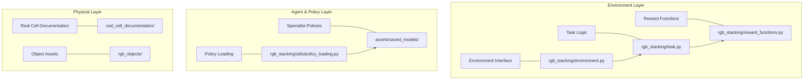
Sources: [README.md:10-27](), [rgb_stacking/environment.py:1-20](), [rgb_stacking/task.py:1-30](), [rgb_stacking/reward_functions.py:1-25](), [rgb_stacking/utils/policy_loading.py:1-15]()

### Core Task Description
The environment features a Sawyer robot arm equipped with a Robotiq 2F-85 gripper. The agent's objective is to stack the red object on the blue object within a 20-second time limit [README.md:19-23]().

The agent interacts with the environment via a 4D Cartesian controller, commanding:
*   **X, Y, Z velocities**
*   **Rotation around the Z-axis** [README.md:23-25]()

### Key Repository Components

| Component | Description |
| :--- | :--- |
| **Simulation** | A MuJoCo environment utilizing the MoMa framework for modular robot manipulation. |
| **Object Triplets** | Specific sets of three objects (Red, Green, Blue). The repo supports test, train, and held-out splits [README.md:138-143](). |
| **Specialist Policies** | Pre-trained state-based policies for five specific test triplets, achieving ~75% success [README.md:46-58](). |
| **Real-World Documentation** | Comprehensive assembly guides and bills of materials for replicating the simulation in a physical robot cell. |

### Research Context: The Three-Stage Pipeline
The repository supports a multi-stage reinforcement learning and distillation pipeline:
1.  **Stage 1: Skill Mastery**: Training state-based specialist policies using Maximum a Posteriori Policy Optimization (MPO).
2.  **Stage 2: Skill Generalization**: Distilling specialists into vision-based policies via interactive imitation learning.
3.  **Stage 3: Offline Policy Improvement**: Refining policies using offline RL (Critic Regularized Regression - CRR) from real-world data [README.md:29-42]().

**Training Pipeline Data Flow**
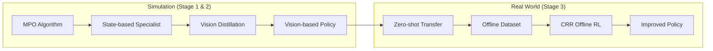
Sources: [README.md:29-42]()

### Wiki Navigation

*   **[Getting Started](#1.1)**: Installation instructions and how to run the interactive viewer or record policy videos using `run.sh` and `rgb_stacking/main.py`.
*   **[Research Background and Training Pipeline](#1.2)**: Deep dive into the MPO/CRR methodology and the object triplet distribution used for evaluation.
*   **Simulation Environment**: Detailed documentation of `task.py`, observation sets, and reward functions.
*   **Pre-trained Specialist Policies**: Information on loading and using the TensorFlow `SavedModel` assets provided in the repository.
*   **Real-World Cell Documentation**: Guidance on using the provided PDFs and CAD models to build a physical counterpart to the simulation.
*   **Testing and Development**: How to run `environment_test.py` and contribute to the project.

Sources: [README.md:65-125](), [CONTRIBUTING.md:1-25](), [LICENSE:1-130]()

---

# Page: Getting Started

# Getting Started

<details>
<summary>Relevant source files</summary>

The following files were used as context for generating this wiki page:

- [requirements.txt](requirements.txt)
- [rgb_stacking/main.py](rgb_stacking/main.py)
- [run.sh](run.sh)

</details>


This page provides a technical guide for setting up the `rgb_stacking` environment, installing its dependencies, and utilizing the provided CLI tools to visualize the environment or record policy rollouts.

## Installation and Environment Setup

The repository uses a standard Python virtual environment approach to manage dependencies. The primary entry point for automated setup is the `run.sh` script.

### Dependency Management
The environment relies on several DeepMind robotics libraries and TensorFlow for policy execution. Key dependencies defined in `requirements.txt` [1-7]() include:
*   `dm-control`: The underlying MuJoCo physics wrapper.
*   `dm-robotics-moma`: The Model-Based Manipulation (MoMa) framework used to construct the task.
*   `tensorflow`: Required for loading and running the pre-trained specialist policies.
*   `dm-reverb`: Used for data management in reinforcement learning contexts.

### Automated Setup with `run.sh`
The `run.sh` script [1-36]() automates the creation of a temporary environment to run the visualizer. It performs the following steps:
1.  Creates a temporary directory using `mktemp` [23]().
2.  Initializes a Python 3 virtual environment [25]().
3.  Upgrades and installs all requirements from `requirements.txt` [29]().
4.  Executes the main visualization script [32]().
5.  Cleans up the temporary directory upon exit [35]().

**Data Flow: Installation to Execution**
The following diagram illustrates how `run.sh` prepares the system for `rgb_stacking.main`.

**Setup and Execution Flow**
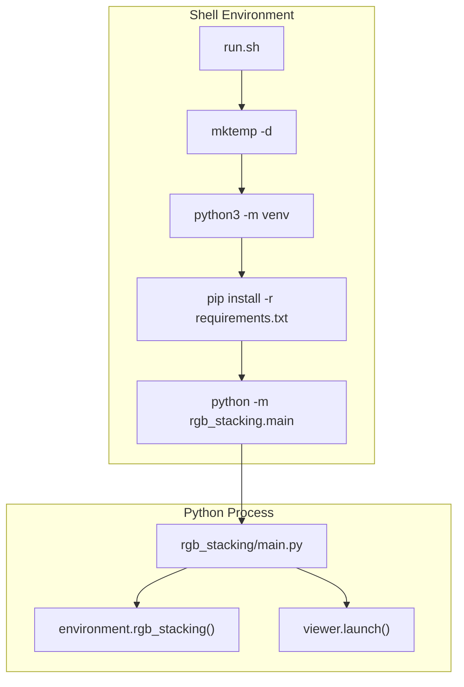
Sources: [run.sh:1-36](), [requirements.txt:1-7](), [rgb_stacking/main.py:115-116]()

---

## Interactive Viewer and CLI Usage

The `rgb_stacking/main.py` script is the central utility for interacting with the environment. It supports both an interactive GUI (via `dm_control.viewer`) and a headless video recording mode.

### Command Line Flags
The script uses `absl.flags` to configure the environment and policy loading:

| Flag | Type | Default | Description |
| :--- | :--- | :--- | :--- |
| `--object_triplet` | Enum | `rgb_test_random` | The set of 3 objects to load. Options include specific test triplets or `rgb_train_random`/`rgb_test_random` [45-47](). |
| `--policy_object_triplet` | Enum | `None` | If provided, loads a pre-trained specialist policy for that specific triplet from `assets/saved_models` [48-51](). |
| `--launch_viewer` | Bool | `True` | If `True`, starts the interactive MuJoCo viewer. If `False`, records a video rollout [52-55](). |

### Policy Loading Logic
When a policy is requested via `--policy_object_triplet`, the script maps the triplet name to a filesystem path [41-43]() and uses `policy_loading.policy_from_path` to instantiate the model [90](). For use within the interactive viewer, the policy is wrapped in a `StatefulPolicyCallable` [97]() to manage the internal state of the MPO agent across timesteps.

**Entity Mapping: CLI to Code Entities**
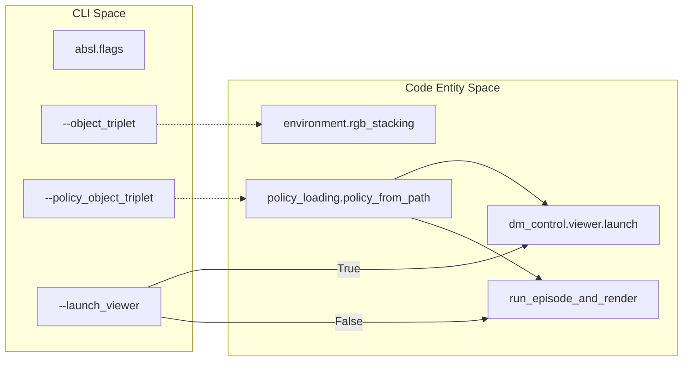
Sources: [rgb_stacking/main.py:41-55](), [rgb_stacking/main.py:85-98]()

---

## Recording Policy Rollouts

If `--launch_viewer` is set to `False`, the system enters a recording loop defined in `run_episode_and_render` [58-74]().

### The Rendering Pipeline
1.  **Initialization**: The policy's initial state is retrieved via `policy.initial_state()` [66](), and the environment is reset [67]().
2.  **Simulation Loop**:
    *   The policy produces an action based on the current `timestep` and `state` [70]().
    *   The environment steps the physics forward using `env.step(action)` [71]().
    *   The `main_camera` view is rendered into a numpy array via `env.physics.render` [72]().
3.  **Video Encoding**:
    *   The sequence of images is processed using `cv2.VideoWriter` [106-109]().
    *   Color spaces are converted from RGB (MuJoCo) to BGR (OpenCV) [111]().
    *   The frame rate is calculated as `1.0 / env.task.control_timestep` [109]().
    *   The resulting file is saved as `./rendered_policy.mp4` [107]().

**Data Flow: Policy Rollout to Video**
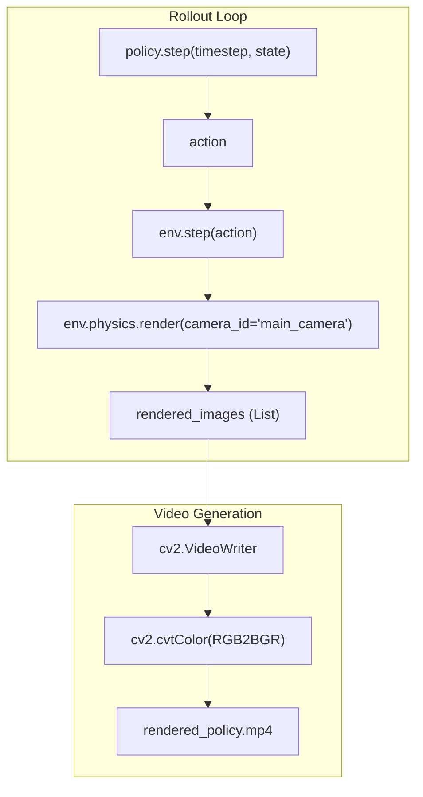
Sources: [rgb_stacking/main.py:58-74](), [rgb_stacking/main.py:102-113]()

---

# Page: Research Background and Training Pipeline

# Research Background and Training Pipeline

<details>
<summary>Relevant source files</summary>

The following files were used as context for generating this wiki page:

- [README.md](README.md)
- [assets/saved_models/mpo_state_rgb_test_triplet1/saved_model.pb](assets/saved_models/mpo_state_rgb_test_triplet1/saved_model.pb)

</details>


This page documents the three-stage training methodology used to develop the stacking policies for the RGB-stacking task, as described in the CoRL 2021 paper "Beyond Pick-and-Place: Tackling Robotic Stacking of Diverse Shapes". The pipeline transitions from simulation-based reinforcement learning with full state access to vision-based policies capable of zero-shot sim-to-real transfer and subsequent offline refinement.

## Methodology Overview

The training process is divided into three distinct phases designed to overcome the challenges of complex shape manipulation and the reality gap.

| Stage | Name | Algorithm | Observation Space | Goal |
| :--- | :--- | :--- | :--- | :--- |
| **Stage 1** | Skill Mastery | MPO | `STATE_ONLY` | Train expert "specialist" policies on specific object triplets using ground-truth simulation states. |
| **Stage 2** | Skill Generalization | Interactive Imitation | `INTERACTIVE_IMITATION_LEARNING` | Distill specialist knowledge into a vision-based "generalist" policy using domain randomization. |
| **Stage 3** | Offline Improvement | CRR | `OFFLINE_POLICY_IMPROVEMENT` | Refine the vision policy using real-world data and Critic Regularized Regression. |

Sources: [README.md:29-42](), [README.md:163-171]()

---

## Stage 1: Skill Mastery (MPO)

In the first stage, Maximum a Posteriori Policy Optimization (MPO) is used to train state-based specialists. These agents have access to the exact positions and orientations of the objects, which simplifies the learning problem.

### Key Components
*   **Algorithm:** MPO (Maximum a Posteriori Policy Optimization).
*   **Observations:** `STATE_ONLY`. This includes proprioception (joint angles/velocities), the robot's pinch pose, and the absolute poses of the Red, Green, and Blue objects [README.md:163-165]().
*   **Output:** Specialist policies for specific object triplets. This repository includes 5 such specialist models [README.md:46-58]().

### Object Triplet Splits
To evaluate generalization, the objects are partitioned into three sets:
1.  **Train Triplets:** Used for training the generalist in Stage 2 [README.md:142-142]().
2.  **Test Triplets:** 5 specific triplets used to evaluate Skill Mastery and Generalization [README.md:140-141]().
3.  **Held-out Triplets:** Entirely unseen objects used to test the limits of generalization [README.md:143-143]().

Sources: [README.md:36-37](), [README.md:126-146]()

---

## Stage 2: Skill Generalization (Vision Distillation)

The second stage involves distilling the knowledge from the state-based specialists into a vision-based student policy. This is achieved through **Interactive Imitation Learning**.

### The Distillation Process
1.  **Teacher:** The state-based MPO specialist (Stage 1).
2.  **Student:** A vision-based policy receiving RGB camera feeds.
3.  **Interactive Loop:** The student policy predicts actions based on pixels. During training, the student is supervised by the teacher's actions.
4.  **Domain Randomization:** To facilitate sim-to-real transfer, the simulation environment is randomized (lighting, textures, camera positions). Note: The open-source version of this repository currently omits the domain randomization module [README.md:13-15]().

### Code Entity Mapping: Distillation Observations
The following diagram bridges the research concept of "Interactive Imitation" to the specific observation sets defined in the codebase.

**Vision Distillation Data Flow**
```mermaid
graph TD
    subgraph "Natural Language Space"
        Teacher["State-Based Specialist"]
        Student["Vision-Based Generalist"]
        Sim["Simulation Env"]
    end

    subgraph "Code Entity Space (rgb_stacking/environment.py)"
        IIL_SET["ObservationSet.INTERACTIVE_IMITATION_LEARNING"]
        STATE_SET["ObservationSet.STATE_ONLY"]
        VISION_SET["ObservationSet.VISION_ONLY"]
    end

    Sim -->|Provides| STATE_SET
    Sim -->|Provides| VISION_SET
    
    STATE_SET -->|Inputs to| Teacher
    VISION_SET -->|Inputs to| Student
    
    Teacher -.->|Supervises| Student
    
    IIL_SET ---|Combines| VISION_SET
    IIL_SET ---|Adds| Proprioception["Proprioception (Sub-set)"]
end
```
Sources: [README.md:37-40](), [README.md:167-168]()

---

## Stage 3: Offline Policy Improvement (CRR)

The final stage addresses the performance gap when the vision policy is deployed on physical hardware. Even with domain randomization, sim-to-real transfer is rarely perfect.

### Methodology
*   **Data Collection:** The distilled vision policy is deployed on the real robot cell [README.md:39-40](). Rollouts (both successes and failures) are recorded into a dataset.
*   **Algorithm:** Critic Regularized Regression (CRR). This offline RL algorithm allows the policy to learn from the collected data without further environment interaction.
*   **Observation Space:** `OFFLINE_POLICY_IMPROVEMENT`. This set is optimized for the data stored in the offline logs, typically including compressed visual features and robot state [README.md:169-171]().

Sources: [README.md:40-42](), [README.md:169-171]()

---

## Implementation in Code

The training pipeline stages are reflected in how the environment is initialized and how policies are loaded.

### Policy Loading and Execution
The `SavedModel` assets provided in the repository are the result of **Stage 1**. They expect state-based observations as defined in the `_MPOState` named tuple or the `STATE_ONLY` observation set.

**Policy Execution Pipeline**
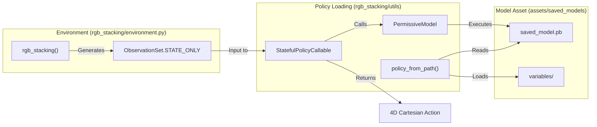

### Key Functions and Classes
*   `rgb_stacking.environment.rgb_stacking`: The main entry point for creating the environment with specific `ObservationSet` configurations [README.md:133-135]().
*   `rgb_stacking.utils.policy_loading.policy_from_path`: Utility to load the TensorFlow SavedModels from the `assets/` directory.
*   `rgb_stacking.main`: Demonstrates how to link a specific object triplet (e.g., `rgb_test_triplet4`) with its corresponding specialist policy [README.md:115-115]().

Sources: [README.md:110-116](), [README.md:157-159](), [assets/saved_models/mpo_state_rgb_test_triplet1/saved_model.pb:1-103]()

---

# Page: Simulation Environment

# Simulation Environment

<details>
<summary>Relevant source files</summary>

The following files were used as context for generating this wiki page:

- [rgb_stacking/environment.py](rgb_stacking/environment.py)
- [rgb_stacking/task.py](rgb_stacking/task.py)

</details>


The RGB stacking environment is a high-fidelity robotic simulation built using the [MuJoCo](https://mujoco.org) physics engine and the DeepMind [Modular Manipulation (MoMa)](https://github.com/google-deepmind/dm_robotics) framework [[rgb_stacking/environment.py:37-39]()] [[rgb_stacking/task.py:39-42]()]. 

The environment features a Sawyer robot arm equipped with a Robotiq 2F-85 gripper and an FTS-300 force-torque sensor. The robot's objective is to interact with three colored objects (Red, Green, and Blue) within a basket workspace, specifically aiming to stack the red object on top of the blue one [[rgb_stacking/environment.py:18-22]()].

### System Architecture
The environment is structured as a `SubTaskEnvironment` [[rgb_stacking/environment.py:141]()] which wraps a `BaseTask` [[rgb_stacking/task.py:118-175]()]. This separation allows the physical simulation (robot, arena, props) to remain constant while different reward functions and observation sets are swapped in for different research stages (e.g., state-based RL vs. vision-based imitation learning).

#### Relationship between Code Entities
The following diagram illustrates how the high-level simulation concepts map to specific classes and factory functions within the codebase.

**Entity Mapping: Simulation to Code**
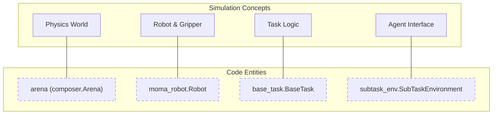
Sources: [[rgb_stacking/task.py:33-52]()] [[rgb_stacking/environment.py:37-38]()]

---

### Key Components

#### Task Construction
The physical scene is assembled in `task.py`. This includes the `RGBBasket` workspace, the `sawyer` robot arm, and the `rgb_object` props [[rgb_stacking/task.py:133-152]()]. The task also defines `entity_initializer` logic to randomize the starting positions of the objects and the robot's Tool Center Point (TCP) at the beginning of each episode [[rgb_stacking/task.py:161-164]()].

For details, see [Task Construction](#2.1).

#### Observation and Action Spaces
The environment supports multiple `ObservationSet` configurations, ranging from `STATE_ONLY` (using ground-truth physics data) to `VISION_ONLY` (using RGB camera pixels) [[rgb_stacking/environment.py:114-134]()]. The action space is a 4D Cartesian velocity space, controlling the robot's [x, y, z] translation and the [yaw] rotation of the wrist, alongside a gripper actuation command [[rgb_stacking/task.py:44-46]()].

For details, see [Observation and Action Spaces](#2.2).

#### Reward Functions
The environment provides two primary reward types:
1.  **Shaped Reward**: A continuous, multi-stage reward pipeline (reach, grasp, lift, hover, stack) used for training specialist policies [[rgb_stacking/reward_functions.py:27-30]()].
2.  **Sparse Reward**: A binary signal (1.0 if stacked and not touching the robot, 0.0 otherwise) used for evaluation and offline RL [[rgb_stacking/environment.py:152-154]()].

For details, see [Reward Functions](#2.3).

#### Physics and Collisions
To ensure realistic stacking and performance, the environment utilizes `mujoco_collisions` to exclude unnecessary contact checks [[rgb_stacking/environment.py:162-163]()]. Specialized physics utilities in `physics_utils.py` are used to detect precise contact between object geoms and the basket floor to validate successful stacks [[rgb_stacking/physics_utils.py:22-24]()].

For details, see [Physics Utilities](#2.4).

---

### Environment Initialization Flow
The following diagram shows the sequence of operations when calling the main entry point `rgb_stacking()`.

**Initialization Sequence**
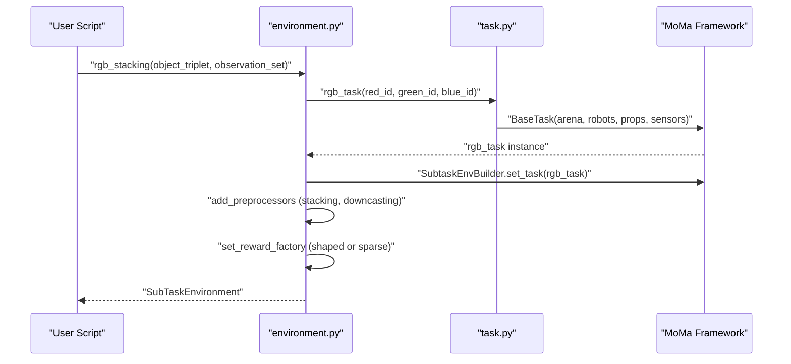
Sources: [[rgb_stacking/environment.py:137-210]()] [[rgb_stacking/task.py:116-175]()]

### Summary Table

| Feature | Specification | Source |
| :--- | :--- | :--- |
| **Physics Engine** | MuJoCo | [[rgb_stacking/environment.py:162-163]()] |
| **Control Frequency** | 20 Hz (0.05s) | [[rgb_stacking/task.py:89-89]()] |
| **Physics Timestep** | 0.0005s | [[rgb_stacking/environment.py:57-57]()] |
| **Max Episode Length** | 400 steps | [[rgb_stacking/environment.py:54-54]()] |
| **Action Space** | 4D Cartesian Velocity + Gripper | [[rgb_stacking/task.py:44-46]()] |
| **Camera Resolution** | 128x128 (3 cameras) | [[rgb_stacking/task.py:107-113]()] |

---

# Page: Task Construction

# Task Construction

<details>
<summary>Relevant source files</summary>

The following files were used as context for generating this wiki page:

- [rgb_stacking/environment.py](rgb_stacking/environment.py)
- [rgb_stacking/task.py](rgb_stacking/task.py)

</details>


This page details the construction of the RGB stacking task using the Modular Manipulation (MoMa) framework. The task is defined in `rgb_stacking/task.py` and encapsulates the physical simulation components, including the robot, workspace, objects, and the control interfaces required for reinforcement learning.

The environment consists of a Sawyer robot arm equipped with a Robotiq gripper, positioned in front of a basket containing three colored objects (Red, Green, Blue). The primary goal is to stack the red object onto the blue one [rgb_stacking/environment.py:16-22]().

## System Architecture

The task construction follows the MoMa `BaseTask` pattern, which separates the physical assembly of the scene from the high-level task logic (rewards and observations).

### Code Entity Relationship
The following diagram illustrates how high-level components map to specific classes and functions within the codebase.

**Component Mapping: Natural Language to Code Entities**
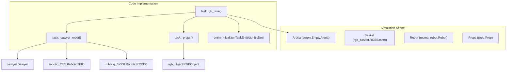
**Sources:** [rgb_stacking/task.py:116-175](), [rgb_stacking/task.py:202-245](), [rgb_stacking/task.py:270-283]()

## Physical Components

### 1. Robot Assembly
The robot is a Rethink Robotics Sawyer arm [rgb_stacking/task.py:51](). It is assembled with the following hardware stack:
*   **Arm:** Sawyer robot arm.
*   **Wrist Sensor:** Robotiq FTS-300 force-torque sensor [rgb_stacking/task.py:50]().
*   **End-Effector:** Robotiq 2F-85 parallel gripper [rgb_stacking/task.py:49]().

The robot is integrated into the MoMa framework via `moma_robot.Robot`, which bundles the arm, gripper, sensors, and effectors [rgb_stacking/task.py:236-245]().

### 2. Workspace and Arena
The environment uses an empty arena as a base [rgb_stacking/task.py:134](). The interaction area is defined by an `RGBBasket` positioned at a default offset from the robot base [rgb_stacking/task.py:70-73]().
*   **Basket Origin:** (0.6, 0.0, 0.0498) [rgb_stacking/task.py:72]().
*   **Workspace Size:** 0.25m x 0.25m x 0.2m [rgb_stacking/task.py:74]().

### 3. RGB Objects (Props)
The task involves three objects, identified by their colors. These are instantiated using the `rgb_object.RGBObject` class, which handles the MuJoCo geometry for the various shapes used in the research [rgb_stacking/task.py:270-283]().

**Sources:** [rgb_stacking/task.py:48-60](), [rgb_stacking/task.py:134-152](), [rgb_stacking/task.py:178-185]()

## Sensors and Perception

The task defines a suite of sensors to provide the state and visual information required for the `ObservationSet`.

| Sensor Category | Implementation Class | Description |
| :--- | :--- | :--- |
| **Proprioception** | `RobotArmSensor`, `RobotiqGripperSensor` | Joint angles, velocities, and torques [rgb_stacking/task.py:221-224](). |
| **TCP State** | `RobotTCPSensor` | Cartesian pose and velocity of the Tool Center Point [rgb_stacking/task.py:225](). |
| **Force/Torque** | `RobotWristFTSensor` | 6-axis F/T data from the FTS-300 [rgb_stacking/task.py:226](). |
| **Visual** | `CameraSensor` | Three 128x128 RGB cameras: `basket_back_left`, `basket_front_left`, and `basket_front_right` [rgb_stacking/task.py:102-113](). |
| **Object State** | `PropPoseSensor` | Absolute poses of the red, green, and blue objects [rgb_stacking/task.py:154](). |

**Sources:** [rgb_stacking/task.py:99-113](), [rgb_stacking/task.py:153-160](), [rgb_stacking/task.py:221-234]()

## Initialization and Control

### Entity Initializers
To ensure variety during training, the environment uses a `TaskEntitiesInitializer` to randomize the starting configuration of every episode [rgb_stacking/task.py:162-164]().
*   **Gripper Initializer:** Randomizes the TCP pose within a defined box: X [0.5, 0.7], Y [-0.14, 0.14], Z [0.22, 0.43] [rgb_stacking/task.py:85-86]().
*   **Prop Initializer:** Randomly places the three objects within the basket bounds: X [0.5, 0.7], Y [-0.1, 0.1] [rgb_stacking/task.py:81-82]().

### 4D Cartesian Velocity Effector
The agent controls the robot using a 4D Cartesian velocity interface. This effector maps agent actions to:
1.  **Linear Velocity (X, Y, Z):** Limited to 0.07 m/s [rgb_stacking/task.py:76]().
2.  **Angular Velocity (Yaw/Z-axis):** Limited to 1.0 rad/s [rgb_stacking/task.py:77]().

The effector is implemented using `Cartesian4dVelocityEffector`, which utilizes an IK solver with a nullspace preference towards a default joint configuration `_NULLSPACE_JOINT_STATE` to maintain a natural arm posture [rgb_stacking/task.py:92-94](), [rgb_stacking/task.py:255-267]().

**Data Flow: Action to Simulation**
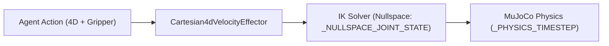

**Sources:** [rgb_stacking/task.py:75-98](), [rgb_stacking/task.py:162-164](), [rgb_stacking/task.py:255-267](), [rgb_stacking/environment.py:57]()

---

# Page: Observation and Action Spaces

# Observation and Action Spaces

<details>
<summary>Relevant source files</summary>

The following files were used as context for generating this wiki page:

- [rgb_stacking/environment.py](rgb_stacking/environment.py)
- [rgb_stacking/environment_test.py](rgb_stacking/environment_test.py)

</details>


This page documents the interface between the agent and the `rgb_stacking` environment. It covers the various observation configurations available for different training stages, the preprocessing pipeline for sensor data, and the 4D Cartesian action space used to control the robot.

## Observation Spaces

The environment uses the `ObservationSet` enum to define which sensors are exposed to the agent [rgb_stacking/environment.py:114-134](). This allows the same environment code to support state-based reinforcement learning (Stage 1), vision-based distillation (Stage 2), and offline policy improvement (Stage 3).

### ObservationSet Configurations

| Enum Member | Purpose | Key Observations |
| :--- | :--- | :--- |
| `STATE_ONLY` | Stage 1: Skill Mastery (MPO) | Proprioception, Object Poses, Relative distances. |
| `VISION_ONLY` | Visual feedback only | Camera pixels from three basket views. |
| `ALL` | Debugging / Comprehensive | Combination of State and Vision. |
| `INTERACTIVE_IMITATION_LEARNING` | Stage 2: Skill Generalization | Proprioception + Front-left/Front-right camera pixels. |
| `OFFLINE_POLICY_IMPROVEMENT` | Stage 3: CRR from real data | Velocity-augmented proprioception + Front cameras. |

Sources: [rgb_stacking/environment.py:60-134]()

### Observation Preprocessing and Stacking

Observations undergo a transformation pipeline managed by `subtask_env_builder.SubtaskEnvBuilder` [rgb_stacking/environment.py:167-169](). This pipeline includes:

1.  **Type Casting**: All floating-point observations are downcast to `float32` [rgb_stacking/environment.py:188-189]().
2.  **Merging**: Specific vectors (like position and quaternions) are merged into single "pose" observations (e.g., `robot0_tcp_pose`) [rgb_stacking/environment.py:192-195]().
3.  **Temporal Stacking**: To provide temporal context, observations are stacked across multiple timesteps:
    *   Standard observations: Stacked depth of 3 [rgb_stacking/environment.py:50]().
    *   Action-related observations: Stacked depth of 2 [rgb_stacking/environment.py:51]().

### Data Flow: From Simulation to Agent

The following diagram illustrates how raw MuJoCo data is processed into the final observation dictionary.

**Observation Processing Pipeline**
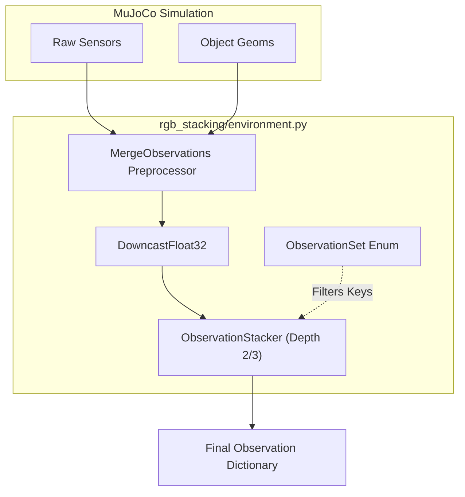
Sources: [rgb_stacking/environment.py:47-51](), [rgb_stacking/environment.py:114-134](), [rgb_stacking/environment.py:188-195]()

---

## Action Space

The agent interacts with the environment through a **4D Cartesian velocity space**. This space is constructed by combining the robot arm's Cartesian effector and the gripper's scalar effector.

### Action Space Composition

The `rgb_stacking` environment uses `dm_robotics.agentflow` to compose action spaces [rgb_stacking/environment.py:183-185]().

*   **Arm Action (3D)**: Linear velocity $(v_x, v_y, v_z)$ of the Tool Center Point (TCP) in the robot's base frame.
*   **Gripper Action (1D)**: A scalar value representing the desired change in gripper opening/closing.

The `subtask_env` exposes these via a `CompositeActionSpace` [rgb_stacking/environment.py:183-185]().

### Action Space Mapping
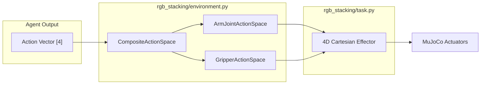
Sources: [rgb_stacking/environment.py:173-185](), [rgb_stacking/task.py:26-29]()

### Environment Lifecycle

The environment is instantiated via `rgb_stacking.environment.rgb_stacking(...)` [rgb_stacking/environment.py:137-141]().

1.  **Task Initialization**: Loads the `rgb_task` with specific object triplets [rgb_stacking/environment.py:156-157]().
2.  **Physics Setup**: Sets simulation timestep to 0.0005s [rgb_stacking/environment.py:57-158]().
3.  **Collision Optimization**: Uses `mujoco_collisions` to exclude impossible geom interactions to improve performance [rgb_stacking/environment.py:162-163]().
4.  **Reward Binding**: Attaches either the sparse reward or the complex staged reward function [rgb_stacking/environment.py:140-141]().

Sources: [rgb_stacking/environment.py:137-170]()

---

# Page: Reward Functions

# Reward Functions

<details>
<summary>Relevant source files</summary>

The following files were used as context for generating this wiki page:

- [rgb_stacking/physics_utils.py](rgb_stacking/physics_utils.py)
- [rgb_stacking/reward_functions.py](rgb_stacking/reward_functions.py)
- [rgb_stacking/stack_rewards.py](rgb_stacking/stack_rewards.py)

</details>


The `rgb_stacking` package implements a sophisticated reward system designed to guide reinforcement learning agents through the complex task of stacking objects. This system includes a five-stage shaped reward pipeline for skill acquisition and a physics-based sparse reward for evaluating final task success.

## Reward System Architecture

The reward system is divided into two primary files:
- `rgb_stacking/reward_functions.py`: Contains generic, reusable reward primitives (e.g., distance, lifting, grasping) and logic combinators [rgb_stacking/reward_functions.py:16-17]().
- `rgb_stacking/stack_rewards.py`: Defines the specific stacking task rewards, including the `Staged` pipeline and the `SparseStack` physics-based reward [rgb_stacking/stack_rewards.py:16-17]().

### Reward Flow Overview

The following diagram illustrates how the reward components interact to produce a final reward signal for the agent.

**Reward Calculation Data Flow**
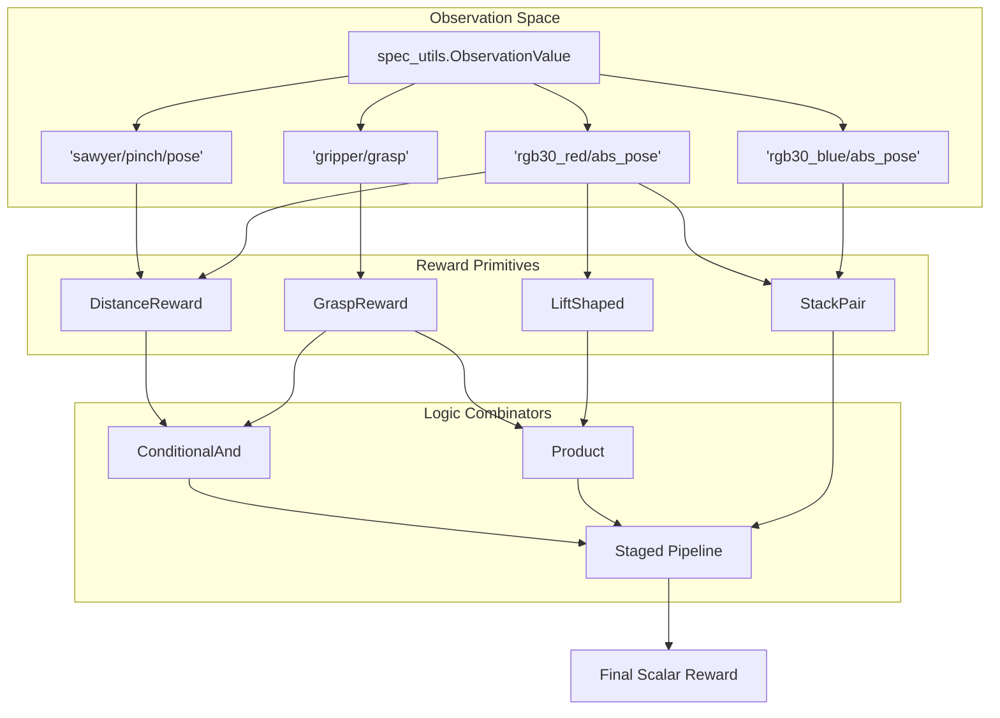
Sources: [rgb_stacking/reward_functions.py:31-31](), [rgb_stacking/stack_rewards.py:52-57](), [rgb_stacking/stack_rewards.py:65-111]()

## Shaped Stacking Pipeline

The `get_shaped_stacking_reward` function constructs a `Staged` reward pipeline. This pipeline ensures that the agent receives a dense signal by progressing through five distinct stages [rgb_stacking/stack_rewards.py:65-111]().

| Stage | Name | Description | Implementation Detail |
| :--- | :--- | :--- | :--- |
| 1 | **Reach and Grasp** | Agent must move the pinch site to the red object and close the gripper. | `ConditionalAnd(reach_red, grasp, 0.9)` [rgb_stacking/stack_rewards.py:68-86]() |
| 2 | **Grasp and Lift** | Agent must maintain a grasp while lifting the red object above a height threshold. | `Product([grasp, lift_reward])` [rgb_stacking/stack_rewards.py:89-90]() |
| 3 | **Hover** | Agent must move the lifted red object to a position above the blue object. | `DistanceReward` with `_HOVER_OFFSET` [rgb_stacking/stack_rewards.py:95-101]() |
| 4 | **Stack** | Agent must place the red object on top of the blue object and release it. | `StackPair` [rgb_stacking/stack_rewards.py:104-104]() |
| 5 | **Stack and Leave** | Final stage where the object is stacked and the arm moves away. | `Product(stack, above_red)` [rgb_stacking/stack_rewards.py:107-108]() |

Sources: [rgb_stacking/stack_rewards.py:65-111]()

## Reward Primitives and Combinators

### Core Primitive Classes
- **`DistanceReward`**: Calculates a shaped reward based on the L2 distance between two entities. It uses a squared tanh shaping function (`tanh_squared`) to provide a smooth gradient [rgb_stacking/reward_functions.py:168-182]().
- **`LiftShaped`**: Provides reward for lifting an object. It is zero below a minimum height and reaches maximum reward at a target threshold [rgb_stacking/reward_functions.py:277-285]().
- **`GraspReward`**: A sparse reward that returns 1.0 if the gripper sensor reports an `_INWARD_GRASP` (value 2) [rgb_stacking/reward_functions.py:52-65]().
- **`StackPair`**: Checks if the horizontal and vertical distance between two objects is within specified tolerances (`_STACK_HORIZONTAL_TOLERANCE`, `_STACK_VERTICAL_TOLERANCE`) [rgb_stacking/reward_functions.py:68-114]().

### Combinator Classes
- **`Staged`**: Chains multiple reward functions. The agent only receives reward for stage $N$ if the reward for stage $N-1$ exceeds a specific threshold [rgb_stacking/reward_functions.py:461-470]().
- **`Product`**: Returns the product of multiple reward terms, effectively acting as a soft "AND" gate [rgb_stacking/reward_functions.py:423-435]().
- **`ConditionalAnd`**: Returns the second reward only if the first reward is above a threshold; otherwise, it returns a scaled version of the first reward [rgb_stacking/reward_functions.py:381-397]().
- **`Max`**: Returns the maximum value among several reward terms, often used to combine different ways of achieving a sub-goal [rgb_stacking/reward_functions.py:350-362]().

Sources: [rgb_stacking/reward_functions.py:52-470]()

## Sparse Physics-Based Reward

The `SparseStack` class in `stack_rewards.py` provides a ground-truth success metric based on MuJoCo physics state rather than just object poses [rgb_stacking/stack_rewards.py:159-166]().

### Success Criteria
For a stack to be considered successful by `SparseStack`, three conditions must be met:
1.  **Alignment**: The red object's center must be within `_X_Y_CLOSE` (0.05m) of the blue object in the X-Y plane [rgb_stacking/stack_rewards.py:184-187]().
2.  **Verticality**: The red object must be at least `_ONTOP` (0.02m) above the blue object [rgb_stacking/stack_rewards.py:189-192]().
3.  **Stability (No Robot Contact)**: The red object must NOT be in contact with the robot or the ground, ensuring it is supported solely by the blue object [rgb_stacking/stack_rewards.py:194-200]().

### Physics Utilities
The `SparseStack` reward relies on `rgb_stacking/physics_utils.py` to query the MuJoCo contact buffer:
- **`has_ground_collision`**: Checks if an object is touching the `work_surface` or `ground` geoms [rgb_stacking/physics_utils.py:39-46]().
- **`has_robot_collision`**: Checks if an object is touching any `robot` geoms [rgb_stacking/physics_utils.py:49-56]().
- **`has_collision`**: The underlying iterator that scans `physics.data.contact` for geom pairs within a specified `margin` [rgb_stacking/physics_utils.py:59-74]().

**Physics-Based Success Logic**
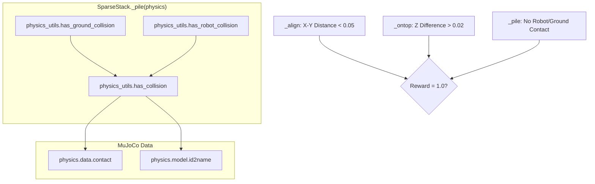
Sources: [rgb_stacking/stack_rewards.py:184-200](), [rgb_stacking/physics_utils.py:59-74]()

---

# Page: Physics Utilities

# Physics Utilities

<details>
<summary>Relevant source files</summary>

The following files were used as context for generating this wiki page:

- [rgb_stacking/physics_utils.py](rgb_stacking/physics_utils.py)
- [rgb_stacking/stack_rewards.py](rgb_stacking/stack_rewards.py)

</details>


The `rgb_stacking/physics_utils.py` module provides a suite of helper functions for querying MuJoCo contact data. These utilities are essential for detecting collisions between the three primary entity types in the environment: the RGB objects, the robot arm (Sawyer/Robotiq), and the ground/workspace surface.

The primary role of these utilities is to support the sparse reward logic and task termination criteria by verifying that objects are supported by each other rather than being held by the robot or resting on the ground.

## Collision Detection Logic

Collision detection is implemented by iterating through the `physics.data.contact` buffer provided by MuJoCo. The utilities filter these contacts based on a distance margin and geom name prefixes.

### Key Prefixes and Margins
The module defines standard prefixes to identify geoms within the MuJoCo model:
*   **Object Geoms**: Identified by the prefix `rgb` [rgb_stacking/physics_utils.py:24]().
*   **Ground Geoms**: Identified by prefixes `work_surface` or `ground` [rgb_stacking/physics_utils.py:25]().
*   **Robot Geoms**: Identified by the prefix `robot` [rgb_stacking/physics_utils.py:26]().

Two default margins are used:
*   `DEFAULT_OBJECT_COLLISION_MARGIN`: 0.0002 [rgb_stacking/physics_utils.py:21]().
*   `DEFAULT_COLLISION_MARGIN`: 1e-8 [rgb_stacking/physics_utils.py:22]().

### Core Function: `has_collision`
The `has_collision` function is the underlying engine for all physics queries in this module. It performs the following steps:
1.  Iterates through all active contacts in `physics.data.contact` [rgb_stacking/physics_utils.py:62]().
2.  Ignores contacts where the distance is greater than the specified `margin` [rgb_stacking/physics_utils.py:63-64]().
3.  Resolves the MuJoCo `id` of the two colliding geoms into string names using `physics.model.id2name` [rgb_stacking/physics_utils.py:65-66]().
4.  Checks if the names start with the provided prefixes for the two groups being compared [rgb_stacking/physics_utils.py:69-72]().

**Sources:** [rgb_stacking/physics_utils.py:21-74]()

## High-Level Query Functions

The module exposes specialized wrappers to check collisions against specific categories.

| Function | Purpose | Implementation |
| :--- | :--- | :--- |
| `has_object_collision` | Checks if a specific geom is touching any RGB object. | Calls `has_collision` with `OBJECT_GEOM_PREFIXES` [rgb_stacking/physics_utils.py:29-36](). |
| `has_ground_collision` | Checks if a specific geom is touching the floor or basket. | Calls `has_collision` with `GROUND_GEOM_PREFIXES` [rgb_stacking/physics_utils.py:39-46](). |
| `has_robot_collision` | Checks if a specific geom is touching the robot arm/gripper. | Calls `has_collision` with `ROBOT_GEOM_PREFIXES` [rgb_stacking/physics_utils.py:49-56](). |

**Sources:** [rgb_stacking/physics_utils.py:29-56]()

## Integration with Sparse Rewards

The `SparseStack` reward class in `rgb_stacking/stack_rewards.py` relies heavily on these utilities to validate a successful stack. A "sparse" success is defined not just by proximity, but by the physical state of the objects.

### Sparse Reward Flow
The `SparseStack` class uses `physics_utils` to ensure that a stack is "freestanding":
1.  **Alignment**: Checks if objects are aligned in the X-Y plane [rgb_stacking/stack_rewards.py:185-188]().
2.  **Verticality**: Checks if the top object is above the bottom object [rgb_stacking/stack_rewards.py:191-192]().
3.  **No Grounding**: Uses `has_ground_collision` to ensure the top object is not touching the basket [rgb_stacking/stack_rewards.py:196-197]().
4.  **No Robot Support**: Uses `has_robot_collision` to ensure the robot is not touching the top object, confirming the agent has released it [rgb_stacking/stack_rewards.py:198-199]().

### Code Entity Mapping: Reward to Physics

The following diagram illustrates how the high-level reward logic invokes the low-level physics utilities.

**Diagram: Sparse Reward Physics Validation**
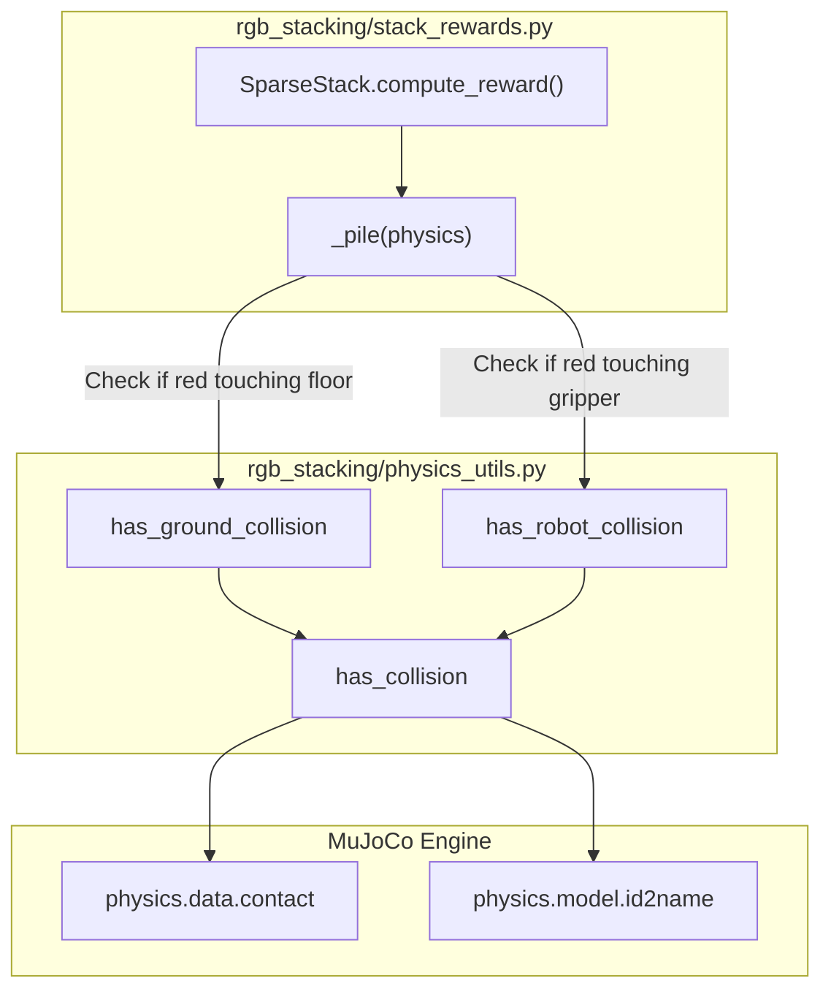
**Sources:** [rgb_stacking/stack_rewards.py:159-200](), [rgb_stacking/physics_utils.py:59-74]()

## Data Flow: From Contact to Boolean

The mapping from raw MuJoCo contact buffers to semantic collision booleans is shown below.

**Diagram: Collision Detection Data Flow**
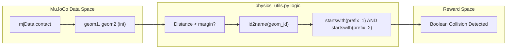
**Sources:** [rgb_stacking/physics_utils.py:62-74]()

## Constants Reference

The following constants define the geometric categories used throughout the collision detection system:

| Constant | Value | Description |
| :--- | :--- | :--- |
| `OBJECT_GEOM_PREFIXES` | `['rgb']` | Targets all manipulatable objects (Red, Blue, Green) [rgb_stacking/physics_utils.py:24](). |
| `GROUND_GEOM_PREFIXES` | `['work_surface', 'ground']` | Targets the floor and the basket boundaries [rgb_stacking/physics_utils.py:25](). |
| `ROBOT_GEOM_PREFIXES` | `['robot']` | Targets the Sawyer arm and Robotiq gripper components [rgb_stacking/physics_utils.py:26](). |

**Sources:** [rgb_stacking/physics_utils.py:24-26]()

---

# Page: Pre-trained Specialist Policies

# Pre-trained Specialist Policies

<details>
<summary>Relevant source files</summary>

The following files were used as context for generating this wiki page:

- [assets/saved_models/mpo_state_rgb_test_triplet1/saved_model.pb](assets/saved_models/mpo_state_rgb_test_triplet1/saved_model.pb)
- [assets/saved_models/mpo_state_rgb_test_triplet2/saved_model.pb](assets/saved_models/mpo_state_rgb_test_triplet2/saved_model.pb)
- [assets/saved_models/mpo_state_rgb_test_triplet3/saved_model.pb](assets/saved_models/mpo_state_rgb_test_triplet3/saved_model.pb)
- [assets/saved_models/mpo_state_rgb_test_triplet4/saved_model.pb](assets/saved_models/mpo_state_rgb_test_triplet4/saved_model.pb)
- [assets/saved_models/mpo_state_rgb_test_triplet5/saved_model.pb](assets/saved_models/mpo_state_rgb_test_triplet5/saved_model.pb)

</details>


This page provides an overview of the five pre-trained specialist policies included in the `rgb_stacking` repository. These policies represent the result of the **Skill Mastery** stage (Stage 1) of the training pipeline described in the associated research. They are state-based agents trained using Maximum a Posteriori Policy Optimization (MPO) to solve the stacking task for specific object triplets.

## Overview and Purpose

The specialist policies are intended to serve as "teachers" for subsequent training stages, such as vision-based distillation or offline policy improvement. Each policy is specialized to one of the five test triplets defined in the environment. Unlike the final agents which may use vision, these specialists operate on the `STATE_ONLY` observation set, giving them ground-truth knowledge of object poses.

### Performance and Success Rates
The following table summarizes the success rates for each specialist policy on its corresponding triplet:

| Triplet Name | Asset Directory | Success Rate |
| :--- | :--- | :--- |
| Test Triplet 1 | `assets/saved_models/mpo_state_rgb_test_triplet1/` | ~75% |
| Test Triplet 2 | `assets/saved_models/mpo_state_rgb_test_triplet2/` | ~85% |
| Test Triplet 3 | `assets/saved_models/mpo_state_rgb_test_triplet3/` | ~85% |
| Test Triplet 4 | `assets/saved_models/mpo_state_rgb_test_triplet4/` | ~85% |
| Test Triplet 5 | `assets/saved_models/mpo_state_rgb_test_triplet5/` | ~80% |

**Licensing Note:** While the source code of this project is under the Apache 2.0 license, the pre-trained model weights in `assets/saved_models/` are licensed under **Creative Commons Attribution 4.0 (CC BY 4.0)**.

**Sources:**
- [assets/saved_models/mpo_state_rgb_test_triplet1/saved_model.pb:1-200]() (and subsequent triplet files)

## System Architecture: From Model to Environment

The following diagram illustrates how the pre-trained specialist policies (stored as TensorFlow SavedModels) are integrated into the execution pipeline via the provided utility classes.

### Policy Loading Flow
"This diagram maps the high-level loading process to specific code entities."

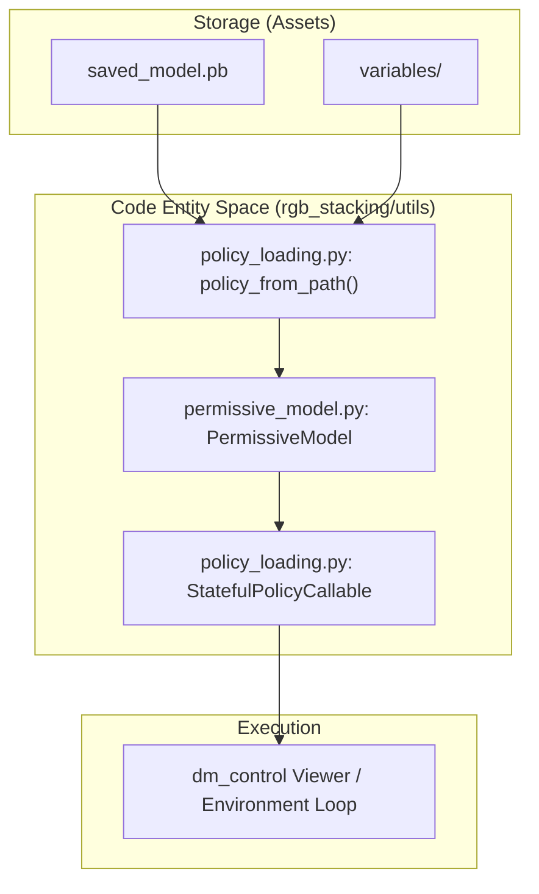

**Sources:**
- [assets/saved_models/mpo_state_rgb_test_triplet1/saved_model.pb:92-110]()
- [assets/saved_models/mpo_state_rgb_test_triplet1/saved_model.pb:247-270]()

## SavedModel Structure

Each specialist is stored in the standard TensorFlow SavedModel format. These models contain the computational graph and the trained weights (variables) required to map environment observations to robot actions.

The models expose specific `SignatureDefs` for inference, typically involving:
- **Inputs:** A collection of tensors representing the `STATE_ONLY` observation set (e.g., `sawyer_pinch_pose`, `rgb30_red_abs_pose`).
- **Outputs:** The 4D Cartesian velocity actions for the robot arm and gripper.
- **State:** Recurrent state tensors (MPO states) that must be passed back to the model in subsequent timesteps.

For a detailed breakdown of the file layout and internal variable groups (actor/critic), see **[SavedModel Asset Structure](#3.1)**.

**Sources:**
- [assets/saved_models/mpo_state_rgb_test_triplet1/saved_model.pb:211-230]()
- [assets/saved_models/mpo_state_rgb_test_triplet1/saved_model.pb:247-250]()

## Loading and Usage Utilities

The repository provides specialized utilities to handle the complexities of loading these models into a `dm_env` compatible loop.

### Policy Interaction Diagram
"This diagram shows the relationship between the Environment's observation output and the Policy's action input."

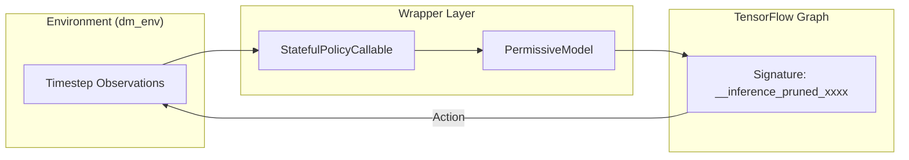

Key utility components include:
- **`policy_from_path`**: The primary entry point for loading a specialist.
- **`PermissiveModel`**: A wrapper that allows the model to accept observations even if the input dictionary contains extra keys not required by the specific SavedModel signature.
- **`StatefulPolicyCallable`**: Manages the `_MPOState` NamedTuple, ensuring that recurrent states are correctly persisted and updated between environment steps.

For details on implementation and usage in the viewer, see **[Policy Loading Utilities](#3.2)**.

**Sources:**
- [assets/saved_models/mpo_state_rgb_test_triplet1/saved_model.pb:211-230]()
- [assets/saved_models/mpo_state_rgb_test_triplet1/saved_model.pb:281-300]()

---

# Page: SavedModel Asset Structure

# SavedModel Asset Structure

<details>
<summary>Relevant source files</summary>

The following files were used as context for generating this wiki page:

- [assets/saved_models/mpo_state_rgb_test_triplet1/saved_model.pb](assets/saved_models/mpo_state_rgb_test_triplet1/saved_model.pb)
- [assets/saved_models/mpo_state_rgb_test_triplet1/variables/variables.data-00000-of-00001](assets/saved_models/mpo_state_rgb_test_triplet1/variables/variables.data-00000-of-00001)
- [assets/saved_models/mpo_state_rgb_test_triplet1/variables/variables.index](assets/saved_models/mpo_state_rgb_test_triplet1/variables/variables.index)
- [assets/saved_models/mpo_state_rgb_test_triplet2/saved_model.pb](assets/saved_models/mpo_state_rgb_test_triplet2/saved_model.pb)
- [assets/saved_models/mpo_state_rgb_test_triplet2/variables/variables.data-00000-of-00001](assets/saved_models/mpo_state_rgb_test_triplet2/variables/variables.data-00000-of-00001)
- [assets/saved_models/mpo_state_rgb_test_triplet2/variables/variables.index](assets/saved_models/mpo_state_rgb_test_triplet2/variables/variables.index)
- [assets/saved_models/mpo_state_rgb_test_triplet3/saved_model.pb](assets/saved_models/mpo_state_rgb_test_triplet3/saved_model.pb)
- [assets/saved_models/mpo_state_rgb_test_triplet3/variables/variables.data-00000-of-00001](assets/saved_models/mpo_state_rgb_test_triplet3/variables/variables.data-00000-of-00001)
- [assets/saved_models/mpo_state_rgb_test_triplet3/variables/variables.index](assets/saved_models/mpo_state_rgb_test_triplet3/variables/variables.index)
- [assets/saved_models/mpo_state_rgb_test_triplet4/saved_model.pb](assets/saved_models/mpo_state_rgb_test_triplet4/saved_model.pb)
- [assets/saved_models/mpo_state_rgb_test_triplet4/variables/variables.data-00000-of-00001](assets/saved_models/mpo_state_rgb_test_triplet4/variables/variables.data-00000-of-00001)
- [assets/saved_models/mpo_state_rgb_test_triplet4/variables/variables.index](assets/saved_models/mpo_state_rgb_test_triplet4/variables/variables.index)
- [assets/saved_models/mpo_state_rgb_test_triplet5/saved_model.pb](assets/saved_models/mpo_state_rgb_test_triplet5/saved_model.pb)
- [assets/saved_models/mpo_state_rgb_test_triplet5/variables/variables.data-00000-of-00001](assets/saved_models/mpo_state_rgb_test_triplet5/variables/variables.data-00000-of-00001)
- [assets/saved_models/mpo_state_rgb_test_triplet5/variables/variables.index](assets/saved_models/mpo_state_rgb_test_triplet5/variables/variables.index)

</details>


This page describes the internal organization and data layout of the TensorFlow SavedModel assets provided for the five MPO state-based specialist policies. These models are located in `assets/saved_models/` and correspond to the "Skill Mastery" stage (Stage 1) of the training pipeline.

## 1. Directory Layout

Each specialist policy is stored as a self-contained TensorFlow SavedModel directory. This format allows for the serialization of the complete computational graph, including its variables (weights) and the specific functions (signatures) required to execute the policy.

The structure for a typical triplet (e.g., `mpo_state_rgb_test_triplet1`) is as follows:

| File / Directory | Description |
| :--- | :--- |
| `saved_model.pb` | The main protocol buffer file containing the graph definition, metadata, and `SignatureDefs`. |
| `variables/` | Directory containing the serialized values of the model's parameters. |
| `variables/variables.index` | A key-value index mapping tensor names to their location in the data shards. |
| `variables/variables.data-00000-of-00001` | The actual weight values (sharded; in this case, a single shard). |

**Sources:**
- `assets/saved_models/mpo_state_rgb_test_triplet1/saved_model.pb` [1-104]()
- `assets/saved_models/mpo_state_rgb_test_triplet1/variables/variables.index` [1]()
- `assets/saved_models/mpo_state_rgb_test_triplet1/variables/variables.data-00000-of-00001` [1-5]()

## 2. Computational Graph and Signatures

The `saved_model.pb` file defines the operations and data flow for the policy. It utilizes `SignatureDefs` to expose specific entry points for inference and state management.

### Graph Definition Overview
The graph is composed of several high-level components defined through `StatefulPartitionedCall` operations. These calls encapsulate complex sub-graphs for:
- **Observation Processing**: Mapping raw environment observations (joint angles, object poses, etc.) to internal representations.
- **Policy Execution (Actor)**: Mapping processed observations to the 4D Cartesian action space.
- **State Management**: Handling the recurrent state of the MPO agent (captured in the `_MPOState` named tuple).

### Signature Mapping
The SavedModels expose signatures that the `PermissiveModel` and `policy_loading.py` utilities interact with. These signatures include:
- `serve`: The primary inference endpoint.
- `__inference_pruned_...`: Internal traced functions for specific execution paths (e.g., `__inference_pruned_9555` in triplet 1).

**Sources:**
- `assets/saved_models/mpo_state_rgb_test_triplet1/saved_model.pb` [67-77](), [186-193]()
- `assets/saved_models/mpo_state_rgb_test_triplet2/saved_model.pb` [281-286]()

## 3. Variable Groups

The weights stored in the `variables/` directory are partitioned into groups based on their role within the MPO (Maximum a Posteriori Policy Optimization) architecture.

### Actor, Critic, and Target Networks
The SavedModel contains variables for:
1.  **Actor Network**: The policy network $\pi(a|s)$ that generates actions.
2.  **Critic Network**: The Q-function or Value function used during the MPO optimization process.
3.  **Target Networks**: Delayed copies of the actor and critic used to stabilize training.

### Internal State Tensors
Because these are stateful MPO policies, the variables also include initialization values for the recurrent cores. These are often referenced in the graph via `mpo/initial_state/zeros` or `mpo/initial_state/Squeeze` operations.

### Data Flow: Asset to Code Entity
The following diagram illustrates how the physical SavedModel assets map to the logical entities used during policy loading and execution.

**Policy Asset Mapping**
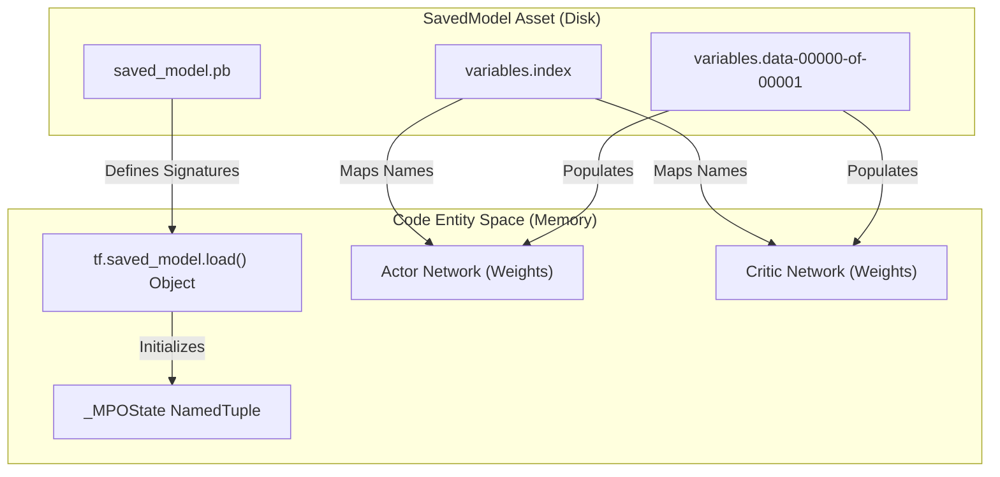

**Sources:**
- `assets/saved_models/mpo_state_rgb_test_triplet4/saved_model.pb` [151-163]()
- `assets/saved_models/mpo_state_rgb_test_triplet1/saved_model.pb` [102-105]()

## 4. Input and Output Tensors

The policies expect a structured set of input tensors corresponding to the `ObservationSet.STATE_ONLY` configuration.

### Input Observations
The graph defines placeholders for various sensors, including:
- **Proprioception**: `sawyer_joints_angle`, `sawyer_tcp_pose`, `gripper_joints_angle`.
- **Object State**: `rgb30_red_abs_pose`, `rgb30_blue_to_pinch`, etc.
- **Forces**: `wrist_force`, `wrist_torque`.

### Output Actions
The output of the policy is a 4D action vector representing Cartesian velocity and gripper state, typically handled via an `Identity` operation at the end of the `PartitionedCall`.

**Observation to Graph Mapping**
```mermaid
graph LR
    subgraph "Environment Observations"
        JOINTS["sawyer_joints_angle"]
        POSES["rgb30_red_abs_pose"]
        FORCE["wrist_force"]
    end

    subgraph "SavedModel Graph (saved_model.pb)"
        INPUT_NODE["timestep_observation_... Nodes"]
        PROC_NODE["__inference_func_..."]
        POLICY_NODE["StatefulPartitionedCall (Actor)"]
        OUT_NODE["Identity:output:0"]
    end

    JOINTS --> INPUT_NODE
    POSES --> INPUT_NODE
    FORCE --> INPUT_NODE
    INPUT_NODE --> PROC_NODE
    PROC_NODE --> POLICY_NODE
    POLICY_NODE --> OUT_NODE
    OUT_NODE -->|"4D Action"| FinalAction
```

**Sources:**
- `assets/saved_models/mpo_state_rgb_test_triplet1/saved_model.pb` [211-229]()
- `assets/saved_models/mpo_state_rgb_test_triplet2/saved_model.pb` [373-392]()
- `assets/saved_models/mpo_state_rgb_test_triplet3/saved_model.pb` [306-325]()

---

# Page: Policy Loading Utilities

# Policy Loading Utilities

<details>
<summary>Relevant source files</summary>

The following files were used as context for generating this wiki page:

- [rgb_stacking/main.py](rgb_stacking/main.py)
- [rgb_stacking/utils/permissive_model.py](rgb_stacking/utils/permissive_model.py)
- [rgb_stacking/utils/policy_loading.py](rgb_stacking/utils/policy_loading.py)

</details>


This page documents the utilities used to load, wrap, and execute the pre-trained TensorFlow SavedModels provided in the `rgb_stacking` repository. These utilities bridge the gap between strict TensorFlow SavedModel signatures and the `dm_env` interfaces used by the environment and the `dm_control` viewer.

The primary logic is contained within `rgb_stacking/utils/policy_loading.py`, which handles batch dimension management and state tracking, and `rgb_stacking/utils/permissive_model.py`, which provides a flexible wrapper for SavedModel functions.

## Policy Loading Pipeline

The loading process transforms a directory containing a TensorFlow SavedModel into a `Policy` protocol-compliant object that can be used for rollouts or visualization.

### Data Flow: From SavedModel to Policy Callable

The following diagram illustrates how a raw SavedModel is transformed into a usable policy through various wrapping layers.

**Policy Wrapping Layers**
```mermaid
graph TD
    subgraph "SavedModel on Disk"
        [A] -- "tf.saved_model.load" --> B["Raw TF Model"]
    end

    subgraph "rgb_stacking.utils.permissive_model"
        B -- "PermissiveModel()" --> C["PermissiveModel Instance"]
    end

    subgraph "rgb_stacking.utils.policy_loading"
        C -- "policy_from_path()" --> D["Policy (Unbatched Wrapper)"]
        D -- "StatefulPolicyCallable()" --> E["Viewer-Compatible Callable"]
    end

    E -- "Calls" --> D
    D -- "Calls" --> C
    C -- "Calls" --> B
```
Sources: [rgb_stacking/utils/policy_loading.py:47-74](), [rgb_stacking/utils/policy_loading.py:77-89](), [rgb_stacking/utils/permissive_model.py:43-80]()

### Key Functions and Classes

| Entity | Location | Description |
| :--- | :--- | :--- |
| `policy_from_path` | `policy_loading.py` | Entry point for loading a model. It loads the TF graph, wraps it in `PermissiveModel`, and adds logic to handle batch dimension expansion/squeezing. |
| `_MPOState` | `policy_loading.py` | A `NamedTuple` representing the internal state of the MPO agent, containing a `counter`, `actor` structure, and `critic` structure. |
| `StatefulPolicyCallable` | `policy_loading.py` | A class that maintains the `_MPOState` internally, allowing the policy to be passed as a simple `Callable[[dm_env.TimeStep], np.ndarray]` to the `dm_control` viewer. |
| `PermissiveModel` | `permissive_model.py` | A wrapper that inspects SavedModel signatures and allows calling functions with extraneous or missing optional arguments without crashing. |

Sources: [rgb_stacking/utils/policy_loading.py:31-35](), [rgb_stacking/utils/policy_loading.py:47-49](), [rgb_stacking/utils/policy_loading.py:77-82](), [rgb_stacking/utils/permissive_model.py:43-52]()

---

## Permissive Model Wrapper

The `PermissiveModel` class is designed to handle the strictness of TensorFlow's `SignatureDef` requirements. When a model is exported via `tf.saved_model.save`, the resulting functions often have very specific input signatures. `PermissiveModel` relaxes these requirements to facilitate easier integration with different versions of the environment or observation sets.

### Implementation Details
- **Signature Inspection**: During initialization, it retrieves function signatures and parameters using `model.function_signatures()` [rgb_stacking/utils/permissive_model.py:66-76]().
- **Argument Binding**: It uses Python's `inspect.Signature.bind` to map provided arguments to the expected canonical arguments of the SavedModel [rgb_stacking/utils/permissive_model.py:156-158]().
- **Table Initialization**: It automatically initializes any hash tables required by the SavedModel (e.g., for vocabulary lookups) by locating the relevant ops in the graph [rgb_stacking/utils/permissive_model.py:82-121]().

Sources: [rgb_stacking/utils/permissive_model.py:43-153]()

---

## Batch Dimension Management

The pre-trained specialist policies (MPO state-based agents) are trained on batched data and expect inputs with a leading batch dimension. However, the `dm_env` loop typically provides single timesteps. `policy_from_path` implements a closure that handles this transformation transparently.

### The `policy_step_fn` Logic
When `policy_from_path` is called, it redefines the `step` method of the loaded policy:
1. **Expand**: It applies `np.expand_dims(x, axis=0)` to all tensors in the `dm_env.TimeStep.observation` and the `_MPOState` [rgb_stacking/utils/policy_loading.py:58-68]().
2. **Execute**: It calls the underlying `PermissiveModel` function with the batched data [rgb_stacking/utils/policy_loading.py:69-69]().
3. **Squeeze**: It applies `np.squeeze(x, axis=0)` to the resulting action and updated state before returning them to the caller [rgb_stacking/utils/policy_loading.py:61-71]().

Sources: [rgb_stacking/utils/policy_loading.py:54-74]()

---

## Stateful Policy for Visualization

The `dm_control` viewer expects a policy to be a simple callable that takes a `TimeStep` and returns an action. Because the specialist policies are stateful (tracking MPO internal states), they cannot be passed directly.

### `StatefulPolicyCallable`
This class wraps a `Policy` and manages the lifecycle of the `_MPOState`:
- **Initialization**: It calls `policy.initial_state()` to get the starting state [rgb_stacking/utils/policy_loading.py:82-82]().
- **Reset Logic**: On every `dm_env.StepType.FIRST` (the start of a new episode), it automatically resets the internal state [rgb_stacking/utils/policy_loading.py:85-86]().
- **Action Selection**: It executes the policy step and stores the updated state internally, returning only the action to the viewer [rgb_stacking/utils/policy_loading.py:87-88]().

**State Management Entity Map**
```mermaid
classDiagram
    class Policy {
        <<Protocol>>
        +initial_state() _MPOState
        +step(timestep, state) Tuple
    }
    class _MPOState {
        +tf.Tensor counter
        +Structure actor
        +Structure critic
    }
    class StatefulPolicyCallable {
        -_policy: Policy
        -_state: _MPOState
        +__call__(timestep) np.ndarray
    }
    
    StatefulPolicyCallable o-- Policy : wraps
    StatefulPolicyCallable o-- _MPOState : manages
    Policy ..> _MPOState : produces/consumes
```
Sources: [rgb_stacking/utils/policy_loading.py:31-44](), [rgb_stacking/utils/policy_loading.py:77-89]()

## Usage in `main.py`

The `main.py` script demonstrates the standard usage of these utilities. It loads a policy based on a command-line flag and chooses whether to wrap it for the viewer or for a manual rendering loop.

- **For Video Recording**: The script uses the `Policy` object directly, manually passing the state through the loop in `run_episode_and_render` [rgb_stacking/main.py:58-74]().
- **For Interactive Viewer**: The script wraps the loaded policy in a `StatefulPolicyCallable` before passing it to `viewer.launch` [rgb_stacking/main.py:94-98]().

Sources: [rgb_stacking/main.py:88-98]()

---

# Page: Real-World Cell Documentation

# Real-World Cell Documentation

<details>
<summary>Relevant source files</summary>

The following files were used as context for generating this wiki page:

- [real_cell_documentation/basket_and_camera_assembly.pdf](real_cell_documentation/basket_and_camera_assembly.pdf)
- [real_cell_documentation/bill_of_materials.pdf](real_cell_documentation/bill_of_materials.pdf)
- [real_cell_documentation/cell_assembly.pdf](real_cell_documentation/cell_assembly.pdf)
- [real_cell_documentation/robot_assembly.pdf](real_cell_documentation/robot_assembly.pdf)
- [real_cell_documentation/standard_cell_generic_setup.pdf](real_cell_documentation/standard_cell_generic_setup.pdf)

</details>


This page provides a high-level overview of the physical hardware environment designed to mirror the `rgb_stacking` simulation. The real-world cell consists of a Sawyer robot arm, a Robotiq gripper, a workspace basket, and a multi-camera vision system. The repository includes comprehensive PDF documentation and CAD models to enable the reproduction of this standardized research environment.

The physical setup is designed to be functionally identical to the simulation's task construction [rgb_stacking/task.py:53-125](), ensuring that policies trained in MuJoCo can be transferred to the real world with minimal friction.

## Hardware Components and Assembly

The physical cell is a modular assembly built around an aluminum extrusion frame. It integrates the robot, the interaction basket, and the sensing suite into a rigid, calibrated unit.

*   **Robot and Gripper**: A Rethink Robotics Sawyer arm equipped with a Robotiq 2F-85 gripper.
*   **Sensing**: Includes an ATI FTS-300 force-torque sensor and a vision system comprising three synchronized cameras (Left, Right, and Overhead).
*   **Workspace**: A standardized basket containing the "Red", "Green", and "Blue" objects. The objects themselves are 3D-printed using STL files provided in the repository assets.

### System Mapping: Code to Physical Entities

The following diagram maps the software abstractions used in the `rgb_stacking` environment to their physical hardware counterparts described in the documentation.

**Hardware-to-Code Mapping**
```mermaid
graph TD
    subgraph "Code Entity Space (Simulation/API)"
        A["Sawyer [rgb_stacking/task.py]"]
        B["Robotiq2f85 [rgb_stacking/task.py]"]
        C["Basket [rgb_stacking/task.py]"]
        D["ObservationSet.VISION_ONLY"]
    end

    subgraph "Physical Hardware Space"
        H1["Sawyer Robot Arm"]
        H2["Robotiq 2F-85 Gripper"]
        H3["Physical Interaction Basket"]
        H4["Camera Setup (L/R/Overhead)"]
    end

    A --- H1
    B --- H2
    C --- H3
    D --- H4
```
Sources: [rgb_stacking/task.py:53-125](), [real_cell_documentation/cell_assembly.pdf:1-30]()

For detailed step-by-step instructions on building the basket, mounting cameras, and integrating the robot arm, see **[Hardware Assembly Guides](#4.1)**.

## Procurement and Connectivity

The cell is documented through a complete Bill of Materials (BOM) and a generic wiring diagram. These documents ensure that the electrical and network topology of the real cell matches the expectations of the control software.

*   **Bill of Materials**: A granular list of every component required, from the robot arm down to specific fasteners and 3D-printing specifications for the RGB objects.
*   **Wiring and Networking**: Detailed schematics for connecting the robot controller, camera sync boxes, and the workstation. This setup supports the 20Hz control loop and synchronized image acquisition required for vision-based policies.

### Infrastructure Topology

This diagram illustrates how the physical components are networked to provide the observations defined in the `ObservationSet` [rgb_stacking/task.py:37-45]().

**Cell Networking and Signal Flow**
```mermaid
graph LR
    subgraph "Compute & Control"
        PC["Workstation (Control Loop)"]
    end

    subgraph "Sensors & Actuators"
        CAM["3x Cameras (Vision)"]
        ROB["Sawyer Controller"]
        FTS["FTS-300 Sensor"]
    end

    PC -- "4D Cartesian Velocity" --> ROB
    ROB -- "Proprioception" --> PC
    CAM -- "RGB Pixels" --> PC
    FTS -- "Force/Torque Data" --> PC
```
Sources: [real_cell_documentation/standard_cell_generic_setup.pdf:97-124](), [real_cell_documentation/bill_of_materials.pdf:100-112]()

For the full parts list and electrical schematics, see **[Bill of Materials and Cell Wiring](#4.2)**.

## Documentation Index

The `real_cell_documentation/` directory contains five primary PDF files that serve as the definitive guide for the physical setup:

| Document | Description |
| :--- | :--- |
| `basket_and_camera_assembly.pdf` | Instructions for the workspace frame and camera positioning. |
| `robot_assembly.pdf` | Integration of the Sawyer arm, FTS sensor, and Robotiq gripper. |
| `cell_assembly.pdf` | Final integration of the robot into the basket/frame environment. |
| `bill_of_materials.pdf` | Complete list of parts, vendors, and quantities. |
| `standard_cell_generic_setup.pdf` | Electrical wiring and network configuration. |

Additionally, a CAD model of the full assembly is available on **Onshape** (link provided in the repository's hardware documentation folder).

Sources: [real_cell_documentation/basket_and_camera_assembly.pdf:1-6](), [real_cell_documentation/bill_of_materials.pdf:45-47](), [real_cell_documentation/cell_assembly.pdf:1-6](), [real_cell_documentation/robot_assembly.pdf:1-6](), [real_cell_documentation/standard_cell_generic_setup.pdf:1-6]()

---

# Page: Hardware Assembly Guides

# Hardware Assembly Guides

<details>
<summary>Relevant source files</summary>

The following files were used as context for generating this wiki page:

- [real_cell_documentation/basket_and_camera_assembly.pdf](real_cell_documentation/basket_and_camera_assembly.pdf)
- [real_cell_documentation/cell_assembly.pdf](real_cell_documentation/cell_assembly.pdf)
- [real_cell_documentation/robot_assembly.pdf](real_cell_documentation/robot_assembly.pdf)

</details>


This page provides technical details for the physical construction and integration of the `rgb_stacking` robot cell. The hardware design is intended to provide a high-fidelity physical counterpart to the simulation environment defined in `rgb_stacking/task.py` [rgb_stacking/task.py:1-20]().

The assembly is divided into three primary phases: the workspace (basket and cameras), the robotic manipulator (Sawyer and Robotiq gripper), and the final cell integration.

## Assembly Workflow Overview

The hardware setup mirrors the MuJoCo simulation entities. The relationship between physical components and code entities is illustrated below:

**Diagram: Hardware-to-Code Mapping**
```mermaid
graph TD
    subgraph "Physical Hardware"
        A["Sawyer Arm"]
        B["Robotiq 2F-85"]
        C["FTS-300 Sensor"]
        D["RGB Objects"]
        E["Basket Workspace"]
        F["Cameras (3x)"]
    end

    subgraph "Code Entities (rgb_stacking/task.py)"
        A1["sawyer.Sawyer"]
        B1["robotiq_2f85.Robotiq2f85"]
        C1["force_torque.FTSensor"]
        D1["props.RedObject / GreenObject / BlueObject"]
        E1["arena.Basket"]
        F1["cameras.RealSenseCamera"]
    end

    A --- A1
    B --- B1
    C --- C1
    D --- D1
    E --- E1
    F --- F1
```
Sources: [rgb_stacking/task.py:50-150]()

## 1. Basket and Camera Assembly
The basket serves as the bounded workspace for the stacking task. The assembly document `basket_and_camera_assembly.pdf` details the construction of the aluminum extrusion frame that supports the cameras and the workspace floor.

*   **Basket Construction:** The workspace is a rectangular area with sloped walls to encourage objects to slide toward the center, matching the `Basket` class geometry in simulation [rgb_stacking/task.py:90-95]().
*   **Camera Mounting:** Three cameras are positioned to provide the `VISION_ONLY` observation set [rgb_stacking/task.py:41-41]().
    *   **Side Cameras:** Two cameras providing lateral views.
    *   **Front Camera:** One camera providing a frontal perspective of the workspace.
*   **Calibration:** The physical mounts are designed to match the camera extrinsics defined in the simulation's `MJCF` models to minimize the sim-to-real gap.

Sources: `real_cell_documentation/basket_and_camera_assembly.pdf`, [rgb_stacking/task.py:40-45]()

## 2. Robot and Gripper Integration
The `robot_assembly.pdf` guide covers the mechanical and electrical integration of the Sawyer arm and its end-effector.

### Component Stack
1.  **Sawyer Arm:** The 7-DOF manipulator.
2.  **Force-Torque Sensor:** A Robotiq FTS-300 is mounted to the wrist flange. In code, this provides the force/torque data used in the `ObservationSet.ALL` configuration [rgb_stacking/task.py:42-42]().
3.  **Robotiq 2F-85 Gripper:** A parallel-jaw gripper. The assembly includes specific finger-tip modifications to ensure stable grasps on the 3D-printed RGB objects.

**Diagram: End-Effector Data Flow**
```mermaid
graph LR
    subgraph "Hardware"
        H_FTS["FTS-300 Sensor"]
        H_GRP["2F-85 Gripper"]
    end

    subgraph "Software Interface"
        S_OBS["ObservationSet"]
        S_ACT["Cartesian 4D Action"]
    end

    H_FTS -->|"Force/Torque Data"| S_OBS
    S_ACT -->|"Gripper Command"| H_GRP
```
Sources: `real_cell_documentation/robot_assembly.pdf`, [rgb_stacking/task.py:160-180]()

## 3. Full Cell Integration
The `cell_assembly.pdf` document describes the final arrangement where the robot is mated to the basket frame.

*   **Relative Positioning:** The robot base must be precisely aligned with the basket to ensure the 4D Cartesian velocity effector [rgb_stacking/task.py:175-185]() operates within the expected reachable workspace.
*   **Safety Guarding:** Includes instructions for installing transparent shielding around the cell to allow for safe high-speed policy execution.
*   **Lighting:** Standardized overhead lighting is required to ensure that the vision-based policies (trained on domain-randomized simulation) can generalize to the real-world visual features.

Sources: `real_cell_documentation/cell_assembly.pdf`

## 4. RGB Objects (3D Printing)
The objects used in the task (Red, Green, and Blue) are not off-the-shelf parts. They must be manufactured using the STL files provided in the `rgb_objects` directory.

*   **Geometry:** The objects feature specific "tabs" and "slots" designed to make stacking physically possible yet challenging.
*   **Printing Specifications:**
    *   **Material:** PLA or ABS is typically used.
    *   **Infill:** Must be consistent to ensure the center of mass matches the `physics_utils.py` calculations for object stability [rgb_stacking/physics_utils.py:20-35]().
    *   **Color:** High-saturation Red, Green, and Blue filaments are required to match the color-based segmentation and reward logic used during training.

## 5. CAD Model Reference
For precise measurements and custom mount modifications, the repository references an **Onshape CAD model**. This cloud-based model contains the full assembly, including:
*   Fastener specifications.
*   Custom 3D-printed bracket designs for the cameras.
*   The exact spatial relationship between the robot base and the workspace origin.

Sources: `real_cell_documentation/cell_assembly.pdf`, [rgb_stacking/task.py:80-90]()

---

# Page: Bill of Materials and Cell Wiring

# Bill of Materials and Cell Wiring

<details>
<summary>Relevant source files</summary>

The following files were used as context for generating this wiki page:

- [real_cell_documentation/bill_of_materials.pdf](real_cell_documentation/bill_of_materials.pdf)
- [real_cell_documentation/standard_cell_generic_setup.pdf](real_cell_documentation/standard_cell_generic_setup.pdf)

</details>


This page details the physical hardware composition and electrical architecture of the RGB stacking robot cell. It describes the specific components required to replicate the environment and the wiring schemas that facilitate communication between the robot, sensors, and the control workstation.

## Bill of Materials (BOM)

The physical cell is designed to be a reproducible research platform. The Bill of Materials provides a comprehensive list of structural, robotic, and sensing components.

### Core Robotic Components
The cell is built around the **Rethink Robotics Sawyer** arm and the **Robotiq 2F-85** gripper. These components are modeled in simulation within `rgb_stacking/task.py` to ensure high-fidelity sim-to-real transfer.

| Category | Component | Quantity | Purpose |
| :--- | :--- | :--- | :--- |
| **Robot** | Rethink Robotics Sawyer | 1 | 7-DOF Manipulator |
| **End Effector** | Robotiq 2F-85 Gripper | 1 | Parallel-jaw grasping |
| **Sensor** | Robotiq FTS-300 | 1 | Wrist Force-Torque sensing |
| **Computing** | Linux Workstation | 1 | Controller running the agent and MoMa |

### Structural and Environmental Components
The environment consists of a specific workspace (the "basket") and a fixed camera rig.

*   **Basket Assembly**: A precision-machined or 3D-printed enclosure that defines the robot's workspace boundaries.
*   **Camera Mounts**: Rigid fixtures for three specialized cameras (Left, Right, and Overhead).
*   **RGB Objects**: Three distinct blocks (Red, Green, Blue) with specific geometries defined in the STL files.

**Sources:**
*   `real_cell_documentation/bill_of_materials.pdf:1-113`()
*   `rgb_stacking/task.py:72-100`()

---

## Cell Wiring and Network Architecture

The `standard_cell_generic_setup.pdf` defines the electrical and data flow connections. This physical setup maps directly to the `dm_control` and `MoMa` interfaces used in the software.

### Data Flow Diagram: Hardware to Code
The following diagram illustrates how physical hardware signals are routed to the software entities defined in the `rgb_stacking` codebase.

**Hardware-to-Software Mapping**
```mermaid
graph TD
    subgraph "Physical Cell Space"
        SAW["Sawyer Robot Arm"]
        FTS["FTS-300 Sensor"]
        GRP["Robotiq 2F-85"]
        CAM["3x USB/Ethernet Cameras"]
    end

    subgraph "Code Entity Space (rgb_stacking)"
        ENV["Environment (task.py)"]
        OBS["ObservationSet (observation_configs.py)"]
        EFF["4D Cartesian Effector (task.py)"]
    end

    SAW -- "Joint State" --> OBS
    FTS -- "Force/Torque Data" --> OBS
    CAM -- "RGB Pixels" --> OBS
    
    EFF -- "Velocity Commands" --> SAW
    EFF -- "Grasp Command" --> GRP

    style SAW stroke-dasharray: 5 5
    style FTS stroke-dasharray: 5 5
    style GRP stroke-dasharray: 5 5
```

**Sources:**
*   `real_cell_documentation/standard_cell_generic_setup.pdf:1-124`()
*   `rgb_stacking/task.py:120-150`()

### Network and Electrical Connections
The cell requires a unified grounding and network strategy to ensure low-latency control and synchronized sensor readings.

1.  **Robot Controller**: Connected via Ethernet to the main workstation.
2.  **Gripper/FTS**: Usually daisy-chained via RS-485 or connected through the Sawyer's head/wrist ports.
3.  **Cameras**: Connected via high-bandwidth USB 3.0 or PoE (Power over Ethernet) to the workstation to minimize frame drop.

**Electrical Interface Mapping**
```mermaid
graph LR
    subgraph "Workstation (Controller)"
        AGENT["Agent Policy"]
        MOMA["MoMa Framework"]
    end

    subgraph "Standard Cell Generic Setup"
        ETH["Ethernet Switch"]
        PWR["24V DC Power Supply"]
    end

    AGENT --> MOMA
    MOMA -- "TCP/IP" --> ETH
    ETH -- "Control/Feedback" --> SAW_CTRL["Sawyer Controller"]
    PWR -- "Power" --> SAW_CTRL
    PWR -- "Power" --> GRP_FTS["Gripper & FTS"]
```

**Sources:**
*   `real_cell_documentation/standard_cell_generic_setup.pdf:97-124`()

---

## Sim-to-Real Interface Mapping

The physical wiring and component selection are designed to match the simulation's sensor and effector interfaces exactly.

### Sensors to Observations
The sensors defined in the BOM map to the `ObservationSet` used by the agent:
*   **Sawyer Internal Encoders**: Map to `proprioception` observations in `rgb_stacking/task.py`.
*   **FTS-300**: Maps to the force-torque sensor observations used for detecting contact during grasping.
*   **Cameras**: Map to the `VISION_ONLY` or `ALL` observation sets, providing the pixel data for the vision-based policies.

### Effectors to Actuators
The `4D Cartesian velocity effector` in the simulation maps to the physical robot's motion controller:
*   **X, Y, Z Velocities**: Translated into joint velocities via the robot's Inverse Kinematics (IK) solver or Jacobian-based control.
*   **Rotation (Yaw)**: Controlled as the 4th dimension of the Cartesian action space.
*   **Gripper Actuation**: Binary or continuous signal sent to the Robotiq controller.

**Sources:**
*   `rgb_stacking/task.py:155-180`()
*   `real_cell_documentation/bill_of_materials.pdf:45-80`()
*   `real_cell_documentation/standard_cell_generic_setup.pdf:100-115`()

---

# Page: Testing and Development

# Testing and Development

<details>
<summary>Relevant source files</summary>

The following files were used as context for generating this wiki page:

- [.gitignore](.gitignore)
- [CONTRIBUTING.md](CONTRIBUTING.md)
- [LICENSE](LICENSE)
- [rgb_stacking/environment_test.py](rgb_stacking/environment_test.py)

</details>


This section outlines the procedures for validating the `rgb_stacking` environment, managing the codebase, and contributing to the project. The development lifecycle is supported by a standardized test suite, a clear contribution workflow involving Google's Contributor License Agreement (CLA), and licensing under the Apache 2.0 standard.

### Core Development Components

The following diagram illustrates the relationship between the testing infrastructure, the source code configuration, and the contribution requirements.

**Development Workflow and Governance**
```mermaid
graph TD
    subgraph "Testing Space"
        ["environment_test.py"] -- "validates" --> ["environment.py"]
        ["environment_test.py"] -- "uses" --> ["dm_env.test_utils.EnvironmentTestMixin"]
    end

    subgraph "Repository Management"
        [".gitignore"] -- "filters" --> ["Build/Cache Artifacts"]
        ["CONTRIBUTING.md"] -- "defines" --> ["PR Process"]
        ["LICENSE"] -- "governs" --> ["Source Code"]
    end

    subgraph "Contributor Requirements"
        ["PR Process"] -- "requires" --> ["Google CLA"]
        ["PR Process"] -- "requires" --> ["Code Review"]
    end
```
Sources: [rgb_stacking/environment_test.py:1-34](), [CONTRIBUTING.md:1-25](), [.gitignore:1-25](), [LICENSE:1-132]()

---

## Running Tests

The reliability of the simulation environment is ensured through automated tests located in `rgb_stacking/environment_test.py`. These tests utilize the `dm_env` testing utilities to verify that the environment adheres to the expected RL interface.

The primary test class, `EnvironmentTest`, inherits from `test_utils.EnvironmentTestMixin` [rgb_stacking/environment_test.py:24-24](). This mixin automatically runs a battery of checks, including:
*   **Spec Validation**: Ensuring action and observation specs match the data returned by the environment.
*   **Lifecycle Checks**: Verifying the `reset()` and `step()` transitions.
*   **Observation Consistency**: Checking that the `ObservationSet` requested (e.g., `ObservationSet.ALL`) is correctly populated [rgb_stacking/environment_test.py:27-29]().

For details on how to execute these tests and extend them for different object triplets or observation configurations, see **[Running Tests](#5.1)**.

Sources: [rgb_stacking/environment_test.py:16-34]()

---

## Contributing and Licensing

The `rgb_stacking` project is open-source and welcomes community contributions. However, all submissions must follow a specific legal and technical workflow to ensure code quality and licensing compliance.

### Contribution Workflow
All changes are managed through GitHub Pull Requests. Key requirements include:
*   **Contributor License Agreement (CLA)**: Contributors must sign the Google CLA to grant permission for redistribution [CONTRIBUTING.md:9-13]().
*   **Code Review**: Every submission, including those from project members, must undergo a formal review [CONTRIBUTING.md:21-24]().

### Licensing
The project employs a dual-license structure:
1.  **Software**: The Python source code and environment logic are licensed under the **Apache License, Version 2.0** [LICENSE:2-4]().
2.  **Assets**: Note that while the code is Apache 2.0, pre-trained policy weights (found in `assets/saved_models/`) are typically governed by separate terms (CC BY 4.0).

For details on the PR process, CLA links, and specific license terms, see **[Contributing and Licensing](#5.2)**.

Sources: [CONTRIBUTING.md:1-25](), [LICENSE:1-132]()

---

## Environment Configuration

The repository includes a `.gitignore` file to maintain a clean development environment by excluding non-essential files from version control.

| Category | Excluded Patterns |
| :--- | :--- |
| **Python Internals** | `__pycache__`, `*.py[cod]`, `*$py.class` |
| **Packaging** | `build/`, `dist/`, `*.egg-info/`, `wheels/` |
| **Virtual Envs** | `.Python`, `lib/`, `lib64/` |

Sources: [.gitignore:1-25]()

---

# Page: Running Tests

# Running Tests

<details>
<summary>Relevant source files</summary>

The following files were used as context for generating this wiki page:

- [rgb_stacking/environment.py](rgb_stacking/environment.py)
- [rgb_stacking/environment_test.py](rgb_stacking/environment_test.py)

</details>


The `rgb_stacking` repository provides a suite of automated tests to ensure that the environment, its observation/action specs, and the underlying MuJoCo simulation lifecycle remain consistent with the requirements of the `dm_env` interface.

## Overview of `environment_test.py`

The primary test file is `rgb_stacking/environment_test.py` [rgb_stacking/environment_test.py:1-34](). This script validates the integrity of the `SubTaskEnvironment` returned by the factory function `environment.rgb_stacking` [rgb_stacking/environment.py:137-141]().

The test suite leverages `dm_env.test_utils.EnvironmentTestMixin`, a standard utility provided by DeepMind's `dm_env` library. This mixin automatically runs a battery of tests against the environment instance to ensure it adheres to the Reinforcement Learning environment API.

### Validated Components
The tests verify several critical aspects of the simulation:
*   **Action Spec Compliance**: Ensures that the `action_spec()` returned by the environment matches the dimensions and types expected by the `CompositeActionSpace` [rgb_stacking/environment.py:183-185]().
*   **Observation Spec Compliance**: Validates that all observations defined in the selected `ObservationSet` (e.g., `ALL`, `STATE_ONLY`) are present in the `TimeStep` and match their defined shapes and types [rgb_stacking/environment.py:114-135]().
*   **Step/Reset Lifecycle**: Validates that calling `reset()` returns a `FIRST` step, and subsequent calls to `step()` return `MID` steps until the episode terminates (reaching `_MAX_STEPS` or a reward condition) [rgb_stacking/environment.py:54-54]().
*   **Data Types**: Confirms that observation preprocessors, such as the `DowncastFloatPreprocessor`, correctly convert floating-point data to `float32` [rgb_stacking/environment.py:188-189]().

### Test Architecture
The following diagram illustrates how `EnvironmentTest` interacts with the environment factory and the underlying `dm_env` mixin.

**Test Execution Flow**
```mermaid
graph TD
    subgraph "Test Suite (environment_test.py)"
        A["EnvironmentTest Class"] -- "inherits" --> B["test_utils.EnvironmentTestMixin"]
        A -- "implements" --> C["make_object_under_test()"]
    end

    subgraph "Environment Factory (environment.py)"
        C -- "calls" --> D["rgb_stacking()"]
        D -- "instantiates" --> E["SubTaskEnvironment"]
    end

    subgraph "Validation Logic"
        B -- "validates" --> E
        B -- "checks" --> F["action_spec()"]
        B -- "checks" --> G["observation_spec()"]
        B -- "executes" --> H["step() / reset()"]
    end
```
**Sources:** [rgb_stacking/environment_test.py:24-29](), [rgb_stacking/environment.py:137-141]()

## Invocation

To run the tests, execute the script directly using Python. Ensure that all dependencies listed in `requirements.txt` are installed in your environment.

```bash
python3 -m rgb_stacking.environment_test
```

The `absltest.main()` entry point [rgb_stacking/environment_test.py:32-33]() handles the test discovery and reporting.

## Implementation Details

The `EnvironmentTest` class implements the `make_object_under_test` method, which is the required hook for the `EnvironmentTestMixin`.

| Feature | Implementation |
| :--- | :--- |
| **Target Class** | `EnvironmentTest` [rgb_stacking/environment_test.py:24]() |
| **Object Triplet** | `rgb_test_triplet1` [rgb_stacking/environment_test.py:28]() |
| **Observation Set** | `ObservationSet.ALL` [rgb_stacking/environment_test.py:29]() |
| **Library** | `absl.testing.absltest` [rgb_stacking/environment_test.py:18]() |

By default, the test uses the `ALL` observation set to ensure that both state-based (proprioception/poses) and vision-based (camera pixels) observation pipelines are exercised during the test run.

**Environment Construction Data Flow**
```mermaid
graph LR
    subgraph "Input Parameters"
        T["object_triplet: 'rgb_test_triplet1'"]
        O["observation_set: ObservationSet.ALL"]
    end

    subgraph "Environment Initialization"
        F["environment.rgb_stacking"] --> Task["task.rgb_task"]
        Task --> Builder["subtask_env_builder.SubtaskEnvBuilder"]
        Builder --> Env["SubTaskEnvironment"]
    end

    subgraph "Observation Processing"
        Env --> P1["DowncastFloatPreprocessor"]
        Env --> P2["MergeObservations"]
        Env --> P3["ObservationStacker"]
    end

    T & O --> F
```
**Sources:** [rgb_stacking/environment_test.py:26-29](), [rgb_stacking/environment.py:137-200]()

## Extending Tests

Developers adding new features should update or add tests in the following scenarios:

### New Observation Sets
If a new `ObservationSet` is added to `environment.py` [rgb_stacking/environment.py:114-135](), create a new test method or parameterize `EnvironmentTest` to validate that the new set contains the expected keys.

### New Object Triplets
The test currently uses `rgb_test_triplet1`. If a new triplet is defined in `dm_robotics.manipulation.props.rgb_objects.rgb_object.PROP_TRIPLETS`, you can verify its compatibility by updating the `object_triplet` argument in `make_object_under_test` [rgb_stacking/environment_test.py:28]().

### Reward Function Validation
While `EnvironmentTestMixin` validates the environment lifecycle, specific reward logic (e.g., the shaped reward pipeline in `reward_functions.py`) may require additional unit tests if new reward components like `DistanceReward` or `StackPair` are introduced.

**Sources:** [rgb_stacking/environment_test.py:24-30](), [rgb_stacking/environment.py:114-141]()

---

# Page: Contributing and Licensing

# Contributing and Licensing

<details>
<summary>Relevant source files</summary>

The following files were used as context for generating this wiki page:

- [.gitignore](.gitignore)
- [CONTRIBUTING.md](CONTRIBUTING.md)
- [LICENSE](LICENSE)

</details>


This page details the protocols for contributing to the `rgb_stacking` project and the legal frameworks governing its use. The project utilizes a dual-licensing model: the source code is provided under the Apache 2.0 license, while the pre-trained model weights are provided under a Creative Commons license.

## 1. Contribution Workflow

Contributions to the `rgb_stacking` repository are managed through GitHub Pull Requests. All submissions, whether from external contributors or project members, must undergo a formal review process [CONTRIBUTING.md:19-24]().

### 1.1 Contributor License Agreement (CLA)
Before a Pull Request can be accepted, contributors must have a signed Contributor License Agreement (CLA) on file with Google. This agreement clarifies that the contributor (or their employer) retains copyright while granting permission for the project to use and redistribute the contribution [CONTRIBUTING.md:7-13]().

*   **Submission:** CLAs are managed at [https://cla.developers.google.com/](https://cla.developers.google.com).
*   **Scope:** Generally, a CLA only needs to be submitted once and covers contributions across different Google-managed projects [CONTRIBUTING.md:15-17]().

### 1.2 Pull Request Review Process
The repository follows standard GitHub collaboration patterns. The following diagram illustrates the flow from local development to code integration.

**Contribution and Review Flow**
```mermaid
graph TD
    subgraph "External_Space"
        A["Fork Repository"] --> B["Local Development"]
        B --> C["Sign Google CLA"]
        C --> D["Submit Pull Request"]
    end

    subgraph "GitHub_Code_Entity_Space"
        D --> E["Automatic Checks"]
        E --> F{"Reviewer Approval?"}
        F -- "No (Changes Requested)" --> B
        F -- "Yes" --> G["Merge to Main Branch"]
    end

    subgraph "Files_Involved"
        H["CONTRIBUTING.md"]
        I["LICENSE"]
    end

    D -.-> H
    G -.-> I
```
Sources: [CONTRIBUTING.md:1-25](), [LICENSE:1-130]()

## 2. Licensing

The `rgb_stacking` project is distributed under two distinct licenses to account for the difference between functional source code and research data (model weights).

### 2.1 Apache License 2.0 (Source Code)
The primary codebase is licensed under the **Apache License, Version 2.0** [LICENSE:2-4](). This is a permissive license that allows for:
*   **Reproduction and Distribution:** Users may reproduce and distribute copies of the work or derivative works [LICENSE:90-94]().
*   **Patent Grant:** Contributors grant a perpetual, worldwide patent license to users [LICENSE:74-82]().
*   **Modification:** Users can modify the code, provided they include prominent notices of changes and retain copyright/attribution notices [LICENSE:98-106]().

### 2.2 CC BY 4.0 (Policy Weights)
The pre-trained specialist policies located in `assets/saved_models/` are governed by the **Creative Commons Attribution 4.0 International (CC BY 4.0)** license. This allows users to share and adapt the models for any purpose, including commercial ones, as long as appropriate credit is given.

### 2.3 License Summary Table

| Asset Type | Location | License |
| :--- | :--- | :--- |
| **Source Code** | Root directory, `rgb_stacking/` | Apache 2.0 |
| **Documentation** | Root directory, `real_cell_documentation/` | Apache 2.0 |
| **Model Weights** | `assets/saved_models/` | CC BY 4.0 |
| **3D Assets** | `assets/` (excluding `saved_models/`) | Apache 2.0 |

Sources: [LICENSE:1-130](), [CONTRIBUTING.md:1-25]()

## 3. Development Environment and File Management

To maintain a clean repository and ensure contributions adhere to the project structure, a `.gitignore` file is provided to exclude build artifacts and environment-specific files.

### 3.1 Ignored Files and Directories
The repository explicitly ignores Python-specific metadata and distribution folders to prevent accidental commits of local environment data [ .gitignore:1-25]().

**Repository File Handling Logic**
```mermaid
graph LR
    subgraph "Local_Development_Environment"
        A["__pycache__/"]
        B["*.pyc"]
        C[".Python"]
        D["venv/ / .eggs/"]
    end

    subgraph "Git_Filter_Logic"
        E{".gitignore"}
    end

    subgraph "Repository_Source_Space"
        F["rgb_stacking/"]
        G["assets/"]
        H["CONTRIBUTING.md"]
    end

    A -- "Blocked" --> E
    B -- "Blocked" --> E
    C -- "Blocked" --> E
    D -- "Blocked" --> E
    
    F -- "Tracked" --> G_Main["GitHub Main"]
    G -- "Tracked" --> G_Main
    H -- "Tracked" --> G_Main
```
Sources: [.gitignore:1-25]()

### 3.2 Key Ignored Categories
*   **Byte-compiled files:** `__pycache__`, `.py[cod]`, and `$py.class` are excluded to avoid architecture-specific conflicts [.gitignore:1-4]().
*   **Packaging artifacts:** Directories like `build/`, `dist/`, and `*.egg-info/` are ignored to keep the repository focused on source code rather than distribution binaries [.gitignore:8-21]().
*   **Local environments:** Virtual environment markers such as `.Python` and `lib/` are excluded [.gitignore:7-14]().

Sources: [.gitignore:1-25](), [CONTRIBUTING.md:1-25](), [LICENSE:1-130]()

---

# Page: Glossary

# Glossary

<details>
<summary>Relevant source files</summary>

The following files were used as context for generating this wiki page:

- [README.md](README.md)
- [assets/saved_models/mpo_state_rgb_test_triplet1/saved_model.pb](assets/saved_models/mpo_state_rgb_test_triplet1/saved_model.pb)
- [rgb_stacking/environment.py](rgb_stacking/environment.py)
- [rgb_stacking/physics_utils.py](rgb_stacking/physics_utils.py)
- [rgb_stacking/reward_functions.py](rgb_stacking/reward_functions.py)
- [rgb_stacking/stack_rewards.py](rgb_stacking/stack_rewards.py)
- [rgb_stacking/task.py](rgb_stacking/task.py)
- [rgb_stacking/utils/permissive_model.py](rgb_stacking/utils/permissive_model.py)
- [rgb_stacking/utils/policy_loading.py](rgb_stacking/utils/policy_loading.py)

</details>


This page provides definitions for codebase-specific terms, abbreviations, and domain concepts used in the `rgb_stacking` repository. It includes technical implementation details and pointers to relevant code entities to assist onboarding engineers.

## Core Domain Concepts

### RGB Stacking Task
The primary robotic manipulation task where a robot arm must stack a **Red** object on top of a **Blue** object while a **Green** object serves as a distractor/obstacle [README.md:19-23](). The task is considered successful if the objects are stacked and the robot is not touching them within a 20-second limit [README.md:21-23]().

### Object Triplets
Specific sets of three 3D-printed shapes (Red, Green, Blue). The environment supports different splits for research purposes:
*   **Test Triplets**: 5 specific fixed combinations (1-5) used for evaluating "Skill Mastery" [README.md:138-141]().
*   **Train/Held-out Random**: Randomized selections from larger pools of objects to test "Skill Generalization" [README.md:142-143]().

### Control Loop & Timesteps
The environment operates with two distinct timesteps:
*   **Physics Timestep**: Set to 0.0005s (2000Hz) for MuJoCo simulation stability [rgb_stacking/environment.py:57-57]().
*   **Control Timestep**: Set to 0.05s (20Hz), which is the frequency at which the agent receives observations and provides actions [rgb_stacking/task.py:89-89]().

## System Architecture: Code Entity Map

The following diagram maps natural language concepts to the specific Python classes and functions that implement them.

**System Entity Mapping**
```mermaid
graph TD
    subgraph "Natural Language Space"
        TaskDef["Task Definition"]
        Env["Environment Instance"]
        Rew["Reward Logic"]
        Pol["Policy Execution"]
    end

    subgraph "Code Entity Space"
        task_py["rgb_stacking/task.py: rgb_task()"]
        env_py["rgb_stacking/environment.py: rgb_stacking()"]
        sub_builder["dm_robotics.moma.subtask_env_builder"]
        
        reward_functions["rgb_stacking/reward_functions.py"]
        stack_rewards["rgb_stacking/stack_rewards.py"]
        
        policy_loading["rgb_stacking/utils/policy_loading.py"]
        permissive["rgb_stacking/utils/permissive_model.py"]
    end

    TaskDef --> task_py
    Env --> env_py
    env_py --> sub_builder
    Rew --> reward_functions
    Rew --> stack_rewards
    Pol --> policy_loading
    Pol --> permissive
```
Sources: [rgb_stacking/task.py:116-118](), [rgb_stacking/environment.py:137-141](), [rgb_stacking/utils/policy_loading.py:47-47]().

## Technical Glossary

| Term | Definition | Code Pointer |
| :--- | :--- | :--- |
| **MoMa** | Modular Manipulation framework. A library used to build MuJoCo tasks by composing robots, arenas, and props [README.md:25-26](). | `dm_robotics.moma` |
| **4D Cartesian Velocity** | The action space of the robot: linear velocity (x, y, z) and angular velocity around the z-axis [README.md:23-25](). | [rgb_stacking/task.py:44-45]() |
| **Observation Stacking** | The process of concatenating previous $N$ frames of data into a single observation vector to provide temporal context [rgb_stacking/environment.py:47-51](). | `_OBSERVATION_STACK_DEPTH` |
| **Shaped Reward** | A continuous reward signal that guides the agent through stages (reach $\to$ grasp $\to$ lift $\to$ hover $\to$ stack) [rgb_stacking/stack_rewards.py:65-111](). | `get_shaped_stacking_reward` |
| **Sparse Reward** | A binary reward (0 or 1) given only when the stacking goal is fully achieved and the robot has retreated [rgb_stacking/stack_rewards.py:114-117](). | `get_sparse_stacking_reward` |
| **TCP** | Tool Center Point. The coordinate frame located between the gripper fingers [rgb_stacking/task.py:75-76](). | `sawyer/tcp/pose` |
| **Pinch Pose** | The specific point where the gripper fingers meet, used for precise distance calculations [rgb_stacking/task.py:85-86](). | `sawyer/pinch/pose` |

## Data Flow: Observation Preprocessing

The environment uses a `SubtaskEnvBuilder` to transform raw MuJoCo sensor data into the format expected by the agents.

**Observation Processing Pipeline**
```mermaid
graph LR
    subgraph "Raw Sensors (task.py)"
        S1["Sawyer Sensors"]
        S2["Prop Pose Sensors"]
        S3["Camera Sensors"]
    end

    subgraph "Preprocessors (environment.py)"
        Merge["MergeObservations"]
        Downcast["DowncastFloat (float32)"]
        Stack["ObservationStacker"]
    end

    S1 --> Merge
    S2 --> Merge
    Merge --> Downcast
    S3 --> Downcast
    Downcast --> Stack
    Stack --> Agent["Agent Step"]
```
Sources: [rgb_stacking/environment.py:188-203](), [rgb_stacking/task.py:153-160]().

## Policy & Inference Terms

### PermissiveModel
A wrapper class found in [rgb_stacking/utils/permissive_model.py:43-44]() that allows a TensorFlow `SavedModel` to be called with flexible arguments. It handles signature matching and ignores extraneous keyword arguments that might be present in the environment's observation dictionary but not required by the specific model [rgb_stacking/utils/permissive_model.py:60-63]().

### _MPOState
A `NamedTuple` used to track the internal state of the Maximum a Posteriori Policy Optimization (MPO) agent. It contains a `counter`, and state structures for the `actor` and `critic` [rgb_stacking/utils/policy_loading.py:31-35]().

### StatefulPolicyCallable
A helper class that maintains the `_MPOState` across environment steps, making the policy compatible with the `dm_control` viewer's expectation of a simple mapping from `TimeStep` to `Action` [rgb_stacking/utils/policy_loading.py:77-89]().

## Physics & Collision Utilities

The module `rgb_stacking/physics_utils.py` provides helpers to query the MuJoCo `contact` buffer.

*   **`has_collision`**: The base function that iterates through `physics.data.contact` to find intersections between geoms with specific prefixes [rgb_stacking/physics_utils.py:59-74]().
*   **Collision Prefixes**:
    *   `rgb`: Used for the manipulatable objects [rgb_stacking/physics_utils.py:24-24]().
    *   `work_surface`/`ground`: Used for the basket floor [rgb_stacking/physics_utils.py:25-25]().
    *   `robot`: Used for the Sawyer arm and gripper [rgb_stacking/physics_utils.py:26-26]().

Sources: [rgb_stacking/physics_utils.py:21-26](), [rgb_stacking/physics_utils.py:59-62]().