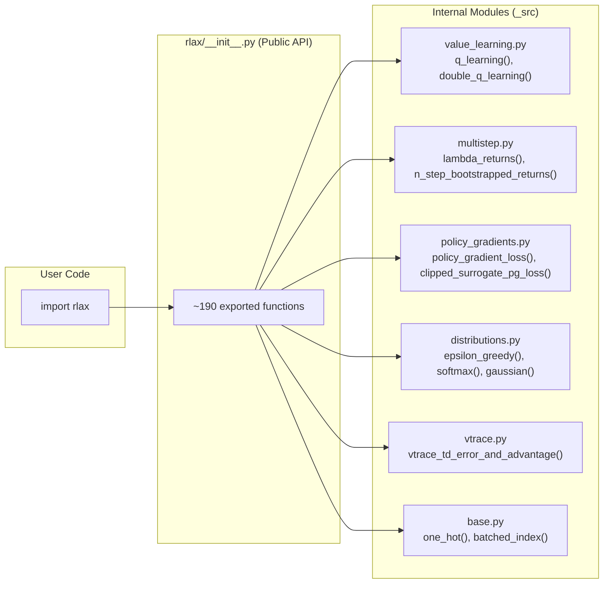
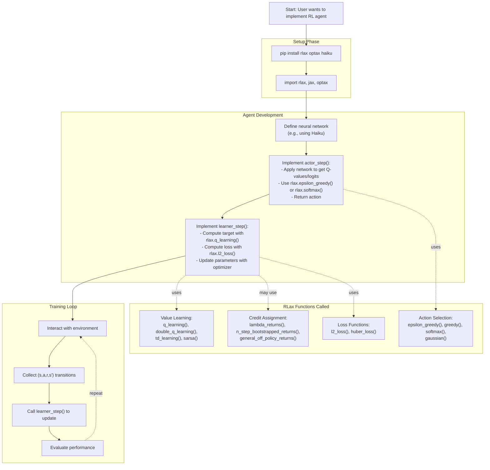

<!-- source: DeepWiki mcp.deepwiki.com · repo google-deepmind/rlax · page 1.1 Installation and Quick Start · fetched 2026-10-26 -->

# Installation and Quick Start

<details>
<summary>Relevant source files</summary>

The following files were used as context for generating this wiki page:

- [README.md](README.md)
- [examples/__init__.py](examples/__init__.py)
- [examples/experiment.py](examples/experiment.py)
- [examples/online_q_learning.py](examples/online_q_learning.py)
- [examples/pop_art.py](examples/pop_art.py)
- [examples/simple_dqn.py](examples/simple_dqn.py)
- [rlax/_src/__init__.py](rlax/_src/__init__.py)
- [rlax/_src/embedding.py](rlax/_src/embedding.py)
- [test.sh](test.sh)

</details>


This page guides you through installing RLax and getting started with basic usage. It covers installation methods, dependency requirements, and demonstrates simple examples to verify your setup. For detailed information about specific algorithms and advanced features, see the algorithm-specific pages (e.g., [Basic Value Learning](#2.1), [Policy Gradient Losses](#5.1)).

## Purpose and Scope

This page covers:
- Installation methods (PyPI, GitHub)
- Core dependencies and optional requirements
- Basic import patterns and library structure
- Running the provided examples
- Verifying your installation

For complete agent implementations and tutorials, see [Examples and Tutorials](#9).

---

## Installation Methods

### Installing from PyPI

The simplest way to install RLax is via PyPI:

```bash
pip install rlax
```

This installs the latest stable release with core dependencies (JAX, chex, distrax).

**Sources:** [README.md:14-18]()

### Installing from GitHub

To get the latest development version:

```bash
pip install git+https://github.com/deepmind/rlax.git
```

For local development with examples:

```bash
git clone https://github.com/deepmind/rlax.git
cd rlax
pip install -e ".[test]"
```

**Sources:** [README.md:20-33](), [test.sh:30-33]()

---

## Dependency Structure

```mermaid
graph TB
    subgraph "Core Installation: pip install rlax"
        RLAX["rlax<br/>(Main Package)"]
    end
    
    subgraph "Required Dependencies"
        JAX["jax / jaxlib<br/>(Numerical computation,<br/>JIT compilation)"]
        CHEX["chex<br/>(Type checking utilities)"]
        DISTRAX["distrax<br/>(Probability distributions)"]
        NUMPY["numpy<br/>(Array operations)"]
    end
    
    subgraph "Optional: For Running Examples"
        OPTAX["optax<br/>(Optimizers)"]
        HAIKU["haiku<br/>(Neural networks)"]
        BSUITE["bsuite<br/>(Catch environment)"]
        ABSL["absl-py<br/>(Flag parsing)"]
    end
    
    subgraph "Development Dependencies"
        PYTEST["pytest / pytest-xdist<br/>(Testing)"]
        FLAKE8["flake8<br/>(Linting)"]
        PYLINT["pylint<br/>(Linting)"]
        PYTYPE["pytype<br/>(Type checking)"]
        SPHINX["sphinx<br/>(Documentation)"]
    end
    
    RLAX --> JAX
    RLAX --> CHEX
    RLAX --> DISTRAX
    RLAX --> NUMPY
    
    RLAX -.examples require.-> OPTAX
    RLAX -.examples require.-> HAIKU
    RLAX -.examples require.-> BSUITE
    RLAX -.examples require.-> ABSL
    
    RLAX -.development requires.-> PYTEST
    RLAX -.development requires.-> FLAKE8
    RLAX -.development requires.-> PYLINT
    RLAX -.development requires.-> PYTYPE
    RLAX -.development requires.-> SPHINX
```



**Dependency Installation**

| Purpose | Command |
|---------|---------|
| Core library only | `pip install rlax` |
| With examples | `pip install optax haiku bsuite` |
| Full development | `pip install -e ".[test]"` |
| Documentation build | `pip install -e ".[docs]"` |

**Sources:** [README.md:29-33](), [test.sh:30-44]()

---

## Basic Usage Patterns

### Importing RLax

RLax provides all public functions through the top-level `rlax` module:

```python
import jax
import jax.numpy as jnp
import rlax

# All functions available directly
td_error = rlax.q_learning(q_tm1, a_tm1, r_t, discount_t, q_t)
advantage = rlax.lambda_returns(r_t, discount_t, v_t, lambda_=0.95)
action = rlax.epsilon_greedy(epsilon).sample(key, q_values)
```

The library is organized into functional modules that are all exposed through `rlax.__init__`:



**Sources:** [README.md:26-27](), [README.md:53-61]()

### JIT Compilation

All RLax functions are JAX-compatible and can be JIT-compiled:

```python
import jax
import rlax

# JIT compile a loss function
@jax.jit
def compute_loss(q_tm1, a_tm1, r_t, discount_t, q_t):
    td_error = rlax.q_learning(q_tm1, a_tm1, r_t, discount_t, q_t)
    return rlax.l2_loss(td_error)

# JIT compile with vmap for batching
batched_loss = jax.jit(jax.vmap(rlax.q_learning))
```

**Sources:** [README.md:26-27](), [examples/simple_dqn.py:108-109]()

---

## Quick Start Examples

### Minimal Q-Learning Example

This demonstrates the core pattern of using RLax functions:

```python
import jax.numpy as jnp
import rlax

# Transition data (s_t-1, a_t-1, r_t, s_t)
q_tm1 = jnp.array([1.0, 2.0, 3.0])  # Q-values at previous state
a_tm1 = 1                            # Action taken
r_t = 1.0                            # Reward received
discount_t = 0.99                    # Discount factor
q_t = jnp.array([2.0, 3.0, 4.0])    # Q-values at current state

# Compute TD error for Q-learning
td_error = rlax.q_learning(q_tm1, a_tm1, r_t, discount_t, q_t)
# td_error = r_t + discount_t * max(q_t) - q_tm1[a_tm1]

# Compute loss
loss = rlax.l2_loss(td_error)
```

**Sources:** [examples/online_q_learning.py:118-122]()

### Action Selection Example

```python
import jax
import jax.numpy as jnp
import rlax

# Q-values for 3 actions
q_values = jnp.array([1.0, 3.0, 2.0])
key = jax.random.PRNGKey(42)

# Epsilon-greedy exploration
epsilon = 0.1
policy = rlax.epsilon_greedy(epsilon)
action = policy.sample(key, q_values)

# Pure greedy (no exploration)
greedy_policy = rlax.greedy()
best_action = greedy_policy.sample(key, q_values)

# Softmax (Boltzmann) exploration
temperature = 1.0
softmax_policy = rlax.softmax(temperature)
sampled_action = softmax_policy.sample(key, q_values)
```

**Sources:** [examples/simple_dqn.py:130-132](), [examples/online_q_learning.py:107-109]()

---

## Running the Examples

### Example Structure

The `examples/` directory contains three complete agent implementations:

```mermaid
graph TB
    subgraph "examples/ Directory"
        EXPERIMENT["experiment.py<br/>run_loop()<br/>(Training orchestration)"]
        DQN["simple_dqn.py<br/>DQN class<br/>ReplayBuffer class"]
        ONLINEQ["online_q_learning.py<br/>OnlineQ class<br/>TransitionAccumulator class"]
        POPART["pop_art.py<br/>PopArtAgent class<br/>TransitionAccumulator class"]
    end
    
    subgraph "Key Components in Each Example"
        INIT["initial_params()<br/>Initialize network parameters"]
        ACTOR["actor_step()<br/>Select actions, maintain exploration"]
        LEARNER["learner_step()<br/>Update parameters from data"]
        LOSS["_loss()<br/>Compute TD error or PG loss"]
    end
    
    subgraph "RLax Functions Used"
        VL_FUNCS["Value Learning:<br/>rlax.q_learning()<br/>rlax.double_q_learning()"]
        DIST_FUNCS["Action Selection:<br/>rlax.epsilon_greedy()<br/>rlax.greedy()"]
        LOSS_FUNCS["Loss Functions:<br/>rlax.l2_loss()"]
        PA_FUNCS["Normalization:<br/>rlax.popart()<br/>rlax.normalize()<br/>rlax.unnormalize()"]
    end
    
    DQN --> INIT
    DQN --> ACTOR
    DQN --> LEARNER
    DQN --> LOSS
    
    ONLINEQ --> INIT
    ONLINEQ --> ACTOR
    ONLINEQ --> LEARNER
    ONLINEQ --> LOSS
    
    POPART --> INIT
    POPART --> ACTOR
    POPART --> LEARNER
    POPART --> LOSS
    
    EXPERIMENT -.orchestrates.-> ACTOR
    EXPERIMENT -.orchestrates.-> LEARNER
    
    DQN --> VL_FUNCS
    DQN --> DIST_FUNCS
    DQN --> LOSS_FUNCS
    
    ONLINEQ --> VL_FUNCS
    ONLINEQ --> DIST_FUNCS
    ONLINEQ --> LOSS_FUNCS
    
    POPART --> VL_FUNCS
    POPART --> DIST_FUNCS
    POPART --> LOSS_FUNCS
    POPART --> PA_FUNCS
```



**Sources:** [examples/experiment.py:21-72](), [examples/simple_dqn.py:95-154](), [examples/online_q_learning.py:80-123](), [examples/pop_art.py:86-160]()

### Running the DQN Example

The DQN example demonstrates double Q-learning with experience replay:

```bash
# Install example dependencies
pip install optax haiku bsuite

# Run DQN on Catch environment
cd examples
python simple_dqn.py \
    --train_episodes=301 \
    --batch_size=32 \
    --replay_capacity=2000 \
    --epsilon_begin=1.0 \
    --epsilon_end=0.01 \
    --learning_rate=0.005
```

**Key Components:**
- `DQN` class [examples/simple_dqn.py:95-154]()
- `ReplayBuffer` for off-policy learning [examples/simple_dqn.py:66-93]()
- Uses `rlax.double_q_learning()` [examples/simple_dqn.py:151]()
- Uses `rlax.epsilon_greedy()` [examples/simple_dqn.py:130]()

**Sources:** [examples/simple_dqn.py:38-51](), [examples/simple_dqn.py:95-154]()

### Running the Online Q-Learning Example

A simpler example without replay buffer:

```bash
python online_q_learning.py \
    --train_episodes=500 \
    --num_hidden_units=50 \
    --epsilon=0.01 \
    --learning_rate=0.005
```

**Key Differences from DQN:**
- Single-step updates (no replay buffer) [examples/online_q_learning.py:57-84]()
- Uses `rlax.q_learning()` [examples/online_q_learning.py:121]()
- Simpler `TransitionAccumulator` [examples/online_q_learning.py:57-78]()

**Sources:** [examples/online_q_learning.py:34-42](), [examples/online_q_learning.py:80-123]()

### Running the PopArt Example

Demonstrates adaptive normalization for non-stationary rewards:

```bash
python pop_art.py \
    --train_episodes=1000 \
    --reward_scale=10000 \
    --pop_art_step_size=3e-3 \
    --learning_rate=0.005
```

**Key Features:**
- Uses `rlax.popart()` for normalization [examples/pop_art.py:100-101]()
- Uses `rlax.normalize()` and `rlax.unnormalize()` [examples/pop_art.py:137-153]()
- Handles large reward scales [examples/pop_art.py:39]()

**Sources:** [examples/pop_art.py:38-48](), [examples/pop_art.py:100-160]()

---

## Verification and Testing

### Quick Verification

Verify your installation by running a simple test:

```python
import jax
import jax.numpy as jnp
import rlax

# Test basic Q-learning computation
q_tm1 = jnp.array([1.0, 2.0, 3.0])
a_tm1 = 1
r_t = 1.0
discount_t = 0.99
q_t = jnp.array([2.0, 3.0, 4.0])

td_error = rlax.q_learning(q_tm1, a_tm1, r_t, discount_t, q_t)
print(f"TD Error: {td_error}")

# Test JIT compilation
@jax.jit
def compute_td():
    return rlax.q_learning(q_tm1, a_tm1, r_t, discount_t, q_t)

jitted_td = compute_td()
print(f"JIT compiled TD Error: {jitted_td}")
print("Installation successful!")
```

### Running the Test Suite

For development or to verify a source installation:

```bash
# Run all tests
pytest -n auto --pyargs rlax

# Run specific module tests
pytest --pyargs rlax._src.value_learning_test
pytest --pyargs rlax._src.multistep_test

# Run with verbose output
pytest -v --pyargs rlax
```

**Sources:** [test.sh:84-93]()

### Type Checking (Python < 3.11)

```bash
# Install pytype
pip install pytype

# Run type checking
pytype rlax -j auto --keep-going --disable import-error
```

**Sources:** [test.sh:75-82]()

---

## Common Usage Workflow



**Sources:** [examples/experiment.py:21-72](), [examples/simple_dqn.py:95-154]()

---

## Next Steps

After completing installation and running the quick start examples:

1. **Learn Core Algorithms:**
   - [Basic Value Learning](#2.1) - Q-learning, SARSA, TD learning
   - [Multistep Returns and Credit Assignment](#3) - Lambda returns, GAE
   - [Policy Gradient Losses](#5.1) - REINFORCE, PPO

2. **Explore Advanced Topics:**
   - [Distributional Reinforcement Learning](#2.2) - C51, quantile regression
   - [V-trace for Off-Policy Learning](#3.2) - IMPALA-style training
   - [MPO and VMPO](#5.2) - Constrained policy optimization

3. **Study Complete Implementations:**
   - [DQN Example](#9.1) - Experience replay, target networks
   - [Online Q-Learning Example](#9.2) - Simple single-step updates
   - [PopArt Normalization Example](#9.3) - Adaptive reward scaling

4. **Review API Reference:**
   - [Complete API Reference](#8) - All available functions

**Sources:** [README.md:35-52](), [README.md:83-105]()

---

## Troubleshooting

### JAX Installation Issues

If you encounter issues with JAX installation, particularly with GPU/TPU support:

```bash
# CPU-only JAX
pip install --upgrade "jax[cpu]"

# CUDA 12 support
pip install --upgrade "jax[cuda12_pip]" -f https://storage.googleapis.com/jax-releases/jax_cuda_releases.html

# CUDA 11 support
pip install --upgrade "jax[cuda11_pip]" -f https://storage.googleapis.com/jax-releases/jax_cuda_releases.html
```

### Import Errors

If you see import errors after installation:

```python
# Verify rlax is installed correctly
import rlax
print(rlax.__version__)
print(rlax.__file__)

# Check available functions
print(dir(rlax))
```

### Example Dependencies

If examples fail to run, ensure all dependencies are installed:

```bash
pip install optax haiku bsuite absl-py
```

**Sources:** [test.sh:36-44](), [README.md:29-33]()

---

