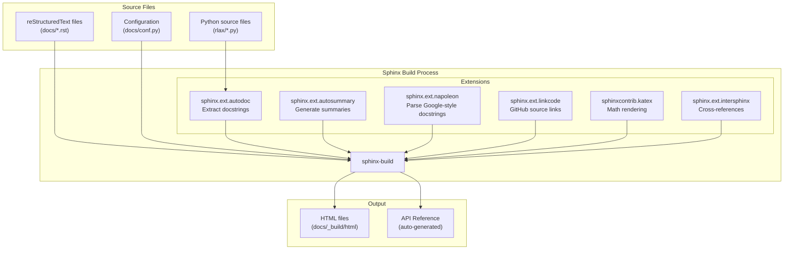
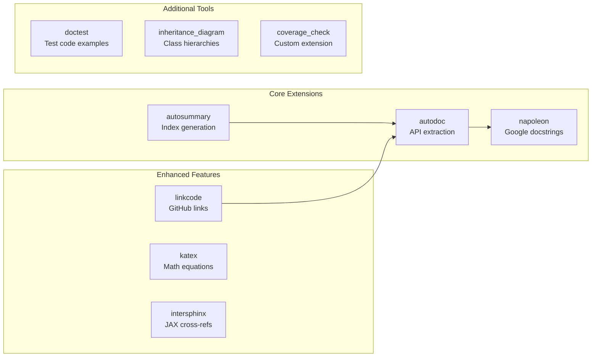
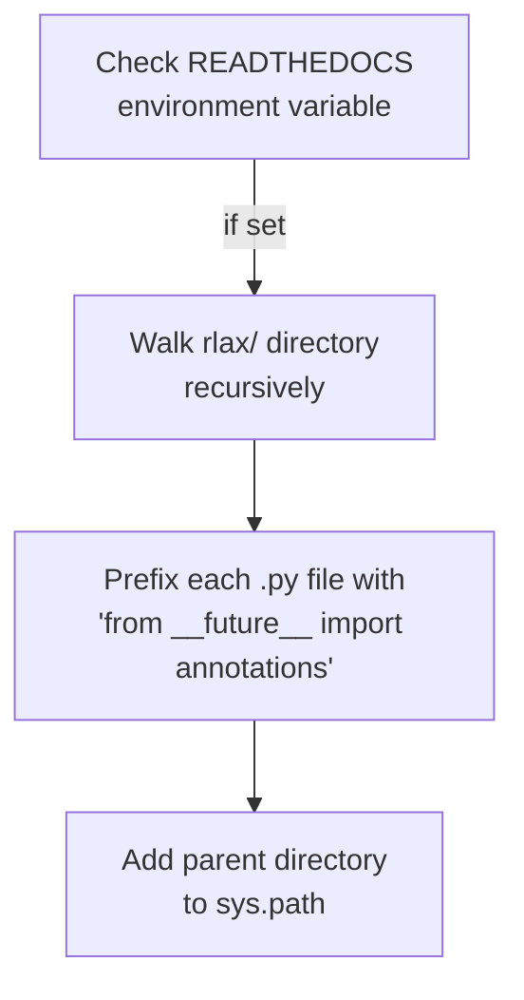
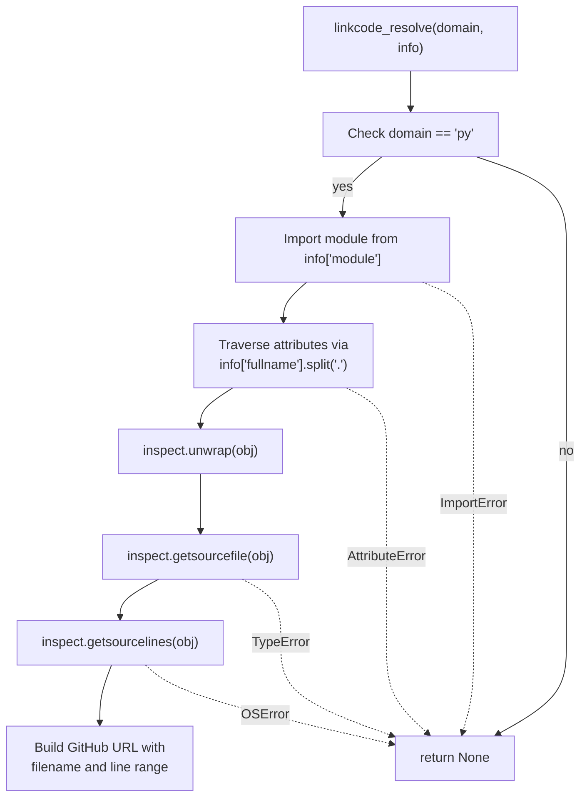
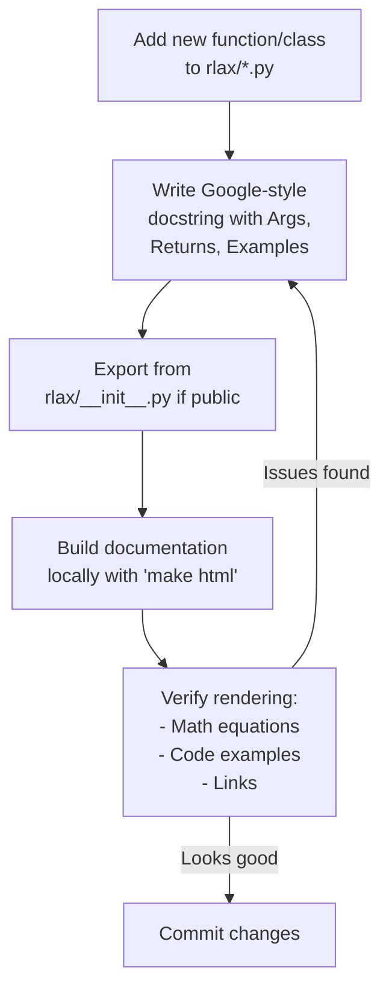

<!-- source: DeepWiki mcp.deepwiki.com · repo google-deepmind/rlax · page 10.2 Documentation System · fetched 2026-10-26 -->

# Documentation System

<details>
<summary>Relevant source files</summary>

The following files were used as context for generating this wiki page:

- [docs/conf.py](docs/conf.py)

</details>


## Purpose and Scope

This document explains RLax's Sphinx-based documentation system, including configuration, API generation, build process, and special features like math rendering and source code linking. For information about testing the documentation build as part of CI, see [10.3](#10.3). For general contribution guidelines, see [10](#10).

## Architecture Overview

The documentation system uses Sphinx to generate HTML documentation from Python docstrings and reStructuredText source files. The system automatically extracts API documentation from the codebase and renders mathematical notation for reinforcement learning equations.



**Diagram: Documentation Build Pipeline**

The pipeline extracts API documentation from source code docstrings, processes reStructuredText files, and generates static HTML with math rendering and GitHub source links.

Sources: [docs/conf.py:1-195]()

## Sphinx Configuration

The primary configuration resides in `docs/conf.py`, which defines project metadata, extensions, theme settings, and custom behavior.

### Project Metadata

| Setting | Value | Purpose |
|---------|-------|---------|
| `project` | 'RLax' | Project display name |
| `copyright` | '2021, DeepMind' | Copyright notice |
| `author` | 'RLax Contributors' | Author attribution |
| `master_doc` | 'index' | Root document (index.rst) |

Sources: [docs/conf.py:71-77]()

### Extension Configuration

The documentation system enables multiple Sphinx extensions:



**Diagram: Sphinx Extensions and Dependencies**

The extension list is defined at [docs/conf.py:82-92]():

```python
extensions = [
    'sphinx.ext.autodoc',
    'sphinx.ext.autosummary',
    'sphinx.ext.doctest',
    'sphinx.ext.inheritance_diagram',
    'sphinx.ext.intersphinx',
    'sphinx.ext.linkcode',
    'sphinx.ext.napoleon',
    'sphinxcontrib.katex',
    'coverage_check',
]
```

Sources: [docs/conf.py:82-92]()

### Theme Configuration

RLax uses the `sphinx_book_theme` for clean, modern documentation appearance:

| Option | Value | Effect |
|--------|-------|--------|
| `show_toc_level` | 2 | Display two levels in table of contents |
| `repository_url` | `https://github.com/google-deepmind/rlax` | GitHub repository link |
| `use_repository_button` | `True` | Add "link to repository" button |
| `navigation_with_keys` | `False` | Disable keyboard navigation |

Sources: [docs/conf.py:114-121]()

### Autodoc Configuration

The autodoc extension is configured to control member ordering and visibility:

```python
autodoc_default_options = {
    'member-order': 'bysource',  # Order as in source file
    'special-members': True,      # Include __init__, etc.
    'exclude-members': '__repr__, __str__, __weakref__',
}
```

This ensures API documentation reflects the logical organization in source files rather than alphabetical ordering.

Sources: [docs/conf.py:104-108]()

## API Documentation Generation

### Automatic Docstring Extraction

The `sphinx.ext.autodoc` extension automatically extracts docstrings from Python modules, classes, and functions. The `sphinx.ext.napoleon` extension parses Google-style docstrings (the format used throughout RLax):

```
Args:
    q_tm1: Q-values at time t-1 of shape [batch_size, num_actions].
    a_tm1: action index at time t-1 of shape [batch_size].
    r_t: reward at time t of shape [batch_size].

Returns:
    TD error of shape [batch_size].
```

Napoleon converts these to reStructuredText format that Sphinx can process.

Sources: [docs/conf.py:89]()

### Source Path Configuration

For Read the Docs builds, the configuration adds a future import to all Python files to ensure compatibility:



**Diagram: Read the Docs Setup Process**

This modification at [docs/conf.py:34-61]() ensures consistent type annotation handling across Python versions. The import is prefixed (not inserted on a new line) to preserve line numbers for accurate source code linking.

Sources: [docs/conf.py:34-61]()

## GitHub Source Code Linking

The `linkcode_resolve` function generates GitHub URLs for each documented Python object:



**Diagram: GitHub Link Generation Logic**

The function builds URLs in this format:
```
https://github.com/google-deepmind/rlax/tree/main/rlax/{filename}#L{start}#L{end}
```

This allows users to click from documentation directly to the corresponding source code on GitHub.

Sources: [docs/conf.py:148-185]()

## Mathematical Rendering with KaTeX

RLax documentation includes numerous mathematical equations for reinforcement learning algorithms. The `sphinxcontrib.katex` extension renders LaTeX math in HTML:

### Macro Definitions

Custom LaTeX macros are defined and converted to KaTeX format:

```python
latex_macros = r"""
    \def \d              #1{\operatorname{#1}}
"""

katex_macros = katex.latex_defs_to_katex_macros(latex_macros)
katex_options = (
    '{displayMode: true, fleqn: true, macros: {' + katex_macros + '}}'
)
```

The `\d` macro formats operator names (e.g., `\d{TD}` for TD operator). Options enable:
- `displayMode: true` - Display-style (centered) equations
- `fleqn: true` - Flush left equation numbering

Sources: [docs/conf.py:132-143]()

## Intersphinx Cross-References

The `sphinx.ext.intersphinx` extension enables linking to external documentation:

```python
intersphinx_mapping = {
    'jax': ('https://jax.readthedocs.io/en/latest/', None),
}
```

This allows RLax documentation to reference JAX types and functions (e.g., `jax.numpy.ndarray`) with automatic linking to JAX's documentation.

Sources: [docs/conf.py:190-192]()

## Building Documentation

### Local Build Process

To build documentation locally:

1. **Install dependencies**:
   ```bash
   pip install sphinx sphinx-book-theme sphinxcontrib-katex
   ```

2. **Navigate to docs directory**:
   ```bash
   cd docs/
   ```

3. **Build HTML**:
   ```bash
   make html
   ```

4. **View output**:
   ```bash
   open _build/html/index.html  # macOS
   xdg-open _build/html/index.html  # Linux
   ```

The build output is placed in `docs/_build/html/` (excluded from version control via `.gitignore`).

### Build Artifacts

| Artifact | Location | Description |
|----------|----------|-------------|
| Main index | `_build/html/index.html` | Documentation homepage |
| API reference | `_build/html/api.html` | Auto-generated API docs |
| Search index | `_build/html/searchindex.js` | Client-side search data |
| Static assets | `_build/html/_static/` | CSS, JavaScript, fonts |

Sources: [docs/conf.py:77](), [docs/conf.py:100]()

## Documentation Workflow

### For Contributors

When adding new functions or classes to RLax:



**Diagram: Documentation Contribution Workflow**

### Docstring Format

RLax uses Google-style docstrings parsed by the Napoleon extension. Example structure:

```python
def td_learning(
    v_tm1: Array,
    r_t: Array,
    discount_t: Array,
    v_t: Array
) -> Array:
  """Calculates the TD-learning temporal difference error.
  
  See "Reinforcement Learning: An Introduction" by Sutton and Barto.
  (http://incompleteideas.net/book/ebook/node60.html).
  
  Args:
    v_tm1: sequence of state values at time t-1.
    r_t: sequence of rewards at time t.
    discount_t: sequence of discounts at time t.
    v_t: sequence of state values at time t.
    
  Returns:
    TD error.
  """
```

Key sections:
- Brief summary (first line)
- Extended description with references
- `Args:` - Parameter descriptions
- `Returns:` - Return value description
- `Raises:` (if applicable) - Exceptions

Sources: [docs/conf.py:89]()

## Coverage Checking

The custom `coverage_check` extension (loaded at [docs/conf.py:91]()) verifies that all public API members are documented. This extension is located in `docs/ext/coverage_check.py` and ensures documentation completeness.

Sources: [docs/conf.py:91]()

## File Organization

The documentation system expects this directory structure:

```
docs/
├── conf.py              # Sphinx configuration
├── index.rst            # Main documentation index
├── api.rst              # API reference page
├── Makefile             # Build automation (Unix)
├── make.bat             # Build automation (Windows)
├── _templates/          # Custom Jinja2 templates
├── ext/                 # Custom Sphinx extensions
│   └── coverage_check.py
└── _build/              # Build output (gitignored)
    └── html/
```

The `exclude_patterns` configuration at [docs/conf.py:100]() prevents Sphinx from processing build artifacts and system files.

Sources: [docs/conf.py:100]()

## Read the Docs Integration

When building on Read the Docs, the system:

1. Detects the `READTHEDOCS` environment variable ([docs/conf.py:60-61]())
2. Recursively adds future annotations imports ([docs/conf.py:54-58]())
3. Modifies sys.path to find the rlax package ([docs/conf.py:63-64]())
4. Builds HTML documentation automatically on every commit

The configuration is designed to work both locally and on Read the Docs without modification.

Sources: [docs/conf.py:60-64]()

---

