# Page: Overview

# Overview

<details>
<summary>Relevant source files</summary>

The following files were used as context for generating this wiki page:

- [README.md](README.md)
- [examples/__init__.py](examples/__init__.py)
- [examples/experiment.py](examples/experiment.py)
- [examples/online_q_learning.py](examples/online_q_learning.py)
- [examples/pop_art.py](examples/pop_art.py)
- [examples/simple_dqn.py](examples/simple_dqn.py)
- [rlax/__init__.py](rlax/__init__.py)
- [rlax/_src/embedding.py](rlax/_src/embedding.py)

</details>


This document provides a high-level introduction to RLax, explaining its purpose, design philosophy, architectural organization, and how to navigate the codebase. For installation instructions and quick start examples, see [Installation and Quick Start](#1.1). For detailed documentation of specific algorithm families, see the subsequent chapters on value-based learning ([#2](#2)), multistep returns ([#3](#3)), distributions ([#4](#4)), and policy optimization ([#5](#5)).

## Purpose and Scope

RLax is a library of **modular reinforcement learning building blocks** built on JAX. Unlike full-featured RL frameworks that provide complete agent implementations, RLax focuses on providing primitive mathematical operations that can be composed to build custom RL algorithms. The library exposes approximately 190 functions through its public API, organized into functional domains such as value learning, policy gradients, multistep credit assignment, and probability distributions.

RLax is designed for researchers and practitioners who want:
- Fine-grained control over algorithm implementation
- JAX-compatible RL operations that support JIT compilation, automatic differentiation, and hardware acceleration
- Reusable components that can be mixed and matched across different RL paradigms
- Well-tested implementations of complex RL operations (e.g., V-trace, distributional Bellman operators, MPO)

**Sources:** [README.md:1-139](), [rlax/__init__.py:1-284]()

## Design Philosophy: Building Blocks, Not Algorithms

RLax provides **operations and functions**, not complete algorithms. Each function implements a specific mathematical transformation used in RL. For example:

- `rlax.q_learning()` computes the Q-learning TD error, but does not implement a full DQN agent
- `rlax.policy_gradient_loss()` computes a policy gradient loss, but does not implement PPO
- `rlax.lambda_returns()` computes λ-returns, but does not implement an actor-critic algorithm

Complete agents are built by **composing** these primitives. The `examples/` directory demonstrates this pattern:

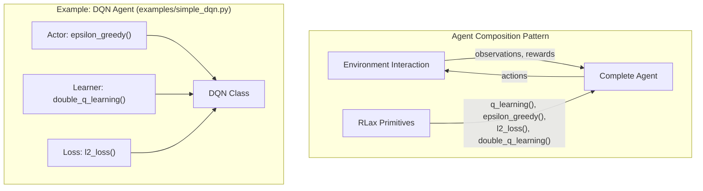

This modular design allows users to:
1. Mix components from different RL families (e.g., distributional Q-learning with n-step returns)
2. Implement novel algorithms by recombining primitives in new ways
3. Swap individual components while keeping the rest of an agent unchanged

**Sources:** [README.md:35-52](), [examples/simple_dqn.py:95-154](), [examples/online_q_learning.py:80-123]()

## Core Functional Areas

RLax is organized into distinct functional modules. The following diagram shows the main areas and their relative importance (based on code change frequency):

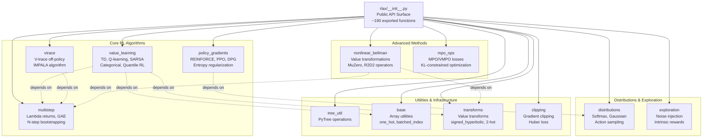

**Sources:** [rlax/__init__.py:17-143]()

### Module Descriptions

| Module | Primary Functions | Purpose |
|--------|------------------|---------|
| `value_learning` | `q_learning`, `double_q_learning`, `categorical_q_learning`, `retrace`, `sarsa` | Temporal difference methods for value-based RL |
| `multistep` | `lambda_returns`, `n_step_bootstrapped_returns`, `truncated_generalized_advantage_estimation` | Multi-step return computation and credit assignment |
| `vtrace` | `vtrace`, `vtrace_td_error_and_advantage`, `leaky_vtrace` | Off-policy correction for actor-critic methods |
| `policy_gradients` | `policy_gradient_loss`, `clipped_surrogate_pg_loss`, `dpg_loss`, `entropy_loss` | Policy optimization losses |
| `mpo_ops` | `mpo_loss`, `vmpo_loss`, `compute_parametric_kl_penalty_and_dual_loss` | Maximum a Posteriori Policy Optimization |
| `nonlinear_bellman` | `transformed_q_lambda`, `muzero_pair`, `SIGNED_HYPERBOLIC_PAIR` | Transformed value functions for deep RL |
| `distributions` | `softmax`, `epsilon_greedy`, `gaussian_diagonal`, `squashed_gaussian` | Action selection and probability distributions |
| `tree_util` | `tree_select`, `tree_map_zipped`, `tree_split_key` | Operations on nested structures (PyTrees) |
| `base` | `batched_index`, `one_hot`, `lhs_broadcast` | Fundamental array operations |

**Sources:** [rlax/__init__.py:17-143]()

## Public API Organization

All public functions are exported through a single entry point: `rlax/__init__.py`. The `__all__` tuple explicitly defines the public API surface. Functions are organized by domain:

### Value Learning Functions (30+ functions)

```python
# Basic TD methods
rlax.q_learning(q_tm1, a_tm1, r_t, discount_t, q_t)
rlax.double_q_learning(q_tm1, a_tm1, r_t, discount_t, q_t_value, q_t_selector)
rlax.sarsa(q_tm1, a_tm1, r_t, discount_t, q_t, a_t)
rlax.expected_sarsa(q_tm1, a_tm1, r_t, discount_t, q_t, probs_a_t)

# Distributional RL
rlax.categorical_q_learning(atoms_tm1, logits_tm1, a_tm1, r_t, discount_t, atoms_t, logits_t)
rlax.quantile_q_learning(dist_tm1, tau_tm1, a_tm1, r_t, discount_t, dist_t)

# Off-policy
rlax.retrace(q_tm1, q_t, a_tm1, a_t, r_t, discount_t, rho_tm1, lambda_)
```

**Sources:** [rlax/__init__.py:120-139]()

### Multistep Return Functions (5+ functions)

```python
rlax.discounted_returns(r_t, discount_t, v_t)
rlax.lambda_returns(r_t, discount_t, v_t, lambda_)
rlax.n_step_bootstrapped_returns(r_t, discount_t, v_t, n)
rlax.truncated_generalized_advantage_estimation(r_t, discount_t, lambda_, values)
```

**Sources:** [rlax/__init__.py:60-65]()

### Policy Gradient Functions (8+ functions)

```python
rlax.policy_gradient_loss(logprobs_actions, advantages, w)
rlax.clipped_surrogate_pg_loss(prob_ratios, advantages, epsilon)
rlax.dpg_loss(a_t, dq_da)
rlax.entropy_loss(logits, w)
```

**Sources:** [rlax/__init__.py:84-90]()

### Distribution Functions (11+ functions)

```python
rlax.softmax(temperature)  # Returns a distribution
rlax.epsilon_greedy(epsilon)  # Returns a distribution
rlax.greedy()  # Returns a distribution
rlax.gaussian_diagonal(mu, sigma)
rlax.squashed_gaussian(mu, sigma, ...)
```

**Sources:** [rlax/__init__.py:24-34]()

## How Building Blocks Compose

The following diagram illustrates how RLax primitives compose into a complete DQN agent, mapping high-level algorithm steps to specific RLax functions:

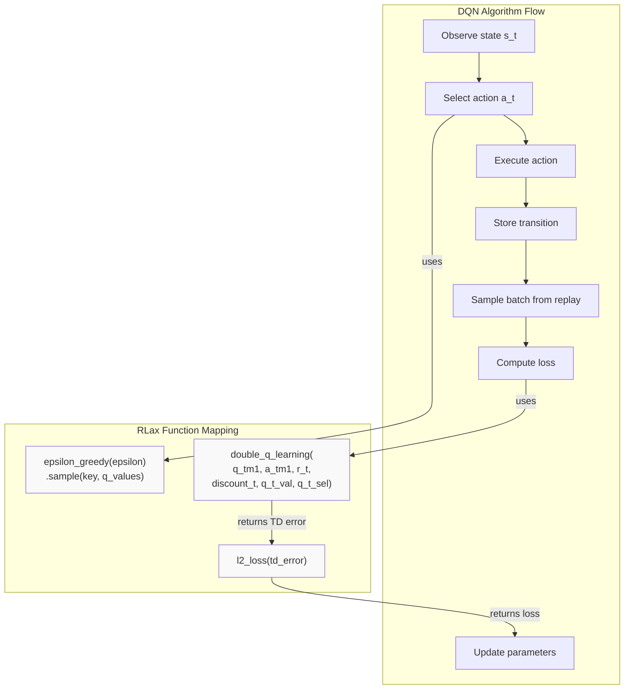

**Concrete Example from `examples/simple_dqn.py`:**

```python
# Action selection (actor_step)
q = self._network.apply(params.online, obs)
epsilon = self._epsilon_by_frame(actor_state.count)
a = rlax.epsilon_greedy(epsilon).sample(key, q)

# Learning (learner_step -> _loss)
q_tm1 = self._network.apply(online_params, obs_tm1)
q_t_val = self._network.apply(target_params, obs_t)
q_t_select = self._network.apply(online_params, obs_t)
batched_loss = jax.vmap(rlax.double_q_learning)
td_error = batched_loss(q_tm1, a_tm1, r_t, discount_t, q_t_val, q_t_select)
return jnp.mean(rlax.l2_loss(td_error))
```

**Sources:** [examples/simple_dqn.py:126-154]()

### Composition Patterns

RLax functions follow consistent composition patterns:

1. **TD Learning Pipeline**: `value_learning` functions return TD errors → feed to loss functions (`l2_loss`, `huber_loss`)
2. **Multistep + Value Learning**: `multistep` functions compute targets → combine with predictions in `value_learning` functions
3. **Distribution + Policy Gradient**: `distributions` provide action sampling → `policy_gradients` compute losses
4. **Transform + Bellman**: `TxPair` objects wrap Bellman operators in `nonlinear_bellman` module

**Sources:** [examples/simple_dqn.py:146-153](), [examples/online_q_learning.py:118-122]()

## JAX Integration and Features

RLax is deeply integrated with the JAX ecosystem and leverages JAX's core features:

### JIT Compilation
All RLax functions are designed to work with `jax.jit`:

```python
# From examples/simple_dqn.py
self.actor_step = jax.jit(self.actor_step)
self.learner_step = jax.jit(self.learner_step)
```

### Automatic Vectorization
Functions are designed for single transitions but can be batched with `jax.vmap`:

```python
# Single transition
td_error = rlax.double_q_learning(q_tm1, a_tm1, r_t, discount_t, q_t_val, q_t_select)

# Batched transitions
batched_loss = jax.vmap(rlax.double_q_learning)
td_errors = batched_loss(q_tm1_batch, a_tm1_batch, r_t_batch, ...)
```

### Automatic Differentiation
Losses are differentiable and work with `jax.grad`:

```python
# Compute gradient of loss w.r.t. parameters
dloss_dtheta = jax.grad(self._loss)(params, data)
```

### Hardware Acceleration
Code runs unchanged on CPU, GPU, or TPU through JAX's device abstraction.

**Sources:** [README.md:26-28](), [examples/simple_dqn.py:107-109](), [examples/simple_dqn.py:151-153]()

## Codebase Structure

The codebase follows a clear organizational structure:

```
rlax/
├── __init__.py              # Public API (all exports)
├── _src/                    # Private implementation modules
│   ├── base.py             # Array utilities
│   ├── clipping.py         # Gradient clipping, Huber loss
│   ├── distributions.py    # Action distributions
│   ├── exploration.py      # Exploration strategies
│   ├── multistep.py        # Multi-step returns
│   ├── policy_gradients.py # Policy optimization
│   ├── value_learning.py   # TD methods
│   ├── vtrace.py           # V-trace algorithm
│   ├── mpo_ops.py          # MPO/VMPO
│   ├── nonlinear_bellman.py# Value transformations
│   ├── tree_util.py        # PyTree operations
│   ├── transforms.py       # Value transforms
│   └── ...                 # Other specialized modules
└── examples/
    ├── simple_dqn.py       # DQN implementation
    ├── online_q_learning.py# Online Q-learning
    ├── pop_art.py          # PopArt normalization
    └── experiment.py       # Training loop utilities
```

### Navigating Implementation

- **Public API**: All user-facing functions are in `rlax/__init__.py` (lines 17-272)
- **Implementation**: Private modules in `rlax/_src/` contain actual implementations
- **Examples**: Complete agent implementations in `examples/` show usage patterns
- **Documentation**: Function docstrings contain mathematical definitions and paper references

**Key principle**: Users should only import from `rlax`, never from `rlax._src`:

```python
# Correct
import rlax
td_error = rlax.q_learning(...)

# Incorrect - _src is private
from rlax._src.value_learning import q_learning  # Don't do this
```

**Sources:** [rlax/__init__.py:274-282]()

## Naming Conventions

RLax follows consistent naming conventions to clarify temporal relationships:

- **`_tm1`**: Values at the *source* state of a transition (time minus 1)
- **`_t`**: Values at the *destination* state (current time)
- **`_tp1`**: Values at the next state (time plus 1)

**Example:**
```python
# q_tm1: Q-values in source state
# a_tm1: action taken in source state  
# r_t: reward received after taking action
# discount_t: discount factor for this transition
# q_t: Q-values in destination state
td_error = rlax.q_learning(q_tm1, a_tm1, r_t, discount_t, q_t)
```

**Sources:** [README.md:112-121]()

## Data Requirements and Constraints

**Important**: RLax functions compute correct updates only when input data satisfies algorithm-specific requirements:

- **On-policy algorithms** (e.g., `policy_gradient_loss`): Require trajectories sampled from the current policy
- **Off-policy algorithms** (e.g., `q_learning`, `retrace`): Can learn from data sampled by different policies
- **Importance sampling**: Some functions (e.g., `vtrace`) require importance ratios when learning off-policy

The library **does not enforce** these constraints; users must ensure data is sampled correctly. Function docstrings specify requirements.

**Sources:** [README.md:99-104]()

## External Dependencies

RLax integrates with the JAX ecosystem:

| Dependency | Purpose |
|-----------|---------|
| **JAX** | Core numerical computation, JIT, autodiff, vmap |
| **jax.numpy** | NumPy-compatible array operations |
| **chex** | Runtime type checking and assertions |
| **distrax** | Probability distributions (being migrated to) |
| **optax** | Gradient-based optimization (examples) |
| **haiku** | Neural networks (examples only) |

The core library depends only on JAX and chex. Examples additionally require optax, haiku, and bsuite.

**Sources:** [README.md:29-33](), [examples/simple_dqn.py:17-28]()

## Next Steps

To start using RLax:

1. **Install the library**: See [Installation and Quick Start](#1.1)
2. **Explore examples**: Review complete agent implementations in `examples/`
3. **Deep dive into algorithms**: 
   - Value-based methods: [#2](#2)
   - Multistep returns: [#3](#3)
   - Distributions: [#4](#4)
   - Policy gradients: [#5](#5)
4. **Browse API reference**: See [Complete API Reference](#8) for all functions

**Sources:** [README.md:1-139](), [examples/simple_dqn.py:1-186](), [examples/online_q_learning.py:1-150]()

---

# Page: Installation and Quick Start

# Installation and Quick Start

<details>
<summary>Relevant source files</summary>

The following files were used as context for generating this wiki page:

- [README.md](README.md)
- [examples/__init__.py](examples/__init__.py)
- [examples/experiment.py](examples/experiment.py)
- [examples/online_q_learning.py](examples/online_q_learning.py)
- [examples/pop_art.py](examples/pop_art.py)
- [examples/simple_dqn.py](examples/simple_dqn.py)
- [rlax/_src/__init__.py](rlax/_src/__init__.py)
- [rlax/_src/embedding.py](rlax/_src/embedding.py)
- [test.sh](test.sh)

</details>


This page guides you through installing RLax and getting started with basic usage. It covers installation methods, dependency requirements, and demonstrates simple examples to verify your setup. For detailed information about specific algorithms and advanced features, see the algorithm-specific pages (e.g., [Basic Value Learning](#2.1), [Policy Gradient Losses](#5.1)).

## Purpose and Scope

This page covers:
- Installation methods (PyPI, GitHub)
- Core dependencies and optional requirements
- Basic import patterns and library structure
- Running the provided examples
- Verifying your installation

For complete agent implementations and tutorials, see [Examples and Tutorials](#9).

---

## Installation Methods

### Installing from PyPI

The simplest way to install RLax is via PyPI:

```bash
pip install rlax
```

This installs the latest stable release with core dependencies (JAX, chex, distrax).

**Sources:** [README.md:14-18]()

### Installing from GitHub

To get the latest development version:

```bash
pip install git+https://github.com/deepmind/rlax.git
```

For local development with examples:

```bash
git clone https://github.com/deepmind/rlax.git
cd rlax
pip install -e ".[test]"
```

**Sources:** [README.md:20-33](), [test.sh:30-33]()

---

## Dependency Structure

```mermaid
graph TB
    subgraph "Core Installation: pip install rlax"
        RLAX["rlax<br/>(Main Package)"]
    end
    
    subgraph "Required Dependencies"
        JAX["jax / jaxlib<br/>(Numerical computation,<br/>JIT compilation)"]
        CHEX["chex<br/>(Type checking utilities)"]
        DISTRAX["distrax<br/>(Probability distributions)"]
        NUMPY["numpy<br/>(Array operations)"]
    end
    
    subgraph "Optional: For Running Examples"
        OPTAX["optax<br/>(Optimizers)"]
        HAIKU["haiku<br/>(Neural networks)"]
        BSUITE["bsuite<br/>(Catch environment)"]
        ABSL["absl-py<br/>(Flag parsing)"]
    end
    
    subgraph "Development Dependencies"
        PYTEST["pytest / pytest-xdist<br/>(Testing)"]
        FLAKE8["flake8<br/>(Linting)"]
        PYLINT["pylint<br/>(Linting)"]
        PYTYPE["pytype<br/>(Type checking)"]
        SPHINX["sphinx<br/>(Documentation)"]
    end
    
    RLAX --> JAX
    RLAX --> CHEX
    RLAX --> DISTRAX
    RLAX --> NUMPY
    
    RLAX -.examples require.-> OPTAX
    RLAX -.examples require.-> HAIKU
    RLAX -.examples require.-> BSUITE
    RLAX -.examples require.-> ABSL
    
    RLAX -.development requires.-> PYTEST
    RLAX -.development requires.-> FLAKE8
    RLAX -.development requires.-> PYLINT
    RLAX -.development requires.-> PYTYPE
    RLAX -.development requires.-> SPHINX
```

**Dependency Installation**

| Purpose | Command |
|---------|---------|
| Core library only | `pip install rlax` |
| With examples | `pip install optax haiku bsuite` |
| Full development | `pip install -e ".[test]"` |
| Documentation build | `pip install -e ".[docs]"` |

**Sources:** [README.md:29-33](), [test.sh:30-44]()

---

## Basic Usage Patterns

### Importing RLax

RLax provides all public functions through the top-level `rlax` module:

```python
import jax
import jax.numpy as jnp
import rlax

# All functions available directly
td_error = rlax.q_learning(q_tm1, a_tm1, r_t, discount_t, q_t)
advantage = rlax.lambda_returns(r_t, discount_t, v_t, lambda_=0.95)
action = rlax.epsilon_greedy(epsilon).sample(key, q_values)
```

The library is organized into functional modules that are all exposed through `rlax.__init__`:

```mermaid
graph LR
    subgraph "User Code"
        IMPORT["import rlax"]
    end
    
    subgraph "rlax/__init__.py (Public API)"
        API["~190 exported functions"]
    end
    
    subgraph "Internal Modules (_src)"
        VL["value_learning.py<br/>q_learning(), double_q_learning()"]
        MS["multistep.py<br/>lambda_returns(), n_step_bootstrapped_returns()"]
        PG["policy_gradients.py<br/>policy_gradient_loss(), clipped_surrogate_pg_loss()"]
        DIST["distributions.py<br/>epsilon_greedy(), softmax(), gaussian()"]
        VT["vtrace.py<br/>vtrace_td_error_and_advantage()"]
        BASE["base.py<br/>one_hot(), batched_index()"]
    end
    
    IMPORT --> API
    API --> VL
    API --> MS
    API --> PG
    API --> DIST
    API --> VT
    API --> BASE
```

**Sources:** [README.md:26-27](), [README.md:53-61]()

### JIT Compilation

All RLax functions are JAX-compatible and can be JIT-compiled:

```python
import jax
import rlax

# JIT compile a loss function
@jax.jit
def compute_loss(q_tm1, a_tm1, r_t, discount_t, q_t):
    td_error = rlax.q_learning(q_tm1, a_tm1, r_t, discount_t, q_t)
    return rlax.l2_loss(td_error)

# JIT compile with vmap for batching
batched_loss = jax.jit(jax.vmap(rlax.q_learning))
```

**Sources:** [README.md:26-27](), [examples/simple_dqn.py:108-109]()

---

## Quick Start Examples

### Minimal Q-Learning Example

This demonstrates the core pattern of using RLax functions:

```python
import jax.numpy as jnp
import rlax

# Transition data (s_t-1, a_t-1, r_t, s_t)
q_tm1 = jnp.array([1.0, 2.0, 3.0])  # Q-values at previous state
a_tm1 = 1                            # Action taken
r_t = 1.0                            # Reward received
discount_t = 0.99                    # Discount factor
q_t = jnp.array([2.0, 3.0, 4.0])    # Q-values at current state

# Compute TD error for Q-learning
td_error = rlax.q_learning(q_tm1, a_tm1, r_t, discount_t, q_t)
# td_error = r_t + discount_t * max(q_t) - q_tm1[a_tm1]

# Compute loss
loss = rlax.l2_loss(td_error)
```

**Sources:** [examples/online_q_learning.py:118-122]()

### Action Selection Example

```python
import jax
import jax.numpy as jnp
import rlax

# Q-values for 3 actions
q_values = jnp.array([1.0, 3.0, 2.0])
key = jax.random.PRNGKey(42)

# Epsilon-greedy exploration
epsilon = 0.1
policy = rlax.epsilon_greedy(epsilon)
action = policy.sample(key, q_values)

# Pure greedy (no exploration)
greedy_policy = rlax.greedy()
best_action = greedy_policy.sample(key, q_values)

# Softmax (Boltzmann) exploration
temperature = 1.0
softmax_policy = rlax.softmax(temperature)
sampled_action = softmax_policy.sample(key, q_values)
```

**Sources:** [examples/simple_dqn.py:130-132](), [examples/online_q_learning.py:107-109]()

---

## Running the Examples

### Example Structure

The `examples/` directory contains three complete agent implementations:

```mermaid
graph TB
    subgraph "examples/ Directory"
        EXPERIMENT["experiment.py<br/>run_loop()<br/>(Training orchestration)"]
        DQN["simple_dqn.py<br/>DQN class<br/>ReplayBuffer class"]
        ONLINEQ["online_q_learning.py<br/>OnlineQ class<br/>TransitionAccumulator class"]
        POPART["pop_art.py<br/>PopArtAgent class<br/>TransitionAccumulator class"]
    end
    
    subgraph "Key Components in Each Example"
        INIT["initial_params()<br/>Initialize network parameters"]
        ACTOR["actor_step()<br/>Select actions, maintain exploration"]
        LEARNER["learner_step()<br/>Update parameters from data"]
        LOSS["_loss()<br/>Compute TD error or PG loss"]
    end
    
    subgraph "RLax Functions Used"
        VL_FUNCS["Value Learning:<br/>rlax.q_learning()<br/>rlax.double_q_learning()"]
        DIST_FUNCS["Action Selection:<br/>rlax.epsilon_greedy()<br/>rlax.greedy()"]
        LOSS_FUNCS["Loss Functions:<br/>rlax.l2_loss()"]
        PA_FUNCS["Normalization:<br/>rlax.popart()<br/>rlax.normalize()<br/>rlax.unnormalize()"]
    end
    
    DQN --> INIT
    DQN --> ACTOR
    DQN --> LEARNER
    DQN --> LOSS
    
    ONLINEQ --> INIT
    ONLINEQ --> ACTOR
    ONLINEQ --> LEARNER
    ONLINEQ --> LOSS
    
    POPART --> INIT
    POPART --> ACTOR
    POPART --> LEARNER
    POPART --> LOSS
    
    EXPERIMENT -.orchestrates.-> ACTOR
    EXPERIMENT -.orchestrates.-> LEARNER
    
    DQN --> VL_FUNCS
    DQN --> DIST_FUNCS
    DQN --> LOSS_FUNCS
    
    ONLINEQ --> VL_FUNCS
    ONLINEQ --> DIST_FUNCS
    ONLINEQ --> LOSS_FUNCS
    
    POPART --> VL_FUNCS
    POPART --> DIST_FUNCS
    POPART --> LOSS_FUNCS
    POPART --> PA_FUNCS
```

**Sources:** [examples/experiment.py:21-72](), [examples/simple_dqn.py:95-154](), [examples/online_q_learning.py:80-123](), [examples/pop_art.py:86-160]()

### Running the DQN Example

The DQN example demonstrates double Q-learning with experience replay:

```bash
# Install example dependencies
pip install optax haiku bsuite

# Run DQN on Catch environment
cd examples
python simple_dqn.py \
    --train_episodes=301 \
    --batch_size=32 \
    --replay_capacity=2000 \
    --epsilon_begin=1.0 \
    --epsilon_end=0.01 \
    --learning_rate=0.005
```

**Key Components:**
- `DQN` class [examples/simple_dqn.py:95-154]()
- `ReplayBuffer` for off-policy learning [examples/simple_dqn.py:66-93]()
- Uses `rlax.double_q_learning()` [examples/simple_dqn.py:151]()
- Uses `rlax.epsilon_greedy()` [examples/simple_dqn.py:130]()

**Sources:** [examples/simple_dqn.py:38-51](), [examples/simple_dqn.py:95-154]()

### Running the Online Q-Learning Example

A simpler example without replay buffer:

```bash
python online_q_learning.py \
    --train_episodes=500 \
    --num_hidden_units=50 \
    --epsilon=0.01 \
    --learning_rate=0.005
```

**Key Differences from DQN:**
- Single-step updates (no replay buffer) [examples/online_q_learning.py:57-84]()
- Uses `rlax.q_learning()` [examples/online_q_learning.py:121]()
- Simpler `TransitionAccumulator` [examples/online_q_learning.py:57-78]()

**Sources:** [examples/online_q_learning.py:34-42](), [examples/online_q_learning.py:80-123]()

### Running the PopArt Example

Demonstrates adaptive normalization for non-stationary rewards:

```bash
python pop_art.py \
    --train_episodes=1000 \
    --reward_scale=10000 \
    --pop_art_step_size=3e-3 \
    --learning_rate=0.005
```

**Key Features:**
- Uses `rlax.popart()` for normalization [examples/pop_art.py:100-101]()
- Uses `rlax.normalize()` and `rlax.unnormalize()` [examples/pop_art.py:137-153]()
- Handles large reward scales [examples/pop_art.py:39]()

**Sources:** [examples/pop_art.py:38-48](), [examples/pop_art.py:100-160]()

---

## Verification and Testing

### Quick Verification

Verify your installation by running a simple test:

```python
import jax
import jax.numpy as jnp
import rlax

# Test basic Q-learning computation
q_tm1 = jnp.array([1.0, 2.0, 3.0])
a_tm1 = 1
r_t = 1.0
discount_t = 0.99
q_t = jnp.array([2.0, 3.0, 4.0])

td_error = rlax.q_learning(q_tm1, a_tm1, r_t, discount_t, q_t)
print(f"TD Error: {td_error}")

# Test JIT compilation
@jax.jit
def compute_td():
    return rlax.q_learning(q_tm1, a_tm1, r_t, discount_t, q_t)

jitted_td = compute_td()
print(f"JIT compiled TD Error: {jitted_td}")
print("Installation successful!")
```

### Running the Test Suite

For development or to verify a source installation:

```bash
# Run all tests
pytest -n auto --pyargs rlax

# Run specific module tests
pytest --pyargs rlax._src.value_learning_test
pytest --pyargs rlax._src.multistep_test

# Run with verbose output
pytest -v --pyargs rlax
```

**Sources:** [test.sh:84-93]()

### Type Checking (Python < 3.11)

```bash
# Install pytype
pip install pytype

# Run type checking
pytype rlax -j auto --keep-going --disable import-error
```

**Sources:** [test.sh:75-82]()

---

## Common Usage Workflow

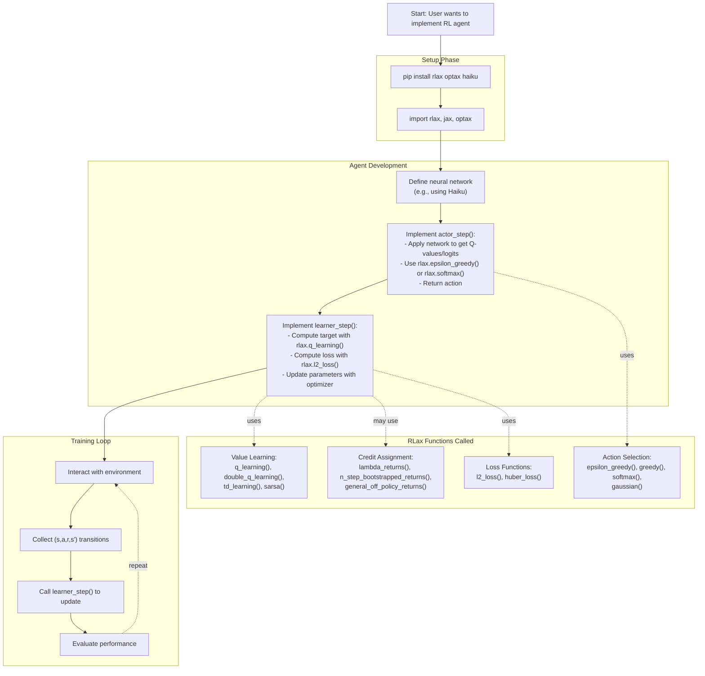

**Sources:** [examples/experiment.py:21-72](), [examples/simple_dqn.py:95-154]()

---

## Next Steps

After completing installation and running the quick start examples:

1. **Learn Core Algorithms:**
   - [Basic Value Learning](#2.1) - Q-learning, SARSA, TD learning
   - [Multistep Returns and Credit Assignment](#3) - Lambda returns, GAE
   - [Policy Gradient Losses](#5.1) - REINFORCE, PPO

2. **Explore Advanced Topics:**
   - [Distributional Reinforcement Learning](#2.2) - C51, quantile regression
   - [V-trace for Off-Policy Learning](#3.2) - IMPALA-style training
   - [MPO and VMPO](#5.2) - Constrained policy optimization

3. **Study Complete Implementations:**
   - [DQN Example](#9.1) - Experience replay, target networks
   - [Online Q-Learning Example](#9.2) - Simple single-step updates
   - [PopArt Normalization Example](#9.3) - Adaptive reward scaling

4. **Review API Reference:**
   - [Complete API Reference](#8) - All available functions

**Sources:** [README.md:35-52](), [README.md:83-105]()

---

## Troubleshooting

### JAX Installation Issues

If you encounter issues with JAX installation, particularly with GPU/TPU support:

```bash
# CPU-only JAX
pip install --upgrade "jax[cpu]"

# CUDA 12 support
pip install --upgrade "jax[cuda12_pip]" -f https://storage.googleapis.com/jax-releases/jax_cuda_releases.html

# CUDA 11 support
pip install --upgrade "jax[cuda11_pip]" -f https://storage.googleapis.com/jax-releases/jax_cuda_releases.html
```

### Import Errors

If you see import errors after installation:

```python
# Verify rlax is installed correctly
import rlax
print(rlax.__version__)
print(rlax.__file__)

# Check available functions
print(dir(rlax))
```

### Example Dependencies

If examples fail to run, ensure all dependencies are installed:

```bash
pip install optax haiku bsuite absl-py
```

**Sources:** [test.sh:36-44](), [README.md:29-33]()

---

# Page: Value-Based Learning

# Value-Based Learning

<details>
<summary>Relevant source files</summary>

The following files were used as context for generating this wiki page:

- [rlax/_src/value_learning.py](rlax/_src/value_learning.py)
- [rlax/_src/value_learning_test.py](rlax/_src/value_learning_test.py)

</details>


## Purpose and Scope

This document covers the value learning algorithms provided by RLax for estimating state values and action-values (Q-values) in discrete action spaces. Value-based methods learn to estimate the expected return an agent can collect under a given policy by applying various forms of temporal difference (TD) learning and Bellman operators.

This page provides a comprehensive overview of both **point-estimate** methods (standard TD, Q-learning, SARSA and variants) and **distributional** methods (categorical and quantile-based approaches). For detailed coverage of specific algorithm families, see:
- [Basic Value Learning (TD, Q-learning, SARSA)](#2.1) for fundamental temporal difference methods
- [Distributional Reinforcement Learning](#2.2) for categorical and quantile methods

For multistep return computation used by many value learning algorithms, see [Multistep Returns and Credit Assignment](#3).

Sources: [rlax/_src/value_learning.py:15-22]()

## Module Overview

The `value_learning` module provides JAX functions for computing temporal difference errors and losses in discrete action spaces. Actions are represented as integer indices in the range `[0, A)` where `A` is the number of distinct actions. The module contains approximately 20 distinct algorithms organized into three categories:

| Category | Algorithms | Key Characteristics |
|----------|-----------|---------------------|
| **Point-Estimate TD** | `td_learning`, `td_lambda`, `sarsa`, `expected_sarsa`, `sarsa_lambda`, `q_learning`, `double_q_learning`, `persistent_q_learning`, `qv_learning`, `qv_max`, `q_lambda`, `retrace`, `retrace_continuous` | Single scalar value per state/action, standard Bellman updates |
| **Distributional Categorical** | `categorical_l2_project`, `categorical_td_learning`, `categorical_q_learning`, `categorical_double_q_learning` | Represent value as categorical distribution over support atoms |
| **Distributional Quantile** | `quantile_regression_loss`, `quantile_q_learning`, `quantile_expected_sarsa` | Represent value as quantile distribution |

Sources: [rlax/_src/value_learning.py:1-924]()

## Value Learning Taxonomy

The following diagram maps the conceptual algorithm names to their concrete function implementations in the codebase:

```mermaid
graph TD
    VL["value_learning module"]
    
    subgraph "Point-Estimate Methods"
        TD["Temporal Difference Learning"]
        TD --> td_learning["td_learning()"]
        TD --> td_lambda["td_lambda()"]
        
        SARSA["SARSA Family"]
        SARSA --> sarsa["sarsa()"]
        SARSA --> expected_sarsa["expected_sarsa()"]
        SARSA --> sarsa_lambda["sarsa_lambda()"]
        
        QL["Q-Learning Family"]
        QL --> q_learning["q_learning()"]
        QL --> double_q_learning["double_q_learning()"]
        QL --> persistent_q_learning["persistent_q_learning()"]
        QL --> q_lambda["q_lambda()"]
        
        QV["QV Family"]
        QV --> qv_learning["qv_learning()"]
        QV --> qv_max["qv_max()"]
        
        RET["Off-Policy Correction"]
        RET --> retrace["retrace()"]
        RET --> retrace_continuous["retrace_continuous()"]
    end
    
    subgraph "Distributional Methods"
        CAT["Categorical / C51"]
        CAT --> categorical_l2_project["categorical_l2_project()"]
        CAT --> categorical_td_learning["categorical_td_learning()"]
        CAT --> categorical_q_learning["categorical_q_learning()"]
        CAT --> categorical_double_q_learning["categorical_double_q_learning()"]
        
        QUANT["Quantile Regression"]
        QUANT --> quantile_regression_loss["quantile_regression_loss()"]
        QUANT --> quantile_q_learning["quantile_q_learning()"]
        QUANT --> quantile_expected_sarsa["quantile_expected_sarsa()"]
    end
    
    VL --> TD
    VL --> SARSA
    VL --> QL
    VL --> QV
    VL --> RET
    VL --> CAT
    VL --> QUANT
```

Sources: [rlax/_src/value_learning.py:36-924]()

## Core Data Flow Pattern

All value learning functions follow a consistent computational pattern for computing temporal difference errors:

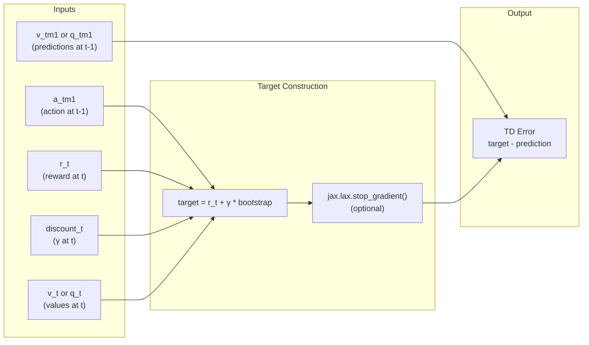

**Key Pattern Elements:**

1. **Predictions at t-1** (`v_tm1` or `q_tm1`): Values from the network being trained
2. **Reward** (`r_t`): Immediate reward observed at time t
3. **Discount** (`discount_t`): Discount factor γ, typically in [0, 1]
4. **Bootstrap Values** (`v_t` or `q_t`): Values at next state for bootstrapping
5. **Stop Gradients**: The `stop_target_gradients` parameter controls whether gradients flow through targets

Sources: [rlax/_src/value_learning.py:36-66](), [rlax/_src/value_learning.py:219-251]()

## Point-Estimate Value Learning

Point-estimate methods represent values as single scalar quantities and compute temporal difference errors using various Bellman operators.

### Basic Temporal Difference Learning

The fundamental `td_learning` function computes the TD(0) error for state values:

```
TD Error = (r_t + γ * v_t) - v_tm1
```

**Signature:** [rlax/_src/value_learning.py:36-66]()
```python
td_learning(v_tm1, r_t, discount_t, v_t, stop_target_gradients=True)
```

The `td_lambda` function extends this to TD(λ) by utilizing the `multistep.lambda_returns` function for credit assignment over multiple timesteps.

Sources: [rlax/_src/value_learning.py:36-99]()

### SARSA Family

SARSA (State-Action-Reward-State-Action) algorithms use the actually executed action at time t for bootstrapping:

| Function | Bootstrap Method | Use Case |
|----------|------------------|----------|
| `sarsa()` | Uses `q_t[a_t]` | On-policy learning with actual next action |
| `expected_sarsa()` | Uses `∑ probs_a_t * q_t` | Expected value under policy distribution |
| `sarsa_lambda()` | Uses `lambda_returns()` with actual actions | Multi-step on-policy learning |

**Example:** [rlax/_src/value_learning.py:101-136]()
```python
# SARSA updates Q-value using the next action actually taken
td_error = sarsa(q_tm1, a_tm1, r_t, discount_t, q_t, a_t)
```

Sources: [rlax/_src/value_learning.py:101-217]()

### Q-Learning Family

Q-learning algorithms use the maximum Q-value at the next state (greedy action selection):

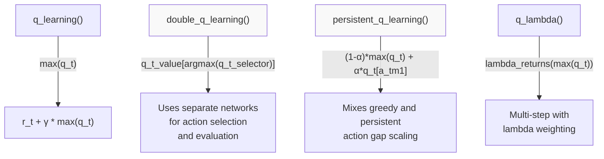

**Double Q-Learning** addresses overestimation bias by decoupling action selection from value estimation: [rlax/_src/value_learning.py:254-290]()

**Persistent Q-Learning** increases the action gap by mixing the greedy action value with the current action: [rlax/_src/value_learning.py:292-331]()

Sources: [rlax/_src/value_learning.py:219-442]()

### Retrace: Off-Policy Correction

The `retrace` and `retrace_continuous` functions implement safe off-policy learning with importance sampling:

**Key computation:** [rlax/_src/value_learning.py:444-494]()
```python
# Importance sampling ratio clipped by lambda
c_t = min(1.0, π_t(a_t) / μ_t(a_t)) * λ

# Uses general_off_policy_returns from multistep module
target = general_off_policy_returns_from_action_values(q_t, a_t, r_t, discount_t, c_t, π_t)
```

The trace cutting coefficient `c_t` prevents excessive variance by clipping importance weights.

Sources: [rlax/_src/value_learning.py:444-541]()

## Distributional Value Learning

Distributional methods represent the entire distribution of returns rather than just the expected value, providing richer information about outcome uncertainty.

### Categorical Distributions (C51)

Categorical methods represent the value distribution as a discrete categorical distribution over fixed atoms (support points):

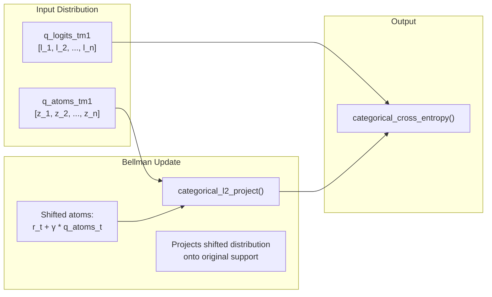

**Categorical Projection:** [rlax/_src/value_learning.py:543-603]()

The `categorical_l2_project` function is the core operation that projects a distribution `(z_p, probs)` onto a different support `z_q` by minimizing the L2 (Cramér) distance between cumulative distribution functions. This is essential because after the Bellman update shifts the atoms, they no longer align with the original support.

**Algorithm implementations:**
- `categorical_td_learning`: TD learning for state value distributions [rlax/_src/value_learning.py:605-653]()
- `categorical_q_learning`: Q-learning with greedy action selection [rlax/_src/value_learning.py:655-711]()
- `categorical_double_q_learning`: Double Q-learning variant [rlax/_src/value_learning.py:713-770]()

Sources: [rlax/_src/value_learning.py:543-770]()

### Quantile Regression (QR-DQN, IQN)

Quantile methods represent the value distribution via quantile estimates at specified thresholds:

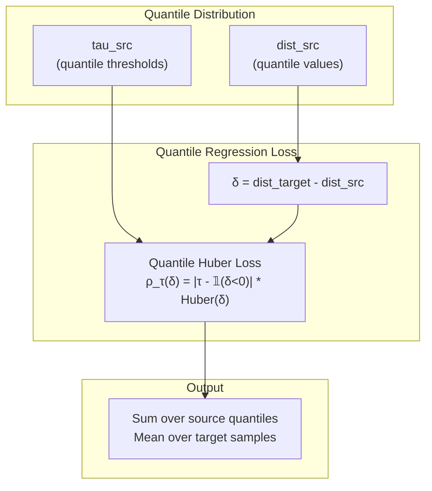

**Quantile Regression Loss:** [rlax/_src/value_learning.py:772-814]()

The asymmetric quantile loss penalizes over-predictions and under-predictions differently based on the quantile threshold τ. An optional Huber loss can smooth the gradient for stability.

**Q-Learning with Quantiles:** [rlax/_src/value_learning.py:816-871]()
```python
# Select greedy action using mean of quantile distribution
q_t_selector_mean = jnp.mean(dist_q_t_selector, axis=0)
a_t = jnp.argmax(q_t_selector_mean)

# Compute target distribution
dist_target = r_t + discount_t * dist_q_t[:, a_t]

# Apply quantile regression loss
loss = quantile_regression_loss(dist_qa_tm1, tau_q_tm1, dist_target, huber_param)
```

**Expected SARSA variant** averages over action distribution: [rlax/_src/value_learning.py:873-924]()

Sources: [rlax/_src/value_learning.py:772-924]()

## Dependencies and Integration

The value learning module integrates with several other RLax components:

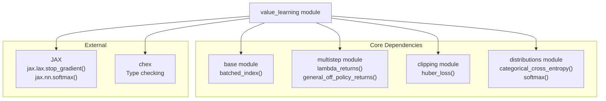

**Key dependencies:**

- **`base.batched_index()`**: Efficiently indexes Q-values at selected actions [rlax/_src/value_learning.py:211-212]()
- **`multistep.lambda_returns()`**: Computes λ-weighted returns for temporal credit assignment [rlax/_src/value_learning.py:95](), [rlax/_src/value_learning.py:213]()
- **`multistep.general_off_policy_returns_from_action_values()`**: Off-policy return computation for retrace [rlax/_src/value_learning.py:486-487]()
- **`clipping.huber_loss()`**: Robust loss function for quantile regression [rlax/_src/value_learning.py:807]()
- **`distributions.categorical_cross_entropy()`**: Loss for categorical distributions [rlax/_src/value_learning.py:651-652]()

Sources: [rlax/_src/value_learning.py:24-31]()

## Common Usage Patterns

### Pattern 1: Single-Step Q-Learning

```python
# Basic Q-learning update
q_tm1 = network(state_tm1)  # Shape: [num_actions]
a_tm1 = 0  # Action taken
r_t = 1.0  # Reward received
discount_t = 0.99
q_t = target_network(state_t)

td_error = rlax.q_learning(q_tm1, a_tm1, r_t, discount_t, q_t)
loss = 0.5 * td_error ** 2
```

### Pattern 2: Double Q-Learning with Separate Networks

```python
# Double Q-learning to reduce overestimation
q_tm1 = online_network(state_tm1)
q_t_selector = online_network(state_t)  # Select action
q_t_value = target_network(state_t)      # Evaluate action

td_error = rlax.double_q_learning(
    q_tm1, a_tm1, r_t, discount_t, 
    q_t_value, q_t_selector
)
```

### Pattern 3: Categorical Q-Learning (C51)

```python
# Fixed support atoms
atoms = jnp.linspace(-10, 10, 51)

# Network outputs logits over atoms
q_logits_tm1 = network(state_tm1)  # Shape: [num_actions, 51]
q_logits_t = target_network(state_t)

loss = rlax.categorical_q_learning(
    atoms, q_logits_tm1, a_tm1, r_t, discount_t,
    atoms, q_logits_t
)
```

### Pattern 4: Quantile Q-Learning

```python
# Quantile thresholds
tau = jnp.array([0.1, 0.3, 0.5, 0.7, 0.9])

# Network outputs quantile values
dist_q_tm1 = network(state_tm1)  # Shape: [num_quantiles, num_actions]
dist_q_t = target_network(state_t)

loss = rlax.quantile_q_learning(
    dist_q_tm1, tau, a_tm1, r_t, discount_t,
    dist_q_t, dist_q_t,  # Can use same for both selector and target
    huber_param=1.0
)
```

### Pattern 5: Retrace for Off-Policy Learning

```python
# Off-policy correction with importance sampling
q_tm1 = network(states[:-1])  # Sequence of Q-values
q_t = target_network(states[1:])
a_tm1 = actions[:-1]
a_t = actions[1:]
r_t = rewards[:-1]
discount_t = discounts[:-1]
pi_t = target_policy_probs  # Current policy
mu_t = behavior_policy_probs  # Behavior policy

td_errors = rlax.retrace(
    q_tm1, q_t, a_tm1, a_t, r_t, discount_t,
    pi_t, mu_t, lambda_=0.95
)
```

Sources: [rlax/_src/value_learning_test.py:28-897]()

## Implementation Characteristics

### Array Shapes and Batching

All value learning functions are designed for single transitions. To process batches, use `jax.vmap`:

```python
# Single transition
td_error = rlax.q_learning(q_tm1, a_tm1, r_t, discount_t, q_t)

# Batched transitions
batch_q_learning = jax.vmap(rlax.q_learning)
td_errors = batch_q_learning(q_tm1_batch, a_tm1_batch, r_t_batch, 
                              discount_t_batch, q_t_batch)
```

### Type Safety

All functions use `chex` assertions to validate input shapes and types: [rlax/_src/value_learning.py:59-60]()

```python
chex.assert_rank([v_tm1, r_t, discount_t, v_t], 0)
chex.assert_type([v_tm1, r_t, discount_t, v_t], float)
```

### Gradient Control

The `stop_target_gradients` parameter (default `True`) controls whether gradients flow through target values. This is essential for stable learning with target networks:

```python
target_tm1 = r_t + discount_t * v_t
target_tm1 = jax.lax.select(
    stop_target_gradients,
    jax.lax.stop_gradient(target_tm1), 
    target_tm1
)
```

Sources: [rlax/_src/value_learning.py:41](), [rlax/_src/value_learning.py:63-64]()

## Algorithm Selection Guide

| Scenario | Recommended Algorithm | Key Benefit |
|----------|----------------------|-------------|
| On-policy, single-step | `sarsa()` | Follows actual policy |
| Off-policy, single-step | `q_learning()` | Learns optimal policy regardless of behavior |
| Reduce Q-value overestimation | `double_q_learning()` | Decouples action selection from evaluation |
| Multi-step credit assignment | `q_lambda()`, `sarsa_lambda()` | Better bias-variance tradeoff |
| Off-policy with importance sampling | `retrace()` | Safe off-policy learning |
| Estimate return distribution | `categorical_q_learning()` | Full distributional information |
| Flexible quantile estimation | `quantile_q_learning()` | No fixed support required |
| Increase action gap | `persistent_q_learning()` | Better exploration properties |

Sources: [rlax/_src/value_learning.py:1-924]()

---

# Page: Basic Value Learning (TD, Q-learning, SARSA)

# Basic Value Learning (TD, Q-learning, SARSA)

<details>
<summary>Relevant source files</summary>

The following files were used as context for generating this wiki page:

- [README.md](README.md)
- [examples/__init__.py](examples/__init__.py)
- [examples/experiment.py](examples/experiment.py)
- [examples/online_q_learning.py](examples/online_q_learning.py)
- [examples/pop_art.py](examples/pop_art.py)
- [examples/simple_dqn.py](examples/simple_dqn.py)
- [rlax/_src/embedding.py](rlax/_src/embedding.py)
- [rlax/_src/value_learning.py](rlax/_src/value_learning.py)
- [rlax/_src/value_learning_test.py](rlax/_src/value_learning_test.py)

</details>


## Purpose and Scope

This page documents the fundamental temporal difference (TD) learning algorithms provided by RLax for estimating state values and action-values in discrete action spaces. These building blocks implement point-estimate value functions that compute TD errors for gradient-based learning.

**Scope:** This page covers basic TD methods including TD learning, Q-learning, double Q-learning, SARSA, expected SARSA, and their lambda-based variants. These functions compute temporal difference errors that can be used directly as pseudo-losses for training value networks.

**Related pages:**
- For distributional value learning (categorical/quantile methods), see [Distributional Reinforcement Learning](#2.2)
- For multistep return computation used by lambda-based methods, see [Multistep Returns and Credit Assignment](#3)
- For off-policy corrections like Retrace, see [V-trace for Off-Policy Learning](#3.2)
- For value transformations and nonlinear Bellman equations, see [Nonlinear Bellman Equations and Value Transformations](#6.1)

## Value Learning Function Taxonomy

The following diagram maps the natural language algorithm names to their corresponding RLax function implementations:

```mermaid
graph TB
    subgraph "State-Value Methods"
        TD_ALG["TD Learning"]
        TDL_ALG["TD(λ)"]
        QVMAX_ALG["QV-Max"]
    end
    
    subgraph "Action-Value On-Policy"
        SARSA_ALG["SARSA"]
        ESARSA_ALG["Expected SARSA"]
        SARSAL_ALG["SARSA(λ)"]
    end
    
    subgraph "Action-Value Off-Policy"
        Q_ALG["Q-Learning"]
        DQ_ALG["Double Q-Learning"]
        PQ_ALG["Persistent Q-Learning"]
        QL_ALG["Q(λ)"]
        QV_ALG["QV-Learning"]
        RET_ALG["Retrace"]
        RETC_ALG["Retrace Continuous"]
    end
    
    subgraph "value_learning.py Functions"
        TD_FN["td_learning()"]
        TDL_FN["td_lambda()"]
        SARSA_FN["sarsa()"]
        ESARSA_FN["expected_sarsa()"]
        SARSAL_FN["sarsa_lambda()"]
        Q_FN["q_learning()"]
        DQ_FN["double_q_learning()"]
        PQ_FN["persistent_q_learning()"]
        QL_FN["q_lambda()"]
        QV_FN["qv_learning()"]
        QVMAX_FN["qv_max()"]
        RET_FN["retrace()"]
        RETC_FN["retrace_continuous()"]
    end
    
    TD_ALG --> TD_FN
    TDL_ALG --> TDL_FN
    QVMAX_ALG --> QVMAX_FN
    SARSA_ALG --> SARSA_FN
    ESARSA_ALG --> ESARSA_FN
    SARSAL_ALG --> SARSAL_FN
    Q_ALG --> Q_FN
    DQ_ALG --> DQ_FN
    PQ_ALG --> PQ_FN
    QL_ALG --> QL_FN
    QV_ALG --> QV_FN
    RET_ALG --> RET_FN
    RETC_ALG --> RETC_FN
    
    style TD_FN fill:#e1f5ff
    style TDL_FN fill:#e1f5ff
    style SARSA_FN fill:#fff9e1
    style ESARSA_FN fill:#fff9e1
    style SARSAL_FN fill:#fff9e1
    style Q_FN fill:#ffe1f5
    style DQ_FN fill:#ffe1f5
    style PQ_FN fill:#ffe1f5
    style QL_FN fill:#ffe1f5
    style QV_FN fill:#ffe1f5
    style QVMAX_FN fill:#e1f5ff
    style RET_FN fill:#ffe1f5
    style RETC_FN fill:#ffe1f5
```

**Sources:** [rlax/_src/value_learning.py:1-924]()

## Temporal Difference Error Computation Pattern

All value learning functions in RLax follow a consistent pattern for computing TD errors. Understanding this pattern is essential for using these functions correctly:

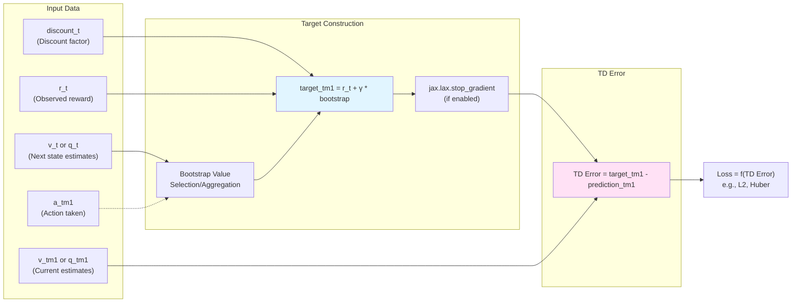

**Key concepts:**
- **Source state (t-1):** The state where the agent was and took action `a_tm1`
- **Destination state (t):** The state where the agent ended up after the action
- **Target construction:** Combines reward `r_t` with bootstrapped estimate from next state
- **Stop gradients:** The `stop_target_gradients` parameter prevents backpropagation through targets

**Sources:** [rlax/_src/value_learning.py:36-66](), [rlax/_src/value_learning.py:219-251](), [rlax/_src/value_learning.py:101-136]()

## Basic TD Learning

### `td_learning()`

The fundamental TD(0) algorithm for state-value estimation. Computes the temporal difference between the actual observed return (reward + bootstrapped next-state value) and the current estimate.

**Function signature:**
```python
td_learning(
    v_tm1: Numeric,      # Value estimate at time t-1
    r_t: Numeric,        # Reward at time t
    discount_t: Numeric, # Discount factor at time t
    v_t: Numeric,        # Value estimate at time t
    stop_target_gradients: bool = True
) -> Numeric
```

**Bellman equation:**
```
TD Error = [r_t + γ * V(s_t)] - V(s_t-1)
```

**Implementation details:**
- All inputs must be scalars (rank 0)
- Target is `r_t + discount_t * v_t`
- Gradients are stopped on the target by default
- Returns the TD error (not the loss)

**Usage example from tests:**
```python
# Batched computation using vmap
td_learning_batch = jax.vmap(rlax.td_learning)
td_errors = td_learning_batch(v_tm1, r_t, discount_t, v_t)
```

**Sources:** [rlax/_src/value_learning.py:36-66](), [rlax/_src/value_learning_test.py:28-53]()

### `td_lambda()`

Implements TD(λ), which computes multi-step bootstrapped targets using eligibility traces. The λ parameter controls the trade-off between bias (low λ) and variance (high λ).

**Function signature:**
```python
td_lambda(
    v_tm1: Array,        # Sequence of values at t-1
    r_t: Array,          # Sequence of rewards at t
    discount_t: Array,   # Sequence of discounts at t
    v_t: Array,          # Sequence of values at t
    lambda_: Numeric,    # Mixing parameter (scalar or sequence)
    stop_target_gradients: bool = True
) -> Array
```

**Key characteristics:**
- Requires sequences of length T (rank 1 arrays)
- Uses `multistep.lambda_returns()` for target computation
- λ=0 reduces to TD(0), λ=1 gives Monte Carlo returns
- Can accept per-timestep λ values for adaptive weighting

**Sources:** [rlax/_src/value_learning.py:68-99](), [rlax/_src/value_learning_test.py:55-84]()

## Q-Learning Family

Q-learning methods estimate action-values Q(s,a) using off-policy updates that bootstrap from the maximum Q-value in the next state, regardless of the action actually taken.

### `q_learning()`

The standard Q-learning algorithm that uses greedy action selection for bootstrapping.

**Function signature:**
```python
q_learning(
    q_tm1: Array,        # Q-values at t-1, shape [num_actions]
    a_tm1: Numeric,      # Action taken at t-1 (integer index)
    r_t: Numeric,        # Reward at t
    discount_t: Numeric, # Discount at t
    q_t: Array,          # Q-values at t, shape [num_actions]
    stop_target_gradients: bool = True
) -> Numeric
```

**Bellman optimality equation:**
```
TD Error = [r_t + γ * max_a Q(s_t, a)] - Q(s_t-1, a_t-1)
```

**Key characteristics:**
- Off-policy: learns optimal policy while following different behavior policy
- Bootstrap uses `jnp.max(q_t)` regardless of actual action taken
- Returns scalar TD error for the action `a_tm1`

**Example usage from `online_q_learning.py`:**
```python
def _loss(self, params, obs_tm1, a_tm1, r_t, discount_t, obs_t):
    q_tm1 = self._network.apply(params, obs_tm1)
    q_t = self._network.apply(params, obs_t)
    td_error = rlax.q_learning(q_tm1, a_tm1, r_t, discount_t, q_t)
    return rlax.l2_loss(td_error)
```

**Sources:** [rlax/_src/value_learning.py:219-251](), [examples/online_q_learning.py:118-122]()

### `double_q_learning()`

Addresses overestimation bias in Q-learning by decoupling action selection from action evaluation using two separate Q-networks.

**Function signature:**
```python
double_q_learning(
    q_tm1: Array,           # Q-values at t-1
    a_tm1: Numeric,         # Action at t-1
    r_t: Numeric,           # Reward at t
    discount_t: Numeric,    # Discount at t
    q_t_value: Array,       # Q-values for evaluation
    q_t_selector: Array,    # Q-values for action selection
    stop_target_gradients: bool = True
) -> Numeric
```

**Double Q-learning equation:**
```
a* = argmax_a Q_selector(s_t, a)
TD Error = [r_t + γ * Q_value(s_t, a*)] - Q(s_t-1, a_t-1)
```

**Key characteristics:**
- Action selected using `q_t_selector.argmax()`
- Action evaluated using `q_t_value[a*]`
- Reduces maximization bias compared to standard Q-learning
- In practice, `q_t_selector` is often the online network, `q_t_value` is the target network

**Example from `simple_dqn.py`:**
```python
def _loss(self, online_params, target_params, obs_tm1, a_tm1, r_t, discount_t, obs_t):
    q_tm1 = self._network.apply(online_params, obs_tm1)
    q_t_val = self._network.apply(target_params, obs_t)
    q_t_select = self._network.apply(online_params, obs_t)
    batched_loss = jax.vmap(rlax.double_q_learning)
    td_error = batched_loss(q_tm1, a_tm1, r_t, discount_t, q_t_val, q_t_select)
    return jnp.mean(rlax.l2_loss(td_error))
```

**Sources:** [rlax/_src/value_learning.py:254-290](), [examples/simple_dqn.py:146-153]()

### `persistent_q_learning()`

Implements the persistent Q-learning operator that increases the action gap between the best and second-best actions, potentially improving learning stability.

**Function signature:**
```python
persistent_q_learning(
    q_tm1: Array,
    a_tm1: Numeric,
    r_t: Numeric,
    discount_t: Numeric,
    q_t: Array,
    action_gap_scale: float,  # Coefficient in [0, 1]
    stop_target_gradients: bool = True
) -> Numeric
```

**Modified Bellman equation:**
```
corrected_q_t = (1 - α) * max_a Q(s_t, a) + α * Q(s_t, a_t-1)
TD Error = [r_t + γ * corrected_q_t] - Q(s_t-1, a_t-1)
```

**Key characteristics:**
- `action_gap_scale` (α) controls the persistence effect
- α=0 reduces to standard Q-learning
- α=1 reduces to on-policy learning (like SARSA)
- Designed to increase action gap, improving exploration-exploitation trade-off

**Sources:** [rlax/_src/value_learning.py:292-331](), [rlax/_src/value_learning_test.py:235-260]()

## SARSA Family

SARSA (State-Action-Reward-State-Action) methods are on-policy algorithms that bootstrap using the actual action taken in the next state.

### `sarsa()`

The standard SARSA algorithm that updates Q-values based on the actual action sequence.

**Function signature:**
```python
sarsa(
    q_tm1: Array,        # Q-values at t-1
    a_tm1: Numeric,      # Action at t-1
    r_t: Numeric,        # Reward at t
    discount_t: Numeric, # Discount at t
    q_t: Array,          # Q-values at t
    a_t: Numeric,        # Action at t (actually taken)
    stop_target_gradients: bool = True
) -> Numeric
```

**SARSA equation:**
```
TD Error = [r_t + γ * Q(s_t, a_t)] - Q(s_t-1, a_t-1)
```

**Key characteristics:**
- On-policy: requires the actual action `a_t` taken in state s_t
- Bootstrap uses `q_t[a_t]` (the Q-value for the action actually taken)
- More stable than Q-learning in stochastic environments
- Learns the value of the policy being followed

**Sources:** [rlax/_src/value_learning.py:101-136](), [rlax/_src/value_learning_test.py:86-108]()

### `expected_sarsa()`

Computes the expectation over all possible actions weighted by the policy, reducing variance compared to standard SARSA.

**Function signature:**
```python
expected_sarsa(
    q_tm1: Array,
    a_tm1: Numeric,
    r_t: Numeric,
    discount_t: Numeric,
    q_t: Array,
    probs_a_t: Array,    # Action probabilities π(a|s_t)
    stop_target_gradients: bool = True
) -> Numeric
```

**Expected SARSA equation:**
```
TD Error = [r_t + γ * Σ_a π(a|s_t) * Q(s_t, a)] - Q(s_t-1, a_t-1)
```

**Key characteristics:**
- Bootstrap is `jnp.dot(q_t, probs_a_t)` - expectation over policy
- Does not require the actual action taken at time t
- Lower variance than SARSA
- Approaches Q-learning when policy is greedy

**Sources:** [rlax/_src/value_learning.py:138-175](), [rlax/_src/value_learning_test.py:110-139]()

## Lambda-Based Variants

Lambda-based methods extend basic TD algorithms with eligibility traces for multi-step bootstrapping.

### `sarsa_lambda()`

Multi-step SARSA with eligibility traces.

**Function signature:**
```python
sarsa_lambda(
    q_tm1: Array,        # Sequence of Q-values at t-1, shape [T, num_actions]
    a_tm1: Array,        # Sequence of actions at t-1, shape [T]
    r_t: Array,          # Sequence of rewards, shape [T]
    discount_t: Array,   # Sequence of discounts, shape [T]
    q_t: Array,          # Sequence of Q-values at t, shape [T, num_actions]
    a_t: Array,          # Sequence of actions at t, shape [T]
    lambda_: Numeric,    # Mixing parameter
    stop_target_gradients: bool = True
) -> Array
```

**Process:**
1. Extract Q-values for taken actions: `qa_tm1 = q_tm1[a_tm1]`, `qa_t = q_t[a_t]`
2. Compute lambda returns: `target_tm1 = lambda_returns(r_t, discount_t, qa_t, λ)`
3. Return TD errors: `target_tm1 - qa_tm1`

**Sources:** [rlax/_src/value_learning.py:177-217](), [rlax/_src/value_learning_test.py:141-185]()

### `q_lambda()`

Multi-step Q-learning variant using eligibility traces. Can implement either Peng's Q(λ) (constant λ) or Watkins' Q(λ) (variable λ).

**Function signature:**
```python
q_lambda(
    q_tm1: Array,        # Sequence of Q-values, shape [T, num_actions]
    a_tm1: Array,        # Sequence of actions, shape [T]
    r_t: Array,          # Sequence of rewards, shape [T]
    discount_t: Array,   # Sequence of discounts, shape [T]
    q_t: Array,          # Sequence of Q-values, shape [T, num_actions]
    lambda_: Numeric,    # Scalar (Peng) or sequence (Watkins)
    stop_target_gradients: bool = True
) -> Array
```

**Key distinction:**
- **Peng's Q(λ):** λ is a scalar, always uses multi-step returns
- **Watkins' Q(λ):** λ is a sequence, can be 0 when off-policy actions occur

**Process:**
1. Extract current action Q-values: `qa_tm1 = batched_index(q_tm1, a_tm1)`
2. Compute max Q-values for next states: `v_t = max(q_t, axis=-1)`
3. Compute lambda returns using max Q-values
4. Return TD errors

**Sources:** [rlax/_src/value_learning.py:402-442](), [rlax/_src/value_learning_test.py:317-358]()

## Specialized Methods

### `qv_learning()` and `qv_max()`

These methods combine Q-learning and V-learning into hybrid algorithms.

**`qv_learning()` function:**
```python
qv_learning(
    q_tm1: Array,        # Q-values at t-1
    a_tm1: Numeric,      # Action at t-1
    r_t: Numeric,        # Reward at t
    discount_t: Numeric, # Discount at t
    v_t: Numeric,        # State value at t (not Q-values!)
    stop_target_gradients: bool = True
) -> Numeric
```

Updates Q-values using a separate V-value estimate as the bootstrap target:
```
TD Error = [r_t + γ * V(s_t)] - Q(s_t-1, a_t-1)
```

**`qv_max()` function:**
```python
qv_max(
    v_tm1: Numeric,      # State value at t-1
    r_t: Numeric,        # Reward at t
    discount_t: Numeric, # Discount at t
    q_t: Array,          # Q-values at t
    stop_target_gradients: bool = True
) -> Numeric
```

Updates V-values using the maximum Q-value:
```
TD Error = [r_t + γ * max_a Q(s_t, a)] - V(s_t-1)
```

**Sources:** [rlax/_src/value_learning.py:333-400](), [rlax/_src/value_learning_test.py:262-315]()

## Retrace for Off-Policy Learning

Retrace is an advanced off-policy algorithm that safely combines importance sampling with eligibility traces. It appears in this module but is conceptually related to V-trace.

### `retrace()` for Discrete Actions

**Function signature:**
```python
retrace(
    q_tm1: Array,        # Sequence of Q-values, shape [T, num_actions]
    q_t: Array,          # Sequence of Q-values, shape [T, num_actions]
    a_tm1: Array,        # Sequence of actions, shape [T]
    a_t: Array,          # Sequence of actions, shape [T]
    r_t: Array,          # Sequence of rewards, shape [T]
    discount_t: Array,   # Sequence of discounts, shape [T]
    pi_t: Array,         # Target policy probs, shape [T, num_actions]
    mu_t: Array,         # Behavior policy probs, shape [T]
    lambda_: float,      # Trace decay parameter
    eps: float = 1e-8,   # Numerical stability
    stop_target_gradients: bool = True
) -> Array
```

**Retrace mechanics:**
1. Compute importance sampling ratios: `ρ_t = π(a_t|s_t) / μ(a_t|s_t)`
2. Clip ratios and multiply by λ: `c_t = min(1.0, ρ_t) * λ`
3. Compute generalized off-policy returns using `multistep.general_off_policy_returns_from_action_values()`
4. Return TD errors

**Key advantages:**
- Safe off-policy learning with bounded importance weights
- Reduces variance compared to standard importance sampling
- Suitable for experience replay and distributed training

**Sources:** [rlax/_src/value_learning.py:444-494](), [rlax/_src/value_learning_test.py:360-415]()

### `retrace_continuous()` for Continuous Actions

Variant of Retrace designed for continuous action spaces where importance sampling ratios are computed from log-probabilities.

**Function signature:**
```python
retrace_continuous(
    q_tm1: Array,        # Q-values at t-1, shape [K]
    q_t: Array,          # Q-values at t (on-policy), shape [K-1]
    v_t: Array,          # Value estimates at t, shape [K]
    r_t: Array,          # Rewards, shape [K]
    discount_t: Array,   # Discounts, shape [K]
    log_rhos: Array,     # Log importance ratios, shape [K-1]
    lambda_: Union[Array, float],
    stop_target_gradients: bool = True
) -> Array
```

**Key differences from discrete version:**
- Uses log importance ratios: `c_t = min(1.0, exp(log_rhos)) * λ`
- Requires both Q-values and V-values
- Uses `multistep.general_off_policy_returns_from_q_and_v()`

**Sources:** [rlax/_src/value_learning.py:496-541](), [rlax/_src/value_learning_test.py:430-487]()

## Algorithm Comparison Table

| Algorithm | Type | Policy | Bootstrap | Lambda | Best Use Case |
|-----------|------|--------|-----------|--------|---------------|
| `td_learning` | State-value | N/A | V(s_t) | No | Simple value prediction |
| `td_lambda` | State-value | N/A | Multi-step | Yes | Value prediction with bias-variance trade-off |
| `q_learning` | Action-value | Off-policy | max Q(s_t) | No | Learning optimal policy from suboptimal data |
| `double_q_learning` | Action-value | Off-policy | Q_value[argmax Q_selector] | No | Reducing overestimation bias |
| `persistent_q_learning` | Action-value | Off-policy | Weighted max | No | Improving action gap |
| `sarsa` | Action-value | On-policy | Q(s_t, a_t) | No | Learning value of current policy |
| `expected_sarsa` | Action-value | On-policy | 𝔼[Q(s_t, a)] | No | Lower variance than SARSA |
| `sarsa_lambda` | Action-value | On-policy | Multi-step | Yes | On-policy with eligibility traces |
| `q_lambda` | Action-value | Off-policy | Multi-step max | Yes | Off-policy with eligibility traces |
| `qv_learning` | Hybrid | On-policy | V(s_t) | No | Combining Q and V networks |
| `retrace` | Action-value | Off-policy | Multi-step clipped IS | Yes | Safe off-policy with replay |

## Usage Patterns

### Pattern 1: Single-Step Learning (Online Q-Learning)

Simplest pattern for online learning without replay buffers:

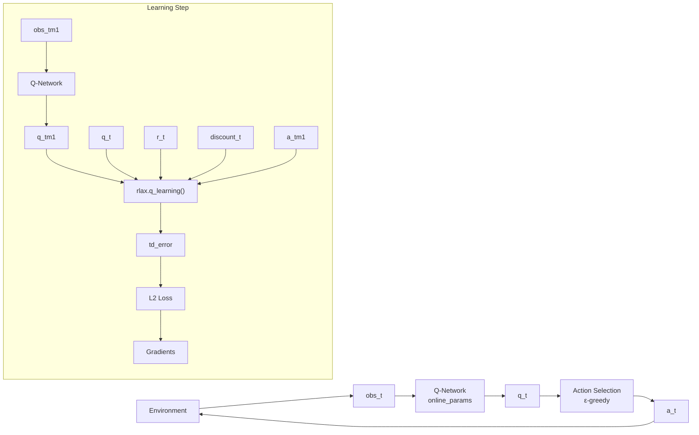

**Example:** [examples/online_q_learning.py:80-123]()

**Sources:** [examples/online_q_learning.py:1-150]()

### Pattern 2: Experience Replay with Target Networks (DQN)

Standard pattern for stable off-policy learning:

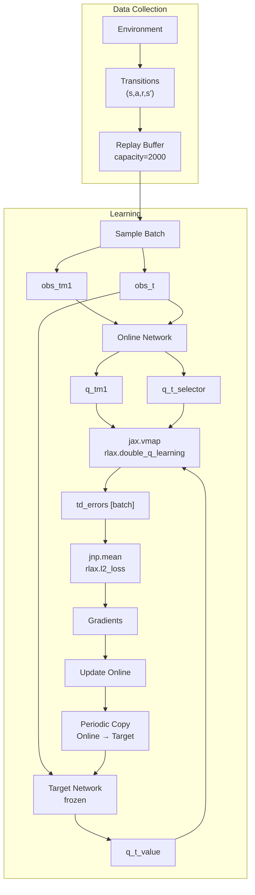

**Key components:**
- Replay buffer decouples data collection from learning
- Target network provides stable bootstrap targets
- Periodic updates (e.g., every 50 steps) prevent harmful correlations
- Batched computation using `jax.vmap`

**Example:** [examples/simple_dqn.py:95-154]()

**Sources:** [examples/simple_dqn.py:1-186]()

### Pattern 3: Batched Computation

All RLax value learning functions operate on single transitions. Use `jax.vmap` for batch processing:

```python
# Single transition
td_error = rlax.q_learning(q_tm1, a_tm1, r_t, discount_t, q_t)

# Batched transitions
batched_q_learning = jax.vmap(rlax.q_learning)
td_errors = batched_q_learning(
    q_tm1_batch,      # shape [B, A]
    a_tm1_batch,      # shape [B]
    r_t_batch,        # shape [B]
    discount_t_batch, # shape [B]
    q_t_batch         # shape [B, A]
)  # Returns shape [B]
```

**Benefits:**
- Automatic parallelization across batch dimension
- No explicit loops needed
- JIT-compatible for maximum performance

**Sources:** [rlax/_src/value_learning_test.py:46-52](), [rlax/_src/value_learning_test.py:201-207]()

### Pattern 4: Lambda-Based Multi-Step Learning

For algorithms using eligibility traces, you need sequences of transitions:

```python
# Sequences of length T
q_tm1_seq = jnp.array([[...], [...], ...])  # shape [T, A]
a_tm1_seq = jnp.array([...])                # shape [T]
r_t_seq = jnp.array([...])                  # shape [T]
discount_t_seq = jnp.array([...])           # shape [T]
q_t_seq = jnp.array([[...], [...], ...])    # shape [T, A]

# Compute multi-step TD errors
td_errors = rlax.q_lambda(
    q_tm1_seq, a_tm1_seq, r_t_seq, 
    discount_t_seq, q_t_seq, lambda_=0.9
)  # Returns shape [T]
```

**Note:** Lambda-based methods internally use functions from the `multistep` module (see [Multistep Returns and Credit Assignment](#3)).

**Sources:** [rlax/_src/value_learning.py:402-442]()

## When to Use Each Algorithm

### Decision Tree for Algorithm Selection

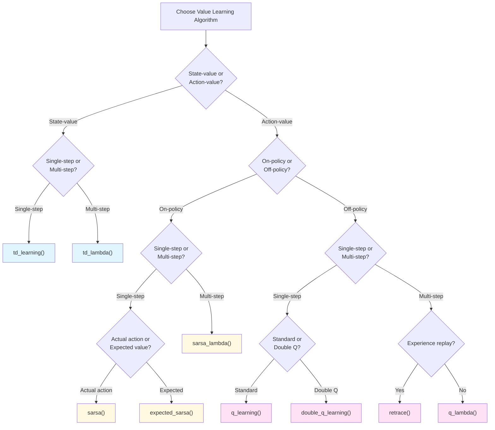

**Sources:** [rlax/_src/value_learning.py:15-22]()

### Practical Guidelines

**Use `q_learning()` when:**
- Learning optimal policy from off-policy data (exploration, demonstrations)
- Simple environments without overestimation issues
- Baseline implementation before trying variants

**Use `double_q_learning()` when:**
- Concerned about Q-value overestimation (common in complex environments)
- Using target networks (which naturally provide two Q-estimates)
- Need more stable learning than standard Q-learning

**Use `sarsa()` when:**
- Learning value of current policy (on-policy learning)
- Environment has high stochasticity
- Want conservative policy that accounts for exploration
- Safety is important (learns actual behavior, not optimal)

**Use `expected_sarsa()` when:**
- Want lower variance than SARSA
- Have access to policy probabilities
- Interpolating between SARSA (stochastic policy) and Q-learning (greedy policy)

**Use lambda-based methods (`td_lambda`, `sarsa_lambda`, `q_lambda`) when:**
- Need to balance bias-variance trade-off
- Have sequences of transitions (trajectories)
- Want faster credit assignment than single-step methods
- λ ∈ (0, 1): tune based on environment characteristics

**Use `retrace()` when:**
- Using experience replay with off-policy data
- Need safe importance sampling with bounded weights
- Distributed training with multiple actors (like IMPALA)
- Want multi-step learning with off-policy correction

**Use `persistent_q_learning()` when:**
- Want to increase action gap between best and second-best actions
- Experimenting with improved exploration-exploitation
- Research setting (less commonly used in practice)

**Sources:** [README.md:35-52](), [rlax/_src/value_learning.py:1-22]()

## Loss Functions and Optimization

The value learning functions return TD errors, not losses. You must apply a loss function before computing gradients:

```python
# Common pattern
td_error = rlax.q_learning(q_tm1, a_tm1, r_t, discount_t, q_t)

# Option 1: L2 loss (mean squared error)
loss = rlax.l2_loss(td_error)  # 0.5 * td_error^2

# Option 2: Huber loss (for robustness)
loss = rlax.huber_loss(td_error, delta=1.0)

# For batches, typically take mean
batch_td_errors = jax.vmap(rlax.q_learning)(...)
batch_loss = jnp.mean(rlax.l2_loss(batch_td_errors))
```

**Available loss functions:**
- `rlax.l2_loss()`: Standard squared error
- `rlax.huber_loss()`: Robust to outliers, linear beyond threshold

**Sources:** [examples/simple_dqn.py:153](), [examples/online_q_learning.py:122]()

## Common Pitfalls and Best Practices

### Pitfall 1: Forgetting to Stop Gradients

```python
# WRONG: Gradients flow through target
td_error = rlax.q_learning(q_tm1, a_tm1, r_t, discount_t, q_t, 
                           stop_target_gradients=False)

# CORRECT: Default stops gradients through bootstrap target
td_error = rlax.q_learning(q_tm1, a_tm1, r_t, discount_t, q_t)
```

**Why it matters:** Without stopped gradients, the network chases a moving target, causing instability.

### Pitfall 2: Incorrect Shapes for Lambda Methods

```python
# WRONG: Scalar inputs for lambda methods
td_error = rlax.q_lambda(q_tm1_scalar, a_tm1_scalar, ...)  # Will fail!

# CORRECT: Sequence inputs
td_errors = rlax.q_lambda(q_tm1_sequence, a_tm1_sequence, ...)
```

**Why it matters:** Lambda methods require rank-1 arrays (sequences), not scalars.

### Pitfall 3: Not Using vmap for Batches

```python
# INEFFICIENT: Manual loop
td_errors = []
for i in range(batch_size):
    td_error = rlax.q_learning(q_tm1[i], a_tm1[i], ...)
    td_errors.append(td_error)

# EFFICIENT: Use vmap
td_errors = jax.vmap(rlax.q_learning)(q_tm1, a_tm1, ...)
```

**Why it matters:** `vmap` parallelizes computation and is JIT-compatible.

### Best Practice: JIT Compilation

```python
# Define loss function
def loss_fn(params, data):
    q_tm1 = network.apply(params, data.obs_tm1)
    q_t = network.apply(params, data.obs_t)
    td_error = rlax.q_learning(q_tm1, data.a_tm1, data.r_t, 
                               data.discount_t, q_t)
    return rlax.l2_loss(td_error)

# JIT compile for performance
loss_fn = jax.jit(loss_fn)
grad_fn = jax.jit(jax.grad(loss_fn))
```

**Why it matters:** JIT compilation provides 10-100x speedup for typical RL operations.

**Sources:** [examples/simple_dqn.py:108-109](), [examples/online_q_learning.py:92-93]()

## Integration with JAX Ecosystem

RLax value learning functions integrate seamlessly with other JAX libraries:

**With Optax (optimization):**
```python
optimizer = optax.adam(learning_rate=1e-3)
opt_state = optimizer.init(params)

# In training loop
grads = jax.grad(loss_fn)(params, data)
updates, opt_state = optimizer.update(grads, opt_state)
params = optax.apply_updates(params, updates)
```

**With Haiku (neural networks):**
```python
import haiku as hk

def q_network(obs):
    net = hk.Sequential([
        hk.Flatten(),
        hk.nets.MLP([50, num_actions])
    ])
    return net(obs)

network = hk.without_apply_rng(hk.transform(q_network))
q_values = network.apply(params, obs)
```

**With Chex (type checking):**
```python
import chex

# Value learning functions include chex assertions
chex.assert_rank([q_tm1, a_tm1, r_t, discount_t, q_t], [1, 0, 0, 0, 1])
chex.assert_type([q_tm1, a_tm1, r_t, discount_t, q_t], 
                 [float, int, float, float, float])
```

**Sources:** [examples/simple_dqn.py:54-63](), [examples/simple_dqn.py:104-106](), [rlax/_src/value_learning.py:244-246]()

## Summary

This page covered the fundamental temporal difference learning algorithms provided by RLax:

1. **Basic TD methods** (`td_learning`, `td_lambda`) for state-value estimation
2. **Q-learning variants** (`q_learning`, `double_q_learning`, `persistent_q_learning`) for off-policy action-value learning
3. **SARSA methods** (`sarsa`, `expected_sarsa`) for on-policy action-value learning
4. **Lambda-based methods** (`sarsa_lambda`, `q_lambda`) with eligibility traces
5. **Advanced methods** (`retrace`, `qv_learning`) for specialized use cases

All functions follow a consistent API pattern:
- Accept transition data (states, actions, rewards, discounts)
- Compute bootstrap targets with optional gradient stopping
- Return TD errors (not losses)
- Support batching via `jax.vmap`

For distributional variants of these algorithms, see [Distributional Reinforcement Learning](#2.2).

**Sources:** [rlax/_src/value_learning.py:1-924](), [README.md:35-105]()

---

# Page: Distributional Reinforcement Learning

# Distributional Reinforcement Learning

<details>
<summary>Relevant source files</summary>

The following files were used as context for generating this wiki page:

- [rlax/_src/value_learning.py](rlax/_src/value_learning.py)
- [rlax/_src/value_learning_test.py](rlax/_src/value_learning_test.py)

</details>


## Purpose and Scope

This document covers distributional reinforcement learning methods in RLax, which model the full return distribution rather than just its expectation. Two main approaches are implemented: **categorical distributions** (C51) and **quantile distributions** (QR-DQN, IQN). These methods provide richer representations of value uncertainty and often lead to improved performance over point-estimate methods.

For basic point-estimate value learning methods (TD, Q-learning, SARSA), see [Basic Value Learning](#2.1). For transformed value functions that can be combined with distributional methods, see [Nonlinear Bellman Equations and Value Transformations](#6.1).

---

## Distributional RL Overview

Traditional value-based RL learns a single scalar Q-value representing expected return. Distributional RL instead learns a probability distribution over returns, capturing uncertainty and multi-modality in outcomes. This provides several advantages:
- Better representation of risk and uncertainty
- Reduced approximation error through richer targets
- Improved sample efficiency in many domains
- Natural handling of stochastic environments

RLax implements two primary distributional representations:

| Representation | Description | Key Functions | Papers |
|----------------|-------------|---------------|---------|
| **Categorical** | Fixed support with learned probabilities | `categorical_q_learning`, `categorical_l2_project` | C51, Rainbow |
| **Quantile** | Fixed probabilities with learned quantiles | `quantile_q_learning`, `quantile_regression_loss` | QR-DQN, IQN |

**Sources:** [rlax/_src/value_learning.py:15-22]()

---

## Categorical Distributional RL (C51)

### Representation

Categorical methods represent the value distribution as a discrete set of atoms (support points) with associated probabilities. Given N atoms `z = [z_1, ..., z_N]` spanning `[V_min, V_max]`, the distribution is:

```
Z(s,a) = Σ_i p_i(s,a) δ_{z_i}
```

where `p_i(s,a)` are learned probabilities (modeled as softmax logits) and `δ_{z_i}` is a point mass at atom `z_i`.

### Categorical L2 Projection

The key operation in categorical distributional RL is projecting a distribution onto a different support. This is required because the Bellman operator transforms the support (via `r + γz`), necessitating re-projection onto the original fixed support.

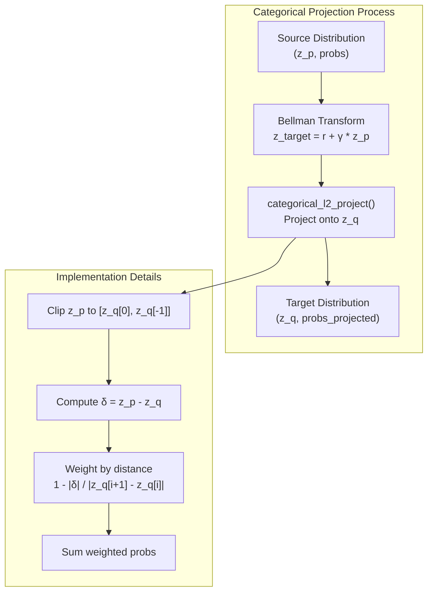

**Function:** `categorical_l2_project(z_p, probs, z_q)`

The projection minimizes the L2 (Cramer) distance between cumulative distribution functions:

```
Φ(z_q) = argmin_Φ ||CDF_p - CDF_Φ||_2
```

This is computed efficiently by distributing probability mass proportionally to the overlap of atoms.

**Implementation:**
- Input: Source support `z_p` (shape `[kp]`), probabilities `probs` (shape `[kp]`), target support `z_q` (shape `[kq]`)
- Output: Projected probabilities on `z_q` (shape `[kq]`)
- Supports arbitrary support sizes: `kp` need not equal `kq`

**Sources:** [rlax/_src/value_learning.py:543-602]()

### Categorical Q-Learning

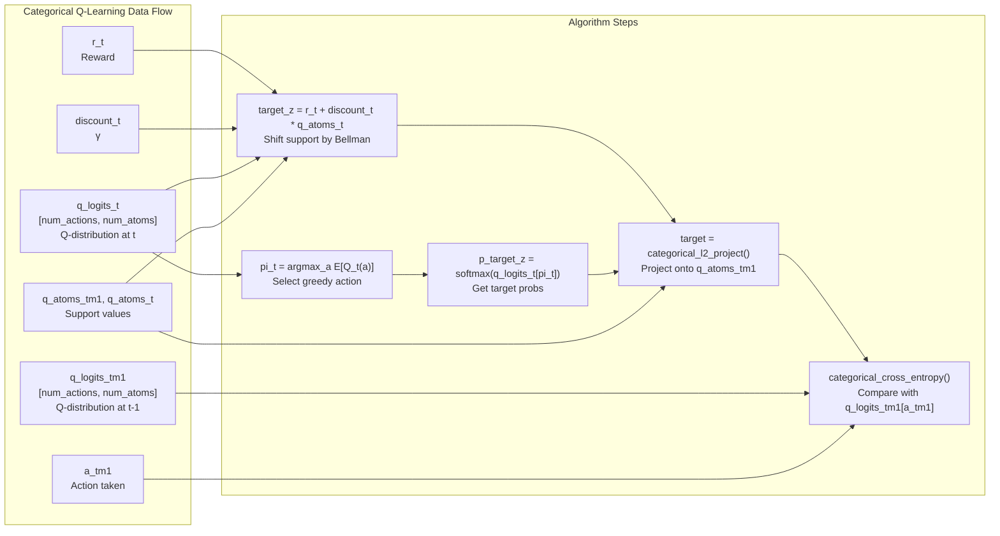

**Function:** `categorical_q_learning(q_atoms_tm1, q_logits_tm1, a_tm1, r_t, discount_t, q_atoms_t, q_logits_t)`

**Algorithm:**
1. Transform target support: `target_z = r_t + discount_t * q_atoms_t`
2. Select greedy action: `pi_t = argmax_a mean(Q_t(a))` where mean is computed as `Σ_i probs_i * z_i`
3. Extract target distribution: `p_target = softmax(q_logits_t[pi_t])`
4. Project onto source support: `target_probs = categorical_l2_project(target_z, p_target, q_atoms_tm1)`
5. Compute cross-entropy loss: `loss = -Σ_i target_probs[i] * log(probs_tm1[i])`

The loss is the temporal difference error expressed as a distributional distance.

**Variants:**
- `categorical_td_learning`: For state-value distributions V(s) instead of Q(s,a)
- `categorical_double_q_learning`: Uses separate selector network for action selection

**Sources:** [rlax/_src/value_learning.py:655-710](), [rlax/_src/value_learning.py:605-653](), [rlax/_src/value_learning.py:713-769]()

### Usage Example

```python
# Setup
num_actions = 4
num_atoms = 51
v_min, v_max = -10.0, 10.0
atoms = jnp.linspace(v_min, v_max, num_atoms)

# Network outputs logits over the categorical distribution
q_logits_tm1 = network(obs_tm1)  # shape: [num_actions, num_atoms]
q_logits_t = target_network(obs_t)  # shape: [num_actions, num_atoms]

# Compute loss
loss = rlax.categorical_q_learning(
    q_atoms_tm1=atoms,
    q_logits_tm1=q_logits_tm1,
    a_tm1=action,
    r_t=reward,
    discount_t=discount,
    q_atoms_t=atoms,
    q_logits_t=q_logits_t
)
```

---

## Quantile Distributional RL (QR-DQN)

### Representation

Quantile methods take a dual approach: fix the cumulative probabilities τ (quantiles) and learn the corresponding return values. Given N quantiles `τ = [τ_1, ..., τ_N]` uniformly distributed in [0,1], the distribution is represented implicitly by:

```
θ_i(s,a) = F^{-1}_{Z(s,a)}(τ_i)
```

where `θ_i` are the learned quantile values and `F^{-1}` is the inverse CDF.

This representation is particularly powerful for:
- No need for domain knowledge to set support bounds (V_min, V_max)
- Natural representation of heavy-tailed distributions
- Direct risk-sensitive policy learning by adjusting which quantiles to optimize

### Quantile Regression Loss

```mermaid
graph TB
    subgraph "Quantile Regression Loss Computation"
        SRC["dist_src<br/>[n_src_quantiles]<br/>Source quantile values"]
        TAU["tau_src<br/>[n_src_quantiles]<br/>Quantile fractions"]
        TGT["dist_target<br/>[n_tgt_quantiles]<br/>Target quantile values"]
    end
    
    subgraph "Loss Calculation"
        DELTA["delta = dist_target - dist_src<br/>Pairwise differences<br/>[n_src, n_tgt]"]
        SIGN["delta_neg = (delta < 0)<br/>Indicator function"]
        WEIGHT["weight = |tau_src - delta_neg|<br/>Asymmetric weighting"]
        HUBER["loss = huber_loss(delta, κ)<br/>or |delta| if κ=0"]
        PRODUCT["weighted_loss = loss * weight"]
        REDUCE["sum over src, mean over target"]
    end
    
    SRC --> DELTA
    TGT --> DELTA
    DELTA --> SIGN
    TAU --> WEIGHT
    SIGN --> WEIGHT
    DELTA --> HUBER
    HUBER --> PRODUCT
    WEIGHT --> PRODUCT
    PRODUCT --> REDUCE
```

**Function:** `quantile_regression_loss(dist_src, tau_src, dist_target, huber_param=0.)`

The quantile regression loss is:

```
L = E_τ[ρ_τ(δ)]  where  ρ_τ(δ) = |τ - I{δ<0}| * L_κ(δ)
```

where:
- `τ` are the quantile fractions
- `δ = target - prediction` is the TD error
- `I{δ<0}` is the indicator function (1 if δ<0, else 0)
- `L_κ` is Huber loss with parameter κ (or absolute value if κ=0)

The asymmetric weighting `|τ - I{δ<0}|` ensures:
- When `δ < 0` (overestimation): weight is `|τ - 1| = 1 - τ`
- When `δ ≥ 0` (underestimation): weight is `|τ - 0| = τ`

This creates different penalties for over vs. under-estimation based on the quantile level.

**Sources:** [rlax/_src/value_learning.py:772-813]()

### Quantile Q-Learning

```mermaid
graph LR
    subgraph "Inputs"
        DISTQTM1["dist_q_tm1<br/>[n_quantiles, n_actions]"]
        TAUQTM1["tau_q_tm1<br/>[n_quantiles]"]
        ATM1["a_tm1"]
        RT["r_t"]
        DISC["discount_t"]
        DISTQT["dist_q_t<br/>[n_quantiles, n_actions]"]
        SELECTOR["dist_q_t_selector<br/>For double Q"]
    end
    
    subgraph "Algorithm"
        SELECT_SRC["dist_qa_tm1 = dist_q_tm1[:, a_tm1]<br/>Extract taken action"]
        GREEDY["a_t = argmax_a mean(dist_q_t_selector)<br/>Greedy action selection"]
        SELECT_TGT["dist_qa_t = dist_q_t[:, a_t]<br/>Extract target action"]
        BELLMAN["dist_target = r_t + discount_t * dist_qa_t<br/>Bellman update"]
        QR_LOSS["quantile_regression_loss()<br/>Compute QR loss"]
    end
    
    DISTQTM1 --> SELECT_SRC
    ATM1 --> SELECT_SRC
    
    SELECTOR --> GREEDY
    GREEDY --> SELECT_TGT
    DISTQT --> SELECT_TGT
    
    RT --> BELLMAN
    DISC --> BELLMAN
    SELECT_TGT --> BELLMAN
    
    SELECT_SRC --> QR_LOSS
    TAUQTM1 --> QR_LOSS
    BELLMAN --> QR_LOSS
```

**Function:** `quantile_q_learning(dist_q_tm1, tau_q_tm1, a_tm1, r_t, discount_t, dist_q_t_selector, dist_q_t, huber_param=0.)`

**Algorithm:**
1. Select quantiles for taken action: `dist_qa_tm1 = dist_q_tm1[:, a_tm1]`
2. Compute mean Q-values for action selection: `q_mean = mean(dist_q_t_selector, axis=0)`
3. Select greedy action: `a_t = argmax(q_mean)`
4. Extract target quantiles: `dist_qa_t = dist_q_t[:, a_t]`
5. Apply Bellman operator: `dist_target = r_t + discount_t * dist_qa_t`
6. Compute quantile regression loss between `dist_qa_tm1` and `dist_target`

The function supports **Double Q-learning** through separate `dist_q_t_selector` and `dist_q_t` networks. For standard Q-learning, pass the same network outputs for both.

**Variants:**
- `quantile_expected_sarsa`: Uses expected value over actions weighted by policy probabilities instead of greedy selection

**Sources:** [rlax/_src/value_learning.py:816-870](), [rlax/_src/value_learning.py:873-923]()

### Usage Example

```python
# Setup
num_actions = 4
num_quantiles = 200
tau = (jnp.arange(num_quantiles) + 0.5) / num_quantiles  # Uniform quantiles

# Network outputs quantile values (no softmax needed)
dist_q_tm1 = network(obs_tm1)  # shape: [num_quantiles, num_actions]
dist_q_t = target_network(obs_t)  # shape: [num_quantiles, num_actions]

# Compute loss with Huber parameter
loss = rlax.quantile_q_learning(
    dist_q_tm1=dist_q_tm1,
    tau_q_tm1=tau,
    a_tm1=action,
    r_t=reward,
    discount_t=discount,
    dist_q_t_selector=dist_q_t,  # Can use separate network
    dist_q_t=dist_q_t,
    huber_param=1.0  # κ parameter for Huber loss
)
```

---

## Comparison: Categorical vs. Quantile Methods

```mermaid
graph TD
    subgraph "Categorical C51"
        CAT_FIXED["Fixed: Support locations z_i"]
        CAT_LEARN["Learned: Probabilities p_i"]
        CAT_PROJ["Requires: Projection operation"]
        CAT_DOMAIN["Needs: Domain knowledge for V_min, V_max"]
    end
    
    subgraph "Quantile QR-DQN"
        QUANT_FIXED["Fixed: Quantile fractions τ_i"]
        QUANT_LEARN["Learned: Quantile values θ_i"]
        QUANT_NO_PROJ["No projection: Direct Bellman update"]
        QUANT_NO_DOMAIN["No domain knowledge needed"]
    end
    
    DIST_RL["Distributional RL"]
    DIST_RL --> CAT_FIXED
    DIST_RL --> QUANT_FIXED
```

| Aspect | Categorical (C51) | Quantile (QR-DQN) |
|--------|-------------------|-------------------|
| **Fixed** | Support atoms `z` | Quantile fractions `τ` |
| **Learned** | Probabilities (via logits) | Quantile values `θ` |
| **Output layer** | Softmax over atoms | Direct values (no activation) |
| **Key operation** | L2 projection onto support | Quantile regression loss |
| **Hyperparameters** | `V_min`, `V_max`, `num_atoms` | `num_quantiles`, `huber_param` |
| **Domain knowledge** | Required (value bounds) | Not required |
| **Bellman operator** | Transforms support (needs projection) | Directly updates quantiles |
| **Distributional distance** | Cross-entropy after projection | Wasserstein (via QR loss) |
| **Typical usage** | 51-201 atoms | 32-200 quantiles |

**Sources:** [rlax/_src/value_learning.py:543-923]()

---

## Function Reference

### Categorical Methods

| Function | Purpose | Input Shapes | Output |
|----------|---------|--------------|--------|
| `categorical_l2_project` | Project distribution onto new support | `z_p: [kp]`, `probs: [kp]`, `z_q: [kq]` | `[kq]` |
| `categorical_td_learning` | TD learning for V-distributions | `v_atoms: [n]`, `v_logits: [n]` | scalar |
| `categorical_q_learning` | Q-learning for Q-distributions | `q_atoms: [n]`, `q_logits: [num_actions, n]` | scalar |
| `categorical_double_q_learning` | Double Q-learning for Q-distributions | Same + `q_t_selector: [num_actions]` | scalar |

### Quantile Methods

| Function | Purpose | Input Shapes | Output |
|----------|---------|--------------|--------|
| `quantile_regression_loss` | QR loss between distributions | `dist_src: [n_src]`, `dist_target: [n_tgt]` | scalar |
| `quantile_q_learning` | Q-learning for quantile distributions | `dist_q: [n_quantiles, n_actions]` | scalar |
| `quantile_expected_sarsa` | Expected SARSA for quantile distributions | Same + `probs_a_t: [n_actions]` | scalar |

**Key Parameters:**
- `stop_target_gradients`: Whether to detach targets from computation graph (default: `True`)
- `huber_param`: Huber loss parameter κ for quantile methods (default: `0.` = no Huber loss)

**Sources:** [rlax/_src/value_learning.py:543-923]()

---

## Implementation Details

### Categorical Projection Algorithm

The projection operation [rlax/_src/value_learning.py:543-602]() implements the algorithm from Bellemare et al. (2017):

1. **Clip source support:** `z_p_clipped = clip(z_p, z_q[0], z_q[-1])`
2. **Compute intervals:** For each target atom `z_q[i]`, compute distances to neighbors
3. **Distribute mass:** For each source atom, distribute its probability to neighboring target atoms proportionally to overlap
4. **Handle edge cases:** Atoms at boundaries receive mass from all clipped source atoms

The implementation uses vectorized operations for efficiency:
- Broadcasts `z_p` and `z_q` to shape `[kq, kp]`
- Computes pairwise differences: `delta_qp = z_p - z_q`
- Uses indicator functions and linear interpolation weights
- Final reduction: `sum(clip(1 - delta_hat, 0, 1) * probs, axis=-1)`

### Quantile Loss Computation

The quantile regression loss [rlax/_src/value_learning.py:772-813]() computes:

1. **Pairwise TD errors:** `delta[i,j] = dist_target[j] - dist_src[i]` (shape `[n_src, n_tgt]`)
2. **Asymmetric weights:** `weight[i,j] = |tau_src[i] - I{delta[i,j]<0}|`
3. **Huber loss:** Apply Huber loss to `delta` if `huber_param > 0`, else use absolute value
4. **Weighted loss:** `weighted_loss = loss * weight`
5. **Reduction:** Mean over `n_tgt`, sum over `n_src`

The use of Huber loss (when `huber_param > 0`) reduces sensitivity to outliers while maintaining differentiability.

**Sources:** [rlax/_src/value_learning.py:543-813]()

---

## Relationship to Other Modules

```mermaid
graph TB
    subgraph "Distributional RL Functions"
        CAT["categorical_q_learning()<br/>categorical_l2_project()"]
        QUANT["quantile_q_learning()<br/>quantile_regression_loss()"]
    end
    
    subgraph "Dependencies"
        DIST["distributions module<br/>categorical_cross_entropy()<br/>softmax()"]
        CLIP["clipping module<br/>huber_loss()"]
        BASE["base module<br/>batched_index()"]
    end
    
    subgraph "Used By"
        NONLIN["nonlinear_bellman<br/>Can wrap distributional methods"]
        EXAMPLES["examples/<br/>DQN agents (point estimate)<br/>Could use distributional"]
    end
    
    CAT --> DIST
    QUANT --> CLIP
    CAT --> BASE
    QUANT --> BASE
    
    NONLIN -.optional.-> CAT
    NONLIN -.optional.-> QUANT
    EXAMPLES -.could use.-> CAT
    EXAMPLES -.could use.-> QUANT
```

**Integration points:**
- **distributions module:** `categorical_cross_entropy` computes the loss between target and predicted distributions
- **clipping module:** `huber_loss` provides robust loss for quantile methods
- **base module:** `batched_index` extracts action values from batched Q-arrays
- **nonlinear_bellman:** Value transformations can be applied to distributional returns (see [Nonlinear Bellman Equations](#6.1))

**Sources:** [rlax/_src/value_learning.py:24-30](), [rlax/_src/distributions.py](), [rlax/_src/clipping.py](), [rlax/_src/base.py]()

---

## Testing and Validation

The test suite [rlax/_src/value_learning_test.py]() validates:

**Categorical Methods:**
- Projection correctness: Random supports projected and verified against expected distributions
- TD learning: Various reward/discount scenarios tested
- Q-learning: Greedy action selection and target computation verified
- Double Q-learning: Equivalence to standard Q-learning when selector equals target network

**Quantile Methods:**
- QR loss computation: Explicit calculations verified for different Huber parameters
- Q-learning: Greedy action selection and Bellman updates tested
- Expected SARSA: Policy-weighted targets validated for both greedy and uniform policies

**Test patterns:**
- Batched computation via `jax.vmap` tested extensively
- Edge cases: Terminal states, zero discounts, extreme values
- Numerical stability: Small epsilon values, division by zero handling

**Sources:** [rlax/_src/value_learning_test.py:489-897]()

---

# Page: Multistep Returns and Credit Assignment

# Multistep Returns and Credit Assignment

<details>
<summary>Relevant source files</summary>

The following files were used as context for generating this wiki page:

- [rlax/_src/multistep.py](rlax/_src/multistep.py)
- [rlax/_src/vtrace.py](rlax/_src/vtrace.py)

</details>


## Purpose and Scope

This page explains the multistep return computation mechanisms in RLax, which solve the fundamental **credit assignment problem** in reinforcement learning: how to propagate rewards backward in time to determine which actions were responsible for which outcomes. These functions construct target values for value-based and policy gradient algorithms by combining observed rewards with bootstrapped value estimates.

The primary implementation is in [rlax/_src/multistep.py:1-447](), which provides functions for computing lambda returns, n-step returns, generalized advantage estimation (GAE), and general off-policy return estimates. V-trace, a specialized off-policy method used in IMPALA, is implemented separately in [rlax/_src/vtrace.py:1-338]().

**Related pages:**
- For detailed coverage of lambda returns and GAE, see [Lambda Returns and GAE](#3.1)
- For V-trace and IMPALA-style off-policy learning, see [V-trace for Off-Policy Learning](#3.2)
- For how these returns are used in value learning algorithms, see [Value-Based Learning](#2)
- For policy gradient usage, see [Policy Optimization Methods](#5)

---

## The Credit Assignment Problem

In reinforcement learning, an agent receives rewards at various time steps, but the question remains: which past actions were responsible for these rewards? Multistep return methods provide different solutions to this problem by computing target values that aggregate future rewards.

The core challenge is balancing:
- **Bias**: Bootstrapping from value estimates introduces bias if those estimates are inaccurate
- **Variance**: Using many real rewards reduces bias but increases variance due to stochastic environment dynamics
- **Off-policy correction**: When learning from trajectories generated by a different policy, importance sampling corrections are needed

RLax provides a comprehensive set of functions that implement various points along these trade-offs, suitable for both on-policy and off-policy algorithms.

**Sources:** [rlax/_src/multistep.py:15-22]()

---

## Taxonomy of Multistep Return Methods

```mermaid
graph TB
    subgraph "Return Estimation Methods in RLax"
        ROOT["Multistep Returns"]
        
        subgraph "On-Policy Methods"
            LAMBDA["lambda_returns()<br/>TD(λ) mixing"]
            NSTEP["n_step_bootstrapped_returns()<br/>Fixed n-step"]
            DISC["discounted_returns()<br/>Monte Carlo"]
            GAE["truncated_generalized_advantage_estimation()<br/>GAE for policy gradients"]
        end
        
        subgraph "Off-Policy Methods"
            IMP_CORR["importance_corrected_td_errors()<br/>Per-decision IS"]
            GEN_QV["general_off_policy_returns_from_q_and_v()<br/>Retrace, Tree-Backup, Q(λ)"]
            GEN_AV["general_off_policy_returns_from_action_values()<br/>From Q-values"]
            VT["vtrace()<br/>IMPALA clipped IS"]
            LEAKY["leaky_vtrace()<br/>Tunable IS mixing"]
        end
        
        subgraph "Supporting Operations"
            STOP["stop_target_gradients parameter<br/>Gradient flow control"]
            MASK["sample_mask parameter<br/>Episode boundary handling"]
        end
    end
    
    ROOT --> LAMBDA
    ROOT --> NSTEP
    ROOT --> DISC
    ROOT --> GAE
    ROOT --> IMP_CORR
    ROOT --> GEN_QV
    ROOT --> GEN_AV
    ROOT --> VT
    ROOT --> LEAKY
    
    LAMBDA -.uses.-> STOP
    GAE -.uses.-> STOP
    VT -.uses.-> STOP
    VT -.uses.-> MASK
    
    DISC -.special case of.-> LAMBDA
    NSTEP -.special case of.-> LAMBDA
    GAE -.related to.-> LAMBDA
    VT -.special case of.-> GEN_QV
    LEAKY -.extends.-> VT
```

**Sources:** [rlax/_src/multistep.py:1-447](), [rlax/_src/vtrace.py:1-338]()

---

## Core Concepts

### Bootstrapping and Lambda Mixing

The fundamental equation for lambda returns is:

```
Gₜ = rₜ₊₁ + γₜ₊₁ [(1 - λₜ₊₁) vₜ₊₁ + λₜ₊₁ Gₜ₊₁]
```

Where:
- `Gₜ` is the return estimate at time t
- `rₜ₊₁` is the immediate reward
- `γₜ₊₁` is the discount factor
- `λₜ₊₁` is the mixing parameter (controls bias-variance trade-off)
- `vₜ₊₁` is the bootstrapped value estimate

The lambda parameter trades off between:
- `λ = 0`: One-step TD (high bias, low variance, fast learning)
- `λ = 1`: Monte Carlo (low bias, high variance, slow learning)
- `0 < λ < 1`: Interpolation between the extremes

**Sources:** [rlax/_src/multistep.py:34-118]()

### Importance Sampling for Off-Policy Learning

When the behavior policy μ differs from the target policy π, importance sampling ratios correct the returns:

```
ρₜ = π(aₜ|sₜ) / μ(aₜ|sₜ)
```

Different algorithms use these ratios differently:

| Method | Weighting Strategy | Implementation |
|--------|-------------------|----------------|
| **Importance Sampling** | `cₜ = ρₜ` | Full IS weight |
| **Q(λ)** | `cₜ = λ` | Fixed mixing |
| **Tree-Backup** | `cₜ = π(aₜ|sₜ)` | Policy probability |
| **Retrace** | `cₜ = λ min(1, ρₜ)` | Clipped IS |
| **V-trace** | Special clipping for critic and actor | `clip_rho_threshold`, `clip_pg_rho_threshold` |

**Sources:** [rlax/_src/multistep.py:215-277](), [rlax/_src/multistep.py:330-446](), [rlax/_src/vtrace.py:38-105]()

---

## Multistep Module API Structure

```mermaid
graph LR
    subgraph "Input Data"
        REWARDS["r_t<br/>Rewards [T]"]
        DISCOUNTS["discount_t<br/>Discounts [T]"]
        VALUES["v_t or q_t<br/>Value estimates [T+1]"]
        IS["rho_tm1<br/>IS ratios [T]"]
        LAMBDA["lambda_<br/>Mixing param"]
    end
    
    subgraph "multistep.py Functions"
        LR["lambda_returns()"]
        NSB["n_step_bootstrapped_returns()"]
        DR["discounted_returns()"]
        GAE_F["truncated_generalized_advantage_estimation()"]
        ICE["importance_corrected_td_errors()"]
        GOPAV["general_off_policy_returns_from_action_values()"]
        GOPQV["general_off_policy_returns_from_q_and_v()"]
    end
    
    subgraph "vtrace.py Functions"
        VT_F["vtrace()"]
        LVT["leaky_vtrace()"]
        VTADV["vtrace_td_error_and_advantage()"]
        LVTADV["leaky_vtrace_td_error_and_advantage()"]
    end
    
    subgraph "Output"
        RETURNS["Returns Gₜ<br/>or TD errors δₜ<br/>or Advantages Âₜ"]
    end
    
    REWARDS --> LR
    DISCOUNTS --> LR
    VALUES --> LR
    LAMBDA --> LR
    
    REWARDS --> NSB
    DISCOUNTS --> NSB
    VALUES --> NSB
    
    REWARDS --> GAE_F
    DISCOUNTS --> GAE_F
    VALUES --> GAE_F
    LAMBDA --> GAE_F
    
    REWARDS --> ICE
    DISCOUNTS --> ICE
    VALUES --> ICE
    IS --> ICE
    LAMBDA --> ICE
    
    REWARDS --> VT_F
    DISCOUNTS --> VT_F
    VALUES --> VT_F
    IS --> VT_F
    
    LR --> RETURNS
    NSB --> RETURNS
    DR --> RETURNS
    GAE_F --> RETURNS
    ICE --> RETURNS
    VT_F --> RETURNS
    VTADV --> RETURNS
```

### Common Parameters

All functions share similar parameter conventions:

| Parameter | Type | Description |
|-----------|------|-------------|
| `r_t` | `Array[T]` | Rewards at times [1, ..., T] |
| `discount_t` | `Array[T]` | Discount factors γₜ at times [1, ..., T] |
| `v_t` | `Array[T+1]` | Value estimates at times [0, ..., T] (for bootstrapping) |
| `lambda_` | `Scalar` or `Array[T]` | Mixing parameter (scalar or per-timestep) |
| `stop_target_gradients` | `bool` | Whether to stop gradients through bootstrap targets |

**Sources:** [rlax/_src/multistep.py:34-118](), [rlax/_src/multistep.py:279-328]()

---

## Function Reference by Use Case

### Basic Return Computation

#### lambda_returns()

Computes the standard TD(λ) return with configurable lambda mixing.

**Function signature:** [rlax/_src/multistep.py:34-118]()

```python
lambda_returns(
    r_t: Array,
    discount_t: Array,
    v_t: Array,
    lambda_: Numeric = 1.,
    stop_target_gradients: bool = False,
) -> Array
```

**Use when:**
- Implementing on-policy value learning (TD(λ), SARSA(λ))
- Need to trade off bias vs variance with lambda parameter
- Have value estimates for bootstrapping

**Implementation details:**
- Works backward from `G_{T-1}` to `G_0` using JAX scan
- Lambda can be scalar (fixed) or per-timestep (adaptive)
- Equivalent to Monte Carlo when `lambda_=1.0`

**Sources:** [rlax/_src/multistep.py:34-118]()

---

#### n_step_bootstrapped_returns()

Computes strided n-step returns by accumulating exactly n rewards before bootstrapping.

**Function signature:** [rlax/_src/multistep.py:121-178]()

```python
n_step_bootstrapped_returns(
    r_t: Array,
    discount_t: Array,
    v_t: Array,
    n: int,
    lambda_t: Numeric = 1.,
    stop_target_gradients: bool = False,
) -> Array
```

**Use when:**
- Want fixed-horizon lookahead (e.g., n=3 for 3-step Q-learning)
- Simpler than full lambda mixing
- DQN-style algorithms with target networks

**Implementation details:**
- Pads sequences to handle trajectory boundaries
- Can include lambda mixing within the n-step window
- When `lambda_t=1.0`, reduces to pure n-step bootstrapping

**Sources:** [rlax/_src/multistep.py:121-178]()

---

#### discounted_returns()

Computes pure Monte Carlo returns without bootstrapping (lambda=1).

**Function signature:** [rlax/_src/multistep.py:181-212]()

```python
discounted_returns(
    r_t: Array,
    discount_t: Array,
    v_t: Array,
    stop_target_gradients: bool = False,
) -> Array
```

**Use when:**
- Have complete trajectories
- Want unbiased return estimates
- Policy gradient methods (REINFORCE)

**Implementation details:**
- Special case of `lambda_returns()` with `lambda_=1.0`
- `v_t` is only used for the final bootstrap value

**Sources:** [rlax/_src/multistep.py:181-212]()

---

### Advantage Estimation

#### truncated_generalized_advantage_estimation()

Computes GAE(λ) for policy gradient methods, computing advantages rather than returns.

**Function signature:** [rlax/_src/multistep.py:279-328]()

```python
truncated_generalized_advantage_estimation(
    r_t: Array,
    discount_t: Array,
    lambda_: Union[Array, Scalar],
    values: Array,
    stop_target_gradients: bool = False,
) -> Array
```

**Computes:**
```
Âₜ = δₜ + (γλ) * δₜ₊₁ + ... + (γλ)^(k-t+1) * δₖ₋₁
where δₜ = rₜ₊₁ + γₜ₊₁ * v(sₜ₊₁) - v(sₜ)
```

**Use when:**
- Implementing PPO, A2C, or other actor-critic methods
- Need advantage estimates for policy gradients
- Want variance reduction from baseline subtraction

**Sources:** [rlax/_src/multistep.py:279-328]()

---

### Off-Policy Return Estimation

#### importance_corrected_td_errors()

Computes multistep TD errors with per-decision importance sampling.

**Function signature:** [rlax/_src/multistep.py:215-277]()

```python
importance_corrected_td_errors(
    r_t: Array,
    discount_t: Array,
    rho_tm1: Array,
    lambda_: Array,
    values: Array,
    stop_target_gradients: bool = False,
) -> Array
```

**Computes:**
```
td-errorₜ = ρₜ δₜ(ρ,λ)
δₜ(ρ,λ) = δₜ + ρₜ₊₁ λₜ₊₁ γₜ₊₁ δₜ₊₁(ρ,λ)
```

**Use when:**
- Implementing off-policy actor-critic
- Have importance sampling ratios available
- Want to use per-decision IS correction

**Sources:** [rlax/_src/multistep.py:215-277]()

---

#### general_off_policy_returns_from_q_and_v()

Unified interface for multiple off-policy algorithms (Retrace, Tree-Backup, Q(λ)).

**Function signature:** [rlax/_src/multistep.py:389-446]()

```python
general_off_policy_returns_from_q_and_v(
    q_t: Array,
    v_t: Array,
    r_t: Array,
    discount_t: Array,
    c_t: Array,
    stop_target_gradients: bool = False,
) -> Array
```

**Computes:**
```
Gₜ = rₜ₊₁ + γₜ₊₁ * (vₜ₊₁ - cₜ₊₁ * q(aₜ₊₁) + cₜ₊₁ * Gₜ₊₁)
```

**Implements different algorithms via `c_t` parameter:**

| Algorithm | `c_t` Value | Reference |
|-----------|-------------|-----------|
| Importance Sampling | `π(aₜ\|sₜ) / μ(aₜ\|sₜ)` | Full IS weight |
| Q(λ) | `λ` | Harutyunyan et al. |
| Tree-Backup | `π(aₜ\|sₜ)` | Precup et al. |
| Retrace | `λ min(1, π(aₜ\|sₜ) / μ(aₜ\|sₜ))` | Munos et al. |

**Use when:**
- Need flexible off-policy correction
- Implementing Retrace, Tree-Backup, or Q(λ)
- Have Q-values and policy probabilities

**Sources:** [rlax/_src/multistep.py:389-446](), [rlax/_src/multistep.py:330-387]()

---

### V-trace Specific Functions

V-trace is covered in detail in [V-trace for Off-Policy Learning](#3.2), but the key functions are:

#### vtrace()

Core V-trace return computation with clipped importance sampling.

**Function signature:** [rlax/_src/vtrace.py:38-105]()

```python
vtrace(
    v_tm1: Array,
    v_t: Array,
    r_t: Array,
    discount_t: Array,
    rho_tm1: Array,
    lambda_: Numeric = 1.0,
    clip_rho_threshold: float = 1.0,
    stop_target_gradients: bool = True,
    sample_mask: Array | None = None,
) -> Array
```

**Key differences from standard lambda returns:**
- Clips importance ratios: `c_tm1 = min(1.0, rho_tm1) * lambda_`
- Uses separate clipping for TD errors: `clipped_rhos_tm1 = min(clip_rho_threshold, rho_tm1)`
- Supports `sample_mask` for episode boundaries

**Sources:** [rlax/_src/vtrace.py:38-105]()

---

#### vtrace_td_error_and_advantage()

Combined function for IMPALA-style actor-critic, computing both value targets and policy advantages.

**Function signature:** [rlax/_src/vtrace.py:183-254]()

```python
vtrace_td_error_and_advantage(
    v_tm1: Array,
    v_t: Array,
    r_t: Array,
    discount_t: Array,
    rho_tm1: Array,
    lambda_: Numeric = 1.0,
    clip_rho_threshold: float = 1.0,
    clip_pg_rho_threshold: float = 1.0,
    stop_target_gradients: bool = True,
    sample_mask: Array | None = None,
) -> VTraceOutput
```

**Returns:** `VTraceOutput(errors, pg_advantage, q_estimate)`
- `errors`: TD errors for critic loss
- `pg_advantage`: Clipped advantages for policy gradient
- `q_estimate`: Q-value estimates

**Key feature:** Uses separate clipping thresholds for critic (`clip_rho_threshold`) and actor (`clip_pg_rho_threshold`)

**Sources:** [rlax/_src/vtrace.py:183-254]()

---

## Usage Patterns and Integration

### Typical Usage in Value Learning

```mermaid
graph TB
    subgraph "DQN Example"
        TRAJ["Trajectory Data<br/>states, actions, rewards"]
        QNET["Q-Network<br/>q_tm1, q_t"]
        SELECT["Action Selection<br/>epsilon-greedy"]
        
        TARGET["Target Computation"]
        TRAJ --> TARGET
        QNET --> TARGET
        
        TARGET --> NSB["n_step_bootstrapped_returns()<br/>n=3 for 3-step DQN"]
        NSB --> LOSS["TD Loss<br/>L2(q_tm1, target)"]
    end
    
    subgraph "SARSA Lambda"
        TRAJ2["Trajectory"]
        VNET["V-Network or Q-Network"]
        TRAJ2 --> LR["lambda_returns()<br/>lambda=0.9"]
        VNET --> LR
        LR --> LOSS2["TD Loss"]
    end
```

**Sources:** Based on [examples/simple_dqn.py]() usage pattern

---

### Typical Usage in Policy Gradients

```mermaid
graph TB
    subgraph "PPO Example"
        ROLLOUT["Rollout Collection<br/>states, actions, rewards"]
        CRITIC["Critic Network<br/>V(s)"]
        ACTOR["Actor Network<br/>π(a|s)"]
        
        ROLLOUT --> GAE_COMPUTE["truncated_generalized_advantage_estimation()<br/>lambda=0.95"]
        CRITIC --> GAE_COMPUTE
        
        GAE_COMPUTE --> ADV["Advantages Âₜ"]
        ADV --> PG["Policy Gradient Loss<br/>clipped_surrogate_pg_loss()"]
        ADV --> VL["Value Loss<br/>L2(V(s), returns)"]
    end
    
    subgraph "IMPALA Example"
        BUFFER["Experience Buffer<br/>Off-policy data"]
        CRITIC2["Critic V(s)"]
        ACTOR2["Actor π(a|s)"]
        
        BUFFER --> IS["Compute IS ratios<br/>ρ = π/μ"]
        IS --> VTRACE["vtrace_td_error_and_advantage()"]
        CRITIC2 --> VTRACE
        
        VTRACE --> CRIT_LOSS["Critic Loss<br/>errors"]
        VTRACE --> ACT_LOSS["Actor Loss<br/>pg_advantage"]
    end
```

**Sources:** Based on common usage patterns

---

## Implementation Details

### Backward Scan Pattern

Most functions use JAX's `lax.scan` in reverse to compute returns efficiently:

```mermaid
graph LR
    subgraph "Forward Time Direction"
        T0["t=0"] --> T1["t=1"] --> T2["t=2"] --> T3["..."] --> TN["t=T"]
    end
    
    subgraph "Backward Computation"
        GN["G_T=v_T"] --> GN1["G_T-1"] --> GN2["G_T-2"] --> GN3["..."] --> G0["G_0"]
    end
    
    TN -.initialize.-> GN
    T3 -.rewards.-> GN1
    T2 -.rewards.-> GN2
    T1 -.rewards.-> GN3
    T0 -.rewards.-> G0
```

**Key implementation detail:** [rlax/_src/multistep.py:107-114]()

The scan body function accumulates returns backward:
```python
def _body(acc, xs):
    returns, discounts, values, lambda_ = xs
    acc = returns + discounts * ((1-lambda_) * values + lambda_ * acc)
    return acc, acc
```

This pattern enables efficient parallel computation on accelerators (GPU/TPU).

**Sources:** [rlax/_src/multistep.py:107-118](), [rlax/_src/vtrace.py:92-99]()

---

### Gradient Control

The `stop_target_gradients` parameter controls whether gradients flow through bootstrap targets:

- `stop_target_gradients=True`: Treats targets as constants, prevents double backpropagation
- `stop_target_gradients=False`: Allows gradients through targets (rarely used)

**Implementation:** [rlax/_src/multistep.py:116-118]()

```python
return jax.lax.select(stop_target_gradients,
                      jax.lax.stop_gradient(returns),
                      returns)
```

Most algorithms use `stop_target_gradients=True` to avoid the "deadly triad" (function approximation + bootstrapping + off-policy), as described in Sutton & Barto.

**Sources:** [rlax/_src/multistep.py:116-118](), [rlax/_src/vtrace.py:102-105]()

---

### Episode Boundary Handling

V-trace functions support `sample_mask` to handle episode boundaries in batched trajectories:

**Implementation:** [rlax/_src/vtrace.py:71-72](), [rlax/_src/vtrace.py:92-99]()

```python
def _body(acc, xs):
    td_error, discount, learnable, c = xs
    acc = learnable * (td_error + discount * c * acc) + (1.0 - learnable) * acc
    return acc, acc
```

The mask ensures that returns don't propagate across episode boundaries, which is critical for distributed training where trajectories from different episodes may be interleaved.

**Sources:** [rlax/_src/vtrace.py:66-99]()

---

## Summary Table: When to Use Each Function

| Function | On/Off-Policy | Primary Use Case | Key Parameters |
|----------|---------------|------------------|----------------|
| `lambda_returns` | On-policy | TD(λ), SARSA(λ), value learning | `lambda_` (bias-variance tradeoff) |
| `n_step_bootstrapped_returns` | On-policy | n-step DQN, fixed-horizon methods | `n` (number of steps) |
| `discounted_returns` | On-policy | Monte Carlo, REINFORCE | None (full trajectory) |
| `truncated_generalized_advantage_estimation` | On-policy | PPO, A2C, actor-critic | `lambda_` (advantage smoothing) |
| `importance_corrected_td_errors` | Off-policy | Per-decision IS methods | `rho_tm1` (IS ratios) |
| `general_off_policy_returns_from_q_and_v` | Off-policy | Retrace, Tree-Backup, Q(λ) | `c_t` (correction weights) |
| `general_off_policy_returns_from_action_values` | Off-policy | Same as above, from Q-values | `c_t`, `pi_t` (policy probs) |
| `vtrace` | Off-policy | IMPALA critic | `clip_rho_threshold` |
| `vtrace_td_error_and_advantage` | Off-policy | IMPALA actor-critic | `clip_rho_threshold`, `clip_pg_rho_threshold` |
| `leaky_vtrace` | Off-policy | Adaptive IS mixing | `alpha_` (IS vs V-trace) |

**Sources:** [rlax/_src/multistep.py:1-447](), [rlax/_src/vtrace.py:1-338]()

---

## Relationship to Other RLax Modules

The multistep module is a foundational component used throughout RLax:

| Module | How It Uses Multistep Returns |
|--------|-------------------------------|
| **value_learning** ([#2](#2)) | Uses `lambda_returns()` for TD(λ), SARSA(λ); uses `general_off_policy_returns_from_q_and_v()` for Retrace |
| **policy_gradients** ([#5](#5)) | Uses `truncated_generalized_advantage_estimation()` for advantage computation in PPO |
| **nonlinear_bellman** ([#6.1](#6.1)) | Wraps multistep returns with value transformations for MuZero |
| **vtrace** ([#3.2](#3.2)) | Extends multistep framework with IMPALA-specific importance sampling |

The module depends on:
- **base** ([#7.2](#7.2)) for `batched_index()` used in Q-value extraction
- **JAX/jax.numpy** for array operations and `lax.scan`
- **chex** for type checking and assertions

**Sources:** Based on module dependency analysis from high-level diagrams

---

# Page: Lambda Returns and GAE

# Lambda Returns and GAE

<details>
<summary>Relevant source files</summary>

The following files were used as context for generating this wiki page:

- [README.md](README.md)
- [examples/__init__.py](examples/__init__.py)
- [examples/experiment.py](examples/experiment.py)
- [examples/online_q_learning.py](examples/online_q_learning.py)
- [examples/pop_art.py](examples/pop_art.py)
- [examples/simple_dqn.py](examples/simple_dqn.py)
- [rlax/_src/embedding.py](rlax/_src/embedding.py)
- [rlax/_src/multistep.py](rlax/_src/multistep.py)
- [rlax/_src/vtrace.py](rlax/_src/vtrace.py)

</details>


## Purpose and Scope

This page covers **lambda returns** and **Generalized Advantage Estimation (GAE)**, two fundamental techniques for computing multistep return estimates in reinforcement learning. These methods trade off bias and variance in value estimation by mixing bootstrapped returns at different time horizons using a parameter λ (lambda).

Lambda returns are used for value learning algorithms (TD(λ), Q(λ), Sarsa(λ)), while GAE is specifically designed for computing advantage estimates in policy gradient methods. Both are implemented in the `multistep` module.

For off-policy corrections using V-trace (a special case of lambda returns), see [V-trace for Off-Policy Learning](#3.2). For general multistep bootstrapping concepts, see [Multistep Returns and Credit Assignment](#3).

---

## Mathematical Foundation

### Lambda Returns

Lambda returns combine n-step returns with different bootstrap horizons according to a mixing parameter λ ∈ [0, 1]. Given a trajectory of rewards `r_t`, discounts `γ_t`, and value estimates `v_t`, the lambda return at time t is computed recursively:

```
G_t^λ = r_{t+1} + γ_{t+1} [(1 - λ_{t+1}) v_{t+1} + λ_{t+1} G_{t+1}^λ]
```

This formula exponentially weights different n-step returns:
- **λ = 0**: Pure 1-step TD (high bias, low variance): `r_{t+1} + γ_{t+1} v_{t+1}`
- **λ = 1**: Monte Carlo return (low bias, high variance): `r_{t+1} + γ_{t+1} r_{t+2} + γ_{t+1}γ_{t+2} r_{t+3} + ...`
- **0 < λ < 1**: Weighted mixture of all n-step returns

The key insight is that λ controls the **bias-variance tradeoff**:
- Lower λ → more bootstrapping → lower variance but higher bias (depends on value accuracy)
- Higher λ → less bootstrapping → higher variance but lower bias (depends less on value accuracy)

**Sources:** [rlax/_src/multistep.py:34-118]()

### Generalized Advantage Estimation (GAE)

GAE applies the lambda return concept to compute advantage estimates for policy gradients. The advantage at time t is:

```
Â_t^λ = δ_t + (γλ) δ_{t+1} + (γλ)² δ_{t+2} + ... + (γλ)^{k-t} δ_{k-1}
```

where `δ_t = r_{t+1} + γ_{t+1} v_{t+1} - v_t` is the temporal difference (TD) error.

GAE can be expressed in terms of lambda returns as:
```
Â_t^λ = G_t^λ - v_t
```

This means GAE is simply the difference between the lambda return target and the current value estimate, making it suitable for actor-critic methods where we need advantage estimates for policy updates.

**Sources:** [rlax/_src/multistep.py:279-327]()

---

## Core Implementation Architecture

```mermaid
graph TB
    subgraph "Lambda Returns Computation"
        INPUT["Inputs<br/>r_t: rewards [T]<br/>discount_t: γ_t [T]<br/>v_t: values [T]<br/>lambda_: λ scalar or [T]"]
        
        PREP["Preparation<br/>lambda_ → vector [T]<br/>Initialize G_{T-1} = v_{T-1}"]
        
        SCAN["jax.lax.scan<br/>(reverse=True)<br/>_body function"]
        
        BODY["Body Function<br/>acc = r_t + γ_t * [(1-λ_t)*v_t + λ_t*acc]<br/>returns G_t at each step"]
        
        OUTPUT["Returns<br/>G_t^λ for t ∈ [0, T-1]"]
        
        GRAD["Optional<br/>stop_target_gradients<br/>jax.lax.stop_gradient"]
    end
    
    subgraph "GAE Computation"
        GAE_INPUT["Inputs<br/>r_t: rewards [T]<br/>discount_t: γ_t [T]<br/>values: v_t [T+1]<br/>lambda_: λ scalar or [T]"]
        
        TD["Compute TD Errors<br/>δ_t = r_t + γ_t*v_{t+1} - v_t"]
        
        GAE_SCAN["jax.lax.scan<br/>(reverse=True)<br/>_body function"]
        
        GAE_BODY["Body Function<br/>acc = δ_t + γ_t*λ_t*acc<br/>returns Â_t at each step"]
        
        GAE_OUTPUT["Advantages<br/>Â_t^λ for t ∈ [0, T-1]"]
        
        GAE_GRAD["Optional<br/>stop_target_gradients"]
    end
    
    INPUT --> PREP
    PREP --> SCAN
    SCAN --> BODY
    BODY --> BODY
    BODY --> OUTPUT
    OUTPUT --> GRAD
    GRAD --> FINAL["Final Returns"]
    
    GAE_INPUT --> TD
    TD --> GAE_SCAN
    GAE_SCAN --> GAE_BODY
    GAE_BODY --> GAE_BODY
    GAE_BODY --> GAE_OUTPUT
    GAE_OUTPUT --> GAE_GRAD
    GAE_GRAD --> GAE_FINAL["Final Advantages"]
```

**Sources:** [rlax/_src/multistep.py:34-118](), [rlax/_src/multistep.py:279-327]()

---

## Function Signatures and Parameters

### `lambda_returns`

```python
def lambda_returns(
    r_t: Array,              # Rewards at times [1, ..., T]
    discount_t: Array,       # Discounts γ_t at times [1, ..., T]
    v_t: Array,              # Value estimates at times [1, ..., T]
    lambda_: Numeric = 1.,   # Mixing parameter (scalar or [T])
    stop_target_gradients: bool = False,
) -> Array:
```

| Parameter | Shape | Type | Description |
|-----------|-------|------|-------------|
| `r_t` | `[T]` | float | Sequence of rewards at timesteps t ∈ [1, T] |
| `discount_t` | `[T]` | float | Sequence of discount factors γ_t ∈ [1, T] |
| `v_t` | `[T]` | float | Value estimates (state or state-action values) |
| `lambda_` | `[]` or `[T]` | float | Mixing parameter (0 = TD, 1 = MC). Can vary per timestep for off-policy |
| `stop_target_gradients` | - | bool | Whether to block gradients through bootstrap targets |

**Returns:** Array of shape `[T]` containing lambda returns `G_t^λ` for t ∈ [0, T-1]

**Sources:** [rlax/_src/multistep.py:34-99]()

### `truncated_generalized_advantage_estimation`

```python
def truncated_generalized_advantage_estimation(
    r_t: Array,              # Rewards at times [1, ..., k]
    discount_t: Array,       # Discounts at times [1, ..., k]
    lambda_: Union[Array, Scalar],  # Mixing parameter
    values: Array,           # Values at times [0, ..., k]
    stop_target_gradients: bool = False,
) -> Array:
```

| Parameter | Shape | Type | Description |
|-----------|-------|------|-------------|
| `r_t` | `[k]` | float | Rewards at times [1, k] |
| `discount_t` | `[k]` | float | Discount factors at times [1, k] |
| `lambda_` | `[]` or `[k]` | float | GAE mixing parameter (typically 0.95-0.99) |
| `values` | `[k+1]` | float | Value estimates v(s_t) at times [0, k]. Note k+1 length! |
| `stop_target_gradients` | bool | Whether to block gradients |

**Returns:** Array of shape `[k]` containing advantage estimates `Â_t^λ` for t ∈ [0, k-1]

**Important:** The `values` array must have length `k+1` (one more than rewards), as it includes both the source state values and the final bootstrap value.

**Sources:** [rlax/_src/multistep.py:279-327]()

---

## Implementation Details

### Reverse Scan Pattern

Both functions use `jax.lax.scan` with `reverse=True` to compute returns efficiently in a single backward pass through the trajectory. This is more efficient than naive Python loops and enables automatic differentiation.

```mermaid
graph LR
    T["t = T-1<br/>G_{T-1} = v_{T-1}"]
    T1["t = T-2<br/>G_{T-2} = r_{T-1} + γ*[...]"]
    T2["t = T-3<br/>G_{T-3} = r_{T-2} + γ*[...]"]
    DOT["..."]
    T0["t = 0<br/>G_0 = r_1 + γ*[...]"]
    
    T -->|accumulate| T1
    T1 -->|accumulate| T2
    T2 -->|accumulate| DOT
    DOT -->|accumulate| T0
```

The `_body` function for `lambda_returns` [rlax/_src/multistep.py:108-111]():
```python
def _body(acc, xs):
    returns, discounts, values, lambda_ = xs
    acc = returns + discounts * ((1-lambda_) * values + lambda_ * acc)
    return acc, acc
```

The `_body` function for GAE [rlax/_src/multistep.py:317-320]():
```python
def _body(acc, xs):
    deltas, discounts, lambda_ = xs
    acc = deltas + discounts * lambda_ * acc
    return acc, acc
```

**Sources:** [rlax/_src/multistep.py:108-118](), [rlax/_src/multistep.py:317-323]()

### Lambda as Scalar or Vector

Both functions support `lambda_` as either:
- **Scalar**: Same λ for all timesteps (typical for on-policy learning)
- **Vector**: Different λ_t per timestep (used for off-policy corrections)

The code broadcasts scalar lambda to a vector [rlax/_src/multistep.py:105]():
```python
lambda_ = jnp.ones_like(discount_t) * lambda_
```

**Sources:** [rlax/_src/multistep.py:105](), [rlax/_src/multistep.py:312]()

### Gradient Blocking

The `stop_target_gradients` parameter controls whether gradients flow through the bootstrap targets. This is typically set to `True` to prevent value function updates from being influenced by their own predictions, which can destabilize learning.

Implementation [rlax/_src/multistep.py:116-118]():
```python
return jax.lax.select(stop_target_gradients,
                      jax.lax.stop_gradient(returns),
                      returns)
```

**Sources:** [rlax/_src/multistep.py:116-118](), [rlax/_src/multistep.py:325-327]()

---

## Use Cases and Algorithm Variants

### On-Policy Algorithms

Lambda returns can implement various on-policy temporal difference methods depending on how `v_t` is computed:

```mermaid
graph TB
    LAMBDA["lambda_returns<br/>(r_t, γ_t, v_t, λ)"]
    
    TD["TD(λ)<br/>v_t = V(s_t)<br/>state values"]
    QLAMBDA["Q(λ)<br/>v_t = max_a Q(s_t, a)<br/>max over actions"]
    SARSA["Sarsa(λ)<br/>v_t = Q(s_t, a_t)<br/>on-policy action"]
    
    GAE_USE["GAE for Actor-Critic<br/>truncated_generalized_advantage_estimation<br/>computes Â_t = G_t^λ - v_t"]
    PPO["PPO<br/>Uses GAE advantages<br/>for clipped surrogate loss"]
    A2C["A2C/A3C<br/>Uses GAE advantages<br/>for policy gradient"]
    
    LAMBDA --> TD
    LAMBDA --> QLAMBDA
    LAMBDA --> SARSA
    
    GAE_USE --> PPO
    GAE_USE --> A2C
```

**Common λ values:**
- **TD(λ), Q(λ), Sarsa(λ)**: λ ∈ [0.9, 1.0]
- **GAE**: λ ∈ [0.95, 0.99] (slightly lower than value-based methods)

**Sources:** [rlax/_src/multistep.py:58-66](), [rlax/_src/multistep.py:292-293]()

### Off-Policy Corrections

For off-policy learning, λ can be made time-dependent to incorporate importance sampling corrections:

| Algorithm | λ_t Formula | Purpose |
|-----------|-------------|---------|
| **Per-decision IS** | λ_t = λ · ρ_t where ρ_t = π(a\|s) / μ(a\|s) | Full importance sampling correction |
| **V-trace (IMPALA)** | λ_t = min(1, ρ_t) | Clipped IS for stability in distributed learning |
| **Retrace** | λ_t = λ · min(1, ρ_t) | Combines fixed λ with clipping |

The function `importance_corrected_td_errors` [rlax/_src/multistep.py:215-276]() implements per-decision importance sampling using lambda returns with time-varying λ_t = ρ_t.

V-trace (covered in [page 3.2](#3.2)) is a special case that sets λ_t based on importance ratios.

**Sources:** [rlax/_src/multistep.py:68-82](), [rlax/_src/multistep.py:215-276]()

---

## Practical Usage Examples

### Example 1: Computing TD(λ) Targets

```python
import jax.numpy as jnp
import rlax

# Trajectory data (length T=5)
rewards = jnp.array([1.0, 0.0, 0.0, 1.0, 0.0])
discounts = jnp.array([0.99, 0.99, 0.99, 0.99, 0.99])
state_values = jnp.array([0.5, 0.6, 0.7, 0.8, 0.9])

# Compute TD(λ=0.9) returns
lambda_val = 0.9
returns = rlax.lambda_returns(
    r_t=rewards,
    discount_t=discounts,
    v_t=state_values,
    lambda_=lambda_val,
    stop_target_gradients=True
)

# Use returns as targets for value function update
td_errors = returns - state_values  # Could also get this from lambda_returns
```

### Example 2: Computing GAE for Actor-Critic

```python
import jax.numpy as jnp
import rlax

# Trajectory data (length k=5)
rewards = jnp.array([1.0, 0.0, 0.0, 1.0, 0.0])
discounts = jnp.array([0.99, 0.99, 0.99, 0.99, 0.99])
# Note: values has length k+1 (includes bootstrap value)
state_values = jnp.array([0.5, 0.6, 0.7, 0.8, 0.9, 1.0])

# Compute GAE(λ=0.95)
advantages = rlax.truncated_generalized_advantage_estimation(
    r_t=rewards,
    discount_t=discounts,
    lambda_=0.95,
    values=state_values,
    stop_target_gradients=True
)

# Use advantages in policy gradient
# policy_loss = -advantages * log_probs
```

### Example 3: Off-Policy with Time-Varying Lambda

```python
import jax.numpy as jnp
import rlax

# Trajectory with importance sampling ratios
rewards = jnp.array([1.0, 0.0, 0.0, 1.0, 0.0])
discounts = jnp.array([0.99, 0.99, 0.99, 0.99, 0.99])
state_values = jnp.array([0.5, 0.6, 0.7, 0.8, 0.9])
importance_ratios = jnp.array([1.2, 0.8, 1.5, 0.9, 1.1])

# Use per-decision importance sampling: λ_t = λ * ρ_t
base_lambda = 0.9
lambda_t = base_lambda * importance_ratios

returns = rlax.lambda_returns(
    r_t=rewards,
    discount_t=discounts,
    v_t=state_values,
    lambda_=lambda_t,  # Time-varying lambda
    stop_target_gradients=True
)
```

**Sources:** Documentation inference from [rlax/_src/multistep.py:34-327]()

---

## Relationship to Other Multistep Methods

```mermaid
graph TB
    MULTI["Multistep Return Family"]
    
    LAMBDA["lambda_returns<br/>General λ-mixing<br/>Supports time-varying λ"]
    
    GAE["truncated_generalized_advantage_estimation<br/>GAE = λ-return - baseline<br/>For policy gradients"]
    
    NSTEP["n_step_bootstrapped_returns<br/>Fixed n-step horizon<br/>Simpler, no λ mixing"]
    
    DISC["discounted_returns<br/>Pure Monte Carlo<br/>λ = 1, no bootstrapping"]
    
    OFFPOL["general_off_policy_returns_from_q_and_v<br/>Retrace, Tree-Backup, Q(λ)<br/>Uses correction weights c_t"]
    
    IMP["importance_corrected_td_errors<br/>Per-decision IS<br/>λ_t = λ * ρ_t"]
    
    VTRACE["vtrace (separate module)<br/>IMPALA-style correction<br/>λ_t = min(1, ρ_t)"]
    
    MULTI --> LAMBDA
    MULTI --> GAE
    MULTI --> NSTEP
    MULTI --> DISC
    MULTI --> OFFPOL
    MULTI --> IMP
    MULTI --> VTRACE
    
    LAMBDA -.special case λ=1.-> DISC
    LAMBDA -.used by.-> GAE
    LAMBDA -.with λ_t=ρ_t.-> IMP
    LAMBDA -.special case.-> VTRACE
```

| Function | Module | Lambda Support | Off-Policy | Use Case |
|----------|--------|----------------|------------|----------|
| `lambda_returns` | multistep | Yes (scalar or vector) | Via time-varying λ | General TD(λ), Q(λ), Sarsa(λ) |
| `truncated_generalized_advantage_estimation` | multistep | Yes | No (on-policy) | Actor-critic advantages (PPO, A2C) |
| `n_step_bootstrapped_returns` | multistep | Optional (default 1) | No | Fixed horizon n-step |
| `discounted_returns` | multistep | Implicit (λ=1) | No | Monte Carlo returns |
| `importance_corrected_td_errors` | multistep | Yes (via ρ) | Yes | Per-decision importance sampling |
| `vtrace` | vtrace | Yes | Yes | IMPALA distributed actor-critic |

**Sources:** [rlax/_src/multistep.py:1-447](), [rlax/_src/vtrace.py:1-338]()

---

## Key Design Decisions

### Why Reverse Scan?

The implementation uses `jax.lax.scan` in reverse order because returns are computed backward from the final timestep:
- Start with `G_{T-1} = v_{T-1}` (bootstrap from final value)
- Work backward: `G_t` depends on `G_{t+1}`
- This matches the mathematical definition and is cache-efficient

**Sources:** [rlax/_src/multistep.py:113-114]()

### Why Separate GAE Function?

Although GAE can be computed as `lambda_returns(...) - values[:-1]`, having a dedicated `truncated_generalized_advantage_estimation` function provides:
1. **Clarity:** Explicitly shows this is for computing advantages
2. **Efficiency:** Avoids computing full returns when only advantages are needed
3. **API consistency:** Matches the PPO/actor-critic literature

The implementation directly computes TD errors and accumulates them, which is mathematically equivalent but more direct.

**Sources:** [rlax/_src/multistep.py:279-327]()

### When to Use `stop_target_gradients`?

| Scenario | Setting | Reason |
|----------|---------|--------|
| Training value function | `True` | Prevent destabilizing gradients through bootstrap |
| Computing targets for fixed network | `False` | Gradients don't matter for targets |
| Debugging gradient flow | `False` | Allow full backpropagation for analysis |

Most standard algorithms use `stop_target_gradients=True` to implement the target network pattern from DQN and similar algorithms.

**Sources:** [rlax/_src/multistep.py:94-95](), [rlax/_src/multistep.py:304-305]()

---

## Bias-Variance Tradeoff Visualization

The choice of λ fundamentally trades off bias and variance in return estimates:

```mermaid
graph LR
    subgraph "λ = 0 (Pure TD)"
        TD_LOW["Low Variance<br/>Depends on single reward<br/>+ single bootstrap"]
        TD_HIGH["High Bias<br/>Fully trusts (possibly wrong)<br/>value estimates"]
    end
    
    subgraph "λ = 0.5 (Balanced)"
        MID_VAR["Medium Variance<br/>Uses several rewards<br/>+ discounted bootstrap"]
        MID_BIAS["Medium Bias<br/>Partially trusts<br/>value estimates"]
    end
    
    subgraph "λ = 1 (Monte Carlo)"
        MC_HIGH["High Variance<br/>Depends on entire<br/>trajectory of rewards"]
        MC_LOW["Low Bias<br/>No dependence on<br/>value estimates"]
    end
    
    TD_LOW --> MID_VAR
    TD_HIGH --> MID_BIAS
    MID_VAR --> MC_HIGH
    MID_BIAS --> MC_LOW
```

**Practical Guidelines:**
- **Good value function:** Use lower λ (0.8-0.9) to reduce variance
- **Poor value function:** Use higher λ (0.95-1.0) to reduce bias
- **Long episodes:** Use lower λ to avoid compounding errors
- **Short episodes:** Can use higher λ safely
- **GAE typically:** λ ∈ [0.95, 0.99] works well across many domains

**Sources:** [rlax/_src/multistep.py:44-86]()

---

## Common Pitfalls and Solutions

### Pitfall 1: Array Length Mismatch for GAE

**Problem:** GAE requires `values` of length `k+1` but providing length `k`.

```python
# WRONG: values has same length as rewards
rewards = jnp.array([1.0, 0.0, 0.0])      # length 3
values = jnp.array([0.5, 0.6, 0.7])       # length 3 - WRONG!

# CORRECT: values needs bootstrap value
rewards = jnp.array([1.0, 0.0, 0.0])      # length 3
values = jnp.array([0.5, 0.6, 0.7, 0.8])  # length 4 - includes v_{k}
```

**Sources:** [rlax/_src/multistep.py:300]()

### Pitfall 2: Off-Policy λ Without Importance Ratios

**Problem:** Using scalar λ for off-policy data leads to biased estimates.

**Solution:** Use time-varying λ_t that includes importance sampling ratios, or use `importance_corrected_td_errors` or `vtrace` functions.

**Sources:** [rlax/_src/multistep.py:68-82]()

### Pitfall 3: Forgetting stop_target_gradients

**Problem:** Gradients flow through bootstrap values, causing training instability.

**Solution:** Set `stop_target_gradients=True` when using returns as learning targets.

**Sources:** [rlax/_src/multistep.py:94-95]()

---

## Integration with RLax Ecosystem

Lambda returns and GAE are foundational building blocks used throughout RLax:

```mermaid
graph TB
    LAMBDA["lambda_returns<br/>multistep.py"]
    GAE["truncated_generalized_advantage_estimation<br/>multistep.py"]
    
    VALUE["Value Learning<br/>value_learning.py"]
    POLICY["Policy Gradients<br/>policy_gradients.py"]
    VTRACE_MOD["V-trace<br/>vtrace.py"]
    
    TD["TD Learning<br/>SARSA<br/>Q-learning"]
    RETRACE["Retrace<br/>Off-policy TD"]
    
    PPO_LOSS["clipped_surrogate_pg_loss<br/>PPO algorithm"]
    RPG_LOSS["rpg_loss<br/>Retrace policy gradient"]
    
    IMPALA["vtrace_td_error_and_advantage<br/>IMPALA algorithm"]
    
    LAMBDA --> VALUE
    LAMBDA --> VTRACE_MOD
    VALUE --> TD
    VALUE --> RETRACE
    
    GAE --> POLICY
    POLICY --> PPO_LOSS
    POLICY --> RPG_LOSS
    
    VTRACE_MOD --> IMPALA
```

**Sources:** [rlax/_src/multistep.py:1-447](), [rlax/_src/vtrace.py:1-338]()

---

## References and Further Reading

The implementations follow standard formulations from reinforcement learning literature:

1. **Lambda Returns:**
   - Sutton & Barto, "Reinforcement Learning: An Introduction" - TD(λ) chapter
   - Link in docstring: http://incompleteideas.net/sutton/book/ebook/node74.html

2. **GAE:**
   - Schulman et al., "High-Dimensional Continuous Control Using Generalized Advantage Estimation"
   - Link in docstring: https://arxiv.org/abs/1506.02438
   - Also referenced in PPO paper: https://arxiv.org/abs/1707.06347

3. **Off-Policy Corrections:**
   - Sutton et al., "A new Q(λ) with interim forward view and Monte Carlo equivalence"
   - Link in docstring: http://proceedings.mlr.press/v32/sutton14.html

**Sources:** [rlax/_src/multistep.py:86-87](), [rlax/_src/multistep.py:292-297](), [rlax/_src/multistep.py:238-239]()

---

# Page: V-trace for Off-Policy Learning

# V-trace for Off-Policy Learning

<details>
<summary>Relevant source files</summary>

The following files were used as context for generating this wiki page:

- [rlax/_src/clipping_test.py](rlax/_src/clipping_test.py)
- [rlax/_src/multistep.py](rlax/_src/multistep.py)
- [rlax/_src/vtrace.py](rlax/_src/vtrace.py)
- [rlax/_src/vtrace_test.py](rlax/_src/vtrace_test.py)

</details>


**Purpose and Scope**: This page documents the V-trace algorithm and its variants as implemented in RLax. V-trace is an off-policy correction method that uses clipped importance sampling to compute value targets and policy gradient advantages, primarily used in distributed actor-critic systems like IMPALA.

For general multistep return calculations including on-policy methods like TD(λ) and GAE, see [Lambda Returns and GAE](#3.1). For policy gradient loss functions that consume V-trace advantages, see [Policy Gradient Losses](#5.1).

## Overview

V-trace is a specialized off-policy correction algorithm that addresses the high variance problem in standard importance sampling while maintaining low bias. It achieves this through truncated importance sampling ratios with separate clipping thresholds for value learning and policy gradients. The algorithm is particularly suited for distributed learning scenarios where experience is collected by multiple actors running slightly stale policies.

**Key characteristics**:
- Clips importance sampling ratios to bound variance
- Computes lambda-weighted multistep returns with off-policy correction
- Provides both value targets (for critic updates) and advantages (for policy updates)
- Includes a "leaky" variant that interpolates between full importance sampling and V-trace

Sources: [rlax/_src/vtrace.py:16-23]()

## Theoretical Foundation

### Importance Sampling and Trace Cutting

V-trace addresses off-policy learning where trajectories are generated by a behavior policy μ but we want to evaluate/improve a target policy π. The importance sampling ratio at time t is:

```
ρₜ = π(aₜ|sₜ) / μ(aₜ|sₜ)
```

Standard importance sampling multiplies returns by these ratios, but this leads to high variance when policies differ significantly. V-trace applies two types of clipping:

| Parameter | Purpose | Typical Value |
|-----------|---------|---------------|
| `clip_rho_threshold` (c̄) | Clips ratios for value function trace | 1.0 |
| `clip_pg_rho_threshold` (ρ̄) | Clips ratios for policy gradient advantage | 1.0 - 10.0 |

The clipped ratios are:
```
c_t = min(c̄, ρₜ) * λ
clipped_ρₜ = min(ρ̄, ρₜ)
```

where λ is the usual mixing parameter for multistep returns.

Sources: [rlax/_src/vtrace.py:38-106]()

### V-trace Return Computation

```mermaid
graph TB
    subgraph "Input Data"
        V_TM1["v_tm1<br/>Value estimates at t-1"]
        V_T["v_t<br/>Value estimates at t"]
        R_T["r_t<br/>Rewards at t"]
        DISC["discount_t<br/>Discounts at t"]
        RHO["rho_tm1<br/>Importance ratios"]
    end
    
    subgraph "Clipping Operations"
        CLIP_C["c_tm1 = min(1.0, rho_tm1) * lambda_<br/>Trace coefficient"]
        CLIP_RHO["clipped_rhos_tm1 = min(clip_rho_threshold, rho_tm1)<br/>TD error coefficient"]
    end
    
    subgraph "TD Error Computation"
        TD_ERR["td_errors = clipped_rhos_tm1 * (r_t + discount_t * v_t - v_tm1)<br/>One-step TD errors"]
    end
    
    subgraph "Backward Scan"
        SCAN["jax.lax.scan with _body function<br/>Accumulates: td_error + discount * c * acc"]
        BODY["errors[t] = td_error[t] + discount[t] * c[t] * errors[t+1]"]
    end
    
    subgraph "Output"
        ERRORS["V-trace errors<br/>Can apply stop_gradient"]
        TARGETS["Targets = errors + v_tm1"]
    end
    
    V_TM1 --> TD_ERR
    V_T --> TD_ERR
    R_T --> TD_ERR
    DISC --> TD_ERR
    RHO --> CLIP_C
    RHO --> CLIP_RHO
    
    CLIP_RHO --> TD_ERR
    TD_ERR --> SCAN
    CLIP_C --> SCAN
    DISC --> SCAN
    
    SCAN --> BODY
    BODY --> ERRORS
    ERRORS --> TARGETS
    
    style SCAN fill:#e8e8e8
    style BODY fill:#e8e8e8
```

**V-trace Recursive Formula**:

Starting from the final time step and working backward:
```
errors[t] = clipped_ρₜ * (rₜ₊₁ + γₜ₊₁ * vₜ₊₁ - vₜ) + γₜ₊₁ * cₜ₊₁ * errors[t+1]
```

where:
- The first term is the clipped one-step TD error
- The second term accumulates future errors weighted by trace coefficients
- The final target is `vₜ + errors[t]`

Sources: [rlax/_src/vtrace.py:38-106](), [rlax/_src/vtrace.py:88-105]()

## Core V-trace Functions

### `vtrace()` Function

The basic V-trace function computes errors from importance weights and trajectory data.

```mermaid
graph LR
    subgraph "Function Signature"
        INPUTS["vtrace(<br/>v_tm1, v_t,<br/>r_t, discount_t,<br/>rho_tm1,<br/>lambda_=1.0,<br/>clip_rho_threshold=1.0,<br/>stop_target_gradients=True,<br/>sample_mask=None<br/>)"]
    end
    
    subgraph "Processing Steps"
        VALIDATE["Validate input shapes<br/>and types using chex"]
        MASK["Create sample_mask<br/>if None"]
        CLIP["Compute c_tm1 and<br/>clipped_rhos_tm1"]
        COMPUTE["Calculate TD errors:<br/>clipped_rhos * (r + γv' - v)"]
        ACCUMULATE["Backward scan to<br/>accumulate errors"]
        GRADIENT["Optionally apply<br/>stop_gradient"]
    end
    
    OUTPUT["Returns: Array<br/>V-trace errors"]
    
    INPUTS --> VALIDATE
    VALIDATE --> MASK
    MASK --> CLIP
    CLIP --> COMPUTE
    COMPUTE --> ACCUMULATE
    ACCUMULATE --> GRADIENT
    GRADIENT --> OUTPUT
```

**Key parameters**:

| Parameter | Type | Description | Default |
|-----------|------|-------------|---------|
| `v_tm1` | Array | Value estimates at time t-1 | Required |
| `v_t` | Array | Value estimates at time t | Required |
| `r_t` | Array | Rewards at time t | Required |
| `discount_t` | Array | Discount factors at time t | Required |
| `rho_tm1` | Array | Importance sampling ratios π(a)/μ(a) | Required |
| `lambda_` | Numeric | Mixing parameter (scalar or per-step) | 1.0 |
| `clip_rho_threshold` | float | Clipping threshold for ρ | 1.0 |
| `stop_target_gradients` | bool | Whether to block gradients through targets | True |
| `sample_mask` | Array | Binary mask for learnable timesteps | None |

**Implementation details**:
- Uses `jax.lax.scan` with `reverse=True` for efficient backward accumulation
- Clipping is applied element-wise: `jnp.minimum(threshold, rho_tm1)`
- The trace coefficient `c_tm1` is computed separately from the TD error coefficient
- Sample mask allows excluding certain timesteps (e.g., non-learnable states)

Sources: [rlax/_src/vtrace.py:38-106]()

### `leaky_vtrace()` Function

Leaky V-trace interpolates between full importance sampling (α=0) and standard V-trace (α=1), controlled by a mixing parameter α.

**Mathematical formulation**:
```
c_tm1 = ((1 - α) * ρₜ + α * min(1.0, ρₜ)) * λ
clipped_ρₜ = (1 - α) * ρₜ + α * min(clip_rho_threshold, ρₜ)
```

When α=1, this reduces to standard V-trace. When α=0, no clipping is applied (full importance sampling).

```mermaid
graph TB
    subgraph "Alpha Mixing"
        ALPHA["alpha_ parameter<br/>(default 1.0)"]
        
        ALPHA --> MIX_C["c_tm1 = (1-α)*rho + α*min(1,rho)"]
        ALPHA --> MIX_RHO["clipped_rhos = (1-α)*rho + α*min(threshold,rho)"]
    end
    
    subgraph "Special Cases"
        CASE1["α = 1.0<br/>Standard V-trace<br/>(fully clipped)"]
        CASE2["α = 0.0<br/>Full IS<br/>(no clipping)"]
        CASE3["0 < α < 1<br/>Hybrid approach<br/>(partial clipping)"]
    end
    
    ALPHA --> CASE1
    ALPHA --> CASE2
    ALPHA --> CASE3
```

**Use cases**:
- Meta-learning scenarios where α can be learned
- Gradual transition from IS to V-trace during training
- Environments where optimal clipping strength varies

The function signature is identical to `vtrace()` except for the additional `alpha_` parameter.

Sources: [rlax/_src/vtrace.py:108-181](), [rlax/_src/vtrace.py:156-161]()

## IMPALA Integration

### `vtrace_td_error_and_advantage()` Function

This function computes both value targets and policy gradient advantages as used in the IMPALA distributed actor-critic agent. It returns a `VTraceOutput` named tuple with three components.

```mermaid
graph TB
    subgraph "IMPALA V-trace Pipeline"
        INPUT["Input trajectory:<br/>v_tm1, v_t, r_t,<br/>discount_t, rho_tm1"]
        
        VTRACE["Call vtrace() to<br/>compute errors"]
        
        TARGETS["targets_tm1 = errors + v_tm1<br/>Value targets for critic"]
        
        QBOOT["q_bootstrap = λ*targets[t+1] + (1-λ)*v[t+1]<br/>Q-value bootstrap"]
        
        QEST["q_estimate = r_t + discount_t * q_bootstrap<br/>Estimated Q-values"]
        
        PG_CLIP["clipped_pg_rho = min(clip_pg_rho_threshold, rho_tm1)"]
        
        PG_ADV["pg_advantages = clipped_pg_rho * (q_estimate - v_tm1)<br/>Policy gradient advantages"]
        
        OUTPUT["VTraceOutput(<br/>errors,<br/>pg_advantage,<br/>q_estimate<br/>)"]
    end
    
    INPUT --> VTRACE
    VTRACE --> TARGETS
    TARGETS --> QBOOT
    QBOOT --> QEST
    INPUT --> PG_CLIP
    QEST --> PG_ADV
    PG_CLIP --> PG_ADV
    
    TARGETS --> OUTPUT
    PG_ADV --> OUTPUT
    QEST --> OUTPUT
    
    style OUTPUT fill:#e8e8e8
```

**VTraceOutput structure**:

| Field | Purpose | Usage |
|-------|---------|-------|
| `errors` | V-trace TD errors | Critic loss: `(errors + v_tm1 - v_predictions)²` |
| `pg_advantage` | Policy gradient advantages | Actor loss: `-pg_advantage * log π(a\|s)` |
| `q_estimate` | Estimated Q-values | Alternative advantage: `q_estimate - v_tm1` |

**Key differences from basic `vtrace()`**:
- Returns structured output instead of just errors
- Computes separate clipping for policy gradients (`clip_pg_rho_threshold`)
- Constructs Q-value estimates with lambda-mixing
- PG advantages use clipped ratios multiplied by temporal differences

**Typical parameter values in IMPALA**:
- `clip_rho_threshold`: 1.0 (conservative clipping for critic)
- `clip_pg_rho_threshold`: 1.0 to 10.0 (less conservative for actor)
- `lambda_`: 0.9 to 1.0 (high lambda for longer bootstrapping)

Sources: [rlax/_src/vtrace.py:183-255](), [rlax/_src/vtrace.py:234-254]()

### Q-estimate Construction

The Q-estimate computation deserves special attention as it implements a mixing strategy:

```python
# From vtrace.py lines 246-250
q_bootstrap = jnp.concatenate([
    lambda_[:-1] * targets_tm1[1:] + (1 - lambda_[:-1]) * v_tm1[1:],
    v_t[-1:],
], axis=0)
q_estimate = r_t + discount_t * q_bootstrap
```

This creates a bootstrap value that mixes:
- The V-trace target at the next step (weighted by λ)
- The raw value estimate at the next step (weighted by 1-λ)

**Purpose**: This mixing allows interpolation between:
- Full V-trace returns (λ=1): `Q(s,a) ≈ r + γ * V_vtrace(s')`
- One-step TD (λ=0): `Q(s,a) ≈ r + γ * V(s')`

Sources: [rlax/_src/vtrace.py:246-254]()

## Implementation Details

### Backward Scan Mechanics

Both `vtrace()` and `leaky_vtrace()` use `jax.lax.scan` for efficient computation. The scan body accumulates errors backward through time:

```python
# From vtrace.py lines 92-95
def _body(acc, xs):
    td_error, discount, learnable, c = xs
    acc = learnable * (td_error + discount * c * acc) + (1.0 - learnable) * acc
    return acc, acc
```

**Key features**:
- `acc` is the accumulated error from future timesteps
- `learnable` mask allows skipping non-learnable states (e.g., episode boundaries)
- Returns both carry (`acc`) and output (`acc`) for scan
- Executed in reverse with `reverse=True`

```mermaid
graph LR
    T3["t=T-1<br/>Initial: acc=0"] --> T2["t=T-2<br/>acc = td_err + γ*c*acc"]
    T2 --> T1["t=T-3<br/>acc = td_err + γ*c*acc"]
    T1 --> T0["t=0<br/>acc = td_err + γ*c*acc"]
    
    T0 --> OUT["Output:<br/>errors[0:T]"]
```

Sources: [rlax/_src/vtrace.py:92-99]()

### Gradient Flow Control

The `stop_target_gradients` parameter controls whether gradients flow through the bootstrap targets:

```python
# From vtrace.py lines 102-105
return jax.lax.select(
    stop_target_gradients,
    jax.lax.stop_gradient(errors + v_tm1) - v_tm1,
    errors)
```

**When `stop_target_gradients=True`** (default):
- Gradients flow only through `v_tm1` term
- The target `errors + v_tm1` is treated as a fixed constant
- Standard practice for temporal difference learning

**When `stop_target_gradients=False`**:
- Gradients flow through the entire computation graph
- Can lead to more complex gradient dynamics
- Rarely used in practice

Sources: [rlax/_src/vtrace.py:102-105]()

## Comparison with Other Off-Policy Methods

### V-trace vs. Alternative Approaches

```mermaid
graph TB
    subgraph "Off-Policy Correction Methods"
        
        subgraph "Importance Sampling Family"
            IS["Full Importance Sampling<br/>λₜ = ρₜ<br/>High variance"]
            VTRACE["V-trace<br/>λₜ = min(1, ρₜ)<br/>Clipped IS"]
            LEAKY["Leaky V-trace<br/>λₜ = (1-α)ρₜ + α*min(1,ρₜ)<br/>Interpolated"]
        end
        
        subgraph "Tree-Based Methods"
            TB["Tree-Backup<br/>cₜ = π(aₜ\|sₜ)<br/>No IS ratios"]
            RETRACE["Retrace<br/>cₜ = λ*min(1,ρₜ)<br/>Similar to V-trace"]
        end
        
        subgraph "Q-learning Based"
            QLAMBDA["Q(λ)<br/>λₜ = λ*ρₜ<br/>Per-decision IS"]
        end
    end
    
    IS --> VTRACE
    VTRACE --> LEAKY
    TB --> RETRACE
    RETRACE -.similar to.-> VTRACE
```

**Method comparison table**:

| Method | Trace Coefficient | Variance | Bias | Best Use Case |
|--------|------------------|----------|------|---------------|
| Full IS | ρₜ | Very High | None | Similar policies |
| V-trace | min(1, ρₜ) | Moderate | Some | Distributed RL, stale policies |
| Leaky V-trace | (1-α)ρₜ + α·min(1,ρₜ) | Tunable | Tunable | Meta-learning α |
| Retrace | λ·min(1, ρₜ) | Low | Some | General off-policy |
| Tree-Backup | π(aₜ\|sₜ) | Low | More | No IS needed |
| Q(λ) | λ·ρₜ | High | Less | On-policy-like |

**V-trace advantages**:
- Stable under policy lag (actors run old policies)
- Scales to distributed systems (IMPALA architecture)
- Separate clipping for critic and actor reduces variance
- Computationally efficient (single backward pass)

**When to use V-trace**:
- ✓ Distributed training with multiple actors
- ✓ Policy updates faster than experience collection
- ✓ Need for stable off-policy learning
- ✓ Large-scale environments

**When to avoid V-trace**:
- ✗ On-policy learning (use GAE instead, see [Lambda Returns and GAE](#3.1))
- ✗ Replay buffers with very old data (V-trace assumes moderate lag)
- ✗ Continuous action spaces with extreme policy differences

Sources: [rlax/_src/vtrace.py:16-23](), [rlax/_src/multistep.py:68-77]()

## Relationship to Multistep Returns

V-trace is a special case of the general lambda returns framework with specific choices for the mixing parameter:

```mermaid
graph TB
    subgraph "General Lambda Returns Framework"
        LAMBDA["lambda_returns(r_t, discount_t, v_t, lambda_)<br/>General multistep return computation"]
    end
    
    subgraph "Special Cases"
        ONPOLICY["λₜ = λ (constant)<br/>TD(λ), GAE<br/>On-policy learning"]
        
        PDIS["λₜ = λ * ρₜ<br/>Per-decision IS<br/>Q(λ) algorithm"]
        
        VTRACE_CASE["λₜ = min(1, ρₜ)<br/>V-trace<br/>Clipped off-policy"]
        
        RETRACE_CASE["λₜ = λ * min(1, ρₜ)<br/>Retrace<br/>Combined approach"]
    end
    
    LAMBDA --> ONPOLICY
    LAMBDA --> PDIS
    LAMBDA --> VTRACE_CASE
    LAMBDA --> RETRACE_CASE
    
    style VTRACE_CASE fill:#e8e8e8
```

The V-trace implementation in `vtrace.py` directly computes the errors using the scan operation, while it could alternatively be computed by calling `lambda_returns()` from the multistep module with `lambda_ = jnp.minimum(1.0, rho_tm1)`.

**Connection to multistep module**:
- Both use backward scan with `jax.lax.scan(reverse=True)`
- Share the same recursive structure for return accumulation
- V-trace adds importance sampling clipping on top
- V-trace computes "errors" while lambda_returns computes "returns"

Sources: [rlax/_src/vtrace.py:16-23](), [rlax/_src/multistep.py:34-119]()

## Usage Patterns

### Basic V-trace Usage

```python
# Compute importance sampling ratios (typically from policy networks)
# rho_tm1[t] = π(a_t|s_t) / μ(a_t|s_t)

# Call vtrace with trajectory data
errors = rlax.vtrace(
    v_tm1=values[:-1],          # Values at time t-1
    v_t=values[1:],             # Values at time t  
    r_t=rewards,                # Rewards
    discount_t=discounts,       # Discount factors
    rho_tm1=importance_ratios,  # IS ratios
    lambda_=0.95,               # Mixing parameter
    clip_rho_threshold=1.0,     # Conservative clipping
)

# Compute value loss
targets = errors + values[:-1]
value_loss = jnp.mean(jnp.square(value_predictions - targets))
```

### IMPALA Actor-Critic Pattern

```python
# Compute V-trace outputs for IMPALA-style training
vtrace_output = rlax.vtrace_td_error_and_advantage(
    v_tm1=values[:-1],
    v_t=values[1:],
    r_t=rewards,
    discount_t=discounts,
    rho_tm1=importance_ratios,
    lambda_=0.95,
    clip_rho_threshold=1.0,      # Critic clipping
    clip_pg_rho_threshold=1.0,   # Actor clipping (can be higher)
)

# Critic loss (value function)
value_targets = vtrace_output.errors + values[:-1]
critic_loss = jnp.mean(jnp.square(value_predictions - value_targets))

# Actor loss (policy gradient)
log_probs = policy_network.log_prob(actions)
policy_loss = -jnp.mean(vtrace_output.pg_advantage * log_probs)

# Optionally add entropy regularization
entropy = policy_network.entropy()
total_loss = critic_loss + policy_loss - 0.01 * entropy
```

### Handling Episode Boundaries

```python
# Create mask for valid timesteps (exclude terminal states)
is_terminal = (discounts == 0.0)
sample_mask = ~is_terminal

# V-trace respects episode boundaries through the mask
errors = rlax.vtrace(
    v_tm1=values[:-1],
    v_t=values[1:],
    r_t=rewards,
    discount_t=discounts,
    rho_tm1=importance_ratios,
    sample_mask=sample_mask,  # Exclude terminals from learning
)
```

### Batched Computation with vmap

```python
# Apply V-trace to a batch of trajectories
import jax

batch_vtrace = jax.vmap(
    functools.partial(
        rlax.vtrace_td_error_and_advantage,
        lambda_=0.95,
        clip_rho_threshold=1.0,
    )
)

# Process batch of trajectories
vtrace_outputs = batch_vtrace(
    v_tm1=batch_values[:, :-1],
    v_t=batch_values[:, 1:],
    r_t=batch_rewards,
    discount_t=batch_discounts,
    rho_tm1=batch_importance_ratios,
)

# vtrace_outputs now has batch dimension in all fields
```

Sources: [rlax/_src/vtrace.py:183-255](), [rlax/_src/vtrace_test.py:74-89]()

## Function Reference

### Main Functions

**`vtrace()`** - [rlax/_src/vtrace.py:38-106]()
- Computes V-trace TD errors from importance weights
- Returns: Array of V-trace errors

**`leaky_vtrace()`** - [rlax/_src/vtrace.py:108-181]()
- Interpolates between importance sampling and V-trace
- Additional parameter: `alpha_` (mixing coefficient)
- Returns: Array of leaky V-trace errors

**`vtrace_td_error_and_advantage()`** - [rlax/_src/vtrace.py:183-255]()
- Computes both TD errors and policy gradient advantages
- Returns: `VTraceOutput(errors, pg_advantage, q_estimate)`

**`leaky_vtrace_td_error_and_advantage()`** - [rlax/_src/vtrace.py:257-338]()
- Leaky variant of IMPALA outputs
- Additional parameter: `alpha` (mixing coefficient)
- Returns: `VTraceOutput(errors, pg_advantage, q_estimate)`

### Common Parameters

All functions share these core parameters:

- `v_tm1`: Value estimates at time t-1 (Array, shape [T])
- `v_t`: Value estimates at time t (Array, shape [T])
- `r_t`: Rewards at time t (Array, shape [T])
- `discount_t`: Discount factors at time t (Array, shape [T])
- `rho_tm1`: Importance sampling ratios at t-1 (Array, shape [T])
- `lambda_`: Mixing parameter (float or Array)
- `clip_rho_threshold`: Clipping threshold for value traces (float, default 1.0)
- `stop_target_gradients`: Block gradients through targets (bool, default True)
- `sample_mask`: Binary mask for learnable steps (Array or None)

IMPALA functions add:
- `clip_pg_rho_threshold`: Clipping for policy gradient ratios (float, default 1.0)

Leaky variants add:
- `alpha_` or `alpha`: Mixing between IS and V-trace (float, default 1.0)

Sources: [rlax/_src/vtrace.py:38-338]()

---

# Page: Distributions and Action Selection

# Distributions and Action Selection

<details>
<summary>Relevant source files</summary>

The following files were used as context for generating this wiki page:

- [rlax/_src/distributions.py](rlax/_src/distributions.py)
- [rlax/_src/distributions_test.py](rlax/_src/distributions_test.py)

</details>


This page documents RLax's probability distribution infrastructure and action selection mechanisms. The distributions module provides a unified interface for working with both discrete and continuous action spaces, supporting common RL operations like sampling, log probability computation, entropy calculation, and KL divergence. 

**Scope**: This page covers the distribution abstractions, the relationship with the `distrax` library, and the overall architecture of action selection. For detailed information about specific distribution types, see:
- Discrete action distributions (softmax, epsilon-greedy, greedy): [Discrete Action Distributions](#4.1)
- Continuous action distributions (Gaussian, squashed Gaussian): [Continuous Action Distributions](#4.2)

For how distributions are used in policy optimization, see [Policy Optimization Methods](#5).

**Status**: The RLax distributions module is in a transitional state, with all functions showing pending deprecation warnings that recommend using `distrax` directly. The module currently serves as a compatibility wrapper over `distrax`.

---

## Distribution Abstractions

RLax defines two named tuple types that encapsulate the essential operations for discrete and continuous probability distributions.

### DiscreteDistribution

The `DiscreteDistribution` named tuple provides a standard interface for discrete action spaces:

```python
DiscreteDistribution = collections.namedtuple(
    "DiscreteDistribution", ["sample", "probs", "logprob", "entropy", "kl"])
```

**Fields**:
- `sample`: Function `(key, logits/preferences) -> action` to sample actions
- `probs`: Function `(logits/preferences) -> probabilities` to compute action probabilities
- `logprob`: Function `(action, logits/preferences) -> log_prob` to evaluate log probability
- `entropy`: Function `(logits/preferences) -> entropy` to compute distribution entropy
- `kl`: Function `(p_logits, q_logits) -> kl_div` to compute KL divergence (optional)

Sources: [rlax/_src/distributions.py:35-36]()

### ContinuousDistribution

The `ContinuousDistribution` named tuple provides the interface for continuous action spaces:

```python
ContinuousDistribution = collections.namedtuple(
    "ContinuousDistribution", ["sample", "prob", "logprob", "entropy",
                               "kl_to_standard_normal", "kl"])
```

**Fields**:
- `sample`: Function `(key, mu, sigma, ...) -> action` to sample continuous actions
- `prob`: Function `(action, mu, sigma, ...) -> probability` to compute probability density
- `logprob`: Function `(action, mu, sigma, ...) -> log_prob` to evaluate log probability
- `entropy`: Function `(mu, sigma, ...) -> entropy` to compute distribution entropy
- `kl_to_standard_normal`: Function `(mu, sigma) -> kl_div` for KL to standard normal
- `kl`: Function `(mu_0, sigma_0, mu_1, sigma_1) -> kl_div` for general KL divergence

Sources: [rlax/_src/distributions.py:37-39]()

---

## Distribution Architecture

```mermaid
graph TB
    subgraph "RLax Distribution Layer"
        RLAX_API["rlax.distributions API<br/>(Compatibility Layer)"]
        
        subgraph "Discrete Distributions"
            SOFT["softmax(temperature)<br/>→ DiscreteDistribution"]
            CLIP_SOFT["clipped_entropy_softmax()<br/>→ DiscreteDistribution"]
            GREEDY["greedy()<br/>→ DiscreteDistribution"]
            EPSG["epsilon_greedy(epsilon)<br/>→ DiscreteDistribution"]
        end
        
        subgraph "Continuous Distributions"
            GAUSS["gaussian_diagonal(sigma)<br/>→ ContinuousDistribution"]
            SQGAUSS["squashed_gaussian(sigma_min, sigma_max)<br/>→ ContinuousDistribution"]
        end
        
        subgraph "Utilities"
            CAT_SAMPLE["categorical_sample()"]
            IS_RATIOS["categorical_importance_sampling_ratios()"]
            CAT_CE["categorical_cross_entropy()"]
            CAT_KL["categorical_kl_divergence()"]
            MVN_KL["multivariate_normal_kl_divergence()"]
        end
    end
    
    subgraph "Distrax Library"
        DISTRAX_CAT["distrax.Categorical"]
        DISTRAX_SOFT["distrax.Softmax"]
        DISTRAX_GREEDY["distrax.Greedy"]
        DISTRAX_EPSG["distrax.EpsilonGreedy"]
        DISTRAX_MVN["distrax.MultivariateNormalDiag"]
        DISTRAX_TRANS["distrax.Transformed"]
        DISTRAX_CHAIN["distrax.Chain"]
        DISTRAX_TANH["distrax.Tanh"]
    end
    
    SOFT --> DISTRAX_SOFT
    CLIP_SOFT --> DISTRAX_SOFT
    GREEDY --> DISTRAX_GREEDY
    EPSG --> DISTRAX_EPSG
    GAUSS --> DISTRAX_MVN
    SQGAUSS --> DISTRAX_MVN
    SQGAUSS --> DISTRAX_TRANS
    SQGAUSS --> DISTRAX_CHAIN
    SQGAUSS --> DISTRAX_TANH
    
    CAT_SAMPLE --> DISTRAX_CAT
    IS_RATIOS --> DISTRAX_CAT
    CAT_CE --> DISTRAX_CAT
    CAT_KL --> DISTRAX_SOFT
    MVN_KL --> DISTRAX_MVN
    
    RLAX_API --> SOFT
    RLAX_API --> CLIP_SOFT
    RLAX_API --> GREEDY
    RLAX_API --> EPSG
    RLAX_API --> GAUSS
    RLAX_API --> SQGAUSS
    RLAX_API --> CAT_SAMPLE
    RLAX_API --> IS_RATIOS
    RLAX_API --> CAT_CE
    RLAX_API --> CAT_KL
    RLAX_API --> MVN_KL
```

**Figure 1: RLax Distributions as Wrappers Over Distrax**

The RLax distributions module acts as a compatibility layer that wraps `distrax` distributions. All distribution constructors in RLax return named tuples containing functions that internally delegate to corresponding `distrax` classes. This design provides a stable API while allowing users to migrate to `distrax` at their own pace.

Sources: [rlax/_src/distributions.py:1-348]()

---

## Action Selection Pipeline

```mermaid
graph LR
    subgraph "Policy Network Output"
        NET_OUT["Neural Network"]
        LOGITS["Logits/Parameters<br/>(unnormalized)"]
    end
    
    subgraph "Distribution Construction"
        DIST_FACTORY["Distribution Factory<br/>softmax(), epsilon_greedy(),<br/>gaussian_diagonal(), etc."]
        DIST_OBJ["DiscreteDistribution or<br/>ContinuousDistribution<br/>named tuple"]
    end
    
    subgraph "Action Operations"
        SAMPLE["sample(key, params)<br/>→ actions"]
        PROBS["probs(params)<br/>→ probabilities"]
        LOGPROB["logprob(action, params)<br/>→ log π(a|s)"]
        ENTROPY["entropy(params)<br/>→ H(π)"]
        KL["kl(p_params, q_params)<br/>→ D_KL(p||q)"]
    end
    
    subgraph "Usage in RL"
        ACT_SELECT["Action Selection<br/>(online/evaluation)"]
        POLICY_LOSS["Policy Loss Computation<br/>see policy_gradients"]
        EXPL["Exploration<br/>ε-greedy, entropy bonus"]
        OFF_POLICY["Off-Policy Correction<br/>importance sampling"]
    end
    
    NET_OUT --> LOGITS
    LOGITS --> DIST_FACTORY
    DIST_FACTORY --> DIST_OBJ
    
    DIST_OBJ --> SAMPLE
    DIST_OBJ --> PROBS
    DIST_OBJ --> LOGPROB
    DIST_OBJ --> ENTROPY
    DIST_OBJ --> KL
    
    SAMPLE --> ACT_SELECT
    PROBS --> EXPL
    LOGPROB --> POLICY_LOSS
    LOGPROB --> OFF_POLICY
    ENTROPY --> POLICY_LOSS
    KL --> POLICY_LOSS
```

**Figure 2: Action Selection and Distribution Usage Pipeline**

This diagram shows how neural network outputs are transformed into distributions, which are then used for various RL operations. The distribution named tuples provide a functional interface that separates distribution construction from its usage.

Sources: [rlax/_src/distributions.py:42-251]()

---

## Available Distributions

### Discrete Action Distributions

| Distribution | Constructor | Temperature/Epsilon | Use Case |
|-------------|-------------|---------------------|----------|
| Softmax | `softmax(temperature=1.)` | Temperature controls sharpness | Standard discrete policy |
| Clipped Entropy Softmax | `clipped_entropy_softmax(temperature=1., entropy_clip=1.)` | Clips entropy for stability | MPO/VMPO policies |
| Greedy | `greedy()` | N/A | Deterministic exploitation |
| Epsilon-Greedy | `epsilon_greedy(epsilon=None)` | Epsilon exploration rate | Value-based methods (DQN) |

**Key Properties**:
- All discrete distributions accept **logits** (unnormalized log probabilities) as input
- Temperature parameter in softmax scales the logits before softmax: `softmax(logits/temperature)`
- Higher temperature → more uniform distribution (more exploration)
- Lower temperature → sharper distribution (more exploitation)

Sources: [rlax/_src/distributions.py:52-154]()

### Continuous Action Distributions

| Distribution | Constructor | Parameters | Use Case |
|-------------|-------------|------------|----------|
| Gaussian Diagonal | `gaussian_diagonal(sigma=None)` | `mu` (mean), `sigma` (std) | Continuous control |
| Squashed Gaussian | `squashed_gaussian(sigma_min=-4, sigma_max=0.)` | `mu`, `sigma`, `action_spec` | Bounded continuous actions |

**Key Properties**:
- `gaussian_diagonal` uses a diagonal covariance matrix (independent action dimensions)
- `squashed_gaussian` applies a `tanh` transformation to bound actions to [-1, 1]
- If `action_spec` is provided to `squashed_gaussian`, actions are further scaled/shifted to match bounds
- Sigma activation: `exp(sigma_min + 0.5 * (sigma_max - sigma_min) * (tanh(sigma) + 1))`

Sources: [rlax/_src/distributions.py:157-251]()

---

## Distribution Operations

### Sampling

All distributions provide a `sample` function that takes a PRNG key and distribution parameters:

```python
# Discrete example
dist = rlax.softmax(temperature=1.0)
action = dist.sample(key, logits)  # Returns action index

# Continuous example
dist = rlax.gaussian_diagonal(sigma=0.1)
action = dist.sample(key, mu, sigma)  # Returns continuous action vector
```

Sources: [rlax/_src/distributions.py:60-61, 166-168]()

### Probability and Log Probability

Discrete distributions provide `probs` (probability mass function) and `logprob`:

```python
dist = rlax.softmax()
probs = dist.probs(logits)  # Action probabilities
log_prob = dist.logprob(action, logits)  # Log probability of action
```

Continuous distributions provide `prob` (probability density) and `logprob`:

```python
dist = rlax.gaussian_diagonal()
density = dist.prob(action, mu, sigma)
log_prob = dist.logprob(action, mu, sigma)
```

Sources: [rlax/_src/distributions.py:63-67, 170-176]()

### Entropy

Entropy measures the randomness/exploration level of a policy:

```python
dist = rlax.softmax()
H = dist.entropy(logits)  # Entropy in nats

# For clipped entropy softmax
dist = rlax.clipped_entropy_softmax(entropy_clip=0.5)
H = dist.entropy(logits)  # Clipped to 0.5 * log(num_actions)
```

**Clipped Entropy**: The `clipped_entropy_softmax` limits entropy to prevent excessive exploration:
```
H_clipped = min(H, entropy_clip * log(num_actions))
```

Sources: [rlax/_src/distributions.py:69-70, 99-102]()

### KL Divergence

KL divergence measures the difference between two distributions:

```python
# For discrete distributions
dist = rlax.softmax()
kl = dist.kl(p_logits, q_logits)  # D_KL(p || q)

# For continuous distributions
dist = rlax.gaussian_diagonal()
kl = dist.kl(mu_0, sigma_0, mu_1, sigma_1)

# KL to standard normal (useful for regularization)
kl_std = dist.kl_to_standard_normal(mu, sigma)
```

Sources: [rlax/_src/distributions.py:72-73, 188-191, 182-186]()

---

## Utility Functions

### Importance Sampling Ratios

Compute importance sampling ratios for off-policy corrections:

```python
rho = rlax.categorical_importance_sampling_ratios(
    pi_logits_t,  # Target policy logits
    mu_logits_t,  # Behavior policy logits
    a_t           # Actions taken
)
# rho[i] = π(a_t[i] | s_t) / μ(a_t[i] | s_t)
```

Used extensively in off-policy algorithms like V-trace (see [V-trace for Off-Policy Learning](#3.2)) and importance-weighted policy gradients.

Sources: [rlax/_src/distributions.py:253-272]()

### Categorical Cross Entropy

Compute cross entropy between label distribution and policy:

```python
loss = rlax.categorical_cross_entropy(
    labels,  # Target probability distribution
    logits   # Policy logits
)
# Equivalent to: sum_i(labels[i] * log_softmax(logits[i]))
```

Used in policy distillation (see [Policy Distillation and Targets](#5.3)) where you want to match a target policy.

Sources: [rlax/_src/distributions.py:275-300]()

### KL Divergence Functions

Standalone KL divergence functions for common cases:

```python
# Categorical KL
kl = rlax.categorical_kl_divergence(
    p_logits, q_logits, temperature=1.0
)

# Multivariate normal KL
kl = rlax.multivariate_normal_kl_divergence(
    mu_0, sigma_0, mu_1, sigma_1
)
```

These are used in constrained policy optimization methods like MPO (see [MPO and VMPO](#5.2)).

Sources: [rlax/_src/distributions.py:303-347]()

---

## Squashed Gaussian Details

The `squashed_gaussian` distribution is particularly important for continuous control with bounded action spaces. It chains multiple transformations:

```mermaid
graph LR
    MU_RAW["Raw mu, sigma<br/>(network output)"]
    ACTIVATED["mu_activation(mu)<br/>sigma_activation(sigma)"]
    BASE_GAUSS["MultivariateNormalDiag<br/>(unbounded Gaussian)"]
    TANH["Tanh() bijector<br/>(bound to [-1, 1])"]
    AFFINE["ScalarAffine bijector<br/>(scale/shift to action_spec)"]
    FINAL["Final action<br/>(in valid range)"]
    
    MU_RAW --> ACTIVATED
    ACTIVATED --> BASE_GAUSS
    BASE_GAUSS --> TANH
    TANH --> AFFINE
    AFFINE --> FINAL
```

**Figure 3: Squashed Gaussian Transformation Chain**

**Activation Functions**:
- `mu_activation(mu) = tanh(mu)` - bounds raw mu to [-1, 1]
- `sigma_activation(sigma) = exp(sigma_min + 0.5 * (sigma_max - sigma_min) * (tanh(sigma) + 1))`
  - Ensures sigma is positive and bounded

**Bijector Chain**:
1. Base distribution: `MultivariateNormalDiag(loc=mu_activation(mu), scale_diag=sigma_activation(sigma))`
2. `Tanh()`: Squashes to [-1, 1]
3. `ScalarAffine(shift=1.0)`: Shifts to [0, 2] (optional intermediate step)
4. `ScalarAffine(shift=action_spec.minimum, scale=0.5*(action_spec.maximum - action_spec.minimum))`: Final scaling

**Implementation Note**: Entropy is computed on the base Gaussian distribution (before squashing), not the transformed distribution, as computing the exact entropy of a transformed distribution is intractable.

Sources: [rlax/_src/distributions.py:197-250]()

---

## Integration with Other RLax Modules

### Policy Gradients

Distributions are central to policy gradient methods:

```python
# Policy gradient uses logprob
dist = rlax.softmax()
log_pi = dist.logprob(actions, logits)
policy_loss = -log_pi * advantages  # REINFORCE

# PPO uses ratio of probabilities
log_pi_old = dist.logprob(actions, old_logits)
ratio = jnp.exp(log_pi - log_pi_old)
```

See [Policy Gradient Losses](#5.1) for details.

### MPO/VMPO

Maximum a Posteriori Policy Optimization uses KL constraints:

```python
dist = rlax.clipped_entropy_softmax()
kl = dist.kl(p_logits, q_logits)  # KL constraint
H = dist.entropy(p_logits)  # Entropy regularization
```

See [MPO and VMPO](#5.2) for the full algorithm.

### Exploration

The exploration module may use distributions for exploration strategies:

```python
# Epsilon-greedy exploration
dist = rlax.epsilon_greedy(epsilon=0.1)
action = dist.sample(key, q_values)

# Entropy-based exploration
dist = rlax.softmax(temperature=2.0)  # Higher temp = more exploration
entropy_bonus = -entropy_coeff * dist.entropy(logits)
```

Sources: [rlax/_src/distributions.py:134-154]()

---

## Migration to Distrax

All functions in the `rlax.distributions` module emit `PendingDeprecationWarning` messages, indicating that users should migrate to `distrax` directly. The warnings provide specific migration paths:

| RLax Function | Distrax Equivalent |
|--------------|-------------------|
| `rlax.categorical_sample()` | `distrax.Categorical.sample()` |
| `rlax.softmax()` | `distrax.Softmax` |
| `rlax.greedy()` | `distrax.Greedy` |
| `rlax.epsilon_greedy()` | `distrax.EpsilonGreedy` |
| `rlax.gaussian_diagonal()` | `distrax.MultivariateNormalDiag` |
| `rlax.squashed_gaussian()` | `distrax.Transformed` with `MultivariateNormalDiag` + `Chain([ScalarAffine, Tanh])` |
| `rlax.categorical_importance_sampling_ratios()` | `distrax.importance_sampling_ratios()` |
| `rlax.categorical_cross_entropy()` | `distrax.Categorical.cross_entropy()` |
| `rlax.categorical_kl_divergence()` | `distrax.Softmax.kl_divergence()` |
| `rlax.multivariate_normal_kl_divergence()` | `distrax.MultivariateNormalDiag.kl_divergence()` |

**Migration Example**:

```python
# Old RLax API
dist = rlax.softmax(temperature=1.0)
action = dist.sample(key, logits)
log_prob = dist.logprob(action, logits)

# New Distrax API
dist = distrax.Softmax(logits, temperature=1.0)
action = dist.sample(seed=key)
log_prob = dist.log_prob(action)
```

**Key Differences**:
- Distrax distributions are objects instantiated with parameters, not factory functions returning named tuples
- Distrax uses `seed=` kwarg instead of positional `key`
- Distrax has richer functionality (more distribution types, better batching support, bijectors)

Sources: [rlax/_src/distributions.py:44-47, 54-58, 82-86, 113-117, 138-141, 160-164, 200-205, 266-270, 294-298, 319-322, 342-345]()

---

## Testing

The distributions module has comprehensive tests covering all distribution types and operations. Tests verify:

- **Correctness**: Numerical outputs match expected values from reference implementations
- **Batching**: All operations correctly handle batched inputs
- **Edge cases**: Invalid distributions, boundary conditions
- **Integration**: Compatibility with JAX transformations (vmap, jit, grad)

Test organization:
- `CategoricalSampleTest`: Tests for `categorical_sample`
- `SoftmaxTest`: Tests for `softmax` and `clipped_entropy_softmax`
- `GreedyTest`: Tests for `greedy`
- `EpsilonGreedyTest`: Tests for `epsilon_greedy`
- `GaussianDiagonalTest`: Tests for `gaussian_diagonal`
- `SquashedGaussianTest`: Tests for `squashed_gaussian`
- `ImportanceSamplingTest`: Tests for importance sampling ratios
- `CategoricalKLTest`: Tests for KL divergence
- `CategoricalCrossEntropyTest`: Tests for cross entropy
- `MultivariateNormalKLTest`: Tests for multivariate normal KL

Sources: [rlax/_src/distributions_test.py:1-605]()

---

## Summary

The RLax distributions module provides:

1. **Unified Interface**: Named tuple abstractions (`DiscreteDistribution`, `ContinuousDistribution`) that standardize distribution operations
2. **Common Distributions**: Both discrete (softmax, epsilon-greedy, greedy) and continuous (Gaussian, squashed Gaussian) action distributions
3. **RL-Specific Utilities**: Importance sampling ratios, KL divergence, cross entropy for policy optimization
4. **Compatibility Layer**: Wrappers over `distrax` that allow gradual migration
5. **Action Selection**: Complete pipeline from network outputs to sampled actions

**Current Status**: The module is stable but deprecated. Users are encouraged to migrate to `distrax` for new projects while existing code continues to work with deprecation warnings.

**Next Steps**: 
- For discrete action space details, see [Discrete Action Distributions](#4.1)
- For continuous action space details, see [Continuous Action Distributions](#4.2)
- For policy optimization using distributions, see [Policy Optimization Methods](#5)

Sources: [rlax/_src/distributions.py:1-348]()

---

# Page: Discrete Action Distributions

# Discrete Action Distributions

<details>
<summary>Relevant source files</summary>

The following files were used as context for generating this wiki page:

- [rlax/_src/distributions.py](rlax/_src/distributions.py)
- [rlax/_src/distributions_test.py](rlax/_src/distributions_test.py)

</details>


## Purpose and Scope

This page documents RLax's discrete action distribution implementations for environments with discrete action spaces. These distributions are used to select actions from a finite set of options, compute log probabilities for policy gradient methods, and evaluate distribution statistics like entropy and KL divergence.

The discrete distributions covered here include softmax (with temperature control), greedy, and epsilon-greedy policies. For continuous action spaces (e.g., robotic control), see [Continuous Action Distributions](#4.2). For how these distributions integrate with policy gradient algorithms, see [Policy Gradient Losses](#5.1).

**Important**: All functions in this module are wrappers around the `distrax` library and are marked for deprecation. Users are encouraged to use `distrax` directly for new code, though RLax continues to provide these wrappers for backward compatibility.

Sources: [rlax/_src/distributions.py:15-22](), [rlax/_src/distributions.py:35-39]()

---

## DiscreteDistribution Structure

All discrete distributions in RLax follow a common interface defined by the `DiscreteDistribution` namedtuple, which packages five core operations:

```mermaid
graph TD
    DD["DiscreteDistribution<br/>namedtuple"]
    
    DD --> SAMPLE["sample<br/>key, logits → action"]
    DD --> PROBS["probs<br/>logits → probabilities"]
    DD --> LOGPROB["logprob<br/>action, logits → log_prob"]
    DD --> ENTROPY["entropy<br/>logits → scalar"]
    DD --> KL["kl<br/>p_logits, q_logits → divergence"]
    
    SAMPLE --> USE1["Action selection<br/>during rollout"]
    PROBS --> USE2["Probability computation<br/>for analysis"]
    LOGPROB --> USE3["Policy gradient<br/>loss computation"]
    ENTROPY --> USE4["Entropy regularization<br/>bonus"]
    KL --> USE5["Distribution matching<br/>constraints"]
```

| Method | Input | Output | Purpose |
|--------|-------|--------|---------|
| `sample` | `key: Array, logits: Array` | `action: Array` | Sample action from distribution using JAX random key |
| `probs` | `logits: Array` | `probs: Array` | Convert unnormalized logits to probability distribution |
| `logprob` | `sample: Array, logits: Array` | `log_prob: Array` | Compute log probability of given action |
| `entropy` | `logits: Array` | `entropy: Array` | Compute Shannon entropy of distribution |
| `kl` | `p_logits: Array, q_logits: Array` | `kl_div: Array` | Compute KL divergence between two distributions |

**Note**: The `kl` method may be `None` for distributions that don't support KL divergence computation (e.g., `greedy` and `epsilon_greedy`).

Sources: [rlax/_src/distributions.py:35-36]()

---

## Distribution Types and Action Selection Flow

```mermaid
graph LR
    subgraph "Neural Network Output"
        NET["Policy Network<br/>π_θ(s)"]
        LOGITS["Logits / Preferences<br/>[unnormalized scores]"]
    end
    
    subgraph "Distribution Selection"
        SOFT["softmax()<br/>temperature-controlled"]
        CLIPPED["clipped_entropy_softmax()<br/>entropy bounds"]
        GREEDY["greedy()<br/>deterministic max"]
        EPSGREEDY["epsilon_greedy()<br/>exploration noise"]
    end
    
    subgraph "DiscreteDistribution Methods"
        SAMPLE["sample(key, logits)"]
        PROBS["probs(logits)"]
        LOGPROB["logprob(action, logits)"]
        ENTROPY["entropy(logits)"]
        KL["kl(p_logits, q_logits)"]
    end
    
    subgraph "Outputs"
        ACTION["Selected Action<br/>a_t"]
        STATS["Statistics<br/>log π, H, KL"]
    end
    
    NET --> LOGITS
    LOGITS --> SOFT
    LOGITS --> CLIPPED
    LOGITS --> GREEDY
    LOGITS --> EPSGREEDY
    
    SOFT --> SAMPLE
    CLIPPED --> SAMPLE
    GREEDY --> SAMPLE
    EPSGREEDY --> SAMPLE
    
    SAMPLE --> ACTION
    
    SOFT --> PROBS
    SOFT --> LOGPROB
    SOFT --> ENTROPY
    SOFT --> KL
    
    PROBS --> STATS
    LOGPROB --> STATS
    ENTROPY --> STATS
    KL --> STATS
```

Sources: [rlax/_src/distributions.py:52-154]()

---

## Softmax Distribution

The `softmax` function creates a temperature-controlled categorical distribution over discrete actions. The temperature parameter controls the sharpness of the probability distribution.

### Function Signature

```python
softmax(temperature=1.) -> DiscreteDistribution
```

### Mathematical Formulation

Given logits $z = [z_1, z_2, ..., z_n]$, the softmax distribution computes:

$$\pi(a_i | z) = \frac{\exp(z_i / \tau)}{\sum_{j=1}^{n} \exp(z_j / \tau)}$$

where $\tau$ is the temperature parameter.

### Temperature Effects

| Temperature ($\tau$) | Effect | Use Case |
|---------------------|--------|----------|
| $\tau \to 0$ | Sharp, near-deterministic | Exploitation, testing |
| $\tau = 1$ | Standard softmax | Default behavior |
| $\tau > 1$ | Smoother, more exploration | Early training, high entropy |
| $\tau \to \infty$ | Uniform distribution | Maximum exploration |

### Implementation Details

```mermaid
graph TD
    INPUT["Input: logits, temperature"]
    
    DIST["distrax.Softmax<br/>(logits, temperature)"]
    
    SAMPLE_FN["sample_fn<br/>wraps .sample()"]
    PROBS_FN["probs_fn<br/>wraps .probs"]
    LOGPROB_FN["logprob_fn<br/>wraps .log_prob()"]
    ENTROPY_FN["entropy_fn<br/>wraps .entropy()"]
    KL_FN["kl_fn<br/>categorical_kl_divergence()"]
    
    OUTPUT["DiscreteDistribution<br/>namedtuple"]
    
    INPUT --> DIST
    DIST --> SAMPLE_FN
    DIST --> PROBS_FN
    DIST --> LOGPROB_FN
    DIST --> ENTROPY_FN
    DIST --> KL_FN
    
    SAMPLE_FN --> OUTPUT
    PROBS_FN --> OUTPUT
    LOGPROB_FN --> OUTPUT
    ENTROPY_FN --> OUTPUT
    KL_FN --> OUTPUT
```

**Deprecation Note**: This function wraps `distrax.Softmax`. Users should migrate to using `distrax.Softmax` directly.

Sources: [rlax/_src/distributions.py:52-76]()

### Entropy Computation

The entropy of a softmax distribution measures the uncertainty in action selection:

$$H(\pi) = -\sum_{i=1}^{n} \pi(a_i) \log \pi(a_i)$$

Higher entropy indicates more exploration, while lower entropy indicates more deterministic behavior.

Sources: [rlax/_src/distributions.py:69-70](), [rlax/_src/distributions_test.py:136-167]()

---

## Clipped Entropy Softmax

The `clipped_entropy_softmax` function extends the standard softmax with an entropy clipping mechanism to prevent the distribution from becoming too uniform.

### Function Signature

```python
clipped_entropy_softmax(temperature=1., entropy_clip=1.) -> DiscreteDistribution
```

### Entropy Clipping Formula

The entropy is clipped according to:

$$H_{\text{clipped}} = \min(H(\pi), \ \text{entropy\_clip} \times \log(n))$$

where $n$ is the number of actions and $\log(n)$ is the maximum possible entropy for a uniform distribution.

### Clipping Behavior

| `entropy_clip` | Maximum Entropy | Interpretation |
|----------------|-----------------|----------------|
| `1.0` | $\log(n)$ | No clipping (full uniform allowed) |
| `0.5` | $0.5 \times \log(n)$ | Prevents excessive uniformity |
| `0.9` | $0.9 \times \log(n)$ | Mild clipping |

Sources: [rlax/_src/distributions.py:79-108](), [rlax/_src/distributions_test.py:147-155]()

---

## Greedy Policy

The `greedy` function creates a deterministic policy that always selects the action with the highest preference score. When multiple actions have the same maximum value, it breaks ties uniformly.

### Function Signature

```python
greedy() -> DiscreteDistribution
```

### Behavior

```mermaid
graph LR
    PREFS["Preferences<br/>[1.0, 2.5, 2.5, 0.5]"]
    MAX["argmax(preferences)"]
    TIES["Tie-breaking<br/>actions 1, 2"]
    UNIFORM["Uniform over ties<br/>[0, 0.5, 0.5, 0]"]
    ACTION["Selected Action<br/>randomly 1 or 2"]
    
    PREFS --> MAX
    MAX --> TIES
    TIES --> UNIFORM
    UNIFORM --> ACTION
```

### Properties

- **Deterministic (usually)**: Selects the maximum-valued action
- **Tie-breaking**: Uniform random selection among tied maxima
- **Zero entropy**: $H = 0$ when no ties exist, $H = -\log(k)$ when $k$ actions are tied
- **No KL support**: The `kl` method returns `None`

### Example Outputs

| Preferences | Probabilities | Entropy |
|-------------|---------------|---------|
| `[1, 2, 0]` | `[0, 1, 0]` | `0` |
| `[1, 1, 0]` | `[0.5, 0.5, 0]` | `0.693` |
| `[1, 1, 1]` | `[0.33, 0.33, 0.33]` | `1.099` |

Sources: [rlax/_src/distributions.py:111-131](), [rlax/_src/distributions_test.py:170-244]()

---

## Epsilon-Greedy Policy

The `epsilon_greedy` function creates a policy that selects the greedy action with probability $(1-\epsilon)$ and a random action with probability $\epsilon$. This is a classic exploration strategy in reinforcement learning.

### Function Signature

```python
epsilon_greedy(epsilon=None) -> DiscreteDistribution
```

### Probability Distribution

Given preferences $z$ with greedy action $a^* = \arg\max_a z_a$:

$$\pi(a | z, \epsilon) = \begin{cases}
1 - \epsilon + \frac{\epsilon}{n} & \text{if } a = a^* \\
\frac{\epsilon}{n} & \text{otherwise}
\end{cases}$$

where $n$ is the number of actions.

### Exploration Scheduling

```mermaid
graph TD
    START["Training Start<br/>ε = 1.0"]
    HIGH["High Exploration<br/>ε = 0.5 - 1.0"]
    MED["Medium Exploration<br/>ε = 0.1 - 0.3"]
    LOW["Low Exploration<br/>ε = 0.01 - 0.05"]
    FINAL["Final Policy<br/>ε = 0.0"]
    
    START --> HIGH
    HIGH --> MED
    MED --> LOW
    LOW --> FINAL
    
    HIGH -.-> DESC1["Random exploration<br/>Learn diverse behaviors"]
    MED -.-> DESC2["Balanced exploration<br/>Refine policy"]
    LOW -.-> DESC3["Occasional exploration<br/>Prevent local optima"]
    FINAL -.-> DESC4["Pure exploitation<br/>Deployment"]
```

### Example Behavior

With `epsilon=0.2` and 4 actions, preferences `[1, 2, 0, 0]`:

| Action | Is Greedy | Probability | Calculation |
|--------|-----------|-------------|-------------|
| 0 | No | 0.05 | $\epsilon / 4 = 0.2 / 4$ |
| 1 | Yes | 0.85 | $1 - \epsilon + \epsilon / 4 = 0.8 + 0.05$ |
| 2 | No | 0.05 | $\epsilon / 4$ |
| 3 | No | 0.05 | $\epsilon / 4$ |

Sources: [rlax/_src/distributions.py:134-154](), [rlax/_src/distributions_test.py:247-322]()

---

## Statistical Operations

### KL Divergence

The `categorical_kl_divergence` function computes the KL divergence between two categorical distributions specified by their logits:

$$\text{KL}(P \| Q) = \sum_i P(i) \log \frac{P(i)}{Q(i)}$$

**Function**: `categorical_kl_divergence(p_logits, q_logits, temperature=1.)`

This is used for:
- Policy distillation (matching a student policy to a teacher)
- MPO/VMPO KL constraints (see [MPO and VMPO](#5.2))
- Trust region optimization

Sources: [rlax/_src/distributions.py:303-324](), [rlax/_src/distributions_test.py:537-560]()

### Cross-Entropy

The `categorical_cross_entropy` function computes the cross-entropy loss between label probabilities and predicted logits:

$$H(P, Q) = -\sum_i P(i) \log Q(i)$$

**Function**: `categorical_cross_entropy(labels, logits)`

**Use cases**:
- Supervised learning of policies from demonstrations
- Policy distillation losses
- Classification-style auxiliary tasks

Sources: [rlax/_src/distributions.py:275-300](), [rlax/_src/distributions_test.py:563-580]()

### Importance Sampling Ratios

The `categorical_importance_sampling_ratios` function computes the importance sampling ratio for off-policy correction:

$$\rho_t = \frac{\pi(a_t | s_t)}{\mu(a_t | s_t)}$$

**Function**: `categorical_importance_sampling_ratios(pi_logits_t, mu_logits_t, a_t)`

This ratio is critical for:
- V-trace off-policy correction (see [V-trace for Off-Policy Learning](#3.2))
- Importance-weighted policy gradients
- Off-policy evaluation

Sources: [rlax/_src/distributions.py:253-272](), [rlax/_src/distributions_test.py:513-534]()

---

## Integration with RLax Algorithms

### Value-Based Learning

Discrete distributions are used in value-based methods for action selection:

```mermaid
graph LR
    Q["Q-values<br/>Q(s,a) for all a"]
    
    EPS["epsilon_greedy()<br/>exploration"]
    SOFT["softmax()<br/>Boltzmann"]
    GREEDY["greedy()<br/>max Q"]
    
    SAMPLE["Sample action<br/>for environment"]
    LOGPROB["Log prob<br/>for learning"]
    
    Q --> EPS
    Q --> SOFT
    Q --> GREEDY
    
    EPS --> SAMPLE
    SOFT --> SAMPLE
    GREEDY --> SAMPLE
    
    EPS --> LOGPROB
    SOFT --> LOGPROB
```

Sources: [rlax/_src/distributions.py:111-154]()

### Policy Gradient Methods

For policy gradient algorithms, the discrete distributions provide:

1. **Action sampling**: During environment interaction
2. **Log probability**: For computing $\nabla \log \pi(a|s)$ in REINFORCE
3. **Entropy**: For entropy regularization bonus
4. **KL divergence**: For trust region constraints

**Example integration** (conceptual):

```
logits = policy_network(state)
distribution = rlax.softmax(temperature=1.0)

# During rollout
action = distribution.sample(rng_key, logits)

# During learning
log_prob = distribution.logprob(action, logits)
entropy = distribution.entropy(logits)
pg_loss = -log_prob * advantage - entropy_coef * entropy
```

See [Policy Gradient Losses](#5.1) for detailed usage in policy optimization.

Sources: [rlax/_src/distributions.py:52-76]()

---

## Comparison Table

| Distribution | Exploration | Entropy | Temperature | KL Support | Typical Use |
|--------------|-------------|---------|-------------|------------|-------------|
| `softmax` | Continuous | Variable | Yes | Yes | Policy gradients, Boltzmann exploration |
| `clipped_entropy_softmax` | Controlled | Bounded | Yes | Yes | Preventing collapse to uniform |
| `greedy` | None | 0 (or small) | No | No | Evaluation, deterministic policies |
| `epsilon_greedy` | Binary | Medium | No | No | DQN, Q-learning exploration |

---

## Deprecation and Migration

All functions in `rlax._src.distributions` are deprecated wrappers around `distrax`. To migrate:

| RLax (deprecated) | Distrax (recommended) |
|-------------------|----------------------|
| `rlax.softmax(temp)` | `distrax.Softmax(logits, temp)` |
| `rlax.greedy()` | `distrax.Greedy(preferences)` |
| `rlax.epsilon_greedy(eps)` | `distrax.EpsilonGreedy(preferences, eps)` |
| `rlax.categorical_sample(key, probs)` | `distrax.Categorical(probs).sample(seed=key)` |
| `rlax.categorical_kl_divergence(p, q, temp)` | `distrax.Softmax(p, temp).kl_divergence(distrax.Softmax(q, temp))` |

**Migration example**:

```python
# Old RLax code
dist = rlax.softmax(temperature=0.5)
action = dist.sample(key, logits)
log_prob = dist.logprob(action, logits)

# New distrax code
dist = distrax.Softmax(logits, temperature=0.5)
action = dist.sample(seed=key)
log_prob = dist.log_prob(action)
```

Sources: [rlax/_src/distributions.py:44-48](), [rlax/_src/distributions.py:54-58](), [rlax/_src/distributions.py:113-117](), [rlax/_src/distributions.py:136-141]()

---

## Summary

Discrete action distributions in RLax provide a unified interface for action selection in finite action spaces. The key distributions are:

- **Softmax**: Temperature-controlled stochastic policies for policy gradients
- **Epsilon-greedy**: Classic exploration strategy for Q-learning
- **Greedy**: Deterministic exploitation for evaluation

All distributions return a `DiscreteDistribution` namedtuple with methods for sampling, probability computation, log probabilities, entropy, and KL divergence. These primitives integrate with RLax's value learning (see [Basic Value Learning](#2.1)) and policy optimization modules (see [Policy Gradient Losses](#5.1)).

Users should prefer `distrax` directly for new code, as RLax's distribution wrappers are deprecated.

Sources: [rlax/_src/distributions.py:1-348]()

---

# Page: Continuous Action Distributions

# Continuous Action Distributions

<details>
<summary>Relevant source files</summary>

The following files were used as context for generating this wiki page:

- [rlax/_src/distributions.py](rlax/_src/distributions.py)
- [rlax/_src/distributions_test.py](rlax/_src/distributions_test.py)

</details>


This page documents RLax's support for continuous action distributions used in continuous control tasks. These distributions are essential for policy gradient methods in robotics, physics simulation, and other domains with continuous action spaces.

**Scope**: This page covers `gaussian_diagonal` and `squashed_gaussian` distributions, their parameter representations, sampling procedures, and probability computations. For discrete action distributions (softmax, epsilon-greedy), see [Discrete Action Distributions](#4.1). For policy gradient algorithms that use these distributions, see [Policy Optimization Methods](#5).

## Overview

RLax provides two primary continuous action distributions through wrapper functions over the `distrax` library:

| Distribution | Use Case | Action Bounds | Key Features |
|--------------|----------|---------------|--------------|
| `gaussian_diagonal` | Unbounded actions | None | Simple multivariate normal with diagonal covariance |
| `squashed_gaussian` | Bounded actions | Via action_spec | Transformed distribution with tanh squashing |

Both distributions return a `ContinuousDistribution` namedtuple providing a consistent interface for sampling, probability evaluation, entropy computation, and KL divergence calculation.

**Deprecation Notice**: These functions are wrappers over `distrax` and will be deprecated in future versions. Users are encouraged to migrate to `distrax.MultivariateNormalDiag` and `distrax.Transformed` directly.

Sources: [rlax/_src/distributions.py:37-39](), [rlax/_src/distributions.py:157-250]()

## Continuous Distribution Interface

```mermaid
graph LR
    subgraph "ContinuousDistribution NamedTuple"
        SAMPLE["sample(key, mu, sigma, ...)"]
        PROB["prob(sample, mu, sigma, ...)"]
        LOGPROB["logprob(sample, mu, sigma, ...)"]
        ENTROPY["entropy(mu, sigma, ...)"]
        KL_STD["kl_to_standard_normal(mu, sigma, ...)"]
        KL["kl(mu0, sigma0, mu1, sigma1)"]
    end
    
    POLICY["Policy Network"] --> MU["Mean μ"]
    POLICY --> SIGMA["Std Dev σ"]
    
    MU --> SAMPLE
    SIGMA --> SAMPLE
    SAMPLE --> ACTION["Sampled Action"]
    
    MU --> PROB
    SIGMA --> PROB
    ACTION --> PROB
    PROB --> LIKELIHOOD["Probability Density"]
    
    MU --> ENTROPY
    SIGMA --> ENTROPY
    ENTROPY --> ENT_VALUE["Entropy Value"]
```

**ContinuousDistribution Interface**

The `ContinuousDistribution` namedtuple [rlax/_src/distributions.py:37-39]() provides six functions:

1. **sample(key, mu, sigma, ...)**: Sample actions from the distribution
2. **prob(sample, mu, sigma, ...)**: Compute probability density at a sample
3. **logprob(sample, mu, sigma, ...)**: Compute log probability density
4. **entropy(mu, sigma, ...)**: Compute distribution entropy
5. **kl_to_standard_normal(mu, sigma, ...)**: KL divergence to standard normal N(0, I)
6. **kl(mu_0, sigma_0, mu_1, sigma_1)**: KL divergence between two distributions

All functions accept distribution parameters (mean `mu` and standard deviation `sigma`) as arrays. The `sigma` parameter can be specified at construction time as a default or passed at call time.

Sources: [rlax/_src/distributions.py:37-39]()

## Gaussian Diagonal Distribution

```mermaid
graph TD
    subgraph "gaussian_diagonal Construction"
        FUNC["gaussian_diagonal(sigma=None)"]
        FUNC --> DIST["ContinuousDistribution"]
    end
    
    subgraph "Distribution Parameters"
        MU["mu: Array<br/>Mean vector<br/>shape: [action_dim]"]
        SIGMA["sigma: Array or float<br/>Std dev (per dimension)<br/>shape: [action_dim] or scalar"]
    end
    
    subgraph "Underlying Implementation"
        MVND["distrax.MultivariateNormalDiag"]
        MVND --> COV["Diagonal Covariance Matrix<br/>Σ = diag(σ₁², σ₂², ..., σₙ²)"]
    end
    
    subgraph "Sampling Process"
        EPSILON["ε ~ N(0, I)"]
        TRANSFORM["a = μ + σ ⊙ ε"]
        ACTION_OUT["Action a"]
    end
    
    MU --> MVND
    SIGMA --> MVND
    MVND --> EPSILON
    EPSILON --> TRANSFORM
    TRANSFORM --> ACTION_OUT
```

**Purpose and Use Cases**

The `gaussian_diagonal` function [rlax/_src/distributions.py:157-194]() creates a multivariate Gaussian distribution with a diagonal covariance matrix. This distribution is suitable for:

- Continuous control tasks with unbounded action spaces
- Environments where actions can take any real value (e.g., joint torques)
- Algorithms like DDPG, TD3, or SAC (when not using bounded actions)

**Diagonal Covariance**: The distribution assumes independence between action dimensions, meaning each action component has its own variance but no correlation with other components. This simplifies computation and reduces parameter count from O(n²) to O(n) for n-dimensional actions.

**Implementation Details**

The function creates a distribution using `distrax.MultivariateNormalDiag` [rlax/_src/distributions.py:167-191]():

- **Mean (mu)**: Direct output from the policy network, representing the expected action
- **Standard Deviation (sigma)**: Either fixed at construction time or parameterized per-dimension
  - Can be a scalar (same std dev for all dimensions)
  - Can be a vector (independent std dev per dimension)
  - Typically `jnp.ones_like(mu) * sigma` to create diagonal covariance

**Key Functions**:

1. **sample_fn** [rlax/_src/distributions.py:166-168](): Samples from N(mu, sigma²I)
2. **prob_fn** [rlax/_src/distributions.py:170-172](): Computes probability density p(a|mu, sigma)
3. **logprob_fn** [rlax/_src/distributions.py:174-176](): Computes log p(a|mu, sigma)
4. **entropy_fn** [rlax/_src/distributions.py:178-180](): Computes H[p] = ½log((2πe)ⁿ|Σ|)
5. **kl_to_standard_normal_fn** [rlax/_src/distributions.py:182-186](): KL[N(mu,sigma²I) || N(0,I)]
6. **kl_fn** [rlax/_src/distributions.py:188-191](): KL[N(mu₀,sigma₀²I) || N(mu₁,sigma₁²I)]

Sources: [rlax/_src/distributions.py:157-194]()

## Squashed Gaussian Distribution

```mermaid
graph TB
    subgraph "squashed_gaussian Construction"
        SG["squashed_gaussian(sigma_min=-4, sigma_max=0)"]
        SG --> SG_DIST["ContinuousDistribution"]
    end
    
    subgraph "Parameter Activations"
        RAW_MU["Raw μ from network"]
        RAW_SIGMA["Raw σ from network"]
        
        MU_ACT["mu_activation:<br/>μ' = tanh(μ)"]
        SIGMA_ACT["sigma_activation:<br/>σ' = exp(σ_min + 0.5(σ_max - σ_min)(tanh(σ) + 1))"]
        
        RAW_MU --> MU_ACT
        RAW_SIGMA --> SIGMA_ACT
        
        MU_ACT --> ACT_MU["μ' ∈ (-1, 1)"]
        SIGMA_ACT --> ACT_SIGMA["σ' ∈ [exp(σ_min), exp(σ_max)]"]
    end
    
    subgraph "Bijector Chain"
        BASE["Base: MultivariateNormalDiag(μ', σ')"]
        TANH["Bijector 1: Tanh<br/>Maps (-∞, ∞) → (-1, 1)"]
        SHIFT1["Bijector 2: ScalarAffine(shift=1)<br/>Maps (-1, 1) → (0, 2)"]
        SHIFT2["Bijector 3: ScalarAffine(shift=min, scale=scale)<br/>Maps (0, 2) → [min, max]"]
        
        BASE --> TANH
        TANH --> SHIFT1
        SHIFT1 --> SHIFT2
    end
    
    subgraph "Action Bounds"
        SPEC["action_spec.minimum<br/>action_spec.maximum"]
        SPEC --> SHIFT2
    end
    
    SHIFT2 --> BOUNDED["Bounded Actions<br/>a ∈ [min, max]"]
```

**Purpose and Use Cases**

The `squashed_gaussian` function [rlax/_src/distributions.py:197-250]() creates a transformed Gaussian distribution that produces bounded actions. This is essential for:

- Environments with explicit action bounds (e.g., robot joint angles, motor speeds)
- SAC (Soft Actor-Critic) and similar algorithms that require bounded action spaces
- Preventing actions from causing environment errors or physical violations

**Parameter Activations**

The distribution applies non-linear transformations to the raw network outputs [rlax/_src/distributions.py:207-212]():

1. **sigma_activation** [rlax/_src/distributions.py:207-209]():
   ```
   σ' = exp(σ_min + 0.5 * (σ_max - σ_min) * (tanh(σ) + 1))
   ```
   - Maps raw sigma to (exp(sigma_min), exp(sigma_max))
   - Default: sigma_min=-4, sigma_max=0 gives range (0.018, 1.0)
   - Prevents degenerate distributions (too small sigma) or excessive variance

2. **mu_activation** [rlax/_src/distributions.py:211-212]():
   ```
   μ' = tanh(μ)
   ```
   - Squashes mean to (-1, 1) before applying bijectors
   - Base distribution operates in pre-squashed space

**Bijector Composition**

The distribution uses `distrax.Transformed` with a chain of bijectors [rlax/_src/distributions.py:214-226]():

| Bijector | Purpose | Transformation |
|----------|---------|----------------|
| `Tanh()` | Squash to (-1, 1) | y = tanh(x) |
| `ScalarAffine(shift=1.0)` | Shift to (0, 2) | y = x + 1 |
| `ScalarAffine(shift=min, scale=scale)` | Scale to [min, max] | y = shift + scale * x |

When `action_spec` is provided [rlax/_src/distributions.py:215-220]():
- `scale = 0.5 * (action_spec.maximum - action_spec.minimum)`
- `shift = action_spec.minimum`
- Final range: [action_spec.minimum, action_spec.maximum]

When `action_spec` is None [rlax/_src/distributions.py:221-222](), only `Tanh()` is applied, keeping actions in (-1, 1).

**Probability Correction**

The bijector automatically applies the change-of-variables formula for probability densities:
```
log p(a) = log p_base(f⁻¹(a)) - log|det(∂f⁻¹/∂a)|
```

This ensures that `logprob_fn` correctly computes the density in the transformed (bounded) space.

Sources: [rlax/_src/distributions.py:197-250]()

## Comparison and Usage Patterns

```mermaid
graph LR
    subgraph "Algorithm Decision Tree"
        ALG["Choose Distribution"]
        
        BOUNDED{"Actions<br/>Bounded?"}
        ALG --> BOUNDED
        
        BOUNDED -->|"Yes"| SG["squashed_gaussian<br/>+ action_spec"]
        BOUNDED -->|"No"| GD["gaussian_diagonal"]
        
        SIGMA_Q{"Fixed or<br/>Learned σ?"}
        GD --> SIGMA_Q
        SG --> SIGMA_Q
        
        SIGMA_Q -->|"Fixed"| FIXED["Pass sigma at construction:<br/>dist = gaussian_diagonal(sigma=0.1)"]
        SIGMA_Q -->|"Learned"| LEARNED["Network outputs σ:<br/>sigma = network.sigma_head(state)"]
    end
    
    subgraph "Typical Usage Pattern"
        STATE["State"]
        POLICY["Policy Network"]
        
        STATE --> POLICY
        POLICY --> MU_OUT["μ output head"]
        POLICY --> SIGMA_OUT["σ output head (optional)"]
        
        MU_OUT --> DIST_CREATE["Create distribution"]
        SIGMA_OUT --> DIST_CREATE
        
        DIST_CREATE --> SAMPLE_CALL["dist.sample(key, mu, sigma, spec)"]
        SAMPLE_CALL --> ACTION_RESULT["Action"]
        
        ACTION_RESULT --> ENV["Environment"]
        ENV --> REWARD["Reward"]
        
        REWARD --> LOSS["Policy Gradient Loss"]
        DIST_CREATE --> LOGPROB_CALL["dist.logprob(action, mu, sigma, spec)"]
        LOGPROB_CALL --> LOSS
    end
```

**Choosing Between Distributions**

| Criterion | gaussian_diagonal | squashed_gaussian |
|-----------|-------------------|-------------------|
| Action bounds | None (unbounded) | Required via action_spec |
| Algorithms | DDPG, TD3, PPO (unbounded) | SAC, TD3 (bounded variant) |
| Parameter activation | None | tanh(mu), exp-bounded(sigma) |
| Complexity | Simple | More complex (bijectors) |
| Probability computation | Direct | Includes Jacobian correction |

**Common Usage Pattern**

1. **Construction**: Create distribution function once
   ```python
   # Example (not actual code, for illustration):
   dist = rlax.gaussian_diagonal(sigma=0.1)  # Fixed sigma
   # or
   dist = rlax.squashed_gaussian()  # For bounded actions
   ```

2. **Per-step sampling**: Call sample with network outputs
   ```python
   # Network produces mu (and optionally sigma)
   action = dist.sample(key, mu, sigma, action_spec)
   ```

3. **Loss computation**: Evaluate log probability for policy gradients
   ```python
   log_prob = dist.logprob(action, mu, sigma, action_spec)
   loss = -log_prob * advantage  # Policy gradient
   ```

4. **Regularization**: Add entropy bonus
   ```python
   entropy = dist.entropy(mu, sigma)
   loss = policy_loss - entropy_coeff * entropy
   ```

Sources: [rlax/_src/distributions.py:157-250](), [rlax/_src/distributions_test.py:325-511]()

## Implementation Examples from Tests

The test suite [rlax/_src/distributions_test.py:325-511]() demonstrates typical usage patterns:

**Gaussian Diagonal Test Setup** [rlax/_src/distributions_test.py:327-348]():
- Uses batch of means: `mu = [[1., -1], [0.1, -0.1]]`
- Tests with different sigma per dimension: `sigma = [[0.1, 0.1], [0.2, 0.3]]`
- Validates probability, log probability, entropy against TensorFlow Probability

**Squashed Gaussian Test Setup** [rlax/_src/distributions_test.py:434-458]():
- Defines action_spec with bounds: `minimum=[-1.0]`, `maximum=[2.0]`
- Configures sigma range: `sigma_min=0.0`, `sigma_max=2.0`
- Tests bounded sampling and probability computations with Jacobian corrections

**KL Divergence Tests**:
- **kl_to_standard_normal** [rlax/_src/distributions_test.py:422-429](): Measures divergence from N(0, I), useful for regularization
- **kl between distributions** [rlax/_src/distributions_test.py:413-419](): Compares two policies, used in trust region methods

Sources: [rlax/_src/distributions_test.py:325-511]()

## Migration to Distrax

All functions in this module emit deprecation warnings [rlax/_src/distributions.py:160-163, 200-204]() and are thin wrappers over `distrax`:

**Direct Distrax Equivalents**:

| RLax Function | Distrax Equivalent |
|---------------|-------------------|
| `gaussian_diagonal(sigma)` | `distrax.MultivariateNormalDiag(mu, ones_like(mu) * sigma)` |
| `squashed_gaussian()` | `distrax.Transformed(MultivariateNormalDiag(...), Chain([Tanh(), ScalarAffine(...)]))` |

The transition involves:
1. Import `distrax` instead of using `rlax.gaussian_diagonal` / `rlax.squashed_gaussian`
2. Create distributions directly using `distrax` classes
3. Use `distrax` distribution methods (`.sample()`, `.log_prob()`, etc.) instead of calling namedtuple functions

**Benefits of Direct Distrax Usage**:
- More distributions available (Beta, Gamma, Student-t, etc.)
- Richer bijector library for custom transformations
- Better integration with JAX ecosystem
- Ongoing maintenance and feature additions

Sources: [rlax/_src/distributions.py:160-163](), [rlax/_src/distributions.py:200-204]()

## Key Takeaways

1. **ContinuousDistribution Interface**: Provides uniform API for sample, prob, logprob, entropy, and KL computations
2. **gaussian_diagonal**: Simple unbounded Gaussian with diagonal covariance, suitable for unconstrained action spaces
3. **squashed_gaussian**: Transformed Gaussian for bounded actions, uses tanh and affine bijectors with proper Jacobian corrections
4. **Diagonal Covariance**: Assumes independent action dimensions to reduce parameters from O(n²) to O(n)
5. **Parameter Activations**: squashed_gaussian applies tanh to mu and bounded-exp to sigma for numerical stability
6. **Migration Path**: These are deprecated wrappers; migrate to `distrax.MultivariateNormalDiag` and `distrax.Transformed`

Sources: [rlax/_src/distributions.py:37-250]()

---

# Page: Policy Optimization Methods

# Policy Optimization Methods

<details>
<summary>Relevant source files</summary>

The following files were used as context for generating this wiki page:

- [docs/api.rst](docs/api.rst)
- [rlax/__init__.py](rlax/__init__.py)
- [rlax/_src/policy_targets.py](rlax/_src/policy_targets.py)
- [rlax/_src/policy_targets_test.py](rlax/_src/policy_targets_test.py)

</details>


## Purpose and Scope

This page provides an overview of policy optimization methods available in RLax, covering algorithms that directly optimize policy parameters through gradient-based updates. These methods form one of the two main branches of reinforcement learning (the other being value-based methods covered in [Value-Based Learning](#2)).

**Coverage:**
- Basic policy gradient losses (REINFORCE, PPO, entropy regularization)
- Deterministic policy gradients (DPG, QPG)
- Advanced constrained optimization (MPO, VMPO)
- Policy distillation and target policies

**Related Pages:**
- For detailed explanation of policy gradient loss functions, see [Policy Gradient Losses](#5.1)
- For MPO and VMPO algorithms, see [MPO and VMPO](#5.2)
- For policy distillation techniques, see [Policy Distillation and Targets](#5.3)
- For action distributions used with policy gradients, see [Distributions and Action Selection](#4)
- For advantage estimation (GAE) used in actor-critic methods, see [Lambda Returns and GAE](#3.1)

## Overview

Policy optimization methods in RLax directly parameterize and optimize policies π(a|s) using gradient ascent on expected return. Unlike value-based methods that learn Q(s,a) and derive policies implicitly, policy gradient algorithms maintain an explicit policy network and update it based on trajectory data.

RLax provides modular building blocks for policy optimization organized into three main categories:

| Category | Functions | Use Cases |
|----------|-----------|-----------|
| **Basic Policy Gradients** | `policy_gradient_loss`, `clipped_surrogate_pg_loss`, `entropy_loss` | REINFORCE, A2C, PPO |
| **Deterministic Gradients** | `dpg_loss`, `qpg_loss` | Continuous control (DDPG, TD3) |
| **Constrained Optimization** | `mpo_loss`, `vmpo_loss`, `compute_parametric_kl_penalty_and_dual_loss` | Sample-efficient learning with KL constraints |
| **Policy Distillation** | `sampled_policy_distillation_loss`, `PolicyTarget`, `constant_policy_targets` | Transfer learning, regularization |
| **Retrace-based** | `rpg_loss`, `rm_loss` | Off-policy actor-critic |

These functions are designed to compose with other RLax modules: they consume action distributions from [rlax/_src/distributions.py]() and advantage estimates from [rlax/_src/multistep.py]() to produce differentiable loss values suitable for optimization.

Sources: [rlax/__init__.py:84-94](), [docs/api.rst:224-320]()

## Policy Gradient Algorithm Taxonomy

The following diagram maps conceptual algorithm categories to specific RLax functions, showing how different policy optimization methods are organized in the codebase:

```mermaid
graph TB
    subgraph "Policy Gradient Methods"
        PG_ROOT["Policy Optimization<br/>rlax/_src/policy_gradients.py"]
        
        subgraph "Stochastic Policy Gradients"
            BASIC["policy_gradient_loss<br/>REINFORCE/A2C<br/>∇θ log π(a|s) A(s,a)"]
            PPO["clipped_surrogate_pg_loss<br/>PPO algorithm<br/>clip(r_t(θ), 1±ε)A"]
            ENTROPY["entropy_loss<br/>Entropy regularization<br/>-β H[π(·|s)]"]
        end
        
        subgraph "Deterministic Policy Gradients"
            DPG["dpg_loss<br/>Deterministic PG<br/>∇θ μ(s) · ∇a Q(s,a)"]
            QPG["qpg_loss<br/>Q-value PG<br/>Reparameterization trick"]
        end
        
        subgraph "Off-Policy Actor-Critic"
            RPG["rpg_loss<br/>Retrace policy gradient<br/>Uses retrace λ-returns"]
            RM["rm_loss<br/>Reward-matching<br/>Alternative formulation"]
        end
        
        subgraph "Constrained Optimization"
            MPO_LOSS["mpo_loss<br/>MPO algorithm<br/>E-step + M-step"]
            VMPO_LOSS["vmpo_loss<br/>V-MPO variant<br/>Value-based weights"]
            
            MPO_WEIGHTS["mpo_compute_weights_and_temperature_loss<br/>E-step weight computation"]
            VMPO_WEIGHTS["vmpo_compute_weights_and_temperature_loss<br/>V-MPO weight computation"]
            
            KL_PENALTY["compute_parametric_kl_penalty_and_dual_loss<br/>Lagrange KL constraint<br/>Adaptive penalty coefficients"]
        end
        
        subgraph "Policy Distillation"
            DISTILL["sampled_policy_distillation_loss<br/>Cross-entropy from targets<br/>-E[w · log π(a)]"]
            
            POLICY_TARGET["PolicyTarget dataclass<br/>actions + weights"]
            CONST_TARGETS["constant_policy_targets<br/>Uniform sampling"]
            ZERO_TARGETS["zero_policy_targets<br/>No-op regularization"]
        end
    end
    
    PG_ROOT --> BASIC
    PG_ROOT --> PPO
    PG_ROOT --> ENTROPY
    PG_ROOT --> DPG
    PG_ROOT --> QPG
    PG_ROOT --> RPG
    PG_ROOT --> RM
    
    MPO_LOSS --> MPO_WEIGHTS
    MPO_LOSS --> KL_PENALTY
    VMPO_LOSS --> VMPO_WEIGHTS
    VMPO_LOSS --> KL_PENALTY
    
    DISTILL --> POLICY_TARGET
    POLICY_TARGET --> CONST_TARGETS
    POLICY_TARGET --> ZERO_TARGETS
```

**Key observations:**
- **Stochastic methods** (`policy_gradient_loss`, `clipped_surrogate_pg_loss`) work with probability distributions over actions
- **Deterministic methods** (`dpg_loss`, `qpg_loss`) optimize deterministic policies μ(s) for continuous control
- **Constrained methods** (MPO/VMPO) add explicit KL constraints to prevent policy collapse
- **Distillation** provides a separate mechanism for learning from target action distributions

Sources: [rlax/__init__.py:84-94](), [rlax/_src/policy_gradients.py](), [rlax/_src/mpo_ops.py](), [rlax/_src/policy_targets.py:1-109]()

## Policy Gradient Computation Flow

This diagram shows the data flow through a typical policy gradient update, highlighting how RLax components interact:

```mermaid
graph LR
    subgraph "Inputs"
        STATE["State s_t"]
        ACTION["Action a_t"]
        REWARD["Reward r_t"]
        NEXT_STATE["Next state s_t+1"]
    end
    
    subgraph "Policy Network"
        POLICY_NET["Policy Network π_θ"]
        DIST_PARAMS["Distribution params<br/>logits or μ,σ"]
    end
    
    subgraph "Action Distribution"
        DIST["distributions module<br/>softmax()<br/>gaussian_diagonal()<br/>squashed_gaussian()"]
        LOG_PROB["log π(a|s)"]
        SAMPLE["Sample action<br/>categorical_sample()"]
    end
    
    subgraph "Advantage Estimation"
        VALUE_NET["Value Network V_φ"]
        RETURNS["multistep module<br/>lambda_returns()<br/>truncated_generalized_advantage_estimation()"]
        ADVANTAGE["Advantage A(s,a)<br/>= Q(s,a) - V(s)"]
    end
    
    subgraph "Policy Loss Computation"
        PG_LOSS_FUNC["policy_gradients module<br/>policy_gradient_loss()<br/>clipped_surrogate_pg_loss()"]
        ENT_LOSS["entropy_loss()<br/>-β H[π]"]
        TOTAL_LOSS["Total Loss<br/>L_PG + L_entropy"]
    end
    
    subgraph "Optimization"
        GRAD["∇θ L"]
        OPTIMIZER["Optimizer<br/>Adam/SGD"]
        UPDATE["θ ← θ - α∇θL"]
    end
    
    STATE --> POLICY_NET
    POLICY_NET --> DIST_PARAMS
    DIST_PARAMS --> DIST
    DIST --> LOG_PROB
    DIST --> SAMPLE
    
    STATE --> VALUE_NET
    VALUE_NET --> RETURNS
    REWARD --> RETURNS
    NEXT_STATE --> RETURNS
    RETURNS --> ADVANTAGE
    
    LOG_PROB --> PG_LOSS_FUNC
    ADVANTAGE --> PG_LOSS_FUNC
    DIST --> ENT_LOSS
    
    PG_LOSS_FUNC --> TOTAL_LOSS
    ENT_LOSS --> TOTAL_LOSS
    
    TOTAL_LOSS --> GRAD
    GRAD --> OPTIMIZER
    OPTIMIZER --> UPDATE
    UPDATE --> POLICY_NET
```

**Key components:**
1. **Policy Network** produces distribution parameters (logits for discrete, μ/σ for continuous)
2. **Distribution Module** ([rlax/_src/distributions.py]()) converts parameters to probability distributions
3. **Multistep Module** ([rlax/_src/multistep.py]()) computes advantages using GAE or lambda returns
4. **Policy Gradient Loss** ([rlax/_src/policy_gradients.py]()) combines log probabilities with advantages
5. **Entropy Loss** optionally adds exploration bonus

Sources: [rlax/_src/policy_gradients.py](), [rlax/_src/distributions.py](), [rlax/_src/multistep.py]()

## Core Policy Gradient Loss Functions

### Basic Policy Gradient Loss

The `policy_gradient_loss` function implements the REINFORCE algorithm and basic actor-critic methods:

```
L_PG = -E[log π_θ(a|s) · A(s,a)]
```

**Usage pattern:**
```python
# Given policy distribution and advantages
loss = rlax.policy_gradient_loss(
    logits_t=policy_logits,
    actions_t=actions,
    advantages_t=advantages
)
```

This loss drives the policy to increase probabilities of actions with positive advantages and decrease probabilities of actions with negative advantages.

Sources: [rlax/__init__.py:87](), [docs/api.rst:276-279]()

### Clipped Surrogate Loss (PPO)

The `clipped_surrogate_pg_loss` implements the Proximal Policy Optimization algorithm, which constrains policy updates to prevent destructively large changes:

```
L_PPO = -E[min(r_t(θ)A, clip(r_t(θ), 1-ε, 1+ε)A)]
```

where `r_t(θ) = π_θ(a|s) / π_θ_old(a|s)` is the importance sampling ratio.

The clipping mechanism ensures that policy updates remain within a trust region defined by ε (typically 0.1 or 0.2).

Sources: [rlax/__init__.py:84](), [docs/api.rst:244-247]()

### Entropy Regularization

The `entropy_loss` function adds an exploration bonus by maximizing policy entropy:

```
L_entropy = -β · H[π(·|s)] = β · E[log π(a|s)]
```

Higher entropy encourages exploration by preventing premature convergence to deterministic policies. The coefficient β controls the strength of regularization.

Sources: [rlax/__init__.py:86](), [docs/api.rst:260-263]()

### Deterministic Policy Gradients

For continuous control, RLax provides deterministic policy gradient methods:

- **`dpg_loss`**: Standard deterministic policy gradient ∇_θ μ_θ(s) · ∇_a Q(s,a)|_{a=μ(s)}
- **`qpg_loss`**: Q-value policy gradient using the reparameterization trick

These methods are used in algorithms like DDPG and TD3 where the policy outputs deterministic actions rather than probability distributions.

Sources: [rlax/__init__.py:85,88](), [docs/api.rst:255-258,281-284]()

## MPO/VMPO Constrained Optimization

Maximum a Posteriori Policy Optimization (MPO) and V-MPO represent advanced policy optimization methods that incorporate explicit KL divergence constraints. These algorithms solve a two-phase optimization problem:

**E-step:** Compute importance weights for sampled actions based on their Q-values or advantages
**M-step:** Update policy to match the weighted action distribution while satisfying KL constraints

The key functions are:

| Function | Purpose |
|----------|---------|
| `mpo_loss` / `vmpo_loss` | Complete MPO/V-MPO loss computation |
| `mpo_compute_weights_and_temperature_loss` | E-step weight computation for MPO |
| `vmpo_compute_weights_and_temperature_loss` | E-step weight computation for V-MPO |
| `compute_parametric_kl_penalty_and_dual_loss` | Adaptive Lagrange multiplier updates |

The `LagrangePenalty` dataclass tracks the dual variables (Lagrange multipliers) that adaptively adjust constraint strength during training.

**Detailed coverage:** See [MPO and VMPO](#5.2) for in-depth explanation of the E-M optimization process and constraint handling.

Sources: [rlax/__init__.py:54-59](), [rlax/_src/mpo_ops.py](), [docs/api.rst:266-319]()

## Policy Distillation Framework

Policy distillation provides a mechanism for learning from target action distributions rather than from environment rewards. The framework consists of three components:

### PolicyTarget Dataclass

The `PolicyTarget` dataclass ([rlax/_src/policy_targets.py:25-34]()) holds sampled target actions and their associated weights:

```python
@chex.dataclass(frozen=True)
class PolicyTarget:
    actions: chex.Array      # Shape: [N_targets, ...]
    weights: chex.Array      # Shape: matches log_prob(actions).shape
```

### Target Generation Functions

- **`constant_policy_targets`**: Samples actions from a distribution with constant weights. Used to push policies toward uniform distributions or other fixed target distributions.
  
- **`zero_policy_targets`**: Special case with `weights_scale=0.0`, effectively creating a no-op regularization term.

### Distillation Loss

The `sampled_policy_distillation_loss` function computes a weighted cross-entropy loss:

```
L_distill = -E[w_i · log π(a_i)]
```

where `a_i` and `w_i` come from a `PolicyTarget` object. This loss drives the policy to match the target action distribution weighted by the provided importance weights.

**Use cases:**
- Knowledge transfer between policies
- Regularization toward specific behavior patterns
- Multi-task learning with shared policy representations

**Detailed coverage:** See [Policy Distillation and Targets](#5.3) for implementation details and usage patterns.

Sources: [rlax/_src/policy_targets.py:1-109](), [rlax/_src/policy_targets_test.py:1-61](), [docs/api.rst:296-309]()

## Integration with Other RLax Modules

Policy optimization methods integrate tightly with other RLax components:

```mermaid
graph TB
    subgraph "Policy Optimization Module"
        PG["policy_gradients.py<br/>Loss computation"]
        MPO["mpo_ops.py<br/>Constrained optimization"]
        TARGETS["policy_targets.py<br/>Distillation"]
    end
    
    subgraph "Distributions Module"
        DISC["Discrete distributions<br/>softmax()<br/>epsilon_greedy()"]
        CONT["Continuous distributions<br/>gaussian_diagonal()<br/>squashed_gaussian()"]
        METRICS["KL divergence<br/>Entropy computation"]
    end
    
    subgraph "Multistep Module"
        GAE["truncated_generalized_advantage_estimation()"]
        LAMBDA["lambda_returns()"]
        NSTEP["n_step_bootstrapped_returns()"]
    end
    
    subgraph "V-trace Module"
        VTRACE["vtrace_td_error_and_advantage()<br/>Off-policy correction"]
    end
    
    subgraph "Losses Module"
        L2["l2_loss()<br/>Value function loss"]
    end
    
    PG --> DISC
    PG --> CONT
    MPO --> METRICS
    TARGETS --> DISC
    TARGETS --> CONT
    
    PG --> GAE
    PG --> LAMBDA
    MPO --> GAE
    
    PG --> VTRACE
    
    PG --> L2
```

**Key dependencies:**
- **Action distributions** ([#4]()) provide `log_prob()` and `entropy()` methods consumed by policy gradient losses
- **Advantage estimation** ([#3](), [#3.1]()) provides the advantage signals A(s,a) that weight policy updates
- **V-trace** ([#3.2]()) enables off-policy policy gradient updates in distributed settings (IMPALA)
- **Value transforms** ([#6.1]()) can be applied to returns before computing advantages

Sources: [rlax/_src/policy_gradients.py](), [rlax/_src/mpo_ops.py](), [rlax/_src/policy_targets.py]()

## Comparison: Policy Optimization vs Value-Based Methods

| Aspect | Policy Optimization | Value-Based Methods |
|--------|---------------------|---------------------|
| **What's learned** | Policy π(a\|s) directly | Value function Q(s,a) or V(s) |
| **Action selection** | Sample from π(a\|s) | Derive policy from argmax Q(s,a) |
| **Continuous actions** | Natural via Gaussian policies | Difficult (requires discretization) |
| **Exploration** | Stochastic by nature | Requires explicit ε-greedy |
| **Convergence** | Can be unstable | More stable with fixed targets |
| **Sample efficiency** | Generally less efficient | Can be more efficient (replay) |
| **RLax modules** | `policy_gradients`, `mpo_ops` | `value_learning`, `multistep` |

**When to use policy optimization:**
- Continuous action spaces (robotics, control)
- Stochastic optimal policies (competitive games)
- Direct policy constraints needed (safety, conventions)

**When to use value-based methods:**
- Discrete action spaces
- Sample efficiency is critical
- Off-policy learning from replay buffers

Sources: [rlax/_src/policy_gradients.py](), [rlax/_src/value_learning.py]()

## Usage Example: PPO with RLax

A typical PPO implementation combines multiple RLax components:

```python
import rlax
import jax.numpy as jnp

# 1. Get action distribution from policy network
logits = policy_network(states)
distribution = rlax.softmax(temperature=1.0)

# 2. Compute advantages using GAE
advantages = rlax.truncated_generalized_advantage_estimation(
    r_t=rewards,
    discount_t=discounts,
    lambda_=0.95,
    values=state_values,
    stop_target_gradients=True
)

# 3. Compute PPO loss
policy_loss = rlax.clipped_surrogate_pg_loss(
    prob_ratios_t=new_probs / old_probs,
    adv_t=advantages,
    epsilon=0.2
)

# 4. Add entropy regularization
entropy_loss = rlax.entropy_loss(distribution, logits)

# 5. Combine losses
total_loss = policy_loss + 0.01 * entropy_loss
```

For complete working examples, see:
- [examples/simple_dqn.py]() for value-based methods
- [DQN Example](#9.1) for replay buffer integration
- [PopArt Normalization Example](#9.3) for reward normalization with policy gradients

Sources: [rlax/__init__.py:84-94](), [docs/api.rst:224-320]()

---

# Page: Policy Gradient Losses

# Policy Gradient Losses

<details>
<summary>Relevant source files</summary>

The following files were used as context for generating this wiki page:

- [docs/api.rst](docs/api.rst)
- [rlax/__init__.py](rlax/__init__.py)
- [rlax/_src/policy_targets.py](rlax/_src/policy_targets.py)
- [rlax/_src/policy_targets_test.py](rlax/_src/policy_targets_test.py)

</details>


## Purpose and Scope

This page documents the policy gradient loss functions provided by RLax for training policy-based reinforcement learning agents. These functions compute losses that enable learning policies through gradient ascent on expected returns.

**Coverage:**
- Basic policy gradient loss (REINFORCE)
- Clipped surrogate policy gradient loss (PPO)
- Deterministic policy gradients (DPG/QPG)
- Retrace-based policy gradients (RPG)
- Entropy regularization

**Related Pages:**
- For constrained policy optimization methods (MPO/VMPO), see [MPO and VMPO](#5.2)
- For policy distillation and knowledge transfer, see [Policy Distillation and Targets](#5.3)
- For action distributions and sampling, see [Distributions and Action Selection](#4)
- For advantage estimation methods, see [Multistep Returns and Credit Assignment](#3)

## Policy Gradient Loss Functions

RLax provides seven policy gradient loss functions in [rlax/_src/policy_gradients.py](), all exported through [rlax/__init__.py:84-90]().

### Function Mapping

```mermaid
graph TB
    subgraph "Public API Entry Points"
        API["rlax.__init__.py"]
    end
    
    subgraph "Implementation Module"
        IMPL["rlax/_src/policy_gradients.py"]
    end
    
    subgraph "Basic Policy Gradients"
        PG_LOSS["policy_gradient_loss<br/>REINFORCE algorithm"]
        ENTROPY["entropy_loss<br/>Regularization term"]
    end
    
    subgraph "Advanced Stochastic PG"
        CLIP_PG["clipped_surrogate_pg_loss<br/>PPO algorithm"]
        RPG["rpg_loss<br/>Retrace-based PG"]
        RM["rm_loss<br/>Reward matching"]
    end
    
    subgraph "Deterministic Policy Gradients"
        DPG["dpg_loss<br/>Continuous actions"]
        QPG["qpg_loss<br/>Q-value based"]
    end
    
    API --> IMPL
    IMPL --> PG_LOSS
    IMPL --> ENTROPY
    IMPL --> CLIP_PG
    IMPL --> RPG
    IMPL --> RM
    IMPL --> DPG
    IMPL --> QPG
```

**Sources:** [rlax/__init__.py:84-90](), [docs/api.rst:224-320]()

### Loss Function Characteristics

| Function | Algorithm | Action Space | Key Features | Typical Use Case |
|----------|-----------|--------------|--------------|------------------|
| `policy_gradient_loss` | REINFORCE | Discrete/Continuous | Simple, high variance | Basic PG, baseline for comparisons |
| `clipped_surrogate_pg_loss` | PPO | Discrete/Continuous | Clipped importance ratio | Stable on-policy learning |
| `dpg_loss` | DPG | Continuous | Deterministic gradients | Continuous control |
| `qpg_loss` | QPG | Discrete | Q-value weighted | Discrete action spaces with Q-function |
| `rpg_loss` | Retrace PG | Discrete/Continuous | Off-policy correction | Off-policy actor-critic |
| `rm_loss` | Reward Matching | Discrete/Continuous | Direct reward optimization | Specialized applications |
| `entropy_loss` | Entropy Regularization | Discrete/Continuous | Exploration bonus | Combined with other losses |

**Sources:** [rlax/__init__.py:84-90](), [docs/api.rst:276-294]()

## Core Loss Functions

### policy_gradient_loss

The basic policy gradient loss implements the REINFORCE algorithm. It computes:

```
Loss = -mean(advantages * log π(a|s))
```

This function expects:
- `logits_t` or distribution parameters
- `actions_t`: the actions taken
- `advantages`: estimated advantages (e.g., from GAE)

The negative sign converts the gradient ascent objective into a minimization problem for standard optimizers.

**Usage Pattern:**
```python
# Compute advantages using multistep returns (see section 3.1)
advantages = rlax.truncated_generalized_advantage_estimation(...)

# Compute policy gradient loss
pg_loss = rlax.policy_gradient_loss(
    logits_t=policy_logits,
    actions_t=actions,
    advantages=advantages
)
```

**Sources:** [rlax/__init__.py:87](), [docs/api.rst:276-279]()

### clipped_surrogate_pg_loss

Implements the Proximal Policy Optimization (PPO) loss with importance ratio clipping. The loss prevents large policy updates by clipping the importance ratio `ρ = π_new(a|s) / π_old(a|s)` within `[1-ε, 1+ε]`:

```
Loss = -mean(min(ρ * A, clip(ρ, 1-ε, 1+ε) * A))
```

**Parameters:**
- `prob_ratios_t`: importance sampling ratios `π_new / π_old`
- `advantages_t`: advantage estimates
- `epsilon`: clipping parameter (typically 0.1-0.2)

This function provides stable policy updates by limiting how much the policy can change in a single update.

**Sources:** [rlax/__init__.py:84](), [docs/api.rst:244-247]()

### dpg_loss and qpg_loss

Deterministic Policy Gradient (DPG) methods compute gradients through the critic's Q-value function:

**`dpg_loss`**: For continuous actions, computes gradients of Q(s, μ(s)) with respect to policy parameters:
```
Loss = -mean(Q(s, μ(s)))
```

**`qpg_loss`**: For discrete actions, weights policy probabilities by Q-values:
```
Loss = -mean(Σ_a π(a|s) * Q(s,a))
```

These methods are useful when a differentiable critic is available and you want to directly optimize for high-value actions.

**Sources:** [rlax/__init__.py:85,88](), [docs/api.rst:255-284]()

### rpg_loss

Retrace-based Policy Gradient (RPG) combines policy gradients with off-policy corrections using the Retrace algorithm. It applies importance sampling corrections similar to V-trace but for policy gradient estimation.

This is particularly useful in distributed settings with off-policy data, providing variance reduction compared to uncorrected off-policy PG.

**Sources:** [rlax/__init__.py:90](), [docs/api.rst:291-294]()

### entropy_loss

Computes the negative entropy of a policy distribution to encourage exploration:

```
Loss = mean(Σ_a π(a|s) * log π(a|s))
```

The entropy loss is typically added to other policy gradient losses with a coefficient `α`:

```
Total Loss = PG Loss + α * Entropy Loss
```

Higher entropy means more stochastic policies (more exploration), while lower entropy means more deterministic policies (more exploitation).

**Sources:** [rlax/__init__.py:86](), [docs/api.rst:260-263]()

## Policy Gradient Computation Pipeline

The following diagram shows how policy gradient losses integrate with other RLax components:

```mermaid
graph TB
    subgraph "Environment Interaction"
        ENV["Environment"]
        TRAJ["Trajectory Buffer<br/>(s_t, a_t, r_t, s_{t+1})"]
    end
    
    subgraph "Policy Network"
        POLICY["Policy Network π(a|s)"]
        DIST_PARAMS["Distribution Parameters<br/>(logits, means, stdevs)"]
    end
    
    subgraph "Value Function (Critic)"
        VALUE["Value Network V(s)<br/>or Q(s,a)"]
        V_PRED["Value Predictions"]
    end
    
    subgraph "Advantage Estimation"
        ADV_COMP["Advantage Computation"]
        GAE["rlax.truncated_generalized_advantage_estimation"]
        VTRACE["rlax.vtrace_td_error_and_advantage"]
        
        ADV_COMP --> GAE
        ADV_COMP --> VTRACE
    end
    
    subgraph "Policy Gradient Loss Selection"
        PG_SELECT["Choose Loss Function"]
        
        PG_SELECT --> BASIC["policy_gradient_loss"]
        PG_SELECT --> PPO["clipped_surrogate_pg_loss"]
        PG_SELECT --> DET["dpg_loss / qpg_loss"]
        PG_SELECT --> OFF["rpg_loss"]
    end
    
    subgraph "Regularization"
        ENT["entropy_loss"]
        ALPHA["α coefficient"]
    end
    
    subgraph "Total Loss & Optimization"
        TOTAL["Total Loss = PG Loss + α * Entropy"]
        GRAD["Compute Gradients"]
        OPT["Optimizer Update"]
    end
    
    ENV --> TRAJ
    TRAJ --> POLICY
    TRAJ --> VALUE
    
    POLICY --> DIST_PARAMS
    VALUE --> V_PRED
    
    TRAJ --> ADV_COMP
    V_PRED --> ADV_COMP
    
    DIST_PARAMS --> PG_SELECT
    GAE --> PG_SELECT
    VTRACE --> PG_SELECT
    
    PG_SELECT --> TOTAL
    DIST_PARAMS --> ENT
    ENT --> TOTAL
    ALPHA --> TOTAL
    
    TOTAL --> GRAD
    GRAD --> OPT
    OPT --> POLICY
```

**Sources:** [rlax/__init__.py:84-90](), [rlax/__init__.py:63-65](), [rlax/__init__.py:142-143]()

## Mathematical Foundations

### Basic Policy Gradient Theorem

The policy gradient theorem states that the gradient of expected return with respect to policy parameters θ is:

```
∇_θ J(θ) = E[∇_θ log π_θ(a|s) * Q^π(s,a)]
```

In practice, we replace `Q^π(s,a)` with an advantage estimate `A(s,a)` for variance reduction:

```
∇_θ J(θ) ≈ E[∇_θ log π_θ(a|s) * A(s,a)]
```

The `policy_gradient_loss` implements this directly as `-mean(log_prob * advantages)`.

### Importance Sampling for Off-Policy Learning

When learning from data collected by a different policy μ (behavior policy), we use importance sampling:

```
ρ_t = π_θ(a_t|s_t) / μ(a_t|s_t)
```

The `clipped_surrogate_pg_loss` uses these ratios with clipping:

```
L^CLIP(θ) = E[min(ρ_t A_t, clip(ρ_t, 1-ε, 1+ε) A_t)]
```

This prevents excessively large policy updates that could destabilize training.

### Deterministic Policy Gradients

For deterministic policies μ_θ(s), the policy gradient becomes:

```
∇_θ J(θ) = E[∇_a Q(s,a)|_{a=μ_θ(s)} * ∇_θ μ_θ(s)]
```

The `dpg_loss` computes `-mean(Q(s, μ(s)))` and relies on automatic differentiation to compute the gradient chain.

**Sources:** [rlax/_src/policy_gradients.py]()

## Implementation Details

### Input Requirements

```mermaid
graph LR
    subgraph "policy_gradient_loss Inputs"
        PG_LOGITS["logits_t<br/>[batch, actions]"]
        PG_ACTIONS["actions_t<br/>[batch]"]
        PG_ADV["advantages<br/>[batch]"]
    end
    
    subgraph "clipped_surrogate_pg_loss Inputs"
        PPO_RATIO["prob_ratios_t<br/>[batch]"]
        PPO_ADV["advantages_t<br/>[batch]"]
        PPO_EPS["epsilon<br/>scalar"]
    end
    
    subgraph "dpg_loss Inputs"
        DPG_Q["q_values<br/>[batch]"]
        DPG_ACTIONS["actions<br/>[batch, action_dim]"]
        DPG_DQ["dqda<br/>[batch, action_dim]"]
    end
    
    subgraph "entropy_loss Inputs"
        ENT_LOGITS["logits<br/>[batch, actions]"]
    end
```

**Sources:** [rlax/_src/policy_gradients.py]()

### Working with Distributions

Policy gradient losses work with distributions from the `rlax.distributions` module (see [Distributions and Action Selection](#4)):

```python
# Discrete actions with softmax
logits = policy_network(state)
action = rlax.softmax().sample(rng, logits)
log_prob = rlax.softmax().log_prob(logits, action)

# Continuous actions with Gaussian
mean, stddev = policy_network(state)
distribution = rlax.gaussian_diagonal(mean, stddev)
action = distribution.sample(rng)
log_prob = distribution.log_prob(action)
```

The policy gradient loss can then use these log probabilities or work directly with logits/parameters.

**Sources:** [rlax/__init__.py:24-34]()

## Usage Patterns

### Basic REINFORCE Agent

```python
# 1. Collect trajectory
states, actions, rewards = collect_episode(policy, env)

# 2. Compute returns (no critic needed)
returns = rlax.discounted_returns(rewards, discount)

# 3. Compute policy gradient loss
loss = rlax.policy_gradient_loss(
    logits_t=policy(states),
    actions_t=actions,
    advantages=returns  # Using returns as advantages
)
```

### PPO Agent with GAE

```python
# 1. Collect trajectories with old policy
states, actions, rewards, old_log_probs = collect_trajectories(old_policy, env)

# 2. Compute advantages using GAE
values = critic(states)
advantages = rlax.truncated_generalized_advantage_estimation(
    r_t=rewards,
    discount_t=discounts,
    lambda_=0.95,
    values=values
)

# 3. Compute importance ratios
new_log_probs = new_policy(states).log_prob(actions)
prob_ratios = jnp.exp(new_log_probs - old_log_probs)

# 4. Compute clipped surrogate loss
pg_loss = rlax.clipped_surrogate_pg_loss(
    prob_ratios_t=prob_ratios,
    advantages_t=advantages,
    epsilon=0.2
)

# 5. Add entropy bonus
entropy = rlax.entropy_loss(new_policy(states).logits)
total_loss = pg_loss + 0.01 * entropy
```

### DDPG-style Continuous Control

```python
# 1. Sample transitions from replay buffer
states, actions, rewards, next_states = replay_buffer.sample(batch_size)

# 2. Compute Q-values from critic
q_values = critic(states, actions)

# 3. Compute deterministic policy gradient
policy_actions = actor(states)
dpg = rlax.dpg_loss(
    q_values=critic(states, policy_actions),
    actions=policy_actions,
    dqda=jax.grad(lambda a: critic(states, a).sum())(policy_actions)
)
```

**Sources:** [rlax/__init__.py:84-90](), [rlax/__init__.py:63-65]()

## Integration with Multistep Methods

Policy gradient losses rely heavily on advantage estimation from the multistep module (see [Multistep Returns and Credit Assignment](#3)):

### Advantage Estimation Options

| Method | Function | When to Use |
|--------|----------|-------------|
| Monte Carlo | `discounted_returns` | Episodic tasks, high bias tolerance |
| TD(λ) | `lambda_returns` | Balance bias-variance |
| GAE | `truncated_generalized_advantage_estimation` | Most on-policy algorithms (PPO, A3C) |
| V-trace | `vtrace_td_error_and_advantage` | Off-policy distributed learning (IMPALA) |

**Dataflow:**

```mermaid
graph LR
    subgraph "Trajectory Data"
        REWARDS["rewards<br/>[T, B]"]
        DISCOUNTS["discounts<br/>[T, B]"]
        VALUES["values<br/>[T, B]"]
    end
    
    subgraph "Multistep Module"
        MS["rlax.multistep"]
        
        DR["discounted_returns"]
        LR["lambda_returns"]
        GAE["truncated_generalized_advantage_estimation"]
    end
    
    subgraph "VTrace Module"
        VT["rlax.vtrace"]
        
        VT_ADV["vtrace_td_error_and_advantage"]
    end
    
    subgraph "Policy Gradient Loss"
        PG_LOSS["policy_gradient_loss<br/>clipped_surrogate_pg_loss<br/>rpg_loss"]
    end
    
    REWARDS --> MS
    DISCOUNTS --> MS
    VALUES --> MS
    
    MS --> DR
    MS --> LR
    MS --> GAE
    
    REWARDS --> VT
    DISCOUNTS --> VT
    VALUES --> VT
    
    VT --> VT_ADV
    
    DR --> PG_LOSS
    LR --> PG_LOSS
    GAE --> PG_LOSS
    VT_ADV --> PG_LOSS
```

**Sources:** [rlax/__init__.py:60-65](), [rlax/__init__.py:140-143](), [rlax/__init__.py:84-90]()

## Combining Multiple Loss Terms

Most practical policy optimization algorithms combine multiple loss terms:

```mermaid
graph TB
    subgraph "Loss Components"
        PG["Policy Gradient Loss<br/>Actor objective"]
        ENT["Entropy Loss<br/>Exploration bonus"]
        VALUE["Value Loss<br/>Critic objective"]
        AUX["Auxiliary Losses<br/>(optional)"]
    end
    
    subgraph "Loss Coefficients"
        ALPHA["α_entropy<br/>(e.g., 0.01)"]
        BETA["β_value<br/>(e.g., 0.5)"]
        GAMMA["γ_aux<br/>(varies)"]
    end
    
    subgraph "Combined Loss"
        TOTAL["Total Loss = PG + α*ENT + β*VALUE + γ*AUX"]
    end
    
    PG --> TOTAL
    ENT --> TOTAL
    VALUE --> TOTAL
    AUX --> TOTAL
    
    ALPHA --> TOTAL
    BETA --> TOTAL
    GAMMA --> TOTAL
```

**Example:**
```python
# PPO-style combined loss
pg_loss = rlax.clipped_surrogate_pg_loss(prob_ratios, advantages, epsilon=0.2)
value_loss = rlax.l2_loss(value_predictions, value_targets)
entropy_loss = rlax.entropy_loss(policy_logits)

total_loss = pg_loss + 0.5 * value_loss + 0.01 * entropy_loss
```

**Sources:** [rlax/__init__.py:84-86](), [rlax/__init__.py:45]()

## Comparison with MPO Methods

While this page covers direct policy gradient methods, RLax also provides Maximum a Posteriori Policy Optimization (MPO) methods in [MPO and VMPO](#5.2):

| Aspect | Policy Gradient (this page) | MPO/VMPO (section 5.2) |
|--------|----------------------------|------------------------|
| **Approach** | Direct gradient through log probability | Two-phase E-M optimization |
| **Constraints** | None or implicit (PPO clipping) | Explicit KL constraints |
| **Functions** | `policy_gradient_loss`, `clipped_surrogate_pg_loss` | `mpo_loss`, `vmpo_loss` |
| **Complexity** | Simpler to implement | More complex, needs dual optimization |
| **Use Cases** | Standard RL tasks | Sample-efficient learning, robotics |

The choice between methods depends on:
- **Simplicity**: Use policy gradients for straightforward implementations
- **Sample efficiency**: Use MPO for expensive simulations
- **Constraint satisfaction**: Use MPO for hard constraint requirements

**Sources:** [rlax/__init__.py:54-59](), [docs/api.rst:266-319]()

## Common Patterns and Best Practices

### Normalizing Advantages

Many implementations normalize advantages to have zero mean and unit variance:

```python
advantages = (advantages - advantages.mean()) / (advantages.std() + 1e-8)
```

This improves training stability by keeping gradient magnitudes consistent across different scales of rewards.

### Gradient Clipping

Policy gradient methods often benefit from gradient clipping:

```python
gradients = jax.grad(loss_fn)(params)
clipped_gradients = rlax.clip_gradient(gradients, max_norm=0.5)
```

See [Parameter Updates and Clipping](#7.3) for more details.

### Stop Gradients on Advantages

Advantages should not propagate gradients to the critic:

```python
advantages = jax.lax.stop_gradient(advantages)
pg_loss = rlax.policy_gradient_loss(logits, actions, advantages)
```

This prevents feedback loops where the policy gradient affects the advantage estimates.

**Sources:** [rlax/__init__.py:22](), [rlax/_src/policy_gradients.py]()

## Summary

RLax provides a comprehensive suite of policy gradient loss functions:

1. **`policy_gradient_loss`**: Basic REINFORCE algorithm for all action spaces
2. **`clipped_surrogate_pg_loss`**: PPO's stable trust-region optimization  
3. **`dpg_loss` / `qpg_loss`**: Deterministic policy gradients for continuous/discrete actions
4. **`rpg_loss`**: Off-policy correction with Retrace
5. **`entropy_loss`**: Exploration regularization

These functions compose with:
- Distribution utilities ([section 4](#4)) for action sampling
- Multistep methods ([section 3](#3)) for advantage estimation
- Value learning ([section 2](#2)) for critic training
- MPO methods ([section 5.2](#5.2)) for advanced optimization

The modular design enables building a wide variety of policy optimization algorithms from DQN-style actor-critics to modern PPO variants.

**Sources:** [rlax/__init__.py:84-90](), [docs/api.rst:224-320]()

---

# Page: MPO and VMPO

# MPO and VMPO

<details>
<summary>Relevant source files</summary>

The following files were used as context for generating this wiki page:

- [rlax/_src/episodic_memory.py](rlax/_src/episodic_memory.py)
- [rlax/_src/mpo_ops.py](rlax/_src/mpo_ops.py)
- [rlax/_src/mpo_ops_test.py](rlax/_src/mpo_ops_test.py)

</details>


This page documents the Maximum a Posteriori Policy Optimization (MPO) and its on-policy variant V-MPO (VMPO) algorithms implemented in RLax. These are advanced policy gradient methods that use constrained optimization with KL divergence bounds and Lagrange multipliers to ensure stable policy updates.

For basic policy gradient methods like REINFORCE and PPO, see [Policy Gradient Losses](#5.1). For policy distillation techniques, see [Policy Distillation and Targets](#5.3).

**Scope**: This page covers the E-step/M-step optimization framework, temperature parameter learning, hard KL constraints, and the differences between off-policy MPO and on-policy VMPO.

## Overview

MPO and VMPO are policy optimization algorithms that decompose the policy improvement problem into two phases:

1. **E-Step (Non-parametric)**: Compute a target distribution by reweighting samples according to their state-action values or advantages, with a temperature parameter that bounds the KL divergence from the previous policy.

2. **M-Step (Parametric)**: Update the parametric policy via supervised learning to match the non-parametric target, subject to additional KL constraints.

The key innovation is the use of dual variables (Lagrange multipliers) to automatically adapt constraint bounds during training, ensuring stable policy updates.

**Sources**: [rlax/_src/mpo_ops.py:15-33]()

## Core Data Structures

### LagrangePenalty

The `LagrangePenalty` structure encapsulates a constraint and its dual variable:

```python
class LagrangePenalty(NamedTuple):
  alpha: Array          # Dual variable (Lagrange multiplier)
  epsilon: Scalar       # Constraint bound
  per_dimension: bool   # Whether to constrain each dimension separately
```

- **alpha**: The learnable dual variable that modulates the penalty strength
- **epsilon**: The hard constraint bound (e.g., maximum allowed KL divergence)
- **per_dimension**: When `True`, applies separate constraints to each action dimension (useful for continuous control)

**Sources**: [rlax/_src/mpo_ops.py:49-56]()

### MpoOutputs

The `MpoOutputs` structure contains all loss components and diagnostic information:

```python
class MpoOutputs(NamedTuple):
  temperature_loss: Numeric    # E-step temperature loss
  policy_loss: Array           # M-step policy loss
  kl_loss: Array              # KL constraint loss
  alpha_loss: Array           # Dual variable loss
  normalized_weights: Array   # Computed sample weights
  num_samples: Numeric        # Number of samples used
```

**Sources**: [rlax/_src/mpo_ops.py:58-70]()

## Algorithm Flow Diagram

```mermaid
graph TB
    subgraph "Input Data"
        A["Policy π(a|s)"]
        B["Sampled Actions"]
        C["Q-values (MPO)<br/>or Advantages (VMPO)"]
    end
    
    subgraph "E-Step: Non-Parametric Policy"
        D["Temperature α<br/>(Dual Variable)"]
        E["Scaled Values<br/>q/α or A/α"]
        F["Compute Weights<br/>w ∝ exp(scaled values)"]
        G["Temperature Loss<br/>α(ε + log mean w)"]
    end
    
    subgraph "M-Step: Parametric Update"
        H["KL Constraints<br/>KL(π_target || π)"]
        I["Alpha Variables<br/>(Dual Variables)"]
        J["Policy Loss<br/>-Σ w * log π(a|s)"]
        K["KL Loss<br/>α * KL"]
        L["Alpha Loss<br/>α * (ε - KL)"]
    end
    
    subgraph "Total Loss"
        M["loss = policy_loss<br/>+ temperature_loss<br/>+ kl_loss<br/>+ alpha_loss"]
    end
    
    A --> B
    B --> C
    C --> E
    D --> E
    E --> F
    F --> G
    F --> J
    
    A --> H
    H --> K
    H --> L
    I --> K
    I --> L
    
    G --> M
    J --> M
    K --> M
    L --> M
    
    M --> A
```

**Sources**: [rlax/_src/mpo_ops.py:75-176](), [rlax/_src/mpo_ops.py:266-375]()

## MPO: Off-Policy Maximum a Posteriori Policy Optimization

MPO is designed for off-policy learning where actions are sampled from a behavior policy (often the target policy from a previous iteration). It uses Q-values to evaluate the sampled actions.

### Function Signature

```python
def mpo_loss(
    sample_log_probs: Array,      # [S, E*] log π(a|s) for sampled actions
    sample_q_values: Array,       # [S, E*] Q-values for sampled actions
    temperature_constraint: LagrangePenalty,
    kl_constraints: Sequence[Tuple[Array, LagrangePenalty]],
    projection_operator: ProjectionOperatorFn = ...,
    policy_loss_weight: float = 1.0,
    temperature_loss_weight: float = 1.0,
    kl_loss_weight: float = 1.0,
    alpha_loss_weight: float = 1.0,
    sample_axis: int = 0,
    use_stop_gradient: bool = True,
) -> Tuple[Array, MpoOutputs]
```

**Key Parameters**:
- **sample_log_probs**: Log probabilities of sampled actions under current policy, shape `[S, E*]` where S is the sample dimension
- **sample_q_values**: Q-values for the sampled actions, same shape
- **sample_axis**: Which axis contains the action samples (default 0)
- **kl_constraints**: List of `(KL, LagrangePenalty)` tuples for constraining policy changes

**Sources**: [rlax/_src/mpo_ops.py:75-176]()

### MPO E-Step: Weight Computation

The E-step computes normalized weights for each sampled action based on its Q-value:

```mermaid
graph LR
    A["Sample Q-values<br/>[S, E*]"]
    B["Temperature α"]
    C["Scaled Q-values<br/>q/α"]
    D["Softmax over<br/>sample axis"]
    E["Normalized Weights<br/>[S, E*]"]
    F["Temperature Loss"]
    
    A --> C
    B --> C
    C --> D
    D --> E
    C --> F
    B --> F
```

The weight computation uses a softmax over the scaled Q-values:

$$w_i \propto \exp(Q_i / \alpha)$$

The temperature loss encourages the weighted policy to stay within KL bound `ε` from the previous policy:

$$L_{temp} = \alpha \cdot (\epsilon + \log \frac{1}{N}\sum_i \exp(Q_i/\alpha))$$

**Sources**: [rlax/_src/mpo_ops.py:178-244]()

### MPO M-Step: Policy Update

The M-step performs supervised learning on the weighted samples:

| Component | Formula | Purpose |
|-----------|---------|---------|
| Policy Loss | $-\sum_i w_i \log \pi(a_i\|s)$ | Maximize likelihood of high-Q actions |
| KL Loss | $\alpha_{KL} \cdot KL(\pi_{target} \|\| \pi)$ | Penalize excessive policy change |
| Alpha Loss | $\alpha_{KL} \cdot (\epsilon_{KL} - KL)$ | Update dual variable |

**Sources**: [rlax/_src/mpo_ops.py:160-176]()

### MPO Usage Example

```python
# From test file showing typical usage
temperature_constraint = mpo_ops.LagrangePenalty(
    alpha=jnp.array(0.2),        # Initial temperature
    epsilon=0.01                  # KL bound
)

kl_mean_constraint = mpo_ops.LagrangePenalty(
    alpha=jnp.array(0.001),       # Initial alpha for mean KL
    epsilon=10.0,                 # Mean KL bound
    per_dimension=False
)

kl_cov_constraint = mpo_ops.LagrangePenalty(
    alpha=jnp.array(1e6),         # Initial alpha for covariance KL  
    epsilon=1e-12,                # Covariance KL bound
    per_dimension=False
)

loss, outputs = mpo_ops.mpo_loss(
    sample_log_probs=log_probs,   # [num_samples, time, batch]
    sample_q_values=q_values,     # [num_samples, time, batch]
    temperature_constraint=temperature_constraint,
    kl_constraints=[
        (kl_mean, kl_mean_constraint),
        (kl_cov, kl_cov_constraint)
    ],
    sample_axis=0  # First axis is sample dimension
)
```

**Sources**: [rlax/_src/mpo_ops_test.py:150-161](), [rlax/_src/mpo_ops_test.py:197-215]()

## VMPO: On-Policy V-MPO

VMPO is the on-policy variant that uses advantages instead of Q-values and supports additional features for on-policy learning:

1. **Advantages instead of Q-values**: No sample dimension needed
2. **Top-k fraction**: Only use the top fraction of advantages
3. **Restarting weights**: Mask out episode boundaries
4. **Importance weights**: Support off-policy corrections

### Function Signature

```python
def vmpo_loss(
    sample_log_probs: Array,            # [E*] log π(a|s)
    advantages: Array,                  # [E*] advantage values
    temperature_constraint: LagrangePenalty,
    kl_constraints: Sequence[Tuple[Array, LagrangePenalty]],
    projection_operator: ProjectionOperatorFn = ...,
    restarting_weights: Optional[Array] = None,  # [E*] episode boundaries
    importance_weights: Optional[Array] = None,  # [E*] IS weights
    top_k_fraction: float = 0.5,                # Use top 50% by default
    policy_loss_weight: float = 1.0,
    temperature_loss_weight: float = 1.0,
    kl_loss_weight: float = 1.0,
    alpha_loss_weight: float = 1.0,
    axis_name: Optional[str] = None,            # For distributed training
    use_stop_gradient: bool = True,
) -> Tuple[Array, MpoOutputs]
```

**Key Differences from MPO**:
- No `sample_axis` parameter (advantages are per-example, not per-sample)
- `top_k_fraction`: Fraction of samples to use in E-step (0.5 = top 50%)
- `restarting_weights`: 0 at episode start, 1 otherwise (masks invalid transitions)
- `importance_weights`: Off-policy correction weights
- `axis_name`: For `pmap` distributed training

**Sources**: [rlax/_src/mpo_ops.py:266-375]()

### VMPO E-Step with Top-K Selection

```mermaid
graph TB
    A["Advantages [E*]"]
    B["Restarting Weights"]
    C["Temperature α"]
    D["Scaled Advantages<br/>A/α"]
    E["Top-k Selection<br/>(e.g., top 50%)"]
    F["Filtered Advantages"]
    G["Importance Weights"]
    H["Compute Weights<br/>w ∝ IS * exp(A/α)"]
    I["Normalized Weights"]
    J["Temperature Loss"]
    
    A --> D
    C --> D
    B --> D
    D --> E
    E --> F
    F --> H
    G --> H
    H --> I
    D --> J
    C --> J
```

The top-k selection filters advantages to only use the best `top_k_fraction`:

```python
# Pseudo-code from implementation
top_k = int(top_k_fraction * num_advantages)
top_k_min = jnp.sort(advantages)[-top_k]
top_k_weights = (advantages >= top_k_min).astype(float)
```

This focuses learning on the most promising actions while ignoring poor experiences.

**Sources**: [rlax/_src/mpo_ops.py:377-435](), [rlax/_src/mpo_ops.py:437-519]()

### VMPO Temperature Loss Computation

The VMPO temperature loss accounts for importance sampling and top-k filtering:

$$L_{temp} = \alpha \cdot (\epsilon + \log \frac{\sum_i IS_i \cdot \mathbb{1}_{top\text{-}k}(i) \cdot \exp(A_i/\alpha)}{\sum_i \mathbb{1}_{top\text{-}k}(i)})$$

where:
- $IS_i$ are importance sampling weights
- $\mathbb{1}_{top\text{-}k}(i)$ is 1 if advantage $i$ is in top-k, 0 otherwise
- $A_i$ are advantages

**Sources**: [rlax/_src/mpo_ops.py:513-517]()

### Restarting Weights Example

Restarting weights mask out the first step of each episode since the agent cannot influence the initial state:

```python
# Example trajectory with episode boundaries
# Episode 1: steps 0-2, Episode 2: steps 3-5
restarting_weights = jnp.array([
    0.0,  # Episode 1 start - masked
    1.0,  # Episode 1 continuation
    1.0,  # Episode 1 continuation
    0.0,  # Episode 2 start - masked
    1.0,  # Episode 2 continuation
    1.0,  # Episode 2 continuation
])

loss, outputs = mpo_ops.vmpo_loss(
    sample_log_probs=log_probs,
    advantages=advantages,
    temperature_constraint=temperature_constraint,
    kl_constraints=kl_constraints,
    restarting_weights=restarting_weights,  # Mask episode starts
    top_k_fraction=0.5
)
```

**Sources**: [rlax/_src/mpo_ops_test.py:485-494]()

## KL Constraints and Dual Variables

### Hard KL Constraint Optimization

Both MPO and VMPO enforce hard KL constraints using Lagrange multipliers (dual variables). The constraint optimization alternates between two phases:

**Phase 1: Optimize α (dual variable) with fixed KL**
$$L_{\alpha} = \alpha \cdot (\epsilon - KL)$$

**Phase 2: Optimize policy with fixed α**
$$L_{KL} = \alpha \cdot KL$$

This coordinate ascent drives KL toward the bound ε:
- If $KL < \epsilon$: $L_{\alpha}$ pushes α down, allowing more policy change
- If $KL > \epsilon$: $L_{\alpha}$ pushes α up, restricting policy change

```mermaid
graph LR
    A["Compute KL<br/>Divergence"]
    B["Phase 1:<br/>Alpha Loss<br/>α(ε - KL)"]
    C["Phase 2:<br/>KL Loss<br/>α * KL"]
    D["Update α"]
    E["Update Policy"]
    
    A --> B
    A --> C
    B --> D
    C --> E
    D -.Next Iteration.-> A
    E -.Next Iteration.-> A
```

**Sources**: [rlax/_src/mpo_ops.py:521-575]()

### Coupled vs Decoupled KL Constraints

For multivariate Gaussian policies, KL divergence can be decomposed:

$$KL(\mathcal{N}(\mu_0, \Sigma_0) || \mathcal{N}(\mu_1, \Sigma_1)) = KL_{mean} + KL_{cov}$$

where:
- $KL_{mean} = \frac{1}{2}(\mu_1 - \mu_0)^T \Sigma_1^{-1} (\mu_1 - \mu_0)$
- $KL_{cov} = \frac{1}{2}(tr(\Sigma_1^{-1}\Sigma_0) - d + \log\frac{|\Sigma_1|}{|\Sigma_0|})$

**Decoupled Constraints** (recommended): Separate bounds for mean and covariance
```python
kl_constraints = [
    (kl_mean, LagrangePenalty(alpha_mean, epsilon_mean)),
    (kl_cov, LagrangePenalty(alpha_cov, epsilon_cov))
]
```

**Coupled Constraints**: Single bound for total KL
```python
kl_constraints = [
    (kl_mean + kl_cov, LagrangePenalty(alpha, epsilon_total))
]
```

**Sources**: [rlax/_src/mpo_ops_test.py:163-195](), [rlax/_src/mpo_ops_test.py:197-231]()

### Per-Dimension KL Constraints

For continuous control, you can apply separate KL constraints to each action dimension:

```python
# kl has shape [time, batch, action_dim]
kl_constraint = LagrangePenalty(
    alpha=jnp.ones([time, batch, action_dim]),  # Per-dimension alphas
    epsilon=0.1,                                 # Same bound per dimension
    per_dimension=True
)

# Loss sums over action_dim internally
loss, outputs = mpo_ops.mpo_loss(
    sample_log_probs=log_probs,
    sample_q_values=q_values,
    temperature_constraint=temp_constraint,
    kl_constraints=[(kl, kl_constraint)]
)
```

When `per_dimension=True`, the KL loss is computed as:
$$L_{KL} = \sum_d \alpha_d \cdot KL_d$$

**Sources**: [rlax/_src/mpo_ops.py:568-573]()

## Implementation Details

### Projection Operator

The projection operator ensures dual variables remain positive:

```python
# Default projection
projection_operator = functools.partial(jnp.clip, a_min=1e-10)

# Can be customized
def custom_projection(x: Array) -> Array:
    return jnp.clip(x, min=1e-8, max=1e3)  # Upper bound too
```

This is applied to both temperature and alpha variables.

**Sources**: [rlax/_src/mpo_ops.py:80-81](), [rlax/_src/mpo_ops_test.py:66-67]()

### Stop Gradients

The `use_stop_gradient` parameter controls gradient flow:

- **E-step weights**: Stop gradients by default to prevent feedback loops
- **Temperature/Alpha**: Allow gradients for dual variable learning
- **KL values**: Stop gradients when optimizing alpha, allow when optimizing policy

This implements the two-phase optimization correctly.

**Sources**: [rlax/_src/mpo_ops.py:156-158](), [rlax/_src/mpo_ops_test.py:370-393]()

### Axis Name for Distributed Training

The `axis_name` parameter enables distributed training with `pmap`:

```python
# In a pmap context
loss_fn = jax.pmap(
    lambda data: mpo_ops.vmpo_loss(
        advantages=data['advantages'],
        ...,
        axis_name='devices'  # Sum/max across devices
    ),
    axis_name='devices'
)
```

This causes operations like sum and max to aggregate across devices when computing:
- Number of samples
- Top-k thresholds
- Weight normalization

**Sources**: [rlax/_src/mpo_ops.py:308-309](), [rlax/_src/mpo_ops.py:499-500]()

## Shape Flexibility

MPO/VMPO functions work with arbitrary example shapes `E*`:

| Shape Notation | Example | Description |
|----------------|---------|-------------|
| `[T, B]` | `[128, 32]` | Time-first batches |
| `[B, T]` | `[32, 128]` | Batch-first sequences |
| `[B]` | `[1024]` | Single timestep batch |
| `[S, T, B]` (MPO) | `[10, 128, 32]` | With sample dimension |

The `sample_axis` parameter for MPO specifies which axis contains action samples:
- `sample_axis=0`: `[S, E*]` (default)
- `sample_axis=1`: `[E1, S, E2...]`
- `sample_axis=-1`: `[E*, S]`

**Sources**: [rlax/_src/mpo_ops.py:27-33](), [rlax/_src/mpo_ops.py:94-100]()

## Complete MPO vs VMPO Comparison

| Feature | MPO | VMPO |
|---------|-----|------|
| **Learning Mode** | Off-policy | On-policy |
| **Target Values** | Q-values (critic) | Advantages (actor-critic) |
| **Sample Dimension** | Yes (multiple actions per state) | No (one action per state) |
| **Top-k Selection** | No | Yes (configurable fraction) |
| **Restarting Weights** | No | Yes (episode boundaries) |
| **Importance Weights** | No | Yes (off-policy correction) |
| **Distributed Support** | No | Yes (via `axis_name`) |
| **Typical Use Case** | Model-based, planning | Model-free actor-critic |

**Sources**: [rlax/_src/mpo_ops.py:75-176](), [rlax/_src/mpo_ops.py:266-375]()

## Complete Usage Flow

```mermaid
graph TB
    subgraph "Setup (Once)"
        A["Initialize dual variables<br/>temperature_alpha,<br/>kl_alpha_mean,<br/>kl_alpha_cov"]
        B["Create LagrangePenalty<br/>objects"]
    end
    
    subgraph "Training Loop"
        C["Collect rollouts<br/>(states, actions, rewards)"]
        D["Compute targets<br/>Q-values (MPO) or<br/>Advantages (VMPO)"]
        E["Compute log probs<br/>log π(a|s)"]
        F["Compute KL divergence<br/>KL(π_target || π)"]
        G["Call mpo_loss or<br/>vmpo_loss"]
        H["Extract total loss<br/>+ MpoOutputs"]
        I["Compute gradients"]
        J["Update policy<br/>parameters"]
        K["Update dual<br/>variables<br/>(temperature, alphas)"]
    end
    
    A --> B
    B --> C
    C --> D
    C --> E
    C --> F
    D --> G
    E --> G
    F --> G
    G --> H
    H --> I
    I --> J
    I --> K
    K -.Next iteration.-> C
    J -.Next iteration.-> C
```

**Sources**: [rlax/_src/mpo_ops_test.py:278-315]()

## References

The MPO/VMPO algorithms are based on the following papers:

1. **MPO**: "Maximum a Posteriori Policy Optimisation" - https://openreview.net/forum?id=S1ANxQW0b
2. **Relative Entropy**: "Relative Entropy Regularized Policy Iteration" - https://arxiv.org/abs/1812.02256
3. **V-MPO**: "V-MPO: On-Policy Maximum a Posteriori Policy Optimization for Discrete and Continuous Control" - https://openreview.net/forum?id=SylOlp4FvH

**Sources**: [rlax/_src/mpo_ops.py:17-26]()

---

# Page: Policy Distillation and Targets

# Policy Distillation and Targets

<details>
<summary>Relevant source files</summary>

The following files were used as context for generating this wiki page:

- [docs/api.rst](docs/api.rst)
- [rlax/_src/policy_targets.py](rlax/_src/policy_targets.py)
- [rlax/_src/policy_targets_test.py](rlax/_src/policy_targets_test.py)

</details>


## Purpose and Scope

This document describes RLax's policy distillation functionality, which enables knowledge transfer between policies by defining target action distributions and computing losses to match them. Policy distillation is used for imitation learning, curriculum learning, and regularization by distilling knowledge from one policy (teacher) into another (student).

For basic policy gradient losses like REINFORCE and PPO, see [Policy Gradient Losses](#5.1). For advanced constrained optimization methods, see [MPO and VMPO](#5.2).

## Overview

Policy distillation trains a policy network to match a target distribution over actions. This is accomplished through two key components:

1. **PolicyTarget**: A data structure holding sampled actions and their associated weights
2. **Distillation Loss**: A cross-entropy-like loss that penalizes deviation from the target distribution

The system supports both discrete and continuous action spaces and allows flexible weighting schemes for different regularization strategies.

**Sources:** [rlax/_src/policy_targets.py:1-109]()

## Core Data Structure

### PolicyTarget Dataclass

```mermaid
classDiagram
    class PolicyTarget {
        +Array actions
        +Array weights
    }
    
    note for PolicyTarget "Frozen dataclass holding policy targets"
    note for PolicyTarget "actions: [N_targets, ...] sampled target actions"
    note for PolicyTarget "weights: scalar or [N_targets, ...] importance weights"
```

The `PolicyTarget` dataclass is a frozen (immutable) container that holds:

| Field | Shape | Description |
|-------|-------|-------------|
| `actions` | `[N_targets, ...]` | Sampled target actions (discrete indices or continuous vectors) |
| `weights` | Same as `log_prob(actions).shape` | Probabilities or importance weights for corresponding actions |

The weights can represent:
- Constant values for uniform regularization
- Importance sampling ratios for off-policy correction
- Teacher policy probabilities for distillation
- Zero values to disable distillation

**Sources:** [rlax/_src/policy_targets.py:25-34]()

## Creating Policy Targets

### Constant Policy Targets

```mermaid
graph LR
    DIST["distrax.Distribution<br/>(teacher policy)"]
    RNG["PRNGKey"]
    NUM["num_samples"]
    SCALE["weights_scale"]
    
    FUNC["constant_policy_targets()"]
    
    SAMPLE["Sample actions<br/>distribution.sample()"]
    CREATE["Create constant weights<br/>weights_scale * ones()"]
    
    TARGET["PolicyTarget<br/>(actions, weights)"]
    
    DIST --> FUNC
    RNG --> FUNC
    NUM --> FUNC
    SCALE --> FUNC
    
    FUNC --> SAMPLE
    FUNC --> CREATE
    
    SAMPLE --> TARGET
    CREATE --> TARGET
```

The `constant_policy_targets` function creates policy targets with uniform weights:

```python
def constant_policy_targets(
    distribution: distrax.DistributionLike,
    rng_key: chex.PRNGKey,
    num_samples: int,
    weights_scale: float = 1.) -> PolicyTarget
```

**Parameters:**
- `distribution`: A `distrax` or TFP distribution to sample actions from (teacher policy)
- `rng_key`: JAX PRNG key for reproducible sampling
- `num_samples`: Number of actions to sample (typically 1-100)
- `weights_scale`: Constant weight multiplier (controls regularization strength)

**Behavior:**
1. Samples `num_samples` actions from the provided distribution
2. Assigns constant weight of `weights_scale` to each action
3. Returns a `PolicyTarget` with shape `[num_samples, ...] + batch_shape`

**Use Case:** When `distribution` is uniform, this pushes the student policy toward maximum entropy. When `weights_scale=0`, distillation has no effect.

**Sources:** [rlax/_src/policy_targets.py:36-65]()

### Zero Policy Targets

```python
zero_policy_targets = functools.partial(
    constant_policy_targets, weights_scale=0.0)
```

This convenience function creates policy targets with zero weights, effectively disabling the distillation loss. Useful for conditional distillation or as a placeholder.

**Sources:** [rlax/_src/policy_targets.py:67-68]()

## Distillation Loss Computation

### Sampled Policy Distillation Loss

```mermaid
graph TB
    subgraph "Inputs"
        PRED["distribution<br/>(student policy)<br/>distrax.DistributionLike"]
        TARGET["policy_targets<br/>PolicyTarget"]
        STOP["stop_target_gradients<br/>bool (default=True)"]
    end
    
    subgraph "Processing"
        EXTRACT["Extract<br/>actions & weights"]
        STOPGRAD["Apply stop_gradient<br/>(if enabled)"]
        LOGPROB["Compute log_prob(actions)<br/>from student distribution"]
        SAFEMUL["Safe multiply<br/>weights * max(log_prob, min_logp)"]
        MEAN["Average over<br/>samples & batch"]
    end
    
    subgraph "Output"
        LOSS["Scalar loss<br/>-mean(weights * log_prob)"]
    end
    
    PRED --> LOGPROB
    TARGET --> EXTRACT
    EXTRACT --> STOPGRAD
    STOP --> STOPGRAD
    
    STOPGRAD --> SAFEMUL
    LOGPROB --> SAFEMUL
    
    SAFEMUL --> MEAN
    MEAN --> LOSS
```

The `sampled_policy_distillation_loss` function computes a cross-entropy-like loss between a student policy and target actions:

```python
def sampled_policy_distillation_loss(
    distribution: distrax.DistributionLike,
    policy_targets: PolicyTarget,
    stop_target_gradients: bool = True,
) -> chex.Numeric
```

**Loss Formula:**

```
loss = -mean(weights * log_prob(actions))
```

where the mean is computed over:
- N samples in the `PolicyTarget`
- Batch dimensions
- Action dimensions (for continuous action vectors)

**Parameters:**
- `distribution`: Student policy distribution to train
- `policy_targets`: `PolicyTarget` containing teacher actions and weights
- `stop_target_gradients`: Whether to block gradients through targets (default `True`)

**Implementation Details:**

1. **Gradient Stopping** [rlax/_src/policy_targets.py:94-99](): Uses `jax.lax.select` and `jax.lax.stop_gradient` to conditionally block gradients from flowing into weights and actions

2. **Numerical Stability** [rlax/_src/policy_targets.py:104-106](): Handles `0 * (-inf)` cases by replacing with `0 * min_logp` to avoid NaN propagation

3. **Shape Validation** [rlax/_src/policy_targets.py:102-103](): Asserts that weights and log_probs have matching shapes

**Sources:** [rlax/_src/policy_targets.py:71-109]()

## Data Flow Pipeline

```mermaid
graph TB
    subgraph "Teacher Policy"
        TEACHER["Teacher Network<br/>π_teacher(a|s)"]
        TEACHER_DIST["Teacher Distribution<br/>distrax.Categorical<br/>or distrax.Normal"]
    end
    
    subgraph "Target Construction"
        SAMPLE["Sample Actions<br/>constant_policy_targets()"]
        PT["PolicyTarget<br/>actions + weights"]
    end
    
    subgraph "Student Policy"
        STUDENT["Student Network<br/>π_student(a|s)"]
        STUDENT_DIST["Student Distribution<br/>distrax.Categorical<br/>or distrax.Normal"]
    end
    
    subgraph "Loss Computation"
        DISTILL["sampled_policy_distillation_loss()"]
        LOSS["Distillation Loss<br/>scalar"]
        OPT["Optimizer<br/>(Adam, SGD)"]
        GRAD["Gradients<br/>∂loss/∂θ_student"]
    end
    
    TEACHER --> TEACHER_DIST
    TEACHER_DIST --> SAMPLE
    SAMPLE --> PT
    
    STUDENT --> STUDENT_DIST
    PT --> DISTILL
    STUDENT_DIST --> DISTILL
    
    DISTILL --> LOSS
    LOSS --> GRAD
    GRAD --> OPT
    OPT --> STUDENT
```

**Sources:** [rlax/_src/policy_targets.py:1-109]()

## Use Cases and Patterns

### Pattern 1: Entropy Regularization

Push policy toward uniform distribution for maximum exploration:

```python
# Create uniform distribution over actions
uniform_dist = distrax.Categorical(probs=jnp.ones(num_actions) / num_actions)

# Sample targets with moderate weight
targets = rlax.constant_policy_targets(
    distribution=uniform_dist,
    rng_key=rng,
    num_samples=10,
    weights_scale=0.1  # Weak regularization
)

# Compute loss
entropy_loss = rlax.sampled_policy_distillation_loss(student_policy, targets)
```

### Pattern 2: Teacher-Student Distillation

Transfer knowledge from a trained teacher to a smaller student:

```python
# Teacher policy (pre-trained)
teacher_actions = teacher_policy.sample(seed=rng, sample_shape=(num_samples,))
teacher_probs = teacher_policy.prob(teacher_actions)

# Create weighted targets
targets = PolicyTarget(
    actions=teacher_actions,
    weights=teacher_probs  # Weight by teacher confidence
)

# Train student to match teacher
distill_loss = rlax.sampled_policy_distillation_loss(student_policy, targets)
```

### Pattern 3: Conditional Distillation

Apply distillation only under certain conditions:

```python
# Use zero targets when condition is False
def conditional_targets(condition, distribution, rng_key):
    return jax.lax.cond(
        condition,
        lambda: rlax.constant_policy_targets(distribution, rng_key, 10, 1.0),
        lambda: rlax.zero_policy_targets(distribution, rng_key, 10)
    )
```

**Sources:** [rlax/_src/policy_targets.py:36-109](), [rlax/_src/policy_targets_test.py:28-56]()

## Action Space Support

### Discrete Actions

For discrete action spaces (e.g., Atari, board games):

| Component | Type | Example |
|-----------|------|---------|
| Distribution | `distrax.Categorical` | `Categorical(logits=policy_logits)` |
| Actions shape | `[N_samples,] + batch_shape` | `[10, 32]` for 10 samples, batch 32 |
| Weights shape | `[N_samples,] + batch_shape` | `[10, 32]` |
| log_prob output | `[N_samples,] + batch_shape` | `[10, 32]` |

### Continuous Actions

For continuous action spaces (e.g., robotics, continuous control):

| Component | Type | Example |
|-----------|------|---------|
| Distribution | `distrax.MultivariateNormalDiag` | `MultivariateNormalDiag(loc, scale)` |
| Actions shape | `[N_samples, action_dim] + batch` | `[10, 6, 32]` for 10 samples, 6-dim actions, batch 32 |
| Weights shape | `[N_samples,] + batch_shape` | `[10, 32]` |
| log_prob output | `[N_samples,] + batch_shape` | `[10, 32]` |

**Note:** The loss averages over all dimensions, including action dimensions for continuous vectors.

**Sources:** [rlax/_src/policy_targets.py:71-109]()

## Mathematical Foundation

### Cross-Entropy Perspective

The distillation loss can be viewed as a sampled approximation of cross-entropy:

```
H(P_target, P_student) = -𝔼_{a ~ P_target}[log P_student(a)]
```

With sampled targets:
```
loss ≈ -(1/N) Σᵢ wᵢ log P_student(aᵢ)
```

where:
- `N` is the number of samples
- `aᵢ` are sampled actions from `PolicyTarget`
- `wᵢ` are the associated weights
- `P_student` is the student policy distribution

### KL Divergence Connection

When weights are normalized probabilities from a teacher policy:
```
weights[i] = P_teacher(actions[i])
```

The loss approximates the KL divergence:
```
loss ≈ KL(P_teacher || P_student) + constant
```

This makes it suitable for policy distillation where we want to minimize divergence from the teacher.

**Sources:** [rlax/_src/policy_targets.py:76-82]()

## Integration with Policy Gradients

Policy distillation is typically combined with standard policy gradient objectives:

```mermaid
graph LR
    subgraph "Total Loss"
        TOTAL["total_loss"]
    end
    
    subgraph "RL Objective"
        PG["Policy Gradient<br/>-advantages * log_prob"]
        ENT["Entropy Bonus<br/>-β * entropy"]
    end
    
    subgraph "Distillation Objective"
        DISTILL["Distillation Loss<br/>sampled_policy_distillation_loss()"]
    end
    
    WEIGHT1["α_pg (≈ 1.0)"]
    WEIGHT2["α_distill (≈ 0.01-0.1)"]
    
    PG --> TOTAL
    ENT --> TOTAL
    DISTILL --> TOTAL
    
    WEIGHT1 -.weight.-> PG
    WEIGHT2 -.weight.-> DISTILL
```

Combined loss:
```
total_loss = α_pg * pg_loss + α_distill * distillation_loss + α_ent * entropy_loss
```

where:
- `α_pg ≈ 1.0`: Primary RL objective
- `α_distill ≈ 0.01-0.1`: Regularization/knowledge transfer
- `α_ent ≈ 0.001-0.01`: Exploration bonus

**Sources:** [rlax/_src/policy_targets.py:71-109]()

## API Reference Summary

### Functions

| Function | Purpose | Input | Output |
|----------|---------|-------|--------|
| `constant_policy_targets` | Create uniform-weighted targets | `distribution`, `rng_key`, `num_samples`, `weights_scale` | `PolicyTarget` |
| `zero_policy_targets` | Create zero-weighted targets | Same as above | `PolicyTarget` |
| `sampled_policy_distillation_loss` | Compute cross-entropy loss | `distribution`, `policy_targets`, `stop_target_gradients` | Scalar loss |

### Data Structures

| Type | Fields | Purpose |
|------|--------|---------|
| `PolicyTarget` | `actions: Array`, `weights: Array` | Container for target actions and their weights |

**Sources:** [rlax/_src/policy_targets.py:1-109](), [docs/api.rst:232-242, 296-309]()

## Testing and Validation

The implementation includes comprehensive tests validating:

1. **Loss Computation Correctness** [rlax/_src/policy_targets_test.py:28-38](): Verifies numerical accuracy of loss calculation against expected values

2. **Target Construction** [rlax/_src/policy_targets_test.py:40-56](): Validates that `constant_policy_targets` produces correct shapes and values

3. **Gradient Flow**: Ensures `stop_target_gradients` correctly blocks gradient propagation

**Sources:** [rlax/_src/policy_targets_test.py:1-61]()

## Relationship to Other Modules

```mermaid
graph TB
    TARGETS["policy_targets<br/>PolicyTarget dataclass<br/>distillation loss"]
    
    DIST["distributions module<br/>distrax wrappers<br/>action sampling"]
    
    PG["policy_gradients<br/>Basic PG losses<br/>PPO, DPG"]
    
    MPO["mpo_ops<br/>Advanced optimization<br/>E-step, M-step"]
    
    AGENT["Complete Agent<br/>Combined loss<br/>RL + Distillation"]
    
    DIST -.provides distributions.-> TARGETS
    TARGETS -.regularizes.-> PG
    TARGETS -.can combine with.-> MPO
    
    PG --> AGENT
    TARGETS --> AGENT
    MPO --> AGENT
```

**Related Pages:**
- [Policy Gradient Losses](#5.1): Basic policy optimization methods
- [MPO and VMPO](#5.2): Advanced constrained optimization
- [Discrete Action Distributions](#4.1): Categorical distributions for discrete actions
- [Continuous Action Distributions](#4.2): Gaussian distributions for continuous actions

**Sources:** [rlax/_src/policy_targets.py:1-109](), [docs/api.rst:224-320]()

---

# Page: Advanced Topics

# Advanced Topics

<details>
<summary>Relevant source files</summary>

The following files were used as context for generating this wiki page:

- [rlax/_src/nonlinear_bellman.py](rlax/_src/nonlinear_bellman.py)
- [rlax/_src/transforms.py](rlax/_src/transforms.py)

</details>


## Purpose and Scope

This page covers advanced reinforcement learning techniques implemented in RLax that go beyond standard value learning and policy gradient methods. The primary focus is on **nonlinear Bellman equations** and **value transformations**, which enable learning in transformed value spaces for improved stability and representational capacity.

For basic value learning methods (TD, Q-learning, SARSA), see [Value-Based Learning](#2). For policy optimization methods, see [Policy Optimization Methods](#5). For multistep return calculations that these transformations wrap, see [Multistep Returns and Credit Assignment](#3).

The advanced topics covered here include:

- **Value function transformations** using the `TxPair` abstraction
- **Nonlinear Bellman equations** that operate in transformed value spaces
- **Specialized transformation functions** (signed hyperbolic, 2-hot encoding)
- **MuZero-style transformations** combining squashing and discretization
- **Transformed variants** of core RL algorithms (Q-learning, Retrace, etc.)

These techniques are particularly useful when dealing with unbounded or highly variable value ranges, as seen in algorithms like MuZero and R2D2.

---

## Overview of Value Transformations

Traditional value-based RL assumes that value functions are the fixed points of linear Bellman equations. However, learning can be improved by working in a **transformed value space**, where the Bellman equation becomes nonlinear. The key insight is that we can:

1. Transform values before computing bootstrapped returns
2. Compute targets in the transformed space
3. Learn to predict transformed values
4. Invert the transformation when needed for action selection

```mermaid
graph LR
    subgraph "Standard Value Learning"
        V1["V(s)"] --> B1["Bellman Operator<br/>R + γV(s')"] --> T1["Target"]
        P1["Predictions V(s)"] --> L1["Loss:<br/>||V - Target||²"]
    end
    
    subgraph "Transformed Value Learning"
        V2["V(s)"] --> TX1["h(V)"] --> B2["Nonlinear Bellman<br/>h(R + γh⁻¹(h(V')))"] --> T2["Transformed Target"]
        P2["Predictions h(V)"] --> L2["Loss:<br/>||h(V) - h(Target)||²"]
        TX1 -.inverse.-> INV["h⁻¹"]
        INV --> ACT["Action Selection"]
    end
    
    style TX1 fill:#f9f9f9
    style B2 fill:#f9f9f9
    style INV fill:#f9f9f9
```

**Diagram: Standard vs Transformed Value Learning**

The transformation `h(·)` and its inverse `h⁻¹(·)` form what RLax calls a `TxPair`.

**Sources:** [rlax/_src/nonlinear_bellman.py:15-24]()

---

## The TxPair Abstraction

The core abstraction for value transformations is the `TxPair` named tuple, defined in [rlax/_src/nonlinear_bellman.py:37]():

```python
TxPair = collections.namedtuple('TxPair', ['apply', 'apply_inv'])
```

A `TxPair` consists of:
- **`apply`**: The forward transformation function `h(x)`
- **`apply_inv`**: The inverse transformation function `h⁻¹(x)`

These are typically monotonically increasing functions to preserve value orderings.

```mermaid
graph TB
    subgraph "TxPair Structure"
        TP["TxPair<br/>(namedtuple)"]
        TP --> APPLY["apply: Callable<br/>x → h(x)"]
        TP --> AINV["apply_inv: Callable<br/>x → h⁻¹(x)"]
    end
    
    subgraph "Transformation Properties"
        PROP1["Monotonic:<br/>x₁ < x₂ ⟹ h(x₁) < h(x₂)"]
        PROP2["Invertible:<br/>h⁻¹(h(x)) = x"]
        PROP3["Squashing or<br/>Reparametrization"]
    end
    
    subgraph "Example Pairs from nonlinear_bellman.py"
        ID["IDENTITY_PAIR<br/>h(x) = x"]
        LOG["SIGNED_LOGP1_PAIR<br/>h(x) = sign(x)log(1+|x|)"]
        HYP["SIGNED_HYPERBOLIC_PAIR<br/>h(x) = sign(x)(√(|x|+1)-1) + εx"]
        SIN["HYPERBOLIC_SIN_PAIR<br/>h(x) = arcsinh(x)"]
        DISC["DISCOUNT_TRANSFORM_PAIR<br/>h(x) = -log(1-x)"]
    end
    
    TP --> ID
    TP --> LOG
    TP --> HYP
    TP --> SIN
    TP --> DISC
    
    APPLY -.satisfies.-> PROP1
    APPLY -.satisfies.-> PROP2
```

**Diagram: TxPair Abstraction and Built-in Pairs**

**Sources:** [rlax/_src/nonlinear_bellman.py:37-53]()

### Pre-defined Transformation Pairs

RLax provides several pre-built transformation pairs:

| Constant | Forward Transform `apply` | Inverse Transform `apply_inv` | Use Case |
|----------|--------------------------|-------------------------------|----------|
| `IDENTITY_PAIR` | `identity(x)` | `identity(x)` | No transformation (baseline) |
| `SIGNED_LOGP1_PAIR` | `signed_logp1(x)` | `signed_expm1(x)` | Logarithmic squashing |
| `SIGNED_HYPERBOLIC_PAIR` | `signed_hyperbolic(x)` | `signed_parabolic(x)` | MuZero-style squashing |
| `HYPERBOLIC_SIN_PAIR` | `hyperbolic_arcsin(x)` | `hyperbolic_sin(x)` | Smooth squashing |
| `DISCOUNT_TRANSFORM_PAIR` | `-log(1-x)` | `1-exp(-x)` | Discount factor transforms |

**Sources:** [rlax/_src/nonlinear_bellman.py:43-53]()

---

## Transformation Functions

The actual transformation functions are implemented in `rlax/_src/transforms.py`. These are element-wise operations that can be applied to arrays of values.

### Squashing Transformations

**Signed Logarithmic Transform** [rlax/_src/transforms.py:48-57]():
```
h(x) = sign(x) · log(1 + |x|)
h⁻¹(x) = sign(x) · (exp(|x|) - 1)
```

This transformation compresses large values logarithmically while preserving sign and being smooth at zero.

**Signed Hyperbolic Transform** [rlax/_src/transforms.py:60-82]():
```
h(x) = sign(x) · (√(|x| + 1) - 1) + εx
h⁻¹(x) = sign(x) · (z² - 1), where z = √(1 + 4ε(ε + 1 + |x|)) / 2ε - 1 / 2ε
```

This is the transformation used in MuZero, providing mild squashing for small values and stronger squashing for large values. The `ε` parameter (default 0.001) ensures the derivative doesn't vanish at zero.

```mermaid
graph LR
    subgraph "Common Transformations in transforms.py"
        TRANS["Transformation<br/>Functions"]
        
        TRANS --> SQU["Squashing<br/>Functions"]
        TRANS --> DISC["Discretization<br/>Functions"]
        
        SQU --> SLOG["signed_logp1<br/>signed_expm1"]
        SQU --> SHYP["signed_hyperbolic<br/>signed_parabolic"]
        SQU --> HSIN["hyperbolic_arcsin<br/>hyperbolic_sin"]
        SQU --> POW["power"]
        
        DISC --> T2H["transform_to_2hot<br/>transform_from_2hot"]
        DISC --> T2HN["transform_to_2hot_nonlinear<br/>transform_from_2hot_nonlinear"]
    end
    
    subgraph "Properties"
        SLOG --> P1["Logarithmic<br/>compression"]
        SHYP --> P2["MuZero-style<br/>gradual squashing"]
        T2H --> P3["Discretize to<br/>uniform bins"]
        T2HN --> P4["Discretize to<br/>non-uniform bins"]
    end
```

**Diagram: Transformation Functions in transforms.py**

**Sources:** [rlax/_src/transforms.py:48-89](), [rlax/_src/transforms.py:92-144]()

### 2-Hot Encoding

A **2-hot representation** discretizes a scalar value over a fixed support by distributing probability mass across two adjacent bins. This is particularly useful for representing value distributions.

**Forward Transformation** [rlax/_src/transforms.py:92-109]():
1. Clip scalar to `[min_value, max_value]`
2. Map to bin index in `[0, num_bins-1]`
3. Compute floor and ceiling bins
4. Distribute probability inversely proportional to distance

**Inverse Transformation** [rlax/_src/transforms.py:112-121]():
1. Compute weighted average over support space
2. Returns expected value under the categorical distribution

```mermaid
graph TD
    subgraph "2-Hot Encoding Process"
        SCALAR["Scalar Value<br/>v = 3.7"]
        
        SCALAR --> CLIP["Clip to [min, max]<br/>v ∈ [0, 10]"]
        CLIP --> MAP["Map to bin index<br/>idx = 3.7"]
        MAP --> SPLIT["Split to adjacent bins"]
        
        SPLIT --> LOWER["Lower bin: 3<br/>weight: 0.3"]
        SPLIT --> UPPER["Upper bin: 4<br/>weight: 0.7"]
        
        LOWER --> VEC["2-Hot Vector<br/>[0, 0, 0, 0.3, 0.7, 0, ...]"]
        UPPER --> VEC
    end
    
    subgraph "Inverse: From Distribution"
        VEC2["2-Hot Vector<br/>p ∈ ℝⁿ"]
        VEC2 --> SUPP["Support Space<br/>s = linspace(min, max, n)"]
        SUPP --> DOT["Weighted Sum<br/>v = Σ pᵢ·sᵢ"]
        DOT --> RES["Scalar Value"]
    end
```

**Diagram: 2-Hot Encoding and Decoding**

**Sources:** [rlax/_src/transforms.py:92-121]()

---

## Composing Transformations

Transformation pairs can be composed using the `compose_tx` function [rlax/_src/nonlinear_bellman.py:74-99]().

```mermaid
graph LR
    subgraph "compose_tx Example"
        X["Input x"]
        
        X --> F["f.apply(x)"]
        F --> G["g.apply(f(x))"]
        G --> Y["Output y"]
        
        Y -.inverse.-> GINV["g.apply_inv(y)"]
        GINV -.inverse.-> FINV["f.apply_inv(g⁻¹(y))"]
        FINV -.inverse.-> X2["Recovered x"]
    end
    
    subgraph "Forward: [f, g]"
        FWD["Transformations<br/>applied in order"]
        FWD --> FWD1["Step 1: f"]
        FWD --> FWD2["Step 2: g"]
    end
    
    subgraph "Inverse: [f, g]"
        INV["Inverses applied<br/>in reverse order"]
        INV --> INV1["Step 1: g⁻¹"]
        INV --> INV2["Step 2: f⁻¹"]
    end
```

**Diagram: Transformation Composition**

The `compose_tx(*tx_list)` function creates a new `TxPair` where:
- **Forward**: Applies transformations in order `g(f(x))`
- **Inverse**: Applies inverses in reverse order `f⁻¹(g⁻¹(x))`

**Sources:** [rlax/_src/nonlinear_bellman.py:74-99]()

---

## MuZero Transformation Pair

The **MuZero transformation pair** [rlax/_src/nonlinear_bellman.py:102-124]() combines squashing with discretization, as introduced in the MuZero paper (Schrittwieser et al., 2019).

```python
def muzero_pair(min_value, max_value, num_bins, tx) -> TxPair:
    """Combines a monotonic squashing function with 2-hot encoding."""
    return compose_tx(tx, twohot_pair(min_value, max_value, num_bins))
```

This composition:
1. First applies a nonlinear squashing function (typically `SIGNED_HYPERBOLIC_PAIR`)
2. Then applies 2-hot encoding to discretize over a fixed support

```mermaid
graph LR
    subgraph "MuZero Transformation Pipeline"
        V["Raw Value<br/>v ∈ ℝ"]
        
        V --> SQ["Squashing Transform<br/>h(v) = sign(v)(√(|v|+1)-1) + εv"]
        SQ --> DISC["2-Hot Encoding<br/>Over [h(min), h(max)]"]
        DISC --> OUT["Distribution<br/>p ∈ ℝⁿ"]
        
        OUT -.inverse.-> INV1["From 2-Hot<br/>Weighted average"]
        INV1 -.inverse.-> INV2["Unsquash<br/>h⁻¹(v)"]
        INV2 -.inverse.-> V2["Recovered Value"]
    end
    
    subgraph "Parameters"
        PARAMS["muzero_pair params"]
        PARAMS --> PMIN["min_value:<br/>minimum support"]
        PARAMS --> PMAX["max_value:<br/>maximum support"]
        PARAMS --> PBINS["num_bins:<br/>discretization bins"]
        PARAMS --> PTX["tx:<br/>squashing TxPair"]
    end
```

**Diagram: MuZero Transformation Pipeline**

**Example usage:**
```python
# Create a MuZero pair with signed hyperbolic squashing
muzero_tx = muzero_pair(
    min_value=-300.0,
    max_value=300.0,
    num_bins=601,
    tx=SIGNED_HYPERBOLIC_PAIR
)
```

**Sources:** [rlax/_src/nonlinear_bellman.py:102-124]()

---

## Unbiased Transformation Pair

The **unbiased transformation pair** [rlax/_src/nonlinear_bellman.py:127-155]() is an alternative to `muzero_pair` where the nonlinearity is applied to the bin locations rather than the scalar value.

```mermaid
graph TB
    subgraph "muzero_pair: Transform Value then Discretize"
        MZ_V["Value v"]
        MZ_V --> MZ_TX["Apply h(v)"]
        MZ_TX --> MZ_DISC["Discretize over<br/>uniform bins"]
    end
    
    subgraph "unbiased_transform_pair: Discretize over Transformed Bins"
        UB_V["Value v"]
        UB_BINS["Compute bins<br/>b = h⁻¹(linspace(min, max, n))"]
        UB_V --> UB_DISC["Discretize over<br/>non-uniform bins b"]
        UB_BINS --> UB_DISC
    end
    
    MZ_DISC --> MZ_RES["Can introduce bias<br/>in expectation"]
    UB_DISC --> UB_RES["Unbiased<br/>in expectation"]
```

**Diagram: MuZero Pair vs Unbiased Transform Pair**

The key difference:
- **`muzero_pair`**: Transforms the value, then discretizes uniformly
- **`unbiased_transform_pair`**: Discretizes over non-uniform bins defined by the inverse transformation

The unbiased version uses `transform_to_2hot_nonlinear` [rlax/_src/transforms.py:124-136]() and `transform_from_2hot_nonlinear` [rlax/_src/transforms.py:139-144](), which work with arbitrary bin locations.

**Sources:** [rlax/_src/nonlinear_bellman.py:127-155](), [rlax/_src/transforms.py:124-144]()

---

## Transformed Value Learning Algorithms

The `transform_values` decorator [rlax/_src/nonlinear_bellman.py:158-169]() wraps existing return calculation functions to operate in transformed space.

```mermaid
graph TB
    subgraph "transform_values Decorator Pattern"
        ORIG["Original Function<br/>build_targets(r, γ, V', ...)"]
        DEC["@transform_values<br/>decorator"]
        
        DEC --> WRAP["wrapped_build_targets<br/>(tx_pair, r, γ, V', ...)"]
        
        WRAP --> STEP1["1. Apply tx_pair.apply_inv<br/>to value arguments"]
        STEP1 --> STEP2["2. Call original function<br/>in untransformed space"]
        STEP2 --> STEP3["3. Apply tx_pair.apply<br/>to targets"]
        STEP3 --> RES["Transformed Targets"]
    end
    
    subgraph "Applied to Core Functions"
        WRAP --> TLR["transformed_lambda_returns"]
        WRAP --> TGOP["transformed_general_off_policy_returns"]
        WRAP --> TNS["transformed_n_step_returns"]
    end
```

**Diagram: transform_values Decorator Mechanics**

**Sources:** [rlax/_src/nonlinear_bellman.py:158-169]()

### Transformed Lambda Returns

[rlax/_src/nonlinear_bellman.py:172]() wraps `multistep.lambda_returns`:

```python
transformed_lambda_returns = transform_values(multistep.lambda_returns, 2)
```

The `2` indicates that the value argument (position 2) should be inverse-transformed before computing returns.

### Transformed Q(λ)

The `transformed_q_lambda` function [rlax/_src/nonlinear_bellman.py:179-218]() computes Q(λ) TD errors with value transformations:

```mermaid
graph LR
    subgraph "transformed_q_lambda Flow"
        Q_TM1["Q(s,a)<br/>at t-1"]
        A_TM1["Action a<br/>at t-1"]
        R_T["Rewards r<br/>at t"]
        Q_T["Q(s',a')<br/>at t"]
        
        Q_T --> MAX["max_a Q(s',a)"]
        MAX --> INV["tx_pair.apply_inv<br/>h⁻¹(V')"]
        
        INV --> TLR["transformed_lambda_returns<br/>(tx_pair, r, γ, h⁻¹(V'), λ)"]
        R_T --> TLR
        
        TLR --> TARGET["Transformed Target<br/>h(Target)"]
        
        Q_TM1 --> INDEX["batched_index<br/>Q(s,a)"]
        A_TM1 --> INDEX
        
        TARGET --> ERR["TD Error<br/>h(Target) - Q(s,a)"]
        INDEX --> ERR
    end
```

**Diagram: Transformed Q(λ) Calculation**

**Sources:** [rlax/_src/nonlinear_bellman.py:179-218]()

### Transformed Retrace

The `transformed_retrace` function [rlax/_src/nonlinear_bellman.py:221-268]() implements Retrace with value transformations for off-policy learning:

**Key features:**
- Supports importance sampling with policy ratio `π_t / μ_t`
- Computes trace cutting coefficients `c_t = min(1, π_a / μ) · λ`
- Uses `transformed_general_off_policy_returns_from_action_values`
- Suitable for experience replay and distributed training (as in R2D2)

```mermaid
graph TB
    subgraph "transformed_retrace Components"
        PI["Target Policy π"]
        MU["Behavior Policy μ"]
        
        PI --> IS["Importance Ratio<br/>ρ = π(a|s) / μ(a|s)"]
        MU --> IS
        
        IS --> CLIP["Trace Cutting<br/>c = min(1, ρ) · λ"]
        CLIP --> GOPS["transformed_general_off_policy_returns<br/>(tx_pair, Q, a, r, γ, c, π)"]
        
        GOPS --> TARGET["Transformed Target"]
        
        Q_TM1["Q(s,a) at t-1"]
        TARGET --> ERR["TD Error<br/>Target - Q(s,a)"]
        Q_TM1 --> ERR
    end
```

**Diagram: Transformed Retrace Algorithm**

**Sources:** [rlax/_src/nonlinear_bellman.py:221-268]()

### Transformed N-Step Q-Learning

The `transformed_n_step_q_learning` function [rlax/_src/nonlinear_bellman.py:271-314]() implements n-step TD with transformations:

```mermaid
graph LR
    subgraph "transformed_n_step_q_learning"
        Q_TM1["Q-values<br/>at t-1"]
        TARGET_Q["Target Q-values<br/>at t"]
        A_T["Actions a<br/>for bootstrapping"]
        
        TARGET_Q --> SELECT["batched_index<br/>V = Q(s', a')"]
        A_T --> SELECT
        
        SELECT --> INV["tx_pair.apply_inv<br/>h⁻¹(V)"]
        
        INV --> TNS["transformed_n_step_returns<br/>(tx_pair, r, γ, h⁻¹(V), n)"]
        R["Rewards r"] --> TNS
        
        TNS --> TARG["Transformed Target"]
        
        Q_TM1 --> IDX["batched_index<br/>Q(s,a)"]
        A_TM1["Actions a<br/>at t-1"] --> IDX
        
        TARG --> ERR["N-Step TD Error"]
        IDX --> ERR
    end
```

**Diagram: Transformed N-Step Q-Learning**

**Parameters:**
- `n`: Number of steps for reward accumulation
- Supports double Q-learning when `a_t` comes from online network
- Compatible with target network updates

**Sources:** [rlax/_src/nonlinear_bellman.py:271-314]()

---

## Usage Patterns

### Basic Transformation Example

```python
import rlax

# Define a transformation pair
tx_pair = rlax.SIGNED_HYPERBOLIC_PAIR

# Transform a value
raw_value = 100.0
transformed = tx_pair.apply(raw_value)  # Squashed value
recovered = tx_pair.apply_inv(transformed)  # Should equal raw_value

# Use in learning
q_values = network(state)
target_q = target_network(next_state)

td_error = rlax.transformed_q_lambda(
    q_tm1=q_values,
    a_tm1=actions,
    r_t=rewards,
    discount_t=discounts,
    q_t=target_q,
    lambda_=0.9,
    tx_pair=tx_pair
)
```

### MuZero-Style Transformation

```python
# Create MuZero transformation
muzero_tx = rlax.muzero_pair(
    min_value=-300.0,
    max_value=300.0,
    num_bins=601,
    tx=rlax.SIGNED_HYPERBOLIC_PAIR
)

# Value predictions are now distributions over bins
value_logits = network(state)  # Shape: [..., 601]
value_probs = jax.nn.softmax(value_logits)

# To get scalar value for action selection
scalar_value = muzero_tx.apply_inv(value_probs)

# Compute targets
targets = rlax.transformed_n_step_returns(
    muzero_tx,
    rewards,
    discounts,
    bootstrap_values,
    n=5
)

# Loss is cross-entropy between predicted and target distributions
loss = jax.nn.softmax_cross_entropy_with_logits(value_logits, targets)
```

---

## Relationship to Other RLax Components

```mermaid
graph TB
    subgraph "nonlinear_bellman Dependencies"
        NB["nonlinear_bellman.py"]
        
        NB --> TRANS["transforms.py<br/>Transformation functions"]
        NB --> MS["multistep.py<br/>Return calculations"]
        NB --> BASE["base.py<br/>batched_index, one_hot"]
    end
    
    subgraph "Transformation Usage Flow"
        USER["User Code"]
        
        USER --> CREATE["Create TxPair<br/>(muzero_pair, etc.)"]
        CREATE --> ALGO["Use transformed algorithm<br/>(transformed_q_lambda, etc.)"]
        
        ALGO --> WRAP["Wraps multistep function<br/>via transform_values"]
        WRAP --> CORE["Core return calculation<br/>(lambda_returns, etc.)"]
        
        ALGO --> TX_OPS["Uses transform operations<br/>(apply, apply_inv)"]
        TX_OPS --> TRANS
    end
    
    subgraph "Used By"
        ALGO --> VL["value_learning algorithms"]
        ALGO --> AGENTS["Advanced agents<br/>(MuZero, R2D2)"]
    end
```

**Diagram: Nonlinear Bellman in RLax Architecture**

The nonlinear Bellman module:
- **Depends on**: `transforms.py` for transformation functions, `multistep.py` for base return calculations, `base.py` for array utilities
- **Used by**: Advanced value learning algorithms, agents that require value transformations
- **Provides**: TxPair abstraction, pre-built transformation pairs, transformed versions of core algorithms

**Sources:** [rlax/_src/nonlinear_bellman.py:1-315]()

---

## When to Use Value Transformations

| Scenario | Recommended Transformation | Rationale |
|----------|---------------------------|-----------|
| Unbounded value ranges | `SIGNED_HYPERBOLIC_PAIR` | Provides bounded gradients while preserving ordering |
| Large value magnitudes | `SIGNED_LOGP1_PAIR` | Logarithmic compression prevents overflow |
| Discrete value predictions | `muzero_pair` | Combines squashing with categorical representation |
| Unbiased discrete values | `unbiased_transform_pair` | Removes bias from discretization |
| Stable baseline | `IDENTITY_PAIR` | No transformation (useful for comparison) |
| Custom needs | Compose via `compose_tx` | Chain multiple transformations |

**Guidelines:**
1. Start with `IDENTITY_PAIR` as a baseline
2. If training is unstable due to large values, try `SIGNED_HYPERBOLIC_PAIR`
3. For distributional RL with fixed support, use `muzero_pair`
4. For off-policy learning with replay, combine transformations with `transformed_retrace`
5. Always verify that `tx_pair.apply_inv(tx_pair.apply(x))` recovers `x` accurately

---

## Summary

Value transformations in RLax enable learning in transformed spaces through:

1. **TxPair abstraction**: Clean interface for transformation/inverse pairs
2. **Pre-built transformations**: Ready-to-use squashing and discretization functions
3. **Transformed algorithms**: Drop-in replacements for core RL algorithms
4. **Composition utilities**: Combine transformations for complex behaviors
5. **MuZero support**: Complete implementation of MuZero-style value representations

The key advantage is improved stability and representational capacity when dealing with unbounded or highly variable value estimates, as demonstrated in state-of-the-art algorithms like MuZero and R2D2.

For the actual transformation mathematics, see [Value Transformations](#6.1). For specialized utilities beyond value transformations, see [Specialized Utilities](#6.2).

**Sources:** [rlax/_src/nonlinear_bellman.py:1-315](), [rlax/_src/transforms.py:1-145]()

---

# Page: Nonlinear Bellman Equations and Value Transformations

# Nonlinear Bellman Equations and Value Transformations

<details>
<summary>Relevant source files</summary>

The following files were used as context for generating this wiki page:

- [rlax/_src/nonlinear_bellman.py](rlax/_src/nonlinear_bellman.py)
- [rlax/_src/transforms.py](rlax/_src/transforms.py)

</details>


## Purpose and Scope

This page documents RLax's support for **nonlinear Bellman equations** and **value function transformations**. Standard reinforcement learning algorithms solve linear Bellman equations where value functions are fixed points of recursive relations. This module provides utilities to instead learn **transformed value functions** that solve nonlinear generalizations of Bellman equations.

The key abstraction is `TxPair`, which encapsulates a transformation and its inverse. These pairs can be applied to wrap standard temporal difference algorithms, enabling techniques from papers like MuZero (Schrittwieser et al., 2019) and "General non-linear Bellman equations" (van Hasselt et al., 2019).

**Scope:** This page covers the `nonlinear_bellman` module and related transformations from the `transforms` module. For standard (untransformed) value learning algorithms, see [Basic Value Learning](#2.1). For multistep return calculations that these transformations wrap, see [Multistep Returns and Credit Assignment](#3).

**Sources:** [rlax/_src/nonlinear_bellman.py:1-24]()

---

## Core Concepts

### The TxPair Abstraction

The fundamental building block is the `TxPair` named tuple, which pairs a transformation with its inverse:

```python
TxPair = collections.namedtuple('TxPair', ['apply', 'apply_inv'])
```

- **`apply`**: Forward transformation function `h(x)` that maps values to transformed space
- **`apply_inv`**: Inverse transformation function `h^{-1}(y)` that maps back to original space

This abstraction enables a general pattern: transform values before computing Bellman targets, then apply the inverse transformation to bring predictions into the same space for regression.

```mermaid
graph LR
    subgraph "Original Value Space"
        V_orig["V(s)"]
        Target_orig["Bellman Target<br/>r + γV(s')"]
    end
    
    subgraph "Transformed Space"
        V_tx["h(V(s))"]
        Target_tx["h(r + γh⁻¹(h(V(s'))))"]
        Loss["Loss(V_tx, Target_tx)"]
    end
    
    V_orig -->|"apply_inv"| TxInv["h⁻¹"]
    TxInv --> Bellman["Bellman<br/>Operator"]
    Bellman --> TxFwd["h"]
    TxFwd -->|"apply"| Target_tx
    
    V_orig -->|"apply"| V_tx
    V_tx --> Loss
    Target_tx --> Loss
```

**Sources:** [rlax/_src/nonlinear_bellman.py:37-38]()

---

### Why Transform Values?

Nonlinear transformations serve several purposes:

1. **Stability**: Squashing functions like `signed_hyperbolic` bound the range of value estimates, preventing divergence
2. **Improved representations**: Transform value space to match the actual distribution of returns (e.g., heavy-tailed distributions)
3. **Discretization**: Represent continuous values as categorical distributions over discrete bins (2-hot encoding)
4. **Faster learning**: Some transformations can improve credit propagation by changing the geometry of the value space

**Key insight**: The transformation must preserve the ordering of values (monotonic) to maintain the correctness of greedy action selection.

**Sources:** [rlax/_src/nonlinear_bellman.py:15-24]()

---

## Predefined Transformations

### Scalar Transformations

RLax provides several predefined `TxPair` instances for common scalar transformations:

| Transform Pair | Forward Function | Inverse Function | Use Case |
|----------------|------------------|------------------|----------|
| `IDENTITY_PAIR` | `identity(x)` | `identity(x)` | No transformation (baseline) |
| `SIGNED_LOGP1_PAIR` | `signed_logp1(x)` | `signed_expm1(x)` | Logarithmic compression |
| `SIGNED_HYPERBOLIC_PAIR` | `signed_hyperbolic(x)` | `signed_parabolic(x)` | Gentle squashing (MuZero) |
| `HYPERBOLIC_SIN_PAIR` | `hyperbolic_arcsin(x)` | `hyperbolic_sin(x)` | Symmetric squashing |
| `DISCOUNT_TRANSFORM_PAIR` | `-log(1-x)` | `1-exp(-x)` | Transform discounts |

The **signed hyperbolic** transformation is particularly important, used in MuZero:

```
h(x) = sign(x) * (√(|x| + 1) - 1) + εx
h⁻¹(x) = sign(x) * (z² - 1)  where z = √(1 + 4ε(ε + 1 + |x|)) / 2ε - 1/2ε
```

This provides gentle squashing while preserving gradients near zero (via the εx term).

**Sources:** [rlax/_src/nonlinear_bellman.py:40-53](), [rlax/_src/transforms.py:60-83]()

---

### Discretization Transformations (2-Hot Encoding)

The **2-hot encoding** discretizes scalar values into categorical distributions over a fixed support:

```mermaid
graph TD
    Scalar["Scalar Value: 3.7"]
    Bins["Discrete Bins:<br/>[0, 1, 2, 3, 4, 5]"]
    
    Scalar --> Clip["Clip to [min, max]"]
    Clip --> Locate["Find adjacent bins:<br/>3 and 4"]
    Locate --> Interpolate["Linear interpolation:<br/>p_lower = 0.3<br/>p_upper = 0.7"]
    Interpolate --> Distribution["Categorical Distribution:<br/>[0, 0, 0, 0.3, 0.7, 0]"]
    
    Distribution -->|"Inverse"| ExpValue["Expected Value:<br/>Σ(p_i × bin_i) = 3.7"]
```

The `twohot_pair` function creates a transformation pair:

```python
def twohot_pair(min_value: float, max_value: float, num_bins: int) -> TxPair
```

- **Forward** (`transform_to_2hot`): Maps scalar → categorical distribution with at most 2 non-zero probabilities
- **Inverse** (`transform_from_2hot`): Maps categorical → scalar via expected value

This representation has advantages for neural networks learning value functions:
- Provides richer gradient signal (classification over bins vs. regression)
- Naturally handles multi-modal distributions
- Used in C51, Rainbow DQN, and MuZero

**Sources:** [rlax/_src/nonlinear_bellman.py:56-71](), [rlax/_src/transforms.py:92-122]()

---

## Composing Transformations

### The compose_tx Utility

Multiple transformations can be chained using `compose_tx`:

```python
def compose_tx(*tx_list) -> TxPair
```

Transformations are applied **in order** during forward pass and **reverse order** during inverse:

```mermaid
graph LR
    subgraph "Forward: apply"
        X["x"] --> F["f.apply"] --> Y1["y₁"] --> G["g.apply"] --> Y2["y₂"]
    end
    
    subgraph "Inverse: apply_inv"
        Y2_inv["y₂"] --> G_inv["g.apply_inv"] --> Y1_inv["y₁"] --> F_inv["f.apply_inv"] --> X_inv["x"]
    end
    
    style F fill:#e0e0e0
    style G fill:#e0e0e0
    style G_inv fill:#e0e0e0
    style F_inv fill:#e0e0e0
```

Example:
```python
# Compose log transform then hyperbolic transform
composed = compose_tx(SIGNED_LOGP1_PAIR, SIGNED_HYPERBOLIC_PAIR)
# Forward: y = hyperbolic(log(x))
# Inverse: x = exp(parabolic(y))
```

**Sources:** [rlax/_src/nonlinear_bellman.py:74-99]()

---

### MuZero Pair

The **MuZero transformation** combines a scalar squashing function with 2-hot discretization:

```python
def muzero_pair(
    min_value: float,
    max_value: float,
    num_bins: int,
    tx: TxPair
) -> TxPair
```

This creates: `compose_tx(tx, twohot_pair(min_value, max_value, num_bins))`

**Typical usage** (as in MuZero paper):
```python
muzero_tx = muzero_pair(
    min_value=-300.0,
    max_value=300.0,
    num_bins=601,
    tx=SIGNED_HYPERBOLIC_PAIR
)
```

The pipeline:
1. Apply scalar transformation (e.g., `signed_hyperbolic`) to value
2. Apply 2-hot encoding to transformed value
3. Network outputs categorical distribution
4. To get scalar prediction: inverse 2-hot → inverse scalar transform

**Sources:** [rlax/_src/nonlinear_bellman.py:102-124]()

---

### Unbiased Transform Pair

The **unbiased transformation** applies the nonlinearity to the **bin locations** rather than the scalar values:

```python
def unbiased_transform_pair(
    min_value: float,
    max_value: float,
    num_bins: int,
    tx: TxPair
) -> TxPair
```

**Key difference from MuZero pair:**

| Aspect | MuZero Pair | Unbiased Pair |
|--------|-------------|---------------|
| Bin spacing | Uniform in transformed space | Nonlinear (transformed from uniform) |
| Scalar transform | Applied to values | Applied to bin locations |
| Bias | Can introduce bias from discretization | Reduces discretization bias |

The unbiased version:
1. Creates bins by inverse-transforming uniformly-spaced points: `bins = tx.apply_inv(linspace(min, max, num_bins))`
2. Uses `transform_to_2hot_nonlinear` with these non-uniform bins
3. Results in more accurate representation of the original (untransformed) values

**Sources:** [rlax/_src/nonlinear_bellman.py:127-155](), [rlax/_src/transforms.py:124-144]()

---

## Transformed Learning Algorithms

### The transform_values Decorator

The core utility for wrapping return calculations is `transform_values`:

```python
def transform_values(build_targets, *value_argnums) -> Callable
```

This decorator:
1. Applies `tx_pair.apply_inv` to specified value arguments (positions in `value_argnums`)
2. Calls the original target construction function
3. Applies `tx_pair.apply` to the resulting targets

```mermaid
graph TD
    subgraph "Decorator Pattern"
        Input["Function Arguments<br/>(r, γ, V, λ, ...)"]
        Identify["Identify value args<br/>by position"]
        InvTransform["Apply tx.apply_inv<br/>to value args"]
        Compute["Call original function<br/>(e.g., lambda_returns)"]
        FwdTransform["Apply tx.apply<br/>to result"]
        Output["Transformed Targets"]
    end
    
    Input --> Identify
    Identify --> InvTransform
    InvTransform --> Compute
    Compute --> FwdTransform
    FwdTransform --> Output
```

**Predefined wrapped functions:**
- `transformed_lambda_returns` - wraps `multistep.lambda_returns`
- `transformed_general_off_policy_returns_from_action_values` - wraps `multistep.general_off_policy_returns_from_action_values`
- `transformed_n_step_returns` - wraps `multistep.n_step_bootstrapped_returns`

**Sources:** [rlax/_src/nonlinear_bellman.py:158-177]()

---

### Transformed Q-Lambda

The `transformed_q_lambda` function computes temporal difference errors for Peng's or Watkins' Q(λ) with value transformations:

```python
def transformed_q_lambda(
    q_tm1: Array,      # Q-values at t-1
    a_tm1: Array,      # Actions at t-1
    r_t: Array,        # Rewards at t
    discount_t: Array, # Discounts at t
    q_t: Array,        # Q-values at t
    lambda_: Array,    # Mixing parameter
    stop_target_gradients: bool = True,
    tx_pair: TxPair = IDENTITY_PAIR,
) -> Array
```

**Algorithm:**
1. Extract Q(s_{t-1}, a_{t-1}) from q_tm1
2. Compute V(s_t) = max_a Q(s_t, a)
3. Compute transformed lambda returns: `target = h(r + γh^{-1}(h(V)) + λγh^{-1}(h(V)) + ...)`
4. Return TD error: `target - Q(s_{t-1}, a_{t-1})`

The transformation is applied through `transformed_lambda_returns`, which handles the complex multistep bootstrapping in transformed space.

**Sources:** [rlax/_src/nonlinear_bellman.py:179-218]()

---

### Transformed Retrace

The `transformed_retrace` function extends Retrace (off-policy actor-critic) to transformed values:

```python
def transformed_retrace(
    q_tm1: Array,      # Q-values at t-1
    q_t: Array,        # Q-values at t
    a_tm1: Array,      # Actions at t-1
    a_t: Array,        # Actions at t
    r_t: Array,        # Rewards at t
    discount_t: Array, # Discounts at t
    pi_t: Array,       # Target policy probs at t
    mu_t: Array,       # Behavior policy probs at t
    lambda_: float,    # Mixing parameter
    eps: float = 1e-8,
    stop_target_gradients: bool = True,
    tx_pair: TxPair = IDENTITY_PAIR,
) -> Array
```

**Key steps:**
1. Compute importance sampling weights: `c_t = min(1, π(a_t|s_t) / μ(a_t|s_t)) × λ`
2. Use `transformed_general_off_policy_returns_from_action_values` to compute targets with trace cutting
3. Return TD error in original space

This is used in R2D2 (Kapturowski et al., 2019) with `SIGNED_HYPERBOLIC_PAIR` or `muzero_pair`.

**Sources:** [rlax/_src/nonlinear_bellman.py:221-268]()

---

### Transformed N-Step Q-Learning

The `transformed_n_step_q_learning` function handles n-step TD with transformations:

```python
def transformed_n_step_q_learning(
    q_tm1: Array,        # Q-values at t-1
    a_tm1: Array,        # Actions at t-1
    target_q_t: Array,   # Target Q-values at t
    a_t: Array,          # Actions at t (for bootstrapping)
    r_t: Array,          # Rewards at t
    discount_t: Array,   # Discounts at t
    n: int,              # Number of steps
    stop_target_gradients: bool = True,
    tx_pair: TxPair = IDENTITY_PAIR,
) -> Array
```

**Algorithm:**
1. Select bootstrap values: `V(s_t) = Q_target(s_t, a_t)`
2. Compute n-step returns in transformed space: `target = h(Σ_{k=0}^{n-1} γ^k r_{t+k} + γ^n h^{-1}(h(V_{t+n})))`
3. Return TD error: `target - Q(s_{t-1}, a_{t-1})`

The `a_t` argument allows for double Q-learning (use argmax from online network, evaluate with target network).

**Sources:** [rlax/_src/nonlinear_bellman.py:271-314]()

---

## Code Entity Reference

The following table maps conceptual entities to their code locations:

| Concept | Code Entity | File | Purpose |
|---------|-------------|------|---------|
| Transform pair abstraction | `TxPair` | [nonlinear_bellman.py:37]() | Named tuple with `apply` and `apply_inv` |
| Identity (no-op) | `IDENTITY_PAIR` | [nonlinear_bellman.py:43-44]() | Baseline for comparison |
| Log transform | `SIGNED_LOGP1_PAIR` | [nonlinear_bellman.py:45-46]() | Logarithmic compression |
| Hyperbolic squashing | `SIGNED_HYPERBOLIC_PAIR` | [nonlinear_bellman.py:47-48]() | Used in MuZero |
| Hyperbolic sine | `HYPERBOLIC_SIN_PAIR` | [nonlinear_bellman.py:49-50]() | Symmetric squashing |
| Discount transform | `DISCOUNT_TRANSFORM_PAIR` | [nonlinear_bellman.py:51-53]() | For discount factors |
| 2-hot encoding | `twohot_pair()` | [nonlinear_bellman.py:56-71]() | Discretization transform |
| Composition | `compose_tx()` | [nonlinear_bellman.py:74-99]() | Chain multiple transforms |
| MuZero transform | `muzero_pair()` | [nonlinear_bellman.py:102-124]() | Squashing + discretization |
| Unbiased transform | `unbiased_transform_pair()` | [nonlinear_bellman.py:127-155]() | Nonlinear bins |
| Wrapping decorator | `transform_values()` | [nonlinear_bellman.py:158-169]() | Apply transforms to targets |
| Q-lambda | `transformed_q_lambda()` | [nonlinear_bellman.py:179-218]() | Transformed Q(λ) |
| Retrace | `transformed_retrace()` | [nonlinear_bellman.py:221-268]() | Transformed off-policy |
| N-step Q | `transformed_n_step_q_learning()` | [nonlinear_bellman.py:271-314]() | Transformed n-step TD |

**Sources:** [rlax/_src/nonlinear_bellman.py:1-314]()

---

## Implementation Details and Usage Pattern

### Typical Workflow

```mermaid
graph TB
    subgraph "Setup Phase"
        ChooseTx["1. Choose TxPair<br/>(e.g., muzero_pair)"]
        CreateNet["2. Create network<br/>output layer matching<br/>transformation"]
    end
    
    subgraph "Training Loop"
        Forward["3. Network forward pass<br/>outputs in transformed space"]
        SelectAlg["4. Choose algorithm<br/>(q_lambda, retrace, n_step)"]
        ComputeTarget["5. Compute targets<br/>via transformed_xxx()"]
        ComputeLoss["6. Compute loss<br/>(e.g., cross-entropy for 2-hot)"]
        Update["7. Gradient descent<br/>on network"]
    end
    
    subgraph "Inference Phase"
        PredictTx["8. Network outputs<br/>transformed values"]
        InvertTx["9. Apply tx.apply_inv<br/>to get original values"]
        SelectAction["10. Select action<br/>via argmax or policy"]
    end
    
    ChooseTx --> CreateNet
    CreateNet --> Forward
    Forward --> SelectAlg
    SelectAlg --> ComputeTarget
    ComputeTarget --> ComputeLoss
    ComputeLoss --> Update
    Update --> Forward
    
    Forward --> PredictTx
    PredictTx --> InvertTx
    InvertTx --> SelectAction
```

### Example: MuZero-style Value Learning

```python
# 1. Define transformation
tx_pair = rlax.muzero_pair(
    min_value=-300.0,
    max_value=300.0,
    num_bins=601,
    tx=rlax.SIGNED_HYPERBOLIC_PAIR
)

# 2. Network outputs 601-dimensional categorical distribution
network_output = network(state)  # Shape: [batch, 601]

# 3. Compute transformed targets
transformed_targets = rlax.transformed_n_step_q_learning(
    q_tm1=q_values_tm1,
    a_tm1=actions_tm1,
    target_q_t=target_q_values_t,
    a_t=actions_t,
    r_t=rewards_t,
    discount_t=discounts_t,
    n=5,
    tx_pair=tx_pair
)

# 4. Loss is cross-entropy (classification over bins)
loss = cross_entropy_loss(network_output, transformed_targets)

# 5. For action selection, invert the transformation
scalar_values = tx_pair.apply_inv(network_output)  # [batch, num_actions]
actions = jnp.argmax(scalar_values, axis=-1)
```

**Sources:** [rlax/_src/nonlinear_bellman.py:102-314]()

---

## Relationship to Other Modules

```mermaid
graph TD
    NB["nonlinear_bellman<br/>module"]
    TX["transforms<br/>module"]
    MS["multistep<br/>module"]
    VL["value_learning<br/>module"]
    BASE["base<br/>module"]
    
    NB -->|"uses transformations"| TX
    NB -->|"wraps return calculations"| MS
    NB -->|"alternative to"| VL
    NB -->|"uses batched_index"| BASE
    
    TX -->|"provides"| TxFuncs["signed_hyperbolic<br/>signed_parabolic<br/>transform_to_2hot<br/>transform_from_2hot"]
    
    MS -->|"provides"| MSFuncs["lambda_returns<br/>general_off_policy_returns<br/>n_step_bootstrapped_returns"]
    
    NB -->|"produces"| TxAlgs["transformed_q_lambda<br/>transformed_retrace<br/>transformed_n_step_q_learning"]
```

- **transforms module**: Provides the low-level transformation functions
- **multistep module**: Provides the return calculation functions that get wrapped
- **value_learning module**: Provides untransformed versions of the same algorithms
- **base module**: Provides utilities like `batched_index` for selecting action values

**Sources:** [rlax/_src/nonlinear_bellman.py:32-34](), [rlax/_src/nonlinear_bellman.py:158-177]()

---

## Performance Considerations

**When to use transformations:**
- ✓ Large value scales (> 100): Use `SIGNED_HYPERBOLIC_PAIR` to bound values
- ✓ Multi-modal value distributions: Use 2-hot encoding
- ✓ Difficulty with value prediction stability: Try transformations to change loss landscape
- ✓ Replicating papers (MuZero, R2D2): Use the specific transformation from the paper

**When NOT to use transformations:**
- ✗ Small-scale problems (CartPole, simple gridworlds): Overhead not worth it
- ✗ When interpretability is critical: Transformed values harder to debug
- ✗ Very fast inference required: Inverse transformations add computation

**Computational cost:**
- Scalar transformations: Minimal overhead (few FLOPs per value)
- 2-hot encoding: Moderate overhead (requires one-hot conversion and summation)
- MuZero pair: Higher overhead (both scalar transform and 2-hot encoding)

**Sources:** [rlax/_src/nonlinear_bellman.py:15-24]()

---

# Page: Specialized Utilities

# Specialized Utilities

<details>
<summary>Relevant source files</summary>

The following files were used as context for generating this wiki page:

- [README.md](README.md)
- [examples/__init__.py](examples/__init__.py)
- [examples/experiment.py](examples/experiment.py)
- [examples/online_q_learning.py](examples/online_q_learning.py)
- [examples/pop_art.py](examples/pop_art.py)
- [examples/simple_dqn.py](examples/simple_dqn.py)
- [rlax/_src/embedding.py](rlax/_src/embedding.py)
- [rlax/_src/episodic_memory.py](rlax/_src/episodic_memory.py)
- [rlax/_src/mpo_ops.py](rlax/_src/mpo_ops.py)
- [rlax/_src/mpo_ops_test.py](rlax/_src/mpo_ops_test.py)

</details>


This page documents specialized utility functions in RLax that support specific reinforcement learning techniques beyond the core algorithmic building blocks. These utilities include episodic memory for exploration, PopArt normalization for handling non-stationary reward distributions, and embedding functions for combining observations, actions, and rewards.

For basic array operations and PyTree utilities, see [Base Array Operations](#7.2) and [PyTree Utilities](#7.1). For value transformations used in Bellman operators, see [Nonlinear Bellman Equations and Value Transformations](#6.1).

---

## Episodic Memory for Exploration

Episodic memory provides a mechanism for agents to compute exploration bonuses based on novelty. The agent maintains a database of previously visited states (or state embeddings) and queries this memory to determine how novel the current state is. Novel states receive higher exploration bonuses, encouraging the agent to explore under-visited regions of the state space.

### KNN Query Interface

The episodic memory system centers around a k-nearest neighbors (KNN) query operation that finds the closest neighbors in a database to given query points.

**Diagram: Episodic Memory KNN Query Flow**

```mermaid
graph TB
    subgraph "Input Data"
        DB["Database<br/>(data: Array)<br/>[num_elements, feature_dim]"]
        QP["Query Points<br/>(query_points: Array)<br/>[num_queries, feature_dim]"]
        K["num_neighbors: int"]
        MET["metric: MetricFn"]
    end
    
    subgraph "Distance Computation"
        CDIST["_cdist()<br/>pairwise distances"]
        SQEUC["_sqeuclidian()<br/>default metric<br/>sum(square(x - y))"]
        NEG["neg_distances<br/>-distance_fn(query_points, data)"]
    end
    
    subgraph "Neighbor Selection"
        TOPK["jax.lax.top_k()<br/>select k largest neg_distances"]
        IDX["neighbor_indices<br/>[num_queries, k]"]
    end
    
    subgraph "Result Construction"
        BATCH["vmap indexing<br/>data[indices]"]
        RESULT["KNNQueryResult<br/>dataclass"]
    end
    
    subgraph "Output"
        NEIGH["neighbors<br/>[num_queries, k, feature_dim]"]
        NIDX["neighbor_indices<br/>[num_queries, k]"]
        NDIST["neighbor_neg_distances<br/>[num_queries, k]"]
    end
    
    DB --> CDIST
    QP --> CDIST
    MET --> CDIST
    CDIST --> SQEUC
    CDIST --> NEG
    NEG --> TOPK
    K --> TOPK
    
    TOPK --> IDX
    IDX --> BATCH
    DB --> BATCH
    
    BATCH --> RESULT
    TOPK --> RESULT
    
    RESULT --> NEIGH
    RESULT --> NIDX
    RESULT --> NDIST
```

Sources: [rlax/_src/episodic_memory.py:49-85]()

### Core Functions

| Function | Purpose | Signature |
|----------|---------|-----------|
| `knn_query()` | Find k-nearest neighbors | `(data, query_points, num_neighbors, metric) -> KNNQueryResult` |
| `_cdist()` | Compute pairwise distances | `(a, b, metric) -> Array` |
| `_sqeuclidian()` | Default squared Euclidean metric | `(x, y) -> Array` |

The `knn_query()` function is the main entry point. It takes a database of embeddings and query points, then returns the closest neighbors along with their indices and (negative) distances. The function uses negative distances internally so that `jax.lax.top_k` can select the nearest neighbors (highest negative distance = smallest positive distance).

**Important Implementation Detail**: To make `knn_query()` jittable, you must pass `static_argnums=[2,]` to `jax.jit()` because `num_neighbors` must be known at compile time for the internal `jax.lax.top_k()` operation.

```python
# Example usage pattern
jit_knn_query = jax.jit(
    rlax.knn_query, 
    static_argnums=[2,]  # num_neighbors must be static
)
result = jit_knn_query(database, queries, k=5)
```

Sources: [rlax/_src/episodic_memory.py:49-85]()

### Data Structures

**KNNQueryResult Dataclass**

```mermaid
graph LR
    subgraph "KNNQueryResult"
        N["neighbors<br/>Array[Q, K, D]<br/>actual neighbor data"]
        NI["neighbor_indices<br/>Array[Q, K]<br/>indices into database"]
        ND["neighbor_neg_distances<br/>Array[Q, K]<br/>negative distances"]
    end
    
    N -.sorted by.-> ND
    NI -.sorted by.-> ND
```

Where:
- `Q` = number of query points
- `K` = number of neighbors requested
- `D` = feature dimension

Sources: [rlax/_src/episodic_memory.py:33-37]()

### Metric Functions

Custom distance metrics can be provided to `knn_query()`. A metric function has signature `MetricFn = Callable[[Array, Array], Array]` and should compute a scalar distance between two feature vectors.

The default metric is squared Euclidean distance: `sum(square(x - y))`. To use a different metric (e.g., cosine distance, Manhattan distance), implement a function matching this signature and pass it as the `metric` argument.

Sources: [rlax/_src/episodic_memory.py:40-46]()

### Usage in Exploration

Episodic memory is typically used to compute intrinsic rewards based on state novelty:

1. **Maintain a database**: Store embeddings of visited states
2. **Query at each step**: Find k-nearest neighbors to current state
3. **Compute bonus**: Use inverse distance or kernel function on neighbors to compute exploration bonus
4. **Update database**: Periodically add new state embeddings to memory

The exploration bonus encourages the agent to visit states that are far from previously seen states, promoting exploration of novel areas.

Sources: [rlax/_src/episodic_memory.py:15-20]()

---

## PopArt Normalization

PopArt (Preserving Outputs Precisely while Adaptively Rescaling Targets) is a technique for handling non-stationary reward distributions in reinforcement learning. It normalizes value targets while preserving the network's output semantics, allowing agents to handle rewards that change scale over time or across different tasks.

### PopArt Operations

**Diagram: PopArt State and Operations**

```mermaid
graph TB
    subgraph "PopArt State"
        STATE["PopArtState<br/>running statistics"]
        MU["μ: running mean"]
        SIGMA["σ: running std dev"]
        STATE --> MU
        STATE --> SIGMA
    end
    
    subgraph "Initialization"
        INIT["rlax.popart()<br/>num_outputs, step_size,<br/>scale_lb, scale_ub"]
        INIT_FN["initial_state_fn()"]
        UPDATE_FN["update_fn()"]
        INIT --> INIT_FN
        INIT --> UPDATE_FN
    end
    
    subgraph "Operations"
        NORM["rlax.normalize()<br/>(state, targets, indices)<br/>→ normalized_targets"]
        UNNORM["rlax.unnormalize()<br/>(state, norm_values, indices)<br/>→ unnormalized_values"]
        UPDATE["update_fn()<br/>(params, state, targets, indices)<br/>→ (popped_params, new_state)"]
    end
    
    subgraph "Target Processing"
        TARGET["Target Values<br/>(varying scale)"]
        NORM_TARGET["Normalized Targets<br/>(stable scale)"]
        TARGET --> NORM
        NORM --> NORM_TARGET
    end
    
    subgraph "Value Processing"
        NORM_OUT["Network Output<br/>(normalized)"]
        UNNORM_OUT["Unnormalized Values<br/>(original scale)"]
        NORM_OUT --> UNNORM
        UNNORM --> UNNORM_OUT
    end
    
    subgraph "Parameter Preservation"
        OLD_PARAMS["Old Parameters"]
        NEW_STATE["Updated State<br/>(new μ, σ)"]
        POP_PARAMS["Popped Parameters<br/>(preserve outputs)"]
        OLD_PARAMS --> UPDATE
        NEW_STATE --> UPDATE
        UPDATE --> POP_PARAMS
        UPDATE --> NEW_STATE
    end
    
    INIT_FN --> STATE
    STATE --> NORM
    STATE --> UNNORM
    STATE --> UPDATE
```

Sources: [examples/pop_art.py:100-159]()

### Core Operations

| Operation | Purpose | Key Behavior |
|-----------|---------|--------------|
| `rlax.popart()` | Initialize PopArt system | Returns `(initial_state_fn, update_fn)` |
| `rlax.normalize()` | Normalize targets | `(target - μ) / σ` |
| `rlax.unnormalize()` | Unnormalize values | `value * σ + μ` |
| `update_fn()` | Update statistics and POP parameters | Updates μ, σ and adjusts network weights to preserve outputs |

The key insight is the "POP" (Preserve Outputs Precisely) operation: when PopArt statistics update, the final layer parameters are adjusted so the network's outputs remain unchanged despite the shift in normalization statistics.

Sources: [examples/pop_art.py:100-101]()

### PopArt Workflow

**Diagram: PopArt Training Loop**

```mermaid
graph TB
    subgraph "Network Forward Pass"
        OBS["Observation"]
        NET["Neural Network"]
        NORM_Q["Normalized Q-values<br/>(network output)"]
        OBS --> NET
        NET --> NORM_Q
    end
    
    subgraph "Target Computation"
        UNNORM_OP["rlax.unnormalize()"]
        UNNORM_Q["Unnormalized Q-values"]
        TARGET["Target = r + γ * max(Q)"]
        NORM_Q --> UNNORM_OP
        UNNORM_OP --> UNNORM_Q
        UNNORM_Q --> TARGET
    end
    
    subgraph "PopArt Update"
        UPDATE["update_fn()<br/>(linear_params, state, targets)"]
        NEW_STATE["Updated State<br/>(new μ, σ)"]
        POP_PARAMS["Popped Parameters<br/>(W' = W * σ_old / σ_new)<br/>(b' = (b - μ_old) * σ_new / σ_old + μ_new)"]
        TARGET --> UPDATE
        UPDATE --> NEW_STATE
        UPDATE --> POP_PARAMS
    end
    
    subgraph "Normalize Target"
        NORM_TARGET_OP["rlax.normalize()"]
        NORM_TARGET["Normalized Target"]
        TARGET --> NORM_TARGET_OP
        NEW_STATE --> NORM_TARGET_OP
        NORM_TARGET_OP --> NORM_TARGET
    end
    
    subgraph "Loss Computation"
        NEW_NET["Network with<br/>Popped Parameters"]
        NEW_NORM_Q["New Normalized Q-values"]
        TD_ERR["TD Error<br/>(normalized space)"]
        LOSS["L2 Loss"]
        POP_PARAMS --> NEW_NET
        OBS --> NEW_NET
        NEW_NET --> NEW_NORM_Q
        NEW_NORM_Q --> TD_ERR
        NORM_TARGET --> TD_ERR
        TD_ERR --> LOSS
    end
```

Sources: [examples/pop_art.py:130-159]()

### Implementation Example

The PopArt example demonstrates the typical usage pattern:

1. **Initialize PopArt** with number of outputs (typically 1 for value functions):
   ```python
   initial_state, pop_art_update = rlax.popart(
       num_outputs=1, 
       step_size=3e-3,
       scale_lb=1e-5, 
       scale_ub=1e5
   )
   ```

2. **In loss computation**:
   - Unnormalize network outputs to compute targets in original scale
   - Update PopArt statistics and POP network parameters
   - Normalize targets with updated statistics
   - Compute loss in normalized space

3. **Parameter update**: The POP operation modifies the final linear layer's weights and biases to preserve outputs:
   ```
   W' = W * (σ_old / σ_new)
   b' = ((b - μ_old) / σ_old) * σ_new + μ_new
   ```

Sources: [examples/pop_art.py:100-159]()

### When to Use PopArt

PopArt is beneficial when:

- **Reward scales vary**: Across different tasks or over time within a task
- **Non-stationary environments**: Where reward distributions shift
- **Multi-task learning**: When training on tasks with different reward magnitudes

The example shows learning on Catch with rewards scaled by 10,000x. With PopArt, the agent learns faster because the normalized targets remain in a stable range regardless of the large reward scale.

Sources: [examples/pop_art.py:15-18](), [examples/pop_art.py:39-39]()

---

## Embedding Utilities

Embedding utilities provide functions for combining different types of inputs (observations, actions, rewards) into unified representations suitable for neural network processing.

### OAR Embedding

**Diagram: OAR Embedding Structure**

```mermaid
graph LR
    subgraph "Input Components"
        F["features<br/>[B, D]<br/>observation features"]
        A["action<br/>[B]<br/>discrete action index"]
        R["reward<br/>[B]<br/>scalar reward"]
        NA["num_actions: int"]
    end
    
    subgraph "Transformations"
        OH["jax.nn.one_hot()<br/>action → [B, A]"]
        TANH["tanh(reward)<br/>→ [-1, 1]"]
        EXP["expand_dims<br/>reward → [B, 1]"]
    end
    
    subgraph "Concatenation"
        CONCAT["concatenate<br/>axis=-1"]
        EMB["embedding<br/>[B, D+A+1]"]
    end
    
    A --> OH
    NA --> OH
    R --> TANH
    TANH --> EXP
    
    F --> CONCAT
    OH --> CONCAT
    EXP --> CONCAT
    CONCAT --> EMB
```

Sources: [rlax/_src/embedding.py:24-35]()

### embed_oar Function

The `embed_oar()` function creates a combined embedding from observations, actions, and rewards:

**Function Signature**:
```python
def embed_oar(
    features: Array,      # [B, D] - observation features
    action: Array,        # [B] - action indices
    reward: Array,        # [B] - scalar rewards
    num_actions: int      # number of possible actions
) -> Array:               # [B, D+A+1] - combined embedding
```

**Processing Steps**:

1. **One-hot encode actions**: Converts discrete action indices to one-hot vectors `[B, A]`
2. **Squash rewards**: Applies `tanh()` to bound rewards to `[-1, 1]`
3. **Expand reward dimensions**: Reshapes `[B]` to `[B, 1]` for concatenation
4. **Concatenate all components**: Joins features, one-hot actions, and squashed rewards along feature dimension

The resulting embedding has shape `[B, D+A+1]` where:
- `B` = batch size
- `D` = observation feature dimension
- `A` = number of actions
- `1` = scalar reward dimension

Sources: [rlax/_src/embedding.py:24-35]()

### Use Cases

The OAR embedding is useful for:

- **Recurrent architectures**: LSTMs/GRUs that process sequences of (observation, action, reward) tuples
- **Model-based learning**: World models that predict next states given (s, a, r)
- **Meta-learning**: Tasks requiring awareness of action-reward history
- **Auxiliary tasks**: Predicting rewards or actions from observation sequences

This embedding pattern is common in recurrent RL agents where the hidden state must track not just observations but also the agent's recent action-reward history.

Sources: [rlax/_src/embedding.py:15-15]()

---

## Summary

The specialized utilities covered in this section provide targeted functionality for specific RL techniques:

| Utility | Module | Primary Use Case |
|---------|--------|-----------------|
| Episodic Memory | `episodic_memory` | Exploration bonuses via state novelty detection |
| PopArt | Main API (examples) | Handling non-stationary reward distributions |
| OAR Embedding | `embedding` | Combining observations, actions, rewards for recurrent models |

These utilities complement the core algorithmic building blocks (value learning, policy gradients, multistep returns) by enabling advanced techniques like curiosity-driven exploration and adaptive normalization.

**Key Constraints to Remember**:
- `knn_query()` requires `static_argnums=[2,]` for jitting
- PopArt update must be applied to the final linear layer parameters
- OAR embedding expects discrete actions (uses one-hot encoding)

Sources: [rlax/_src/episodic_memory.py:1-86](), [examples/pop_art.py:1-189](), [rlax/_src/embedding.py:1-36]()

---

# Page: Utility Functions and Infrastructure

# Utility Functions and Infrastructure

<details>
<summary>Relevant source files</summary>

The following files were used as context for generating this wiki page:

- [rlax/_src/base.py](rlax/_src/base.py)
- [rlax/_src/base_test.py](rlax/_src/base_test.py)
- [rlax/_src/tree_util.py](rlax/_src/tree_util.py)
- [rlax/_src/tree_util_test.py](rlax/_src/tree_util_test.py)

</details>


This document covers the foundational utility functions that support all RLax algorithms. These utilities provide low-level operations for manipulating arrays, nested structures (PyTrees), and orchestrating distributed computations. They form the base layer of the RLax architecture and are used extensively by higher-level algorithmic modules.

For detailed documentation of specific utility categories, see:
- PyTree manipulation functions: [PyTree Utilities](#7.1)
- Basic array operations: [Base Array Operations](#7.2)
- Parameter update mechanisms: [Parameter Updates and Clipping](#7.3)

For value transformation utilities (signed hyperbolic, 2-hot encoding), see [Nonlinear Bellman Equations and Value Transformations](#6.1).

## Architectural Role

The utility modules form the foundation of RLax's layered architecture. All algorithmic modules depend on these utilities for their core operations.

```mermaid
graph TB
    subgraph "Core Algorithms"
        VL["value_learning"]
        MS["multistep"]
        VT["vtrace"]
        PG["policy_gradients"]
        NB["nonlinear_bellman"]
    end
    
    subgraph "Utility Infrastructure"
        TREE["tree_util.py<br/>PyTree Operations"]
        BASE["base.py<br/>Array Operations"]
    end
    
    subgraph "JAX Ecosystem"
        JAX["jax.numpy<br/>jax.tree_util<br/>jax.lax"]
    end
    
    VL --> BASE
    VL --> TREE
    MS --> BASE
    MS --> TREE
    VT --> BASE
    VT --> TREE
    PG --> BASE
    PG --> TREE
    NB --> BASE
    NB --> TREE
    
    BASE --> JAX
    TREE --> JAX
    TREE --> BASE
```

**Diagram: Utility modules provide the foundation for all algorithmic components**

Sources: [rlax/_src/tree_util.py:1-184](), [rlax/_src/base.py:1-111]()

## Module Organization

RLax's utility infrastructure consists of two primary modules:

| Module | Location | Primary Purpose | Key Operations |
|--------|----------|-----------------|----------------|
| `tree_util` | [rlax/_src/tree_util.py]() | PyTree manipulation and nested structure operations | `tree_select`, `tree_map_zipped`, `tree_split_key`, `tree_split_leaves`, transpositions |
| `base` | [rlax/_src/base.py]() | Array indexing, broadcasting, and masking | `batched_index`, `one_hot`, `lhs_broadcast`, `replace_masked`, `AllSum` |

Both modules are designed to work seamlessly with JAX's functional programming model and support JIT compilation, automatic differentiation, and distributed computation.

Sources: [rlax/_src/tree_util.py:1-184](), [rlax/_src/base.py:1-111]()

## PyTree Operations

PyTrees are nested structures (dicts, tuples, lists) containing arrays at their leaves. RLax provides utilities for operating on these structures element-wise while preserving their hierarchical organization.

```mermaid
graph LR
    subgraph "Input PyTrees"
        T1["tree_1<br/>{a: array1, b: {c: array2}}"]
        T2["tree_2<br/>{a: array3, b: {c: array4}}"]
    end
    
    subgraph "tree_util Operations"
        SEL["tree_select<br/>Conditional selection"]
        MAP["tree_map_zipped<br/>Element-wise mapping"]
        SPLIT["tree_split_leaves<br/>Split along axis"]
        KEY["tree_split_key<br/>RNG key generation"]
        TRANS["Axis transpositions"]
    end
    
    subgraph "Output"
        OUT["Transformed PyTree<br/>Same structure, new values"]
    end
    
    T1 --> SEL
    T2 --> SEL
    SEL --> OUT
    
    T1 --> MAP
    T2 --> MAP
    MAP --> OUT
    
    T1 --> SPLIT
    SPLIT --> OUT
    
    T1 --> TRANS
    TRANS --> OUT
```

**Diagram: PyTree operations preserve nested structure while transforming leaf arrays**

### Core PyTree Functions

**`tree_select(pred, on_true, on_false)`** - Conditionally selects between two PyTrees based on a boolean predicate. Applies `jax.lax.select` to each corresponding pair of leaves.

[rlax/_src/tree_util.py:30-45]()

**`tree_map_zipped(fn, nests)`** - Maps a function over a list of identically-structured PyTrees. More efficient than nested `tree_map` calls when processing multiple trees.

[rlax/_src/tree_util.py:48-64]()

**`tree_split_key(rng_key, tree_like)`** - Generates a separate JAX PRNG key for each leaf in a PyTree structure. Essential for stochastic operations that need independent randomness.

[rlax/_src/tree_util.py:67-79]()

**`tree_split_leaves(tree_like, axis, keepdim)`** - Splits a PyTree of arrays along a specified axis into a tuple of PyTrees. Avoids data copying for NumPy arrays.

[rlax/_src/tree_util.py:82-106]()

For detailed documentation of these functions, see [PyTree Utilities](#7.1).

Sources: [rlax/_src/tree_util.py:30-106]()

## Array Operations

The `base` module provides fundamental array manipulation operations used throughout RLax algorithms.

```mermaid
graph TB
    subgraph "Input Arrays"
        VALUES["values: [..., D]"]
        INDICES["indices: [...]"]
        MASK["mask: [prefix_shape]"]
    end
    
    subgraph "base Module Operations"
        BATCH["batched_index<br/>Index last dimension"]
        ONEHOT["one_hot<br/>Convert to one-hot"]
        BROAD["lhs_broadcast<br/>Ensure broadcast compatibility"]
        REPL["replace_masked<br/>Masked array updates"]
        SUM["AllSum<br/>Device-aware summation"]
    end
    
    subgraph "Output"
        INDEXED["indexed: [...]"]
        ENCODED["one_hot: [..., num_classes]"]
        UPDATED["updated_array: [...]"]
    end
    
    VALUES --> BATCH
    INDICES --> BATCH
    BATCH --> INDEXED
    
    INDICES --> ONEHOT
    ONEHOT --> ENCODED
    
    MASK --> REPL
    VALUES --> REPL
    REPL --> UPDATED
    
    VALUES --> SUM
    SUM --> UPDATED
```

**Diagram: Base array operations provide indexing, encoding, and masking primitives**

### Core Array Functions

**`batched_index(values, indices, keepdims)`** - Indexes into the last dimension of a tensor while preserving all other dimensions. Uses `jnp.take_along_axis` internally.

[rlax/_src/base.py:26-42]()

**`one_hot(indices, num_classes, dtype)`** - Converts integer indices to one-hot encoded vectors. Adds a new dimension of size `num_classes` at the end.

[rlax/_src/base.py:45-61]()

**`lhs_broadcast(source, target)`** - Ensures a source array is compatible with a target array for left-hand-side broadcasting by adding trailing dimensions.

[rlax/_src/base.py:64-73]()

**`replace_masked(data, replacement, mask)`** - Replaces elements in an array according to a binary mask. The mask shape must be a prefix of the data shape.

[rlax/_src/base.py:76-94]()

**`AllSum`** - Helper class for summing over array elements and across distributed devices using `jax.lax.psum`. Supports multi-device training scenarios.

[rlax/_src/base.py:97-110]()

For detailed documentation and usage examples, see [Base Array Operations](#7.2).

Sources: [rlax/_src/base.py:26-110]()

## Common Usage Patterns

### Pattern 1: Conditional Updates with PyTrees

When implementing algorithms that conditionally update parameters based on a boolean condition:

```python
# Select between updated and old parameters based on step condition
new_params = tree_select(should_update, updated_params, old_params)
```

This pattern is used in algorithms like Periodic Q-learning where target networks update periodically.

Sources: [rlax/_src/tree_util.py:30-45]()

### Pattern 2: Batched Q-Value Indexing

Value-based algorithms frequently need to extract Q-values for specific actions:

```python
# Extract Q-values for chosen actions from Q-table of shape [batch, num_actions]
q_values = batched_index(q_table, actions, keepdims=False)  # Returns [batch]
```

This avoids manual indexing and handles batched operations correctly.

Sources: [rlax/_src/base.py:26-42]()

### Pattern 3: Masked Episode Boundaries

Many RL algorithms need to handle episode termination by masking values:

```python
# Zero out bootstrap values at episode boundaries
bootstrapped_values = replace_masked(target_values, None, is_terminal)
```

The `None` replacement automatically inserts zeros.

Sources: [rlax/_src/base.py:76-94]()

### Pattern 4: Distributed Summation

For multi-device training, use `AllSum` to aggregate statistics across devices:

```python
# Create device-aware summer
all_sum = AllSum(axis_name='devices')

# Sum loss across batch and devices
total_loss = all_sum(losses, axis=0)
```

Sources: [rlax/_src/base.py:97-110]()

## Integration with JAX

All utility functions are designed to be compatible with JAX's transformation system:

| JAX Feature | Utility Support | Notes |
|-------------|-----------------|-------|
| **JIT Compilation** | Full support | All functions compile with `jax.jit` |
| **Automatic Differentiation** | Full support | Gradients flow through all operations |
| **Vectorization (vmap)** | Full support | Functions handle additional batch dimensions |
| **Parallelization (pmap)** | Full support | `AllSum` explicitly supports device axes |

### Tree Structure Constraints

PyTree operations require structural compatibility:

```mermaid
graph TD
    OP["PyTree Operation<br/>tree_select, tree_map_zipped"]
    
    CHECK{"Structure<br/>Check"}
    
    PASS["Operation Proceeds<br/>Element-wise on leaves"]
    FAIL["ValueError Raised<br/>'must share same structure'"]
    
    OP --> CHECK
    CHECK -->|"Same TreeDef"| PASS
    CHECK -->|"Different TreeDef"| FAIL
```

**Diagram: PyTree operations validate structural compatibility before execution**

All PyTree operations in `tree_util` verify that input structures match using `jax.tree_util.tree_structure` comparisons. Mismatched structures raise `ValueError` with descriptive error messages.

Sources: [rlax/_src/tree_util.py:41-42](), [rlax/_src/tree_util.py:61-62]()

## Testing Infrastructure

The utility modules include comprehensive test suites:

| Test File | Coverage | Key Test Cases |
|-----------|----------|----------------|
| [rlax/_src/tree_util_test.py]() | PyTree operations | Structure validation, splitting, selection, transposition |
| [rlax/_src/base_test.py]() | Array operations | One-hot encoding, broadcasting, masked replacement |

Tests verify correctness for:
- Various PyTree structures (nested dicts, tuples, mixed)
- Edge cases (empty structures, single elements)
- Broadcasting compatibility
- Masking behavior with binary masks
- Array shape transformations

Sources: [rlax/_src/tree_util_test.py:1-162](), [rlax/_src/base_test.py:1-95]()

## Performance Considerations

### PyTree Operations

- **`tree_split_leaves`** avoids data copying for NumPy arrays but copies JAX DeviceArrays [rlax/_src/tree_util.py:87]()
- **`tree_map_zipped`** is more efficient than nested `tree_map` calls when processing multiple trees [rlax/_src/tree_util.py:48-64]()

### Array Operations

- **`batched_index`** uses `jnp.take_along_axis` which is optimized for GPU execution [rlax/_src/base.py:39]()
- **`lhs_broadcast`** only reshapes arrays without copying data [rlax/_src/base.py:70]()
- **`AllSum`** uses `jax.lax.psum` for efficient cross-device communication [rlax/_src/base.py:109]()

## Relationship to Other Modules

Utility functions are consumed by all higher-level modules:

- **Value Learning** ([page 2](#2)): Uses `batched_index` for Q-value extraction, `replace_masked` for terminal state handling
- **Multistep Returns** ([page 3](#3)): Uses `tree_replace_masked` for episode boundary handling
- **V-trace** ([page 3.2](#3.2)): Uses `tree_util` operations for off-policy correction calculations
- **Distributions** ([page 4](#4)): Uses `one_hot` for discrete action encoding
- **Policy Gradients** ([page 5](#5)): Uses `tree_select` for conditional parameter updates

Sources: [rlax/_src/tree_util.py:1-184](), [rlax/_src/base.py:1-111]()

---

# Page: PyTree Utilities

# PyTree Utilities

<details>
<summary>Relevant source files</summary>

The following files were used as context for generating this wiki page:

- [rlax/_src/tree_util.py](rlax/_src/tree_util.py)
- [rlax/_src/tree_util_test.py](rlax/_src/tree_util_test.py)

</details>


## Purpose and Scope

This document covers the PyTree manipulation utilities provided by the `tree_util` module. PyTrees (Python trees) are nested data structures composed of dictionaries, tuples, lists, and arrays—the fundamental data structure pattern used throughout RLax for representing agent states, network parameters, batched experiences, and other hierarchical data. The utilities in this module enable efficient operations on entire PyTree structures without manual recursion.

For basic array operations on individual tensors, see [Base Array Operations](#7.2). For parameter update mechanisms, see [Parameter Updates and Clipping](#7.3).

**Sources:** [rlax/_src/tree_util.py:1-184]()

## PyTree Fundamentals

A PyTree is any nested combination of containers (dict, tuple, list, NamedTuple) with array leaves. JAX's `tree_util` provides basic operations like `tree_map`, `tree_flatten`, and `tree_unflatten`. RLax extends these with domain-specific utilities for RL workflows.

**Common PyTree Patterns in RLax:**

| Pattern | Example Structure | Usage Context |
|---------|------------------|---------------|
| Network Parameters | `{'encoder': {'w': array, 'b': array}, 'head': {...}}` | Policy/value function weights |
| Agent State | `{'policy_params': {...}, 'value_params': {...}, 'optimizer_state': {...}}` | Full agent checkpoint |
| Trajectory Batch | `{'observations': array[T, B, ...], 'actions': array[T, B, ...], ...}` | Experience replay or rollout data |
| Multi-head Outputs | `{'q_values': array, 'advantages': array, 'log_probs': array}` | Network forward pass results |

**Sources:** [rlax/_src/tree_util.py:15-28]()

## Core Functions Overview

```mermaid
graph TB
    subgraph "Conditional Operations"
        tree_select["tree_select()<br/>rlax/_src/tree_util.py:30-45"]
    end
    
    subgraph "Batch Operations"
        tree_map_zipped["tree_map_zipped()<br/>rlax/_src/tree_util.py:48-64"]
    end
    
    subgraph "Random Key Management"
        tree_split_key["tree_split_key()<br/>rlax/_src/tree_util.py:67-79"]
    end
    
    subgraph "Structural Transformations"
        tree_split_leaves["tree_split_leaves()<br/>rlax/_src/tree_util.py:82-106"]
        tree_replace_masked["tree_replace_masked()<br/>rlax/_src/tree_util.py:109-127"]
    end
    
    subgraph "Function Utilities"
        tree_fn["tree_fn()<br/>rlax/_src/tree_util.py:130-147"]
        transpose_last_to_first["transpose_last_axis_to_first()<br/>rlax/_src/tree_util.py:150-165"]
        transpose_first_to_last["transpose_first_axis_to_last()<br/>rlax/_src/tree_util.py:168-183"]
    end
    
    JAX["jax.tree_util<br/>Base JAX Utilities"]
    BASE["rlax._src.base<br/>replace_masked()"]
    
    tree_select --> JAX
    tree_map_zipped --> JAX
    tree_split_key --> JAX
    tree_split_leaves --> JAX
    tree_replace_masked --> JAX
    tree_replace_masked --> BASE
    tree_fn --> JAX
    transpose_last_to_first --> tree_fn
    transpose_first_to_last --> tree_fn
```

**Diagram: Function Organization and Dependencies**

**Sources:** [rlax/_src/tree_util.py:1-184]()

## Conditional Selection

### tree_select

The `tree_select` function performs element-wise conditional selection on PyTrees, analogous to `jax.lax.select` but operating on entire nested structures.

**Function Signature:**
```python
tree_select(pred: Array, on_true: Any, on_false: Any) -> Any
```

**Parameters:**
- `pred`: Boolean scalar array determining which branch to select
- `on_true`: PyTree to return when `pred` is True
- `on_false`: PyTree to return when `pred` is False (must have identical structure to `on_true`)

**Behavior:**
- Validates that both input PyTrees have identical structure [rlax/_src/tree_util.py:41-42]()
- Applies `jax.lax.select` to corresponding leaves [rlax/_src/tree_util.py:43-45]()
- Returns a PyTree where each leaf is conditionally selected

**Example Use Cases:**
- Target network selection: Choose between online and target parameters based on update step
- Exploration vs exploitation: Switch between exploratory and greedy policies
- Episode boundary handling: Select initial state vs continued state

**Implementation Detail:**
```python
# From rlax/_src/tree_util.py:43-44
return jax.tree_util.tree_map(
    lambda x, y: jax.lax.select(pred, x, y), on_true, on_false
)
```

**Sources:** [rlax/_src/tree_util.py:30-45](), [rlax/_src/tree_util_test.py:55-65]()

## Batch Operations

### tree_map_zipped

The `tree_map_zipped` function applies a function across multiple PyTrees simultaneously, combining corresponding leaves. This is particularly useful for aggregating batches or ensembles.

**Function Signature:**
```python
tree_map_zipped(fn: Callable[..., Any], nests: Sequence[Any]) -> Any
```

**Parameters:**
- `fn`: Function to apply; arity must equal `len(nests)`
- `nests`: List of PyTrees with identical structure

**Behavior:**
- Returns empty sequence if input is empty [rlax/_src/tree_util.py:58-59]()
- Validates all PyTrees share the same structure [rlax/_src/tree_util.py:60-62]()
- Flattens all trees, zips corresponding leaves, applies `fn`, and reconstructs tree [rlax/_src/tree_util.py:63-64]()

**Common Usage Pattern:**
```python
# Concatenating multiple trajectory batches
batches = [batch1, batch2, batch3]  # Each has structure {'obs': array, 'actions': array}
combined = tree_map_zipped(lambda *arrays: jnp.concatenate(arrays), batches)
# Result: {'obs': concatenated_obs, 'actions': concatenated_actions}
```

**Comparison with JAX's tree_map:**

| Operation | tree_map | tree_map_zipped |
|-----------|----------|-----------------|
| Input | Multiple PyTrees as *args | List of PyTrees |
| Function Application | Elementwise across trees | Across list elements at each leaf |
| Typical Use | Pointwise operations (add, multiply) | Aggregation (concat, stack, mean) |

**Sources:** [rlax/_src/tree_util.py:48-64](), [rlax/_src/tree_util_test.py:35-53]()

## Random Key Management

### tree_split_key

The `tree_split_key` function generates independent random keys for each leaf in a PyTree, enabling parallel stochastic operations while maintaining proper PRNG semantics.

**Function Signature:**
```python
tree_split_key(rng_key: Array, tree_like: Any) -> Tuple[Array, Any]
```

**Parameters:**
- `rng_key`: JAX PRNGKey to split
- `tree_like`: PyTree template defining the structure

**Returns:**
- New root key (for subsequent splits)
- PyTree of keys with same structure as `tree_like`

**Behavior:**
- Counts leaves in the input PyTree [rlax/_src/tree_util.py:77]()
- Splits `rng_key` into `num_leaves + 1` keys [rlax/_src/tree_util.py:78]()
- Returns first key and reconstructs remaining keys into PyTree [rlax/_src/tree_util.py:79]()

**Usage in RL Context:**
```python
# Initialize network parameters with per-layer random keys
key = jax.random.PRNGKey(42)
param_template = {'encoder': None, 'policy_head': None, 'value_head': None}
key, keys = tree_split_key(key, param_template)
# keys = {'encoder': PRNGKey, 'policy_head': PRNGKey, 'value_head': PRNGKey}
```

**Why This Matters:**
JAX requires explicit key management (no global RNG state). When initializing complex nested structures, manually splitting keys for each component is error-prone. This function automates the process while maintaining the PyTree structure.

**Sources:** [rlax/_src/tree_util.py:67-79](), [rlax/_src/tree_util_test.py:29-33]()

## Structural Transformations

### tree_split_leaves

The `tree_split_leaves` function converts a PyTree of batched arrays into a batch of PyTrees, effectively transposing the batch dimension from inside the arrays to outside the tree structure. This avoids data copying for NumPy arrays.

**Function Signature:**
```python
tree_split_leaves(tree_like: Any, axis: int = 0, keepdim: bool = False) -> Tuple[Any, ...]
```

**Parameters:**
- `tree_like`: PyTree with arrays to split
- `axis`: Axis along which to split (default: 0)
- `keepdim`: Whether to preserve the split axis with size 1

**Returns:**
- Tuple of `size(axis)` PyTrees, each containing one slice

**Data Flow Example:**

```mermaid
graph LR
    subgraph "Input: Tree of Batched Arrays"
        IN_TREE["{'obs': [T, D],<br/>'actions': [T, A]}"]
    end
    
    subgraph "tree_split_leaves(tree, axis=0)"
        SPLIT["Split along axis=0<br/>T splits"]
    end
    
    subgraph "Output: Batch of Trees"
        OUT_0["Tree 0:<br/>{'obs': [D],<br/>'actions': [A]}"]
        OUT_1["Tree 1:<br/>{'obs': [D],<br/>'actions': [A]}"]
        OUT_T["Tree T-1:<br/>{'obs': [D],<br/>'actions': [A]}"]
    end
    
    IN_TREE --> SPLIT
    SPLIT --> OUT_0
    SPLIT --> OUT_1
    SPLIT --> OUT_T
    
    OUT_0 -.timestep 0.-> OUT_0
    OUT_1 -.timestep 1.-> OUT_1
    OUT_T -.timestep T-1.-> OUT_T
```

**Diagram: tree_split_leaves Data Transformation**

**Implementation Strategy:**
- Uses `np.split` to partition each leaf [rlax/_src/tree_util.py:103]()
- Optionally squeezes the split axis [rlax/_src/tree_util.py:104]()
- Reconstructs PyTrees from transposed leaf sequences [rlax/_src/tree_util.py:106]()

**Performance Note:**
The function avoids copying data for `np.ndarray` but may copy `jax.numpy.DeviceArray` [rlax/_src/tree_util.py:87]().

**Sources:** [rlax/_src/tree_util.py:82-106](), [rlax/_src/tree_util_test.py:67-90]()

### tree_replace_masked

The `tree_replace_masked` function selectively replaces elements in PyTree leaves based on a boolean mask, useful for masked updates or handling variable-length sequences.

**Function Signature:**
```python
tree_replace_masked(tree_data: Any, tree_replacement: Any, mask: Array) -> Any
```

**Parameters:**
- `tree_data`: PyTree containing data to potentially modify
- `tree_replacement`: PyTree with replacement values (same structure as `tree_data`), or None for zeros
- `mask`: Boolean/binary mask array; shape is prefix of leaf shapes

**Behavior:**
- If `tree_replacement` is None, uses zeros [rlax/_src/tree_util.py:123-124]()
- Applies `base.replace_masked` to each corresponding leaf pair [rlax/_src/tree_util.py:125-127]()

**Use Cases:**
- Episode termination: Zero out terminal state features
- Padding handling: Replace padding positions with zeros or special values
- Partial updates: Modify only selected batch elements

**Example:**
```python
# Mask out terminal transitions in a trajectory
trajectory = {'observations': obs_array, 'rewards': reward_array}
done_mask = jnp.array([0, 0, 1, 0, 1])  # Terminal flags
# Zero out terminal transitions
masked_traj = tree_replace_masked(trajectory, None, done_mask)
```

**Sources:** [rlax/_src/tree_util.py:109-127](), [rlax/_src/tree_util_test.py:113-131]()

## Function Wrapping Utilities

### tree_fn

The `tree_fn` function wraps a scalar function to automatically apply via `jax.tree.map`, enabling concise PyTree operations. Supports partial application to exclude specific arguments from mapping.

**Function Signature:**
```python
tree_fn(fn: Callable, **unmapped_kwargs) -> Callable
```

**Parameters:**
- `fn`: Function to wrap
- `**unmapped_kwargs`: Named arguments to fix via `functools.partial` (not mapped)

**Returns:**
- Wrapped function that applies `jax.tree.map` to its arguments

**Usage Patterns:**

| Pattern | Without tree_fn | With tree_fn |
|---------|-----------------|--------------|
| Add scalar | `jax.tree.map(lambda x: x + 1, tree)` | `tree_fn(lambda x: x + 1)(tree)` |
| Clip values | `jax.tree.map(lambda x: jnp.clip(x, 0, 1), tree)` | `tree_fn(jnp.clip, a_min=0, a_max=1)(tree)` |
| Normalize | `jax.tree.map(lambda x: x / scale, tree)` | `tree_fn(lambda x, s: x / s, s=scale)(tree)` |

**Implementation:**
```python
# From rlax/_src/tree_util.py:144-146
pfn = functools.partial(fn, **unmapped_kwargs)
def _wrapped(*args):
    return jax.tree.map(pfn, *args)
```

**Sources:** [rlax/_src/tree_util.py:130-147](), [rlax/_src/tree_util_test.py:92-111]()

## Axis Transposition

### transpose_last_axis_to_first

Transposes the last axis to the first position for all leaves in a PyTree, converting arrays with shape `[D_1, ..., D_{n-1}, D_n]` to `[D_n, D_1, ..., D_{n-1}]`.

**Function Signature:**
```python
transpose_last_axis_to_first(tree: chex.ArrayTree) -> chex.ArrayTree
```

**Common Use Case:**
Converting time-major format `[T, B, ...]` to batch-major format `[..., T]` by first moving the last dimension to front, particularly when the last dimension represents time steps accumulated during rollout.

**Implementation:**
Uses `tree_fn` wrapper around `jnp.transpose` with axis permutation `[ndim-1, 0, 1, ..., ndim-2]` [rlax/_src/tree_util.py:163-165]().

**Sources:** [rlax/_src/tree_util.py:150-165](), [rlax/_src/tree_util_test.py:133-144]()

### transpose_first_axis_to_last

Transposes the first axis to the last position for all leaves in a PyTree, converting arrays with shape `[D_1, D_2, ..., D_n]` to `[D_2, ..., D_n, D_1]`.

**Function Signature:**
```python
transpose_first_axis_to_last(tree: chex.ArrayTree) -> chex.ArrayTree
```

**Common Use Case:**
Converting time-major rollout data `[T, B, ...]` to batch-major format `[B, ..., T]` for processing algorithms that expect batch-first layout.

**Implementation:**
Uses `tree_fn` wrapper around `jnp.transpose` with axis permutation `[1, 2, ..., ndim-1, 0]` [rlax/_src/tree_util.py:181-183]().

**Sources:** [rlax/_src/tree_util.py:168-183](), [rlax/_src/tree_util_test.py:146-157]()

## Usage Patterns in RLax

```mermaid
graph TB
    subgraph "Data Collection Phase"
        ROLLOUT["Rollout Collection<br/>Time-major: [T, B, ...]"]
    end
    
    subgraph "PyTree Operations"
        T_SPLIT["tree_split_leaves()<br/>Convert to batch of trees"]
        T_SELECT["tree_select()<br/>Choose between policies"]
        T_KEY["tree_split_key()<br/>Per-element random keys"]
    end
    
    subgraph "Batch Processing"
        T_MAP_ZIP["tree_map_zipped()<br/>Combine multiple batches"]
        T_REPLACE["tree_replace_masked()<br/>Handle terminal states"]
    end
    
    subgraph "Format Conversion"
        T_TRANSPOSE["transpose_first_axis_to_last()<br/>Batch-major: [B, ..., T]"]
    end
    
    subgraph "Algorithm Consumption"
        VL["Value Learning Algorithms<br/>Process batch-major data"]
        PG["Policy Gradients<br/>Compute advantages"]
        MS["Multistep Returns<br/>Bootstrap calculations"]
    end
    
    ROLLOUT --> T_SPLIT
    ROLLOUT --> T_TRANSPOSE
    
    T_SPLIT --> T_SELECT
    T_SPLIT --> T_KEY
    T_SELECT --> T_MAP_ZIP
    T_KEY --> T_MAP_ZIP
    T_MAP_ZIP --> T_REPLACE
    
    T_TRANSPOSE --> VL
    T_REPLACE --> VL
    T_REPLACE --> PG
    T_REPLACE --> MS
```

**Diagram: PyTree Utilities in Typical RL Pipeline**

**Sources:** [rlax/_src/tree_util.py:1-184]()

## Function Reference Summary

| Function | Primary Use | Input/Output | Key Feature |
|----------|-------------|--------------|-------------|
| `tree_select` | Conditional branching | (pred, tree1, tree2) → tree | Structure-preserving select |
| `tree_map_zipped` | Batch aggregation | (fn, [tree1, tree2, ...]) → tree | Combine multiple PyTrees |
| `tree_split_key` | PRNG key generation | (key, template) → (key, tree_of_keys) | Parallel random operations |
| `tree_split_leaves` | Batch → sequence | tree[T, ...] → (tree[...], ...) | Zero-copy splitting |
| `tree_replace_masked` | Masked updates | (data, replacement, mask) → data | Episode boundaries |
| `tree_fn` | Function lifting | fn → tree_mapped_fn | Automatic PyTree mapping |
| `transpose_last_axis_to_first` | Axis reordering | tree[..., D] → tree[D, ...] | Last to first |
| `transpose_first_axis_to_last` | Axis reordering | tree[D, ...] → tree[..., D] | First to last |

**Sources:** [rlax/_src/tree_util.py:1-184]()

## Design Principles

The `tree_util` module follows these design principles:

1. **Structure Preservation**: All functions maintain PyTree structure unless explicitly transforming it (e.g., `tree_split_leaves`)
2. **JAX Integration**: Built on `jax.tree_util` primitives for compatibility with JAX transformations (jit, grad, vmap)
3. **Type Agnostic**: Works with any valid PyTree (dicts, tuples, NamedTuples, lists)
4. **Composability**: Functions compose naturally for complex transformations
5. **Performance**: Avoids unnecessary copies, particularly for NumPy arrays in `tree_split_leaves`

These utilities form the foundation for higher-level RLax operations, enabling clean, functional-style code for complex nested data manipulations common in reinforcement learning workflows.

**Sources:** [rlax/_src/tree_util.py:1-184]()

---

# Page: Base Array Operations

# Base Array Operations

<details>
<summary>Relevant source files</summary>

The following files were used as context for generating this wiki page:

- [rlax/_src/base.py](rlax/_src/base.py)
- [rlax/_src/base_test.py](rlax/_src/base_test.py)

</details>


## Purpose and Scope

This page documents the fundamental array operations provided by the `base` module in RLax. These utilities form the foundation for array manipulation across all RL algorithms in the library. The module provides five core operations: indexing into batched tensors, creating one-hot encodings, broadcasting compatibility checks, masked array replacement, and distributed summation.

For higher-level array transformations involving PyTrees, see [PyTree Utilities](#7.1). For value-space transformations like signed hyperbolic encoding, see [Nonlinear Bellman Equations and Value Transformations](#6.1).

Sources: [rlax/_src/base.py:1-111]()

---

## Module Architecture

The `base` module sits at the bottom of the RLax utility stack, providing JAX-compatible array operations that are used throughout value learning, policy gradient, and multistep algorithms. All functions are pure, stateless transformations designed for JIT compilation and automatic differentiation.

```mermaid
graph TB
    subgraph "Core Algorithms"
        VL["value_learning module"]
        MS["multistep module"]
        PG["policy_gradients module"]
        VT["vtrace module"]
    end
    
    subgraph "base module (rlax/_src/base.py)"
        BI["batched_index()"]
        OH["one_hot()"]
        LB["lhs_broadcast()"]
        RM["replace_masked()"]
        AS["AllSum class"]
    end
    
    subgraph "JAX Foundation"
        JNP["jax.numpy"]
        LAX["jax.lax"]
        CHEX["chex (type checking)"]
    end
    
    VL --> BI
    VL --> OH
    MS --> BI
    MS --> RM
    PG --> OH
    VT --> RM
    
    BI --> JNP
    OH --> JNP
    LB --> JNP
    RM --> JNP
    RM --> LB
    AS --> JNP
    AS --> LAX
    
    BI --> CHEX
    OH --> CHEX
    RM --> CHEX
    AS --> CHEX
```

**Diagram: Base Module Dependencies and Usage**

The diagram shows how core RL algorithm modules depend on `base` operations, which in turn build on JAX primitives. The `replace_masked` function internally uses `lhs_broadcast` for shape compatibility, while `AllSum` leverages `jax.lax.psum` for multi-device aggregation.

Sources: [rlax/_src/base.py:1-111](), high-level system diagrams

---

## Indexing Operations

### batched_index

The `batched_index` function extracts values from the last dimension of a tensor using integer indices, while preserving all other dimensions. This is a fundamental operation for gathering Q-values at selected actions or extracting specific predictions from model outputs.

**Function Signature:**
```python
def batched_index(
    values: Array, 
    indices: Array, 
    keepdims: bool = False
) -> Array
```

**Parameters:**

| Parameter | Type | Description |
|-----------|------|-------------|
| `values` | `Array` | Tensor of shape `[..., D]` to index into |
| `indices` | `Array` | Integer indices of shape `[...]` |
| `keepdims` | `bool` | Whether to preserve the final dimension (default: `False`) |

**Returns:** Tensor of shape `[...]` if `keepdims=False`, or `[..., 1]` if `keepdims=True`

**Implementation Details:**

The function uses `jnp.take_along_axis` with the indices expanded to match the value tensor's dimensionality [rlax/_src/base.py:39](). This ensures efficient indexing along the last axis while broadcasting correctly over all preceding dimensions.

```mermaid
graph LR
    subgraph "Input"
        V["values<br/>[B, T, A]<br/>Q-values for actions"]
        I["indices<br/>[B, T]<br/>selected actions"]
    end
    
    subgraph "batched_index()"
        EXP["Expand indices<br/>to [..., None]"]
        TAKE["jnp.take_along_axis<br/>axis=-1"]
        SQZ["Squeeze if not keepdims"]
    end
    
    subgraph "Output"
        O["result<br/>[B, T]<br/>Q-values at actions"]
    end
    
    V --> TAKE
    I --> EXP
    EXP --> TAKE
    TAKE --> SQZ
    SQZ --> O
```

**Diagram: batched_index Data Flow**

**Common Use Cases:**

1. **Q-Learning**: Extract Q-values for actions taken during episode
   - Input: `Q_values` shape `[batch, num_actions]`, `actions` shape `[batch]`
   - Output: `Q_at_actions` shape `[batch]`

2. **Policy Gradient**: Select log probabilities of sampled actions
   - Input: `log_probs` shape `[batch, time, num_actions]`, `actions` shape `[batch, time]`
   - Output: `selected_log_probs` shape `[batch, time]`

3. **Distributional RL**: Extract specific atoms from categorical distributions
   - Input: `atom_values` shape `[batch, num_atoms]`, `atom_indices` shape `[batch]`
   - Output: `selected_atoms` shape `[batch]`

Sources: [rlax/_src/base.py:26-42](), [rlax/_src/base_test.py:1-95]()

---

## Encoding Operations

### one_hot

The `one_hot` function converts integer indices into one-hot encoded vectors, commonly used for representing discrete actions or states in neural network inputs.

**Function Signature:**
```python
def one_hot(
    indices: Array, 
    num_classes: int, 
    dtype=jnp.float32
) -> Array
```

**Parameters:**

| Parameter | Type | Description |
|-----------|------|-------------|
| `indices` | `Array` | Integer tensor of any shape |
| `num_classes` | `int` | Size of the one-hot dimension |
| `dtype` | `dtype` | Output data type (default: `jnp.float32`) |

**Returns:** One-hot tensor with shape `[*indices.shape, num_classes]`

**Implementation Details:**

The function creates a range array `[0, 1, ..., num_classes-1]`, expands it to match the input dimensionality, and performs element-wise equality comparison [rlax/_src/base.py:57-61](). This approach is JAX-friendly and efficient for JIT compilation.

```mermaid
graph TD
    subgraph "Example: Action Encoding"
        IN["indices = [1, 0, 2]<br/>actions taken"]
        NC["num_classes = 3"]
    end
    
    subgraph "one_hot() Processing"
        RNG["Create range [0,1,2]"]
        EXP["Expand to match dims"]
        CMP["Compare indices == range"]
    end
    
    subgraph "Output"
        OUT["[[0,1,0],<br/> [1,0,0],<br/> [0,0,1]]<br/>one-hot actions"]
    end
    
    IN --> CMP
    NC --> RNG
    RNG --> EXP
    EXP --> CMP
    CMP --> OUT
```

**Diagram: one_hot Encoding Process**

**Use Cases in RLax:**

1. **Action Representation**: Convert discrete action indices to one-hot vectors for neural network processing
2. **State Features**: Encode categorical state variables as input features
3. **Policy Targets**: Create target distributions for policy distillation
4. **Attention Masks**: Generate masks for specific positions in sequences

**Example from Tests:**

```python
# Input: indices with shape [1, 2, 3]
indices = jnp.array([[[1., 2., 3.], [1., 2., 2.]]])
num_classes = 3

# Output: one-hot with shape [1, 2, 3, 3]
result = base.one_hot(indices, num_classes)
# result[0, 0, 0] = [0., 1., 0.] (index 1)
# result[0, 0, 1] = [0., 0., 1.] (index 2)
```

Sources: [rlax/_src/base.py:45-61](), [rlax/_src/base_test.py:26-36]()

---

## Broadcasting Operations

### lhs_broadcast

The `lhs_broadcast` function reshapes a source array to be compatible with a target array for broadcasting, ensuring that the source's shape is a valid left-hand-side prefix of the target's shape.

**Function Signature:**
```python
def lhs_broadcast(source: Array, target: Array) -> Array
```

**Parameters:**

| Parameter | Type | Description |
|-----------|------|-------------|
| `source` | `Array` | Array to reshape for broadcasting |
| `target` | `Array` | Target array defining the broadcast shape |

**Returns:** Reshaped source array with trailing singleton dimensions

**Broadcasting Rules:**

The function validates that each dimension in `source` either:
1. Matches the corresponding dimension in `target`, OR
2. Has size 1 (broadcast dimension)

If valid, it appends `(target.ndim - source.ndim)` trailing dimensions of size 1.

```mermaid
graph TB
    subgraph "Valid Broadcasting Examples"
        EX1["source [1] → target [1,2,3]<br/>result [1,1,1]"]
        EX2["source [1,2,1] → target [1,2,3]<br/>result [1,2,1]"]
        EX3["source [2,1,2] → target [2,2,2,3]<br/>result [2,1,2,1]"]
    end
    
    subgraph "lhs_broadcast() Logic"
        VAL["Validate compatibility:<br/>same_shape OR ones"]
        COMP["Compute broadcast_shape:<br/>source.shape + (1,)*(diff)"]
        RESH["jnp.reshape(source, broadcast_shape)"]
    end
    
    subgraph "Invalid Example"
        INV["source [1,2] → target [1,3,1,1]<br/>ValueError: incompatible"]
    end
    
    EX1 --> VAL
    EX2 --> VAL
    EX3 --> VAL
    VAL --> COMP
    COMP --> RESH
    
    INV -.raises.-> VAL
```

**Diagram: lhs_broadcast Shape Transformation**

**Validation Logic:**

The function checks compatibility using NumPy array comparisons [rlax/_src/base.py:66-73]():

```python
same_shape = np.array(source.shape) == np.array(target.shape[:source.ndim])
ones = np.array(source.shape) == np.ones((source.ndim,))
if np.all(same_shape + ones):
    # Valid: either dimensions match or source dimension is 1
    broadcast_shape = source.shape + (1,) * (target.ndim - source.ndim)
    return jnp.reshape(source, broadcast_shape)
else:
    raise ValueError(...)
```

**Common Use Cases:**

1. **Discount Factor Broadcasting**: Broadcast scalar or per-timestep discounts to match value tensors
2. **Mask Application**: Reshape boolean masks to match data dimensions
3. **Coefficient Scaling**: Apply per-batch coefficients to batched, multi-dimensional data

Sources: [rlax/_src/base.py:64-73](), [rlax/_src/base_test.py:39-59]()

---

## Masked Operations

### replace_masked

The `replace_masked` function selectively replaces elements in an array based on a boolean mask, commonly used for handling episode boundaries, terminal states, and conditional updates.

**Function Signature:**
```python
def replace_masked(
    data: chex.Array,
    replacement: Optional[chex.Array],
    mask: chex.Array
) -> chex.Array
```

**Parameters:**

| Parameter | Type | Description |
|-----------|------|-------------|
| `data` | `Array` | Original array to modify |
| `replacement` | `Optional[Array]` | Replacement values (or `None` for zeros) |
| `mask` | `Array` | Boolean mask (0/1) indicating positions to replace |

**Returns:** Modified array with masked positions replaced

**Implementation:**

The function uses `lhs_broadcast` to ensure the mask shape is compatible with the data, then applies `jnp.where` for conditional selection [rlax/_src/base.py:92-94]():

```python
if replacement is None:
    replacement = jnp.zeros_like(data)
return jnp.where(lhs_broadcast(mask, data), replacement, data)
```

```mermaid
graph LR
    subgraph "Inputs"
        D["data<br/>[B, T, F]<br/>trajectory data"]
        R["replacement<br/>[B, T, F]<br/>or None"]
        M["mask<br/>[B, T]<br/>terminal flags"]
    end
    
    subgraph "replace_masked()"
        CHK["Check if<br/>replacement is None"]
        ZERO["Create zeros_like(data)"]
        BC["lhs_broadcast(mask, data)<br/>[B, T] → [B, T, 1]"]
        WHERE["jnp.where(mask, repl, data)"]
    end
    
    subgraph "Output"
        OUT["result<br/>[B, T, F]<br/>masked data"]
    end
    
    D --> WHERE
    R --> CHK
    CHK -->|None| ZERO
    CHK -->|not None| WHERE
    ZERO --> WHERE
    M --> BC
    BC --> WHERE
    WHERE --> OUT
```

**Diagram: replace_masked Operation Flow**

**Use Cases in RL:**

1. **Terminal State Handling**: Zero out bootstrapped values at episode boundaries
   ```python
   # Zero out Q-values for terminal states
   next_q_values = replace_masked(
       data=q_values,
       replacement=None,  # zeros
       mask=is_terminal
   )
   ```

2. **Off-Policy Correction**: Replace importance weights that exceed thresholds
3. **Advantage Masking**: Apply masks for valid timesteps in variable-length episodes
4. **Value Function Updates**: Conditionally update value estimates based on validity flags

**Test Example:**

From [rlax/_src/base_test.py:64-89]():

```python
data = jnp.array([[1, 2, 3, 4, 5, 6],
                  [-1, -2, -3, -4, -5, -6]])
replacement = data * 10
mask = jnp.array([0, 1])  # Replace second batch element

output = base.replace_masked(data, replacement, mask)
# Result: [[1, 2, 3, 4, 5, 6],         # mask=0, keep original
#          [-10, -20, -30, -40, -50, -60]]  # mask=1, use replacement
```

Sources: [rlax/_src/base.py:76-94](), [rlax/_src/base_test.py:62-89]()

---

## Distributed Computation

### AllSum Class

The `AllSum` class provides a unified interface for summing array elements both locally and across multiple devices in distributed training setups. This is critical for computing global statistics in data-parallel RL training.

**Class Definition:**
```python
class AllSum:
    def __init__(self, axis_name: Optional[str] = None):
        """Sums locally and then over devices with the axis name provided."""
        self._axis_name = axis_name
    
    def __call__(
        self, 
        x: Array, 
        axis: Optional[Union[int, Sequence[int]]] = None
    ) -> Array:
        s = jnp.sum(x, axis=axis)
        if self._axis_name:
            s = jax.lax.psum(s, axis_name=self._axis_name)
        return s
```

**Parameters:**

| Parameter | Type | Description |
|-----------|------|-------------|
| `axis_name` | `Optional[str]` | JAX pmap axis name for device synchronization |
| `x` | `Array` | Input array to sum |
| `axis` | `Optional[Union[int, Sequence[int]]]` | Local axes to sum over before cross-device reduction |

**Returns:** Summed result (scalar or reduced array)

```mermaid
graph TB
    subgraph "Single Device Mode (axis_name=None)"
        SD_IN["Input array x"]
        SD_SUM["jnp.sum(x, axis)"]
        SD_OUT["Local sum only"]
        
        SD_IN --> SD_SUM
        SD_SUM --> SD_OUT
    end
    
    subgraph "Multi-Device Mode (axis_name='devices')"
        MD_IN["Input array x<br/>on each device"]
        MD_LOCAL["jnp.sum(x, axis)<br/>local reduction"]
        MD_PSUM["jax.lax.psum<br/>cross-device sync"]
        MD_OUT["Global sum<br/>across all devices"]
        
        MD_IN --> MD_LOCAL
        MD_LOCAL --> MD_PSUM
        MD_PSUM --> MD_OUT
    end
    
    subgraph "Use Cases"
        UC1["Loss aggregation"]
        UC2["Gradient statistics"]
        UC3["Batch normalization"]
        UC4["Global metrics"]
    end
    
    SD_OUT -.single device.-> UC1
    MD_OUT -.distributed.-> UC1
    MD_OUT -.distributed.-> UC2
    MD_OUT -.distributed.-> UC3
    MD_OUT -.distributed.-> UC4
```

**Diagram: AllSum Operation Modes**

**Usage Patterns:**

**1. Single-Device Training (No Axis Name):**
```python
# Create AllSum without axis_name
all_sum = AllSum(axis_name=None)

# Behaves like regular jnp.sum
losses = jnp.array([0.5, 0.3, 0.2])
total_loss = all_sum(losses)  # Returns 1.0
```

**2. Multi-Device Training (With Axis Name):**
```python
# Create AllSum with pmap axis name
all_sum = AllSum(axis_name='devices')

# Use inside pmapped function
@jax.pmap(axis_name='devices')
def distributed_loss(batch_data):
    # Each device computes local loss
    local_loss = compute_loss(batch_data)
    
    # Sum across all devices
    global_loss = all_sum(local_loss, axis=None)
    return global_loss
```

**3. Partial Reduction with Cross-Device Sum:**
```python
all_sum = AllSum(axis_name='batch')

# Sum over specific axes, then across devices
batch_rewards = jnp.array([[1, 2], [3, 4]])  # Shape: [batch, time]
total_reward = all_sum(batch_rewards, axis=0)  # Sum over batch locally
# Then sum across devices if pmapped
```

**Integration with RLax Algorithms:**

The `AllSum` class is designed for composability with RLax's functional API:

| Algorithm Type | AllSum Usage |
|----------------|--------------|
| Value Learning | Aggregate TD errors across devices |
| Policy Gradients | Sum policy loss over distributed actors |
| Multistep Returns | Compute global return statistics |
| V-trace | Aggregate importance sampling ratios |

**Implementation Notes:**

- The class uses `jax.lax.psum` [rlax/_src/base.py:109]() which requires JAX's `pmap` context
- When `axis_name=None`, it degrades gracefully to local summation only
- The callable interface makes it compatible with JAX transformations (jit, grad, vmap)
- Can be used with nested pmaps by providing different axis names for each level

Sources: [rlax/_src/base.py:97-110]()

---

## Function Summary and API Overview

The following table summarizes all base array operations and their typical use cases within RLax:

| Function | Input Shape | Output Shape | Primary Use Case | JAX Operations |
|----------|-------------|--------------|------------------|----------------|
| `batched_index` | `values: [..., D]`<br/>`indices: [...]` | `[...]` or `[..., 1]` | Extract action Q-values | `take_along_axis`, `squeeze` |
| `one_hot` | `indices: [...]` | `[..., num_classes]` | Encode discrete actions | `arange`, `expand_dims`, equality |
| `lhs_broadcast` | `source: [...]`<br/>`target: [...]` | `[..., 1, ...]` | Mask/discount broadcasting | `reshape` |
| `replace_masked` | `data: [...]`<br/>`mask: [prefix]` | `[...]` | Zero terminal states | `where`, `lhs_broadcast` |
| `AllSum.__call__` | `x: [...]` | `[]` or reduced | Distributed aggregation | `sum`, `lax.psum` |

```mermaid
graph TB
    subgraph "Algorithm Modules"
        VL["value_learning<br/>Q-learning, SARSA"]
        MS["multistep<br/>returns, GAE"]
        PG["policy_gradients<br/>PPO, MPO"]
        VT["vtrace<br/>IMPALA"]
    end
    
    subgraph "base.py Operations"
        BI["batched_index<br/>line 26-42"]
        OH["one_hot<br/>line 45-61"]
        LB["lhs_broadcast<br/>line 64-73"]
        RM["replace_masked<br/>line 76-94"]
        AS["AllSum<br/>line 97-110"]
    end
    
    subgraph "Common Patterns"
        P1["Action value extraction"]
        P2["Discrete action encoding"]
        P3["Mask/discount application"]
        P4["Terminal state handling"]
        P5["Distributed statistics"]
    end
    
    VL --> BI
    VL --> OH
    MS --> RM
    MS --> LB
    PG --> OH
    VT --> RM
    
    BI --> P1
    OH --> P2
    LB --> P3
    RM --> P4
    AS --> P5
```

**Diagram: Base Operations Usage Across RLax**

---

## Integration Examples

### Value Learning Integration

Value-based algorithms frequently use `batched_index` to extract Q-values for selected actions:

```python
# From Q-learning update
q_tm1 = network.apply(params, states_tm1)  # Shape: [batch, num_actions]
actions = jnp.array([2, 0, 1])  # Shape: [batch]

# Extract Q-values for taken actions
q_tm1_selected = batched_index(q_tm1, actions)  # Shape: [batch]

# Compute TD error
td_error = rewards + discount * q_t_max - q_tm1_selected
```

### Multistep Returns Integration

Multistep algorithms use `replace_masked` for handling episode boundaries:

```python
# Lambda returns with terminal state masking
bootstrap_values = v_t  # Next state values
is_terminal = jnp.array([0, 0, 1, 0])  # Third state is terminal

# Zero out bootstrap values at terminals
masked_bootstrap = replace_masked(
    data=bootstrap_values,
    replacement=None,  # Use zeros
    mask=is_terminal
)

# Now compute lambda returns safely
lambda_returns = compute_lambda_returns(rewards, masked_bootstrap, lambda_)
```

### Policy Gradient Integration

Policy gradients use `one_hot` for discrete action spaces:

```python
# Convert discrete actions to one-hot for policy evaluation
actions = jnp.array([1, 0, 2])  # Shape: [batch]
num_actions = 3

# Create one-hot action vectors
action_one_hot = one_hot(actions, num_actions)  # Shape: [batch, 3]

# Use in policy distillation or as network input
policy_logits = policy_network(states, action_one_hot)
```

### Distributed Training Integration

Distributed RL uses `AllSum` for global loss aggregation:

```python
# Setup for multi-device training
all_sum = AllSum(axis_name='learner_devices')

@jax.pmap(axis_name='learner_devices')
def distributed_update(batch_per_device):
    # Each device processes its batch
    local_loss = compute_loss(batch_per_device)
    
    # Aggregate across all devices
    global_loss = all_sum(local_loss, axis=None)
    
    # Compute gradients on global loss
    grads = jax.grad(lambda p: global_loss)(params)
    return grads
```

Sources: [rlax/_src/base.py:1-111]()

---

## Performance Considerations

### JIT Compilation

All base operations are designed for efficient JIT compilation:

- **Static Shapes**: Operations preserve static shape information for optimal compilation
- **No Python Loops**: All implementations use vectorized JAX operations
- **Minimal Conditionals**: Branch-free where possible (e.g., `replace_masked` uses `jnp.where`)

### Memory Efficiency

| Operation | Memory Overhead | Notes |
|-----------|----------------|-------|
| `batched_index` | Minimal | Uses `take_along_axis`, no intermediate copies |
| `one_hot` | O(num_classes) | Creates full one-hot matrix, consider sparse alternatives for large vocabularies |
| `lhs_broadcast` | Zero | Just reshapes view, no data copy |
| `replace_masked` | O(data_size) | Creates `zeros_like` if replacement is None |
| `AllSum` | Zero | In-place reduction with optional cross-device sync |

### Autodiff Compatibility

All operations support JAX's automatic differentiation:

- `batched_index`: Differentiable with respect to `values` (not `indices`)
- `one_hot`: Non-differentiable (discrete operation), but output is differentiable
- `lhs_broadcast`: Transparent to autodiff (reshape operation)
- `replace_masked`: Differentiable with respect to both `data` and `replacement`
- `AllSum`: Fully differentiable, gradients correctly distributed in reverse pass

Sources: [rlax/_src/base.py:1-111]()

---

## Type Safety and Validation

The module uses `chex` for runtime type checking and shape validation:

```python
import chex

# Type aliases used throughout
Array = chex.Array
Numeric = chex.Numeric
```

**Runtime Checks:**

- `lhs_broadcast` raises `ValueError` for incompatible shapes [rlax/_src/base.py:71-73]()
- All operations expect NumPy/JAX arrays (not Python lists)
- Shape mismatches are caught at JIT compilation or runtime

**Recommended Validation Pattern:**

```python
# In production code, add explicit shape checks
chex.assert_shape(values, [..., num_actions])
chex.assert_shape(indices, [...])
q_selected = batched_index(values, indices)
```

Sources: [rlax/_src/base.py:17-23]()

---

# Page: Parameter Updates and Clipping

# Parameter Updates and Clipping

<details>
<summary>Relevant source files</summary>

The following files were used as context for generating this wiki page:

- [rlax/_src/clipping_test.py](rlax/_src/clipping_test.py)
- [rlax/_src/nested_updates.py](rlax/_src/nested_updates.py)
- [rlax/_src/nested_updates_test.py](rlax/_src/nested_updates_test.py)
- [rlax/_src/vtrace_test.py](rlax/_src/vtrace_test.py)

</details>


This page documents the foundational utilities for conditional parameter updates and gradient/value clipping in RLax. These functions are used throughout the library to implement target network updates, periodic synchronization, and robust loss functions.

**Scope**: This page covers low-level parameter manipulation utilities (`nested_updates` module) and clipping operations (gradient clipping and Huber loss). For higher-level optimization methods like policy gradient losses, see [Policy Gradient Losses](#5.1). For general array operations, see [Base Array Operations](#7.2).

## Overview

The parameter update and clipping utilities provide three main capabilities:

1. **Conditional Updates**: Switch between old and new parameter sets based on boolean conditions
2. **Periodic Updates**: Synchronize parameters at fixed intervals (e.g., target network updates in DQN)
3. **Clipping Operations**: Gradient clipping and Huber loss for robust optimization

These utilities operate on arbitrary PyTree structures, allowing them to work with nested parameter dictionaries, lists, and tuples.

Sources: [rlax/_src/nested_updates.py:1-47]()

## Nested Parameter Updates

### Conditional Update

The `conditional_update` function provides conditional switching between two parameter sets based on a boolean scalar. This is the fundamental building block for periodic updates and other conditional parameter selection operations.

```mermaid
graph LR
    subgraph "Inputs"
        NEW["new_tensors<br/>(PyTree)"]
        OLD["old_tensors<br/>(PyTree)"]
        COND["is_time<br/>(bool scalar)"]
    end
    
    subgraph "conditional_update"
        SELECT["jax.lax.select"]
        TREEMAP["jax.tree.map"]
    end
    
    subgraph "Output"
        RESULT["Selected PyTree<br/>(new if True, old if False)"]
    end
    
    NEW --> TREEMAP
    OLD --> TREEMAP
    COND --> SELECT
    TREEMAP --> SELECT
    SELECT --> RESULT
    
    NOTE["Applies selection element-wise<br/>across entire PyTree structure"]
```

**Diagram: Conditional Update Data Flow**

The function signature is:

```python
conditional_update(new_tensors: Any, old_tensors: Any, is_time: Numeric) -> Any
```

**Implementation Details**:
- Uses `jax.tree.map` to apply selection across nested structures [rlax/_src/nested_updates.py:32-34]()
- Each leaf node uses `jax.lax.select(is_time, new, old)` for efficient conditional selection
- Returns `new_tensors` when `is_time` is True, `old_tensors` when False
- **Deprecation**: This function is being deprecated in favor of optax equivalents [rlax/_src/nested_updates.py:28-31]()

**Typical Use Cases**:
- Target network updates in DQN and DDPG
- Conditional model selection during training
- Switching between exploration and exploitation policies

Sources: [rlax/_src/nested_updates.py:26-34](), [rlax/_src/nested_updates_test.py:35-55]()

### Periodic Update

The `periodic_update` function extends conditional updates to support periodic synchronization based on step counts. This is the standard approach for updating target networks at fixed intervals.

```mermaid
graph TB
    subgraph "Function Call"
        FUNC["periodic_update(new, old, steps, period)"]
    end
    
    subgraph "Step Calculation"
        STEPS["steps<br/>(scalar counter)"]
        PERIOD["update_period<br/>(int constant)"]
        MOD["steps % update_period == 0"]
        ISTIME["is_time<br/>(bool)"]
    end
    
    subgraph "Delegation"
        COND["conditional_update(new, old, is_time)"]
    end
    
    subgraph "Result"
        OUT["Updated parameters<br/>(every period steps)"]
    end
    
    FUNC --> STEPS
    FUNC --> PERIOD
    STEPS --> MOD
    PERIOD --> MOD
    MOD --> ISTIME
    ISTIME --> COND
    COND --> OUT
```

**Diagram: Periodic Update Control Flow**

The function signature is:

```python
periodic_update(
    new_tensors: Any, 
    old_tensors: Any,
    steps: chex.Array, 
    update_period: int
) -> Any
```

**Implementation Details**:
- Computes `is_time = steps % update_period == 0` [rlax/_src/nested_updates.py:45-46]()
- Delegates to `conditional_update` with the computed boolean
- Parameters update every `update_period` steps
- **Deprecation**: Like `conditional_update`, this is being deprecated in favor of optax [rlax/_src/nested_updates.py:41-43]()

**Common Patterns**:

| Algorithm | Update Period | Purpose |
|-----------|---------------|---------|
| DQN | 1000-10000 | Target network synchronization |
| DDPG | 1-10 (soft update) | Actor-critic target updates |
| Rainbow | 8000 | Target network refresh |
| A3C | Variable | Async parameter sharing |

**Example Usage Pattern**:
```python
# In a training loop
target_params = periodic_update(
    online_params,      # new_tensors
    target_params,      # old_tensors  
    step_counter,       # steps
    target_update_freq  # update_period
)
```

Sources: [rlax/_src/nested_updates.py:37-46]()

## Clipping Operations

### Gradient Clipping

Gradient clipping constrains gradients to a specified range during backpropagation. The `clip_gradient` function uses a custom VJP (vector-Jacobian product) to clip gradients while preserving forward pass values.

```mermaid
graph TB
    subgraph "Forward Pass"
        INPUT["x<br/>(input tensor)"]
        FORWARD["Identity: y = x"]
        OUTPUT["y<br/>(unchanged)"]
    end
    
    subgraph "Backward Pass (VJP)"
        GRAD_IN["dy/dx<br/>(upstream gradient)"]
        CLIP["jnp.clip(g, min_val, max_val)"]
        GRAD_OUT["clipped gradient"]
    end
    
    subgraph "Function Definition"
        CLIPGRAD["clip_gradient(x, min_val, max_val)"]
    end
    
    CLIPGRAD --> INPUT
    INPUT --> FORWARD
    FORWARD --> OUTPUT
    
    OUTPUT -.backprop.-> GRAD_IN
    GRAD_IN --> CLIP
    CLIP --> GRAD_OUT
    
    NOTE["Forward: no change<br/>Backward: gradient clipped"]
```

**Diagram: Gradient Clipping Forward and Backward Behavior**

**Key Properties**:
- Forward pass returns input unchanged
- Backward pass clips gradients element-wise to `[min_val, max_val]`
- Implemented using custom JAX VJP transformation
- Commonly used with delta values like `[-1.0, 1.0]` for DQN

**Typical Applications**:
- DQN TD error clipping (gradients clipped to [-1, 1])
- PPO value function clipping
- Gradient explosion prevention in recurrent networks
- Outlier handling in distributional RL

Sources: [rlax/_src/clipping_test.py:65-86]()

### Huber Loss

The Huber loss is a robust loss function that combines the benefits of L2 loss (smooth gradients near zero) and L1 loss (resistance to outliers). It is quadratic for small errors and linear for large errors.

```mermaid
graph LR
    subgraph "Input"
        X["x<br/>(error/residual)"]
        DELTA["delta<br/>(threshold)"]
    end
    
    subgraph "Loss Computation"
        ABS["abs(x)"]
        COMPARE{"abs(x) <= delta?"}
        QUAD["0.5 * x^2"]
        LINEAR["delta * (abs(x) - 0.5*delta)"]
    end
    
    subgraph "Output"
        LOSS["Huber loss value"]
    end
    
    X --> ABS
    X --> QUAD
    ABS --> COMPARE
    ABS --> LINEAR
    DELTA --> COMPARE
    DELTA --> LINEAR
    
    COMPARE -->|Yes| QUAD
    COMPARE -->|No| LINEAR
    QUAD --> LOSS
    LINEAR --> LOSS
```

**Diagram: Huber Loss Function Behavior**

**Mathematical Definition**:
```
huber_loss(x, delta) = 
    0.5 * x^2                        if |x| <= delta
    delta * (|x| - 0.5 * delta)      if |x| > delta
```

**Gradient Properties**:
```
d/dx huber_loss(x, delta) = 
    x              if |x| <= delta
    delta * sgn(x) if |x| > delta
```

The gradient is continuous at the transition point `|x| = delta`, making it differentiable everywhere.

**Relationship to Gradient Clipping**:

The Huber loss is mathematically equivalent to using squared error with gradient clipping. The following two approaches produce identical gradients:

```python
# Approach 1: Huber loss
loss = huber_loss(td_error, delta)

# Approach 2: Squared error with clipped gradients
loss = 0.5 * jnp.square(clip_gradient(td_error, -delta, delta))
```

This equivalence is verified in the test suite [rlax/_src/clipping_test.py:88-114]().

**Delta Parameter Selection**:

| Algorithm | Typical Delta | Purpose |
|-----------|---------------|---------|
| DQN | 1.0 | Standard TD error clipping |
| Rainbow | 1.0 | Distributional Bellman operator |
| DDPG | 1.0 | Critic loss robustness |
| Large-scale RL | 5.0-10.0 | High variance environments |

Sources: [rlax/_src/clipping_test.py:27-63](), [rlax/_src/clipping_test.py:88-114]()

## Integration with RLax Algorithms

### Target Network Updates

The nested update utilities are primarily used for target network synchronization in value-based algorithms:

```mermaid
graph TB
    subgraph "DQN Training Loop"
        STEP["Training Step"]
        ONLINE["Online Network<br/>Q(s,a;θ)"]
        TARGET["Target Network<br/>Q(s,a;θ-)"]
        
        STEP --> UPDATE["Gradient Update"]
        UPDATE --> ONLINE
        
        ONLINE --> PERIODIC["periodic_update"]
        TARGET --> PERIODIC
        COUNTER["Step Counter"] --> PERIODIC
        PERIODIC --> TARGET
    end
    
    subgraph "Update Timing"
        T0["Step 0: θ- = θ"]
        T1000["Step 1000: θ- = θ"]
        T2000["Step 2000: θ- = θ"]
        DOTS["..."]
        
        T0 --> T1000
        T1000 --> T2000
        T2000 --> DOTS
    end
    
    NOTE["Update frequency (1000)<br/>balances stability and accuracy"]
```

**Diagram: Target Network Update Pattern in DQN**

**Implementation Pattern**:
```python
# After each optimization step
if step % target_update_period == 0:
    target_params = online_params  # Copy online to target
    
# Using periodic_update (deprecated)
target_params = periodic_update(
    online_params, target_params, step, target_update_period
)
```

Sources: [rlax/_src/nested_updates.py:37-46]()

### Robust Value Learning

Clipping operations are integral to robust value function approximation:

```mermaid
graph LR
    subgraph "TD Error Computation"
        TARGET["Target Value"]
        PRED["Predicted Value"]
        TDERR["TD Error = Target - Predicted"]
    end
    
    subgraph "Loss Computation"
        HUBER["huber_loss(td_error, delta=1.0)"]
        
        SMALL["Small errors:<br/>L2 loss (smooth)"]
        LARGE["Large errors:<br/>L1 loss (robust)"]
    end
    
    subgraph "Gradient Flow"
        GRADSMALL["Gradient ∝ error"]
        GRADLARGE["Gradient ∝ sign(error)"]
    end
    
    TARGET --> TDERR
    PRED --> TDERR
    TDERR --> HUBER
    
    HUBER --> SMALL
    HUBER --> LARGE
    
    SMALL --> GRADSMALL
    LARGE --> GRADLARGE
```

**Diagram: Huber Loss in Value Learning Pipeline**

**Code Entity Mapping**:

| Natural Language Concept | RLax Function | Module |
|-------------------------|---------------|---------|
| "Target network update" | `periodic_update` | `nested_updates` |
| "Conditional param switch" | `conditional_update` | `nested_updates` |
| "Robust TD loss" | `huber_loss` | `clipping` |
| "Gradient clipping" | `clip_gradient` | `clipping` |
| "DQN target sync" | `periodic_update` | `nested_updates` |

Sources: [rlax/_src/clipping_test.py:27-63](), [rlax/_src/nested_updates.py:26-46]()

## PyTree Compatibility

All update and clipping functions are fully compatible with JAX PyTrees, enabling them to work with arbitrarily nested parameter structures.

```mermaid
graph TB
    subgraph "Parameter Structure (PyTree)"
        ROOT["Model Parameters"]
        
        ENCODER["Encoder: dict"]
        DECODER["Decoder: dict"]
        
        ENC_W1["weights: Array[784,256]"]
        ENC_B1["bias: Array[256]"]
        DEC_W2["weights: Array[256,10]"]
        DEC_B2["bias: Array[10]"]
        
        ROOT --> ENCODER
        ROOT --> DECODER
        ENCODER --> ENC_W1
        ENCODER --> ENC_B1
        DECODER --> DEC_W2
        DECODER --> DEC_B2
    end
    
    subgraph "Update Operation"
        TREEMAP["jax.tree.map"]
        OP["Operation applied<br/>to each leaf"]
    end
    
    ROOT -.tree_map.-> TREEMAP
    TREEMAP --> OP
    OP --> ENC_W1
    OP --> ENC_B1
    OP --> DEC_W2
    OP --> DEC_B2
```

**Diagram: PyTree Structure Processing**

**Supported Structures**:
- Dictionaries: `{'encoder': params1, 'decoder': params2}`
- Tuples: `((weights, bias), (weights2, bias2))`
- Lists: `[layer1_params, layer2_params, layer3_params]`
- Nested combinations: `{'network': {'layers': [dict, dict, dict]}}`

**Tree Operation Details**:
- `conditional_update` uses `jax.tree.map` to apply selection to every leaf [rlax/_src/nested_updates.py:32-34]()
- All leaves must have the same structure in both `new_tensors` and `old_tensors`
- Boolean condition is broadcast to all leaves
- Operations preserve PyTree structure exactly

Sources: [rlax/_src/nested_updates.py:26-34](), [rlax/_src/nested_updates_test.py:28-55]()

## Migration to Optax

**Important**: The `conditional_update` and `periodic_update` functions in RLax are marked for deprecation. Users should migrate to optax for parameter update utilities.

**Migration Guide**:

| RLax (Deprecated) | Optax Equivalent | Notes |
|-------------------|------------------|-------|
| `conditional_update` | Custom logic with optax transformations | Use masking or conditional in optimizer |
| `periodic_update` | `optax.periodic_update` wrapper | Newer implementations available |
| Target network updates | `optax.incremental_update` | Supports both hard and soft updates |

**Optax Alternative for Target Updates**:
```python
# Instead of rlax.periodic_update
# Use optax for soft or hard target updates
import optax

# Soft update (polyak averaging)
target_params = optax.incremental_update(
    online_params, target_params, step_size=0.001
)

# Hard update (conditional)
if step % period == 0:
    target_params = online_params
```

**Deprecation Warnings**: Both functions emit `PendingDeprecationWarning` when called [rlax/_src/nested_updates.py:28-31](), [rlax/_src/nested_updates.py:41-43]().

Sources: [rlax/_src/nested_updates.py:28-31](), [rlax/_src/nested_updates.py:41-43]()

## Summary

This page documented the parameter update and clipping utilities that form the infrastructure for robust RL training:

**Parameter Updates**:
- `conditional_update`: Element-wise conditional selection between parameter sets
- `periodic_update`: Scheduled parameter synchronization for target networks
- Both marked for deprecation in favor of optax

**Clipping Operations**:
- `clip_gradient`: Custom VJP for gradient clipping during backpropagation
- `huber_loss`: Robust loss function combining L2 and L1 properties
- Equivalent approaches for handling outliers in TD learning

**Key Characteristics**:
- Full PyTree support for nested parameter structures
- JAX-native implementations with JIT and vmap compatibility
- Used throughout RLax for value learning and policy optimization
- Integration points with value_learning, policy_gradients, and multistep modules

For loss computation details, see [Policy Gradient Losses](#5.1). For array manipulation primitives, see [Base Array Operations](#7.2).

Sources: [rlax/_src/nested_updates.py:1-47](), [rlax/_src/clipping_test.py:1-120](), [rlax/_src/nested_updates_test.py:1-60]()

---

# Page: Complete API Reference

# Complete API Reference

<details>
<summary>Relevant source files</summary>

The following files were used as context for generating this wiki page:

- [docs/api.rst](docs/api.rst)
- [rlax/__init__.py](rlax/__init__.py)
- [rlax/_src/policy_targets.py](rlax/_src/policy_targets.py)
- [rlax/_src/policy_targets_test.py](rlax/_src/policy_targets_test.py)

</details>


## Purpose and Scope

This page provides a comprehensive reference to all public functions, classes, and constants exported by RLax. The library exposes approximately 190 symbols through its main entry point [`rlax/__init__.py`](). These are organized into distinct functional categories covering value learning, policy optimization, distributions, utilities, and specialized algorithms.

For detailed explanations of specific algorithmic families, see:
- Value-based methods: [Basic Value Learning](#2.1), [Distributional RL](#2.2)
- Credit assignment: [Lambda Returns and GAE](#3.1), [V-trace](#3.2)
- Policy methods: [Policy Gradient Losses](#5.1), [MPO and VMPO](#5.2)
- Advanced features: [Nonlinear Bellman Equations](#6.1)

This reference focuses on the complete API surface and import patterns rather than algorithmic details.

**Sources:** [rlax/__init__.py:1-284]()

---

## API Organization and Import Structure

RLax uses a single public entry point that exports all functions from internal modules. Users should always import from `rlax` directly, never from `rlax._src.*` which are private implementation details.

```mermaid
graph TB
    subgraph "Public API Surface"
        INIT["rlax/__init__.py<br/>190 exported symbols"]
    end
    
    subgraph "Internal Source Modules"
        VL["_src/value_learning.py<br/>~30 functions"]
        PG["_src/policy_gradients.py<br/>~7 functions"]
        MS["_src/multistep.py<br/>~5 functions"]
        VT["_src/vtrace.py<br/>~4 functions"]
        DIST["_src/distributions.py<br/>~11 functions"]
        MPO["_src/mpo_ops.py<br/>~5 functions"]
        NB["_src/nonlinear_bellman.py<br/>~14 functions + 5 pairs"]
        TRANS["_src/transforms.py<br/>~11 functions"]
        TREE["_src/tree_util.py<br/>~9 functions"]
        BASE["_src/base.py<br/>~5 functions + AllSum"]
        CLIP["_src/clipping.py<br/>~2 functions"]
        EXPL["_src/exploration.py<br/>~4 functions"]
        LOSS["_src/losses.py<br/>~5 functions"]
        POPART["_src/pop_art.py<br/>~6 functions"]
        TARGETS["_src/policy_targets.py<br/>~3 functions + PolicyTarget"]
        EMBED["_src/embedding.py<br/>~1 function"]
        GVF["_src/general_value_functions.py<br/>~2 functions"]
        MEMORY["_src/episodic_memory.py<br/>~1 function"]
        UPDATES["_src/nested_updates.py<br/>~2 functions"]
        MOVAVG["_src/moving_averages.py<br/>~3 items"]
        MODEL["_src/model_learning.py<br/>~2 functions"]
        INTR["_src/interruptions.py<br/>~1 function"]
    end
    
    INIT --> VL
    INIT --> PG
    INIT --> MS
    INIT --> VT
    INIT --> DIST
    INIT --> MPO
    INIT --> NB
    INIT --> TRANS
    INIT --> TREE
    INIT --> BASE
    INIT --> CLIP
    INIT --> EXPL
    INIT --> LOSS
    INIT --> POPART
    INIT --> TARGETS
    INIT --> EMBED
    INIT --> GVF
    INIT --> MEMORY
    INIT --> UPDATES
    INIT --> MOVAVG
    INIT --> MODEL
    INIT --> INTR
```

**Import Pattern:**
```python
import rlax

# Correct usage - import from rlax directly
td_error = rlax.td_learning(v_tm1, r_t, discount_t, v_t)
loss = rlax.q_learning(q_tm1, a_tm1, r_t, discount_t, q_t)

# INCORRECT - never import from _src
# from rlax._src.value_learning import q_learning  # DO NOT DO THIS
```

**Sources:** [rlax/__init__.py:15-272]()

---

## API Categories and Function Counts

The following table summarizes the complete API organized by functional category:

| Category | Function Count | Primary Use Case | Key Modules |
|----------|---------------|------------------|-------------|
| **Value Learning** | 30 | TD methods, Q-learning, SARSA, distributional RL | `value_learning`, `multistep` |
| **Transformed Value Learning** | 6 | Nonlinear Bellman equations (MuZero, R2D2) | `nonlinear_bellman` |
| **Policy Gradients** | 7 | REINFORCE, PPO, DPG, MPO | `policy_gradients` |
| **MPO Operations** | 5 | Constrained policy optimization | `mpo_ops` |
| **Policy Targets** | 3 | Policy distillation | `policy_targets` |
| **Distributions** | 11 | Action selection, sampling, KL divergence | `distributions` |
| **Multistep Returns** | 5 | Lambda returns, GAE, n-step | `multistep` |
| **V-trace** | 4 | Off-policy correction for IMPALA | `vtrace` |
| **Transforms** | 11 | Value space transformations | `transforms` |
| **Transform Pairs** | 5 | Composed transform pairs for Bellman ops | `nonlinear_bellman` |
| **Tree Utilities** | 9 | PyTree manipulation | `tree_util` |
| **Base Operations** | 5 + class | Array indexing, broadcasting, one-hot | `base` |
| **Clipping** | 2 | Gradient clipping, Huber loss | `clipping` |
| **Exploration** | 4 | Noise injection, episodic memory | `exploration`, `episodic_memory` |
| **Losses** | 5 | L2, log loss, expectile, likelihood | `losses` |
| **PopArt** | 6 | Adaptive normalization | `pop_art` |
| **GVF** | 2 | General value functions | `general_value_functions` |
| **Nested Updates** | 2 | Conditional/periodic parameter updates | `nested_updates` |
| **Moving Averages** | 3 | EMA state management | `moving_averages` |
| **Model Learning** | 2 | Subsequence extraction for world models | `model_learning` |
| **Misc Utilities** | 3 | Embeddings, interruptions | `embedding`, `interruptions` |

**Sources:** [rlax/__init__.py:17-143](), [docs/api.rst:1-778]()

---

## Value Learning Functions

This category contains temporal difference methods, Q-learning variants, and distributional RL algorithms.

### Point-Estimate Methods

| Function | Description | Module |
|----------|-------------|--------|
| `td_learning` | Basic temporal difference learning | `value_learning` |
| `q_learning` | Off-policy Q-learning with max Q-target | `value_learning` |
| `double_q_learning` | Double Q-learning to reduce maximization bias | `value_learning` |
| `persistent_q_learning` | Q-learning with persistent targets | `value_learning` |
| `sarsa` | On-policy SARSA algorithm | `value_learning` |
| `expected_sarsa` | Expected SARSA with policy-weighted target | `value_learning` |
| `sarsa_lambda` | SARSA(λ) with eligibility traces | `value_learning` |
| `td_lambda` | TD(λ) for state values | `value_learning` |
| `q_lambda` | Q(λ) with eligibility traces | `value_learning` |
| `retrace` | Safe off-policy algorithm with trace cutting | `value_learning` |
| `retrace_continuous` | Retrace for continuous actions | `value_learning` |
| `qv_learning` | Combined Q-V learning | `value_learning` |
| `qv_max` | Max operation for QV learning | `value_learning` |

### Distributional Methods

| Function | Description | Module |
|----------|-------------|--------|
| `categorical_td_learning` | TD learning over categorical distribution | `value_learning` |
| `categorical_q_learning` | Categorical DQN (C51) | `value_learning` |
| `categorical_double_q_learning` | Double Q-learning for categorical values | `value_learning` |
| `categorical_l2_project` | Project distribution onto support | `value_learning` |
| `quantile_q_learning` | Quantile regression DQN | `value_learning` |
| `quantile_expected_sarsa` | Quantile-based expected SARSA | `value_learning` |
| `quantile_regression_loss` | Loss for quantile regression | `value_learning` |

### Multistep and Off-Policy Returns

| Function | Description | Module |
|----------|-------------|--------|
| `discounted_returns` | Simple discounted returns | `multistep` |
| `n_step_bootstrapped_returns` | N-step bootstrapped targets | `multistep` |
| `lambda_returns` | TD(λ) returns, used for GAE | `multistep` |
| `general_off_policy_returns_from_action_values` | General off-policy returns (TB(λ), Retrace(λ)) | `multistep` |
| `general_off_policy_returns_from_q_and_v` | Off-policy returns using both Q and V | `multistep` |
| `truncated_generalized_advantage_estimation` | GAE for advantage estimation | `multistep` |

### V-trace Functions

| Function | Description | Module |
|----------|-------------|--------|
| `vtrace` | V-trace for value estimates | `vtrace` |
| `vtrace_td_error_and_advantage` | V-trace TD error and advantage for actor-critic | `vtrace` |
| `leaky_vtrace` | Leaky V-trace variant | `vtrace` |
| `leaky_vtrace_td_error_and_advantage` | Leaky V-trace for actor-critic | `vtrace` |

**Sources:** [rlax/__init__.py:120-143](), [docs/api.rst:7-223]()

---

## Transformed Value Learning Functions

These functions apply value transformations to Bellman operations, useful for algorithms like MuZero and R2D2.

| Function | Description | Module |
|----------|-------------|--------|
| `transformed_n_step_q_learning` | N-step Q-learning with value transformation | `nonlinear_bellman` |
| `transformed_n_step_returns` | N-step returns with transformation | `nonlinear_bellman` |
| `transformed_lambda_returns` | Lambda returns with transformation | `nonlinear_bellman` |
| `transformed_q_lambda` | Q(λ) with transformation | `nonlinear_bellman` |
| `transformed_retrace` | Retrace with transformation | `nonlinear_bellman` |
| `transformed_general_off_policy_returns_from_action_values` | General off-policy returns with transformation | `nonlinear_bellman` |

**Transform Pairs** (used with transformed functions):

| Constant | Description | Module |
|----------|-------------|--------|
| `IDENTITY_PAIR` | No transformation (identity) | `nonlinear_bellman` |
| `SIGNED_HYPERBOLIC_PAIR` | Signed hyperbolic transformation | `nonlinear_bellman` |
| `SIGNED_LOGP1_PAIR` | Signed log(1+x) transformation | `nonlinear_bellman` |
| `HYPERBOLIC_SIN_PAIR` | Hyperbolic sine transformation | `nonlinear_bellman` |
| `DISCOUNT_TRANSFORM_PAIR` | Discount-only transformation | `nonlinear_bellman` |

**Functions to create transform pairs:**

| Function | Description | Module |
|----------|-------------|--------|
| `muzero_pair` | Create MuZero-style transform pair | `nonlinear_bellman` |
| `twohot_pair` | Create 2-hot encoding pair | `nonlinear_bellman` |
| `unbiased_transform_pair` | Create unbiased transform pair | `nonlinear_bellman` |
| `compose_tx` | Compose multiple transformations | `nonlinear_bellman` |

**Types:**

- `TxPair`: Named tuple containing `apply_tx` and `apply_inv_tx` functions

**Sources:** [rlax/__init__.py:68-83](), [docs/api.rst:182-211]()

---

## Policy Optimization Functions

### Policy Gradient Losses

| Function | Description | Module |
|----------|-------------|--------|
| `policy_gradient_loss` | Basic REINFORCE policy gradient | `policy_gradients` |
| `clipped_surrogate_pg_loss` | PPO clipped surrogate objective | `policy_gradients` |
| `dpg_loss` | Deterministic policy gradient | `policy_gradients` |
| `qpg_loss` | Q-based policy gradient | `policy_gradients` |
| `rpg_loss` | Retrace-based policy gradient | `policy_gradients` |
| `rm_loss` | Reward maximization loss | `policy_gradients` |
| `entropy_loss` | Entropy regularization loss | `policy_gradients` |

### MPO Operations

| Function | Description | Module |
|----------|-------------|--------|
| `mpo_loss` | Maximum a Posteriori Policy Optimization loss | `mpo_ops` |
| `vmpo_loss` | V-MPO (value-based MPO) loss | `mpo_ops` |
| `mpo_compute_weights_and_temperature_loss` | E-step computation for MPO | `mpo_ops` |
| `vmpo_compute_weights_and_temperature_loss` | E-step computation for V-MPO | `mpo_ops` |
| `compute_parametric_kl_penalty_and_dual_loss` | KL constraint and Lagrange dual | `mpo_ops` |

**Types:**

- `LagrangePenalty`: State for Lagrange penalty optimization

### Policy Targets and Distillation

| Function | Description | Module |
|----------|-------------|--------|
| `constant_policy_targets` | Create targets with constant weights | `policy_targets` |
| `zero_policy_targets` | Create zero-weight targets | `policy_targets` |
| `sampled_policy_distillation_loss` | Cross-entropy loss for policy distillation | `policy_targets` |

**Types:**

- `PolicyTarget`: Dataclass holding sampled actions and weights

**Sources:** [rlax/__init__.py:84-94](), [rlax/_src/policy_targets.py:25-108](), [docs/api.rst:224-320]()

---

## Distribution and Action Selection Functions

These functions handle probability distributions for action selection in both discrete and continuous action spaces.

### Discrete Action Distributions

| Function | Description | Module |
|----------|-------------|--------|
| `softmax` | Softmax distribution with temperature | `distributions` |
| `greedy` | Greedy action selection (argmax) | `distributions` |
| `epsilon_greedy` | ε-greedy exploration | `distributions` |
| `categorical_sample` | Sample from categorical distribution | `distributions` |
| `categorical_cross_entropy` | Cross-entropy between categoricals | `distributions` |
| `categorical_kl_divergence` | KL divergence between categoricals | `distributions` |
| `categorical_importance_sampling_ratios` | Importance sampling ratios | `distributions` |
| `clipped_entropy_softmax` | Softmax with entropy clipping | `distributions` |

### Continuous Action Distributions

| Function | Description | Module |
|----------|-------------|--------|
| `gaussian_diagonal` | Diagonal Gaussian distribution | `distributions` |
| `squashed_gaussian` | Gaussian with tanh squashing | `distributions` |
| `multivariate_normal_kl_divergence` | KL divergence for Gaussians | `distributions` |

```mermaid
graph LR
    subgraph "Discrete Actions"
        LOGITS["Action Logits"]
        SOFT["softmax()"]
        PROBS["Probabilities"]
        EPS["epsilon_greedy()"]
        GREEDY["greedy()"]
        SAMP["categorical_sample()"]
        ACTION_D["Discrete Action"]
        
        LOGITS --> SOFT
        SOFT --> PROBS
        PROBS --> EPS
        PROBS --> GREEDY
        PROBS --> SAMP
        EPS --> ACTION_D
        GREEDY --> ACTION_D
        SAMP --> ACTION_D
    end
    
    subgraph "Continuous Actions"
        MEAN["Mean μ"]
        STD["Std σ"]
        GAUSS["gaussian_diagonal()"]
        SQGAUSS["squashed_gaussian()"]
        DIST["Distribution"]
        ACTION_C["Continuous Action"]
        
        MEAN --> GAUSS
        STD --> GAUSS
        GAUSS --> DIST
        MEAN --> SQGAUSS
        STD --> SQGAUSS
        SQGAUSS --> DIST
        DIST --> ACTION_C
    end
    
    subgraph "Distribution Operations"
        D1["Distribution 1"]
        D2["Distribution 2"]
        KL["categorical_kl_divergence()<br/>multivariate_normal_kl_divergence()"]
        CE["categorical_cross_entropy()"]
        IS["categorical_importance_sampling_ratios()"]
        
        D1 --> KL
        D2 --> KL
        D1 --> CE
        D2 --> CE
        D1 --> IS
        D2 --> IS
    end
```

**Sources:** [rlax/__init__.py:24-34](), [docs/api.rst:702-777]()

---

## Value Transformation Functions

Scalar transformations applied to value functions before and after Bellman operations.

| Function | Description | Module |
|----------|-------------|--------|
| `identity` | Identity transformation (no-op) | `transforms` |
| `sigmoid` | Sigmoid function | `transforms` |
| `logit` | Inverse sigmoid | `transforms` |
| `power` | Power transformation | `transforms` |
| `signed_hyperbolic` | sign(x) * (√(|x|+1) - 1) | `transforms` |
| `signed_logp1` | sign(x) * log(1 + |x|) | `transforms` |
| `signed_expm1` | sign(x) * (exp(|x|) - 1) | `transforms` |
| `signed_parabolic` | Parabolic transformation | `transforms` |
| `transform_to_2hot` | Encode scalar as 2-hot vector | `transforms` |
| `transform_from_2hot` | Decode 2-hot vector to scalar | `transforms` |

**Sources:** [rlax/__init__.py:102-111](), [docs/api.rst:572-659]()

---

## Tree Utilities (PyTree Operations)

Functions for manipulating nested JAX pytrees.

| Function | Description | Module |
|----------|-------------|--------|
| `tree_map_zipped` | Map function over multiple zipped trees | `tree_util` |
| `tree_select` | Select elements from trees based on condition | `tree_util` |
| `tree_replace_masked` | Replace masked elements in tree | `tree_util` |
| `tree_split_key` | Split PRNG key for each tree leaf | `tree_util` |
| `tree_split_leaves` | Split each leaf into multiple sub-leaves | `tree_util` |
| `tree_fn` | Apply function to tree structure | `tree_util` |
| `transpose_last_axis_to_first` | Transpose time and batch axes | `tree_util` |
| `transpose_first_axis_to_first` | Transpose batch and time axes | `tree_util` |

**Sources:** [rlax/__init__.py:112-119](), [docs/api.rst:381-481]()

---

## Base Array Operations

Fundamental array manipulation functions.

| Function/Class | Description | Module |
|----------------|-------------|--------|
| `batched_index` | Index into batched arrays | `base` |
| `one_hot` | Create one-hot encoded vectors | `base` |
| `lhs_broadcast` | Broadcast left-hand side to match shapes | `base` |
| `replace_masked` | Replace values where mask is True | `base` |
| `AllSum` | All-reduce sum for distributed computation | `base` |

**Sources:** [rlax/__init__.py:17-21](), [docs/api.rst:370-446]()

---

## Clipping and Loss Functions

### Clipping

| Function | Description | Module |
|----------|-------------|--------|
| `clip_gradient` | Clip gradients by global norm | `clipping` |
| `huber_loss` | Huber loss (smooth L1) | `clipping` |

### General Loss Functions

| Function | Description | Module |
|----------|-------------|--------|
| `l2_loss` | L2 regression loss | `losses` |
| `log_loss` | Logarithmic loss | `losses` |
| `likelihood` | Log-likelihood | `losses` |
| `expectile_loss` | Asymmetric least squares loss | `losses` |
| `pixel_control_loss` | Loss for pixel control auxiliary task | `losses` |

**Sources:** [rlax/__init__.py:22-23,44-48](), [docs/api.rst:402-699]()

---

## Exploration Functions

Functions for adding exploration noise and computing intrinsic rewards.

| Function | Description | Module |
|----------|-------------|--------|
| `add_gaussian_noise` | Add Gaussian noise to actions | `exploration` |
| `add_ornstein_uhlenbeck_noise` | Add OU process noise | `exploration` |
| `add_dirichlet_noise` | Add Dirichlet noise to policy | `exploration` |
| `episodic_memory_intrinsic_rewards` | Intrinsic rewards from episodic memory | `exploration` |
| `knn_query` | K-nearest neighbors query | `episodic_memory` |

**Sources:** [rlax/__init__.py:37-40,36](), [docs/api.rst:322-360]()

---

## PopArt Normalization

Adaptive normalization for handling non-stationary reward scales.

| Function | Description | Module |
|----------|-------------|--------|
| `normalize` | Normalize values using PopArt statistics | `pop_art` |
| `unnormalize` | Unnormalize values | `pop_art` |
| `unnormalize_linear` | Unnormalize linear layer parameters | `pop_art` |
| `pop` | Update PopArt statistics (preserve outputs) | `pop_art` |
| `art` | Adapt parameters (preserve outputs) | `pop_art` |
| `popart` | Combined pop and art update | `pop_art` |

**Types:**

- `PopArtState`: State containing mean, std, and step count

**Sources:** [rlax/__init__.py:95-101](), [docs/api.rst:525-569]()

---

## General Value Functions

Auxiliary tasks for learning additional value functions.

| Function | Description | Module |
|----------|-------------|--------|
| `pixel_control_rewards` | Pseudo-rewards from pixel changes | `general_value_functions` |
| `feature_control_rewards` | Pseudo-rewards from feature changes | `general_value_functions` |

**Sources:** [rlax/__init__.py:41-42](), [docs/api.rst:483-504]()

---

## Nested Parameter Updates

Conditional parameter update utilities.

| Function | Description | Module |
|----------|-------------|--------|
| `conditional_update` | Update parameters if condition is True | `nested_updates` |
| `periodic_update` | Update parameters periodically | `nested_updates` |

**Sources:** [rlax/__init__.py:66-67](), [docs/api.rst:472-481]()

---

## Moving Averages

Exponential moving average utilities.

| Function/Class | Description | Module |
|----------------|-------------|--------|
| `create_ema` | Create EMA update function | `moving_averages` |
| `EmaState` | State for EMA computation | `moving_averages` |
| `EmaMoments` | Moments (mean, variance) state | `moving_averages` |

**Sources:** [rlax/__init__.py:51-53]()

---

## Model Learning Utilities

Functions for extracting training data for world models.

| Function | Description | Module |
|----------|-------------|--------|
| `extract_subsequences` | Extract overlapping subsequences from trajectories | `model_learning` |
| `sample_start_indices` | Sample random start indices for subsequences | `model_learning` |

**Sources:** [rlax/__init__.py:49-50](), [docs/api.rst:506-523]()

---

## Miscellaneous Utilities

| Function | Description | Module |
|----------|-------------|--------|
| `embed_oar` | Embed observation-action-reward tuples | `embedding` |
| `fix_step_type_on_interruptions` | Fix episode boundaries on interruptions | `interruptions` |

**Sources:** [rlax/__init__.py:35,43](), [docs/api.rst:422-430]()

---

## Complete Function Listing with Import Paths

The following table provides a complete alphabetical listing of all exported symbols:

```mermaid
graph TB
    subgraph "rlax Public API (190 symbols)"
        API["rlax"]
    end
    
    subgraph "Categories"
        CAT1["Value Learning<br/>30 functions"]
        CAT2["Transformed Value<br/>6 functions"]
        CAT3["Policy Gradients<br/>7 functions"]
        CAT4["MPO Ops<br/>5 functions"]
        CAT5["Distributions<br/>11 functions"]
        CAT6["Multistep<br/>5 functions"]
        CAT7["V-trace<br/>4 functions"]
        CAT8["Transforms<br/>11 functions<br/>5 pairs"]
        CAT9["Tree Utils<br/>9 functions"]
        CAT10["Base Ops<br/>5 + 1 class"]
        CAT11["Other<br/>~30 functions"]
    end
    
    subgraph "Usage Pattern"
        USER["User Code"]
        IMPORT["import rlax"]
        CALL["rlax.function_name()"]
        
        USER --> IMPORT
        IMPORT --> CALL
    end
    
    API --> CAT1
    API --> CAT2
    API --> CAT3
    API --> CAT4
    API --> CAT5
    API --> CAT6
    API --> CAT7
    API --> CAT8
    API --> CAT9
    API --> CAT10
    API --> CAT11
    
    CALL --> API
```

### Alphabetical Reference

| Symbol | Type | Category | Source Module |
|--------|------|----------|---------------|
| `add_dirichlet_noise` | function | Exploration | `exploration` |
| `add_gaussian_noise` | function | Exploration | `exploration` |
| `add_ornstein_uhlenbeck_noise` | function | Exploration | `exploration` |
| `AllSum` | class | Base | `base` |
| `art` | function | PopArt | `pop_art` |
| `batched_index` | function | Base | `base` |
| `categorical_cross_entropy` | function | Distributions | `distributions` |
| `categorical_double_q_learning` | function | Value Learning | `value_learning` |
| `categorical_importance_sampling_ratios` | function | Distributions | `distributions` |
| `categorical_kl_divergence` | function | Distributions | `distributions` |
| `categorical_l2_project` | function | Value Learning | `value_learning` |
| `categorical_q_learning` | function | Value Learning | `value_learning` |
| `categorical_sample` | function | Distributions | `distributions` |
| `categorical_td_learning` | function | Value Learning | `value_learning` |
| `clip_gradient` | function | Clipping | `clipping` |
| `clipped_entropy_softmax` | function | Distributions | `distributions` |
| `clipped_surrogate_pg_loss` | function | Policy Gradients | `policy_gradients` |
| `compose_tx` | function | Transforms | `nonlinear_bellman` |
| `compute_parametric_kl_penalty_and_dual_loss` | function | MPO | `mpo_ops` |
| `conditional_update` | function | Updates | `nested_updates` |
| `constant_policy_targets` | function | Policy Targets | `policy_targets` |
| `create_ema` | function | Moving Averages | `moving_averages` |
| `discounted_returns` | function | Multistep | `multistep` |
| `DISCOUNT_TRANSFORM_PAIR` | constant | Transforms | `nonlinear_bellman` |
| `double_q_learning` | function | Value Learning | `value_learning` |
| `dpg_loss` | function | Policy Gradients | `policy_gradients` |
| `embed_oar` | function | Embedding | `embedding` |
| `EmaMoments` | class | Moving Averages | `moving_averages` |
| `EmaState` | class | Moving Averages | `moving_averages` |
| `entropy_loss` | function | Policy Gradients | `policy_gradients` |
| `episodic_memory_intrinsic_rewards` | function | Exploration | `exploration` |
| `epsilon_greedy` | function | Distributions | `distributions` |
| `expectile_loss` | function | Losses | `losses` |
| `expected_sarsa` | function | Value Learning | `value_learning` |
| `extract_subsequences` | function | Model Learning | `model_learning` |
| `feature_control_rewards` | function | GVF | `general_value_functions` |
| `fix_step_type_on_interruptions` | function | Interruptions | `interruptions` |
| `gaussian_diagonal` | function | Distributions | `distributions` |
| `general_off_policy_returns_from_action_values` | function | Multistep | `multistep` |
| `general_off_policy_returns_from_q_and_v` | function | Multistep | `multistep` |
| `greedy` | function | Distributions | `distributions` |
| `huber_loss` | function | Clipping | `clipping` |
| `HYPERBOLIC_SIN_PAIR` | constant | Transforms | `nonlinear_bellman` |
| `identity` | function | Transforms | `transforms` |
| `IDENTITY_PAIR` | constant | Transforms | `nonlinear_bellman` |
| `knn_query` | function | Episodic Memory | `episodic_memory` |
| `l2_loss` | function | Losses | `losses` |
| `LagrangePenalty` | class | MPO | `mpo_ops` |
| `lambda_returns` | function | Multistep | `multistep` |
| `leaky_vtrace` | function | V-trace | `vtrace` |
| `leaky_vtrace_td_error_and_advantage` | function | V-trace | `vtrace` |
| `lhs_broadcast` | function | Base | `base` |
| `likelihood` | function | Losses | `losses` |
| `log_loss` | function | Losses | `losses` |
| `logit` | function | Transforms | `transforms` |
| `mpo_compute_weights_and_temperature_loss` | function | MPO | `mpo_ops` |
| `mpo_loss` | function | MPO | `mpo_ops` |
| `multivariate_normal_kl_divergence` | function | Distributions | `distributions` |
| `muzero_pair` | function | Transforms | `nonlinear_bellman` |
| `normalize` | function | PopArt | `pop_art` |
| `n_step_bootstrapped_returns` | function | Multistep | `multistep` |
| `one_hot` | function | Base | `base` |
| `periodic_update` | function | Updates | `nested_updates` |
| `persistent_q_learning` | function | Value Learning | `value_learning` |
| `pixel_control_loss` | function | Losses | `losses` |
| `pixel_control_rewards` | function | GVF | `general_value_functions` |
| `policy_gradient_loss` | function | Policy Gradients | `policy_gradients` |
| `PolicyTarget` | class | Policy Targets | `policy_targets` |
| `pop` | function | PopArt | `pop_art` |
| `popart` | function | PopArt | `pop_art` |
| `PopArtState` | class | PopArt | `pop_art` |
| `power` | function | Transforms | `transforms` |
| `qpg_loss` | function | Policy Gradients | `policy_gradients` |
| `q_lambda` | function | Value Learning | `value_learning` |
| `q_learning` | function | Value Learning | `value_learning` |
| `quantile_expected_sarsa` | function | Value Learning | `value_learning` |
| `quantile_q_learning` | function | Value Learning | `value_learning` |
| `quantile_regression_loss` | function | Value Learning | `value_learning` |
| `qv_learning` | function | Value Learning | `value_learning` |
| `qv_max` | function | Value Learning | `value_learning` |
| `replace_masked` | function | Base | `base` |
| `retrace` | function | Value Learning | `value_learning` |
| `retrace_continuous` | function | Value Learning | `value_learning` |
| `rm_loss` | function | Policy Gradients | `policy_gradients` |
| `rpg_loss` | function | Policy Gradients | `policy_gradients` |
| `sample_start_indices` | function | Model Learning | `model_learning` |
| `sampled_policy_distillation_loss` | function | Policy Targets | `policy_targets` |
| `sarsa` | function | Value Learning | `value_learning` |
| `sarsa_lambda` | function | Value Learning | `value_learning` |
| `sigmoid` | function | Transforms | `transforms` |
| `signed_expm1` | function | Transforms | `transforms` |
| `signed_hyperbolic` | function | Transforms | `transforms` |
| `SIGNED_HYPERBOLIC_PAIR` | constant | Transforms | `nonlinear_bellman` |
| `signed_logp1` | function | Transforms | `transforms` |
| `SIGNED_LOGP1_PAIR` | constant | Transforms | `nonlinear_bellman` |
| `signed_parabolic` | function | Transforms | `transforms` |
| `softmax` | function | Distributions | `distributions` |
| `squashed_gaussian` | function | Distributions | `distributions` |
| `td_lambda` | function | Value Learning | `value_learning` |
| `td_learning` | function | Value Learning | `value_learning` |
| `transformed_general_off_policy_returns_from_action_values` | function | Transformed Value | `nonlinear_bellman` |
| `transformed_lambda_returns` | function | Transformed Value | `nonlinear_bellman` |
| `transformed_n_step_q_learning` | function | Transformed Value | `nonlinear_bellman` |
| `transformed_n_step_returns` | function | Transformed Value | `nonlinear_bellman` |
| `transformed_q_lambda` | function | Transformed Value | `nonlinear_bellman` |
| `transformed_retrace` | function | Transformed Value | `nonlinear_bellman` |
| `transform_from_2hot` | function | Transforms | `transforms` |
| `transform_to_2hot` | function | Transforms | `transforms` |
| `transpose_first_axis_to_last` | function | Tree Utils | `tree_util` |
| `transpose_last_axis_to_first` | function | Tree Utils | `tree_util` |
| `tree_fn` | function | Tree Utils | `tree_util` |
| `tree_map_zipped` | function | Tree Utils | `tree_util` |
| `tree_replace_masked` | function | Tree Utils | `tree_util` |
| `tree_select` | function | Tree Utils | `tree_util` |
| `tree_split_key` | function | Tree Utils | `tree_util` |
| `tree_split_leaves` | function | Tree Utils | `tree_util` |
| `truncated_generalized_advantage_estimation` | function | Multistep | `multistep` |
| `twohot_pair` | function | Transforms | `nonlinear_bellman` |
| `TxPair` | class | Transforms | `nonlinear_bellman` |
| `unbiased_transform_pair` | function | Transforms | `nonlinear_bellman` |
| `unnormalize` | function | PopArt | `pop_art` |
| `unnormalize_linear` | function | PopArt | `pop_art` |
| `vmpo_compute_weights_and_temperature_loss` | function | MPO | `mpo_ops` |
| `vmpo_loss` | function | MPO | `mpo_ops` |
| `vtrace` | function | V-trace | `vtrace` |
| `vtrace_td_error_and_advantage` | function | V-trace | `vtrace` |
| `zero_policy_targets` | function | Policy Targets | `policy_targets` |

**Sources:** [rlax/__init__.py:147-272]()

---

## Type Annotations and Data Structures

RLax uses several custom types and data structures:

### Dataclasses

| Type | Module | Fields | Purpose |
|------|--------|--------|---------|
| `PolicyTarget` | `policy_targets` | `actions`, `weights` | Hold sampled policy targets for distillation |
| `PopArtState` | `pop_art` | Statistics | Track adaptive normalization state |
| `EmaState` | `moving_averages` | EMA state | Exponential moving average |
| `EmaMoments` | `moving_averages` | Mean, variance | First/second moment tracking |
| `LagrangePenalty` | `mpo_ops` | Multipliers | Lagrange constraint state for MPO |

### Named Tuples

| Type | Module | Fields | Purpose |
|------|--------|--------|---------|
| `TxPair` | `nonlinear_bellman` | `apply_tx`, `apply_inv_tx` | Pair of forward/inverse transforms |

### Common Array Types

All functions use JAX arrays (`jax.Array` / `jnp.ndarray`) and are compatible with:
- Scalar values
- Batched arrays (typically with leading batch dimension)
- Sequence arrays (time dimension followed by batch dimension)
- Nested pytrees of arrays

**Sources:** [rlax/_src/policy_targets.py:25-34](), [rlax/__init__.py:52-55,82,92,99,194]()

---

## Version Information

The current version is exposed as:

```python
import rlax
print(rlax.__version__)  # "0.1.8"
```

**Sources:** [rlax/__init__.py:145]()

---

## API Stability and Private Modules

All symbols in `rlax._src.*` are **private implementation details** and should never be imported directly. The public API contract is solely through `rlax.__init__.py`.

From [rlax/__init__.py:274-283]():

```
 _________________________________________
/ Please don't use symbols in `_src` they \
\ are not part of the RLax public API.    /
 -----------------------------------------
        \   ^__^
         \  (oo)\_______
            (__)\       )\/\
                ||----w |
                ||     ||
```

Only the symbols listed in `__all__` at [rlax/__init__.py:147-272]() are guaranteed to be stable across versions.

**Sources:** [rlax/__init__.py:274-283]()

---

# Page: Examples and Tutorials

# Examples and Tutorials

<details>
<summary>Relevant source files</summary>

The following files were used as context for generating this wiki page:

- [README.md](README.md)
- [examples/__init__.py](examples/__init__.py)
- [examples/experiment.py](examples/experiment.py)
- [examples/online_q_learning.py](examples/online_q_learning.py)
- [examples/pop_art.py](examples/pop_art.py)
- [examples/simple_dqn.py](examples/simple_dqn.py)
- [rlax/_src/embedding.py](rlax/_src/embedding.py)

</details>


This page provides a detailed walkthrough of the example implementations in the RLax repository. The examples demonstrate how to compose RLax's building blocks into complete reinforcement learning agents that learn in the Catch environment from BSuite.

The examples cover three progressively sophisticated agents:
- **Online Q-learning**: Simplest value-based learning with single-step updates
- **DQN**: Off-policy learning with experience replay and target networks
- **PopArt**: Adaptive normalization for handling non-stationary reward scales

For detailed documentation of the individual RLax functions used in these examples, see [Complete API Reference](#8). For algorithm theory, see [Value-Based Learning](#2) and [Policy Optimization Methods](#5).

Sources: [README.md:54-61](), [examples/simple_dqn.py:1-186](), [examples/online_q_learning.py:1-150](), [examples/pop_art.py:1-189]()

---

## Examples Directory Structure

All examples share a common structure and use the same training loop orchestration. The `examples/` directory contains:

```
examples/
├── __init__.py           # Empty package marker
├── experiment.py         # Shared run_loop function
├── simple_dqn.py        # DQN with replay buffer
├── online_q_learning.py # Single-step Q-learning
└── pop_art.py           # PopArt normalization demo
```

### Common Training Loop Infrastructure

All examples use `experiment.run_loop()` as the central training orchestrator. This function implements the standard RL interaction loop: act in the environment, accumulate experience, and perform learning updates.

**Diagram: Shared Training Infrastructure**

```mermaid
graph TB
    subgraph "experiment.py Training Loop"
        RL["run_loop()<br/>[experiment.py:21-72]"]
        
        RL --> INIT["Initialize:<br/>• agent.initial_params()<br/>• agent.initial_learner_state()<br/>• agent.initial_actor_state()"]
        
        RL --> LOOP["For each episode:<br/>environment.reset()"]
        
        LOOP --> ACT["Acting Phase:<br/>agent.actor_step()<br/>[experiment.py:42-43]"]
        ACT --> ENV["Environment Step:<br/>environment.step(action)<br/>[experiment.py:47]"]
        ENV --> ACC["Accumulate:<br/>accumulator.push()<br/>[experiment.py:50]"]
        
        ACC --> READY{"accumulator<br/>.is_ready()?"}
        READY -->|Yes| LEARN["Learning Phase:<br/>agent.learner_step()<br/>[experiment.py:54-55]"]
        READY -->|No| ACT
        LEARN --> ACT
        
        LOOP --> EVAL["Periodic Evaluation:<br/>Run eval_episodes<br/>with evaluation=True<br/>[experiment.py:58-71]"]
    end
    
    subgraph "Agent Interface (Required Methods)"
        IP["initial_params(key)"]
        IAS["initial_actor_state()"]
        ILS["initial_learner_state(params)"]
        AS["actor_step(params, timestep,<br/>actor_state, key, evaluation)"]
        LS["learner_step(params, data,<br/>learner_state, key)"]
    end
    
    subgraph "Accumulator Interface"
        PUSH["push(env_output, action)"]
        SAMPLE["sample(batch_size)"]
        ISREADY["is_ready(batch_size)"]
    end
    
    INIT --> IP
    INIT --> IAS
    INIT --> ILS
    ACT --> AS
    LEARN --> LS
    ACC --> PUSH
    READY --> ISREADY
    LEARN --> SAMPLE
```

The `run_loop` function requires agents to implement five methods:
- `initial_params(key)`: Initialize network parameters
- `initial_actor_state()`: Initialize actor state (e.g., step counter)
- `initial_learner_state(params)`: Initialize optimizer state
- `actor_step(...)`: Select actions given observations
- `learner_step(...)`: Update parameters from experience

Sources: [examples/experiment.py:21-72]()

---

## Online Q-Learning Example

The simplest example demonstrates single-step Q-learning without replay buffer or target network. This is the most straightforward way to use RLax's value learning functions.

### Agent Architecture

**Diagram: OnlineQ Agent Component Mapping**

```mermaid
graph LR
    subgraph "OnlineQ Class [online_q_learning.py:80-123]"
        AGENT["OnlineQ"]
        
        AGENT --> NET["_network: hk.Transformed<br/>build_network()<br/>[online_q_learning.py:45-54]"]
        AGENT --> OPT["_optimizer: optax.adam<br/>[online_q_learning.py:90]"]
        AGENT --> EPS["_epsilon: float<br/>[online_q_learning.py:87]"]
    end
    
    subgraph "Acting [online_q_learning.py:105-110]"
        ACTOR["actor_step()"]
        ACTOR --> FORWARD["network.apply(params, obs)<br/>→ Q-values"]
        FORWARD --> EGREED["rlax.epsilon_greedy()<br/>.sample(key, q)"]
        FORWARD --> GREED["rlax.greedy()<br/>.sample(key, q)"]
        EGREED --> SELECT["jax.lax.select<br/>(evaluation, ...)"]
        GREED --> SELECT
        SELECT --> ACTION["Return action"]
    end
    
    subgraph "Learning [online_q_learning.py:112-122]"
        LEARN["learner_step()"]
        LEARN --> GRAD["jax.grad(_loss)"]
        GRAD --> LOSS["_loss()"]
        
        LOSS --> QTM1["q_tm1 = network.apply(obs_tm1)"]
        LOSS --> QT["q_t = network.apply(obs_t)"]
        QTM1 --> QLOSS["rlax.q_learning()<br/>[online_q_learning.py:121]"]
        QT --> QLOSS
        QLOSS --> L2["rlax.l2_loss(td_error)<br/>[online_q_learning.py:122]"]
        
        GRAD --> UPDATE["optimizer.update()"]
        UPDATE --> APPLY["optax.apply_updates()"]
    end
```

Sources: [examples/online_q_learning.py:80-123]()

### TransitionAccumulator

The `TransitionAccumulator` stores only the most recent transition (s_t-1, a_t-1, r_t, s_t), enabling single-step learning:

| Method | Purpose | Line Reference |
|--------|---------|----------------|
| `push(env_output, action)` | Store latest observation and action | [online_q_learning.py:65-68]() |
| `sample(batch_size)` | Return current transition (batch_size must be 1) | [online_q_learning.py:70-73]() |
| `is_ready(batch_size)` | Check if previous observation exists | [online_q_learning.py:75-77]() |

The accumulator returns a `Transition` namedtuple: `(obs_tm1, a_tm1, r_t, discount_t, obs_t)`.

Sources: [examples/online_q_learning.py:57-77]()

### RLax Functions Used

The OnlineQ agent uses three core RLax functions:

1. **`rlax.epsilon_greedy(epsilon)`** - Creates an epsilon-greedy policy
   - During training, selects random action with probability `epsilon`
   - Used in [online_q_learning.py:107]()

2. **`rlax.greedy()`** - Creates a greedy policy
   - Always selects action with highest Q-value
   - Used during evaluation in [online_q_learning.py:108]()

3. **`rlax.q_learning(q_tm1, a_tm1, r_t, discount_t, q_t)`** - Computes TD error
   - Implements: `δ = r_t + γ * max(q_t) - q_tm1[a_tm1]`
   - Used in [online_q_learning.py:121]()

4. **`rlax.l2_loss(td_error)`** - Converts TD error to L2 loss
   - Implements: `0.5 * δ²`
   - Used in [online_q_learning.py:122]()

Sources: [examples/online_q_learning.py:105-122]()

### Running the Example

```bash
# From repository root with dependencies installed
python -m examples.online_q_learning \
  --train_episodes=500 \
  --epsilon=0.01 \
  --learning_rate=0.005 \
  --discount_factor=0.99
```

Key hyperparameters (defined in [online_q_learning.py:33-42]()):
- `train_episodes`: Number of training episodes (default: 500)
- `epsilon`: Exploration probability (default: 0.01)
- `learning_rate`: Adam optimizer step size (default: 0.005)
- `discount_factor`: Discount γ applied to next-state values (default: 0.99)

Sources: [examples/online_q_learning.py:33-149]()

---

## DQN Example

The DQN example demonstrates off-policy learning with experience replay and target networks, implementing the classic Deep Q-Network algorithm with double Q-learning.

### DQN Agent Architecture

**Diagram: DQN Components and Data Flow**

```mermaid
graph TB
    subgraph "DQN Class [simple_dqn.py:95-154]"
        DQN_AGENT["DQN"]
        
        DQN_AGENT --> PARAMS["Params namedtuple<br/>• online: network params<br/>• target: target params<br/>[simple_dqn.py:31]"]
        
        DQN_AGENT --> NETWORK["_network: hk.Transformed<br/>build_network()<br/>[simple_dqn.py:54-63]"]
        
        DQN_AGENT --> OPT["_optimizer: optax.adam<br/>[simple_dqn.py:105]"]
        
        DQN_AGENT --> EPS_SCHED["_epsilon_by_frame<br/>optax.polynomial_schedule<br/>[simple_dqn.py:106]"]
        
        DQN_AGENT --> TARGET_PER["_target_period<br/>[simple_dqn.py:102]"]
    end
    
    subgraph "ReplayBuffer [simple_dqn.py:66-93]"
        BUFFER["ReplayBuffer"]
        BUFFER --> DEQUE["buffer: collections.deque<br/>maxlen=capacity"]
        BUFFER --> PUSH["push(env_output, action)<br/>Store (s,a,r,s')"]
        BUFFER --> SAMPLE["sample(batch_size)<br/>Random batch"]
        BUFFER --> READY["is_ready(batch_size)"]
    end
    
    subgraph "Acting Phase [simple_dqn.py:126-133]"
        ACT["actor_step()"]
        ACT --> QS["Q-values from online network"]
        QS --> EPS_VAL["epsilon = schedule(count)"]
        EPS_VAL --> EPS_ACTION["rlax.epsilon_greedy()<br/>[simple_dqn.py:130]"]
        EPS_VAL --> GREEDY_ACTION["rlax.greedy()<br/>[simple_dqn.py:131]"]
        EPS_ACTION --> SELECT_A["Select based on evaluation flag"]
        GREEDY_ACTION --> SELECT_A
    end
    
    subgraph "Learning Phase [simple_dqn.py:135-154]"
        LEARNER["learner_step()"]
        LEARNER --> TARGET_UPDATE["optax.periodic_update()<br/>Update target params<br/>[simple_dqn.py:136-138]"]
        
        LEARNER --> LOSS_GRAD["jax.grad(_loss)"]
        
        LOSS_GRAD --> DOUBLE_Q["Double Q-learning Loss<br/>[simple_dqn.py:146-153]"]
        
        DOUBLE_Q --> Q_ONLINE["q_tm1 from online net<br/>q_t_select from online net"]
        DOUBLE_Q --> Q_TARGET["q_t_val from target net"]
        DOUBLE_Q --> BATCH_LOSS["jax.vmap(rlax.double_q_learning)<br/>[simple_dqn.py:151]"]
        BATCH_LOSS --> L2_LOSS["jnp.mean(rlax.l2_loss(td_error))<br/>[simple_dqn.py:153]"]
        
        LOSS_GRAD --> OPT_UPDATE["optimizer.update()<br/>optax.apply_updates()"]
    end
    
    BUFFER --> LEARNER
```

Sources: [examples/simple_dqn.py:31-154]()

### Key Differences from Online Q-Learning

| Feature | Online Q-Learning | DQN |
|---------|------------------|-----|
| **Experience Storage** | Single transition (`TransitionAccumulator`) | Replay buffer with capacity 2000 (`ReplayBuffer`) |
| **Batch Size** | 1 | 32 (configurable) |
| **Learning Updates** | Every step | When buffer has enough samples |
| **Target Network** | None (same network for targets) | Separate target network, updated periodically |
| **Q-Learning Variant** | `rlax.q_learning()` | `rlax.double_q_learning()` |
| **Exploration** | Fixed epsilon | Annealed epsilon (1.0 → 0.01 over 1000 steps) |
| **Actor State** | Empty tuple | Step counter for epsilon scheduling |

Sources: [examples/simple_dqn.py:95-154](), [examples/online_q_learning.py:80-123]()

### ReplayBuffer Implementation

The `ReplayBuffer` stores transitions in a circular buffer using `collections.deque`:

**Diagram: ReplayBuffer Operation**

```mermaid
graph LR
    subgraph "Storage [simple_dqn.py:75-84]"
        PUSH_OP["push(env_output, action)"]
        PUSH_OP --> TRACK["Track: _prev, _action, _latest"]
        TRACK --> APPEND["Append to buffer:<br/>(obs_tm1, a_tm1, r_t,<br/>discount_t, obs_t)"]
    end
    
    subgraph "Sampling [simple_dqn.py:85-89]"
        SAMPLE_OP["sample(batch_size)"]
        SAMPLE_OP --> RANDOM["random.sample(buffer, batch_size)"]
        RANDOM --> STACK["np.stack() observations<br/>np.asarray() actions/rewards"]
        STACK --> DISCOUNT["Apply discount_factor to discount_t"]
    end
    
    subgraph "Buffer Properties"
        DEQUE["collections.deque<br/>maxlen=capacity<br/>[simple_dqn.py:73]"]
        READY_CHECK["is_ready():<br/>len(buffer) >= batch_size<br/>[simple_dqn.py:91-92]"]
    end
```

The buffer applies the discount factor γ when sampling: `discount_t * FLAGS.discount_factor` [simple_dqn.py:89]().

Sources: [examples/simple_dqn.py:66-93]()

### Double Q-Learning with Target Networks

The DQN loss function demonstrates how RLax functions compose to implement double Q-learning:

**Loss computation flow** [simple_dqn.py:146-153]():

1. **Forward passes**:
   - `q_tm1 = network.apply(online_params, obs_tm1)` - Q-values at previous state
   - `q_t_val = network.apply(target_params, obs_t)` - Target net Q-values (for evaluation)
   - `q_t_select = network.apply(online_params, obs_t)` - Online net Q-values (for action selection)

2. **Batched TD error**:
   ```python
   batched_loss = jax.vmap(rlax.double_q_learning)
   td_error = batched_loss(q_tm1, a_tm1, r_t, discount_t, q_t_val, q_t_select)
   ```
   
   The `double_q_learning` function computes: `r_t + γ * q_t_val[argmax(q_t_select)] - q_tm1[a_tm1]`

3. **Mean squared error**:
   ```python
   return jnp.mean(rlax.l2_loss(td_error))
   ```

**Target network updates** [simple_dqn.py:136-138]():
```python
target_params = optax.periodic_update(
    params.online, params.target,
    learner_state.count, self._target_period)
```
This copies `online` parameters to `target` every `target_period` steps (default: 50).

Sources: [examples/simple_dqn.py:135-154]()

### Epsilon Scheduling

DQN uses an annealing epsilon schedule for exploration:

```python
epsilon_cfg = dict(
    init_value=FLAGS.epsilon_begin,  # 1.0
    end_value=FLAGS.epsilon_end,      # 0.01
    transition_steps=FLAGS.epsilon_steps,  # 1000
    power=1.)
self._epsilon_by_frame = optax.polynomial_schedule(**epsilon_cfg)
```

The epsilon value decreases linearly from 1.0 to 0.01 over 1000 environment steps. During acting:
```python
epsilon = self._epsilon_by_frame(actor_state.count)
train_a = rlax.epsilon_greedy(epsilon).sample(key, q)
```

Sources: [examples/simple_dqn.py:106](), [examples/simple_dqn.py:129-130](), [examples/simple_dqn.py:158-162]()

### Running the DQN Example

```bash
python -m examples.simple_dqn \
  --train_episodes=301 \
  --batch_size=32 \
  --replay_capacity=2000 \
  --target_period=50 \
  --epsilon_begin=1.0 \
  --epsilon_end=0.01 \
  --epsilon_steps=1000
```

Key hyperparameters (defined in [simple_dqn.py:38-51]()):
- `batch_size`: Mini-batch size for learning (default: 32)
- `replay_capacity`: Maximum transitions in buffer (default: 2000)
- `target_period`: Steps between target network updates (default: 50)
- `epsilon_begin/end/steps`: Exploration annealing schedule

Sources: [examples/simple_dqn.py:37-185]()

---

## PopArt Normalization Example

The PopArt example demonstrates adaptive normalization for handling non-stationary reward scales. PopArt (Preserving Outputs Precisely while Adaptively Rescaling Targets) maintains running statistics of targets and normalizes them during learning.

### PopArt Motivation

The Catch environment is modified to scale rewards by 10,000x [pop_art.py:39]():
```python
env = wrappers.RewardScale(env, reward_scale=FLAGS.reward_scale)  # 10,000
```

Without normalization, large reward magnitudes make learning unstable. PopArt solves this by:
1. Normalizing targets to have zero mean and unit variance
2. Adjusting network parameters to preserve outputs after normalization updates

### PopArt Agent Architecture

**Diagram: PopArt Components and Normalization Flow**

```mermaid
graph TB
    subgraph "PopArtAgent [pop_art.py:86-160]"
        AGENT["PopArtAgent"]
        
        AGENT --> NET["_network: hk.Transformed<br/>[pop_art.py:95]"]
        AGENT --> OPT["_optimizer: optax.adam<br/>[pop_art.py:96]"]
        AGENT --> POPART_INIT["_initial_pop_art_state<br/>rlax.popart()<br/>[pop_art.py:100-101]"]
        AGENT --> POPART_UPDATE["_pop_art_update"]
    end
    
    subgraph "PopArt State"
        STATE["PopArtState contains:<br/>• mean: running mean<br/>• variance: running variance<br/>• scale: sqrt(variance)<br/>• shift: mean"]
    end
    
    subgraph "Loss Computation [pop_art.py:130-160]"
        LOSS["_loss(params, pop_art_state, ...)"]
        
        LOSS --> UNNORM["1. Unnormalize Q-values<br/>q_t = rlax.unnormalize(state, norm_q_t)<br/>[pop_art.py:137]"]
        
        UNNORM --> TARGET["2. Compute target<br/>target = r_t + γ * max(q_t)<br/>[pop_art.py:138]"]
        
        TARGET --> POP["3. Update PopArt state & POP params<br/>rlax.popart update<br/>[pop_art.py:144-150]"]
        
        POP --> POP_PARAMS["Returns:<br/>• popped_linear_params<br/>• new_pop_art_state"]
        
        POP_PARAMS --> NORM_TARGET["4. Normalize target<br/>norm_target = rlax.normalize(new_state, target)<br/>[pop_art.py:153]"]
        
        NORM_TARGET --> TD["5. Compute TD error<br/>on normalized values<br/>[pop_art.py:156-158]"]
        
        TD --> L2_FINAL["6. L2 loss<br/>[pop_art.py:159]"]
    end
    
    subgraph "PopArt Update Details [pop_art.py:146-150]"
        UPDATE["_pop_art_update(params, state, targets, indices)"]
        UPDATE --> ART["ART: Update statistics<br/>running mean/variance"]
        UPDATE --> POP_OP["POP: Adjust weights/biases<br/>to preserve outputs"]
    end
```

Sources: [examples/pop_art.py:86-160]()

### PopArt Functions Used

The agent uses four key RLax PopArt functions:

1. **`rlax.popart(num_outputs, step_size, scale_lb, scale_ub)`** - Initialize PopArt
   - Returns `(initial_state_fn, update_fn)` [pop_art.py:100-101]()
   - `step_size`: Learning rate for statistics (default: 3e-3)
   - `scale_lb/ub`: Bounds on scale to prevent instability (1e-5, 1e5)

2. **`rlax.unnormalize(pop_art_state, normalized_values, indices)`** - Denormalize
   - Computes: `values = normalized_values * scale + shift` [pop_art.py:137]()

3. **PopArt update** - Update statistics and preserve outputs
   - Returns `(popped_params, new_state)` [pop_art.py:146-148]()
   - Updates running mean/variance from targets
   - Adjusts final layer weights/biases to preserve network outputs

4. **`rlax.normalize(pop_art_state, values, indices)`** - Normalize
   - Computes: `normalized = (values - shift) / scale` [pop_art.py:153]()

Sources: [examples/pop_art.py:100-101](), [examples/pop_art.py:130-160]()

### Parameter Update Flow

The PopArt update modifies the **final linear layer** parameters to preserve outputs:

**Detailed update sequence** [pop_art.py:143-159]():

1. Access final layer parameters:
   ```python
   final_linear_module_name = "mlp/~/linear_1"
   mutable_params = hk.data_structures.to_mutable_dict(params)
   linear_params = mutable_params[final_linear_module_name]
   ```

2. POP and ART:
   ```python
   popped_linear_params, new_pop_art_state = self._pop_art_update(
       params=linear_params, state=pop_art_state, targets=target_tm1, indices=indices)
   ```
   This updates both statistics (ART) and parameters (POP).

3. Reconstruct parameters:
   ```python
   mutable_params[final_linear_module_name] = popped_linear_params
   popped_params = hk.data_structures.to_immutable_dict(mutable_params)
   ```

4. Continue with normalized loss using `popped_params` and `new_pop_art_state`.

The key insight: gradients are computed on `popped_params` with normalized targets, ensuring stability.

Sources: [examples/pop_art.py:143-159]()

### Comparison: With vs Without PopArt

| Aspect | Without PopArt | With PopArt |
|--------|----------------|-------------|
| **Target values** | Raw rewards (scaled 10,000x) | Normalized to ~N(0,1) |
| **Network outputs** | Predicts large Q-values directly | Predicts normalized Q-values |
| **Learning stability** | Unstable with large rewards | Stable across reward scales |
| **Parameter updates** | Standard gradient descent | Adjusted after statistics update (POP) |
| **Convergence** | Slower or fails | Faster, more reliable |

The example trains faster with PopArt because normalized targets lead to more stable gradients.

Sources: [examples/pop_art.py:15-18]()

### Running the PopArt Example

```bash
python -m examples.pop_art \
  --train_episodes=1000 \
  --reward_scale=10000 \
  --pop_art_step_size=0.003 \
  --learning_rate=0.005
```

Key hyperparameters (defined in [pop_art.py:38-48]()):
- `reward_scale`: Multiplier for Catch rewards (default: 10,000)
- `pop_art_step_size`: Statistics update rate (default: 3e-3)
- `learning_rate`: Network parameter learning rate (default: 0.005)

Compare performance with/without PopArt by modifying the loss function to skip normalization.

Sources: [examples/pop_art.py:37-188]()

---

## Common Patterns Across Examples

All three examples follow consistent design patterns that demonstrate RLax best practices:

### Agent Interface Contract

Every agent implements the same five-method interface required by `experiment.run_loop`:

| Method | Purpose | Returns | DQN | OnlineQ | PopArt |
|--------|---------|---------|-----|---------|--------|
| `initial_params(key)` | Initialize network | Params | `Params(online, target)` | Network params | Network params |
| `initial_actor_state()` | Initialize actor | State | `ActorState(count)` | `()` | `()` |
| `initial_learner_state(params)` | Initialize optimizer | State | `LearnerState(count, opt_state)` | `opt_state` | `(opt_state, pop_art_state)` |
| `actor_step(...)` | Select action | `(ActorOutput, state)` | ε-greedy + count | ε-greedy | ε-greedy |
| `learner_step(...)` | Update params | `(params, state)` | Grad update + target | Grad update | Grad + PopArt |

Sources: [examples/simple_dqn.py:95-154](), [examples/online_q_learning.py:80-123](), [examples/pop_art.py:86-160]()

### JAX JIT Compilation

All agents JIT-compile their core functions for performance:

```python
# In __init__:
self.actor_step = jax.jit(self.actor_step)
self.learner_step = jax.jit(self.learner_step)
```

This appears in:
- [simple_dqn.py:108-109]()
- [online_q_learning.py:92-93]()
- [pop_art.py:98-99]()

JIT compilation traces the function once and generates optimized XLA code for subsequent calls.

### Network Architecture

All examples use Haiku to define simple MLP Q-networks:

**Diagram: Shared Network Pattern**

```mermaid
graph LR
    subgraph "build_network() Pattern"
        INPUT["Input:<br/>observation"]
        
        INPUT --> FLAT["hk.Flatten() or<br/>lambda x: jnp.reshape(x, -1)"]
        
        FLAT --> MLP["nets.MLP([hidden_units, num_actions])"]
        
        MLP --> OUTPUT["Output:<br/>Q-values per action"]
    end
    
    subgraph "Haiku Transform"
        FUNC["def q(obs): ..."]
        FUNC --> TRANSFORM["hk.transform(q)"]
        TRANSFORM --> NORNG["hk.without_apply_rng()"]
        NORNG --> RESULT["hk.Transformed<br/>• init(key, input)<br/>• apply(params, input)"]
    end
```

Sources: [examples/simple_dqn.py:54-63](), [examples/online_q_learning.py:45-54](), [examples/pop_art.py:51-60]()

### Gradient-Based Learning

All agents use the same pattern for parameter updates:

1. Define a loss function that takes `params` as first argument
2. Compute gradients: `dloss_dtheta = jax.grad(self._loss)(params, ...)`
3. Update with optimizer: `updates, opt_state = optimizer.update(dloss_dtheta, opt_state)`
4. Apply updates: `params = optax.apply_updates(params, updates)`

This pattern appears in:
- [simple_dqn.py:139-142]() (DQN)
- [online_q_learning.py:113-115]() (OnlineQ)
- [pop_art.py:124-127]() (PopArt)

### RLax Function Composition

The examples demonstrate how RLax functions compose:

**Value-based learning pipeline**:
```
Q-network → rlax.{epsilon_greedy, greedy} → action
                           ↓
               environment interaction
                           ↓
          rlax.{q_learning, double_q_learning} → TD error
                           ↓
                  rlax.l2_loss → loss
                           ↓
                  jax.grad → gradients
```

**Optional transformations**:
- PopArt: wrap Q-values with `normalize`/`unnormalize`
- Batching: wrap TD functions with `jax.vmap`

Sources: [examples/simple_dqn.py:146-153](), [examples/online_q_learning.py:118-122](), [examples/pop_art.py:130-159]()

---

## Additional Examples

For more sophisticated agent implementations using RLax, see the [BSuite baselines](https://github.com/deepmind/bsuite/tree/master/bsuite/baselines), which include:

- **Actor-Critic** agents using policy gradient functions
- **Distributional RL** agents using categorical Q-learning
- **Model-based** agents with planning components

These external examples demonstrate advanced RLax features not covered in the simple examples.

Sources: [README.md:60-61]()

---

## Summary: What Each Example Teaches

| Example | Key Concepts | RLax Functions | Complexity |
|---------|--------------|----------------|------------|
| **Online Q-learning** | Single-step TD learning, basic exploration | `q_learning`, `epsilon_greedy`, `greedy`, `l2_loss` | Beginner |
| **DQN** | Experience replay, target networks, double Q-learning, batching | `double_q_learning`, `epsilon_greedy` with scheduling | Intermediate |
| **PopArt** | Adaptive normalization, non-stationary rewards, parameter adjustment | `popart`, `normalize`, `unnormalize`, PopArt update | Advanced |

Start with **online_q_learning.py** to understand basic RLax usage, then progress to **simple_dqn.py** for off-policy learning, and finally **pop_art.py** for advanced normalization techniques.

Sources: [examples/online_q_learning.py:1-150](), [examples/simple_dqn.py:1-186](), [examples/pop_art.py:1-189]()

---

# Page: DQN Example

# DQN Example

<details>
<summary>Relevant source files</summary>

The following files were used as context for generating this wiki page:

- [README.md](README.md)
- [examples/__init__.py](examples/__init__.py)
- [examples/experiment.py](examples/experiment.py)
- [examples/online_q_learning.py](examples/online_q_learning.py)
- [examples/pop_art.py](examples/pop_art.py)
- [examples/simple_dqn.py](examples/simple_dqn.py)
- [rlax/_src/embedding.py](rlax/_src/embedding.py)

</details>


This page provides a detailed explanation of the DQN (Deep Q-Network) implementation in [examples/simple_dqn.py](). The example demonstrates how to compose RLax building blocks to create a complete value-based reinforcement learning agent. This implementation features double Q-learning, experience replay, target networks, and epsilon-greedy exploration with annealing.

For basic Q-learning concepts, see [Basic Value Learning (TD, Q-learning, SARSA)](#2.1). For information about policy-based methods, see [Policy Optimization Methods](#5). For a simpler online Q-learning example without replay, see [Online Q-Learning Example](#9.2).

## System Overview

The DQN example implements a complete RL agent with the following components:

```mermaid
graph TB
    subgraph "DQN Agent Class"
        ACTOR["actor_step()<br/>Action selection"]
        LEARNER["learner_step()<br/>Parameter updates"]
        LOSS["_loss()<br/>TD error computation"]
    end
    
    subgraph "Data Structures"
        PARAMS["Params<br/>online + target"]
        ASTATE["ActorState<br/>frame count"]
        LSTATE["LearnerState<br/>count + opt_state"]
        DATA["Data<br/>transitions"]
    end
    
    subgraph "External Components"
        NETWORK["build_network()<br/>Haiku MLP"]
        BUFFER["ReplayBuffer<br/>Experience storage"]
        OPT["optax.adam<br/>Optimizer"]
        EPSSCHED["optax.polynomial_schedule<br/>Epsilon annealing"]
    end
    
    subgraph "RLax Functions"
        EPS_GREEDY["rlax.epsilon_greedy()<br/>Exploration policy"]
        GREEDY["rlax.greedy()<br/>Exploitation policy"]
        DOUBLE_Q["rlax.double_q_learning<br/>TD error"]
        L2["rlax.l2_loss<br/>Loss function"]
        PERIODIC["optax.periodic_update<br/>Target sync"]
    end
    
    ACTOR --> EPS_GREEDY
    ACTOR --> GREEDY
    ACTOR --> NETWORK
    ACTOR --> PARAMS
    
    LEARNER --> LOSS
    LEARNER --> OPT
    LEARNER --> PERIODIC
    
    LOSS --> NETWORK
    LOSS --> DOUBLE_Q
    LOSS --> L2
    LOSS --> PARAMS
    
    BUFFER --> DATA
    DATA --> LEARNER
    
    EPSSCHED --> ACTOR
    
    style ACTOR fill:#f9f9f9
    style LEARNER fill:#f9f9f9
    style LOSS fill:#f9f9f9
```

**Sources:** [examples/simple_dqn.py:95-154]()

## Data Structures

The DQN agent uses several named tuples to organize state and data:

| Named Tuple | Fields | Purpose |
|-------------|--------|---------|
| `Params` | `online`, `target` | Holds both online and target network parameters |
| `ActorState` | `count` | Tracks frame count for epsilon annealing |
| `ActorOutput` | `actions`, `q_values` | Output from actor step |
| `LearnerState` | `count`, `opt_state` | Tracks learner steps and optimizer state |
| `Data` | `obs_tm1`, `a_tm1`, `r_t`, `discount_t`, `obs_t` | Transition tuple |

The `Params` structure is critical for implementing target networks - it maintains two copies of network parameters that are synchronized periodically. The `ActorState.count` field enables epsilon annealing by tracking the total number of environment steps.

**Sources:** [examples/simple_dqn.py:31-35]()

## Network Architecture

The Q-network is a simple MLP built using Haiku:

```mermaid
graph LR
    INPUT["Input Observation<br/>(10x5 grid)"]
    FLATTEN["hk.Flatten()"]
    MLP["nets.MLP<br/>[hidden_units, num_actions]"]
    OUTPUT["Q-values<br/>(3 actions)"]
    
    INPUT --> FLATTEN
    FLATTEN --> MLP
    MLP --> OUTPUT
```

The `build_network()` function at [examples/simple_dqn.py:54-63]() creates a Haiku transformed function. Key features:

- Flattens spatial observations into a vector
- Single hidden layer with configurable units (default 50)
- Output layer with one value per action
- Uses `hk.without_apply_rng` since the network is deterministic

The network is initialized in `initial_params()` [examples/simple_dqn.py:111-115]() which creates both online and target parameters by duplicating the initial parameters:

```python
online_params = self._network.init(key, sample_input)
return Params(online_params, online_params)
```

**Sources:** [examples/simple_dqn.py:54-63](), [examples/simple_dqn.py:111-115]()

## Replay Buffer

The `ReplayBuffer` class implements experience replay with a fixed-capacity FIFO buffer:

```mermaid
graph TD
    subgraph "ReplayBuffer Operations"
        PUSH["push(env_output, action)<br/>Store transition"]
        SAMPLE["sample(batch_size)<br/>Random batch"]
        READY["is_ready(batch_size)<br/>Check if enough data"]
    end
    
    subgraph "Internal State"
        PREV["_prev<br/>Previous timestep"]
        ACTION["_action<br/>Action taken"]
        LATEST["_latest<br/>Current timestep"]
        BUFFER["buffer<br/>deque(maxlen=capacity)"]
    end
    
    PUSH --> PREV
    PUSH --> ACTION
    PUSH --> LATEST
    PUSH --> BUFFER
    
    SAMPLE --> BUFFER
    READY --> BUFFER
```

Implementation details at [examples/simple_dqn.py:66-93]():

- Uses `collections.deque` with `maxlen` for automatic capacity management
- Stores tuples: `(obs_tm1, a_tm1, r_t, discount_t, obs_t)`
- `push()` accumulates consecutive observations to form transitions
- `sample()` uses `random.sample()` for uniform random sampling
- Applies discount factor during sampling: `discount_t * FLAGS.discount_factor`

The buffer tracks three consecutive environment outputs to construct transitions:
1. `_prev`: source state s_{t-1}
2. `_action`: action a_{t-1} taken
3. `_latest`: destination state s_t with reward r_t and discount

**Sources:** [examples/simple_dqn.py:66-93]()

## Actor: Action Selection

The `actor_step()` method at [examples/simple_dqn.py:126-133]() handles action selection with epsilon-greedy exploration:

```mermaid
graph TB
    OBSERVE["Observation<br/>from environment"]
    EXPAND["Add batch dimension"]
    NETWORK["Q-network forward pass"]
    QVALS["Q-values (no batch)"]
    
    EPSILON["Get epsilon from schedule<br/>_epsilon_by_frame(count)"]
    
    TRAIN_POLICY["rlax.epsilon_greedy(epsilon)<br/>.sample(key, q)"]
    EVAL_POLICY["rlax.greedy()<br/>.sample(key, q)"]
    
    SELECT["jax.lax.select<br/>(evaluation, eval_a, train_a)"]
    
    ACTION["Selected action"]
    
    OBSERVE --> EXPAND
    EXPAND --> NETWORK
    NETWORK --> QVALS
    
    QVALS --> TRAIN_POLICY
    QVALS --> EVAL_POLICY
    
    TRAIN_POLICY --> SELECT
    EVAL_POLICY --> SELECT
    
    EPSILON --> TRAIN_POLICY
    
    SELECT --> ACTION
```

### Epsilon Scheduling

Epsilon annealing is configured using `optax.polynomial_schedule` [examples/simple_dqn.py:106](), [examples/simple_dqn.py:158-162]():

- `init_value`: Starting epsilon (default 1.0)
- `end_value`: Final epsilon (default 0.01)
- `transition_steps`: Annealing duration (default 1000)
- `power`: Interpolation power (1.0 for linear)

The schedule is queried using `actor_state.count`, which increments on every environment step. This provides frame-level control over exploration.

### Policy Selection

The actor supports both training and evaluation modes:
- **Training**: Uses `rlax.epsilon_greedy()` for exploration
- **Evaluation**: Uses `rlax.greedy()` for pure exploitation

The `jax.lax.select()` at [examples/simple_dqn.py:132]() conditionally chooses between policies based on the `evaluation` flag, allowing the same compiled function to handle both modes.

**Sources:** [examples/simple_dqn.py:126-133](), [examples/simple_dqn.py:106](), [examples/simple_dqn.py:158-162]()

## Learner: Loss Computation and Updates

The `learner_step()` method at [examples/simple_dqn.py:135-144]() performs parameter updates:

```mermaid
graph TB
    SAMPLE["Batch from replay buffer<br/>(obs_tm1, a_tm1, r_t, discount_t, obs_t)"]
    
    TARGET_UPDATE["optax.periodic_update<br/>Sync target params"]
    
    LOSS_GRAD["jax.grad(_loss)<br/>Compute gradients"]
    
    OPT_UPDATE["optimizer.update<br/>Get parameter updates"]
    
    APPLY["optax.apply_updates<br/>Update online params"]
    
    NEW_PARAMS["New Params<br/>(online, target)"]
    NEW_STATE["New LearnerState<br/>(count+1, opt_state)"]
    
    SAMPLE --> TARGET_UPDATE
    SAMPLE --> LOSS_GRAD
    
    TARGET_UPDATE --> LOSS_GRAD
    TARGET_UPDATE --> NEW_PARAMS
    
    LOSS_GRAD --> OPT_UPDATE
    OPT_UPDATE --> APPLY
    APPLY --> NEW_PARAMS
    
    NEW_PARAMS --> NEW_STATE
```

### Double Q-Learning Loss

The `_loss()` method at [examples/simple_dqn.py:146-153]() implements double Q-learning:

```mermaid
graph LR
    subgraph "Forward Passes"
        Q_TM1["Q_tm1 = network(online, obs_tm1)<br/>Source Q-values"]
        Q_T_VAL["Q_t_val = network(target, obs_t)<br/>Target Q-values"]
        Q_T_SEL["Q_t_select = network(online, obs_t)<br/>Selection Q-values"]
    end
    
    subgraph "RLax Operations"
        DOUBLE_Q["rlax.double_q_learning<br/>(q_tm1, a_tm1, r_t, discount_t,<br/>q_t_val, q_t_select)"]
        L2["rlax.l2_loss(td_error)"]
    end
    
    Q_TM1 --> DOUBLE_Q
    Q_T_VAL --> DOUBLE_Q
    Q_T_SEL --> DOUBLE_Q
    
    DOUBLE_Q --> L2
```

The key double Q-learning pattern:
1. **Online network evaluates source**: `q_tm1[a_tm1]` provides current value estimate
2. **Online network selects target action**: `argmax(q_t_select)` chooses best action
3. **Target network evaluates target action**: `q_t_val[argmax(q_t_select)]` provides stable value

This decoupling reduces overestimation bias compared to standard Q-learning. The `rlax.double_q_learning` function at [examples/simple_dqn.py:151]() handles this computation with automatic batching via `jax.vmap`.

The loss is the mean squared TD error: `mean(l2_loss(td_error))` at [examples/simple_dqn.py:153]().

**Sources:** [examples/simple_dqn.py:135-144](), [examples/simple_dqn.py:146-153]()

## Target Network Updates

Target network synchronization uses `optax.periodic_update` at [examples/simple_dqn.py:136-138]():

```mermaid
graph TB
    ONLINE["Online Parameters<br/>(updated every step)"]
    TARGET["Target Parameters<br/>(updated periodically)"]
    COUNT["learner_state.count<br/>(increments every step)"]
    PERIOD["target_period<br/>(e.g., 50 steps)"]
    
    PERIODIC["optax.periodic_update<br/>(online, target, count, period)"]
    
    ONLINE --> PERIODIC
    TARGET --> PERIODIC
    COUNT --> PERIODIC
    PERIOD --> PERIODIC
    
    PERIODIC --> TARGET_NEW["New Target Parameters"]
    
    COPY["If count % period == 0:<br/>target_new = online<br/>Else:<br/>target_new = target"]
    
    PERIODIC -.logic.-> COPY
```

The periodic update mechanism:
- **Every step**: Online parameters are updated via gradient descent
- **Every `target_period` steps**: Target parameters are copied from online parameters
- **Between updates**: Target parameters remain frozen

This creates a moving target that stabilizes learning. The target network lags behind the online network, providing consistent regression targets during the update period.

Configuration at [examples/simple_dqn.py:41]() sets `target_period=50` by default, meaning targets update every 50 learner steps.

**Sources:** [examples/simple_dqn.py:136-138](), [examples/simple_dqn.py:41]()

## Training Loop Integration

The DQN agent integrates with the experiment framework at [examples/experiment.py:21-72]():

```mermaid
graph TB
    INIT["Initialize:<br/>- params = agent.initial_params()<br/>- learner_state = agent.initial_learner_state()"]
    
    subgraph "Episode Loop"
        RESET["environment.reset()"]
        
        subgraph "Timestep Loop"
            ACTOR["actor_output = agent.actor_step<br/>(params, timestep, actor_state, key, False)"]
            ENV_STEP["timestep = environment.step(action)"]
            PUSH["accumulator.push(timestep, action)"]
            
            CHECK_READY["accumulator.is_ready(batch_size)?"]
            LEARNER["params, learner_state = agent.learner_step<br/>(params, batch, learner_state, key)"]
        end
        
        EVAL["Evaluation every N episodes:<br/>Run episodes with evaluation=True"]
    end
    
    INIT --> RESET
    RESET --> ACTOR
    ACTOR --> ENV_STEP
    ENV_STEP --> PUSH
    PUSH --> CHECK_READY
    CHECK_READY -->|Yes| LEARNER
    CHECK_READY -->|No| ACTOR
    LEARNER --> ACTOR
    
    ACTOR -.episode end.-> EVAL
    EVAL --> RESET
```

Key aspects of the training loop:

1. **Initialization** [examples/experiment.py:27-29](): Creates initial parameters and learner state
2. **Experience collection** [examples/experiment.py:42-50](): Actor interacts with environment, storing transitions
3. **Learning** [examples/experiment.py:53-55](): When replay buffer is ready, sample batch and update
4. **Evaluation** [examples/experiment.py:58-71](): Periodically evaluate with greedy policy

The loop uses JAX PRNG keys generated by `hk.PRNGSequence` for reproducible randomness.

**Sources:** [examples/experiment.py:21-72](), [examples/simple_dqn.py:172-181]()

## Configuration and Usage

The DQN agent is configured via command-line flags at [examples/simple_dqn.py:37-51]():

| Flag | Default | Purpose |
|------|---------|---------|
| `seed` | 42 | Random seed for reproducibility |
| `train_episodes` | 301 | Number of training episodes |
| `batch_size` | 32 | Replay buffer sample size |
| `target_period` | 50 | Steps between target network updates |
| `replay_capacity` | 2000 | Maximum buffer size |
| `hidden_units` | 50 | MLP hidden layer size |
| `epsilon_begin` | 1.0 | Initial exploration rate |
| `epsilon_end` | 0.01 | Final exploration rate |
| `epsilon_steps` | 1000 | Annealing duration |
| `discount_factor` | 0.99 | Reward discount (γ) |
| `learning_rate` | 0.005 | Optimizer step size |
| `eval_episodes` | 100 | Episodes per evaluation |
| `evaluate_every` | 50 | Evaluation frequency |

### Running the Example

```bash
# Basic usage
python -m examples.simple_dqn

# Custom configuration
python -m examples.simple_dqn \
    --train_episodes=500 \
    --batch_size=64 \
    --epsilon_end=0.05
```

The agent trains on the Catch environment from BSuite [examples/simple_dqn.py:157](), a simple task where the agent must position a paddle to catch falling balls.

**Sources:** [examples/simple_dqn.py:37-51](), [examples/simple_dqn.py:156-181]()

## RLax Functions Used

This example demonstrates composition of several RLax building blocks:

| RLax Function | Location | Purpose |
|---------------|----------|---------|
| `rlax.epsilon_greedy()` | [examples/simple_dqn.py:130]() | Create epsilon-greedy distribution |
| `rlax.greedy()` | [examples/simple_dqn.py:131]() | Create greedy distribution |
| `rlax.double_q_learning` | [examples/simple_dqn.py:151]() | Compute double Q-learning TD error |
| `rlax.l2_loss` | [examples/simple_dqn.py:153]() | Convert TD error to squared loss |

These functions are documented in:
- [Discrete Action Distributions](#4.1) for `epsilon_greedy` and `greedy`
- [Basic Value Learning (TD, Q-learning, SARSA)](#2.1) for `double_q_learning` and `l2_loss`

**Sources:** [examples/simple_dqn.py:130-131](), [examples/simple_dqn.py:151](), [examples/simple_dqn.py:153]()

## Comparison with Online Q-Learning

The DQN example differs from the simpler online Q-learning example ([Online Q-Learning Example](#9.2)) in several ways:

| Feature | DQN | Online Q-Learning |
|---------|-----|-------------------|
| Replay buffer | ✓ (deque, 2000 capacity) | ✗ (single transition) |
| Target network | ✓ (periodic updates) | ✗ (single network) |
| Batch size | 32 | 1 |
| Q-learning variant | Double Q-learning | Standard Q-learning |
| Epsilon schedule | Annealing (1.0 → 0.01) | Fixed (0.01) |
| Training efficiency | Higher (stable learning) | Lower (high variance) |

DQN's additional complexity provides more stable and sample-efficient learning, especially important for tasks with longer episodes or complex state spaces.

**Sources:** [examples/simple_dqn.py](), [examples/online_q_learning.py]()

---

# Page: Online Q-Learning Example

# Online Q-Learning Example

<details>
<summary>Relevant source files</summary>

The following files were used as context for generating this wiki page:

- [README.md](README.md)
- [examples/__init__.py](examples/__init__.py)
- [examples/experiment.py](examples/experiment.py)
- [examples/online_q_learning.py](examples/online_q_learning.py)
- [examples/pop_art.py](examples/pop_art.py)
- [examples/simple_dqn.py](examples/simple_dqn.py)
- [rlax/_src/embedding.py](rlax/_src/embedding.py)

</details>


## Purpose and Scope

This document explains the online Q-learning example implementation in [examples/online_q_learning.py](). This example demonstrates the simplest possible value-based reinforcement learning agent using RLax building blocks. Unlike the DQN example (see [DQN Example](#9.1)), this agent performs immediate single-step updates without a replay buffer or target network, making it ideal for understanding the core Q-learning algorithm.

The example trains an agent on BSuite's Catch environment and showcases:
- Basic Q-learning with `rlax.q_learning()`
- Epsilon-greedy exploration using `rlax.epsilon_greedy()`
- Immediate online learning (no experience replay)
- Single network architecture (no target network)

For distributional Q-learning variants, see [Distributional Reinforcement Learning](#2.2). For PopArt normalization with online Q-learning, see [PopArt Normalization Example](#9.3).

## Overview

The online Q-learning agent implements the classical Q-learning algorithm where the agent learns directly from each transition as it interacts with the environment. This contrasts with off-policy methods that use replay buffers to store and resample past experiences.

**Key Characteristics:**
| Feature | Online Q-Learning | DQN (for comparison) |
|---------|-------------------|----------------------|
| Experience Storage | Single transition | Replay buffer (2000 capacity) |
| Target Network | None | Separate target network |
| Update Frequency | Every transition | After batch sampling |
| Batch Size | 1 | 32 |
| Algorithm | Q-learning | Double Q-learning |
| Exploration | Fixed epsilon | Annealed epsilon |

Sources: [examples/online_q_learning.py:1-150](), [examples/simple_dqn.py:1-186]()

## Architecture Overview

```mermaid
graph TB
    subgraph "Environment Interaction"
        ENV["Catch Environment<br/>(BSuite)"]
        TIMESTEP["Timestep<br/>observation, reward, discount"]
    end
    
    subgraph "OnlineQ Agent"
        NETWORK["Q-Network<br/>build_network()<br/>MLP[50, num_actions]"]
        ACTOR["actor_step()<br/>epsilon_greedy exploration"]
        LEARNER["learner_step()<br/>Q-learning update"]
        PARAMS["Network Parameters<br/>params"]
    end
    
    subgraph "TransitionAccumulator"
        ACC["TransitionAccumulator<br/>_prev, _action, _latest"]
        TRANS["Transition<br/>obs_tm1, a_tm1, r_t,<br/>discount_t, obs_t"]
    end
    
    subgraph "RLax Operations"
        EPS_GREEDY["rlax.epsilon_greedy()"]
        Q_LEARN["rlax.q_learning()"]
        L2_LOSS["rlax.l2_loss()"]
    end
    
    subgraph "Optimization"
        OPT["optax.adam<br/>learning_rate=0.005"]
        GRAD["jax.grad(_loss)"]
    end
    
    ENV --> TIMESTEP
    TIMESTEP --> ACTOR
    ACTOR --> EPS_GREEDY
    PARAMS --> NETWORK
    NETWORK --> ACTOR
    ACTOR --> ENV
    
    TIMESTEP --> ACC
    ACTOR --> ACC
    ACC --> TRANS
    TRANS --> LEARNER
    
    LEARNER --> GRAD
    GRAD --> NETWORK
    NETWORK --> Q_LEARN
    Q_LEARN --> L2_LOSS
    L2_LOSS --> GRAD
    GRAD --> OPT
    OPT --> PARAMS
    
    style ENV fill:#f9f9f9
    style NETWORK fill:#e6f3ff
    style ACTOR fill:#e6f3ff
    style LEARNER fill:#e6f3ff
    style ACC fill:#fff4e6
    style EPS_GREEDY fill:#e6ffe6
    style Q_LEARN fill:#e6ffe6
    style L2_LOSS fill:#e6ffe6
```

**Diagram: Online Q-Learning Agent Architecture**

The agent consists of three main components that interact in a tight loop: the actor selects actions using epsilon-greedy exploration, the accumulator stores the immediate transition, and the learner updates the network parameters using Q-learning TD errors.

Sources: [examples/online_q_learning.py:80-123](), [examples/experiment.py:21-72]()

## Core Components

### OnlineQ Agent Class

The `OnlineQ` class [examples/online_q_learning.py:80-123]() encapsulates the agent's state and behavior:

**Initialization** [examples/online_q_learning.py:83-93]():
- Creates MLP network via `build_network()` with configurable hidden units
- Initializes Adam optimizer with specified learning rate
- Stores epsilon value for exploration
- JIT-compiles actor and learner steps for performance

**Key Attributes:**
| Attribute | Type | Purpose |
|-----------|------|---------|
| `_network` | `hk.Transformed` | Q-value function approximator |
| `_optimizer` | `optax.GradientTransformation` | Adam optimizer |
| `_epsilon` | `float` | Fixed exploration probability |

Sources: [examples/online_q_learning.py:80-93]()

### Network Architecture

```mermaid
graph LR
    OBS["Observation<br/>(10x5 grid)"]
    FLAT["Flatten<br/>reshape(-1)"]
    HIDDEN["Linear Layer<br/>50 units"]
    OUTPUT["Output Layer<br/>num_actions=3"]
    Q["Q-values<br/>[q_left, q_noop, q_right]"]
    
    OBS --> FLAT
    FLAT --> HIDDEN
    HIDDEN --> OUTPUT
    OUTPUT --> Q
```

**Diagram: Q-Network Structure**

The `build_network()` function [examples/online_q_learning.py:45-54]() creates a simple feedforward network:
1. Flatten input observation to 1D vector
2. Hidden layer with 50 units (configurable)
3. Output layer with one unit per action
4. Returns raw Q-values (no activation on output)

Sources: [examples/online_q_learning.py:45-54]()

### TransitionAccumulator

The `TransitionAccumulator` class [examples/online_q_learning.py:57-77]() provides minimal storage for online learning:

```python
# Structure maintained internally:
# _prev: previous timestep (obs_tm1, r_tm1, discount_tm1)
# _action: action taken (a_tm1)
# _latest: current timestep (obs_t, r_t, discount_t)
```

**Methods:**

| Method | Purpose | Key Behavior |
|--------|---------|--------------|
| `push(env_output, action)` | Store new timestep | Slides window: latest → prev |
| `sample(batch_size)` | Return transition | Asserts batch_size == 1 |
| `is_ready(batch_size)` | Check if ready | Returns `_prev is not None` |

The accumulator only stores the most recent transition, enforcing the batch size of 1 constraint for online learning.

Sources: [examples/online_q_learning.py:57-77]()

## Actor-Learner Pattern

### Actor Step

```mermaid
graph TB
    START["actor_step()"]
    ENV_OUT["env_output:<br/>observation, reward, discount"]
    APPLY["network.apply(params, obs)"]
    Q_VALUES["q_values:<br/>[q_0, q_1, ..., q_n]"]
    
    EVAL_CHECK{"evaluation<br/>flag?"}
    
    TRAIN_BRANCH["Train Mode"]
    EVAL_BRANCH["Eval Mode"]
    
    EPS_GREEDY["rlax.epsilon_greedy(ε).sample()"]
    GREEDY["rlax.greedy().sample()"]
    
    SELECT["jax.lax.select()"]
    ACTION["Selected Action"]
    
    START --> ENV_OUT
    ENV_OUT --> APPLY
    APPLY --> Q_VALUES
    Q_VALUES --> EVAL_CHECK
    
    EVAL_CHECK -->|False| TRAIN_BRANCH
    EVAL_CHECK -->|True| EVAL_BRANCH
    
    TRAIN_BRANCH --> EPS_GREEDY
    EVAL_BRANCH --> GREEDY
    
    EPS_GREEDY --> SELECT
    GREEDY --> SELECT
    Q_VALUES --> EPS_GREEDY
    Q_VALUES --> GREEDY
    
    SELECT --> ACTION
```

**Diagram: Actor Step Data Flow**

The `actor_step()` method [examples/online_q_learning.py:105-110]() implements action selection:

1. **Forward Pass**: Apply network to current observation to get Q-values
2. **Exploration**: Use `rlax.epsilon_greedy(self._epsilon)` to sample action during training
3. **Exploitation**: Use `rlax.greedy()` to select argmax action during evaluation
4. **Conditional Selection**: `jax.lax.select()` chooses between train/eval actions based on flag

**Return Value**: `ActorOutput(actions=a, q_values=q)` tuple and empty actor state `()`

Sources: [examples/online_q_learning.py:105-110]()

### Learner Step

The `learner_step()` method [examples/online_q_learning.py:112-116]() performs the parameter update:

```mermaid
graph TB
    START["learner_step()"]
    DATA["Transition Data:<br/>obs_tm1, a_tm1, r_t,<br/>discount_t, obs_t"]
    
    LOSS["_loss(params, *data)"]
    GRAD["jax.grad(_loss)"]
    DLOSS["dloss_dtheta:<br/>parameter gradients"]
    
    UPDATE["optimizer.update()"]
    APPLY["optax.apply_updates()"]
    
    NEW_PARAMS["Updated params"]
    NEW_STATE["Updated learner_state"]
    
    START --> DATA
    DATA --> GRAD
    GRAD --> LOSS
    LOSS --> DLOSS
    DLOSS --> UPDATE
    UPDATE --> APPLY
    APPLY --> NEW_PARAMS
    UPDATE --> NEW_STATE
```

**Diagram: Learner Step Gradient Flow**

**Implementation Details:**
1. Compute gradient of loss with respect to parameters using `jax.grad()`
2. Update optimizer state with new gradients
3. Apply parameter updates using `optax.apply_updates()`
4. Return updated parameters and optimizer state

The learner state contains only the optimizer state (no additional counters or target networks).

Sources: [examples/online_q_learning.py:112-116]()

## Q-Learning Loss Function

The loss computation [examples/online_q_learning.py:118-122]() implements the core Q-learning update:

```mermaid
graph TB
    PARAMS["Network Parameters"]
    OBS_TM1["obs_tm1<br/>(source state)"]
    OBS_T["obs_t<br/>(destination state)"]
    A_TM1["a_tm1<br/>(action taken)"]
    R_T["r_t<br/>(reward)"]
    DISC_T["discount_t<br/>(discount factor)"]
    
    Q_NET_TM1["network.apply(params, obs_tm1)"]
    Q_NET_T["network.apply(params, obs_t)"]
    
    Q_TM1["q_tm1<br/>Q-values at source"]
    Q_T["q_t<br/>Q-values at destination"]
    
    QL["rlax.q_learning(q_tm1, a_tm1,<br/>r_t, discount_t, q_t)"]
    TD_ERR["td_error:<br/>δ = r_t + γ·max(q_t) - q_tm1[a_tm1]"]
    
    L2["rlax.l2_loss(td_error)"]
    LOSS["loss:<br/>0.5 * δ²"]
    
    PARAMS --> Q_NET_TM1
    PARAMS --> Q_NET_T
    
    OBS_TM1 --> Q_NET_TM1
    OBS_T --> Q_NET_T
    
    Q_NET_TM1 --> Q_TM1
    Q_NET_T --> Q_T
    
    Q_TM1 --> QL
    A_TM1 --> QL
    R_T --> QL
    DISC_T --> QL
    Q_T --> QL
    
    QL --> TD_ERR
    TD_ERR --> L2
    L2 --> LOSS
```

**Diagram: Q-Learning Loss Computation**

**Mathematical Formulation:**

The Q-learning update follows the standard temporal difference equation:

```
TD Error: δ = r_t + γ·max_a' Q(s_t, a') - Q(s_{t-1}, a_{t-1})
Loss: L = 0.5 * δ²
```

Where:
- `q_tm1 = Q(s_{t-1}, ·)`: Q-values at source state
- `a_tm1`: Action taken at source state
- `r_t`: Immediate reward
- `discount_t`: Discount factor (typically γ = 0.99)
- `q_t = Q(s_t, ·)`: Q-values at destination state

**Key RLax Functions Used:**

| Function | File Reference | Purpose |
|----------|----------------|---------|
| `rlax.q_learning()` | Called at [examples/online_q_learning.py:121]() | Computes TD error |
| `rlax.l2_loss()` | Called at [examples/online_q_learning.py:122]() | Converts error to loss |

The `q_learning()` function from RLax handles indexing into `q_tm1` with action `a_tm1` and computing the max over `q_t`.

Sources: [examples/online_q_learning.py:118-122]()

## Training Loop Integration

The agent integrates with the experiment harness via the `run_loop()` function [examples/experiment.py:21-72]():

```mermaid
sequenceDiagram
    participant Loop as run_loop()
    participant Agent as OnlineQ
    participant Env as Catch
    participant Acc as TransitionAccumulator
    
    Note over Loop: Initialize agent & environment
    Loop->>Agent: initial_params(rng)
    Loop->>Agent: initial_learner_state(params)
    
    loop For each episode
        Loop->>Env: reset()
        Env-->>Loop: initial_timestep
        Loop->>Acc: push(timestep, None)
        Loop->>Agent: initial_actor_state()
        
        loop Until episode ends
            Loop->>Agent: actor_step(params, timestep, ...)
            Agent-->>Loop: ActorOutput(action, q_values)
            Loop->>Env: step(action)
            Env-->>Loop: new_timestep
            Loop->>Acc: push(new_timestep, action)
            
            alt Accumulator ready
                Loop->>Acc: sample(batch_size=1)
                Acc-->>Loop: Transition
                Loop->>Agent: learner_step(params, transition, ...)
                Agent-->>Loop: updated_params, updated_state
            end
        end
        
        alt Evaluation episode
            Note over Loop: Run greedy evaluation<br/>without learning
        end
    end
```

**Diagram: Training Loop Sequence**

**Flow Description:**

1. **Initialization Phase:**
   - Create agent with network parameters
   - Initialize optimizer state
   - Reset environment

2. **Episode Loop:**
   - Reset environment and accumulator
   - Initialize actor state (empty tuple for this agent)

3. **Timestep Loop:**
   - Actor selects action based on Q-values
   - Environment steps forward
   - Accumulator stores transition
   - If accumulator ready, learner updates parameters immediately

4. **Evaluation:**
   - Periodically run episodes with greedy policy
   - No learning during evaluation

The critical difference from DQN is that learning happens **every timestep** rather than after accumulating a replay buffer.

Sources: [examples/experiment.py:21-72](), [examples/online_q_learning.py:125-149]()

## Configuration and Hyperparameters

The example uses command-line flags for configuration [examples/online_q_learning.py:33-42]():

| Flag | Default | Purpose |
|------|---------|---------|
| `seed` | 42 | Random seed for reproducibility |
| `train_episodes` | 500 | Number of training episodes |
| `num_hidden_units` | 50 | Hidden layer size in MLP |
| `epsilon` | 0.01 | Epsilon-greedy exploration probability |
| `discount_factor` | 0.99 | Q-learning discount (γ) |
| `learning_rate` | 0.005 | Adam optimizer learning rate |
| `eval_episodes` | 100 | Episodes for evaluation |
| `evaluate_every` | 50 | Frequency of evaluation |

**Notable Differences from DQN:**
- **Fixed epsilon**: No annealing schedule (DQN: 1.0 → 0.01 over 1000 steps)
- **No batch_size flag**: Hardcoded to 1
- **No replay_capacity**: No replay buffer
- **No target_period**: No target network

Sources: [examples/online_q_learning.py:33-42](), [examples/simple_dqn.py:37-51]()

## Comparison: Online Q-Learning vs. DQN

```mermaid
graph TB
    subgraph "Online Q-Learning"
        OQ_ENV["Environment"]
        OQ_ACC["TransitionAccumulator<br/>(1 transition)"]
        OQ_AGENT["OnlineQ Agent<br/>(single network)"]
        OQ_UPDATE["Immediate Update<br/>every step"]
        
        OQ_ENV --> OQ_ACC
        OQ_ACC --> OQ_AGENT
        OQ_AGENT --> OQ_UPDATE
        OQ_UPDATE --> OQ_AGENT
    end
    
    subgraph "DQN"
        DQN_ENV["Environment"]
        DQN_BUFFER["ReplayBuffer<br/>(2000 capacity)"]
        DQN_AGENT["DQN Agent<br/>(online + target)"]
        DQN_SAMPLE["Batch Sample<br/>(size 32)"]
        DQN_UPDATE["Periodic Update<br/>target network"]
        
        DQN_ENV --> DQN_BUFFER
        DQN_BUFFER --> DQN_SAMPLE
        DQN_SAMPLE --> DQN_AGENT
        DQN_AGENT --> DQN_UPDATE
        DQN_UPDATE --> DQN_AGENT
    end
```

**Diagram: Architectural Comparison**

### Key Algorithmic Differences

| Aspect | Online Q-Learning | DQN |
|--------|-------------------|-----|
| **Experience Storage** | Single transition | Replay buffer with 2000 transitions |
| **Sampling** | Immediate use | Random batch sampling |
| **Network Architecture** | Single Q-network | Online + target networks |
| **Q-Learning Variant** | Standard Q-learning | Double Q-learning |
| **Target Stability** | None (uses same network) | Periodic target network sync |
| **Data Efficiency** | Low (single use) | High (repeated sampling) |
| **Computational Cost** | Low (small updates) | Higher (batch processing) |
| **Correlation** | High (sequential data) | Low (randomized batches) |

### RLax Function Usage

**Online Q-Learning:**
- `rlax.q_learning()` [examples/online_q_learning.py:121]()
- `rlax.epsilon_greedy()` [examples/online_q_learning.py:107]()
- `rlax.greedy()` [examples/online_q_learning.py:108]()
- `rlax.l2_loss()` [examples/online_q_learning.py:122]()

**DQN:**
- `rlax.double_q_learning()` [examples/simple_dqn.py:151]()
- `rlax.epsilon_greedy()` with annealing [examples/simple_dqn.py:130]()
- `rlax.greedy()` [examples/simple_dqn.py:131]()
- `rlax.l2_loss()` [examples/simple_dqn.py:153]()

Sources: [examples/online_q_learning.py:118-122](), [examples/simple_dqn.py:146-153]()

## Running the Example

The example can be executed directly from the command line:

```bash
# Run with default hyperparameters
python examples/online_q_learning.py

# Run with custom configuration
python examples/online_q_learning.py \
  --seed=123 \
  --train_episodes=1000 \
  --epsilon=0.05 \
  --learning_rate=0.001
```

**Expected Output:**
```
Training agent for 500 episodes
Episode    0: Average returns: 0.00
Episode   50: Average returns: 0.45
Episode  100: Average returns: 0.78
Episode  150: Average returns: 0.82
...
```

The agent typically converges to near-optimal performance (0.8-0.9 average return on Catch) within a few hundred episodes.

Sources: [examples/online_q_learning.py:125-149]()

## Code Entity Reference

### Main Classes and Functions

| Entity | Location | Purpose |
|--------|----------|---------|
| `OnlineQ` | [examples/online_q_learning.py:80-123]() | Main agent class |
| `build_network()` | [examples/online_q_learning.py:45-54]() | Creates Q-network |
| `TransitionAccumulator` | [examples/online_q_learning.py:57-77]() | Stores single transition |
| `ActorOutput` | [examples/online_q_learning.py:29]() | Named tuple for actor return |
| `Transition` | [examples/online_q_learning.py:30-31]() | Named tuple for SARSA data |
| `run_loop()` | [examples/experiment.py:21-72]() | Training orchestration |

### Method Signatures

```python
# OnlineQ methods
def initial_params(self, key: jax.random.PRNGKey) -> hk.Params
def initial_actor_state(self) -> Tuple[()]
def initial_learner_state(self, params: hk.Params) -> optax.OptState
def actor_step(self, params, env_output, actor_state, key, evaluation) -> Tuple[ActorOutput, ActorState]
def learner_step(self, params, data, learner_state, unused_key) -> Tuple[hk.Params, optax.OptState]
```

### RLax Functions Used

| Function | Module | Purpose in Example |
|----------|--------|-------------------|
| `q_learning()` | `rlax` | Compute Q-learning TD error |
| `epsilon_greedy()` | `rlax` | Exploration policy |
| `greedy()` | `rlax` | Exploitation policy |
| `l2_loss()` | `rlax` | Convert TD error to loss |

Sources: [examples/online_q_learning.py:80-123]()

## When to Use Online Q-Learning

**Appropriate Use Cases:**
- Educational purposes and understanding core Q-learning
- Environments with low-dimensional state spaces
- Problems where data collection is expensive
- Real-time learning scenarios requiring immediate updates
- Debugging and prototyping before implementing more complex methods

**Limitations:**
- **Sample inefficiency**: Each transition used only once
- **High correlation**: Sequential data can cause instability
- **Slow convergence**: Compared to replay-based methods
- **Overestimation bias**: Single network for both prediction and target
- **Sensitivity to hyperparameters**: Especially learning rate and epsilon

**When to Use DQN Instead:**
- High-dimensional state spaces (images, etc.)
- Need for sample efficiency
- Availability of offline data
- Stability requirements

For more stable online learning with non-stationary rewards, consider the PopArt example (see [PopArt Normalization Example](#9.3)).

Sources: [examples/online_q_learning.py:1-150](), [examples/simple_dqn.py:1-186]()

---

# Page: PopArt Normalization Example

# PopArt Normalization Example

<details>
<summary>Relevant source files</summary>

The following files were used as context for generating this wiki page:

- [README.md](README.md)
- [examples/__init__.py](examples/__init__.py)
- [examples/experiment.py](examples/experiment.py)
- [examples/online_q_learning.py](examples/online_q_learning.py)
- [examples/pop_art.py](examples/pop_art.py)
- [examples/simple_dqn.py](examples/simple_dqn.py)
- [rlax/_src/embedding.py](rlax/_src/embedding.py)

</details>


This page explains the PopArt (Preserving Outputs Precisely while Adaptively Rescaling Targets) normalization example, which demonstrates how to handle non-stationary reward scales in reinforcement learning. The example implements an online Q-learning agent with adaptive normalization on the BSuite Catch environment with artificially large rewards (scaled by 10,000x).

For basic Q-learning without normalization, see [Online Q-Learning Example](#9.2). For experience replay and double Q-learning, see [DQN Example](#9.1). For information about value transformations in general, see [Nonlinear Bellman Equations and Value Transformations](#6.1).

## Purpose and Problem Statement

PopArt addresses the challenge of learning when reward scales are large or non-stationary. Without normalization, neural networks struggle with:
- Large magnitude rewards causing gradient instability
- Varying reward scales across different tasks or time periods
- Slow learning due to poorly conditioned value functions

The PopArt algorithm solves this by maintaining running statistics (mean and standard deviation) of targets and adaptively normalizing both network outputs and regression targets while preserving the network's output distribution when statistics are updated.

**Sources:** [examples/pop_art.py:15-18]()

## Agent Architecture

The `PopArtAgent` class in [examples/pop_art.py:86-160]() implements online Q-learning with PopArt normalization. The agent is structurally similar to the standard `OnlineQ` agent but adds normalization logic to the learning step.

```mermaid
graph TB
    subgraph "PopArtAgent Class"
        INIT["__init__()<br/>Line 89-101"]
        ACTOR["actor_step()<br/>Line 113-120"]
        LEARNER["learner_step()<br/>Line 122-128"]
        LOSS["_loss()<br/>Line 130-159"]
    end
    
    subgraph "Network Components"
        NET["_network<br/>Haiku MLP"]
        OPT["_optimizer<br/>Optax Adam"]
        POPSTATE["_initial_pop_art_state<br/>from rlax.popart()"]
        POPUPDATE["_pop_art_update<br/>from rlax.popart()"]
    end
    
    subgraph "RLax PopArt Functions"
        POPART["rlax.popart()<br/>Returns (init_fn, update_fn)"]
        NORM["rlax.normalize()<br/>Normalizes values"]
        UNNORM["rlax.unnormalize()<br/>Unnormalizes values"]
    end
    
    INIT --> NET
    INIT --> OPT
    INIT --> POPART
    POPART --> POPSTATE
    POPART --> POPUPDATE
    
    ACTOR --> NET
    LEARNER --> LOSS
    LOSS --> NET
    LOSS --> POPUPDATE
    LOSS --> NORM
    LOSS --> UNNORM
    
    style INIT fill:#e1f5ff
    style LOSS fill:#fff4e1
    style POPART fill:#e8f5e9
```

**Diagram: PopArtAgent Structure and Dependencies**

**Sources:** [examples/pop_art.py:86-101]()

### Key Components

| Component | Type | Purpose |
|-----------|------|---------|
| `_network` | `hk.Transformed` | MLP that outputs normalized Q-values |
| `_optimizer` | `optax.GradientTransformation` | Adam optimizer for parameter updates |
| `_initial_pop_art_state` | Function | Creates initial PopArt statistics (μ=0, σ=1) |
| `_pop_art_update` | Function | Updates statistics and POPs parameters |
| `_epsilon` | Float | Exploration probability for ε-greedy policy |

The agent is initialized with `num_outputs=1` for PopArt because only the final Q-value output needs normalization, not intermediate activations.

**Sources:** [examples/pop_art.py:89-101]()

## PopArt Operations Cycle

PopArt involves four key operations that work together to maintain normalized learning while adapting to changing target scales:

```mermaid
graph LR
    subgraph "Forward Pass"
        NETOUT["Network Output<br/>norm_q_t"]
        UNN["rlax.unnormalize()<br/>Line 137"]
        RAWQ["Raw Q-values<br/>q_t"]
        TARGET["Compute Target<br/>r_t + γ max(q_t)"]
    end
    
    subgraph "PopArt Update"
        POPUPDATE["_pop_art_update()<br/>Line 146-148"]
        NEWSTATS["Updated Statistics<br/>new μ, new σ"]
        POPPEDPARAMS["POPped Parameters<br/>Preserve outputs"]
    end
    
    subgraph "Target Normalization"
        NORMTARGET["rlax.normalize()<br/>Line 153"]
        NORMTGT["Normalized Target<br/>norm_target_tm1"]
    end
    
    subgraph "Loss Computation"
        NORMQ["Popped Network<br/>norm_q_tm1"]
        TDERR["TD Error<br/>norm_target - norm_q"]
        LOSS["rlax.l2_loss()<br/>Line 159"]
    end
    
    NETOUT --> UNN
    UNN --> RAWQ
    RAWQ --> TARGET
    TARGET --> POPUPDATE
    POPUPDATE --> NEWSTATS
    POPUPDATE --> POPPEDPARAMS
    NEWSTATS --> NORMTARGET
    TARGET --> NORMTARGET
    NORMTARGET --> NORMTGT
    POPPEDPARAMS --> NORMQ
    NORMQ --> TDERR
    NORMTGT --> TDERR
    TDERR --> LOSS
    
    style POPUPDATE fill:#fff4e1
    style NORMTARGET fill:#e8f5e9
    style UNN fill:#e8f5e9
```

**Diagram: PopArt Operations Dataflow in Loss Function**

**Sources:** [examples/pop_art.py:130-159]()

### Operation Details

#### 1. Unnormalize (Line 137)

```python
norm_q_t = self._network.apply(params, obs_t)
q_t = rlax.unnormalize(pop_art_state, norm_q_t, indices)
```

Converts normalized Q-values from the network back to raw scale:
```
q_t = norm_q_t * σ + μ
```

#### 2. PopArt Update (Lines 146-148)

```python
popped_linear_params, new_pop_art_state = self._pop_art_update(
    params=linear_params, state=pop_art_state, targets=target_tm1,
    indices=indices)
```

This operation performs two critical steps:
- **ART (Adaptively Rescaling Targets)**: Updates running statistics (μ, σ) from new targets
- **POP (Preserving Outputs Precisely)**: Modifies the final linear layer's weights and biases so that with the new normalization statistics, the network produces the same outputs

The parameter transformation is:
```
W_new = W_old * (σ_old / σ_new)
b_new = (b_old * σ_old + μ_old - μ_new) / σ_new
```

#### 3. Normalize (Line 153)

```python
norm_target_tm1 = rlax.normalize(new_pop_art_state, target_tm1, indices)
```

Converts raw targets to normalized space using updated statistics:
```
norm_target_tm1 = (target_tm1 - μ_new) / σ_new
```

#### 4. Loss Computation (Lines 156-159)

```python
norm_q_tm1 = self._network.apply(popped_params, obs_tm1)
td_error = jax.lax.stop_gradient(norm_target_tm1) - norm_q_tm1[a_tm1]
return rlax.l2_loss(td_error), new_pop_art_state
```

Computes TD error and loss entirely in normalized space, using the POPped parameters.

**Sources:** [examples/pop_art.py:130-159]()

## Parameter Update Mechanism

A critical detail in the PopArt implementation is how the final linear layer's parameters are extracted, updated, and reinserted into the parameter tree:

```mermaid
graph TB
    subgraph "Parameter Extraction"
        PARAMS["Immutable Params<br/>hk.Params"]
        MUTABLE["to_mutable_dict()<br/>Line 144"]
        MUTDICT["Mutable Dictionary"]
        EXTRACT["Extract Layer<br/>mlp/~/linear_1"]
        LINPARAMS["linear_params<br/>w and b"]
    end
    
    subgraph "PopArt Update"
        POPUPDATE["_pop_art_update()<br/>Line 146-148"]
        STATS["Old Statistics<br/>μ_old, σ_old"]
        TARGETS["New Targets<br/>target_tm1"]
        NEWSTATS["New Statistics<br/>μ_new, σ_new"]
        POPPEDLIN["Popped Linear Params<br/>w_new, b_new"]
    end
    
    subgraph "Parameter Reinsertion"
        INSERT["Insert into Dict<br/>Line 149"]
        IMMUT["to_immutable_dict()<br/>Line 150"]
        NEWPARAMS["Updated Params<br/>popped_params"]
    end
    
    PARAMS --> MUTABLE
    MUTABLE --> MUTDICT
    MUTDICT --> EXTRACT
    EXTRACT --> LINPARAMS
    
    LINPARAMS --> POPUPDATE
    STATS --> POPUPDATE
    TARGETS --> POPUPDATE
    POPUPDATE --> NEWSTATS
    POPUPDATE --> POPPEDLIN
    
    POPPEDLIN --> INSERT
    INSERT --> MUTDICT
    MUTDICT --> IMMUT
    IMMUT --> NEWPARAMS
    
    style POPUPDATE fill:#fff4e1
```

**Diagram: Parameter Manipulation for POP Operation**

The code explicitly identifies the final linear layer by name: `"mlp/~/linear_1"` at [examples/pop_art.py:143](). This is crucial because only the final layer's parameters need adjustment to preserve outputs when normalization statistics change. Intermediate layers remain unchanged.

**Sources:** [examples/pop_art.py:143-150]()

## Integration with Training Loop

The PopArt agent integrates with the standard experiment loop defined in [examples/experiment.py:21-72](). The key differences from standard Q-learning occur in the learner state and loss function:

```mermaid
graph TB
    subgraph "Experiment Loop"
        INIT["Initialize Agent<br/>Line 27-29"]
        EPISODE["Episode Loop<br/>Line 32-56"]
        ACTOR["Actor Step<br/>Line 42-43"]
        ENVSTEP["Environment Step<br/>Line 46-47"]
        ACCUM["Accumulate<br/>Line 50"]
        LEARNER["Learner Step<br/>Line 54-55"]
    end
    
    subgraph "PopArt Learner State"
        LSTATE["(opt_state, pop_art_state)<br/>Line 111"]
        OPSTATE["Optimizer State"]
        POPSTATE["PopArt Statistics<br/>μ, σ, scale bounds"]
    end
    
    subgraph "Actor Step (Lines 113-120)"
        NETFWD["Network Forward<br/>norm_q = network(obs)"]
        EPSGREEDY["ε-greedy on norm_q<br/>Line 117"]
        ACTION["Select Action"]
    end
    
    subgraph "Learner Step (Lines 122-128)"
        GRADLOSS["Compute Gradients<br/>Line 124-125"]
        AUXOUT["Auxiliary Output<br/>new_pop_art_state"]
        OPTUPDATE["Optimizer Update<br/>Line 126"]
        PARAMUPDATE["Apply Updates<br/>Line 127"]
    end
    
    INIT --> LSTATE
    EPISODE --> ACTOR
    ACTOR --> NETFWD
    NETFWD --> EPSGREEDY
    EPSGREEDY --> ACTION
    ACTION --> ENVSTEP
    ENVSTEP --> ACCUM
    ACCUM --> LEARNER
    
    LEARNER --> GRADLOSS
    GRADLOSS --> AUXOUT
    AUXOUT --> LSTATE
    GRADLOSS --> OPTUPDATE
    OPTUPDATE --> PARAMUPDATE
    
    LSTATE --> LEARNER
    
    style LSTATE fill:#e8f5e9
    style AUXOUT fill:#e8f5e9
```

**Diagram: PopArt Integration in Training Loop**

### Learner State Structure

The PopArt agent's learner state at [examples/pop_art.py:111]() is a tuple:
```python
(opt_state, pop_art_state)
```

The `pop_art_state` contains:
- `mean`: Running mean (μ) of targets
- `std`: Running standard deviation (σ) of targets  
- Bounds on scale to prevent numerical instability

This state is both an input and output of the loss function, making the gradient computation use `has_aux=True` at [examples/pop_art.py:124-125]().

**Sources:** [examples/pop_art.py:111](), [examples/pop_art.py:122-128](), [examples/experiment.py:21-72]()

## Comparison to Standard Q-Learning

The table below contrasts the PopArt agent with the standard `OnlineQ` agent from [examples/online_q_learning.py]():

| Aspect | OnlineQ Agent | PopArtAgent |
|--------|---------------|-------------|
| **Network Output** | Raw Q-values | Normalized Q-values |
| **Target Computation** | Direct: `r + γ max(q)` | Unnormalize → compute → normalize |
| **Loss Computation** | `TD(q_raw, target_raw)` | `TD(q_norm, target_norm)` |
| **Learner State** | `opt_state` only | `(opt_state, pop_art_state)` |
| **Gradient Computation** | Standard `jax.grad()` | `jax.grad(..., has_aux=True)` |
| **Parameter Updates** | Direct optimizer application | POP then optimizer application |
| **Handles Large Rewards** | Struggles with scale >100 | Handles scale >10,000 |
| **Adaptation** | Static | Adaptive to changing scales |

**Sources:** [examples/online_q_learning.py:80-123](), [examples/pop_art.py:86-160]()

### Code Comparison: Loss Functions

**Standard Q-Learning** [examples/online_q_learning.py:118-122]():
```python
def _loss(self, params, obs_tm1, a_tm1, r_t, discount_t, obs_t):
    q_tm1 = self._network.apply(params, obs_tm1)
    q_t = self._network.apply(params, obs_t)
    td_error = rlax.q_learning(q_tm1, a_tm1, r_t, discount_t, q_t)
    return rlax.l2_loss(td_error)
```

**PopArt Q-Learning** [examples/pop_art.py:130-159]():
```python
def _loss(self, params, pop_art_state, obs_tm1, a_tm1, r_t, discount_t, obs_t):
    indices = jnp.array(0)
    
    # Unnormalize to compute target
    norm_q_t = self._network.apply(params, obs_t)
    q_t = rlax.unnormalize(pop_art_state, norm_q_t, indices)
    target_tm1 = r_t + discount_t * jnp.max(q_t)
    
    # Update statistics and POP parameters
    popped_linear_params, new_pop_art_state = self._pop_art_update(...)
    
    # Normalize target
    norm_target_tm1 = rlax.normalize(new_pop_art_state, target_tm1, indices)
    
    # Compute loss in normalized space
    norm_q_tm1 = self._network.apply(popped_params, obs_tm1)
    td_error = jax.lax.stop_gradient(norm_target_tm1) - norm_q_tm1[a_tm1]
    return rlax.l2_loss(td_error), new_pop_art_state
```

The PopArt version adds significant complexity but enables stable learning with large or changing reward scales.

**Sources:** [examples/online_q_learning.py:118-122](), [examples/pop_art.py:130-159]()

## Configuration and Hyperparameters

The PopArt example uses specific configuration at [examples/pop_art.py:37-48]():

| Parameter | Value | Purpose |
|-----------|-------|---------|
| `reward_scale` | 10,000 | Artificially inflates rewards to test normalization |
| `pop_art_step_size` | 0.003 | Learning rate for PopArt statistics |
| `scale_lb` | 1e-5 | Lower bound on scale to prevent division by zero |
| `scale_ub` | 1e5 | Upper bound on scale to prevent overflow |
| `num_outputs` | 1 | Only normalize the Q-value output, not per-action |
| `learning_rate` | 0.005 | Standard Adam learning rate |
| `epsilon` | 0.01 | ε-greedy exploration rate |
| `discount_factor` | 0.99 | Q-learning discount |

The `reward_scale` of 10,000 [examples/pop_art.py:39]() creates an environment where standard Q-learning would struggle due to large magnitude gradients. The PopArt agent handles this by maintaining normalized targets internally.

**Sources:** [examples/pop_art.py:37-48](), [examples/pop_art.py:100-101]()

## Actor Step: Action Selection

Unlike the learner, the actor step [examples/pop_art.py:113-120]() is remarkably simple because ε-greedy exploration works identically on normalized and unnormalized Q-values:

```python
def actor_step(self, params, env_output, actor_state, key, evaluation):
    norm_q = self._network.apply(params, env_output.observation)
    # Normalization is linear, so argmax is preserved
    train_a = rlax.epsilon_greedy(self._epsilon).sample(key, norm_q)
    eval_a = rlax.greedy().sample(key, norm_q)
    a = jax.lax.select(evaluation, eval_a, train_a)
    return ActorOutput(actions=a), actor_state
```

The comment at [examples/pop_art.py:115-116]() notes that since normalization is an affine transformation, the argmax over actions is invariant. Therefore, the agent can select actions directly from normalized Q-values without unnormalizing.

**Sources:** [examples/pop_art.py:113-120]()

## Running the Example

The example is executed via the command line with configurable flags:

```bash
python examples/pop_art.py \
    --seed=42 \
    --reward_scale=10000 \
    --train_episodes=1000 \
    --learning_rate=0.005 \
    --pop_art_step_size=0.003
```

The experiment loop at [examples/experiment.py:21-72]() orchestrates:
1. Training episodes with learning updates after each transition
2. Periodic evaluation every 50 episodes  
3. Printing average returns during evaluation

The PopArt agent demonstrates faster learning compared to standard Q-learning on the scaled-reward environment because it maintains stable, normalized targets throughout training.

**Sources:** [examples/pop_art.py:162-185](), [examples/experiment.py:21-72]()

## Key Takeaways

1. **PopArt solves the large reward scale problem** by maintaining running statistics and adaptively normalizing both network outputs and targets

2. **The POP operation preserves outputs** when normalization changes by adjusting the final linear layer's weights and biases: `W_new = W_old * (σ_old / σ_new)` and `b_new = (b_old * σ_old + μ_old - μ_new) / σ_new`

3. **Normalization is transparent to action selection** because argmax is invariant under affine transformations

4. **The loss function requires `has_aux=True`** to return both the loss and updated PopArt state: `return loss, new_pop_art_state`

5. **Only the final layer is modified** by the POP operation; intermediate layers and features remain unchanged

6. **Three RLax functions enable PopArt**: `rlax.popart()` creates the system, `rlax.normalize()` and `rlax.unnormalize()` transform values

**Sources:** [examples/pop_art.py:1-189]()

---

# Page: Development Guide

# Development Guide

<details>
<summary>Relevant source files</summary>

The following files were used as context for generating this wiki page:

- [rlax/_src/__init__.py](rlax/_src/__init__.py)
- [test.sh](test.sh)

</details>


This document provides comprehensive information for contributors to the RLax codebase. It covers the development workflow, testing infrastructure, documentation system, and CI/CD pipeline. This guide is intended for developers who want to contribute code, fix bugs, or improve the library.

For information about using RLax in your projects, see [Installation and Quick Start](#1.1). For details on specific algorithms and features, see the other sections of this wiki.

---

## Purpose and Scope

This Development Guide covers:

- **Development workflow**: Setting up your local environment, running tests, and validating changes
- **CI/CD pipeline**: Understanding the automated checks that run on all contributions via [test.sh]()
- **Testing infrastructure**: How tests are organized and executed (details in [Testing Infrastructure](#10.1))
- **Documentation system**: How to build and contribute to documentation (details in [Documentation System](#10.2))
- **Release process**: Package building and publishing workflow (details in [CI/CD and Release Process](#10.3))

This page provides an overview of all development processes. The sub-pages provide detailed information on specific aspects.

---

## Development Workflow Overview

The typical development workflow for RLax contributors follows this pattern:

```mermaid
graph TB
    DEV["Developer<br/>Local Machine"]
    FORK["Fork & Clone<br/>Repository"]
    ENV["Setup Virtual<br/>Environment"]
    CODE["Write/Modify Code<br/>rlax/_src/*.py"]
    LOCAL["Run Local Tests<br/>./test.sh"]
    
    subgraph "Local Validation"
        LINT["Linting<br/>flake8, pylint"]
        TYPE["Type Checking<br/>pytype"]
        TEST["Unit Tests<br/>pytest"]
        DOCS["Build Docs<br/>sphinx"]
    end
    
    COMMIT["Commit Changes<br/>Git"]
    PR["Create Pull Request<br/>GitHub"]
    
    subgraph "CI Pipeline"
        CI_LINT["CI: Linting"]
        CI_TYPE["CI: Type Check"]
        CI_TEST["CI: Tests"]
        CI_DOCS["CI: Docs Build"]
    end
    
    REVIEW["Code Review<br/>Maintainers"]
    MERGE["Merge to Main"]
    RELEASE["Release to PyPI<br/>(Maintainers)"]
    
    DEV --> FORK
    FORK --> ENV
    ENV --> CODE
    CODE --> LOCAL
    
    LOCAL --> LINT
    LOCAL --> TYPE
    LOCAL --> TEST
    LOCAL --> DOCS
    
    LINT --> COMMIT
    TYPE --> COMMIT
    TEST --> COMMIT
    DOCS --> COMMIT
    
    COMMIT --> PR
    
    PR --> CI_LINT
    PR --> CI_TYPE
    PR --> CI_TEST
    PR --> CI_DOCS
    
    CI_LINT --> REVIEW
    CI_TYPE --> REVIEW
    CI_TEST --> REVIEW
    CI_DOCS --> REVIEW
    
    REVIEW --> MERGE
    MERGE --> RELEASE
```

**Sources**: [test.sh:1-106]()

---

## Repository Structure for Development

Understanding the repository structure is essential for effective contribution:

```mermaid
graph TB
    ROOT["rlax/<br/>(Repository Root)"]
    
    subgraph "Source Code"
        SRC["rlax/_src/<br/>Core Implementation"]
        INIT["rlax/__init__.py<br/>Public API"]
        
        SRC --> MODULES["Modules:<br/>value_learning.py<br/>policy_gradients.py<br/>multistep.py<br/>vtrace.py<br/>distributions.py<br/>etc."]
        SRC --> TESTS["*_test.py<br/>Unit Tests"]
    end
    
    subgraph "Development Tools"
        TEST_SH["test.sh<br/>CI Pipeline Script"]
        SETUP["setup.py<br/>Package Configuration"]
        PYPROJECT["pyproject.toml<br/>Build Configuration"]
    end
    
    subgraph "Documentation"
        DOCS_DIR["docs/<br/>Sphinx Documentation"]
        DOCS_DIR --> CONF["conf.py<br/>Sphinx Config"]
        DOCS_DIR --> API["api.rst<br/>API Reference"]
    end
    
    subgraph "Examples"
        EXAMPLES_DIR["examples/<br/>Demo Implementations"]
        EXAMPLES_DIR --> EX_FILES["simple_dqn.py<br/>online_q_learning.py<br/>pop_art.py"]
    end
    
    ROOT --> SRC
    ROOT --> INIT
    ROOT --> TEST_SH
    ROOT --> SETUP
    ROOT --> PYPROJECT
    ROOT --> DOCS_DIR
    ROOT --> EXAMPLES_DIR
```

| Directory/File | Purpose |
|----------------|---------|
| `rlax/_src/` | Core implementation of all algorithms and utilities |
| `rlax/__init__.py` | Public API surface that exports functions |
| `test.sh` | Main CI/CD script for local and automated testing |
| `docs/` | Sphinx documentation source files |
| `examples/` | Complete agent implementations demonstrating usage |
| `setup.py`, `pyproject.toml` | Package configuration and dependencies |

**Sources**: [test.sh:1-106]()

---

## CI/CD Pipeline Architecture

The [test.sh]() script orchestrates all quality assurance checks. This script runs both locally and in continuous integration:

```mermaid
graph TB
    START["./test.sh<br/>Entry Point"]
    
    subgraph "Environment Setup"
        CLEAN["Clean Old Artifacts<br/>rm -rf _testing .pytype"]
        VENV["Create Virtual Env<br/>python3 -m venv"]
        DEPS["Install Dependencies<br/>uv pip install"]
        JAX["Install JAX Version<br/>Based on JAX_VERSION env var"]
        UNINSTALL["Uninstall Old RLax<br/>Prevent version conflicts"]
    end
    
    subgraph "Code Quality Checks"
        FLAKE8["flake8 Linting<br/>E9,F63,F7,F82,E225,E251"]
        PYLINT["pylint Linting<br/>Google Style Guide<br/>Two-space indent"]
    end
    
    subgraph "Build Verification"
        BUILD["Build Package<br/>python -m build"]
        WHEEL["Create Wheel<br/>pip wheel"]
        INSTALL["Install Wheel<br/>pip install rlax-*.whl"]
    end
    
    subgraph "Type Checking"
        PYTYPE_CHECK["Check Python Version<br/>< 3.11 only"]
        PYTYPE["pytype Type Check<br/>-j auto --keep-going"]
    end
    
    subgraph "Unit Testing"
        CD_TEST["cd _testing<br/>Avoid repo root import"]
        PYTEST_MAIN["pytest Main Tests<br/>--numprocesses auto<br/>Exclude pop_art_test"]
        PYTEST_ISO["pytest Isolated Tests<br/>pop_art_test only<br/>Uses chex.set_n_cpu_device"]
    end
    
    subgraph "Documentation"
        SPHINX["Build Sphinx Docs<br/>make html"]
    end
    
    CLEANUP["Cleanup<br/>rm -rf _testing<br/>deactivate venv"]
    SUCCESS["All tests passed!"]
    
    START --> CLEAN
    CLEAN --> VENV
    VENV --> DEPS
    DEPS --> JAX
    JAX --> UNINSTALL
    
    UNINSTALL --> FLAKE8
    FLAKE8 --> PYLINT
    
    PYLINT --> BUILD
    BUILD --> WHEEL
    WHEEL --> INSTALL
    
    INSTALL --> PYTYPE_CHECK
    PYTYPE_CHECK --> PYTYPE
    
    PYTYPE --> CD_TEST
    CD_TEST --> PYTEST_MAIN
    PYTEST_MAIN --> PYTEST_ISO
    
    PYTEST_ISO --> SPHINX
    
    SPHINX --> CLEANUP
    CLEANUP --> SUCCESS
```

**Sources**: [test.sh:16-105]()

---

## Development Environment Setup

### Prerequisites

RLax requires:
- Python 3.8+ (note: pytype only supports up to Python 3.10)
- JAX and jaxlib
- Development tools: flake8, pylint, pytest, pytype, sphinx

### Local Setup Process

The [test.sh]() script handles environment setup automatically:

1. **Virtual Environment Creation**: [test.sh:20-26]()
   ```bash
   python3 -m venv "${VENV_DIR}"
   source "${VENV_DIR}/bin/activate"
   ```

2. **Dependency Installation**: [test.sh:29-33]()
   - Uses `uv` for fast package installation
   - Installs development tools: flake8, pytest-xdist, pylint, pylint-exit
   - Installs package in editable mode with test extras: `--editable ".[test]"`

3. **JAX Version Management**: [test.sh:35-44]()
   - Controlled via `JAX_VERSION` environment variable
   - Options: default (from requirements), `newest`, `nightly`, or specific version
   - Example: `JAX_VERSION=0.4.13 ./test.sh`

4. **Version Conflict Prevention**: [test.sh:46-49]()
   - Uninstalls any existing rlax installation to ensure tests run against local code

**Sources**: [test.sh:20-49]()

---

## Quality Assurance Checks

### Linting

RLax uses two complementary linting tools:

#### flake8 Linting

[test.sh:51-52]() runs flake8 with strict error codes:

```
flake8 --count --select=E9,F63,F7,F82,E225,E251 --show-source --statistics
```

| Error Code | Meaning |
|------------|---------|
| E9 | Runtime errors (syntax errors, indentation) |
| F63 | Invalid print statements |
| F7 | Syntax errors in type comments |
| F82 | Undefined names |
| E225, E251 | Whitespace around operators |

#### pylint Linting

[test.sh:54-67]() uses Google's Python style guide with customizations:

1. Downloads Google OSS pylintrc configuration
2. Enforces two-space indentation (sed modification)
3. Disables specific checks: `unnecessary-lambda-assignment`, `no-value-for-parameter`, `use-dict-literal`
4. Separates module linting from test linting:
   - Modules: Standard checks, disables E1102
   - Tests: Additionally disables W0212 (protected-access), E1130, E1120

**Sources**: [test.sh:51-67]()

### Type Checking

Type checking with pytype [test.sh:75-82]():

```python
if [ `python -c 'import sys; print(sys.version_info.minor)'` -lt 11 ];
then
  python3 -m pytype "rlax" -j auto --keep-going --disable import-error
fi;
```

- **Python version restriction**: Only runs on Python < 3.11 due to pytype limitations
- **Parallel execution**: `-j auto` uses all available cores
- **Fault tolerance**: `--keep-going` continues checking after errors
- **Import flexibility**: `--disable import-error` allows dynamic imports

**Sources**: [test.sh:75-82]()

---

## Testing Infrastructure Overview

### Test Execution Strategy

```mermaid
graph LR
    PYTEST["pytest<br/>Test Runner"]
    
    subgraph "Test Organization"
        MAIN["Main Test Suite<br/>rlax/*_test.py<br/>(exclude pop_art_test)"]
        ISOLATED["Isolated Tests<br/>pop_art_test.py<br/>Uses chex.set_n_cpu_device"]
    end
    
    subgraph "Execution Context"
        WORKDIR["Working Directory<br/>_testing/<br/>Prevents repo root import"]
        PARALLEL["Parallel Execution<br/>--numprocesses auto"]
    end
    
    PYTEST --> MAIN
    PYTEST --> ISOLATED
    MAIN --> WORKDIR
    MAIN --> PARALLEL
    ISOLATED --> WORKDIR
    ISOLATED --> PARALLEL
```

The test suite is split into two execution phases [test.sh:84-93]():

1. **Main Tests**: [test.sh:89]()
   ```bash
   python3 -m pytest --numprocesses auto --pyargs rlax -k "not pop_art_test"
   ```
   - Runs all tests except pop_art_test
   - Uses parallel execution across all CPU cores
   - Executed from `_testing/` directory to avoid import conflicts

2. **Isolated Tests**: [test.sh:92]()
   ```bash
   python3 -m pytest --numprocesses auto --pyargs rlax -k "pop_art_test"
   ```
   - Runs pop_art_test separately
   - Required because it uses `chex.set_n_cpu_device()` which affects global state

For detailed information on test structure and utilities, see [Testing Infrastructure](#10.1).

**Sources**: [test.sh:84-93]()

---

## Build and Packaging Process

The build process verifies that RLax can be packaged and installed correctly:

```mermaid
graph TD
    BUILD_DEPS["Install Build Tools<br/>uv pip install build"]
    
    BUILD["Build Package<br/>python -m build"]
    BUILD_OUT["Generates:<br/>dist/rlax-*.tar.gz<br/>dist/rlax-*.whl"]
    
    WHEEL["Create Wheel<br/>pip wheel --no-deps<br/>dist/rlax-*.tar.gz"]
    WHEEL_OUT["rlax-*.whl<br/>in current directory"]
    
    INSTALL["Install Wheel<br/>pip install rlax-*.whl"]
    VERIFY["Verify Installation<br/>Tests import from installed package"]
    
    BUILD_DEPS --> BUILD
    BUILD --> BUILD_OUT
    BUILD_OUT --> WHEEL
    WHEEL --> WHEEL_OUT
    WHEEL_OUT --> INSTALL
    INSTALL --> VERIFY
```

The build steps [test.sh:69-73]():

1. **Install build tools**: `python3 -m uv pip install build`
2. **Build source and wheel distributions**: `python3 -m build`
   - Creates source tarball in `dist/`
   - Creates wheel in `dist/`
3. **Create wheel from source**: `python3 -m pip wheel --no-deps dist/rlax-*.tar.gz`
   - Verifies source distribution is valid
4. **Install wheel**: `python3 -m pip install rlax-*.whl`
   - Ensures installation works correctly
   - Subsequent tests run against this installed version

This process validates that:
- The package configuration is correct
- All source files are included in distributions
- The package can be installed from both source and wheel formats
- Import paths work correctly after installation

**Sources**: [test.sh:69-73]()

---

## Documentation Generation

RLax uses Sphinx to generate API documentation from docstrings:

```mermaid
graph TB
    INSTALL_DOCS["Install Docs Dependencies<br/>uv pip install --editable '.[docs]'"]
    
    subgraph "Sphinx Source Files"
        CONF["docs/conf.py<br/>Sphinx Configuration"]
        API_RST["docs/api.rst<br/>API Reference Structure"]
        DOCSTRINGS["Module Docstrings<br/>rlax/_src/*.py"]
    end
    
    BUILD_CMD["Build Command<br/>cd docs && make html"]
    
    subgraph "Build Process"
        AUTODOC["sphinx.ext.autodoc<br/>Extract docstrings"]
        NAPOLEON["sphinx.ext.napoleon<br/>Parse Google-style docstrings"]
        RENDER["Render HTML"]
    end
    
    OUTPUT["docs/_build/html/<br/>Generated Documentation"]
    
    INSTALL_DOCS --> CONF
    CONF --> BUILD_CMD
    API_RST --> BUILD_CMD
    DOCSTRINGS --> BUILD_CMD
    
    BUILD_CMD --> AUTODOC
    AUTODOC --> NAPOLEON
    NAPOLEON --> RENDER
    RENDER --> OUTPUT
```

Documentation build process [test.sh:95-98]():

1. **Install documentation dependencies**: Includes sphinx and extensions
2. **Navigate to docs directory**: `cd docs`
3. **Run Sphinx build**: `make html`
4. **Output location**: `docs/_build/html/index.html`

The documentation system:
- Uses `sphinx.ext.autodoc` to automatically extract docstrings
- Supports Google-style docstrings via `sphinx.ext.napoleon`
- Generates API reference from [rlax/__init__.py]() exports
- Includes hand-written guides and tutorials

For detailed information on documentation structure and conventions, see [Documentation System](#10.2).

**Sources**: [test.sh:95-98]()

---

## Key Development Commands

### Running the Full CI Pipeline Locally

```bash
./test.sh
```

This runs all checks that will be executed in CI. The script is self-contained and handles environment setup automatically.

### Running Individual Components

While `test.sh` provides the complete pipeline, developers can run individual checks during development:

| Check | Command | Script Reference |
|-------|---------|------------------|
| Linting (flake8) | `flake8 rlax --select=E9,F63,F7,F82,E225,E251` | [test.sh:51-52]() |
| Linting (pylint) | `pylint rlax` | [test.sh:54-67]() |
| Type checking | `pytype rlax -j auto` | [test.sh:75-82]() |
| Unit tests | `pytest --pyargs rlax` | [test.sh:84-93]() |
| Documentation | `cd docs && make html` | [test.sh:95-98]() |
| Package build | `python -m build` | [test.sh:69-73]() |

### JAX Version Testing

Test against different JAX versions:

```bash
# Test with newest JAX
JAX_VERSION=newest ./test.sh

# Test with specific version
JAX_VERSION=0.4.13 ./test.sh

# Test with nightly build
JAX_VERSION=nightly ./test.sh
```

The JAX version handling is implemented in [test.sh:35-44]().

**Sources**: [test.sh:35-44](), [test.sh:51-98]()

---

## Continuous Integration Pipeline

The CI pipeline runs automatically on all pull requests and commits to the main branch. It executes the same `test.sh` script that developers run locally, ensuring consistency between local development and automated testing.

```mermaid
graph TB
    TRIGGER["CI Trigger<br/>Pull Request or Push"]
    
    subgraph "CI Environment"
        CHECKOUT["Checkout Code<br/>actions/checkout"]
        SETUP["Setup Python<br/>actions/setup-python"]
        RUN["Run test.sh<br/>Complete Pipeline"]
    end
    
    subgraph "Parallel Checks"
        LINT_CHECK["Linting<br/>flake8 + pylint"]
        TYPE_CHECK["Type Checking<br/>pytype"]
        TEST_CHECK["Unit Tests<br/>pytest"]
        DOC_CHECK["Documentation<br/>sphinx build"]
        BUILD_CHECK["Package Build<br/>wheel creation"]
    end
    
    STATUS["CI Status<br/>Pass/Fail"]
    BLOCK["Block Merge<br/>if Failed"]
    ALLOW["Allow Merge<br/>if Passed"]
    
    TRIGGER --> CHECKOUT
    CHECKOUT --> SETUP
    SETUP --> RUN
    
    RUN --> LINT_CHECK
    RUN --> TYPE_CHECK
    RUN --> TEST_CHECK
    RUN --> DOC_CHECK
    RUN --> BUILD_CHECK
    
    LINT_CHECK --> STATUS
    TYPE_CHECK --> STATUS
    TEST_CHECK --> STATUS
    DOC_CHECK --> STATUS
    BUILD_CHECK --> STATUS
    
    STATUS --> BLOCK
    STATUS --> ALLOW
```

The CI pipeline ensures:
- All code passes linting standards
- Type annotations are correct
- All tests pass
- Documentation builds successfully
- Package can be built and installed

For information on the release process and publishing to PyPI, see [CI/CD and Release Process](#10.3).

**Sources**: [test.sh:1-106]()

---

## Common Development Scenarios

### Adding a New Algorithm Module

1. Create implementation file: `rlax/_src/new_algorithm.py`
2. Write comprehensive docstrings using Google style
3. Create test file: `rlax/_src/new_algorithm_test.py`
4. Export public functions in [rlax/__init__.py]()
5. Run `./test.sh` to validate all checks pass
6. Add usage example to `examples/` if appropriate

### Fixing a Bug

1. Write a failing test that reproduces the bug
2. Fix the implementation
3. Verify the test now passes
4. Run `./test.sh` to ensure no regressions
5. Update documentation if behavior changes

### Updating Dependencies

1. Modify requirements in `setup.py` or `pyproject.toml`
2. Test with different JAX versions:
   ```bash
   JAX_VERSION=oldest ./test.sh
   JAX_VERSION=newest ./test.sh
   ```
3. Update CI configuration if needed
4. Document any breaking changes

**Sources**: [test.sh:1-106]()

---

## Error Handling and Troubleshooting

### Common Issues

| Issue | Cause | Solution |
|-------|-------|----------|
| Import errors during tests | Testing against installed package instead of local code | Run from `_testing/` directory [test.sh:86]() |
| pytype failures on Python 3.11+ | pytype doesn't support Python 3.11+ | Use Python 3.10 or earlier [test.sh:78]() |
| pop_art_test failures | Conflicts with other tests using CPU devices | Tests run in isolation [test.sh:92]() |
| pylint two-space violations | Code uses four-space indentation | Follow Google style guide with two spaces [test.sh:59]() |

### Debugging Test Failures

When tests fail:

1. **Run specific test**: `pytest rlax/_src/module_test.py::test_function`
2. **Enable verbose output**: `pytest -v --pyargs rlax`
3. **Show print statements**: `pytest -s --pyargs rlax`
4. **Run without parallelization**: `pytest --pyargs rlax` (omit `--numprocesses`)

### Build Issues

If package build fails:

1. Verify `setup.py` and `pyproject.toml` are valid
2. Check that all required files are included in `MANIFEST.in`
3. Clean build artifacts: `rm -rf build/ dist/ *.egg-info`
4. Rebuild: `python -m build`

**Sources**: [test.sh:75-93]()

---

## Best Practices for Contributors

### Code Style

- Follow Google Python Style Guide (enforced by pylint)
- Use two-space indentation [test.sh:59]()
- Write comprehensive docstrings for all public functions
- Include type annotations (checked by pytype)
- Keep lines under 80 characters where reasonable

### Testing

- Write tests for all new functionality
- Aim for high test coverage
- Use descriptive test names: `test_<function>_<scenario>_<expected>`
- Test edge cases and error conditions
- Use `chex.assert_*` for shape and type checks

### Documentation

- Document all public APIs with Google-style docstrings
- Include `Args`, `Returns`, and `Raises` sections
- Provide usage examples in docstrings
- Update `docs/api.rst` when adding new modules
- Build docs locally to verify formatting [test.sh:95-98]()

### Version Control

- Create feature branches from `main`
- Write clear, descriptive commit messages
- Keep commits focused and atomic
- Reference issues in commit messages when applicable
- Ensure `./test.sh` passes before pushing

**Sources**: [test.sh:51-98]()

---

## Summary

The RLax development workflow is designed to maintain high code quality through automated checks:

- **Environment isolation**: Virtual environments prevent conflicts
- **Comprehensive linting**: flake8 and pylint enforce style consistency
- **Type safety**: pytype catches type errors before runtime
- **Thorough testing**: pytest with parallel execution validates correctness
- **Documentation validation**: Sphinx build ensures docs are accurate
- **Build verification**: Package creation confirms distribution integrity

All these checks run via the single `./test.sh` command, making it easy for contributors to validate their changes locally before submitting pull requests.

For detailed information on specific aspects:
- Testing organization and utilities: [Testing Infrastructure](#10.1)
- Documentation structure and conventions: [Documentation System](#10.2)
- Release and publishing workflow: [CI/CD and Release Process](#10.3)

**Sources**: [test.sh:1-106]()

---

# Page: Testing Infrastructure

# Testing Infrastructure

<details>
<summary>Relevant source files</summary>

The following files were used as context for generating this wiki page:

- [rlax/_src/__init__.py](rlax/_src/__init__.py)
- [rlax/_src/clipping_test.py](rlax/_src/clipping_test.py)
- [rlax/_src/vtrace_test.py](rlax/_src/vtrace_test.py)
- [test.sh](test.sh)

</details>


## Purpose and Scope

This document describes the testing infrastructure used in RLax for validating code correctness, maintaining code quality, and ensuring compatibility across different JAX versions. It covers the CI pipeline script, test organization, test execution procedures, and common testing patterns used throughout the codebase.

For information about documentation generation (which is also part of the CI pipeline), see [Documentation System](#10.2). For the complete CI/CD and release process, see [CI/CD and Release Process](#10.3).

**Sources:** [test.sh:1-106]()

---

## Test Infrastructure Overview

The RLax testing infrastructure is centered around the [`test.sh`](test.sh:1-106)() script, which orchestrates all quality assurance steps including linting, type checking, unit testing, and documentation building. Tests are written using pytest and leverage JAX testing utilities through the chex library.

### CI Pipeline Architecture

```mermaid
graph TB
    START["test.sh invoked"]
    
    subgraph "Environment Setup"
        CLEAN["Clean previous artifacts<br/>rm -rf _testing .pytype"]
        VENV["Create virtual environment<br/>python3 -m venv"]
        DEPS["Install dependencies<br/>pip install flake8 pytest-xdist pylint"]
        EDITABLE["Install rlax --editable"]
        JAX_VER["Install JAX version<br/>newest/nightly/specific"]
        UNINSTALL["Ensure no pre-installed rlax"]
    end
    
    subgraph "Linting Stage"
        FLAKE8["flake8 linting<br/>E9,F63,F7,F82,E225,E251"]
        PYLINT_DL["Download .pylintrc<br/>google.github.io/styleguide"]
        PYLINT_MOD["pylint modules<br/>rlax/**/*.py"]
        PYLINT_TEST["pylint tests<br/>*_test.py"]
        PYLINT_CLEAN["rm .pylintrc"]
    end
    
    subgraph "Build Stage"
        BUILD["Build package<br/>python3 -m build"]
        WHEEL["Create wheel<br/>pip wheel dist/rlax-*.tar.gz"]
        INSTALL["Install wheel<br/>pip install rlax-*.whl"]
    end
    
    subgraph "Type Checking Stage"
        PYTYPE_CHECK{"Python < 3.11?"}
        PYTYPE["pytype rlax<br/>-j auto --keep-going"]
        SKIP_PYTYPE["Skip pytype"]
    end
    
    subgraph "Test Execution Stage"
        CD_TEST["cd _testing"]
        PYTEST_MAIN["pytest main tests<br/>--numprocesses auto<br/>-k 'not pop_art_test'"]
        PYTEST_ISO["pytest isolated tests<br/>--numprocesses auto<br/>-k 'pop_art_test'"]
        CD_BACK["cd .."]
    end
    
    subgraph "Documentation Stage"
        DOCS_DEPS["Install docs dependencies<br/>pip install .[docs]"]
        SPHINX["Build Sphinx docs<br/>cd docs && make html"]
    end
    
    CLEANUP["Cleanup<br/>rm -rf _testing"]
    SUCCESS["All tests passed!"]
    
    START --> CLEAN
    CLEAN --> VENV
    VENV --> DEPS
    DEPS --> EDITABLE
    EDITABLE --> JAX_VER
    JAX_VER --> UNINSTALL
    
    UNINSTALL --> FLAKE8
    FLAKE8 --> PYLINT_DL
    PYLINT_DL --> PYLINT_MOD
    PYLINT_MOD --> PYLINT_TEST
    PYLINT_TEST --> PYLINT_CLEAN
    
    PYLINT_CLEAN --> BUILD
    BUILD --> WHEEL
    WHEEL --> INSTALL
    
    INSTALL --> PYTYPE_CHECK
    PYTYPE_CHECK -->|Yes| PYTYPE
    PYTYPE_CHECK -->|No| SKIP_PYTYPE
    PYTYPE --> CD_TEST
    SKIP_PYTYPE --> CD_TEST
    
    CD_TEST --> PYTEST_MAIN
    PYTEST_MAIN --> PYTEST_ISO
    PYTEST_ISO --> CD_BACK
    
    CD_BACK --> DOCS_DEPS
    DOCS_DEPS --> SPHINX
    
    SPHINX --> CLEANUP
    CLEANUP --> SUCCESS
```

**Sources:** [test.sh:1-106]()

---

## CI Pipeline Stages

The [`test.sh`](test.sh:1-106)() script executes a series of quality assurance stages in strict order. Each stage must succeed before proceeding to the next.

### Environment Setup

The script creates an isolated virtual environment to ensure reproducible test conditions:

| Step | Command | Purpose |
|------|---------|---------|
| Clean artifacts | `rm -rf _testing .pytype` | Remove previous test runs |
| Create venv | `python3 -m venv ${VENV_DIR}` | Isolated Python environment |
| Upgrade pip | `python3 -m pip install --upgrade pip uv` | Latest package installer |
| Install deps | `python3 -m uv pip install flake8 pytest-xdist pylint` | Testing tools |
| Editable install | `python3 -m uv pip install --editable ".[test]"` | Install rlax in development mode |
| JAX version | Conditional install based on `$JAX_VERSION` | Support multiple JAX versions |
| Uninstall rlax | `python3 -m uv pip uninstall rlax` | Prevent version conflicts |

**Sources:** [test.sh:19-49]()

### JAX Version Matrix

The test script supports testing against multiple JAX versions through the `$JAX_VERSION` environment variable:

```mermaid
graph LR
    JAX_VAR["$JAX_VERSION variable"]
    
    JAX_VAR -->|empty string| DEFAULT["Use version from<br/>requirements"]
    JAX_VAR -->|'newest'| NEWEST["pip install -U jax jaxlib"]
    JAX_VAR -->|'nightly'| NIGHTLY["Install from<br/>ml-oss-artifacts registry"]
    JAX_VAR -->|specific version| SPECIFIC["pip install jax==VERSION"]
```

**Sources:** [test.sh:35-44]()

### Linting Stage

Two linters validate code style and quality:

#### Flake8 Linting

Checks for critical syntax errors and style violations:

```bash
python3 -m flake8 `find rlax -name '*.py' | xargs` \
  --count --select=E9,F63,F7,F82,E225,E251 \
  --show-source --statistics
```

Error codes checked:
- **E9**: Runtime syntax errors
- **F63/F7/F82**: Undefined names and imports
- **E225/E251**: Whitespace around operators

**Sources:** [test.sh:51-52]()

#### Pylint Linting

Performs comprehensive static analysis using Google's style guide:

| Component | Configuration | Purpose |
|-----------|---------------|---------|
| Config download | `wget https://google.github.io/styleguide/pylintrc` | Google OSS standards |
| Indent override | `sed -i "s/indent-string.*/indent-string='  '/"` | Two-space indentation |
| Disabled checks | `unnecessary-lambda-assignment,no-value-for-parameter,use-dict-literal` | Avoid false positives |
| Module checks | `pylint *.py -d E1102` | Main modules |
| Test checks | `pylint *_test.py -d W0212,E1130,E1102,E1120` | Tests with relaxed rules |

The test files allow `protected-access` (W0212) since tests frequently access private members.

**Sources:** [test.sh:54-67]()

### Build and Package Stage

The script verifies that the package can be built and installed:

```bash
python3 -m uv pip install build
python3 -m build
python3 -m pip wheel --no-deps dist/rlax-*.tar.gz
python3 -m pip install rlax-*.whl
```

This ensures the package metadata and distribution are valid.

**Sources:** [test.sh:69-73]()

### Type Checking Stage

Type annotations are checked using pytype (Python < 3.11 only):

```bash
if [ `python -c 'import sys; print(sys.version_info.minor)'` -lt 11 ]; then
  python3 -m pip install pytype
  python3 -m pytype "rlax" -j auto --keep-going --disable import-error
fi
```

The `--keep-going` flag allows checking all files even if some fail, and `--disable import-error` ignores import resolution issues.

**Sources:** [test.sh:75-82]()

### Test Execution Stage

Tests are executed using pytest with parallel execution:

```mermaid
graph TB
    CD["Change to _testing directory"]
    
    subgraph "Main Test Suite"
        MAIN["pytest --numprocesses auto --pyargs rlax<br/>-k 'not pop_art_test'"]
    end
    
    subgraph "Isolated Test Suite"
        ISO["pytest --numprocesses auto --pyargs rlax<br/>-k 'pop_art_test'"]
    end
    
    CD --> MAIN
    MAIN --> ISO
    
    NOTE["Note: pop_art_test uses chex.set_n_cpu_device()<br/>which requires isolation"]
    ISO -.-> NOTE
```

The directory change to `_testing` prevents importing from the repository root, ensuring tests run against the installed package.

**Sources:** [test.sh:84-93]()

---

## Test Organization and Structure

### File Naming Convention

RLax follows a consistent test file naming pattern:

```mermaid
graph LR
    MODULE["Module file<br/>rlax/_src/module.py"]
    TEST["Test file<br/>rlax/_src/module_test.py"]
    
    MODULE -->|"tested by"| TEST
    
    EXAMPLES["Example files:<br/>vtrace.py → vtrace_test.py<br/>clipping.py → clipping_test.py<br/>value_learning.py → value_learning_test.py"]
```

Each implementation module has a corresponding `*_test.py` file in the same directory.

**Sources:** [rlax/_src/vtrace_test.py:1-164](), [rlax/_src/clipping_test.py:1-120]()

### Test File Structure

Test files follow a standard structure using absltest and parameterized testing:

```mermaid
graph TB
    IMPORTS["Imports<br/>absl.testing.absltest<br/>absl.testing.parameterized<br/>chex, jax, numpy"]
    
    TESTCLASS["Test Class<br/>inherits parameterized.TestCase"]
    
    SETUP["setUp method<br/>initialize test data"]
    
    TESTS["Test Methods<br/>@chex.all_variants()<br/>@parameterized.named_parameters"]
    
    MAIN["if __name__ == '__main__':<br/>jax.config.update()<br/>absltest.main()"]
    
    IMPORTS --> TESTCLASS
    TESTCLASS --> SETUP
    SETUP --> TESTS
    TESTS --> MAIN
```

**Example from vtrace_test.py:**

The `VTraceTest` class structure:
- **Imports**: [rlax/_src/vtrace_test.py:17-24]()
- **Test class**: [rlax/_src/vtrace_test.py:27-27]()
- **setUp method**: [rlax/_src/vtrace_test.py:29-62]()
- **Test methods**: [rlax/_src/vtrace_test.py:73-159]()
- **Main block**: [rlax/_src/vtrace_test.py:161-163]()

**Sources:** [rlax/_src/vtrace_test.py:1-164](), [rlax/_src/clipping_test.py:1-120]()

---

## Running Tests

### Running All Tests

Execute the complete CI pipeline:

```bash
./test.sh
```

This runs all stages: linting, type checking, unit tests, and documentation building.

### Running Tests with Specific JAX Version

```bash
JAX_VERSION=newest ./test.sh
JAX_VERSION=nightly ./test.sh
JAX_VERSION=0.4.13 ./test.sh
```

### Running Tests Directly with Pytest

For faster iteration during development:

```bash
# All tests with parallel execution
pytest --numprocesses auto --pyargs rlax

# Specific test module
pytest --pyargs rlax._src.vtrace_test

# Specific test class
pytest --pyargs rlax._src.vtrace_test::VTraceTest

# Specific test method
pytest --pyargs rlax._src.vtrace_test::VTraceTest::test_vtrace_td_error_and_advantage

# Filter by keyword
pytest --pyargs rlax -k "vtrace"
pytest --pyargs rlax -k "not pop_art"
```

### Test Isolation Requirements

Some tests require isolation because they use `chex.set_n_cpu_device()`:

```mermaid
graph TB
    TESTS["All Tests"]
    
    TESTS --> PARALLEL["Most Tests<br/>Run in parallel<br/>--numprocesses auto"]
    TESTS --> ISOLATED["Tests using chex.set_n_cpu_device()<br/>Run separately<br/>-k 'pop_art_test'"]
    
    REASON["Reason: set_n_cpu_device() must be called<br/>before any JAX operations and affects<br/>global JAX state"]
    
    ISOLATED -.-> REASON
```

**Sources:** [test.sh:88-92]()

---

## Test Utilities and Patterns

### Chex Variants

RLax tests extensively use the `@chex.all_variants()` decorator to test functions across different JAX transformations:

```python
@chex.all_variants()
def test_vtrace_td_error_and_advantage(self):
    vtrace_fn = self.variant(jax.vmap(functools.partial(
        vtrace.vtrace_td_error_and_advantage,
        clip_rho_threshold=self._clip_rho_threshold)))
    # ... test code
```

The `self.variant()` wrapper applies JAX transformations:
- **jit**: JIT compilation
- **no transformation**: Pure Python execution
- **with_device**: Explicit device placement

This ensures functions work correctly under all execution modes.

**Sources:** [rlax/_src/vtrace_test.py:73-89]()

### JAX Configuration

Tests configure JAX for strict error checking:

```python
if __name__ == '__main__':
  jax.config.update('jax_numpy_rank_promotion', 'raise')
  absltest.main()
```

This flag raises errors on implicit rank promotion, catching shape errors early.

**Sources:** [rlax/_src/vtrace_test.py:162-163](), [rlax/_src/clipping_test.py:118-119]()

### Parameterized Testing

Complex test scenarios use `@parameterized.named_parameters`:

```python
@parameterized.named_parameters(
    ('scalar_lambda',
     np.array([[0., 1., 1., 0., 0., 1., 1., 1.]], dtype=np.float32),
     np.array([1.], dtype=np.float32)),
    ('vector_lambda',
     np.array([[0., 1., 1., 0., 0., 1., 1., 1.]], dtype=np.float32),
     np.array([[1., 1., 1., 1., 1., 1., 1., 1.]], dtype=np.float32)),
)
def test_vtrace_lambda_multiple_episodes_per_trace(self, discount_t, lambda_):
    # ... test code
```

This runs the same test logic with different input configurations.

**Sources:** [rlax/_src/vtrace_test.py:92-123]()

### Common Testing Patterns

| Pattern | Purpose | Example |
|---------|---------|---------|
| **JAX vmap testing** | Test batched operations | `jax.vmap(functools.partial(fn, ...))` |
| **Gradient testing** | Verify gradient computation | `jax.grad(loss_fn)(inputs)` |
| **Numerical comparison** | Check output values | `np.testing.assert_allclose(actual, expected, rtol=1e-3)` |
| **setUp initialization** | Prepare test data | `self.setUp()` with instance variables |
| **Explicit dtypes** | Ensure type consistency | `np.array([...], dtype=np.float32)` |

**Sources:** [rlax/_src/vtrace_test.py:29-158](), [rlax/_src/clipping_test.py:29-114]()

---

## Writing New Tests

### Test File Template

```python
# Copyright header
"""Tests for `module.py`."""

import functools
from absl.testing import absltest
from absl.testing import parameterized
import chex
import jax
import jax.numpy as jnp
import numpy as np
from rlax._src import module

class ModuleTest(parameterized.TestCase):

  def setUp(self):
    super().setUp()
    # Initialize test data
    self._test_data = ...
  
  @chex.all_variants()
  def test_function_name(self):
    """Tests for function description."""
    function_under_test = self.variant(module.function_name)
    
    # Prepare inputs
    inputs = ...
    
    # Compute outputs
    actual = function_under_test(inputs)
    
    # Verify results
    expected = ...
    np.testing.assert_allclose(actual, expected, rtol=1e-3)

if __name__ == '__main__':
  jax.config.update('jax_numpy_rank_promotion', 'raise')
  absltest.main()
```

### Test Checklist

When writing tests for RLax:

1. ✅ **Use `@chex.all_variants()`** for functions that should work under JAX transformations
2. ✅ **Test with explicit dtypes** (typically `np.float32`)
3. ✅ **Use `np.testing.assert_allclose`** with appropriate tolerance (usually `rtol=1e-3`)
4. ✅ **Test both scalar and batched inputs** using `jax.vmap`
5. ✅ **Verify gradients** when testing loss functions using `jax.grad`
6. ✅ **Set `jax_numpy_rank_promotion` to 'raise'** in main block
7. ✅ **Include docstrings** describing what each test validates
8. ✅ **Isolate tests** that use `chex.set_n_cpu_device()` with appropriate naming

**Sources:** [rlax/_src/vtrace_test.py:1-164](), [rlax/_src/clipping_test.py:1-120]()

---

## Test Execution Flow

```mermaid
graph TB
    INVOKE["pytest invoked<br/>--numprocesses auto --pyargs rlax"]
    
    DISCOVER["Test Discovery<br/>Find *_test.py files<br/>in rlax._src"]
    
    COLLECT["Collect Test Items<br/>Classes inheriting TestCase<br/>Methods starting with test_"]
    
    PARALLEL["Parallel Execution<br/>pytest-xdist distributes tests<br/>across worker processes"]
    
    subgraph "Per Test Execution"
        SETUP["setUp()<br/>Initialize test fixtures"]
        VARIANT["Apply chex variant<br/>jit/no_jit/with_device"]
        EXECUTE["Execute test method<br/>Run function under test"]
        ASSERT["Assert results<br/>np.testing.assert_allclose"]
        TEARDOWN["tearDown()<br/>Clean up if needed"]
    end
    
    AGGREGATE["Aggregate Results<br/>Collect pass/fail status<br/>from all workers"]
    
    REPORT["Report Results<br/>Print summary<br/>Exit code 0/1"]
    
    INVOKE --> DISCOVER
    DISCOVER --> COLLECT
    COLLECT --> PARALLEL
    PARALLEL --> SETUP
    SETUP --> VARIANT
    VARIANT --> EXECUTE
    EXECUTE --> ASSERT
    ASSERT --> TEARDOWN
    TEARDOWN --> AGGREGATE
    AGGREGATE --> REPORT
```

**Sources:** [test.sh:84-92](), [rlax/_src/vtrace_test.py:73-89]()

---

## Summary

The RLax testing infrastructure provides comprehensive validation through:

- **Automated CI pipeline** via `test.sh` covering linting, type checking, testing, and documentation
- **Parallel test execution** using pytest-xdist for fast feedback
- **Multiple JAX version support** for compatibility testing
- **Rigorous code quality checks** with flake8 and pylint
- **Type safety validation** with pytype (Python < 3.11)
- **Consistent test patterns** using chex, absltest, and parameterized testing

All tests must pass before code can be merged, ensuring high code quality and preventing regressions.

**Sources:** [test.sh:1-106](), [rlax/_src/vtrace_test.py:1-164](), [rlax/_src/clipping_test.py:1-120]()

---

# Page: Documentation System

# Documentation System

<details>
<summary>Relevant source files</summary>

The following files were used as context for generating this wiki page:

- [docs/conf.py](docs/conf.py)

</details>


## Purpose and Scope

This document explains RLax's Sphinx-based documentation system, including configuration, API generation, build process, and special features like math rendering and source code linking. For information about testing the documentation build as part of CI, see [10.3](#10.3). For general contribution guidelines, see [10](#10).

## Architecture Overview

The documentation system uses Sphinx to generate HTML documentation from Python docstrings and reStructuredText source files. The system automatically extracts API documentation from the codebase and renders mathematical notation for reinforcement learning equations.

```mermaid
graph TB
    subgraph "Source Files"
        PYSRC["Python source files<br/>(rlax/*.py)"]
        RSTSRC["reStructuredText files<br/>(docs/*.rst)"]
        CONF["Configuration<br/>(docs/conf.py)"]
    end
    
    subgraph "Sphinx Build Process"
        SPHINX["sphinx-build"]
        
        subgraph "Extensions"
            AUTODOC["sphinx.ext.autodoc<br/>Extract docstrings"]
            AUTOSUMMARY["sphinx.ext.autosummary<br/>Generate summaries"]
            NAPOLEON["sphinx.ext.napoleon<br/>Parse Google-style docstrings"]
            LINKCODE["sphinx.ext.linkcode<br/>GitHub source links"]
            KATEX["sphinxcontrib.katex<br/>Math rendering"]
            INTERSPHINX["sphinx.ext.intersphinx<br/>Cross-references"]
        end
    end
    
    subgraph "Output"
        HTML["HTML files<br/>(docs/_build/html)"]
        API_HTML["API Reference<br/>(auto-generated)"]
    end
    
    PYSRC --> AUTODOC
    RSTSRC --> SPHINX
    CONF --> SPHINX
    
    AUTODOC --> SPHINX
    AUTOSUMMARY --> SPHINX
    NAPOLEON --> SPHINX
    LINKCODE --> SPHINX
    KATEX --> SPHINX
    INTERSPHINX --> SPHINX
    
    SPHINX --> HTML
    SPHINX --> API_HTML
```

**Diagram: Documentation Build Pipeline**

The pipeline extracts API documentation from source code docstrings, processes reStructuredText files, and generates static HTML with math rendering and GitHub source links.

Sources: [docs/conf.py:1-195]()

## Sphinx Configuration

The primary configuration resides in `docs/conf.py`, which defines project metadata, extensions, theme settings, and custom behavior.

### Project Metadata

| Setting | Value | Purpose |
|---------|-------|---------|
| `project` | 'RLax' | Project display name |
| `copyright` | '2021, DeepMind' | Copyright notice |
| `author` | 'RLax Contributors' | Author attribution |
| `master_doc` | 'index' | Root document (index.rst) |

Sources: [docs/conf.py:71-77]()

### Extension Configuration

The documentation system enables multiple Sphinx extensions:

```mermaid
graph LR
    subgraph "Core Extensions"
        AUTODOC["autodoc<br/>API extraction"]
        AUTOSUMMARY["autosummary<br/>Index generation"]
        NAPOLEON["napoleon<br/>Google docstrings"]
    end
    
    subgraph "Enhanced Features"
        LINKCODE["linkcode<br/>GitHub links"]
        KATEX["katex<br/>Math equations"]
        INTERSPHINX["intersphinx<br/>JAX cross-refs"]
    end
    
    subgraph "Additional Tools"
        DOCTEST["doctest<br/>Test code examples"]
        INHERITANCE["inheritance_diagram<br/>Class hierarchies"]
        COVERAGE["coverage_check<br/>Custom extension"]
    end
    
    AUTODOC --> NAPOLEON
    AUTOSUMMARY --> AUTODOC
    LINKCODE --> AUTODOC
```

**Diagram: Sphinx Extensions and Dependencies**

The extension list is defined at [docs/conf.py:82-92]():

```python
extensions = [
    'sphinx.ext.autodoc',
    'sphinx.ext.autosummary',
    'sphinx.ext.doctest',
    'sphinx.ext.inheritance_diagram',
    'sphinx.ext.intersphinx',
    'sphinx.ext.linkcode',
    'sphinx.ext.napoleon',
    'sphinxcontrib.katex',
    'coverage_check',
]
```

Sources: [docs/conf.py:82-92]()

### Theme Configuration

RLax uses the `sphinx_book_theme` for clean, modern documentation appearance:

| Option | Value | Effect |
|--------|-------|--------|
| `show_toc_level` | 2 | Display two levels in table of contents |
| `repository_url` | `https://github.com/google-deepmind/rlax` | GitHub repository link |
| `use_repository_button` | `True` | Add "link to repository" button |
| `navigation_with_keys` | `False` | Disable keyboard navigation |

Sources: [docs/conf.py:114-121]()

### Autodoc Configuration

The autodoc extension is configured to control member ordering and visibility:

```python
autodoc_default_options = {
    'member-order': 'bysource',  # Order as in source file
    'special-members': True,      # Include __init__, etc.
    'exclude-members': '__repr__, __str__, __weakref__',
}
```

This ensures API documentation reflects the logical organization in source files rather than alphabetical ordering.

Sources: [docs/conf.py:104-108]()

## API Documentation Generation

### Automatic Docstring Extraction

The `sphinx.ext.autodoc` extension automatically extracts docstrings from Python modules, classes, and functions. The `sphinx.ext.napoleon` extension parses Google-style docstrings (the format used throughout RLax):

```
Args:
    q_tm1: Q-values at time t-1 of shape [batch_size, num_actions].
    a_tm1: action index at time t-1 of shape [batch_size].
    r_t: reward at time t of shape [batch_size].

Returns:
    TD error of shape [batch_size].
```

Napoleon converts these to reStructuredText format that Sphinx can process.

Sources: [docs/conf.py:89]()

### Source Path Configuration

For Read the Docs builds, the configuration adds a future import to all Python files to ensure compatibility:

```mermaid
graph TD
    RTD_CHECK["Check READTHEDOCS<br/>environment variable"]
    WALK["Walk rlax/ directory<br/>recursively"]
    MODIFY["Prefix each .py file with<br/>'from __future__ import annotations'"]
    ADD_PATH["Add parent directory<br/>to sys.path"]
    
    RTD_CHECK -->|"if set"| WALK
    WALK --> MODIFY
    MODIFY --> ADD_PATH
```

**Diagram: Read the Docs Setup Process**

This modification at [docs/conf.py:34-61]() ensures consistent type annotation handling across Python versions. The import is prefixed (not inserted on a new line) to preserve line numbers for accurate source code linking.

Sources: [docs/conf.py:34-61]()

## GitHub Source Code Linking

The `linkcode_resolve` function generates GitHub URLs for each documented Python object:

```mermaid
graph TD
    RESOLVE["linkcode_resolve(domain, info)"]
    CHECK_DOMAIN["Check domain == 'py'"]
    IMPORT_MOD["Import module from info['module']"]
    GET_ATTR["Traverse attributes via<br/>info['fullname'].split('.')"]
    UNWRAP["inspect.unwrap(obj)"]
    GET_FILE["inspect.getsourcefile(obj)"]
    GET_LINES["inspect.getsourcelines(obj)"]
    BUILD_URL["Build GitHub URL with<br/>filename and line range"]
    
    RESOLVE --> CHECK_DOMAIN
    CHECK_DOMAIN -->|"yes"| IMPORT_MOD
    CHECK_DOMAIN -->|"no"| RETURN_NONE
    IMPORT_MOD --> GET_ATTR
    GET_ATTR --> UNWRAP
    UNWRAP --> GET_FILE
    GET_FILE --> GET_LINES
    GET_LINES --> BUILD_URL
    
    IMPORT_MOD -.ImportError.-> RETURN_NONE
    GET_ATTR -.AttributeError.-> RETURN_NONE
    GET_FILE -.TypeError.-> RETURN_NONE
    GET_LINES -.OSError.-> RETURN_NONE
    
    RETURN_NONE["return None"]
```

**Diagram: GitHub Link Generation Logic**

The function builds URLs in this format:
```
https://github.com/google-deepmind/rlax/tree/main/rlax/{filename}#L{start}#L{end}
```

This allows users to click from documentation directly to the corresponding source code on GitHub.

Sources: [docs/conf.py:148-185]()

## Mathematical Rendering with KaTeX

RLax documentation includes numerous mathematical equations for reinforcement learning algorithms. The `sphinxcontrib.katex` extension renders LaTeX math in HTML:

### Macro Definitions

Custom LaTeX macros are defined and converted to KaTeX format:

```python
latex_macros = r"""
    \def \d              #1{\operatorname{#1}}
"""

katex_macros = katex.latex_defs_to_katex_macros(latex_macros)
katex_options = (
    '{displayMode: true, fleqn: true, macros: {' + katex_macros + '}}'
)
```

The `\d` macro formats operator names (e.g., `\d{TD}` for TD operator). Options enable:
- `displayMode: true` - Display-style (centered) equations
- `fleqn: true` - Flush left equation numbering

Sources: [docs/conf.py:132-143]()

## Intersphinx Cross-References

The `sphinx.ext.intersphinx` extension enables linking to external documentation:

```python
intersphinx_mapping = {
    'jax': ('https://jax.readthedocs.io/en/latest/', None),
}
```

This allows RLax documentation to reference JAX types and functions (e.g., `jax.numpy.ndarray`) with automatic linking to JAX's documentation.

Sources: [docs/conf.py:190-192]()

## Building Documentation

### Local Build Process

To build documentation locally:

1. **Install dependencies**:
   ```bash
   pip install sphinx sphinx-book-theme sphinxcontrib-katex
   ```

2. **Navigate to docs directory**:
   ```bash
   cd docs/
   ```

3. **Build HTML**:
   ```bash
   make html
   ```

4. **View output**:
   ```bash
   open _build/html/index.html  # macOS
   xdg-open _build/html/index.html  # Linux
   ```

The build output is placed in `docs/_build/html/` (excluded from version control via `.gitignore`).

### Build Artifacts

| Artifact | Location | Description |
|----------|----------|-------------|
| Main index | `_build/html/index.html` | Documentation homepage |
| API reference | `_build/html/api.html` | Auto-generated API docs |
| Search index | `_build/html/searchindex.js` | Client-side search data |
| Static assets | `_build/html/_static/` | CSS, JavaScript, fonts |

Sources: [docs/conf.py:77](), [docs/conf.py:100]()

## Documentation Workflow

### For Contributors

When adding new functions or classes to RLax:

```mermaid
graph TD
    ADD_CODE["Add new function/class<br/>to rlax/*.py"]
    WRITE_DOCSTRING["Write Google-style<br/>docstring with Args,<br/>Returns, Examples"]
    EXPORT["Export from<br/>rlax/__init__.py if public"]
    BUILD_DOCS["Build documentation<br/>locally with 'make html'"]
    VERIFY["Verify rendering:<br/>- Math equations<br/>- Code examples<br/>- Links"]
    COMMIT["Commit changes"]
    
    ADD_CODE --> WRITE_DOCSTRING
    WRITE_DOCSTRING --> EXPORT
    EXPORT --> BUILD_DOCS
    BUILD_DOCS --> VERIFY
    VERIFY -->|"Issues found"| WRITE_DOCSTRING
    VERIFY -->|"Looks good"| COMMIT
```

**Diagram: Documentation Contribution Workflow**

### Docstring Format

RLax uses Google-style docstrings parsed by the Napoleon extension. Example structure:

```python
def td_learning(
    v_tm1: Array,
    r_t: Array,
    discount_t: Array,
    v_t: Array
) -> Array:
  """Calculates the TD-learning temporal difference error.
  
  See "Reinforcement Learning: An Introduction" by Sutton and Barto.
  (http://incompleteideas.net/book/ebook/node60.html).
  
  Args:
    v_tm1: sequence of state values at time t-1.
    r_t: sequence of rewards at time t.
    discount_t: sequence of discounts at time t.
    v_t: sequence of state values at time t.
    
  Returns:
    TD error.
  """
```

Key sections:
- Brief summary (first line)
- Extended description with references
- `Args:` - Parameter descriptions
- `Returns:` - Return value description
- `Raises:` (if applicable) - Exceptions

Sources: [docs/conf.py:89]()

## Coverage Checking

The custom `coverage_check` extension (loaded at [docs/conf.py:91]()) verifies that all public API members are documented. This extension is located in `docs/ext/coverage_check.py` and ensures documentation completeness.

Sources: [docs/conf.py:91]()

## File Organization

The documentation system expects this directory structure:

```
docs/
├── conf.py              # Sphinx configuration
├── index.rst            # Main documentation index
├── api.rst              # API reference page
├── Makefile             # Build automation (Unix)
├── make.bat             # Build automation (Windows)
├── _templates/          # Custom Jinja2 templates
├── ext/                 # Custom Sphinx extensions
│   └── coverage_check.py
└── _build/              # Build output (gitignored)
    └── html/
```

The `exclude_patterns` configuration at [docs/conf.py:100]() prevents Sphinx from processing build artifacts and system files.

Sources: [docs/conf.py:100]()

## Read the Docs Integration

When building on Read the Docs, the system:

1. Detects the `READTHEDOCS` environment variable ([docs/conf.py:60-61]())
2. Recursively adds future annotations imports ([docs/conf.py:54-58]())
3. Modifies sys.path to find the rlax package ([docs/conf.py:63-64]())
4. Builds HTML documentation automatically on every commit

The configuration is designed to work both locally and on Read the Docs without modification.

Sources: [docs/conf.py:60-64]()

---

# Page: CI/CD and Release Process

# CI/CD and Release Process

<details>
<summary>Relevant source files</summary>

The following files were used as context for generating this wiki page:

- [.github/workflows/pypi-publish.yml](.github/workflows/pypi-publish.yml)
- [.gitignore](.gitignore)
- [rlax/_src/__init__.py](rlax/_src/__init__.py)
- [test.sh](test.sh)

</details>


## Purpose and Scope

This document describes the continuous integration, testing, and release infrastructure for RLax. It covers the automated pipeline that validates code quality, runs tests, and publishes releases to PyPI. For information about the testing infrastructure itself (test organization, utilities), see [Testing Infrastructure](#10.1). For documentation generation details, see [Documentation System](#10.2).

---

## CI Pipeline Overview

RLax uses a comprehensive shell-based CI pipeline defined in [test.sh](). This script orchestrates all quality checks, testing, and validation steps that must pass before code can be merged or released.

### Pipeline Stages

```mermaid
graph TB
    START["Pipeline Start"]
    
    subgraph "Environment Setup"
        CLEAN["Clean _testing and .pytype directories<br/>(test.sh:20-21)"]
        VENV["Create virtual environment<br/>(test.sh:23-26)"]
        DEPS["Install dependencies with uv<br/>(test.sh:30-33)"]
        JAX_VER["Install JAX version<br/>(test.sh:36-44)"]
        UNINSTALL["Uninstall conflicting rlax<br/>(test.sh:49)"]
    end
    
    subgraph "Quality Gates"
        FLAKE8["flake8: Syntax & Import Errors<br/>(test.sh:52)"]
        PYLINT["pylint: Code Quality<br/>(test.sh:54-67)"]
    end
    
    subgraph "Package Build"
        BUILD_PKG["Build source & wheel distributions<br/>(test.sh:69-73)"]
        INSTALL_WHL["Install built wheel<br/>(test.sh:73)"]
    end
    
    subgraph "Type Checking"
        PYTYPE_CHECK["Check Python version < 3.11<br/>(test.sh:78)"]
        PYTYPE["Run pytype type checker<br/>(test.sh:80-81)"]
    end
    
    subgraph "Testing"
        MAIN_TESTS["pytest main tests<br/>--numprocesses auto<br/>(test.sh:89)"]
        ISOLATED_TESTS["pytest pop_art_test<br/>isolated execution<br/>(test.sh:92)"]
    end
    
    subgraph "Documentation"
        SPHINX["Build Sphinx HTML docs<br/>(test.sh:96-98)"]
    end
    
    CLEANUP["Cleanup _testing directory<br/>(test.sh:101)"]
    SUCCESS["All tests passed"]
    
    START --> CLEAN
    CLEAN --> VENV
    VENV --> DEPS
    DEPS --> JAX_VER
    JAX_VER --> UNINSTALL
    
    UNINSTALL --> FLAKE8
    FLAKE8 --> PYLINT
    
    PYLINT --> BUILD_PKG
    BUILD_PKG --> INSTALL_WHL
    
    INSTALL_WHL --> PYTYPE_CHECK
    PYTYPE_CHECK --> PYTYPE
    
    PYTYPE --> MAIN_TESTS
    MAIN_TESTS --> ISOLATED_TESTS
    
    ISOLATED_TESTS --> SPHINX
    
    SPHINX --> CLEANUP
    CLEANUP --> SUCCESS
```

**Sources:** [test.sh:1-106]()

---

## Environment Setup

### Virtual Environment Isolation

The pipeline creates a fresh virtual environment for each run to ensure reproducibility:

```bash
# test.sh:20-26
rm -rf _testing
rm -rf .pytype
mkdir -p _testing
readonly VENV_DIR="$(mktemp -d -p `pwd`/_testing rlax-env.XXXXXXXX)"
python3 -m venv "${VENV_DIR}"
source "${VENV_DIR}/bin/activate"
```

This approach prevents interference from system-wide or user-installed packages.

### Dependency Management

Dependencies are installed using `uv`, a fast Python package installer:

| Step | Tool | Purpose |
|------|------|---------|
| Base tools | `pip`, `uv` | Package management infrastructure |
| Quality tools | `flake8`, `pytest-xdist`, `pylint`, `pylint-exit` | Linting and testing |
| Project dependencies | Editable install `.[test]` | RLax with test extras |
| Build tools | `build` | Package distribution creation |
| Type checker | `pytype` (Python < 3.11) | Static type validation |
| Documentation | `.[docs]` | Sphinx and extensions |

**Sources:** [test.sh:30-33, 70, 80, 96]()

### JAX Version Flexibility

The pipeline supports multiple JAX versions via the `JAX_VERSION` environment variable:

| Value | Behavior |
|-------|----------|
| Empty string | Use version from requirements |
| `"newest"` | Install latest stable via `pip install -U jax jaxlib` |
| `"nightly"` | Install from ML OSS nightly artifacts |
| Specific version | Install exact version: `jax==${JAX_VERSION}` |

This allows testing against different JAX releases to ensure compatibility.

**Sources:** [test.sh:36-44]()

---

## Quality Gates

### Linting with flake8

The first quality gate uses `flake8` to catch syntax errors, undefined names, and import issues:

```bash
# test.sh:52
python3 -m flake8 `find rlax -name '*.py' | xargs` \
  --count \
  --select=E9,F63,F7,F82,E225,E251 \
  --show-source \
  --statistics
```

**Checked Violations:**
- `E9`: Syntax errors
- `F63`: Invalid syntax constructs
- `F7`: Syntax errors in assert/raise statements
- `F82`: Undefined names
- `E225`, `E251`: Whitespace around operators

**Sources:** [test.sh:52]()

### Linting with pylint

The second gate uses `pylint` with Google's style guide configuration:

```mermaid
graph LR
    DOWNLOAD["Download Google styleguide pylintrc<br/>(test.sh:57)"]
    MODIFY["Enforce 2-space indentation<br/>(test.sh:59)"]
    DISABLE["Disable specific checks<br/>(test.sh:61)"]
    
    subgraph "Separate Linting Passes"
        MODULES["Lint production modules<br/>Disable E1102<br/>(test.sh:63)"]
        TESTS["Lint test files<br/>Disable W0212, E1130, E1102, E1120<br/>(test.sh:65)"]
    end
    
    CLEANUP["Remove .pylintrc<br/>(test.sh:67)"]
    
    DOWNLOAD --> MODIFY
    MODIFY --> DISABLE
    DISABLE --> MODULES
    DISABLE --> TESTS
    MODULES --> CLEANUP
    TESTS --> CLEANUP
```

**Key Configuration:**
- **Indent style:** 2 spaces (enforced via sed modification at [test.sh:59]())
- **Disabled checks:** `unnecessary-lambda-assignment`, `no-value-for-parameter`, `use-dict-literal`
- **Test-specific:** `protected-access` disabled for tests (accessing private members is common in testing)

The `pylint-exit` utility converts pylint exit codes to fail on errors/warnings but not on conventions/refactoring suggestions.

**Sources:** [test.sh:54-67]()

---

## Package Building

### Distribution Creation

The pipeline builds both source and wheel distributions:

```bash
# test.sh:69-73
python3 -m uv pip install build
python3 -m build                           # Creates source (.tar.gz) and wheel (.whl)
python3 -m pip wheel --no-deps dist/rlax-*.tar.gz
python3 -m pip install rlax-*.whl
```

This verifies that the package can be correctly built and installed, catching issues like missing files in `MANIFEST.in` or incorrect `setup.py` configuration.

**Sources:** [test.sh:69-73]()

---

## Type Checking

### pytype Static Analysis

For Python versions below 3.11, the pipeline runs `pytype` for static type checking:

```bash
# test.sh:78-82
if [ `python -c 'import sys; print(sys.version_info.minor)'` -lt 11 ];
then
  python3 -m pip install pytype
  python3 -m pytype "rlax" -j auto --keep-going --disable import-error
fi;
```

**Configuration:**
- `-j auto`: Parallel execution using all available cores
- `--keep-going`: Continue checking after errors
- `--disable import-error`: Ignore import resolution issues (common with JAX)

**Note:** pytype does not support Python 3.11+ as of the implementation date. This limitation is explicitly noted at [test.sh:76-77]().

**Sources:** [test.sh:75-82]()

---

## Testing

### Test Execution Strategy

```mermaid
graph TB
    CD["Change to _testing directory<br/>(test.sh:86)"]
    
    subgraph "Parallel Test Execution"
        MAIN["Main test suite<br/>pytest --numprocesses auto<br/>exclude: pop_art_test<br/>(test.sh:89)"]
        ISOLATED["Isolated: pop_art_test<br/>pytest --numprocesses auto<br/>Uses chex.set_n_cpu_device()<br/>(test.sh:92)"]
    end
    
    CD --> MAIN
    MAIN --> ISOLATED
```

**Rationale for Separation:**

Tests are split into two groups:
1. **Main tests** ([test.sh:89]()): Run in parallel with process-level parallelism via `pytest-xdist`
2. **Isolated tests** ([test.sh:92]()): Tests like `pop_art_test` that use `chex.set_n_cpu_device()` must run separately because this function modifies global JAX device configuration

The directory change to `_testing` at [test.sh:86]() prevents accidentally importing the package from the repository root instead of the installed wheel.

**Sources:** [test.sh:84-93]()

---

## Documentation Building

The pipeline validates that documentation can be built successfully:

```bash
# test.sh:96-98
python3 -m uv pip install --editable ".[docs]"
cd docs && make html
cd ..
```

This catches:
- Missing or broken API references
- Sphinx configuration errors
- ReStructuredText syntax issues
- Missing docstrings for public functions

For details on the documentation system itself, see [Documentation System](#10.2).

**Sources:** [test.sh:95-98]()

---

## Release Process

### PyPI Publishing Workflow

RLax uses GitHub Actions for automated PyPI publishing, triggered on GitHub release creation:

```mermaid
graph TB
    TRIGGER["GitHub Release Created<br/>(.github/workflows/pypi-publish.yml:4-5)"]
    
    subgraph "GitHub Actions: ubuntu-latest"
        CHECKOUT["Checkout repository<br/>(pypi-publish.yml:13)"]
        SETUP_PY["Set up Python 3.x<br/>(pypi-publish.yml:14-17)"]
        INSTALL_DEPS["Install build tools<br/>pip, setuptools, wheel, twine, build<br/>(pypi-publish.yml:18-21)"]
        
        subgraph "Version Validation"
            INSTALL_PKG["Install package locally<br/>(pypi-publish.yml:24)"]
            GET_RELEASE["Extract release tag<br/>GITHUB_REF#refs/*/v<br/>(pypi-publish.yml:25)"]
            GET_PACKAGE["Extract package version<br/>rlax.__version__<br/>(pypi-publish.yml:26)"]
            COMPARE["Compare versions<br/>Exit 1 if mismatch<br/>(pypi-publish.yml:27-30)"]
        end
        
        BUILD["python -m build<br/>(pypi-publish.yml:32-33)"]
        PUBLISH["pypa/gh-action-pypi-publish@release/v1<br/>Trusted publishing with id-token<br/>(pypi-publish.yml:34-35)"]
    end
    
    PYPI["PyPI Package Registry"]
    
    TRIGGER --> CHECKOUT
    CHECKOUT --> SETUP_PY
    SETUP_PY --> INSTALL_DEPS
    INSTALL_DEPS --> INSTALL_PKG
    INSTALL_PKG --> GET_RELEASE
    INSTALL_PKG --> GET_PACKAGE
    GET_RELEASE --> COMPARE
    GET_PACKAGE --> COMPARE
    COMPARE --> BUILD
    BUILD --> PUBLISH
    PUBLISH --> PYPI
```

**Sources:** [.github/workflows/pypi-publish.yml:1-36]()

### Version Consistency Check

A critical safety check ensures the GitHub release tag matches the package version:

```bash
# .github/workflows/pypi-publish.yml:22-30
RELEASE_VER=${GITHUB_REF#refs/*/}
PACKAGE_VER="v`python -c 'import rlax; print(rlax.__version__)'`"
if [ $RELEASE_VER != $PACKAGE_VER ]
then
  echo "package ver. ($PACKAGE_VER) != release ver. ($RELEASE_VER)"; exit 1
fi
```

This prevents accidental publication of incorrect versions. The release tag must be prefixed with `v` (e.g., `v0.1.3`) to match the pattern at [.github/workflows/pypi-publish.yml:25]().

**Sources:** [.github/workflows/pypi-publish.yml:22-30]()

### Trusted Publishing

The workflow uses OpenID Connect (OIDC) trusted publishing with the `id-token: write` permission at [.github/workflows/pypi-publish.yml:11](). This eliminates the need for long-lived API tokens, improving security by allowing GitHub Actions to authenticate directly with PyPI.

**Sources:** [.github/workflows/pypi-publish.yml:10-11, 34-35]()

---

## Excluded Artifacts

The `.gitignore` file defines what's excluded from version control:

| Category | Patterns | Purpose |
|----------|----------|---------|
| Build artifacts | `*.egg-info`, `*.pyc`, `*.so`, `build/`, `dist/` | Compiled/generated files |
| Virtual environments | `venv/`, `_testing/` | Local development environments |
| Documentation | `docs/_autosummary`, `docs/_build/`, `docs/_collections`, `docs/modules/generated` | Generated documentation |
| Type checking | `.mypy_cache/`, `.pytype/` | Type checker caches |
| OS files | `.DS_Store` | macOS metadata |
| Editor files | `.idea`, `.vscode`, `.ipynb_checkpoints` | IDE configurations |

The `_testing/` directory is particularly important—it's created during CI runs at [test.sh:22]() and cleaned up at [test.sh:101]() to ensure isolation between runs.

**Sources:** [.gitignore:1-28]()

---

## Running CI Locally

Developers can run the full CI pipeline locally before pushing:

```bash
# Set optional JAX version
export JAX_VERSION=""        # Use default from requirements
# export JAX_VERSION="newest"  # Or use latest
# export JAX_VERSION="0.4.13"  # Or specific version

# Run full CI pipeline
bash test.sh
```

The script is designed to be idempotent and can be run repeatedly. It handles cleanup of previous runs automatically at [test.sh:20-21]().

**Sources:** [test.sh:1-106]()

---

## Quality Metrics Summary

```mermaid
graph LR
    CODE["Code Changes"]
    
    subgraph "Quality Checks (Sequential)"
        SYNTAX["Syntax: flake8"]
        STYLE["Style: pylint"]
        BUILD["Build: setuptools"]
        TYPES["Types: pytype"]
        TESTS["Tests: pytest"]
        DOCS["Docs: Sphinx"]
    end
    
    PASS["✓ Ready for Merge/Release"]
    FAIL["✗ Fix Issues"]
    
    CODE --> SYNTAX
    SYNTAX --> STYLE
    STYLE --> BUILD
    BUILD --> TYPES
    TYPES --> TESTS
    TESTS --> DOCS
    
    DOCS --> PASS
    
    SYNTAX -.failure.-> FAIL
    STYLE -.failure.-> FAIL
    BUILD -.failure.-> FAIL
    TYPES -.failure.-> FAIL
    TESTS -.failure.-> FAIL
    DOCS -.failure.-> FAIL
```

All checks must pass for code to be merged. The sequential nature (enforced by `set -e` at [test.sh:17]()) ensures early failure on basic issues before running expensive operations like testing.

**Sources:** [test.sh:17]()

---

## Release Checklist

For maintainers preparing a release:

1. **Update version** in `rlax/__init__.py` (set `__version__` string)
2. **Commit version change** to main branch
3. **Create GitHub release** with tag `v{version}` (must match package version)
4. **GitHub Actions automatically:**
   - Validates version consistency
   - Builds distributions
   - Publishes to PyPI via trusted publishing

The version check at [.github/workflows/pypi-publish.yml:22-30]() will prevent publication if the tag doesn't match the package version.

**Sources:** [.github/workflows/pypi-publish.yml:4-5, 22-30]()