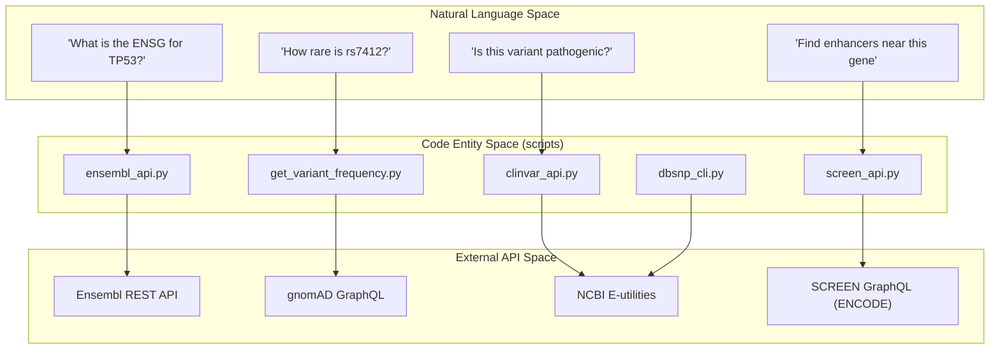
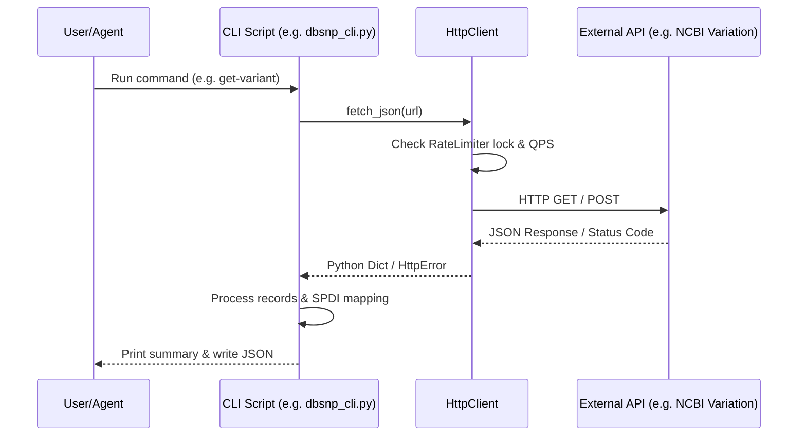

<!-- source: DeepWiki mcp.deepwiki.com · repo google-deepmind/science-skills · page 4 Genomics and Variant Analysis Skills · fetched 2026-10-26 -->

# Genomics and Variant Analysis Skills

Relevant source files

The following files were used as context for generating this wiki page:

- [skills/dbsnp_database/scripts/dbsnp_cli.py](skills/dbsnp_database/scripts/dbsnp_cli.py)
- [skills/ensembl_database/scripts/ensembl_api.py](skills/ensembl_database/scripts/ensembl_api.py)
- [skills/openfda_database/scripts/openfda_query.py](skills/openfda_database/scripts/openfda_query.py)

The Genomics and Variant Analysis skills provide a comprehensive suite of tools for querying genomic databases, resolving genetic identifiers, and analyzing the functional impact of variants. These skills interface with industry-standard resources including **Ensembl**, **gnomAD**, **dbSNP**, **ClinVar**, **ENCODE**, and **GTEx**. Note that AlphaGenome-specific skills are covered separately in Section 5.

## Overview of Genomic Capabilities

The codebase bridges high-level biological questions (e.g., "What is the frequency of this mutation?") to specific API implementations.

### Data Flow and System Architecture

The following diagram illustrates how natural language requests are mapped to specific code entities and external genomic services.

**Genomic Skill Mapping**

Sources: [skills/ensembl_database/scripts/ensembl_api.py:15-40](), [skills/dbsnp_database/scripts/dbsnp_cli.py:42-78]()

---

## 4.1 Ensembl REST API

The Ensembl skill serves as the primary engine for ID resolution and sequence retrieval. It supports mapping between symbols, RefSeq IDs, and Ensembl identifiers (`ENSG`, `ENST`, `ENSP`). It also provides a powerful interface for the **Variant Effect Predictor (VEP)**, incorporating plugins like AlphaMissense and LOEUF [skills/ensembl_database/scripts/ensembl_api.py:41-47]().

For details, see [Ensembl REST API](#4.1).

Sources: [skills/ensembl_database/scripts/ensembl_api.py:15-57]()

---

## 4.2 gnomAD Population Variant Database

This skill queries the Genome Aggregation Database to determine variant rarity. It uses a GraphQL interface to fetch Allele Frequency (`AF`) and Allele Count (`AC`) metrics. It also retrieves gene constraint metrics such as `pLI` and `LOEUF` (`oe_lof_upper`) to assess gene essentiality across dataset versions.

For details, see [gnomAD Population Variant Database](#4.2).

Sources: [skills/dbsnp_database/scripts/dbsnp_cli.py:1-40]()

---

## 4.3 dbSNP and ClinVar Variant Databases

These skills interface with NCBI services. `dbsnp_cli.py` resolves variants using the **SPDI model** (Sequence, Position, Deletion, Insertion) and handles mapping between rsIDs and genomic coordinates with assembly fallbacks [skills/dbsnp_database/scripts/dbsnp_cli.py:42-78](). `clinvar_api.py` retrieves clinical significance (Pathogenic, Benign, etc.) and review status star ratings.

For details, see [dbSNP and ClinVar Variant Databases](#4.3).

Sources: [skills/dbsnp_database/scripts/dbsnp_cli.py:42-80]()

---

## 4.4 ENCODE cCREs Database

The ENCODE skill utilizes the SCREEN GraphQL API to search for candidate Cis-Regulatory Elements (cCREs). It can identify promoters (`PLS`), proximal enhancers (`pELS`), distal enhancers (`dELS`), and CTCF-only regions based on biochemical signatures across various biosamples.

For details, see [ENCODE cCREs Database](#4.4).

Sources: [skills/dbsnp_database/scripts/dbsnp_cli.py:1-30]()

---

## 4.5 GTEx Gene Expression and eQTLs

GTEx provides data on tissue-specific gene expression and expression Quantitative Trait Loci (eQTLs). This skill allows users to resolve versioned GENCODE IDs, find top-expressed tissues across a 54-tissue atlas, and identify variants regulating expression levels within target regions.

For details, see [GTEx Gene Expression and eQTLs](#4.5).

Sources: [skills/dbsnp_database/scripts/dbsnp_cli.py:1-25]()

---

## 4.6 NCBI Sequence Fetch

A utility skill (`ncbi_fetch.py`) for bulk retrieval of nucleotide and protein sequences from NCBI GenBank and RefSeq using E-utilities. It supports CDS translation with ORF fallback, gene-protein linking, ELink workflows, and manages rate limits via the shared `HttpClient` framework.

For details, see [NCBI Sequence Fetch](#4.6).

Sources: [skills/dbsnp_database/scripts/dbsnp_cli.py:42-78]()

---

### Core Implementation Patterns

Most genomics skills follow a pattern of initializing an `HttpClient` with specific Query-Per-Second (QPS) limits to respect external API policies and handle rate limiting (`HTTP 429`) gracefully.

**Service Client Configuration**
| Service | Script | Base URL | QPS Limit |
| :--- | :--- | :--- | :--- |
| Ensembl | `ensembl_api.py` | `https://rest.ensembl.org` | 15 [skills/ensembl_database/scripts/ensembl_api.py:47]() |
| dbSNP | `dbsnp_cli.py` | `https://api.ncbi.nlm.nih.gov` | 3 (10 with `NCBI_API_KEY`) [skills/dbsnp_database/scripts/dbsnp_cli.py:57-63]() |
| openFDA (Ref) | `openfda_query.py` | `https://api.fda.gov` | 4 [skills/openfda_database/scripts/openfda_query.py:43]() |

**Common Genomic Logic Flow**

Sources: [skills/dbsnp_database/scripts/dbsnp_cli.py:53-122](), [skills/openfda_database/scripts/openfda_query.py:40-44]()

---

