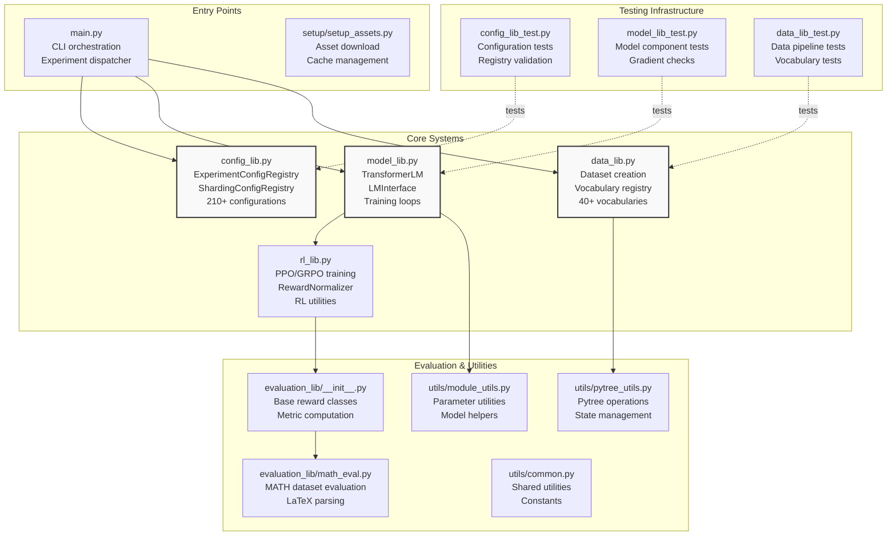
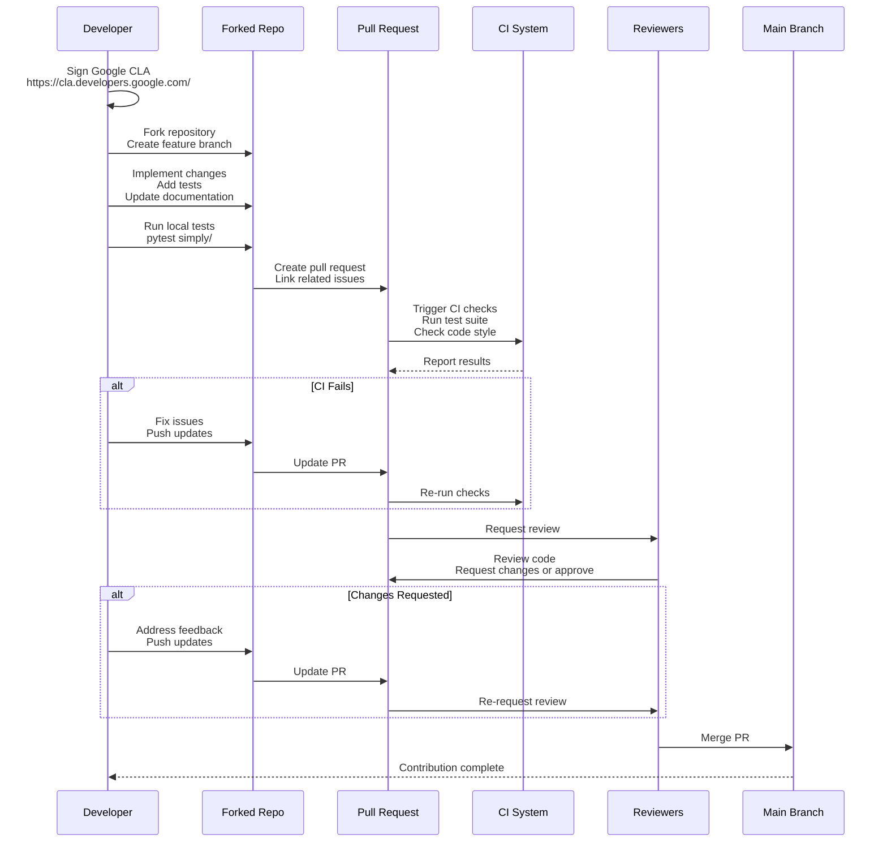
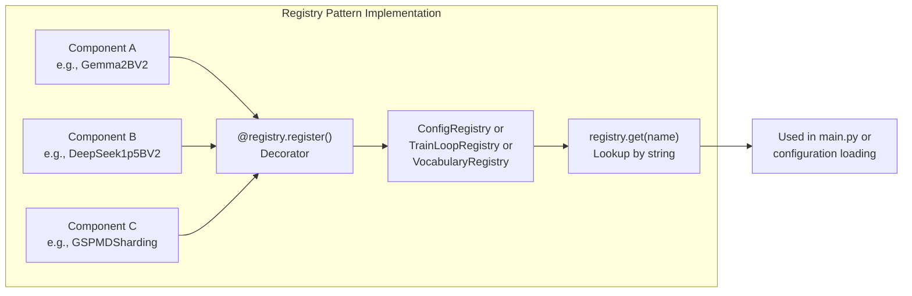
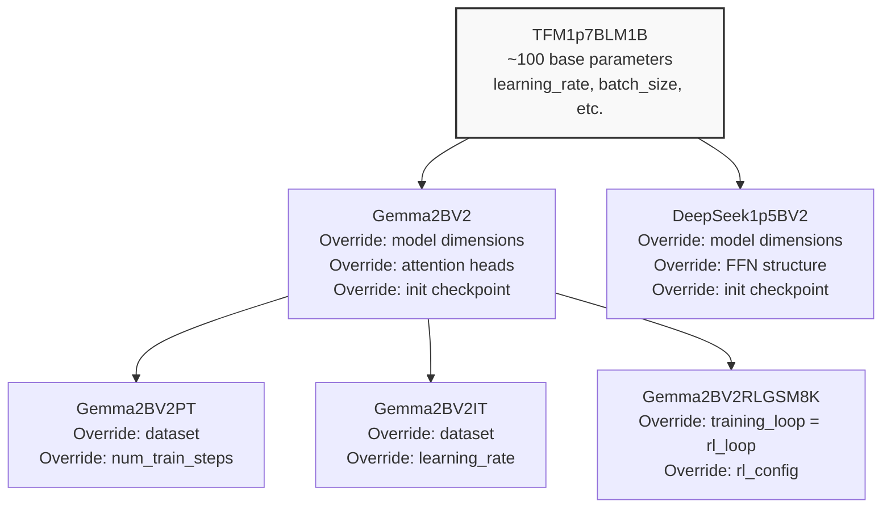
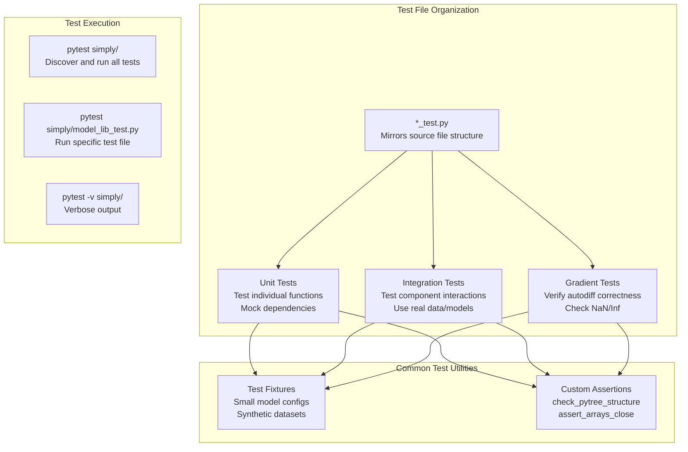
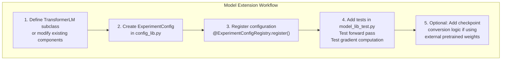
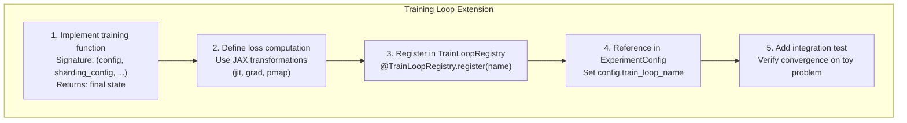
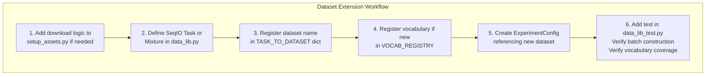
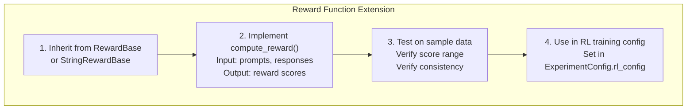

<!-- source: DeepWiki mcp.deepwiki.com · repo google-deepmind/simply · page 7 Developer Guide · fetched 2026-10-26 -->

# Developer Guide

Relevant source files

The following files were used as context for generating this wiki page:

- [CONTRIBUTING.md](CONTRIBUTING.md)
- [requirements.txt](requirements.txt)

This page provides guidance for developers who want to contribute to Simply, extend its capabilities, or understand its internal implementation details. It covers the codebase structure, development workflow, key extension points, and best practices for working with the JAX-based architecture.

For specific topics:
- To learn about running experiments as a user, see [User Guides](#5)
- For detailed API documentation, see [API Reference](#6)
- For initial setup as a user, see [Getting Started](#2)

---

## Codebase Structure

Simply's codebase follows a flat module structure with clear separation of concerns. Understanding which files to modify for different types of contributions is essential for effective development.

### Module Organization

**Sources:** Repository structure observation, [main.py](), [config_lib.py](), [model_lib.py](), [data_lib.py](), [rl_lib.py](), [evaluation_lib/](), [utils/]()

### Key Extension Points by Use Case

| Task | Primary Files | Related Files |
|------|--------------|---------------|
| Add new model architecture | `model_lib.py` | `config_lib.py` (register config) |
| Add new dataset | `data_lib.py` | `setup/setup_assets.py` (download logic) |
| Add new vocabulary | `data_lib.py` | `setup/setup_assets.py` (tokenizer setup) |
| Add new training loop | `model_lib.py` | `rl_lib.py` (reference implementation) |
| Add new sharding strategy | `config_lib.py` | `model_lib.py` (apply sharding) |
| Add new reward function | `evaluation_lib/__init__.py` | `rl_lib.py` (integrate into training) |
| Add new configuration | `config_lib.py` | None (pure configuration) |
| Add new metric | `evaluation_lib/__init__.py` | `rl_lib.py` or `model_lib.py` |

---

## Development Workflow

The contribution process follows standard GitHub workflows with Google's CLA requirement and code review practices.

**Sources:** [CONTRIBUTING.md:1-25]()

### Contributor License Agreement

All contributions require signing Google's Contributor License Agreement (CLA). This is a one-time process:

1. Visit https://cla.developers.google.com/
2. Sign the CLA (individual or corporate)
3. The CLA applies to all Google open-source projects

You retain copyright to your contributions; the CLA grants Google permission to use and redistribute them.

**Sources:** [CONTRIBUTING.md:3-13]()

### Code Review Process

All submissions undergo code review via GitHub pull requests:

1. **Fork and Branch**: Create a feature branch in your fork
2. **Implement**: Make changes with appropriate tests and documentation
3. **Test Locally**: Run `pytest simply/` to verify tests pass
4. **Submit PR**: Create a pull request with clear description
5. **CI Validation**: Automated checks must pass
6. **Review**: Project maintainers review code
7. **Iterate**: Address feedback until approved
8. **Merge**: Maintainers merge approved PRs

**Sources:** [CONTRIBUTING.md:15-20]()

### Community Guidelines

Simply follows [Google's Open Source Community Guidelines](https://opensource.google/conduct), which emphasize:

- Respectful and inclusive communication
- Constructive feedback in code reviews
- Focus on technical merit of contributions

**Sources:** [CONTRIBUTING.md:22-25]()

---

## Dependency Management

Simply relies on a curated set of dependencies from the JAX ecosystem and supporting libraries. Understanding these dependencies is crucial for extending functionality and debugging issues.

### Core Dependency Graph

```mermaid
graph TB
    subgraph "JAX Computational Foundation"
        JAX["jax<br/>Array operations, JIT compilation<br/>Autodifferentiation"]
        Orbax["orbax<br/>Checkpoint management<br/>OCDBT format handling"]
        CLU["clu<br/>Metrics utilities<br/>Parameter counting"]
    end
    
    subgraph "Data Pipeline Dependencies"
        SeqIO["seqio<br/>Task-based data pipelines<br/>Preprocessing"]
        T5["t5<br/>Vocabulary utilities<br/>SentencePiece integration"]
        Einops["einops<br/>Tensor reshaping<br/>Readable transformations"]
    end
    
    subgraph "Infrastructure"
        AbslPy["absl-py<br/>Command-line flags<br/>Logging infrastructure"]
        TensorBoard["tensorboard<br/>Metrics visualization<br/>Training monitoring"]
        HFHub["huggingface_hub<br/>Model/dataset downloads<br/>(not in requirements.txt)"]
    end
    
    subgraph "Evaluation Utilities"
        Sympy["sympy<br/>Symbolic mathematics<br/>Equation evaluation"]
        PyLatexEnc["pylatexenc<br/>LaTeX parsing<br/>Math rendering"]
        Pytest["pytest<br/>Test framework<br/>Test discovery"]
    end
    
    subgraph "Simply Modules"
        ModelLib["model_lib.py"]
        DataLib["data_lib.py"]
        ConfigLib["config_lib.py"]
        RLLib["rl_lib.py"]
        EvalLib["evaluation_lib/"]
        Main["main.py"]
    end
    
    ModelLib --> JAX
    ModelLib --> Orbax
    ModelLib --> CLU
    ModelLib --> Einops
    
    DataLib --> SeqIO
    DataLib --> T5
    DataLib --> JAX
    
    ConfigLib --> Orbax
    
    RLLib --> JAX
    RLLib --> ModelLib
    RLLib --> EvalLib
    
    EvalLib --> Sympy
    EvalLib --> PyLatexEnc
    
    Main --> AbslPy
    Main --> TensorBoard
    Main --> ConfigLib
    Main --> ModelLib
    Main --> DataLib
    
    ConfigLib -.->|references assets| HFHub
    DataLib -.->|references assets| HFHub
```

**Sources:** [requirements.txt:1-12]()

### Dependency Categories and Purposes

| Dependency | Category | Purpose in Simply | Used By |
|------------|----------|-------------------|---------|
| `jax` | Core | Numerical computation, JIT, autodiff | All modules |
| `orbax` | Core | Checkpoint I/O, state management | `config_lib.py`, `model_lib.py` |
| `seqio` | Data | Task-based data pipelines | `data_lib.py` |
| `einops` | Model | Readable tensor reshaping | `model_lib.py` |
| `absl-py` | Infrastructure | CLI flags, logging | `main.py` |
| `clu` | Utilities | Metrics, parameter utilities | `model_lib.py` |
| `t5` | Data | Vocabulary management | `data_lib.py` |
| `tensorboard` | Infrastructure | Metrics logging | `main.py` |
| `sympy` | Evaluation | Math expression evaluation | `evaluation_lib/math_eval.py` |
| `pylatexenc` | Evaluation | LaTeX parsing | `evaluation_lib/math_eval.py` |
| `pytest` | Testing | Test framework | Test files |

**Sources:** [requirements.txt:1-12]()

### Installation Considerations

The dependencies are specified in `requirements.txt` without version pins, allowing flexibility for different JAX backends (CPU, GPU, TPU). Developers should:

1. Install JAX with appropriate backend: `pip install "jax[cpu]"` or `pip install "jax[cuda12]"`
2. Install remaining dependencies: `pip install -r requirements.txt`
3. Note that `sympy` and `pylatexenc` are only required for math evaluation tasks

For detailed installation instructions across platforms, see [Installation and Setup](#2.1).

**Sources:** [requirements.txt:1-12]()

---

## Code Organization Patterns

Simply follows consistent patterns that make the codebase predictable and maintainable.

### Registry Pattern

The codebase extensively uses the registry pattern for configuration management and component registration:

This pattern appears in:
- **ExperimentConfigRegistry** in `config_lib.py`: Maps configuration names to `ExperimentConfig` instances
- **ShardingConfigRegistry** in `config_lib.py`: Maps sharding strategy names to configurations
- **TrainLoopRegistry** in `model_lib.py`: Maps training loop names to training functions
- **VocabularyRegistry** in `data_lib.py`: Maps vocabulary names to vocabulary constructors

**Sources:** [config_lib.py](), [model_lib.py](), [data_lib.py]()

### Configuration Inheritance

Configurations use dataclass inheritance to minimize duplication:

When creating new configurations:
1. Inherit from an existing configuration close to your needs
2. Override only parameters that differ
3. Use `apply_config_diff` for programmatic modifications
4. Register with `ExperimentConfigRegistry.register()`

**Sources:** [config_lib.py]()

### Testing Patterns

Simply's test suite follows consistent patterns:

Key testing practices:
- Each source file has a corresponding `*_test.py` file
- Tests use small configurations to run quickly
- Gradient checks verify autodifferentiation correctness
- Pytree serialization tests ensure checkpoint compatibility

For comprehensive testing documentation, see [Testing](#7.3).

**Sources:** Test file structure observation

---

## Extension Points

Simply is designed to be extended. This section maps common extension tasks to the code locations and patterns to follow.

### Adding New Model Architectures

**Primary File:** `model_lib.py`

**Required modifications:**
1. In `model_lib.py`: Define model architecture (attention, FFN, embeddings)
2. In `config_lib.py`: Create configuration with architecture parameters
3. In `config_lib.py`: Register configuration with unique name
4. In `model_lib_test.py`: Add tests for new components

**Sources:** [model_lib.py](), [config_lib.py]()

### Adding New Training Loops

**Primary Files:** `model_lib.py`, `rl_lib.py` (reference)

**Reference implementation:** `rl_lib.py` demonstrates a complete custom training loop with:
- Custom batch construction (`create_rl_batches`)
- Custom loss computation (`compute_ppo_loss`, `compute_grpo_loss`)
- Custom state management (`RewardNormalizer`)
- Integration with evaluation (`evaluation_lib`)

**Sources:** [model_lib.py](), [rl_lib.py]()

### Adding New Datasets

**Primary Files:** `data_lib.py`, `setup/setup_assets.py`

**Required steps:**
1. Add dataset download logic in `setup/setup_assets.py` if external
2. Define SeqIO Task with preprocessing in `data_lib.py`
3. Register in `TASK_TO_DATASET` mapping
4. Create or reuse appropriate vocabulary
5. Test with `create_dataset` function

**Sources:** [data_lib.py](), [setup/setup_assets.py]()

### Adding New Reward Functions (RL)

**Primary File:** `evaluation_lib/__init__.py`

**Example reward functions:**
- `MathReward`: Evaluates mathematical correctness
- `AccuracyReward`: Binary correctness evaluation
- `LengthReward`: Penalizes or rewards response length

**Sources:** [evaluation_lib/__init__.py](), [evaluation_lib/math_eval.py]()

### Adding New Sharding Strategies

**Primary File:** `config_lib.py`

To add a new sharding strategy:
1. Create a subclass of `ShardingConfig`
2. Define sharding annotations for weights and activations
3. Register with `ShardingConfigRegistry`
4. Apply in model code using `jax.lax.with_sharding_constraint`

Existing strategies to reference:
- `GSPMDSharding`: Full model + data parallelism
- `DecodeGSPMDSharding`: Optimized for inference
- `DataParallelSharding`: Data parallelism only

**Sources:** [config_lib.py](), [model_lib.py]()

---

## Development Best Practices

### JAX-Specific Considerations

When working with Simply's JAX-based architecture:

1. **Pure Functions**: Ensure training functions are pure (no side effects)
2. **JIT Compilation**: Mark performance-critical functions with `@jax.jit`
3. **Gradient Computation**: Use `jax.grad` or `jax.value_and_grad` for differentiation
4. **Pytree Structures**: Maintain consistent pytree structures for checkpointing
5. **Array Operations**: Use JAX array operations (`jnp.*`) instead of NumPy

### Common Pitfalls

| Issue | Symptom | Solution |
|-------|---------|----------|
| Non-pytree checkpoint state | Serialization errors | Ensure all state uses JAX arrays and pytrees |
| Impure functions in JIT | Inconsistent results | Remove side effects from JIT-compiled code |
| Shape mismatches with sharding | Runtime errors | Verify sharding annotations match tensor shapes |
| Memory issues with large models | OOM errors | Use gradient checkpointing or reduce batch size |
| Incorrect mesh configuration | Device underutilization | Use `get_default_mesh_shape` or profile execution |

### Code Style

Simply follows standard Python conventions:
- Use type hints for function signatures
- Write docstrings for public APIs
- Keep functions focused and composable
- Use descriptive variable names
- Follow existing code formatting

---

## Further Documentation

This page provides an overview for developers. For detailed information on specific topics:

- **Dependencies**: See [Dependencies and Requirements](#7.1) for detailed dependency breakdown
- **Contributing**: See [Contributing Guidelines](#7.2) for CLA and PR workflow
- **Testing**: See [Testing](#7.3) for test suite organization and patterns
- **Extending**: See [Extending Simply](#7.4) for comprehensive extension guides
- **API Reference**: See [API Reference](#6) for detailed module documentation

**Sources:** [CONTRIBUTING.md:1-25](), [requirements.txt:1-12]()

---

