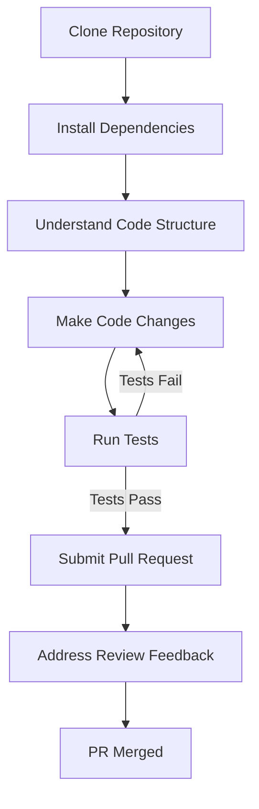
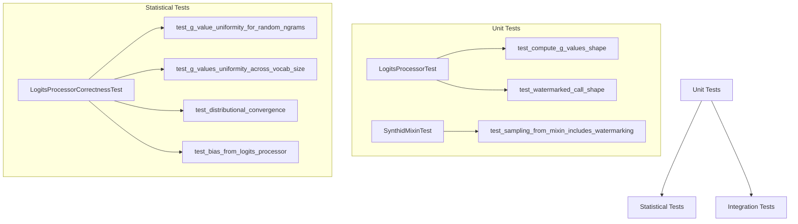
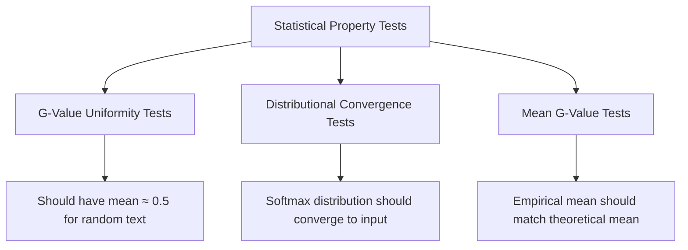

<!-- source: DeepWiki mcp.deepwiki.com · repo google-deepmind/synthid-text · page 6 Development Guide · fetched 2026-10-26 -->

# Development Guide

<details>
<summary>Relevant source files</summary>

The following files were used as context for generating this wiki page:

- [CONTRIBUTING.md](CONTRIBUTING.md)
- [src/synthid_text/logits_processing_test.py](src/synthid_text/logits_processing_test.py)
- [src/synthid_text/synthid_mixin_test.py](src/synthid_text/synthid_mixin_test.py)

</details>


This guide provides comprehensive information for developers who want to contribute to the SynthID Text project. It covers development workflow, code organization, testing practices, and contribution guidelines. For information about using SynthID Text in your applications, see the [Integration Guide](#3).

## Development Environment Setup

### Prerequisites

- Python 3.8 or higher
- PyTorch
- Hugging Face Transformers

### Installation for Development

```bash
git clone https://github.com/google-deepmind/synthid-text.git
cd synthid-text
pip install -e .
```

## Development Workflow



Sources: [CONTRIBUTING.md:15-20]()

## Code Organization

The SynthID Text codebase is organized into two main subsystems:

```mermaid
classDiagram
    class "SynthIDLogitsProcessor" {
        +watermarked_call()
        +compute_g_values()
        +compute_context_repetition_mask()
        +sample_g_values()
        -_compute_keys()
    }
    
    class "SynthIDSparseTopKMixin" {
        +_get_logits_warper()
        +_sample()
        +DEFAULT_WATERMARKING_CONFIG
    }
    
    class "transformers.GenerationMixin" {
        +_get_logits_warper()
        +_sample()
    }
    
    class "BayesianDetector" {
        +score(outputs)
        +train_best_detector()
    }
    
    class "MeanDetector" {
        +mean_score(g_values, mask)
        +weighted_mean_score(g_values, mask)
    }
    
    "transformers.GenerationMixin" <|-- "SynthIDSparseTopKMixin"
    "SynthIDSparseTopKMixin" --> "SynthIDLogitsProcessor" : uses
```

### Key Files in the Codebase

| File Path | Description |
|-----------|-------------|
| `src/synthid_text/synthid_mixin.py` | Contains the `SynthIDSparseTopKMixin` class that integrates watermarking with Hugging Face models |
| `src/synthid_text/logits_processing.py` | Implements `SynthIDLogitsProcessor` for modifying token probabilities during generation |
| `src/synthid_text/detection.py` | Contains watermark detection implementations (Bayesian and Mean detectors) |
| `src/synthid_text/g_value_expectations.py` | Statistical utilities for g-value calculations |

Sources: [src/synthid_text/logits_processing_test.py:25-27](), [src/synthid_text/synthid_mixin_test.py:24-25]()

## Testing Framework

SynthID Text uses the `absl.testing` framework for unit and integration tests. Understanding the testing approach is crucial for contributors.

### Test Structure



Sources: [src/synthid_text/logits_processing_test.py:127-142](), [src/synthid_text/logits_processing_test.py:321-439](), [src/synthid_text/synthid_mixin_test.py:61-94]()

### Key Test Types

1. **Shape Tests**: Verify that functions output tensors of the expected shape
   ```python
   def test_compute_g_values_shape(self):
       # ...
       g_values = logits_processor.compute_g_values(sequences)
       self.assertEqual(g_values.shape, expected_shape)
   ```

2. **Statistical Tests**: Verify the statistical properties of the watermarking system
   ```python
   def test_g_value_uniformity_for_random_ngrams(self):
       # ...
       g_values_mean = torch.mean(torch.mean(g_values.float(), dim=0))
       self.assertAlmostEqual(g_values_mean, 0.5, delta=0.01)
   ```

3. **Integration Tests**: Verify component interactions
   ```python
   def test_sampling_from_mixin_includes_watermarking(self):
       # ...
       synthid_model._sample(input_ids, ...)
       self.assertEqual(mock_watermarked_call.call_count, 1)
   ```

Sources: [src/synthid_text/logits_processing_test.py:143-169](), [src/synthid_text/logits_processing_test.py:353-366](), [src/synthid_text/synthid_mixin_test.py:63-94]()

### Running Tests

```bash
# Run a specific test file
python -m absl.testing.absltest src/synthid_text/logits_processing_test.py

# Run a specific test class
python -m absl.testing.absltest src/synthid_text/logits_processing_test.py::LogitsProcessorTest

# Run a specific test method
python -m absl.testing.absltest src/synthid_text/logits_processing_test.py::LogitsProcessorTest::test_compute_g_values_shape
```

Sources: [src/synthid_text/logits_processing_test.py:441-442](), [src/synthid_text/synthid_mixin_test.py:97-98]()

## Common Development Tasks

### Modifying the Watermarking Algorithm

1. Understand the current implementation in `SynthIDLogitsProcessor`
2. Make changes to relevant methods (e.g., `watermarked_call`, `compute_g_values`)
3. Update tests to verify new behavior
4. Ensure statistical properties are maintained

### Adding Support for a New Model

1. Create a new class that inherits from `SynthIDSparseTopKMixin`
2. Implement model-specific logic if needed
3. Add tests similar to `synthid_mixin_test.py`

### Improving the Detection System

1. Modify detector implementations in the detection module
2. Update detection tests
3. Benchmark detection performance against baseline

## Statistical Testing Guidelines

Statistical tests are critical for ensuring the watermarking system works correctly. When modifying code:

1. **G-Value Uniformity**: For unwatermarked text, g-values should be uniformly distributed with mean approximately 0.5
2. **Distributional Convergence**: Watermarked distributions should converge to the input distribution as sample size increases
3. **Theoretical Expectations**: Empirical means should match theoretical expectations within tolerance



Sources: [src/synthid_text/logits_processing_test.py:143-169](), [src/synthid_text/logits_processing_test.py:217-263](), [src/synthid_text/logits_processing_test.py:304-318]()

## Contribution Process

### Contributor License Agreement

All contributions must be accompanied by a Contributor License Agreement (CLA). You can sign it at https://cla.developers.google.com/.

### Code Review Process

1. Submit a pull request with your changes
2. Address feedback from reviewers
3. Once approved, your code will be merged

### Code Style

Follow Google's Python style guide:
- Use consistent indentation
- Write comprehensive docstrings
- Follow naming conventions
- Keep functions focused and modular

Sources: [CONTRIBUTING.md:3-13](), [CONTRIBUTING.md:15-20]()

## Debugging Common Issues

### Watermarking Issues

- **Incorrect G-Values**: Check for proper context handling in `compute_g_values`
- **Statistical Anomalies**: Run the statistical tests to verify properties

### Detection Issues

- **False Positives/Negatives**: Tune detector thresholds and parameters
- **Performance Issues**: Check tensor operations for unnecessary copies or computations

## Performance Considerations

1. **Batch Processing**: Use batch operations where possible
2. **Memory Usage**: Be mindful of memory consumption, especially for large models
3. **Device Management**: Ensure consistent device placement for tensors

## Community Guidelines

This project follows [Google's Open Source Community Guidelines](https://opensource.google/conduct).

Sources: [CONTRIBUTING.md:22-25]()