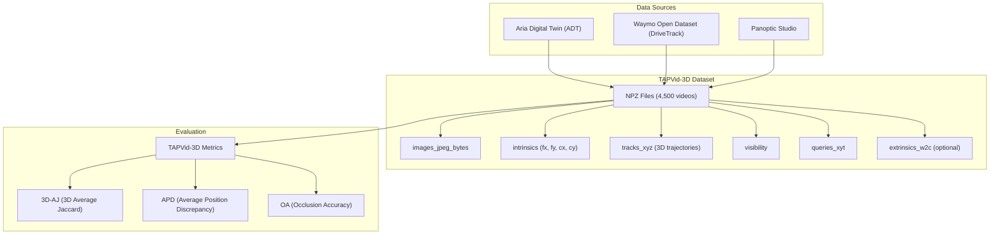
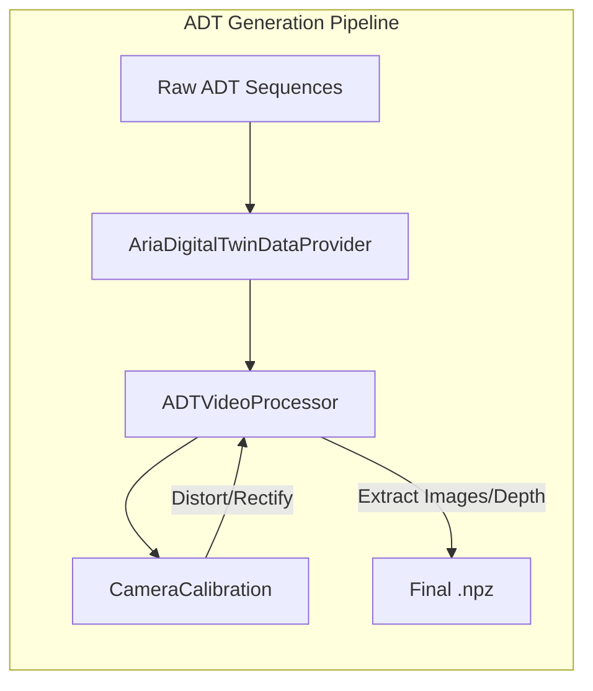
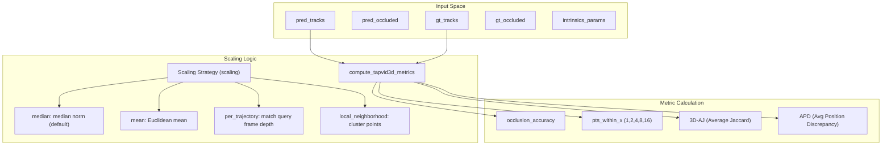

<!-- source: DeepWiki mcp.deepwiki.com · repo google-deepmind/tapnet · page 3.3 TAPVid-3D · fetched 2026-10-26 -->

# TAPVid-3D

<details>
<summary>Relevant source files</summary>

The following files were used as context for generating this wiki page:

- [colabs/kubric_for_tapvid(3d).ipynb](colabs/kubric_for_tapvid(3d).ipynb)
- [tapnet/tapvid3d/README.md](tapnet/tapvid3d/README.md)
- [tapnet/tapvid3d/annotation_generation/adt_utils.py](tapnet/tapvid3d/annotation_generation/adt_utils.py)
- [tapnet/tapvid3d/annotation_generation/adt_v1v2_mappings.py](tapnet/tapvid3d/annotation_generation/adt_v1v2_mappings.py)
- [tapnet/tapvid3d/annotation_generation/gcs_utils.py](tapnet/tapvid3d/annotation_generation/gcs_utils.py)
- [tapnet/tapvid3d/colab/load_and_visualize_tapvid3d_samples.ipynb](tapnet/tapvid3d/colab/load_and_visualize_tapvid3d_samples.ipynb)
- [tapnet/tapvid3d/evaluation/metrics.py](tapnet/tapvid3d/evaluation/metrics.py)
- [tapnet/tapvid3d/splits/tapvid3d_splits.py](tapnet/tapvid3d/splits/tapvid3d_splits.py)

</details>


This page documents TAPVid-3D, a dataset and benchmark for evaluating the task of long-range Tracking Any Point in 3D (TAP-3D). TAPVid-3D features over 4,000 real-world videos spanning a variety of object types, motion patterns, and environments, along with their corresponding metric 3D position point trajectories and camera parameters.

## Overview

TAPVid-3D was developed to extend the 2D point tracking capabilities of the original TAP-Vid benchmark (see [TAP-Vid](3.1)) into 3D space. It addresses the challenges of tracking points in 3D across video frames, including handling occlusions, depth ambiguity, and camera motion.

### TAPVid-3D Dataset Structure



Sources:
- [tapnet/tapvid3d/README.md:10-17]()
- [tapnet/tapvid3d/README.md:19-26]()
- [tapnet/tapvid3d/README.md:87-88]()

The dataset consists of videos from three different sources:

1. **Aria Digital Twin (ADT)**: Indoor scenes with a moving camera, featuring various human activities.
2. **Waymo Open Dataset (DriveTrack)**: Outdoor driving scenes with a moving camera.
3. **Panoptic Studio**: Indoor scenes with a static camera, featuring multiple people performing various activities.

> **Important**: To use the dataset, you must accept the licenses of the constituent original video data sources that you use. You must adhere to the terms of service outlined by [Aria Digital Twin](https://www.projectaria.com/datasets/adt/license), [Waymo Open Dataset](https://waymo.com/open/terms), and [Panoptic Studio](http://domedb.perception.cs.cmu.edu).

## Data Format

Each TAPVid-3D `.npz` file contains a single video with its annotations. The data structure is as follows:

| Field | Shape | Description |
|-------|-------|-------------|
| `images_jpeg_bytes` | `[# of frames, height, width, 3]` | Video frames stored as JPEG bytes that must be decoded [tapnet/tapvid3d/README.md:91-92]() |
| `intrinsics` | `(fx, fy, cx, cy)` | Camera intrinsics parameters [tapnet/tapvid3d/README.md:94-94]() |
| `tracks_xyz` | `[# of frames, # of point tracks, 3]` | 3D point trajectories in meters (x, y, z) [tapnet/tapvid3d/README.md:96-98]() |
| `visibility` | `[# of frames, # of point tracks]` | Boolean visibility mask [tapnet/tapvid3d/README.md:100-101]() |
| `queries_xyt` | `[# of point tracks, 3]` | Query points (x, y, t) where t is the frame index [tapnet/tapvid3d/README.md:103-107]() |
| `extrinsics_w2c` | `[# of frames, 4, 4]` | World-to-camera transform (present for moving cameras in WOD and ADT) [tapnet/tapvid3d/README.md:108-113]() |

The intrinsic matrix has the form:
```
[[fx,  0, cx],
 [ 0, fy, cy],
 [ 0,  0,  1]]
```

Sources:
- [tapnet/tapvid3d/README.md:85-113]()
- [tapnet/tapvid3d/annotation_generation/adt_utils.py:179-188]()

## Annotation Generation Pipeline

The pipeline converts raw data from sources like ADT into the standard TAPVid-3D format.



Key generation entities:
- `ADTVideoProcessor`: Loads raw Aria data, timestamps, and ground truth [tapnet/tapvid3d/annotation_generation/adt_utils.py:44-50]().
- `extract_image_data`: Rectifies and distorts images/depth maps to a standard 512x512 resolution with fixed focal length [tapnet/tapvid3d/annotation_generation/adt_utils.py:71-141]().
- `process_vid`: Main loop that handles chunking (300 frames) and saving the final `.npz` [tapnet/tapvid3d/annotation_generation/adt_utils.py:144-188]().

Sources:
- [tapnet/tapvid3d/annotation_generation/adt_utils.py:37-41]()
- [tapnet/tapvid3d/annotation_generation/adt_utils.py:44-141]()

## Evaluation Metrics

TAPVid-3D introduces metrics that extend the Jaccard-based metrics from 2D TAP to handle the complexities of 3D tracking.

### TAPVid-3D Metrics and Evaluation Pipeline



1. **3D-AJ (3D Average Jaccard)**: Evaluates how well predicted trajectories align with ground truth in 3D space. Computed across threshold values (1, 2, 4, 8, 16) and averaged [tapnet/tapvid3d/evaluation/metrics.py:167-172]().
2. **APD (Average Position Discrepancy)**: Measures the average 3D position error between predicted and ground truth trajectories [tapnet/tapvid3d/evaluation/metrics.py:173-174]().
3. **OA (Occlusion Accuracy)**: Measures the accuracy of occlusion prediction [tapnet/tapvid3d/evaluation/metrics.py:164-164]().

A key challenge in 3D point tracking is handling different depth scales between ground truth and predictions. The `compute_tapvid3d_metrics` function in `tapnet/tapvid3d/evaluation/metrics.py` supports several scaling strategies via the `scaling` argument [tapnet/tapvid3d/evaluation/metrics.py:136-149]().

Sources:
- [tapnet/tapvid3d/evaluation/metrics.py:90-160]()
- [tapnet/tapvid3d/evaluation/metrics.py:161-175]()

## Using TAPVid-3D

### Installation

TAPVid-3D can be installed using pip with specific extras:

```bash
# For evaluation only
pip install "git+https://github.com/google-deepmind/tapnet.git"[tapvid3d_eval]

# For dataset generation and evaluation
pip install "git+https://github.com/google-deepmind/tapnet.git"[tapvid3d_eval,tapvid3d_generation]
```

Sources:
- [tapnet/tapvid3d/README.md:37-55]()

### Dataset Splits

The dataset is organized into three splits defined in `tapvid3d_splits.py`:
- **minival**: A small validation set (e.g., 50 videos for ADT, 44 for DriveTrack) for quick testing [tapnet/tapvid3d/splits/tapvid3d_splits.py:22-120]().
- **full_eval**: The full evaluation set.
- **all**: All available data.

Downloading is handled by `gcs_utils.py` which fetches files from the Google Cloud Storage bucket [tapnet/tapvid3d/annotation_generation/gcs_utils.py:29-46]().

Sources:
- [tapnet/tapvid3d/annotation_generation/gcs_utils.py:34-62]()
- [tapnet/tapvid3d/splits/tapvid3d_splits.py:22-120]()

### Model Evaluation

The model evaluation pipeline is implemented in `evaluate_model.py`. It takes a folder of predicted `.npz` files and computes the metrics against ground truth [tapnet/tapvid3d/README.md:114-131]().

Sources:
- [tapnet/tapvid3d/README.md:114-131]()

## Visualization Tools

TAPVid-3D provides a Colab notebook for visualizing samples from the dataset. It uses `scenepic` for 3D visualization and `mediapy` for video handling [tapnet/tapvid3d/colab/load_and_visualize_tapvid3d_samples.ipynb:48-84]().

The visualization logic involves:
1. **Downloading** a sample `.npz` [tapnet/tapvid3d/colab/load_and_visualize_tapvid3d_samples.ipynb:103-115]().
2. **Projecting** 3D tracks to 2D image coordinates using camera intrinsics [colabs/kubric_for_tapvid(3d).ipynb:148-153]().
3. **Rendering** trajectories using HSV color mapping to distinguish points.

Sources:
- [tapnet/tapvid3d/README.md:132-134]()
- [tapnet/tapvid3d/colab/load_and_visualize_tapvid3d_samples.ipynb:1-85]()
- [colabs/kubric_for_tapvid(3d).ipynb:148-153]()

---

