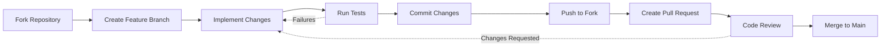

<!-- source: DeepWiki mcp.deepwiki.com · repo google-deepmind/thunnini · page 3.2 Contributing · fetched 2026-10-26 -->

# Contributing

<details>
<summary>Relevant source files</summary>

The following files were used as context for generating this wiki page:

- [.gitignore](.gitignore)
- [CONTRIBUTING.md](CONTRIBUTING.md)

</details>


This document provides guidelines for contributing to the Thunnini fine-tuning research library. It covers the development workflow, code review process, and community standards for external contributors and project maintainers.

For information about testing procedures, see [Testing](#3.1). For installation and dependency requirements, see [Installation and Dependencies](#4.1).

## Prerequisites and Setup

### Contributor License Agreement

All contributions require a signed Contributor License Agreement (CLA). This agreement allows the project to use and redistribute your contributions while you retain copyright ownership. Visit the [Google CLA portal](https://cla.developers.google.com) to sign the agreement if you haven't already done so for another Google project.

### Development Environment

Contributors should set up a development environment that includes:

- Python with the dependencies specified in the project requirements
- JAX ecosystem packages (`jax`, `flax`, `optax`, `distrax`) for neural network implementation
- Scientific computing packages (`numpy`, `scipy`, `matplotlib`) for data processing and visualization
- Development tools (`pytest` for testing, `jupyter` for notebook development)

Sources: [CONTRIBUTING.md:5-13]()

## Development Workflow

### Contribution Areas

The Thunnini library is organized into distinct modules that accept different types of contributions:

**Contributing to Core Components**

```mermaid
graph TD
    CONTRIB["Contributor Changes"] 
    
    subgraph "Configuration Layer"
        CONFIG_PR["config.py modifications"]
        TYPES_PR["types.py additions"]
    end
    
    subgraph "Data Generation"
        DATAGEN_PR["data_generators.py new methods"]
        DATABASE_PR["data_generator_base.py interfaces"]
    end
    
    subgraph "Model Architecture"
        PRED_PR["predictor.py enhancements"]
        TORSO_PR["predictor_torsos.py new architectures"]
        TRANS_PR["transformer_utils.py utilities"]
    end
    
    subgraph "Training Pipeline"
        TRAIN_PR["training.py improvements"]
        TUNE_PR["tuning.py new methods"]
        TUNEFUNC_PR["predictor_tuning_functions.py functions"]
    end
    
    subgraph "Evaluation System"
        EVAL_PR["evaluation.py metrics"]
        PLOT_PR["plot_utils.py visualizations"]
    end
    
    CONTRIB --> CONFIG_PR
    CONTRIB --> TYPES_PR
    CONTRIB --> DATAGEN_PR
    CONTRIB --> DATABASE_PR
    CONTRIB --> PRED_PR
    CONTRIB --> TORSO_PR
    CONTRIB --> TRANS_PR
    CONTRIB --> TRAIN_PR
    CONTRIB --> TUNE_PR
    CONTRIB --> TUNEFUNC_PR
    CONTRIB --> EVAL_PR
    CONTRIB --> PLOT_PR
```


Sources: [CONTRIBUTING.md:1-26]()

### Common Contribution Types

| Contribution Type | Target Files | Requirements |
|-------------------|--------------|-------------|
| New fine-tuning methods | `predictor_tuning_functions.py`, `tuning.py` | Function implementation, config updates, tests |
| Data generators | `data_generators.py`, `data_generator_base.py` | Base class inheritance, type annotations |
| Model architectures | `predictor_torsos.py`, `transformer_utils.py` | JAX/Flax implementation, predictor integration |
| Evaluation metrics | `evaluation.py`, `plot_utils.py` | Metric computation, visualization functions |
| Configuration options | `config.py`, `types.py` | Dataclass definitions, type safety |

### Development Process Flow

**Pull Request Lifecycle**


Sources: [CONTRIBUTING.md:15-20]()

## Code Review Process

### Review Requirements

All submissions require review before merging, including contributions from project maintainers. The review process uses GitHub pull requests and follows these standards:

1. **Technical Review**: Code correctness, performance implications, integration with existing components
2. **Style Review**: Adherence to Python conventions, documentation completeness, type annotations
3. **Testing Review**: Adequate test coverage, test quality, integration test compatibility

### Review Criteria by Component

| Component | Specific Requirements |
|-----------|----------------------|
| `config.py` | Type safety, backward compatibility, comprehensive dataclass definitions |
| `builders.py` | Factory pattern adherence, error handling for invalid configurations |
| Data generators | Base class compliance, reproducible random state, comprehensive testing |
| Model components | JAX/Flax best practices, gradient flow verification, parameter initialization |
| Training/tuning | Convergence validation, checkpoint compatibility, memory efficiency |
| Evaluation | Metric accuracy, baseline comparisons, statistical significance |

### Testing Requirements

Contributors must ensure their changes pass all existing tests and include new tests for added functionality. The test suite covers:

- Unit tests for individual functions and classes
- Integration tests for component interactions  
- End-to-end tests for complete workflows
- Performance regression tests for critical paths

For detailed testing procedures, see [Testing](#3.1).

Sources: [CONTRIBUTING.md:15-20]()

## Community Standards

### Code of Conduct

The project follows [Google's Open Source Community Guidelines](https://opensource.google/conduct), which establish standards for:

- Respectful communication in issues, pull requests, and discussions
- Constructive feedback during code reviews
- Inclusive participation regardless of background or experience level
- Professional conduct in all project interactions

### Documentation Standards

Contributors should maintain documentation quality by:

- Adding docstrings to all public functions and classes
- Updating relevant wiki pages when adding new features
- Including examples in docstrings for complex functionality
- Maintaining type annotations for all function signatures

### Commit Message Guidelines

Use clear, descriptive commit messages that explain the purpose and scope of changes:

```
Add LoRA fine-tuning method to predictor_tuning_functions.py

- Implement low-rank adaptation for transformer layers
- Add configuration options to config.py
- Include integration tests for new tuning method
- Update documentation with LoRA examples
```

Sources: [CONTRIBUTING.md:22-25]()

## Component-Specific Guidelines

### Configuration System Contributions

When modifying `config.py` or `types.py`:

- Maintain backward compatibility with existing configurations
- Use appropriate type annotations and dataclass decorators
- Include default values for new optional parameters
- Update `builders.py` if new configuration options require factory logic changes

### Data Generation Contributions  

When adding to `data_generators.py` or `data_generator_base.py`:

- Inherit from appropriate base classes in `data_generator_base.py`
- Implement required abstract methods with consistent interfaces
- Ensure reproducible behavior with random seed management
- Include comprehensive unit tests with known expected outputs

### Model Architecture Contributions

When modifying predictor components:

- Follow JAX/Flax conventions for model definition and initialization
- Ensure compatibility with existing training and tuning pipelines
- Implement proper gradient flow for all tunable parameters
- Include architecture-specific tests for forward and backward passes

### Training and Tuning Contributions

When adding fine-tuning methods:

- Implement update functions in `predictor_tuning_functions.py`
- Add method configuration to relevant config classes
- Ensure compatibility with all supported model architectures
- Include convergence tests and baseline comparisons

Sources: [config.py](), [builders.py](), [data_generators.py](), [data_generator_base.py](), [predictor.py](), [predictor_torsos.py](), [training.py](), [tuning.py](), [predictor_tuning_functions.py]()

---

