# Page: Overview

# Overview

<details>
<summary>Relevant source files</summary>

The following files were used as context for generating this wiki page:

- [README.md](README.md)

</details>


This document introduces the Thunnini repository, a research library designed for studying fine-tuning methods for neural sequence predictors. Thunnini enables systematic experimentation with nine different tuning methods across LSTM and Transformer architectures using synthetic data distributions where optimal baselines are analytically tractable.

For step-by-step usage instructions, see [Quick Start Guide](#1.1) and [Running Experiments](#1.2). For detailed architecture documentation, see [System Architecture](#2).

## Purpose and Scope

Thunnini is an experimentation library focused on understanding fundamental aspects of fine-tuning methods for neural sequence predictors. The library provides a controlled environment for studying conceptual questions about prompt tuning, parameter-efficient fine-tuning, and their connections to meta-learning and Bayesian inference.

**Core capabilities:**
- **Pretraining**: Neural sequence predictors via log loss minimization on synthetic data
- **Fine-tuning**: Nine different tuning methods including prefix tuning, weight tuning, and LoRA
- **Evaluation**: Performance assessment against optimal oracle and Bayesian baselines  
- **Comparison**: Systematic comparison across architectures and tuning methods

**Scope limitations:**
- Designed for single-GPU experiments completing within minutes
- Uses synthetic data distributions with tractable optimal predictors
- Focuses on sequence prediction rather than LLM-scale language modeling

Sources: [README.md:11-54]()

## System Architecture

The Thunnini system follows a modular architecture with clear separation between configuration, data generation, model definition, training, and evaluation components.

### Core Component Overview

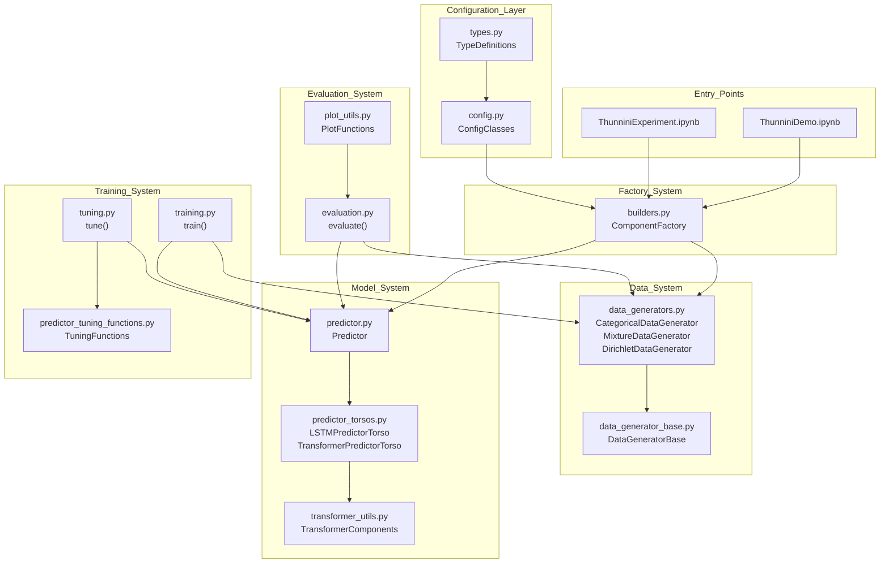

Sources: [README.md:215-247](), [src/builders.py](), [src/config.py](), [src/types.py]()

### Fine-Tuning Method Taxonomy

Thunnini implements nine fine-tuning methods organized into three categories, each targeting different aspects of the neural predictor.

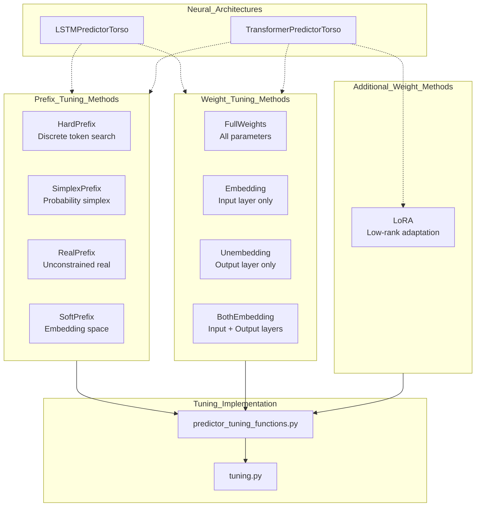

Sources: [README.md:152-182](), [src/predictor_tuning_functions.py](), [src/tuning.py](), [src/predictor_torsos.py]()

## Data Generation System

Thunnini provides three categories of synthetic data generators that enable controlled experimentation with known optimal baselines.

| Generator Type | Description | Use Case | Optimal Baseline |
|---|---|---|---|
| `CategoricalDataGenerator` | Fixed categorical distribution | Simple prediction tasks | Oracle predictor |
| `MixtureDataGenerator` | Mixture of categoricals | Multi-modal distributions | Mixture oracle |
| `DirichletDataGenerator` | Dirichlet-categorical conjugate | Bayesian learning scenarios | Beta-binomial predictor |

Each data generator implements the `DataGeneratorBase` interface and provides:
- Sample generation with ground-truth probabilities
- Bayesian predictor computation for optimal baselines
- Configuration through dataclass specifications

Sources: [README.md:192-207](), [src/data_generator_base.py](), [src/data_generators.py]()

## Experimental Workflow

The typical Thunnini workflow progresses through four main phases, coordinated by the configuration system and component factories.

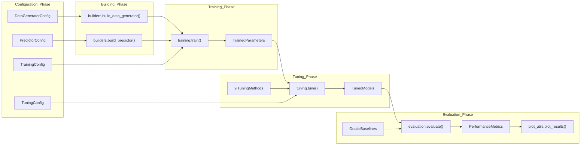

Sources: [README.md:19-42](), [src/training.py](), [src/tuning.py](), [src/evaluation.py](), [src/plot_utils.py]()

## Key Design Principles

**Configuration-Driven**: All experiments are specified through dataclass configurations in [src/config.py](), ensuring reproducibility and systematic parameter exploration.

**Modular Architecture**: Clear separation between data generation, model definition, training, and evaluation enables independent extension of each component.

**Baseline Integration**: Built-in computation of optimal oracle and Bayesian predictors provides rigorous performance baselines for evaluating fine-tuning methods.

**Extensibility**: New neural architectures can be added as `PredictorTorso` implementations, and new data generators through the `DataGeneratorBase` interface.

The library targets researchers studying fundamental questions about fine-tuning rather than practitioners working with large-scale language models. For implementation details of specific components, see [System Architecture](#2).

Sources: [README.md:32-54](), [README.md:249-276]()

---

# Page: Quick Start Guide

# Quick Start Guide

<details>
<summary>Relevant source files</summary>

The following files were used as context for generating this wiki page:

- [colabs/ThunniniDemo.ipynb](colabs/ThunniniDemo.ipynb)

</details>


This guide walks through the basic Thunnini workflow using the `ThunniniDemo.ipynb` notebook. You'll learn how to configure, train, fine-tune, and evaluate a neural predictor on synthetic sequence data. The demo showcases pretraining an LSTM or Transformer on uniformly distributed coin flips, then fine-tuning it on a specific mixture of biased coins using soft prefix tuning.

For comprehensive experimentation with multiple tuning methods and evaluation pipelines, see [Running Experiments](#1.2). For detailed information about the configuration system, see [Configuration System](#2.1).

## Overview and Setup

The demo notebook provides a minimal but complete example of Thunnini's core functionality. It demonstrates the three-phase workflow: pretraining, fine-tuning, and evaluation.

### Demo Workflow

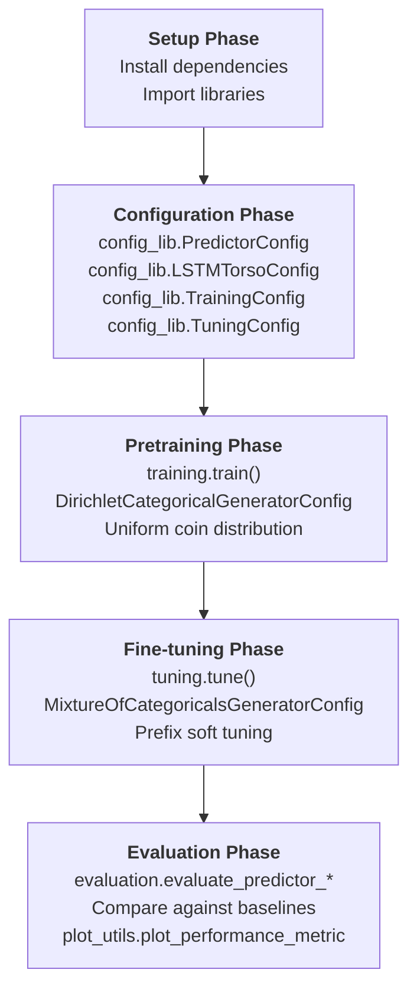

Sources: [colabs/ThunniniDemo.ipynb:9-14]()

### Installation

The notebook handles installation automatically when running on Google Colab:

| Environment | Setup Method |
|-------------|--------------|
| Google Colab | Automatic clone and pip install |
| Local | Manual setup required |

The demo imports core Thunnini modules: `builders`, `config`, `evaluation`, `plot_utils`, `training`, and `tuning`.

Sources: [colabs/ThunniniDemo.ipynb:55-82]()

## Configuration Workflow

Thunnini uses dataclass-based configuration objects to parameterize all components. The demo configures four main aspects: predictor architecture, training data, tuning data, and evaluation data.

### Configuration Components

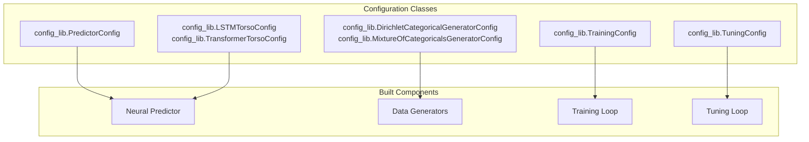

### Key Configuration Parameters

| Component | Key Parameters | Purpose |
|-----------|---------------|---------|
| `PredictorConfig` | `token_dimensionality=2`, `embedding_dimensionality=16` | Binary tokens, embedding size |
| `LSTMTorsoConfig` | `hidden_sizes=[64, 32]`, `is_trainable=True` | LSTM architecture |
| `TransformerTorsoConfig` | `num_attention_heads=4`, `use_lora=True` | Transformer architecture |
| `TrainingConfig` | `num_training_steps=1000`, `learning_rate=5e-3` | Pretraining hyperparameters |
| `TuningConfig` | `tuning_method="prefix_soft"`, `prefix_length=6` | Soft prefix tuning setup |

Sources: [colabs/ThunniniDemo.ipynb:101-189]()

## Pretraining Workflow

Pretraining uses the `training.train()` function with a `DirichletCategoricalGeneratorConfig` to create sequences from coins with uniformly random bias.

### Pretraining Process

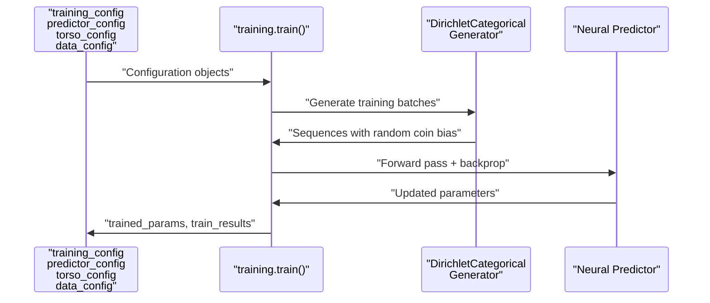

The `DirichletCategoricalGeneratorConfig` generates sequences where each sequence comes from a coin with bias sampled from `Dirichlet([1, 1])` (uniform distribution).

### Training Parameters

| Parameter | Value | Purpose |
|-----------|-------|---------|
| `batch_size` | 128 | Sequences per batch |
| `sequence_length` | 50 | Tokens per sequence |
| `vocab_size` | 2 | Binary tokens (0, 1) |
| `alphas` | `[1, 1]` | Uniform Dirichlet prior |
| `num_training_steps` | 1000 | Training iterations |

Sources: [colabs/ThunniniDemo.ipynb:145-158](), [colabs/ThunniniDemo.ipynb:229-238]()

## Fine-tuning Workflow

Fine-tuning uses `tuning.tune()` with soft prefix tuning on a `MixtureOfCategoricalsGeneratorConfig` that generates sequences from a mixture of two biased coins.

### Tuning Process

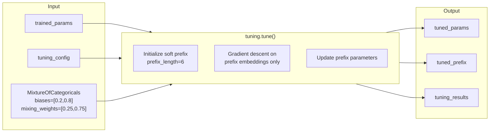

The tuning method `"prefix_soft"` optimizes only the embeddings of the first 6 tokens while keeping the pretrained model weights frozen.

### Tuning Data Configuration

| Parameter | Value | Purpose |
|-----------|-------|---------|
| `biases` | `[[0.2, 0.8], [0.8, 0.2]]` | Two coin types with opposite biases |
| `mixing_weights` | `[0.25, 0.75]` | 25% type 1, 75% type 2 |
| `tuning_method` | `"prefix_soft"` | Optimize prefix embeddings |
| `prefix_length` | 6 | First 6 tokens are tunable |

Sources: [colabs/ThunniniDemo.ipynb:171-189](), [colabs/ThunniniDemo.ipynb:314-324]()

## Evaluation Workflow

Evaluation compares the tuned model against multiple baselines using `evaluation.evaluate_predictor_from_datagen()` and `evaluation.evaluate_predictor_from_sequences()`.

### Evaluation Pipeline

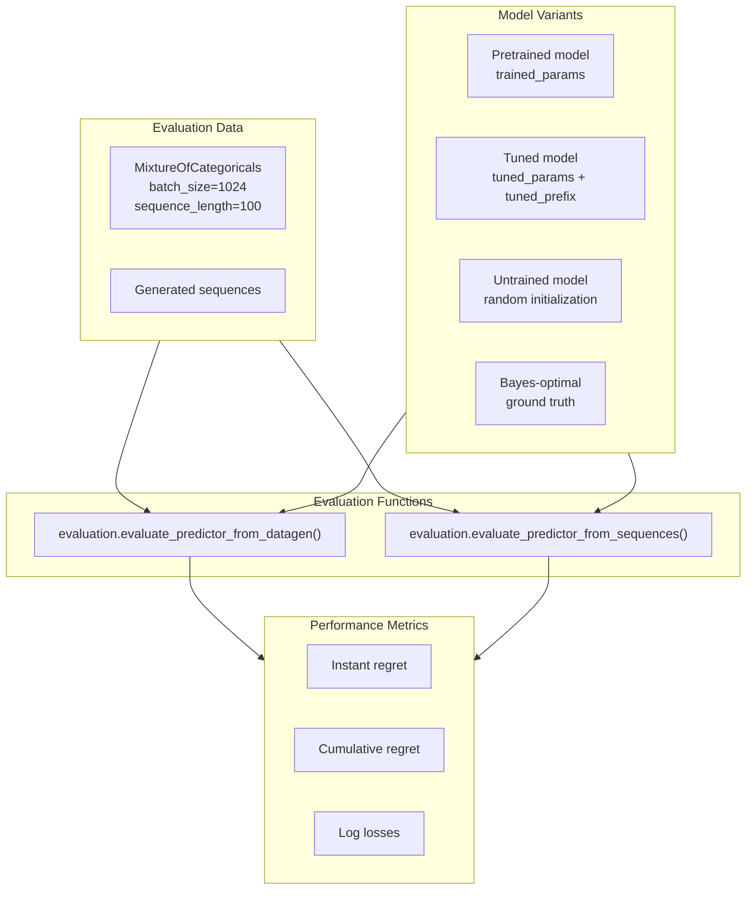

### Baseline Comparisons

| Model | Configuration | Purpose |
|-------|---------------|---------|
| Bayes-optimal | Ground truth probabilities | Theoretical lower bound |
| Pretrained | `trained_params` only | Performance without tuning |
| Tuned | `tuned_params` + `tuned_prefix` | Performance with prefix tuning |
| Untrained | Random initialization | Performance without training |

Sources: [colabs/ThunniniDemo.ipynb:361-395](), [colabs/ThunniniDemo.ipynb:403-420]()

## Results Visualization

The demo uses `plot_utils.plot_performance_metric()` to visualize training curves, tuning curves, and evaluation results comparing instant and cumulative regret across models.

### Visualization Components

```mermaid
graph LR
    subgraph PlotData["Plot Data"]
        TrainLoss["train_results['loss']"]
        TuneLoss["tuning_results['loss']"]
        InstRegret["instant_regret dict"]
        CumRegret["cumulative_regret dict"]
    end
    
    subgraph PlotFunc["plot_utils.plot_performance_metric()"]
        PlotConfig["aggregate_fn_only=True<br/>show_gridlines=True"]
    end
    
    subgraph Outputs["Visualization Outputs"]
        TrainCurve["Training loss curve"]
        TuneCurve["Tuning loss curve"]
        RegretPlots["Regret comparison plots"]
        TrajPlot["Single trajectory predictions"]
    end
    
    PlotData --> PlotFunc
    PlotFunc --> Outputs
```

The visualization includes:
- Training and tuning loss curves
- Instant regret comparison across models
- Cumulative regret over sequence positions
- Single trajectory showing predictions vs ground truth

Sources: [colabs/ThunniniDemo.ipynb:246-255](), [colabs/ThunniniDemo.ipynb:332-343](), [colabs/ThunniniDemo.ipynb:448-502]()

---

# Page: Running Experiments

# Running Experiments

<details>
<summary>Relevant source files</summary>

The following files were used as context for generating this wiki page:

- [colabs/ThunniniExperiment.ipynb](colabs/ThunniniExperiment.ipynb)

</details>


This page covers comprehensive experimentation using the `ThunniniExperiment.ipynb` notebook, which provides a full pipeline for training, tuning, and evaluating multiple models with different fine-tuning methods. This includes configuring complex experiments, running multiple tuning approaches simultaneously, and analyzing comparative results across different evaluation scenarios.

For basic single-model workflows, see [Quick Start Guide](#1.1). For detailed information about individual system components, see [System Architecture](#2).

## Overview

The `ThunniniExperiment.ipynb` notebook implements a complete experimental pipeline that systematically compares multiple fine-tuning approaches. The workflow encompasses four main phases: configuration, pretraining, tuning with multiple methods, and comprehensive evaluation with visualization.

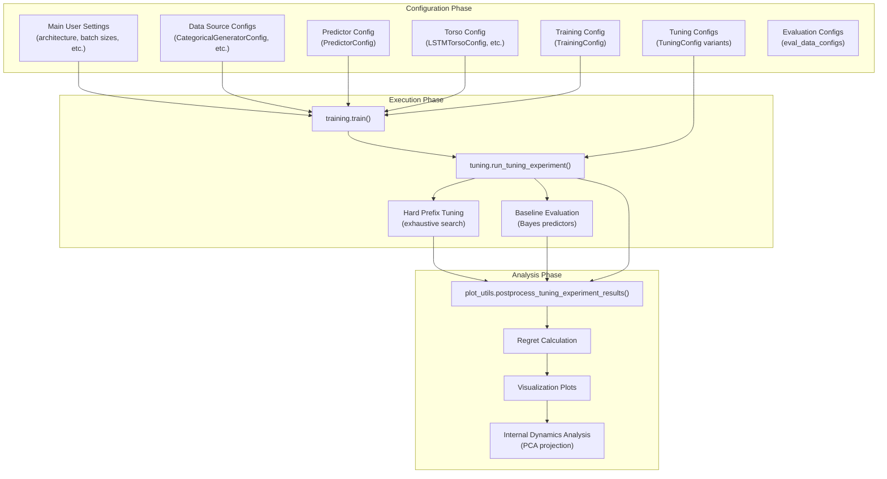

**Pipeline Architecture**
Sources: [colabs/ThunniniExperiment.ipynb:10-75]()

## Configuration System

The experiment configuration uses a hierarchical system of dataclass configurations that parameterize every aspect of the experimental pipeline. The notebook provides both high-level form controls and detailed configuration objects.

### Main Configuration Categories

| Configuration Type | Class | Purpose |
|-------------------|-------|---------|
| Architecture | `PredictorConfig`, `LSTMTorsoConfig`, `TransformerTorsoConfig`, `LinearTorsoConfig` | Define model architecture and capacity |
| Data Generation | `CategoricalGeneratorConfig`, `MixtureOfCategoricalsGeneratorConfig`, `DirichletCategoricalGeneratorConfig` | Specify synthetic data distributions |
| Training | `TrainingConfig` | Control pretraining parameters |
| Tuning | `TuningConfig` (multiple variants) | Configure fine-tuning methods |
| Evaluation | Data configs with modified parameters | Set evaluation scenarios |

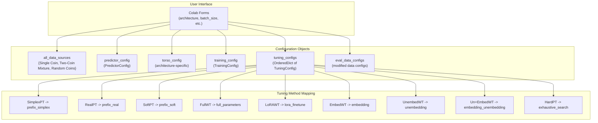

**Configuration Hierarchy and Tuning Methods**
Sources: [colabs/ThunniniExperiment.ipynb:171-449]()

### Data Source Configuration

The experiment supports three families of categorical distributions, configured through specific generator config classes:

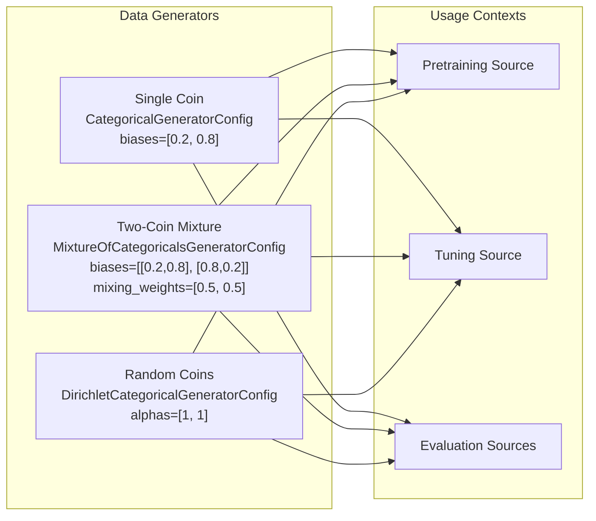

**Data Generator Configuration**
Sources: [colabs/ThunniniExperiment.ipynb:277-299]()

## Execution Workflow

### Pretraining Phase

The pretraining phase uses the `training.train()` function with the configured architecture and data source:

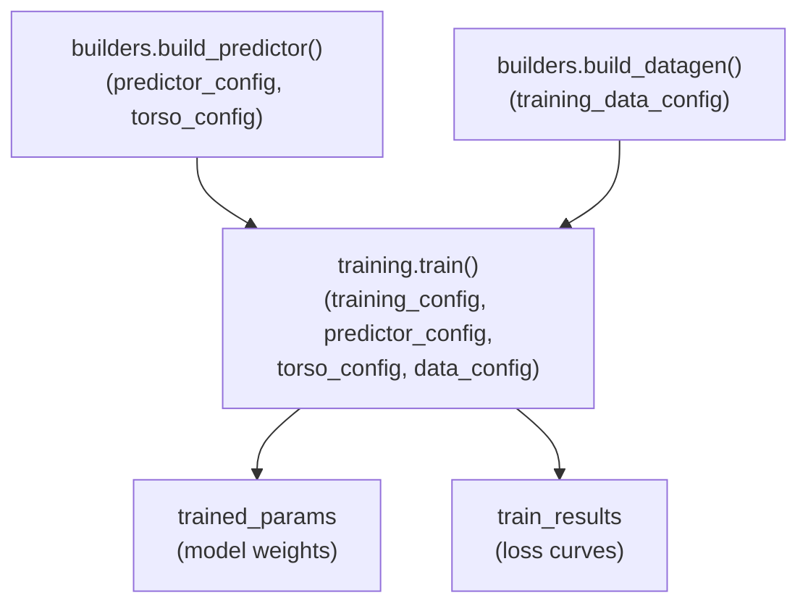

**Pretraining Execution Flow**
Sources: [colabs/ThunniniExperiment.ipynb:608-615]()

### Tuning and Evaluation Phase

The main experimental phase uses `tuning.run_tuning_experiment()` to execute multiple tuning methods simultaneously:

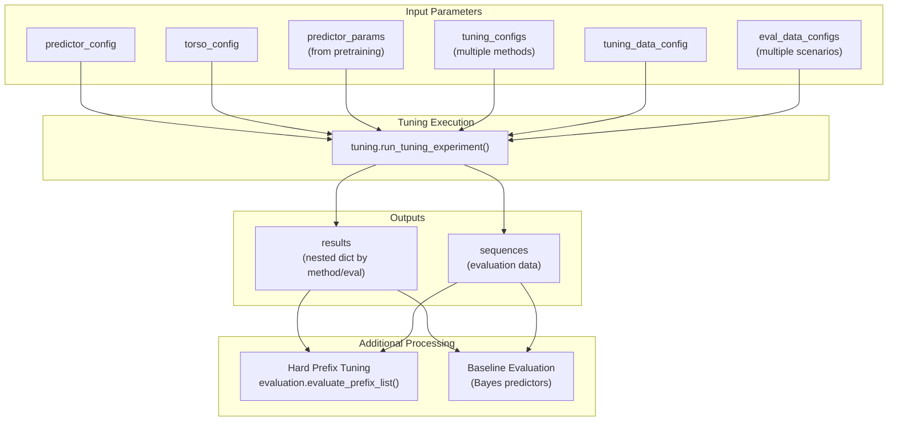

**Main Tuning and Evaluation Pipeline**
Sources: [colabs/ThunniniExperiment.ipynb:693-705]()

### Hard Prefix Tuning

Hard prefix tuning uses exhaustive search over all possible token sequences of the specified length:

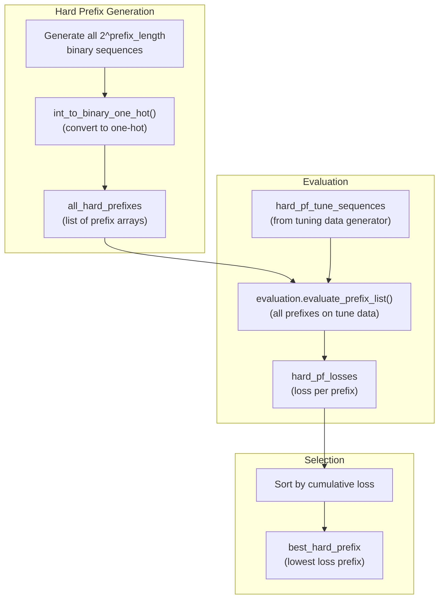

**Hard Prefix Tuning Process**
Sources: [colabs/ThunniniExperiment.ipynb:734-771]()

## Result Analysis and Visualization

### Performance Metrics

The primary evaluation metric is regret, which measures excess prediction error relative to an oracle predictor:

$$\mathcal{R}_\xi(\pi_\theta) = \frac{1}{D} \sum_{k=1}^D \left[ \sum_{i=1}^N -\log \pi_\theta(x^k_i | x^k_{<i}) + \log \xi(x^k_i | x^k_{<i}, \tau=\tau^*) \right]$$

The analysis pipeline processes results through `plot_utils.postprocess_tuning_experiment_results()`:

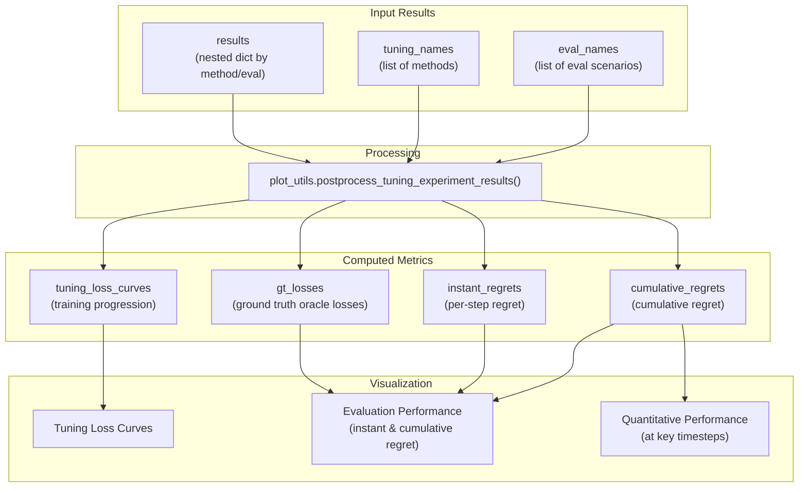

**Analysis and Visualization Pipeline**
Sources: [colabs/ThunniniExperiment.ipynb:977-983]()

### Visualization Types

The notebook generates several types of performance visualizations:

1. **Tuning Loss Curves**: Show training progression for each tuning method
2. **Evaluation Performance**: Instant and cumulative regret over time
3. **Quantitative Performance**: Bar plots at key timesteps (tuning length, training length, evaluation length)
4. **Method Comparison**: Grouped by prefix tuning, weight tuning, and baselines

Sources: [colabs/ThunniniExperiment.ipynb:1064-1338]()

## Advanced Features

### Internal Dynamics Analysis

The notebook includes sophisticated analysis of model internal states using PCA projection:

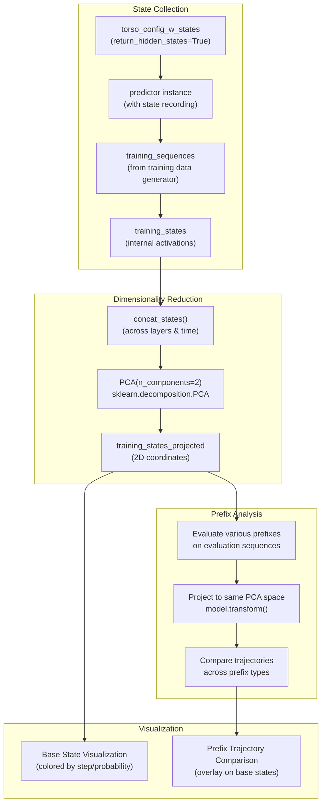

**Internal Dynamics Analysis Pipeline**
Sources: [colabs/ThunniniExperiment.ipynb:1358-1755]()

The analysis reveals how different prefix types affect the model's internal representation space, with different prefixes setting different initial points in the same activation space while weight tuning methods reshape the space itself.

Sources: [colabs/ThunniniExperiment.ipynb:70-75]()

---

# Page: System Architecture

# System Architecture

<details>
<summary>Relevant source files</summary>

The following files were used as context for generating this wiki page:

- [README.md](README.md)
- [src/builders.py](src/builders.py)

</details>


This document provides an overview of the core system components in Thunnini and how they interact to enable fine-tuning research. Thunnini is designed as a modular experimentation library where components can be configured, combined, and extended to study different aspects of neural sequence prediction and fine-tuning methods.

For specific implementation details of individual components, see the relevant subsection pages: [Configuration System](#2.1), [Component Factory](#2.2), [Data Generation](#2.3), [Model Architecture](#2.4), [Training and Tuning](#2.5), and [Evaluation and Visualization](#2.6).

## Overall System Overview

Thunnini's architecture follows a layered design where high-level interfaces orchestrate lower-level components through a configuration-driven factory pattern. The system enables researchers to experiment with 9 different fine-tuning methods across multiple neural architectures and synthetic data distributions.

### Core System Components

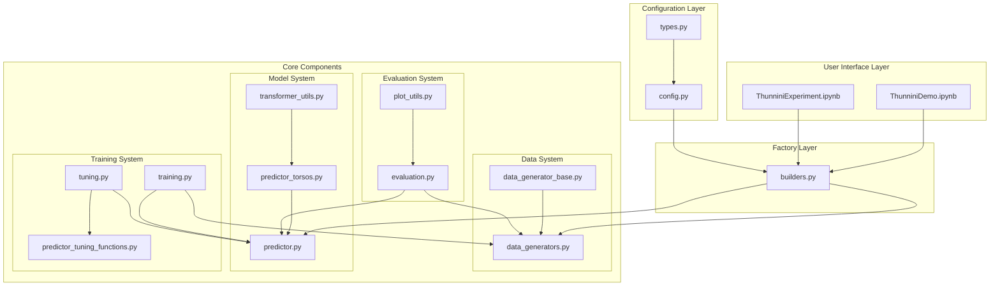

*Sources: [README.md:1-354](), [src/builders.py:1-101]()*

The system is organized into several distinct layers:

| Layer | Purpose | Key Components |
|-------|---------|----------------|
| **User Interface** | Entry points for experiments | `ThunniniDemo.ipynb`, `ThunniniExperiment.ipynb` |
| **Configuration** | Type-safe parameter specification | `config.py`, `types.py` |
| **Factory** | Component instantiation from configs | `builders.py` |
| **Data System** | Synthetic data generation | `data_generator_base.py`, `data_generators.py` |
| **Model System** | Neural architectures and prediction | `predictor.py`, `predictor_torsos.py` |
| **Training System** | Pretraining and fine-tuning loops | `training.py`, `tuning.py` |
| **Evaluation System** | Performance assessment and visualization | `evaluation.py`, `plot_utils.py` |

## Component Factory Pattern

Thunnini uses a centralized factory pattern implemented in `builders.py` to instantiate components from configurations. This design ensures type safety and extensibility while maintaining a clean separation between configuration and implementation.

### Factory Architecture

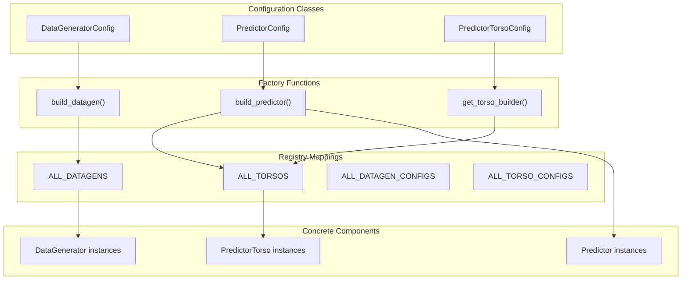

*Sources: [src/builders.py:29-101]()*

The factory maintains four key registries that map string identifiers to component classes:

- `ALL_DATAGENS`: Maps data generator type names to implementation classes
- `ALL_TORSOS`: Maps neural architecture type names to torso classes  
- `ALL_DATAGEN_CONFIGS`: Maps generator types to their configuration classes
- `ALL_TORSO_CONFIGS`: Maps torso types to their configuration classes

## Fine-Tuning Methods Architecture

Thunnini implements 9 fine-tuning methods organized into three categories. The system is designed so that all methods work uniformly across different neural architectures through the `Predictor` wrapper class.

### Tuning Method Taxonomy

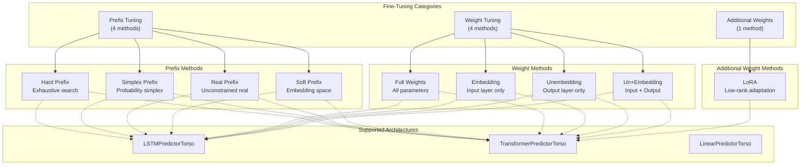

*Sources: [README.md:152-182](), [src/predictor_tuning_functions.py]()*

## Data Flow Architecture

The experimental workflow in Thunnini follows a clear data flow from configuration through training to evaluation. Each stage transforms data and parameters while maintaining provenance and reproducibility.

### Experimental Data Flow

```mermaid
graph LR
    subgraph "Configuration Stage"
        DataGenConfig["DataGeneratorConfig"]
        PredictorConfig["PredictorConfig"]
        TrainingConfig["TrainingConfig"]
        TuningConfig["TuningConfig"]
    end
    
    subgraph "Building Stage"
        build_datagen_func["build_datagen()"]
        build_predictor_func["build_predictor()"]
        DataGenerator["DataGenerator"]
        Predictor["Predictor"]
    end
    
    subgraph "Training Stage"
        train_func["training.train()"]
        TrainedParams["Trained Parameters"]
    end
    
    subgraph "Tuning Stage"
        tune_func["tuning.tune()"]
        TuningMethods["Tuning Methods"]
        TunedModels["Tuned Models"]
    end
    
    subgraph "Evaluation Stage"
        evaluate_func["evaluation.evaluate()"]
        Baselines["Baselines<br/>(Oracle, Bayes, Untrained)"]
        Metrics["Performance Metrics"]
    end
    
    subgraph "Analysis Stage"
        plot_utils_func["plot_utils functions"]
        Results["Experimental Results"]
    end
    
    DataGenConfig --> build_datagen_func
    PredictorConfig --> build_predictor_func
    
    build_datagen_func --> DataGenerator
    build_predictor_func --> Predictor
    
    DataGenerator --> train_func
    Predictor --> train_func
    TrainingConfig --> train_func
    train_func --> TrainedParams
    
    TrainedParams --> tune_func
    TuningConfig --> tune_func
    TuningMethods --> tune_func
    DataGenerator --> tune_func
    tune_func --> TunedModels
    
    TunedModels --> evaluate_func
    Baselines --> evaluate_func
    DataGenerator --> evaluate_func
    evaluate_func --> Metrics
    
    Metrics --> plot_utils_func
    plot_utils_func --> Results
```

*Sources: [README.md:21-31](), [src/training.py](), [src/tuning.py](), [src/evaluation.py]()*

## Key System Abstractions

Thunnini's architecture is built around several key abstractions that enable modularity and extensibility:

### Core Abstract Interfaces

| Interface | Purpose | Key Methods | Implementations |
|-----------|---------|-------------|-----------------|
| `DataGenerator` | Defines data generation protocol | `sample()`, `log_prob()`, `bayesian_update()` | `CategoricalGenerator`, `MixtureOfCategoricalsGenerator`, `DirichletCategoricalGenerator` |
| `PredictorTorso` | Defines neural architecture interface | `__call__()`, `init()` | `LSTMPredictorTorso`, `TransformerPredictorTorso`, `LinearPredictorTorso` |
| `Predictor` | Unified prediction interface | `forward()`, `loss()`, `update()` | Single implementation wrapping torsos |

### Configuration Hierarchy

```mermaid
graph TD
    subgraph "Base Configuration"
        Config["@dataclass Config"]
    end
    
    subgraph "Data Configuration"
        DataGeneratorConfig_class["DataGeneratorConfig"]
        CategoricalGeneratorConfig["CategoricalGeneratorConfig"]
        MixtureConfig["MixtureOfCategoricalsGeneratorConfig"] 
        DirichletConfig["DirichletCategoricalGeneratorConfig"]
    end
    
    subgraph "Model Configuration"
        PredictorConfig_class["PredictorConfig"]
        PredictorTorsoConfig_class["PredictorTorsoConfig"]
        LinearTorsoConfig["LinearTorsoConfig"]
        LSTMTorsoConfig["LSTMTorsoConfig"]
        TransformerTorsoConfig["TransformerTorsoConfig"]
    end
    
    subgraph "Training Configuration"
        TrainingConfig_class["TrainingConfig"]
        TuningConfig_class["TuningConfig"]
    end
    
    Config --> DataGeneratorConfig_class
    Config --> PredictorConfig_class
    Config --> TrainingConfig_class
    
    DataGeneratorConfig_class --> CategoricalGeneratorConfig
    DataGeneratorConfig_class --> MixtureConfig
    DataGeneratorConfig_class --> DirichletConfig
    
    PredictorConfig_class --> PredictorTorsoConfig_class
    PredictorTorsoConfig_class --> LinearTorsoConfig
    PredictorTorsoConfig_class --> LSTMTorsoConfig
    PredictorTorsoConfig_class --> TransformerTorsoConfig
    
    TrainingConfig_class --> TuningConfig_class
```

*Sources: [src/config.py](), [src/types.py]()*

The configuration system uses Python dataclasses with type annotations to provide compile-time safety and runtime validation. All configurations inherit from a base `Config` class and are organized hierarchically to reflect the system's component structure.

This architecture enables Thunnini to be both easy to use for standard experiments and highly extensible for research into new fine-tuning methods, neural architectures, and data distributions.

---

# Page: Configuration System

# Configuration System

<details>
<summary>Relevant source files</summary>

The following files were used as context for generating this wiki page:

- [src/config.py](src/config.py)
- [src/types.py](src/types.py)

</details>


The configuration system provides a structured, type-safe way to parameterize all components of the Thunnini fine-tuning library. It uses frozen dataclasses to define immutable configuration objects that can be serialized to plain text and reconstructed, enabling reproducible experiments and easy parameter management.

For information about how configurations are used to build components, see [Component Factory](#2.2). For details about the training and tuning processes that these configurations parameterize, see [Training and Tuning](#2.5).

## Design Principles

The configuration system follows specific design principles outlined in [src/config.py:16-22]():

- **Serialization Support**: All configurations can be converted to dictionaries and serialized to plain text
- **No Nesting**: Configuration dataclasses do not contain other dataclasses as fields
- **Immutable**: All configurations use `frozen=True` to prevent modification after creation
- **Keyword-Only**: All configurations use `kw_only=True` to require explicit parameter naming
- **No Post-Instantiation Logic**: Default values are set at the dataclass level without requiring post-creation manipulation

Sources: [src/config.py:16-22]()

## Configuration Hierarchy

The configuration system is organized into several main categories, each serving a specific purpose in the experimental pipeline.

```mermaid
graph TD
    subgraph "Data Generation Configs"
        DataGeneratorConfig["DataGeneratorConfig<br/>(Base Class)"]
        DirichletCategoricalGeneratorConfig["DirichletCategoricalGeneratorConfig"]
        CategoricalGeneratorConfig["CategoricalGeneratorConfig"]
        MixtureOfCategoricalsGeneratorConfig["MixtureOfCategoricalsGeneratorConfig"]
    end
    
    subgraph "Model Architecture Configs"
        PredictorConfig["PredictorConfig"]
        PredictorTorsoConfig["PredictorTorsoConfig<br/>(Base Class)"]
        LinearTorsoConfig["LinearTorsoConfig"]
        TransformerTorsoConfig["TransformerTorsoConfig"]
        LSTMTorsoConfig["LSTMTorsoConfig"]
    end
    
    subgraph "Training Pipeline Configs"
        TrainingConfig["TrainingConfig"]
        TuningConfig["TuningConfig"]
    end
    
    DataGeneratorConfig --> DirichletCategoricalGeneratorConfig
    DataGeneratorConfig --> CategoricalGeneratorConfig
    DataGeneratorConfig --> MixtureOfCategoricalsGeneratorConfig
    
    PredictorTorsoConfig --> LinearTorsoConfig
    PredictorTorsoConfig --> TransformerTorsoConfig
    PredictorTorsoConfig --> LSTMTorsoConfig
```

Sources: [src/config.py:32-118]()

## Data Generator Configurations

Data generator configurations define the parameters for synthetic data generation used in experiments.

### Base Configuration

The `DataGeneratorConfig` class provides common fields for all data generators:

| Field | Type | Description |
|-------|------|-------------|
| `generator_type` | `types.DataGenType` | Type of data generator |
| `batch_size` | `int` | Number of sequences per batch |
| `sequence_length` | `int` | Length of each sequence |
| `vocab_size` | `int` | Size of the vocabulary |

Sources: [src/config.py:32-38]()

### Concrete Generator Configurations

Each concrete data generator has specific additional parameters:

```mermaid
graph LR
    subgraph "DirichletCategoricalGeneratorConfig"
        DCGC_Type["generator_type: 'Dirichlet-Categorical'"]
        DCGC_Alphas["alphas: Float32[Array, 'V']"]
    end
    
    subgraph "CategoricalGeneratorConfig"
        CGC_Type["generator_type: 'Categorical'"]
        CGC_Biases["biases: Float32[Array, 'V']"]
    end
    
    subgraph "MixtureOfCategoricalsGeneratorConfig"
        MOCGC_Type["generator_type: 'Mixture-of-Categoricals'"]
        MOCGC_Weights["mixing_weights: Float32[Array, 'C']"]
        MOCGC_Biases["biases: Float32[Array, 'C V']"]
    end
```

Sources: [src/config.py:40-57]()

## Training and Tuning Configurations

These configurations control the training and fine-tuning processes.

### TrainingConfig

Defines parameters for the initial pretraining phase:

| Field | Type | Description |
|-------|------|-------------|
| `num_training_steps` | `int` | Number of training iterations |
| `learning_rate` | `float` | Optimizer learning rate |
| `max_grad_norm` | `float` | Gradient clipping threshold |
| `data_gen_seed` | `int` | Random seed for data generation |
| `predictor_init_seed` | `int` | Random seed for model initialization |

Sources: [src/config.py:59-66]()

### TuningConfig

Defines parameters for the fine-tuning phase with additional options for prefix tuning:

| Field | Type | Default | Description |
|-------|------|---------|-------------|
| `num_tuning_steps` | `int` | - | Number of fine-tuning iterations |
| `learning_rate` | `float` | - | Optimizer learning rate |
| `max_grad_norm` | `float` | - | Gradient clipping threshold |
| `data_gen_seed` | `int` | - | Random seed for data generation |
| `prefix_init_seed` | `int` | - | Random seed for prefix initialization |
| `tuning_method` | `types.TuningMethodType` | - | Fine-tuning strategy |
| `num_tuning_repetitions` | `int` | `1` | Number of repetitions |
| `prefix_length` | `int \| None` | `None` | Length of prefix for prefix methods |
| `prefix_init_method` | `types.PrefixInitMethod \| None` | `'simplex'` | Prefix initialization strategy |
| `iterate_datagen_seed_over_repetitions` | `bool` | `True` | Whether to vary data seeds |

Sources: [src/config.py:68-80]()

## Model Architecture Configurations

These configurations define the neural network architectures used in the experiments.

### PredictorConfig

Basic configuration for the predictor wrapper:

| Field | Type | Description |
|-------|------|-------------|
| `token_dimensionality` | `int` | Input token dimensionality |
| `embedding_dimensionality` | `int` | Embedding layer output size |

Sources: [src/config.py:82-86]()

### Torso Configurations

The torso configurations define the main neural network architectures:

```mermaid
graph TD
    PredictorTorsoConfig["PredictorTorsoConfig<br/>Base Class"]
    
    subgraph "Common Fields"
        TorsoType["torso_type: TorsoType"]
        IsTrainable["is_trainable: bool"]
        HiddenSizes["hidden_sizes: Iterable[int]"]
        ReturnHidden["return_hidden_states: bool = False"]
    end
    
    subgraph "LinearTorsoConfig"
        Linear_Type["torso_type: 'Linear'"]
    end
    
    subgraph "LSTMTorsoConfig"
        LSTM_Type["torso_type: 'LSTM'"]
    end
    
    subgraph "TransformerTorsoConfig"
        Trans_Type["torso_type: 'Transformer'"]
        Trans_Heads["num_attention_heads: int"]
        Trans_PosEnc["positional_encoding: PositionalEncodingType = 'SinCos'"]
        Trans_Widen["widening_factor: int = 4"]
        Trans_NormQK["normalize_qk: bool = True"]
        Trans_Bias["use_bias: bool = False"]
        Trans_LoRA["use_lora: bool = False"]
        Trans_Rank["reduced_rank: int = 4"]
    end
    
    PredictorTorsoConfig --> LinearTorsoConfig
    PredictorTorsoConfig --> LSTMTorsoConfig
    PredictorTorsoConfig --> TransformerTorsoConfig
    
    LinearTorsoConfig --> Linear_Type
    LSTMTorsoConfig --> LSTM_Type
    TransformerTorsoConfig --> Trans_Type
    TransformerTorsoConfig --> Trans_Heads
    TransformerTorsoConfig --> Trans_PosEnc
    TransformerTorsoConfig --> Trans_Widen
    TransformerTorsoConfig --> Trans_NormQK
    TransformerTorsoConfig --> Trans_Bias
    TransformerTorsoConfig --> Trans_LoRA
    TransformerTorsoConfig --> Trans_Rank
```

Sources: [src/config.py:88-118]()

## Type System Integration

The configuration system is tightly integrated with the type system defined in `types.py`. This provides strong typing and validates configuration choices at instantiation time.

### Key Type Definitions

The configuration system uses several important types:

| Type | Values | Usage |
|------|--------|-------|
| `DataGenType` | `'Dirichlet-Categorical'`, `'Categorical'`, `'Mixture-of-Categoricals'` | Data generator selection |
| `TuningMethodType` | `'prefix_real'`, `'prefix_simplex'`, `'prefix_soft'`, `'full_parameters'`, `'lora_finetune'`, `'embedding'`, `'unembedding'`, `'embedding_unembedding'` | Fine-tuning method selection |
| `TorsoType` | `'Linear'`, `'Transformer'`, `'LSTM'` | Neural architecture selection |
| `PrefixInitMethod` | `'zeros'`, `'simplex'`, `'one_hot'` | Prefix initialization strategy |
| `PositionalEncodingType` | `'SinCos'` | Positional encoding method |

Sources: [src/types.py:43-76]()

### Array Type Annotations

The configuration system uses JAX typing for array specifications:

```mermaid
graph LR
    subgraph "Array Types Used in Configs"
        Alphas["alphas: Float32[Array, 'V']<br/>Dirichlet parameters"]
        Biases1["biases: Float32[Array, 'V']<br/>Categorical biases"]
        MixWeights["mixing_weights: Float32[Array, 'C']<br/>Mixture weights"]
        Biases2["biases: Float32[Array, 'C V']<br/>Component biases"]
    end
    
    subgraph "Dimension Meanings"
        V_Dim["V: Vocabulary size"]
        C_Dim["C: Number of components"]
    end
    
    Alphas --> V_Dim
    Biases1 --> V_Dim
    MixWeights --> C_Dim
    Biases2 --> C_Dim
    Biases2 --> V_Dim
```

Sources: [src/config.py:43-56](), [src/types.py:22-29]()

## Configuration Usage Patterns

Configurations are typically created and used in the following pattern:

1. **Creation**: Instantiate configuration objects with keyword arguments
2. **Validation**: Type checking occurs at instantiation time
3. **Serialization**: Convert to dictionaries for storage or logging
4. **Component Building**: Pass to builder functions to create actual components
5. **Immutability**: Once created, configurations cannot be modified

The frozen dataclass design ensures that experimental parameters remain constant throughout an experiment, supporting reproducibility and preventing accidental parameter changes.

Sources: [src/config.py:16-22]()

---

# Page: Component Factory

# Component Factory

<details>
<summary>Relevant source files</summary>

The following files were used as context for generating this wiki page:

- [src/builders.py](src/builders.py)

</details>


The Component Factory provides a centralized creation mechanism for instantiating data generators and predictors from configuration objects. It implements the factory pattern to abstract component construction, allowing users to specify what they want through configuration rather than directly instantiating classes.

This document covers the factory functions and component registries in `builders.py`. For information about the configuration system that drives the factory, see [Configuration System](#2.1). For details about the specific components being created, see [Data Generation](#2.3) and [Model Architecture](#2.4).

## Factory Pattern Overview

The Component Factory centralizes component creation through registry dictionaries that map string identifiers to constructor functions. This design enables dynamic component selection based on configuration parameters while maintaining type safety and providing a single point of control for component creation.

```mermaid
graph TD
    ConfigObj["Configuration Object"]
    Factory["builders.py Factory"]
    Registry["Component Registry"]
    Constructor["Component Constructor"]
    Instance["Component Instance"]
    
    ConfigObj --> Factory
    Factory --> Registry
    Registry --> Constructor
    Constructor --> Instance
    
    subgraph "Registry Types"
        DatagenReg["ALL_DATAGENS"]
        TorsoReg["ALL_TORSOS"]
        DatagenConfigReg["ALL_DATAGEN_CONFIGS"]
        TorsoConfigReg["ALL_TORSO_CONFIGS"]
    end
    
    Registry --> DatagenReg
    Registry --> TorsoReg
    Registry --> DatagenConfigReg
    Registry --> TorsoConfigReg
```

Sources: [src/builders.py:29-63]()

## Data Generator Factory

The data generator factory creates instances of data generators from configuration objects. The `build_datagen()` function serves as the main entry point, supporting both typed configuration objects and dictionary inputs.

### Registry Structure

| Generator Type | Constructor | Config Type |
|----------------|-------------|-------------|
| `"Dirichlet-Categorical"` | `data_generators.DirichletCategoricalGenerator` | `config_lib.DirichletCategoricalGeneratorConfig` |
| `"Categorical"` | `data_generators.CategoricalGenerator` | `config_lib.CategoricalGeneratorConfig` |
| `"Mixture-of-Categoricals"` | `data_generators.MixtureOfCategoricalsGenerator` | `config_lib.MixtureOfCategoricalsGeneratorConfig` |

### Factory Function

The `build_datagen()` function handles configuration validation and component instantiation:

```mermaid
graph TD
    Input["config: DataGeneratorConfig | dict"]
    DictCheck{"isinstance(config, dict)"}
    Convert["config = DataGeneratorConfig(**config)"]
    Validate["assert config.generator_type in DataGenType"]
    Lookup["ALL_DATAGENS[config.generator_type]"]
    Create["Constructor(config)"]
    Output["DataGenerator instance"]
    
    Input --> DictCheck
    DictCheck -->|"Yes"| Convert
    DictCheck -->|"No"| Validate
    Convert --> Validate
    Validate --> Lookup
    Lookup --> Create
    Create --> Output
```

Sources: [src/builders.py:66-73]()

## Predictor and Torso Factory

The predictor factory creates predictor instances with embedded torso architectures. It provides both a torso builder function and a complete predictor builder that combines predictor and torso configurations.

### Torso Registry Structure

| Torso Type | Constructor | Config Type |
|------------|-------------|-------------|
| `"Linear"` | `predictor_torsos.LinearPredictorTorso` | `config_lib.LinearTorsoConfig` |
| `"Transformer"` | `predictor_torsos.TransformerPredictorTorso` | `config_lib.TransformerTorsoConfig` |
| `"LSTM"` | `predictor_torsos.LSTMPredictorTorso` | `config_lib.LSTMTorsoConfig` |

### Factory Functions

The torso factory provides two main functions:

1. **`get_torso_builder()`** - Returns a torso constructor function
2. **`build_predictor()`** - Creates a complete predictor with embedded torso

```mermaid
graph TD
    PredConfig["predictor_config"]
    TorsoConfig["torso_config"]
    TorsoBuilder["get_torso_builder()"]
    Constructor["torso_builder function"]
    PredInstance["predictor.Predictor()"]
    
    TorsoConfig --> TorsoBuilder
    TorsoBuilder --> Constructor
    PredConfig --> PredInstance
    TorsoConfig --> PredInstance
    Constructor --> PredInstance
    
    subgraph "Predictor Constructor Args"
        ConfigArg["config=predictor_config"]
        TorsoConfigArg["torso_config=torso_config"] 
        BuilderArg["torso_builder=torso_builder"]
    end
    
    PredInstance --> ConfigArg
    PredInstance --> TorsoConfigArg
    PredInstance --> BuilderArg
```

Sources: [src/builders.py:76-100]()

## Component Registration System

The factory uses four registry dictionaries to map string identifiers to constructors and configuration classes. This design supports extensibility by allowing new components to be registered without modifying existing factory logic.

```mermaid
graph LR
    subgraph "Data Generator Registries"
        DatagenMap["ALL_DATAGENS<br/>str → Constructor"]
        DatagenConfigMap["ALL_DATAGEN_CONFIGS<br/>str → Config Class"]
    end
    
    subgraph "Torso Registries" 
        TorsoMap["ALL_TORSOS<br/>str → Constructor"]
        TorsoConfigMap["ALL_TORSO_CONFIGS<br/>str → Config Class"]
    end
    
    subgraph "Factory Functions"
        BuildDatagen["build_datagen()"]
        GetTorsoBuilder["get_torso_builder()"]
        BuildPredictor["build_predictor()"]
    end
    
    DatagenMap --> BuildDatagen
    DatagenConfigMap --> BuildDatagen
    TorsoMap --> GetTorsoBuilder
    TorsoConfigMap --> GetTorsoBuilder
    TorsoMap --> BuildPredictor
    TorsoConfigMap --> BuildPredictor
```

### Type Safety and Validation

The factory functions include runtime type validation using `typing.get_args()` to ensure that component type strings match the allowed values defined in the `types` module. This provides early error detection for invalid component specifications.

Sources: [src/builders.py:29-63](), [src/builders.py:72](), [src/builders.py:82]()

## Usage Patterns

The Component Factory is typically used in two scenarios:

1. **Interactive Configuration** - Users specify components by string name in notebooks or scripts
2. **Programmatic Construction** - Other system components use the factory to create instances from configuration objects

The factory supports both dictionary-based configuration (for flexibility) and typed configuration objects (for type safety), with automatic conversion between the two formats as needed.

Sources: [src/builders.py:16](), [src/builders.py:66-100]()

---

# Page: Data Generation

# Data Generation

<details>
<summary>Relevant source files</summary>

The following files were used as context for generating this wiki page:

- [assets/img/ThunniniTaxonomy.svg](assets/img/ThunniniTaxonomy.svg)
- [src/data_generator_base.py](src/data_generator_base.py)
- [src/data_generators.py](src/data_generators.py)

</details>


This document covers the data generation system in Thunnini, which provides synthetic sequence data for fine-tuning research experiments. The system generates one-hot encoded categorical sequences with known ground truth distributions, enabling controlled evaluation of fine-tuning methods.

For information about how data generators are instantiated and configured, see [Component Factory](#2.2). For details about the training pipeline that consumes this data, see [Training and Tuning](#2.5).

## System Overview

The data generation system follows an abstract base class pattern with three concrete implementations for different types of categorical sequence generation. Each generator produces both synthetic sequences and their corresponding ground truth log probabilities, as well as Bayes-optimal predictions.

```mermaid
graph TD
    DataGenerator["DataGenerator<br/>(Abstract Base)"]
    DCG["DirichletCategoricalGenerator<br/>Bayesian categorical"]
    CG["CategoricalGenerator<br/>Fixed categorical"]
    MCG["MixtureOfCategoricalsGenerator<br/>Mixture model"]
    
    DataGenerator --> DCG
    DataGenerator --> CG
    DataGenerator --> MCG
    
    DCG --> Sequences["One-hot Sequences<br/>types.Sequences"]
    CG --> Sequences
    MCG --> Sequences
    
    DCG --> GTProbs["Ground Truth<br/>Log Probabilities"]
    CG --> GTProbs
    MCG --> GTProbs
    
    DCG --> BayesOpt["Bayes-optimal<br/>Predictions"]
    CG --> BayesOpt
    MCG --> BayesOpt
```

Sources: [src/data_generator_base.py:27-122](), [src/data_generators.py:38-187]()

## Base Class Architecture

The `DataGenerator` abstract base class defines the core interface and common functionality for all data generators. It requires subclasses to implement two key methods while providing high-level orchestration.

```mermaid
graph TD
    subgraph "DataGenerator Base Class"
        Config["config: DataGeneratorConfig<br/>batch_size, sequence_length"]
        AbstractGenerate["_generate() abstract<br/>→ sequences, gt_log_probs"]
        AbstractSolve["_solve() abstract<br/>→ bayes_optimal_log_probs"]
        
        Generate["generate()<br/>Public interface"]
        Solve["solve()<br/>Public interface + losses"]
        GenerateSolveLosses["generate_solve_and_losses()<br/>Complete workflow"]
        InstantLogLoss["instant_log_loss_from_logits()<br/>Cross-entropy calculation"]
    end
    
    Config --> Generate
    Config --> Solve
    
    AbstractGenerate --> Generate
    AbstractSolve --> Solve
    
    Generate --> GenerateSolveLosses
    Solve --> GenerateSolveLosses
    InstantLogLoss --> Solve
    InstantLogLoss --> GenerateSolveLosses
```

The base class provides validation through `chex.assert_equal_shape()` calls to ensure implementations return correctly shaped tensors.

Sources: [src/data_generator_base.py:27-122]()

## Concrete Generator Implementations

### DirichletCategoricalGenerator

Implements a Bayesian approach where categorical probabilities are drawn from a Dirichlet prior, then sequences are generated i.i.d. from the resulting categorical distribution.

| Component | Implementation | Purpose |
|-----------|----------------|---------|
| Prior | `distrax.Dirichlet(alphas)` | Generates per-batch categorical probabilities |
| Likelihood | `distrax.OneHotCategorical(probs)` | Samples sequences given probabilities |
| Posterior | Dirichlet-categorical conjugacy | Enables exact Bayesian inference |

```mermaid
graph LR
    Alphas["config.alphas<br/>Dirichlet parameters"]
    Prior["distrax.Dirichlet<br/>self.prior"]
    Probs["Categorical probabilities<br/>per batch"]
    Categorical["distrax.OneHotCategorical<br/>sampling distribution"]
    Sequences["One-hot sequences<br/>transposed to (batch, seq, vocab)"]
    
    Alphas --> Prior
    Prior --> Probs
    Probs --> Categorical
    Categorical --> Sequences
    
    BayesSolve["_solve(): Cumulative counts<br/>+ alphas → posterior means"]
    Sequences --> BayesSolve
    Alphas --> BayesSolve
```

Sources: [src/data_generators.py:38-81]()

### CategoricalGenerator

Generates i.i.d. sequences from a fixed categorical distribution with no latent variables to infer.

```mermaid
graph LR
    Biases["config.biases<br/>Fixed probabilities"]
    Dist["distrax.OneHotCategorical<br/>self.dist"]
    Samples["I.i.d. samples<br/>(batch, seq, vocab)"]
    
    Biases --> Dist
    Dist --> Samples
    
    TileProbs["_solve(): Tile biases<br/>No inference needed"]
    Biases --> TileProbs
```

Sources: [src/data_generators.py:83-112]()

### MixtureOfCategoricalsGenerator

Implements a mixture of categorical distributions where the mixture component is sampled once per sequence, then all tokens in that sequence are generated from the selected component.

```mermaid
graph TD
    MixWeights["config.mixing_weights<br/>Component probabilities"]
    CompBiases["config.biases<br/>(n_components, vocab_size)"]
    
    Prior["distrax.Categorical<br/>self.prior"]
    Components["distrax.OneHotCategorical<br/>self.components_distr"]
    
    MixIdx["Mixture component index<br/>per batch sample"]
    Sequences["Sequences from selected<br/>component per batch"]
    
    LogLikelihood["Log likelihood per<br/>component via cumsum"]
    LogJoint["Log joint = likelihood<br/>+ log mixing_weights"]
    LogEvidence["Log evidence via<br/>logsumexp over components"]
    LogPosterior["Log posterior =<br/>joint - evidence"]
    BayesPred["Posterior-weighted<br/>component predictions"]
    
    MixWeights --> Prior
    CompBiases --> Components
    
    Prior --> MixIdx
    Components --> Sequences
    MixIdx --> Sequences
    
    Sequences --> LogLikelihood
    CompBiases --> LogLikelihood
    LogLikelihood --> LogJoint
    MixWeights --> LogJoint
    LogJoint --> LogEvidence
    LogJoint --> LogPosterior
    LogEvidence --> LogPosterior
    LogPosterior --> BayesPred
    CompBiases --> BayesPred
```

Sources: [src/data_generators.py:114-187]()

## Data Flow and Key Methods

### Core Generation Workflow

The `generate_solve_and_losses()` method provides the complete workflow used by the training pipeline:

```mermaid
graph TB
    Input["rng_key: chex.PRNGKey"]
    
    Generate["generate()<br/>→ sequences, gt_log_probs"]
    GTLosses["instant_log_loss_from_logits()<br/>→ gt_losses"]
    Solve["solve()<br/>→ bayes_opt_log_probs, bayes_opt_losses"]
    
    Output["Return tuple:<br/>sequences, bayes_opt_log_probs,<br/>bayes_opt_losses, gt_log_probs, gt_losses"]
    
    Input --> Generate
    Generate --> GTLosses
    Generate --> Solve
    
    Generate --> Output
    GTLosses --> Output
    Solve --> Output
```

### Loss Calculation

All generators use `optax.safe_softmax_cross_entropy()` for consistent loss computation between predicted log probabilities and one-hot target sequences.

Sources: [src/data_generator_base.py:75-122](), [src/data_generator_base.py:116-121]()

## Integration with Configuration System

Data generators are configured through dataclass configs that specify:

- `batch_size`: Number of sequences per batch
- `sequence_length`: Length of each generated sequence  
- `vocab_size`: Size of the categorical vocabulary
- Generator-specific parameters (e.g., `alphas` for Dirichlet, `biases` for fixed categorical)

The configuration system ensures type safety and parameter validation before generator instantiation.

Sources: [src/data_generator_base.py:33-34](), [src/data_generators.py:42-47](), [src/data_generators.py:86-93](), [src/data_generators.py:117-131]()

---

# Page: Model Architecture

# Model Architecture

<details>
<summary>Relevant source files</summary>

The following files were used as context for generating this wiki page:

- [src/predictor.py](src/predictor.py)
- [src/predictor_torsos.py](src/predictor_torsos.py)
- [src/transformer_utils.py](src/transformer_utils.py)

</details>


This page documents the model architecture system in Thunnini, which provides the core neural network implementations used for fine-tuning research. The system consists of a predictor wrapper that handles embedding, unembedding, and prefix functionality, along with multiple torso architectures including linear, LSTM, and transformer models.

For information about how these models are configured, see [Configuration System](#2.1). For details on how models are instantiated from configurations, see [Component Factory](#2.2). For information about the training and fine-tuning processes that use these models, see [Training and Tuning](#2.5).

## Architecture Overview

The model architecture follows a layered design where a `Predictor` wrapper class provides common functionality around different neural network "torsos" that implement the core computation.

```mermaid
graph TB
    subgraph "Predictor Wrapper Layer"
        PRED["Predictor"]
        EMB["Embedding Layer"]
        UNEMB["Unembedding Layer"]
        PREFIX["Prefix Handling"]
    end
    
    subgraph "Torso Layer"
        TORSO_BASE["PredictorTorso<br/>(Abstract Base)"]
        LINEAR["LinearPredictorTorso"]
        LSTM["LSTMPredictorTorso"] 
        TRANSFORMER["TransformerPredictorTorso"]
    end
    
    subgraph "Transformer Utilities"
        ATTN["MultiheadAttention"]
        MLP["mlp_block"]
        POS["add_positional_encodings"]
        LORA["DenseWithLora"]
    end
    
    PRED --> EMB
    PRED --> UNEMB
    PRED --> PREFIX
    PRED --> TORSO_BASE
    
    TORSO_BASE --> LINEAR
    TORSO_BASE --> LSTM
    TORSO_BASE --> TRANSFORMER
    
    TRANSFORMER --> ATTN
    TRANSFORMER --> MLP
    TRANSFORMER --> POS
    ATTN --> LORA
    MLP --> LORA
```

Sources: [src/predictor.py:50-64](), [src/predictor_torsos.py:16-24](), [src/transformer_utils.py:16]()

## Predictor Wrapper Class

The `Predictor` class serves as the main interface for all neural architectures in Thunnini. It wraps torso implementations with embedding and unembedding layers, and provides support for prefix prompting methods used in fine-tuning.

### Core Functionality

| Component | Purpose | Implementation |
|-----------|---------|----------------|
| Embedding | Converts one-hot sequences to dense vectors | `nn.Dense` layer with configurable dimensionality |
| Torso | Core neural computation | Pluggable architecture (Linear/LSTM/Transformer) |
| Unembedding | Converts hidden states to vocabulary logits | `nn.Dense` layer mapping to vocabulary size |
| Prefix Handling | Supports multiple prefix prompting methods | Four types: none, prepend, simplex, embedding |

The wrapper handles four types of prefix prompting:

```mermaid
graph LR
    subgraph "Prefix Types"
        NONE["'none'<br/>No prefix"]
        PREPEND["'prepend'<br/>Hard discrete tokens"]
        SIMPLEX["'simplex'<br/>Softmax normalized"]
        EMBEDDING["'embedding'<br/>Direct embedding space"]
    end
    
    INPUT["Input Sequences"] --> NONE
    INPUT --> PREPEND
    INPUT --> SIMPLEX  
    INPUT --> EMBEDDING
    
    NONE --> TORSO["Torso Processing"]
    PREPEND --> CONCAT1["Concatenate prefix<br/>to sequences"]
    SIMPLEX --> SOFTMAX["Apply softmax<br/>to prefix"]
    EMBEDDING --> CONCAT2["Insert into<br/>embedding space"]
    
    CONCAT1 --> TORSO
    SOFTMAX --> CONCAT1
    CONCAT2 --> TORSO
```

Sources: [src/predictor.py:66-197](), [src/predictor.py:104-121]()

### Input and Output Handling

The `Predictor.__call__` method processes sequences and returns predictions along with optional hidden states:

- **Input**: One-hot encoded sequences with optional prefix
- **Output**: Log predictions for sequences, hidden states, prefix predictions, and prefix states
- **Padding**: Adds beginning-of-sequence (BOS) token as zero vector for initial prediction

Sources: [src/predictor.py:66-93](), [src/predictor.py:122-129]()

## Torso Implementations

Three concrete torso architectures implement the abstract `PredictorTorso` base class, each providing different computational patterns suitable for different experimental scenarios.

```mermaid
graph TB
    subgraph "PredictorTorso Base Class"
        BASE["PredictorTorso<br/>Abstract Base Class"]
        CALL["__call__(embeddings)<br/>→ (outputs, hidden_states)"]
    end
    
    subgraph "Concrete Implementations"
        LIN["LinearPredictorTorso<br/>Feed-forward layers"]
        LSTM_IMPL["LSTMPredictorTorso<br/>Recurrent processing"]
        TRANS_IMPL["TransformerPredictorTorso<br/>Self-attention layers"]
    end
    
    BASE --> CALL
    BASE -.-> LIN
    BASE -.-> LSTM_IMPL  
    BASE -.-> TRANS_IMPL
    
    LIN --> LIN_DENSE["Sequential nn.Dense layers"]
    LSTM_IMPL --> LSTM_CELLS["nn.OptimizedLSTMCell stack"]
    TRANS_IMPL --> TRANS_BLOCKS["Multi-layer attention blocks"]
```

Sources: [src/predictor.py:30-48](), [src/predictor_torsos.py:41-172]()

### Linear Torso

The `LinearPredictorTorso` provides a simple feed-forward architecture primarily used for testing and baseline comparisons.

| Feature | Implementation |
|---------|----------------|
| Architecture | Sequential `nn.Dense` layers |
| Hidden States | None (no recurrent or attention states) |
| Configuration | `hidden_sizes` list specifies layer dimensions |

Sources: [src/predictor_torsos.py:41-59]()

### LSTM Torso  

The `LSTMPredictorTorso` implements a multi-layer LSTM architecture with proper state handling for recurrent processing.

| Feature | Implementation |
|---------|----------------|
| Architecture | Stack of `nn.OptimizedLSTMCell` layers |
| Hidden States | Cell and hidden states per layer |
| Initialization | Random initialization with fixed seed |
| Scanning | Uses `nn.scan` for efficient unrolling |

The implementation uses a custom unroll function to enable state collection across time steps, since Flax's scan doesn't directly support `return_all_states`.

Sources: [src/predictor_torsos.py:117-172](), [src/predictor_torsos.py:147-162]()

### Transformer Torso

The `TransformerPredictorTorso` implements a multi-layer transformer decoder with self-attention, supporting advanced features like LoRA adaptation.

| Feature | Implementation |
|---------|----------------|
| Architecture | Multi-layer decoder with attention and MLP blocks |
| Attention | Multi-head causal self-attention |
| MLP | Feed-forward with configurable widening factor |
| Normalization | Layer normalization with optional QK normalization |
| LoRA | Optional low-rank adaptation for fine-tuning |

The transformer processes embeddings through alternating attention and MLP blocks:

```mermaid
graph TB
    INPUT["Input Embeddings"] --> POS["Positional Encoding"]
    POS --> LAYER0["Layer 0"]
    
    subgraph "Transformer Layer"
        LAYER0 --> NORM1["LayerNorm"]
        NORM1 --> ATTN["Multi-head Attention"]
        ATTN --> ADD1["Residual Add"]
        ADD1 --> NORM2["LayerNorm"] 
        NORM2 --> MLP["MLP Block"]
        MLP --> ADD2["Residual Add"]
        ADD2 --> NORM3["LayerNorm"]
    end
    
    NORM3 --> LAYER1["Layer 1...N"]
    LAYER1 --> OUTPUT["Final Output"]
```

Sources: [src/predictor_torsos.py:62-114](), [src/predictor_torsos.py:88-113]()

## Transformer Utilities

The `transformer_utils` module provides specialized components for transformer implementation, including attention mechanisms, MLP blocks, positional encodings, and LoRA adapters.

### Attention Implementation

The `MultiheadAttention` class provides causal self-attention with optional LoRA adaptation:

| Component | Purpose |
|-----------|---------|
| Query/Key/Value | Dense projections with optional LoRA |
| Normalization | Optional layer normalization of query and key |
| Masking | Causal masking for autoregressive generation |
| Multi-head | Parallel attention heads with dimension splitting |

Sources: [src/transformer_utils.py:150-218]()

### LoRA Implementation

The `DenseWithLora` class enables low-rank adaptation by adding trainable low-rank matrices in parallel to existing dense layers:

```mermaid
graph LR
    INPUT["Input"] --> FULL["Full Rank Dense<br/>nn.Dense(features)"]
    INPUT --> LORA_IN["LoRA Input<br/>nn.Dense(reduced_rank)"]
    
    FULL --> ADD["Addition"]
    LORA_IN --> LORA_OUT["LoRA Output<br/>nn.Dense(features)<br/>Zero initialized"]
    LORA_OUT --> ADD
    
    ADD --> OUTPUT["Output"]
```

The LoRA layers are initialized to zero, ensuring no contribution until fine-tuned, and use a reduced rank to limit the number of trainable parameters.

Sources: [src/transformer_utils.py:114-148]()

### Positional Encoding

Sinusoidal positional encodings from the original Transformer paper are implemented for sequence position awareness:

- **Encoding**: Alternating sine and cosine functions with different frequencies
- **Addition**: Added directly to input embeddings
- **Configuration**: Configurable maximum timescale parameter

Sources: [src/transformer_utils.py:25-71]()

### MLP Blocks

The MLP implementation uses a standard transformer feed-forward design:

- **Expansion**: Dense layer with configurable widening factor
- **Activation**: GELU activation function
- **Projection**: Dense layer back to input dimensionality
- **Bias**: Configurable bias usage

Sources: [src/transformer_utils.py:74-86]()

## Data Flow Through Architecture

The complete data flow through the model architecture demonstrates how sequences are processed from input to predictions:

```mermaid
graph TB
    INPUT["One-hot Sequences<br/>[B, L, V]"] --> PREFIX_PROC["Prefix Processing"]
    PREFIX_PROC --> BOS["Add BOS Token<br/>[B, L+1, V]"]
    BOS --> EMBED["Embedding Layer<br/>[B, L+1, D]"]
    
    EMBED --> TORSO_PROC["Torso Processing"]
    
    subgraph "Torso Options"
        LINEAR_PROC["Linear: Dense layers"]
        LSTM_PROC["LSTM: Recurrent cells"]
        TRANS_PROC["Transformer: Attention+MLP"]
    end
    
    TORSO_PROC --> LINEAR_PROC
    TORSO_PROC --> LSTM_PROC
    TORSO_PROC --> TRANS_PROC
    
    LINEAR_PROC --> TORSO_OUT["Torso Outputs<br/>[B, L+1, D]"]
    LSTM_PROC --> TORSO_OUT
    TRANS_PROC --> TORSO_OUT
    
    TORSO_OUT --> UNEMBED["Unembedding Layer<br/>[B, L+1, V]"]
    UNEMBED --> SPLIT["Split Output"]
    
    SPLIT --> SEQ_PRED["Sequence Predictions<br/>[B, L, V]"]
    SPLIT --> PREFIX_PRED["Prefix Predictions<br/>[B, prefix_len, V]"]
    
    TORSO_OUT --> HIDDEN_SPLIT["Split Hidden States"]
    HIDDEN_SPLIT --> SEQ_HIDDEN["Sequence Hidden States"]
    HIDDEN_SPLIT --> PREFIX_HIDDEN["Prefix Hidden States"]
```

The architecture ensures that:
- Input sequences maintain batch and sequence dimensions throughout processing
- Hidden states are properly tracked and split between prefix and sequence portions
- Different torso types can be substituted without changing the wrapper interface
- Prefix prompting is handled transparently by the wrapper layer

Sources: [src/predictor.py:94-197](), [src/predictor.py:154-196]()

---

# Page: Training and Tuning

# Training and Tuning

<details>
<summary>Relevant source files</summary>

The following files were used as context for generating this wiki page:

- [src/predictor_tuning_functions.py](src/predictor_tuning_functions.py)
- [src/training.py](src/training.py)
- [src/tuning.py](src/tuning.py)

</details>


This document covers the training and tuning system in Thunnini, which implements pretraining of neural predictors and fine-tuning using nine different methods. The training phase provides initial model parameters through supervised learning on synthetic data, while the tuning phase adapts these parameters using various fine-tuning strategies including prefix tuning, weight tuning, and LoRA.

For information about the model architectures that get trained and tuned, see [Model Architecture](#2.4). For evaluation of trained and tuned models, see [Evaluation and Visualization](#2.6).

## Training System Overview

The training system in Thunnini performs pretraining of neural predictors using synthetic data generators. Training is implemented in the `train()` function and produces initial model parameters that serve as starting points for subsequent fine-tuning.

### Training Workflow

```mermaid
graph TB
    subgraph "Training Configuration"
        TC["TrainingConfig"]
        PC["PredictorConfig"] 
        TSC["PredictorTorsoConfig"]
        DC["DataGeneratorConfig"]
    end
    
    subgraph "Initialization"
        DG["build_datagen()"]
        PRED["build_predictor()"]
        INIT["predictor.init()"]
        OPT["optax.adam()"]
    end
    
    subgraph "Training Loop"
        GEN["data_generator.generate()"]
        GRAD["make_grad_fn()"]
        UPD["update_parameters()"]
        LOSS["loss tracking"]
    end
    
    subgraph "Output"
        PARAMS["trained parameters"]
        CURVE["loss curve"]
    end
    
    TC --> DG
    PC --> PRED
    TSC --> PRED
    DC --> DG
    
    DG --> GEN
    PRED --> INIT
    PRED --> GRAD
    INIT --> PARAMS
    
    GEN --> UPD
    GRAD --> UPD
    OPT --> UPD
    UPD --> LOSS
    UPD --> PARAMS
    
    PARAMS --> CURVE
    
    style TC fill:#f9f9f9
    style PC fill:#f9f9f9
    style TSC fill:#f9f9f9
    style DC fill:#f9f9f9
```

**Training Process Flow**

Sources: [src/training.py:30-95]()

The `train()` function orchestrates the complete pretraining process. It initializes data generators and predictors from configurations, sets up an Adam optimizer with gradient clipping, and runs a training loop for a specified number of steps. Each step generates new synthetic sequences and updates model parameters using full parameter gradients.

For non-trainable torsos (like oracle models), training is skipped entirely and the function returns the initial parameters unchanged.

## Tuning System Overview

The tuning system implements fine-tuning of pretrained models using nine different methods. Fine-tuning adapts models to new data distributions or tasks while preserving learned representations.

### Tuning Methods Taxonomy

```mermaid
graph TD
    subgraph "Tuning Methods"
        PREFIX["Prefix Tuning Methods"]
        WEIGHT["Weight Tuning Methods"] 
        ADDL["Additional Weight Methods"]
    end
    
    subgraph "Prefix Methods"
        PREAL["prefix_real"]
        PSIMPLEX["prefix_simplex"]
        PSOFT["prefix_soft"]
        PHARD["prefix_hard"]
    end
    
    subgraph "Weight Methods"
        FULL["full_parameters"]
        EMB["embedding"]
        UNEMB["unembedding"]
        BOTH["embedding_unembedding"]
    end
    
    subgraph "Additional Methods"
        LORA["lora_finetune"]
    end
    
    subgraph "Implementation Details"
        PTYPE["prefix_type: 'prepend', 'simplex', 'embedding'"]
        GRADARG["grad_fn argnums: 0 or 3"]
        UPDATEFN["apply_updates() routing"]
    end
    
    PREFIX --> PREAL
    PREFIX --> PSIMPLEX
    PREFIX --> PSOFT
    PREFIX --> PHARD
    
    WEIGHT --> FULL
    WEIGHT --> EMB
    WEIGHT --> UNEMB
    WEIGHT --> BOTH
    
    ADDL --> LORA
    
    PREAL --> PTYPE
    PSIMPLEX --> PTYPE
    PSOFT --> PTYPE
    
    FULL --> GRADARG
    EMB --> UPDATEFN
    UNEMB --> UPDATEFN
    
    style PREFIX fill:#e3f2fd
    style WEIGHT fill:#fff3e0
    style ADDL fill:#f1f8e9
```

**Tuning Methods Classification**

Sources: [src/tuning.py:54-172](), [src/predictor_tuning_functions.py:87-105]()

### Prefix Tuning Methods

Prefix tuning methods optimize learned prefixes that are prepended to input sequences. The prefix acts as a task-specific prompt that guides model behavior without modifying core parameters.

| Method | Prefix Type | Dimensionality | Constraint |
|--------|-------------|----------------|------------|
| `prefix_real` | `'prepend'` | `token_dimensionality` | Unconstrained real values |
| `prefix_simplex` | `'simplex'` | `token_dimensionality` | Probability simplex |
| `prefix_soft` | `'embedding'` | `embedding_dimensionality` | Embedding space |
| `prefix_hard` | `'hard'` | `token_dimensionality` | Discrete token selection |

Sources: [src/tuning.py:102-114](), [src/tuning.py:245-256]()

### Weight Tuning Methods

Weight tuning methods directly update model parameters, either globally or for specific parameter subsets.

| Method | Updated Parameters | Use Case |
|--------|-------------------|----------|
| `full_parameters` | All model weights | Complete fine-tuning |
| `embedding` | Input embedding layer | Input adaptation |
| `unembedding` | Output projection layer | Output adaptation |
| `embedding_unembedding` | Input + output layers | Vocabulary adaptation |

Sources: [src/predictor_tuning_functions.py:92-104]()

### Additional Weight Methods

| Method | Technique | Requirements |
|--------|-----------|--------------|
| `lora_finetune` | Low-rank adaptation | TransformerTorsoConfig with `use_lora=True` |

Sources: [src/predictor_tuning_functions.py:94-95](), [src/predictor_tuning_functions.py:144-150]()

## Core Tuning Functions

The tuning system relies on several core functions that handle loss computation, gradient calculation, and parameter updates.

### Function Call Hierarchy

```mermaid
graph TD
    subgraph "High-Level Interface"
        TUNE["tune()"]
        EXPERIMENT["run_tuning_experiment()"]
    end
    
    subgraph "Core Functions"
        MAKEGRND["make_grad_fn()"]
        MAKELOSS["make_loss_fn()"]
        UPDATEPARAM["update_parameters()"]
        APPLYUPD["apply_updates()"]
    end
    
    subgraph "JAX Operations"
        VALUEGRAD["jax.value_and_grad()"]
        OPTAXUPD["optax.apply_updates()"]
        TREEMAP["jax.tree_util.tree_map()"]
    end
    
    subgraph "Predictor Interface"
        PREDAPPLY["predictor.apply()"]
        CROSSENT["optax.safe_softmax_cross_entropy()"]
    end
    
    TUNE --> MAKEGRND
    TUNE --> UPDATEPARAM
    EXPERIMENT --> TUNE
    
    MAKEGRND --> MAKELOSS
    MAKEGRND --> VALUEGRAD
    UPDATEPARAM --> APPLYUPD
    
    MAKELOSS --> PREDAPPLY
    MAKELOSS --> CROSSENT
    APPLYUPD --> OPTAXUPD
    APPLYUPD --> TREEMAP
    
    style TUNE fill:#e1f5fe
    style MAKEGRND fill:#fff3e0
    style UPDATEPARAM fill:#f3e5f5
```

**Core Function Dependencies**

Sources: [src/predictor_tuning_functions.py:107-196](), [src/tuning.py:130-139]()

### Loss and Gradient Functions

The `make_loss_fn()` function creates a loss function that computes cross-entropy loss over sequences, excluding prefix tokens from the loss calculation. The `make_grad_fn()` function wraps the loss function with `jax.value_and_grad()`, routing gradients to either model parameters or prefix based on the tuning method.

Sources: [src/predictor_tuning_functions.py:107-153]()

### Parameter Update Logic

The `apply_updates()` function routes parameter updates based on tuning method using pattern matching. For prefix methods, updates are applied to the prefix. For weight methods, updates are selectively applied to specific parameter subsets using path-aware filtering.

```python
# Key routing logic in apply_updates()
match tuning_method:
    case 'prefix_real' | 'prefix_simplex' | 'prefix_soft':
        return params, optax.apply_updates(prefix, updates)
    case 'full_parameters':
        return full_update_without_lora(params, updates), prefix
    case 'lora_finetune':
        return partial_update(params, updates, ['LoRA']), prefix
```

Sources: [src/predictor_tuning_functions.py:87-105]()

## Experimental Framework

The `run_tuning_experiment()` function provides a comprehensive framework for running tuning experiments with multiple methods, repetitions, and evaluation datasets.

### Experiment Execution Flow

```mermaid
graph LR
    subgraph "Configuration"
        TCONFIGS["tuning_configs dict"]
        EVALCONFIGS["eval_data_configs dict"]
        PARAMS["predictor_params"]
    end
    
    subgraph "Tuning Loop"
        METHODS["for tuning_method in configs"]
        REPS["for repetition in range(num_reps)"]
        TUNEEXEC["tune() execution"]
    end
    
    subgraph "Evaluation Loop"
        EVALDATA["for eval_data in eval_configs"]
        SEQGEN["generate evaluation sequences"]
        EVALEXEC["evaluate_predictor_from_sequences()"]
    end
    
    subgraph "Results Collection"
        TUNERES["tuning_loss curves"]
        EVALRES["evaluation metrics"]
        BASELINES["Bayes optimal results"]
    end
    
    TCONFIGS --> METHODS
    EVALCONFIGS --> EVALDATA
    PARAMS --> TUNEEXEC
    
    METHODS --> REPS
    REPS --> TUNEEXEC
    TUNEEXEC --> EVALDATA
    
    EVALDATA --> SEQGEN
    SEQGEN --> EVALEXEC
    EVALEXEC --> EVALRES
    
    TUNERES --> BASELINES
    EVALRES --> BASELINES
    
    style TCONFIGS fill:#f9f9f9
    style EVALCONFIGS fill:#f9f9f9
    style TUNEEXEC fill:#e8f5e8
    style EVALEXEC fill:#fff3e0
```

**Experimental Framework Architecture**

Sources: [src/tuning.py:175-367]()

### Key Experimental Features

The experimental framework supports:

- **Multiple tuning methods**: Each method in `tuning_configs` dict is executed independently
- **Repetition handling**: Multiple runs with different initialization seeds for statistical analysis
- **Cross-evaluation**: Each tuned model is evaluated on all datasets in `eval_data_configs`
- **Baseline comparison**: Automatic inclusion of Bayes optimal and ground truth baselines
- **Optional untuned evaluation**: Comparison against the original pretrained model

The framework returns structured results containing tuning loss curves, evaluation metrics, and optionally the tuned parameters and prefixes for further analysis.

Sources: [src/tuning.py:225-367]()

---

# Page: Evaluation and Visualization

# Evaluation and Visualization

<details>
<summary>Relevant source files</summary>

The following files were used as context for generating this wiki page:

- [src/evaluation.py](src/evaluation.py)
- [src/plot_utils.py](src/plot_utils.py)

</details>


This page documents the evaluation and visualization systems in Thunnini, which provide comprehensive tools for assessing fine-tuned model performance and creating publication-quality plots. The evaluation system ([src/evaluation.py]()) offers multiple ways to evaluate predictors against data sources, while the visualization system ([src/plot_utils.py]()) provides utilities for plotting performance metrics with proper statistical aggregation and error bands.

For information about the training and tuning processes that produce the models being evaluated, see [Training and Tuning](#2.5). For details about the data generation systems used in evaluation, see [Data Generation](#2.3).

## Evaluation System Architecture

The evaluation system provides four main evaluation pathways, each designed for different use cases and data sources.

### Evaluation Function Overview

```mermaid
graph TD
    subgraph "Data Sources"
        DATAGEN["DataGenerator"]
        SEQUENCES["Fixed Sequences"]
        PREFIXES["Prefix List"]
    end
    
    subgraph "Evaluation Functions"
        EVAL_DATAGEN["evaluate_predictor_from_datagen"]
        EVAL_SEQ["evaluate_predictor_from_sequences"]
        EVAL_PREFIX["evaluate_prefix_list"]
        PRED_STATES["predictions_and_states_from_sequences"]
    end
    
    subgraph "Model Components"
        PREDICTOR["Predictor"]
        PARAMS["predictor_params"]
        CONFIG["PredictorConfig + TorsoConfig"]
    end
    
    subgraph "Outputs"
        LOGITS["LogPredictions"]
        LOSSES["Losses"]
        STATES["Hidden States"]
        GT_RESULTS["Ground Truth Results"]
    end
    
    DATAGEN --> EVAL_DATAGEN
    SEQUENCES --> EVAL_SEQ
    SEQUENCES --> PRED_STATES
    PREFIXES --> EVAL_PREFIX
    
    CONFIG --> EVAL_DATAGEN
    CONFIG --> EVAL_SEQ
    CONFIG --> EVAL_PREFIX
    CONFIG --> PRED_STATES
    
    PARAMS --> EVAL_DATAGEN
    PARAMS --> EVAL_SEQ
    PARAMS --> EVAL_PREFIX
    PARAMS --> PRED_STATES
    
    EVAL_DATAGEN --> LOGITS
    EVAL_DATAGEN --> LOSSES
    EVAL_DATAGEN --> GT_RESULTS
    
    EVAL_SEQ --> LOGITS
    EVAL_SEQ --> LOSSES
    
    EVAL_PREFIX --> LOGITS
    EVAL_PREFIX --> LOSSES
    
    PRED_STATES --> LOGITS
    PRED_STATES --> STATES
```

Sources: [src/evaluation.py:31-314]()

### Core Evaluation Functions

**Evaluation from Data Generator**
The `evaluate_predictor_from_datagen` function generates fresh data and evaluates the predictor on it. This is the primary evaluation method used during experiments, as it can optionally return ground truth and Bayes-optimal results for computing regret metrics.

Key features:
- Generates multiple batches for larger evaluation datasets
- Optional return of ground truth and Bayes-optimal predictions
- Supports all prefix types and custom prefixes
- Handles memory management through batching

**Evaluation from Fixed Sequences**
The `evaluate_predictor_from_sequences` function evaluates on pre-generated sequences. This is useful for consistent evaluation across different models or when evaluation data needs to be cached.

Key features:
- Batching support for memory-efficient evaluation of large sequence sets
- Reusable predictor instances for multiple evaluations
- Flexible configuration through either configs or predictor instances

**Prefix Evaluation**
The `evaluate_prefix_list` function efficiently evaluates multiple prefixes on the same predictor and sequences, optimizing for experiments that test different prefix configurations.

**State Extraction**
The `predictions_and_states_from_sequences` function returns internal model states in addition to predictions, enabling analysis of model internals and hidden representations.

Sources: [src/evaluation.py:31-129](), [src/evaluation.py:132-211](), [src/evaluation.py:214-254](), [src/evaluation.py:257-314]()

## Visualization System Architecture

The visualization system provides a comprehensive framework for creating publication-quality plots with proper statistical aggregation across multiple experimental runs.

### Plotting Pipeline

```mermaid
graph TB
    subgraph "Raw Experimental Data"
        RESULTS["Tuning Experiment Results"]
        METRIC_DICT["Dict[model_name, List[metrics]]"]
    end
    
    subgraph "Data Processing"
        POSTPROCESS["postprocess_tuning_experiment_results"]
        CONFIG["MeanAndVariabilityPlotConfig"]
    end
    
    subgraph "Aggregation Functions"
        AGG_FN["aggregate_fn (median/mean)"]
        VAR_UPPER["variability_fn_upper (75th percentile)"]
        VAR_LOWER["variability_fn_lower (25th percentile)"]
    end
    
    subgraph "Plot Types"
        LINE_PLOT["plot_mean_and_variability_band"]
        BAR_PLOT["bar_plot_mean_and_variability_band"]
        PERF_PLOT["plot_performance_metric"]
    end
    
    subgraph "Output Structures"
        GT_LOSSES["gt_losses"]
        INSTANT_REGRET["instant_regrets"]
        CUM_REGRET["cumulative_regrets"]
        TUNING_CURVES["tuning_loss_curves"]
    end
    
    RESULTS --> POSTPROCESS
    POSTPROCESS --> GT_LOSSES
    POSTPROCESS --> INSTANT_REGRET
    POSTPROCESS --> CUM_REGRET
    POSTPROCESS --> TUNING_CURVES
    
    GT_LOSSES --> METRIC_DICT
    INSTANT_REGRET --> METRIC_DICT
    CUM_REGRET --> METRIC_DICT
    TUNING_CURVES --> METRIC_DICT
    
    METRIC_DICT --> PERF_PLOT
    CONFIG --> LINE_PLOT
    CONFIG --> BAR_PLOT
    CONFIG --> PERF_PLOT
    
    AGG_FN --> LINE_PLOT
    VAR_UPPER --> LINE_PLOT
    VAR_LOWER --> LINE_PLOT
    
    AGG_FN --> BAR_PLOT
    VAR_UPPER --> BAR_PLOT
    VAR_LOWER --> BAR_PLOT
    
    LINE_PLOT --> PERF_PLOT
    BAR_PLOT --> PERF_PLOT
```

Sources: [src/plot_utils.py:275-371](), [src/plot_utils.py:35-62](), [src/plot_utils.py:204-272]()

### Plot Configuration System

The `MeanAndVariabilityPlotConfig` dataclass provides comprehensive control over plot appearance and statistical aggregation:

| Configuration Parameter | Default Value | Purpose |
|-------------------------|---------------|---------|
| `aggregate_fn` | `np.median` | Function for central tendency (median/mean) |
| `variability_fn_upper` | 75th percentile | Upper bound for error bands |
| `variability_fn_lower` | 25th percentile | Lower bound for error bands |
| `alpha` | 0.25 | Transparency for variability bands |
| `aggregate_linewidth` | 1.5 | Line width for main trend line |
| `show_individual_lines` | False | Whether to show individual repetitions |
| `fill_band` | True | Fill variability band vs. line borders only |

Sources: [src/plot_utils.py:35-62]()

### Statistical Aggregation

The plotting system applies statistical functions along specified axes to handle multiple experimental repetitions:

- **Central Tendency**: Configurable via `aggregate_fn` (typically median or mean)
- **Variability**: Quantile-based (25th/75th percentiles) or standard deviation
- **Individual Lines**: Optional display of all repetitions with transparency
- **Axis Control**: Flexible aggregation along different array dimensions

Sources: [src/plot_utils.py:64-140](), [src/plot_utils.py:143-202]()

## Experimental Results Processing

The `postprocess_tuning_experiment_results` function transforms raw experimental outputs into a standardized format optimized for visualization and analysis.

### Data Transformation Pipeline

```mermaid
graph LR
    subgraph "Input Format"
        RAW["results[method][eval_source][run]"]
    end
    
    subgraph "Processing Steps"
        GT_EXTRACT["Extract Ground Truth"]
        REGRET_CALC["Calculate Instant Regret"]
        CUM_CALC["Calculate Cumulative Regret"]
        BASELINE_PROC["Process Baselines"]
    end
    
    subgraph "Output Format"
        NESTED["[eval_source][method][repetitions]"]
    end
    
    subgraph "Computed Metrics"
        INSTANT["Instant Regret = losses - gt_losses"]
        CUMULATIVE["Cumulative Regret = cumsum(instant_regret)"]
        TUNING_LOSS["Tuning Loss Curves"]
    end
    
    RAW --> GT_EXTRACT
    RAW --> REGRET_CALC
    RAW --> CUM_CALC
    RAW --> BASELINE_PROC
    
    GT_EXTRACT --> INSTANT
    REGRET_CALC --> INSTANT
    INSTANT --> CUMULATIVE
    CUM_CALC --> CUMULATIVE
    
    INSTANT --> NESTED
    CUMULATIVE --> NESTED
    TUNING_LOSS --> NESTED
    
    BASELINE_PROC --> NESTED
```

The transformation produces four key outputs:

1. **Ground Truth Losses**: Reference losses for regret computation
2. **Instant Regrets**: Per-timestep regret relative to ground truth
3. **Cumulative Regrets**: Running sum of instant regrets
4. **Tuning Loss Curves**: Training losses during fine-tuning process

This standardized format enables direct integration with `plot_performance_metric` for automated visualization across methods and evaluation sources.

Sources: [src/plot_utils.py:275-371]()

## Integration with Training Pipeline

The evaluation and visualization systems integrate seamlessly with the training pipeline to provide end-to-end experimental workflows.

### Typical Evaluation Workflow

1. **Model Training**: Train predictor using [training.py](#2.5)
2. **Fine-tuning**: Apply tuning methods using [tuning.py](#2.5)  
3. **Evaluation**: Assess performance using `evaluate_predictor_from_datagen`
4. **Result Processing**: Transform results using `postprocess_tuning_experiment_results`
5. **Visualization**: Generate plots using `plot_performance_metric`

### Baseline Comparisons

The evaluation system automatically handles three types of baselines:

- **Ground Truth**: Optimal performance with access to true data distribution
- **Bayes Optimal**: Best possible performance given the model architecture
- **NoTuning**: Performance without fine-tuning (pretrained model only)

These baselines are computed during evaluation and integrated into the visualization pipeline for comprehensive performance comparison.

Sources: [src/evaluation.py:87-105](), [src/plot_utils.py:323-338]()

---

# Page: Development Guide

# Development Guide

<details>
<summary>Relevant source files</summary>

The following files were used as context for generating this wiki page:

- [.gitignore](.gitignore)
- [CONTRIBUTING.md](CONTRIBUTING.md)

</details>


This document provides essential information for developers who want to extend, modify, or contribute to the Thunnini fine-tuning research library. It covers development environment setup, code organization, extension points, and contribution workflows.

For information about using the library as an end user, see [Overview](#1). For testing procedures, see [Testing](#3.1). For contribution guidelines and community standards, see [Contributing](#3.2).

## Development Environment Setup

### Prerequisites

Thunnini is built on the JAX ecosystem and requires Python 3.8 or higher. The core dependencies include JAX, Flax, Optax, and Distrax for the machine learning components, along with NumPy, SciPy, and matplotlib for scientific computing and visualization.

### Installation for Development

For development, clone the repository and install in editable mode to enable immediate testing of code changes without reinstallation:

```bash
git clone https://github.com/google-deepmind/thunnini.git
cd thunnini
pip install -e .
```

The repository follows standard Python project structure with source code in `src/` and tests organized by component.

Sources: [.gitignore:1-25]()

## Code Organization and Extension Points

The Thunnini library is designed with clear separation of concerns and well-defined extension points for adding new functionality.

### Core Architecture Overview

```mermaid
graph TB
    subgraph "Extension Points"
        DataGenExt["data_generator_base.DataGeneratorBase"]
        PredTorsoExt["predictor_torsos.PredictorTorso"]
        TuningExt["predictor_tuning_functions"]
        ConfigExt["config.py dataclasses"]
    end
    
    subgraph "Core Factory System"
        BuilderFunc["builders.build_data_generator()"]
        BuilderFunc2["builders.build_predictor()"]
    end
    
    subgraph "Concrete Implementations"
        ConcreteDG["data_generators.py implementations"]
        ConcretePT["predictor_torsos.py implementations"]
        ConcreteTF["predictor_tuning_functions.py functions"]
    end
    
    subgraph "Configuration System"
        DataGenConfig["DataGeneratorConfig"]
        PredConfig["PredictorConfig"]
        TuningConfig["TuningConfig"]
        TrainingConfig["TrainingConfig"]
    end
    
    DataGenExt --> ConcreteDG
    PredTorsoExt --> ConcretePT
    TuningExt --> ConcreteTF
    ConfigExt --> DataGenConfig
    ConfigExt --> PredConfig
    ConfigExt --> TuningConfig
    ConfigExt --> TrainingConfig
    
    BuilderFunc --> DataGenExt
    BuilderFunc2 --> PredTorsoExt
    
    DataGenConfig --> BuilderFunc
    PredConfig --> BuilderFunc2
```

### Primary Extension Points

The library provides four main extension points for adding new functionality:

| Extension Point | Base Class/Module | Purpose |
|----------------|-------------------|---------|
| **Data Generators** | `data_generator_base.DataGeneratorBase` | Add new synthetic data distributions |
| **Model Architectures** | `predictor_torsos.PredictorTorso` | Implement new neural network architectures |
| **Tuning Methods** | `predictor_tuning_functions` | Create new fine-tuning strategies |
| **Configuration** | `config.py` dataclasses | Define new configuration parameters |

Sources: [System Architecture diagrams]()

### Development Workflow for Extensions

```mermaid
graph LR
    subgraph "Development Cycle"
        Design["Design Extension"]
        Implement["Implement Base Class"]
        Config["Add Configuration"]
        Factory["Update builders.py"]
        Test["Write Tests"]
        Integrate["Integration Testing"]
    end
    
    subgraph "Testing Strategy"
        Unit["Unit Tests"]
        Integration2["Integration Tests"]
        Notebook["Notebook Validation"]
    end
    
    Design --> Implement
    Implement --> Config
    Config --> Factory
    Factory --> Test
    Test --> Unit
    Test --> Integration2
    Test --> Notebook
    Integration2 --> Integrate
    Notebook --> Integrate
    
    Integrate --> Design
```

## Extending Data Generators

To add a new data generation strategy, extend the `DataGeneratorBase` class and implement the required abstract methods. The base class defines the interface for generating synthetic sequential data.

### Implementation Steps

1. **Create Implementation Class**: Inherit from `DataGeneratorBase` in `data_generators.py`
2. **Add Configuration**: Define corresponding dataclass in `config.py`
3. **Update Factory**: Add case to `build_data_generator()` in `builders.py`
4. **Write Tests**: Create test cases covering the new generator

The `DataGeneratorBase` class requires implementing methods for sequence generation, vocabulary management, and distribution parameters. Each generator must provide consistent interfaces for training data generation and evaluation.

Sources: [System Architecture diagrams]()

## Extending Model Architectures

New neural network architectures are added by implementing the `PredictorTorso` interface in `predictor_torsos.py`. This abstraction separates the core model logic from the prediction wrapper.

### Architecture Integration

The `Predictor` class in `predictor.py` wraps `PredictorTorso` implementations and provides a consistent interface for training, tuning, and evaluation. When adding new architectures:

1. **Implement PredictorTorso**: Define the neural network forward pass and parameter structure
2. **Add Configuration**: Extend `PredictorConfig` with architecture-specific parameters  
3. **Update Factory**: Modify `build_predictor()` to instantiate the new architecture
4. **Test Integration**: Ensure compatibility with all tuning methods

The library currently supports LSTM, Transformer, and Linear architectures as reference implementations.

Sources: [System Architecture diagrams]()

## Extending Tuning Methods

Fine-tuning strategies are implemented as functions in `predictor_tuning_functions.py`. Each tuning method defines how model parameters are updated during the fine-tuning process.

### Tuning Function Structure

Tuning functions follow a consistent signature pattern and are organized into three categories:

- **Prefix Tuning**: Methods that add learnable prefixes (hard, soft, simplex, real)
- **Weight Tuning**: Methods that update existing parameters (full, embedding, unembedding, both)
- **Additional Weights**: Methods that add new parameters (LoRA)

To add a new tuning method:

1. **Implement Function**: Add tuning function with standard signature
2. **Add Configuration**: Extend `TuningConfig` with method-specific parameters
3. **Update Dispatcher**: Modify tuning dispatch logic in `tuning.py`
4. **Test Compatibility**: Verify functionality across different model architectures

Sources: [System Architecture diagrams]()

## Code Style and Standards

### Type Annotations

The library makes extensive use of type annotations defined in `types.py`. All new code should include comprehensive type hints using the established type aliases and generic types.

### Configuration Management

All configurable aspects of the system use dataclasses defined in `config.py`. This provides type safety, default values, and serialization capabilities. New functionality should follow this pattern rather than using dictionaries or other ad-hoc configuration methods.

### JAX Conventions

Code follows JAX functional programming conventions with pure functions and immutable data structures. Avoid stateful objects and ensure all functions are compatible with JAX transformations like `jit`, `vmap`, and `grad`.

### Testing Requirements

All new functionality requires corresponding test coverage. Tests should be organized by component and include both unit tests for individual functions and integration tests for end-to-end workflows.

Sources: [CONTRIBUTING.md:1-26](), [.gitignore:1-25]()

## Development Tools and Utilities

### Jupyter Notebook Development

The library includes two primary notebook interfaces that serve as both documentation and development tools:

- **ThunniniDemo.ipynb**: Quick start examples for testing new functionality
- **ThunniniExperiment.ipynb**: Full experimental pipeline for comprehensive testing

When developing new features, update these notebooks to demonstrate usage and validate integration with existing components.

### Debugging and Profiling

JAX provides built-in debugging tools that are particularly useful for development:

- Use `jax.debug.print()` for debugging inside JIT-compiled functions
- Enable JAX debug mode for additional error checking during development
- Profile memory usage and computation time for performance optimization

Sources: [System Architecture diagrams]()

---

# Page: Testing

# Testing

<details>
<summary>Relevant source files</summary>

The following files were used as context for generating this wiki page:

- [tests/config_test.py](tests/config_test.py)
- [tests/data_generators_test.py](tests/data_generators_test.py)
- [tests/evaluation_test.py](tests/evaluation_test.py)
- [tests/predictor_test.py](tests/predictor_test.py)
- [tests/training_test.py](tests/training_test.py)
- [tests/tuning_test.py](tests/tuning_test.py)

</details>


This document covers the test suite structure and testing methodology for the Thunnini library. It explains how to run tests, understand test organization, and add new tests for different components. For information about the core system architecture being tested, see [System Architecture](#2).

## Test Suite Overview

The Thunnini test suite is organized around the main library components, with each test file corresponding to a specific module or functionality area. Tests are implemented using the `absltest` framework with `parameterized` testing support and `chex` for assertions.

### Test Organization Structure

```mermaid
graph TB
    subgraph "tests/"
        CONFIG_TEST["config_test.py<br/>ConfigRebuildingTest"]
        DATA_TEST["data_generators_test.py<br/>DataGeneratorsTest"]
        EVAL_TEST["evaluation_test.py<br/>EvaluateTest"]
        PRED_TEST["predictor_test.py<br/>PredictorTest"]
        TRAIN_TEST["training_test.py<br/>TrainingTest"]
        TUNE_TEST["tuning_test.py<br/>TuningTest"]
    end
    
    subgraph "src/ Components"
        CONFIG["config.py<br/>Configuration Classes"]
        DATA_GEN["data_generators.py<br/>Data Generation"]
        EVALUATION["evaluation.py<br/>Model Evaluation"]
        PREDICTOR["predictor.py<br/>Model Architecture"]
        TRAINING["training.py<br/>Pretraining"]
        TUNING["tuning.py<br/>Fine-tuning"]
    end
    
    CONFIG_TEST --> CONFIG
    DATA_TEST --> DATA_GEN
    EVAL_TEST --> EVALUATION
    PRED_TEST --> PREDICTOR
    TRAIN_TEST --> TRAINING
    TUNE_TEST --> TUNING
```

Sources: [tests/config_test.py:1-238](), [tests/data_generators_test.py:1-188](), [tests/evaluation_test.py:1-132](), [tests/predictor_test.py:1-352](), [tests/training_test.py:1-60](), [tests/tuning_test.py:1-115]()

## Test Categories by Component

### Configuration System Tests

The `ConfigRebuildingTest` class verifies that configuration objects can be correctly instantiated from dictionaries and reconstructed.

| Test Method | Purpose | Key Assertions |
|-------------|---------|----------------|
| `test_config_instantiation` | Config creation from dicts | Shape and content equality |

**Tested Configuration Types:**
- `CategoricalGeneratorConfig`
- `MixtureOfCategoricalsGeneratorConfig`
- `DirichletCategoricalGeneratorConfig`
- `TrainingConfig`
- `PredictorConfig`
- `LinearTorsoConfig`
- `TransformerTorsoConfig`
- `LSTMTorsoConfig`

Sources: [tests/config_test.py:180-234]()

### Data Generator Tests

The `DataGeneratorsTest` class validates data generation functionality across different generator types.

| Test Method | Purpose | Validation Focus |
|-------------|---------|------------------|
| `test_sample_from_datagen` | Basic sampling functionality | Determinism, shape consistency |
| `test_categorical_generator_statistics` | Categorical distribution accuracy | Probability matching |
| `test_dirichlet_categorical_generator_statistics` | Bayesian inference correctness | Convergence properties |
| `test_mixture_of_categorical_generator_statistics` | Mixture model behavior | Component identification |

**Testing Pattern for New Generators:**
1. Add configuration constant at [tests/data_generators_test.py:37-58]()
2. Add to parameterized test list at [tests/data_generators_test.py:64-66]()
3. Implement statistics validation method

Sources: [tests/data_generators_test.py:61-184]()

### Predictor Tests

The `PredictorTest` class comprehensively tests neural network architectures and tuning methods.

**Forward Pass Testing:**
- Standard prediction calls
- Prefix-based predictions (real, simplex, embedding)
- State return validation

**Parameter Update Testing:**
All nine tuning methods are validated:

```mermaid
graph LR
    subgraph "Prefix Methods"
        PREFIX_REAL["prefix_real"]
        PREFIX_SIMPLEX["prefix_simplex"] 
        PREFIX_SOFT["prefix_soft"]
    end
    
    subgraph "Weight Methods"
        FULL["full_parameters"]
        EMB["embedding"]
        UNEMB["unembedding"]
        BOTH["embedding_unembedding"]
    end
    
    subgraph "Additional Methods"
        LORA["lora_finetune"]
    end
    
    PREFIX_REAL --> TEST_UPDATE["Parameter Update Validation"]
    PREFIX_SIMPLEX --> TEST_UPDATE
    PREFIX_SOFT --> TEST_UPDATE
    FULL --> TEST_UPDATE
    EMB --> TEST_UPDATE
    UNEMB --> TEST_UPDATE
    BOTH --> TEST_UPDATE
    LORA --> TEST_UPDATE
    
    TEST_UPDATE --> SHAPE_CHECK["Shape Consistency"]
    TEST_UPDATE --> PARAM_CHECK["Parameter Modification"]
    TEST_UPDATE --> LORA_CHECK["LoRA Isolation"]
```

Sources: [tests/predictor_test.py:76-348]()

### Training and Tuning Tests

**Training Tests:**
- `TrainingTest.test_training_loop` validates the complete pretraining pipeline

**Tuning Tests:**
- Parameter vs. prefix modification validation
- Multiple tuning method support
- Deterministic behavior verification

Sources: [tests/training_test.py:47-56](), [tests/tuning_test.py:59-111]()

### Evaluation Tests

The `EvaluateTest` class verifies model evaluation across different architectures:

| Function Under Test | Validation | Batch Processing |
|---------------------|------------|------------------|
| `evaluate_predictor_from_sequences` | Shape, determinism | Chunked evaluation |
| `evaluate_predictor_from_datagen` | Multi-batch consistency | Generator integration |

Sources: [tests/evaluation_test.py:64-128]()

## Testing Framework and Patterns

### Core Testing Libraries

```python
from absl.testing import absltest
from absl.testing import parameterized
import chex
```

**Framework Usage:**
- `absltest`: Main testing framework
- `parameterized`: Multi-configuration testing
- `chex`: JAX-specific assertions for shapes and numerical equality

### Common Testing Patterns

**Parameterized Testing:**
Tests use `@parameterized.parameters` to run the same test logic across multiple configurations.

**Shape Validation:**
```python
chex.assert_shape(tensor, expected_shape)
chex.assert_equal_shape([tensor1, tensor2])
```

**Determinism Testing:**
Multiple calls with identical random seeds must produce identical results.

**Tree Equality:**
```python
chex.assert_trees_all_equal(tree1, tree2)
chex.assert_trees_all_close(tree1, tree2, rtol=tolerance)
```

Sources: [tests/predictor_test.py:20-24](), [tests/data_generators_test.py:27-34]()

## Running Tests

### Individual Test Files
```bash
python -m tests.config_test
python -m tests.data_generators_test
python -m tests.evaluation_test
python -m tests.predictor_test
python -m tests.training_test
python -m tests.tuning_test
```

### Test Execution Flow

```mermaid
graph TD
    START["Test Execution Start"]
    
    subgraph "Setup Phase"
        CONFIG_CREATE["Create Test Configurations"]
        BUILD_COMPONENTS["Build Components via builders.py"]
        INIT_PARAMS["Initialize Parameters"]
    end
    
    subgraph "Test Phase"
        FORWARD["Forward Pass Tests"]
        BACKWARD["Gradient/Update Tests"]
        STATISTICS["Statistical Validation"]
    end
    
    subgraph "Validation Phase"
        SHAPE_CHECK["Shape Assertions"]
        VALUE_CHECK["Value Comparisons"]
        DETERMINISM["Reproducibility Check"]
    end
    
    START --> CONFIG_CREATE
    CONFIG_CREATE --> BUILD_COMPONENTS
    BUILD_COMPONENTS --> INIT_PARAMS
    INIT_PARAMS --> FORWARD
    FORWARD --> BACKWARD
    BACKWARD --> STATISTICS
    STATISTICS --> SHAPE_CHECK
    SHAPE_CHECK --> VALUE_CHECK
    VALUE_CHECK --> DETERMINISM
```

Sources: [tests/predictor_test.py:98-106](), [tests/data_generators_test.py:67-81]()

## Adding New Tests

### For New Data Generators

1. **Add Configuration:** Create test configuration constants following the pattern in [tests/data_generators_test.py:37-58]()

2. **Add to Parameterized Test:** Include in the parameter list at [tests/data_generators_test.py:64-66]()

3. **Implement Statistics Test:** Create a method following the pattern of `test_categorical_generator_statistics`

### For New Tuning Methods

1. **Update Predictor Test:** Add the new tuning method to the iteration in [tests/predictor_test.py:171]()

2. **Implement Update Logic:** Add handling in the match statement at [tests/predictor_test.py:299-347]()

3. **Define Validation:** Specify expected parameter modification behavior

### Test Configuration Pattern

Tests use small-scale configurations for fast execution:

```python
_TEST_CONFIG = config_lib.SomeConfig(
    batch_size=16,      # Small batch for speed
    sequence_length=10, # Short sequences
    vocab_size=2,       # Binary vocabulary
    # Other minimal parameters
)
```

Sources: [tests/training_test.py:24-44](), [tests/tuning_test.py:29-56]()

## Test Dependencies and Imports

All tests follow the same import pattern for consistency:

```python
# Standard testing
from absl.testing import absltest
from absl.testing import parameterized

# JAX ecosystem
import chex
import jax
import jax.numpy as jnp

# Thunnini components
from thunnini.src import builders
from thunnini.src import config as config_lib
# Additional module-specific imports
```

This structure ensures tests can build components through the standard factory pattern and validate behavior using appropriate assertion libraries.

Sources: [tests/predictor_test.py:16-30](), [tests/evaluation_test.py:16-25]()

---

# Page: Contributing

# Contributing

<details>
<summary>Relevant source files</summary>

The following files were used as context for generating this wiki page:

- [.gitignore](.gitignore)
- [CONTRIBUTING.md](CONTRIBUTING.md)

</details>


This document provides guidelines for contributing to the Thunnini fine-tuning research library. It covers the development workflow, code review process, and community standards for external contributors and project maintainers.

For information about testing procedures, see [Testing](#3.1). For installation and dependency requirements, see [Installation and Dependencies](#4.1).

## Prerequisites and Setup

### Contributor License Agreement

All contributions require a signed Contributor License Agreement (CLA). This agreement allows the project to use and redistribute your contributions while you retain copyright ownership. Visit the [Google CLA portal](https://cla.developers.google.com) to sign the agreement if you haven't already done so for another Google project.

### Development Environment

Contributors should set up a development environment that includes:

- Python with the dependencies specified in the project requirements
- JAX ecosystem packages (`jax`, `flax`, `optax`, `distrax`) for neural network implementation
- Scientific computing packages (`numpy`, `scipy`, `matplotlib`) for data processing and visualization
- Development tools (`pytest` for testing, `jupyter` for notebook development)

Sources: [CONTRIBUTING.md:5-13]()

## Development Workflow

### Contribution Areas

The Thunnini library is organized into distinct modules that accept different types of contributions:

**Contributing to Core Components**
```mermaid
graph TD
    CONTRIB["Contributor Changes"] 
    
    subgraph "Configuration Layer"
        CONFIG_PR["config.py modifications"]
        TYPES_PR["types.py additions"]
    end
    
    subgraph "Data Generation"
        DATAGEN_PR["data_generators.py new methods"]
        DATABASE_PR["data_generator_base.py interfaces"]
    end
    
    subgraph "Model Architecture"
        PRED_PR["predictor.py enhancements"]
        TORSO_PR["predictor_torsos.py new architectures"]
        TRANS_PR["transformer_utils.py utilities"]
    end
    
    subgraph "Training Pipeline"
        TRAIN_PR["training.py improvements"]
        TUNE_PR["tuning.py new methods"]
        TUNEFUNC_PR["predictor_tuning_functions.py functions"]
    end
    
    subgraph "Evaluation System"
        EVAL_PR["evaluation.py metrics"]
        PLOT_PR["plot_utils.py visualizations"]
    end
    
    CONTRIB --> CONFIG_PR
    CONTRIB --> TYPES_PR
    CONTRIB --> DATAGEN_PR
    CONTRIB --> DATABASE_PR
    CONTRIB --> PRED_PR
    CONTRIB --> TORSO_PR
    CONTRIB --> TRANS_PR
    CONTRIB --> TRAIN_PR
    CONTRIB --> TUNE_PR
    CONTRIB --> TUNEFUNC_PR
    CONTRIB --> EVAL_PR
    CONTRIB --> PLOT_PR
```

Sources: [CONTRIBUTING.md:1-26]()

### Common Contribution Types

| Contribution Type | Target Files | Requirements |
|-------------------|--------------|-------------|
| New fine-tuning methods | `predictor_tuning_functions.py`, `tuning.py` | Function implementation, config updates, tests |
| Data generators | `data_generators.py`, `data_generator_base.py` | Base class inheritance, type annotations |
| Model architectures | `predictor_torsos.py`, `transformer_utils.py` | JAX/Flax implementation, predictor integration |
| Evaluation metrics | `evaluation.py`, `plot_utils.py` | Metric computation, visualization functions |
| Configuration options | `config.py`, `types.py` | Dataclass definitions, type safety |

### Development Process Flow

**Pull Request Lifecycle**
```mermaid
graph LR
    FORK["Fork Repository"]
    BRANCH["Create Feature Branch"]
    DEVELOP["Implement Changes"]
    TEST["Run Tests"]
    COMMIT["Commit Changes"]
    PUSH["Push to Fork"]
    PR["Create Pull Request"]
    REVIEW["Code Review"]
    MERGE["Merge to Main"]
    
    FORK --> BRANCH
    BRANCH --> DEVELOP
    DEVELOP --> TEST
    TEST --> COMMIT
    COMMIT --> PUSH
    PUSH --> PR
    PR --> REVIEW
    REVIEW --> MERGE
    
    TEST -.->|"Failures"| DEVELOP
    REVIEW -.->|"Changes Requested"| DEVELOP
```

Sources: [CONTRIBUTING.md:15-20]()

## Code Review Process

### Review Requirements

All submissions require review before merging, including contributions from project maintainers. The review process uses GitHub pull requests and follows these standards:

1. **Technical Review**: Code correctness, performance implications, integration with existing components
2. **Style Review**: Adherence to Python conventions, documentation completeness, type annotations
3. **Testing Review**: Adequate test coverage, test quality, integration test compatibility

### Review Criteria by Component

| Component | Specific Requirements |
|-----------|----------------------|
| `config.py` | Type safety, backward compatibility, comprehensive dataclass definitions |
| `builders.py` | Factory pattern adherence, error handling for invalid configurations |
| Data generators | Base class compliance, reproducible random state, comprehensive testing |
| Model components | JAX/Flax best practices, gradient flow verification, parameter initialization |
| Training/tuning | Convergence validation, checkpoint compatibility, memory efficiency |
| Evaluation | Metric accuracy, baseline comparisons, statistical significance |

### Testing Requirements

Contributors must ensure their changes pass all existing tests and include new tests for added functionality. The test suite covers:

- Unit tests for individual functions and classes
- Integration tests for component interactions  
- End-to-end tests for complete workflows
- Performance regression tests for critical paths

For detailed testing procedures, see [Testing](#3.1).

Sources: [CONTRIBUTING.md:15-20]()

## Community Standards

### Code of Conduct

The project follows [Google's Open Source Community Guidelines](https://opensource.google/conduct), which establish standards for:

- Respectful communication in issues, pull requests, and discussions
- Constructive feedback during code reviews
- Inclusive participation regardless of background or experience level
- Professional conduct in all project interactions

### Documentation Standards

Contributors should maintain documentation quality by:

- Adding docstrings to all public functions and classes
- Updating relevant wiki pages when adding new features
- Including examples in docstrings for complex functionality
- Maintaining type annotations for all function signatures

### Commit Message Guidelines

Use clear, descriptive commit messages that explain the purpose and scope of changes:

```
Add LoRA fine-tuning method to predictor_tuning_functions.py

- Implement low-rank adaptation for transformer layers
- Add configuration options to config.py
- Include integration tests for new tuning method
- Update documentation with LoRA examples
```

Sources: [CONTRIBUTING.md:22-25]()

## Component-Specific Guidelines

### Configuration System Contributions

When modifying `config.py` or `types.py`:

- Maintain backward compatibility with existing configurations
- Use appropriate type annotations and dataclass decorators
- Include default values for new optional parameters
- Update `builders.py` if new configuration options require factory logic changes

### Data Generation Contributions  

When adding to `data_generators.py` or `data_generator_base.py`:

- Inherit from appropriate base classes in `data_generator_base.py`
- Implement required abstract methods with consistent interfaces
- Ensure reproducible behavior with random seed management
- Include comprehensive unit tests with known expected outputs

### Model Architecture Contributions

When modifying predictor components:

- Follow JAX/Flax conventions for model definition and initialization
- Ensure compatibility with existing training and tuning pipelines
- Implement proper gradient flow for all tunable parameters
- Include architecture-specific tests for forward and backward passes

### Training and Tuning Contributions

When adding fine-tuning methods:

- Implement update functions in `predictor_tuning_functions.py`
- Add method configuration to relevant config classes
- Ensure compatibility with all supported model architectures
- Include convergence tests and baseline comparisons

Sources: [config.py](), [builders.py](), [data_generators.py](), [data_generator_base.py](), [predictor.py](), [predictor_torsos.py](), [training.py](), [tuning.py](), [predictor_tuning_functions.py]()

---

# Page: Reference

# Reference

<details>
<summary>Relevant source files</summary>

The following files were used as context for generating this wiki page:

- [CITATION.cff](CITATION.cff)
- [LICENSE](LICENSE)
- [requirements.txt](requirements.txt)

</details>


This page provides quick reference information for the Thunnini library, including dependency requirements, licensing details, and citation information. This serves as a centralized location for technical specifications and legal information needed when using or contributing to the library.

For detailed installation instructions and dependency management, see [Installation and Dependencies](#4.1). For complete licensing terms and citation guidelines, see [License and Citation](#4.2).

## Repository Structure

The following diagram shows the key reference files and their purposes within the repository structure:

**Repository Reference Files**

```mermaid
graph TD
    ROOT["thunnini/"]
    
    subgraph "Reference Files"
        REQ["requirements.txt<br/>Python dependencies"]
        LIC["LICENSE<br/>Apache 2.0 terms"]
        CIT["CITATION.cff<br/>Citation metadata"]
    end
    
    subgraph "Core Library"
        SRC["src/<br/>Main library code"]
        CONFIG["src/config.py<br/>Configuration types"]
        TYPES["src/types.py<br/>Type definitions"]
    end
    
    subgraph "User Interface"
        DEMO["ThunniniDemo.ipynb<br/>Quick start"]
        EXP["ThunniniExperiment.ipynb<br/>Full experiments"]
    end
    
    subgraph "Development"
        TESTS["tests/<br/>Test suite"]
    end
    
    ROOT --> REQ
    ROOT --> LIC
    ROOT --> CIT
    ROOT --> SRC
    ROOT --> DEMO
    ROOT --> EXP
    ROOT --> TESTS
    
    SRC --> CONFIG
    SRC --> TYPES
```

Sources: [requirements.txt:1-13](), [LICENSE:1-203](), [CITATION.cff:1-13]()

## Dependencies Overview

The library has a focused set of dependencies centered around the JAX ecosystem for machine learning research:

**Dependency Categories**

```mermaid
graph TB
    subgraph "JAX Ecosystem"
        JAX["jax<br/>Core computation"]
        FLAX["flax<br/>Neural networks"]
        OPTAX["optax<br/>Optimizers"]
        CHEX["chex<br/>Testing utilities"]
        DISTRAX["distrax<br/>Probability distributions"]
        JAXTYPING["jaxtyping<br/>Type annotations"]
    end
    
    subgraph "Scientific Computing"
        NUMPY["numpy<br/>Array operations"]
        SCIPY["scipy<br/>Scientific functions"]
        SKLEARN["scikit-learn<br/>ML utilities"]
    end
    
    subgraph "Visualization & Interface"
        MATPLOTLIB["matplotlib<br/>Plotting"]
        NOTEBOOK["notebook<br/>Jupyter interface"]
    end
    
    subgraph "Utilities"
        ABSL["absl-py<br/>Command line flags"]
    end
    
    JAX --> FLAX
    JAX --> OPTAX
    JAX --> CHEX
    JAX --> DISTRAX
    NUMPY --> SCIPY
    NUMPY --> SKLEARN
```

Sources: [requirements.txt:1-13]()

## Core Type System

The following table summarizes the key configuration and type classes that users interact with:

| Category | Key Types | Purpose | Location |
|----------|-----------|---------|----------|
| Data Generation | `DataGeneratorConfig` | Configure synthetic data | `src/config.py` |
| Model Architecture | `PredictorConfig` | Configure neural networks | `src/config.py` |
| Training | `TrainingConfig` | Configure pretraining | `src/config.py` |
| Fine-tuning | `TuningConfig` | Configure fine-tuning methods | `src/config.py` |
| Evaluation | Performance metrics | Assessment functions | `src/evaluation.py` |

Sources: Based on system architecture from previous analysis

## Quick Reference Tables

### Tuning Methods

| Method Type | Implementation | Configuration Key |
|-------------|----------------|-------------------|
| Hard Prefix | Discrete token prefixes | `hard_prefix` |
| Soft Prefix | Embedding space prefixes | `soft_prefix` |
| Real Prefix | Unconstrained real prefixes | `real_prefix` |
| Simplex Prefix | Probability simplex prefixes | `simplex_prefix` |
| Full Weights | All parameter tuning | `full_weights` |
| Embedding | Input layer only | `embedding` |
| Unembedding | Output layer only | `unembedding` |
| Both Embeddings | Input + output layers | `un_and_embedding` |
| LoRA | Low-rank adaptation | `lora` |

### Data Generators

| Generator Type | Distribution | Use Case |
|----------------|--------------|----------|
| Categorical | Fixed categorical distribution | Simple sequence modeling |
| Mixture-of-Categoricals | Multiple categorical components | Complex distributions |
| Dirichlet-Categorical | Bayesian categorical | Uncertainty modeling |

Sources: Based on fine-tuning methods and data generation system analysis

## License Summary

**License Type**: Apache License 2.0

**Key Permissions**:
- Commercial use
- Modification
- Distribution
- Patent use
- Private use

**Key Conditions**:
- License and copyright notice
- State changes

**Key Limitations**:
- Trademark use
- Liability
- Warranty

Sources: [LICENSE:1-203]()

## Citation Information

**Software Title**: Thunnini  
**Authors**: Tim Genewein, Li Kevin Wenliang, Anian Ruoss  
**Release Date**: 2025-05-23  
**Repository**: https://github.com/google-deepmind/thunnini.git  

The complete citation metadata is available in Citation File Format (CFF) for automated citation tools and reference managers.

Sources: [CITATION.cff:1-13]()

## Version Information

This reference documentation corresponds to the repository structure and dependencies as specified in the current version. For the most up-to-date dependency requirements, always refer to the `requirements.txt` file in the repository root.

Sources: [requirements.txt:1-13]()

---

# Page: Installation and Dependencies

# Installation and Dependencies

<details>
<summary>Relevant source files</summary>

The following files were used as context for generating this wiki page:

- [requirements.txt](requirements.txt)

</details>


This document provides detailed information about the Python dependencies required to run Thunnini and instructions for setting up the development environment. It covers the core dependencies, optional packages, and system requirements needed for fine-tuning research workflows.

For information about running experiments after installation, see [Quick Start Guide](#1.1). For development setup and testing requirements, see [Testing](#3.1).

## Dependency Overview

Thunnini requires several categories of dependencies to support its machine learning research capabilities. The complete dependency list is defined in [requirements.txt:1-12]().

### Core Dependencies Table

| Dependency | Category | Purpose |
|------------|----------|---------|
| `jax` | ML Framework | Core computational framework for neural networks |
| `flax` | ML Framework | Neural network library built on JAX |
| `optax` | ML Framework | Optimization library for gradient-based learning |
| `chex` | ML Framework | Testing and debugging utilities for JAX |
| `jaxtyping` | ML Framework | Type annotations for JAX arrays |
| `distrax` | ML Framework | Probability distributions for JAX |
| `numpy` | Scientific Computing | Fundamental array operations |
| `scipy` | Scientific Computing | Advanced mathematical functions |
| `matplotlib` | Visualization | Plotting and visualization |
| `scikit-learn` | ML Utilities | Machine learning utilities and metrics |
| `absl-py` | Utilities | Command-line flags and application utilities |
| `notebook` | Development | Jupyter notebook support |

## Dependency Architecture

### JAX Ecosystem Dependencies
```mermaid
graph TB
    subgraph "JAX_Ecosystem"
        JAX["jax<br/>Core tensor library"]
        FLAX["flax<br/>Neural networks"]
        OPTAX["optax<br/>Optimizers"]
        CHEX["chex<br/>Testing utilities"]
        JAXTYPING["jaxtyping<br/>Type annotations"]
        DISTRAX["distrax<br/>Distributions"]
    end
    
    subgraph "Scientific_Stack"
        NUMPY["numpy<br/>Array operations"]
        SCIPY["scipy<br/>Mathematical functions"]
        SKLEARN["scikit-learn<br/>ML utilities"]
    end
    
    subgraph "Visualization_Tools"
        MATPLOTLIB["matplotlib<br/>Plotting"]
    end
    
    subgraph "Development_Tools"
        NOTEBOOK["notebook<br/>Jupyter support"]
        ABSL["absl-py<br/>CLI utilities"]
    end
    
    JAX --> FLAX
    JAX --> OPTAX
    JAX --> CHEX
    JAX --> JAXTYPING
    JAX --> DISTRAX
    
    NUMPY --> JAX
    SCIPY --> NUMPY
    SKLEARN --> NUMPY
```

**Dependencies to Core Components Mapping**
```mermaid
graph LR
    subgraph "Core_Components"
        PREDICTOR["predictor.py<br/>Model wrapper"]
        TORSOS["predictor_torsos.py<br/>Architectures"]
        TRAINING["training.py<br/>Pretraining"]
        TUNING["tuning.py<br/>Fine-tuning"]
        DATAGEN["data_generators.py<br/>Data synthesis"]
        EVAL["evaluation.py<br/>Assessment"]
        PLOT["plot_utils.py<br/>Visualization"]
    end
    
    subgraph "Dependencies"
        JAX_DEPS["jax + flax + optax"]
        MATH_DEPS["numpy + scipy"]
        VIZ_DEPS["matplotlib"]
        ML_DEPS["scikit-learn"]
        DIST_DEPS["distrax"]
    end
    
    JAX_DEPS --> PREDICTOR
    JAX_DEPS --> TORSOS
    JAX_DEPS --> TRAINING
    JAX_DEPS --> TUNING
    
    DIST_DEPS --> DATAGEN
    MATH_DEPS --> DATAGEN
    
    ML_DEPS --> EVAL
    MATH_DEPS --> EVAL
    
    VIZ_DEPS --> PLOT
    MATH_DEPS --> PLOT
```

Sources: [requirements.txt:1-12]()

## Installation Instructions

### Standard Installation

```bash
# Clone the repository
git clone https://github.com/google-deepmind/thunnini.git
cd thunnini

# Install dependencies
pip install -r requirements.txt
```

### Development Installation

```bash
# Install in editable mode for development
pip install -e .

# Install additional development dependencies if needed
pip install -r requirements.txt
```

### Virtual Environment Setup

```bash
# Create virtual environment
python -m venv thunnini-env
source thunnini-env/bin/activate  # On Windows: thunnini-env\Scripts\activate

# Install dependencies
pip install -r requirements.txt
```

Sources: [requirements.txt:1-12]()

## Dependency Categories and Usage

### JAX Ecosystem Components

The core of Thunnini relies on the JAX ecosystem for high-performance machine learning:

- **`jax`**: Provides the foundational array operations and automatic differentiation used throughout the predictor implementations
- **`flax`**: Supplies the neural network primitives used in `predictor_torsos.py` for LSTM, Transformer, and Linear architectures
- **`optax`**: Provides optimizers used in `training.py` and `tuning.py` for gradient-based parameter updates
- **`chex`**: Offers testing utilities and array assertions used across the codebase
- **`jaxtyping`**: Enables precise type annotations for JAX arrays in function signatures
- **`distrax`**: Supplies probability distributions used in `data_generators.py` for synthetic data generation

### Scientific Computing Stack

- **`numpy`**: Fundamental array operations used throughout data processing and evaluation
- **`scipy`**: Advanced mathematical functions for statistical computations in evaluation metrics
- **`scikit-learn`**: Machine learning utilities used in `evaluation.py` for baseline comparisons and metrics

### Visualization and Development

- **`matplotlib`**: Plotting functionality used extensively in `plot_utils.py` for experimental result visualization
- **`notebook`**: Jupyter notebook support for the demo and experiment notebooks
- **`absl-py`**: Command-line application utilities and structured logging

Sources: [requirements.txt:1-12]()

## System Requirements

### Python Version
- Python 3.8 or higher
- Compatible with Python 3.9 and 3.10

### Hardware Considerations
- **CPU**: Works on standard CPUs, though JAX provides better performance with vectorized operations
- **GPU**: Optional but recommended for faster training - JAX automatically detects and uses available GPUs
- **Memory**: Minimum 8GB RAM recommended for typical experiments

### Platform Support
- Linux (primary development platform)
- macOS (supported through JAX)
- Windows (supported with appropriate JAX installation)

Sources: [requirements.txt:1-12]()

---

# Page: License and Citation

# License and Citation

<details>
<summary>Relevant source files</summary>

The following files were used as context for generating this wiki page:

- [CITATION.cff](CITATION.cff)
- [LICENSE](LICENSE)

</details>


This page provides comprehensive information about the licensing terms for the Thunnini library and proper citation guidelines for academic and research use. This documentation covers the legal framework governing the use, modification, and distribution of the software, as well as standardized citation formats for referencing the library in publications.

## License Information

The Thunnini library is distributed under the Apache License 2.0, a permissive open-source license that allows for both commercial and non-commercial use, modification, and distribution of the software.

### Apache License 2.0 Overview

The software is licensed under Apache License Version 2.0, effective January 2004. This license provides the following key permissions and requirements:

| Permission | Description |
|------------|-------------|
| **Commercial Use** | Software may be used for commercial purposes |
| **Modification** | Software may be modified |
| **Distribution** | Software may be distributed |
| **Patent Use** | License provides express grant of patent rights from contributors |
| **Private Use** | Software may be used and modified in private |

| Requirement | Description |
|-------------|-------------|
| **License Notice** | Copy of license must be included with the software |
| **State Changes** | Changes made to the software must be documented |
| **Include Copyright** | Original copyright notice must be retained |

### License File Structure

```mermaid
graph TB
    subgraph "Repository Root"
        LICENSE["LICENSE"]
        CITATION["CITATION.cff"]
    end
    
    subgraph "License Content"
        TERMS["Terms and Conditions"]
        COPYRIGHT["Copyright Notice"]
        APPENDIX["Usage Appendix"]
    end
    
    subgraph "Citation Content"
        AUTHORS["Author Information"]
        METADATA["Publication Metadata"]
        URL["Repository URL"]
    end
    
    LICENSE --> TERMS
    LICENSE --> COPYRIGHT
    LICENSE --> APPENDIX
    
    CITATION --> AUTHORS
    CITATION --> METADATA
    CITATION --> URL
    
    TERMS --> COPYRIGHT
    COPYRIGHT --> APPENDIX
```

**Sources:** [LICENSE:1-203](), [CITATION.cff:1-13]()

### Key License Terms

The Apache License 2.0 grants broad permissions while maintaining minimal restrictions. Key sections include:

- **Grant of Copyright License** [LICENSE:67-72](): Provides perpetual, worldwide, royalty-free copyright license
- **Grant of Patent License** [LICENSE:74-88](): Includes patent rights protection
- **Redistribution Requirements** [LICENSE:90-129](): Specifies conditions for redistribution
- **Disclaimer of Warranty** [LICENSE:144-152](): Software provided "AS IS" without warranties

**Sources:** [LICENSE:67-152]()

## Citation Information

The Thunnini library uses the Citation File Format (CFF) to provide structured citation metadata. This standardized format enables automatic citation generation and proper academic attribution.

### Citation Metadata Structure

```mermaid
graph LR
    subgraph "CITATION.cff Components"
        VERSION["cff-version: 1.2.0"]
        MESSAGE["Citation Message"]
        AUTHORS_BLOCK["Authors Block"]
        TITLE["Title: Thunnini"]
        DATE["Date: 2025-05-23"]
        URL_FIELD["Repository URL"]
    end
    
    subgraph "Author Information"
        AUTHOR1["Tim Genewein"]
        AUTHOR2["Li Kevin Wenliang"]
        AUTHOR3["Anian Ruoss"]
    end
    
    AUTHORS_BLOCK --> AUTHOR1
    AUTHORS_BLOCK --> AUTHOR2
    AUTHORS_BLOCK --> AUTHOR3
    
    VERSION --> MESSAGE
    MESSAGE --> AUTHORS_BLOCK
    AUTHORS_BLOCK --> TITLE
    TITLE --> DATE
    DATE --> URL_FIELD
```

**Sources:** [CITATION.cff:1-13]()

### Standard Citation Format

Based on the metadata in [CITATION.cff:3-12](), the recommended citation format is:

```
Genewein, T., Wenliang, L. K., & Ruoss, A. (2025). 
Thunnini [Computer software]. 
https://github.com/google-deepmind/thunnini.git
```

### Author Information

The library has three primary authors as specified in [CITATION.cff:3-9]():

| Position | Family Name | Given Names |
|----------|-------------|-------------|
| 1st Author | Genewein | Tim |
| 2nd Author | Wenliang | Li Kevin |
| 3rd Author | Ruoss | Anian |

**Sources:** [CITATION.cff:3-9]()

## Usage Guidelines

### For Software Distribution

When redistributing or modifying Thunnini:

1. **Include License File**: The [LICENSE:1-203]() file must be included with any distribution
2. **Maintain Copyright**: Original copyright notices must be preserved
3. **Document Changes**: Any modifications must be clearly documented
4. **Include Attribution**: The [CITATION.cff:1-13]() file should be preserved for proper attribution

### For Academic Use

When using Thunnini in research or academic work:

1. **Cite the Software**: Use the citation format provided above
2. **Reference Repository**: Include the GitHub URL from [CITATION.cff:12]()
3. **Acknowledge Authors**: Credit all three authors listed in [CITATION.cff:3-9]()
4. **Specify Version**: Reference the specific version or commit used in your work

### License Integration Workflow

```mermaid
flowchart TD
    START["Start Using Thunnini"]
    
    subgraph "License Compliance"
        READ_LICENSE["Read LICENSE file"]
        UNDERSTAND_TERMS["Understand Terms & Conditions"]
        INCLUDE_LICENSE["Include LICENSE in Distribution"]
    end
    
    subgraph "Citation Compliance"
        READ_CITATION["Read CITATION.cff"]
        FORMAT_CITATION["Format Citation"]
        INCLUDE_REFERENCE["Include in References"]
    end
    
    subgraph "Usage Types"
        RESEARCH["Research Use"]
        COMMERCIAL["Commercial Use"]
        MODIFICATION["Modification"]
    end
    
    START --> READ_LICENSE
    START --> READ_CITATION
    
    READ_LICENSE --> UNDERSTAND_TERMS
    UNDERSTAND_TERMS --> RESEARCH
    UNDERSTAND_TERMS --> COMMERCIAL
    UNDERSTAND_TERMS --> MODIFICATION
    
    RESEARCH --> INCLUDE_LICENSE
    COMMERCIAL --> INCLUDE_LICENSE
    MODIFICATION --> INCLUDE_LICENSE
    
    READ_CITATION --> FORMAT_CITATION
    FORMAT_CITATION --> INCLUDE_REFERENCE
    
    INCLUDE_LICENSE --> "Compliant Usage"
    INCLUDE_REFERENCE --> "Proper Attribution"
```

**Sources:** [LICENSE:90-129](), [CITATION.cff:1-13]()

## File Relationships

The license and citation files work together to provide comprehensive legal and attribution framework:

- **LICENSE**: Provides legal terms for software use and distribution
- **CITATION.cff**: Provides structured metadata for academic citation
- Both files are located in the repository root for easy access and compliance

These files ensure that Thunnini can be used responsibly in both commercial and academic contexts while maintaining proper attribution to the original authors and respecting the open-source license terms.

**Sources:** [LICENSE:1-203](), [CITATION.cff:1-13]()