# Page: Overview

# Overview

<details>
<summary>Relevant source files</summary>

The following files were used as context for generating this wiki page:

- [README.md](README.md)
- [docs/images/overview.png](docs/images/overview.png)
- [docs/images/pca.png](docs/images/pca.png)
- [docs/images/tipsv2_block.png](docs/images/tipsv2_block.png)
- [docs/images/tipsv2_teaser.png](docs/images/tipsv2_teaser.png)

</details>


The **TIPS** series of models (**T**ext-**I**mage **P**retraining with **S**patial Awareness) represents foundational image-text encoders designed for general-purpose computer vision, dense prediction, and multimodal applications [README.md:10-24](). This repository houses the official implementations for both **TIPS** (ICLR 2025) and the latest **TIPSv2** (CVPR 2026), which introduces enhanced patch-text alignment and spatial reasoning [README.md:12-15]().

This wiki page serves as the parent overview of the repository structure, core model families, and documentation assets. For concrete installation steps and script execution details, refer to [Getting Started](#1.1). For comprehensive model sizing, architectural tiers, and checkpoint download instructions, refer to [Model Variants and Checkpoints](#1.2).

---

## Repository Layout and Architecture

The codebase is organized into two primary backend directories: a native **PyTorch** package (`pytorch/`) and a **JAX/Scenic** subsystem (`scenic/`) [README.md:56-58](). Both backends implement identical scaling variants and support core features such as intermediate layer feature extraction, patch-text contrastive alignment, and dense prediction heads.

### Repository Layout Diagram

```mermaid
graph TD
    Repo["Repository Root"] --> PyTorchDir["pytorch/"]
    Repo --> ScenicDir["scenic/"]
    Repo --> DocsDir["docs/images/"]

    PyTorchDir --> PtrRunImg["pytorch/run_image_encoder_inference.py"]
    PyTorchDir --> PtrRunTxt["pytorch/run_text_encoder_inference.py"]
    PyTorchDir --> PtrVit["pytorch/vit.py"]
    PyTorchDir --> PtrTxtMod["pytorch/text.py"]
    PyTorchDir --> PtrDpt["pytorch/dpt_head.py"]

    ScenicDir --> JaxInf["scenic/projects/tips/run_tips_inference.py"]
    ScenicDir --> JaxCfg["scenic/projects/tips/tips_model_config.py"]
    ScenicDir --> JaxMod["scenic/projects/tips/models/tips.py"]

    DocsDir --> ImgOverview["docs/images/overview.png"]
    DocsDir --> ImgPca["docs/images/pca.png"]
    DocsDir --> ImgBlock["docs/images/tipsv2_block.png"]
    DocsDir --> ImgTeaser["docs/images/tipsv2_teaser.png"]
```
*Sources: [README.md:56-58](), [README.md:18-35]()*

---

## Model Ecosystem & System Components

TIPS models bridge natural language text spaces and spatial vision representations by coupling Vision Transformer (ViT) backbones with text encoders and DPT (Dense Prediction Transformer) decoders. 

### System-to-Code Mapping

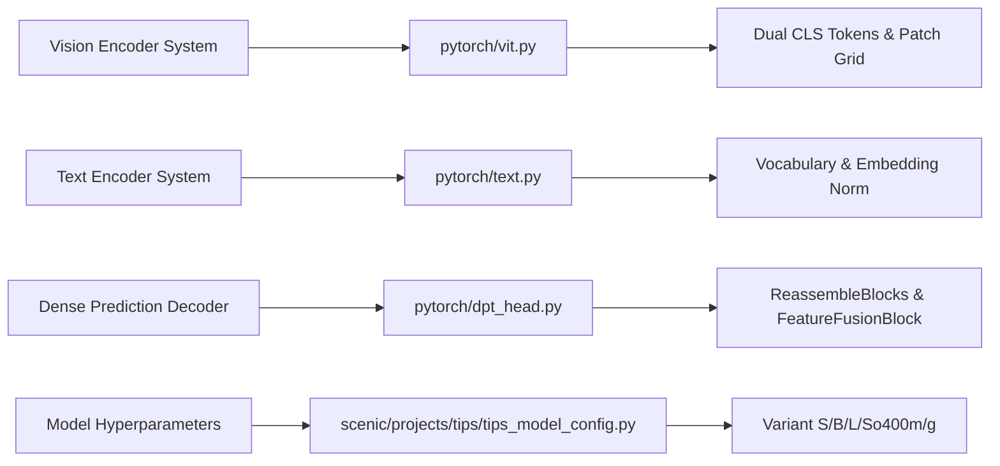
*Sources: [README.md:10-84]()*

---

## Model Variants Summary

The repository provides checkpoints across two major generations (`TIPSv1` and `TIPSv2`) spanning multiple parameter scales [README.md:25-83](). 

| Model Generation | Size / Variant | Vision / Text Parameters | Key Capabilities |
| :--- | :--- | :--- | :--- |
| **TIPSv2** | `g/14` | 1.1B / 389.1M [README.md:68-68]() | Enhanced patch-text alignment, high-resolution spatial awareness [README.md:13-23]() |
| **TIPSv2** | `SO/14` | 412.4M / 448.3M [README.md:69-69]() | Strong semantic segmentation and depth estimation [README.md:38-41]() |
| **TIPSv2** | `L/14` | 303.2M / 183.9M [README.md:70-70]() | Balanced compute and state-of-the-art zero-shot retrieval [README.md:66-71]() |
| **TIPSv2** | `B/14` | 85.7M / 109.6M [README.md:71-71]() | Lightweight baseline for edge and fast prototyping [README.md:66-71]() |
| **TIPSv1** | `g/14-HR` / `g/14-LR` | 1.1B / 389.1M [README.md:77-78]() | High-resolution / Low-resolution spatial variants [README.md:77-78]() |
| **TIPSv1** | `S/14-HR` | 21.6M / 33.6M [README.md:82-82]() | Ultra-compact text-image pretraining baseline [README.md:82-82]() |

For exhaustive benchmarking tables across 9 tasks and 20 datasets (including PASCAL VOC segmentation, NYU-depth, ImageNet-KNN, and Flickr30k cross-modal retrieval), consult [Model Variants and Checkpoints](#1.2) [README.md:23-83]().

Sources: [README.md:13-83]()

---

## Documentation and Architectural Assets

Visual diagrams and qualitative results illustrating spatial awareness, feature PCA projections, and block architectures are stored under `docs/images/` [README.md:18-36]():

* `docs/images/overview.png`: High-level system architecture and task evaluation matrix [README.md:18-20]().
* `docs/images/pca.png`: Principal component analysis visualizations of spatial patch embeddings [README.md:32-36]().
* `docs/images/tipsv2_block.png`: Detailed structural block diagram of TIPSv2 enhancements [docs/images/tipsv2_block.png:1-29]().
* `docs/images/tipsv2_teaser.png`: Qualitative comparison teaser demonstrating zero-shot dense prediction [docs/images/tipsv2_teaser.png:1-27]().

---

## Child Pages

- [Getting Started](#1.1) — Python 3.11 environment setup, `PYTHONPATH` configuration, backend dependencies, and inference script execution instructions.
- [Model Variants and Checkpoints](#1.2) — Variant naming conventions (`S`/`B`/`L`/`So400m`/`g`, `HR`/`LR`, distillation), version comparison, and Google Cloud Storage (GCS) checkpoint layouts.

---

# Page: Getting Started

# Getting Started

<details>
<summary>Relevant source files</summary>

The following files were used as context for generating this wiki page:

- [README.md](README.md)
- [pytorch/run_image_encoder_inference.py](pytorch/run_image_encoder_inference.py)

</details>


## Purpose and Scope

This page provides comprehensive instructions for setting up the execution environment for both PyTorch and JAX/Scenic backends of the TIPS and TIPSv2 codebase. It details Python 3.11 virtual environment configuration, `PYTHONPATH` exports for module resolution, backend-specific dependency installation, and executing end-to-end inference scripts such as `pytorch/run_image_encoder_inference.py` [pytorch/run_image_encoder_inference.py:16-28]().

Sources: [README.md:1-84](), [pytorch/run_image_encoder_inference.py:16-28]()

---

## Environment Setup and Python 3.11 Configuration

To ensure full compatibility with tensor operations and model definitions, the codebase requires **Python 3.11**. Setting up an isolated virtual environment prevents dependency conflicts with system packages.

```bash
# Create a Python 3.11 virtual environment
python3.11 -m venv tips_env

# Activate the environment
source tips_env/bin/activate

# Upgrade pip and packaging tools
pip install --upgrade pip setuptools wheel
```

Sources: [README.md:1-84]()

---

## PYTHONPATH and Module Resolution

The repository utilizes structured subpackages (`pytorch/` and `scenic/`) that import core utilities relative to the repository root. To ensure Python can resolve absolute imports like `from tips.pytorch import image_encoder` [pytorch/run_image_encoder_inference.py:38](), the repository root must be added to your `PYTHONPATH`.

```bash
# Set PYTHONPATH to the root directory of the repository
export PYTHONPATH="${PYTHONPATH}:/path/to/tips"
```

### Module Resolution Flow

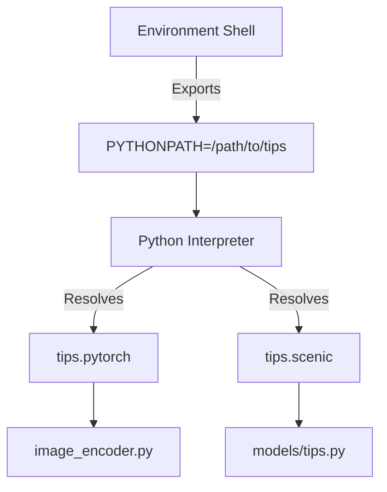
Sources: [pytorch/run_image_encoder_inference.py:30-39]()

---

## Dependencies for Both Backends

The repository supports two distinct deep learning backends: **PyTorch** and **JAX/Scenic**. Depending on your runtime preference, install the respective dependency profiles.

### PyTorch Backend Dependencies
For running PyTorch inference scripts and notebooks, install PyTorch, Torchvision, and supporting data utilities:

```bash
pip install torch torchvision numpy pillow
```

### JAX / Scenic Backend Dependencies
For running the JAX-based inference pipeline using the `scenic` library [README.md:57-58](), install JAX (with GPU/TPU support if applicable) and Scenic requirements:

```bash
pip install jax jaxlib flax scenic
```

Sources: [README.md:53-64](), [pytorch/run_image_encoder_inference.py:30-37]()

### Backend Dependency Architecture

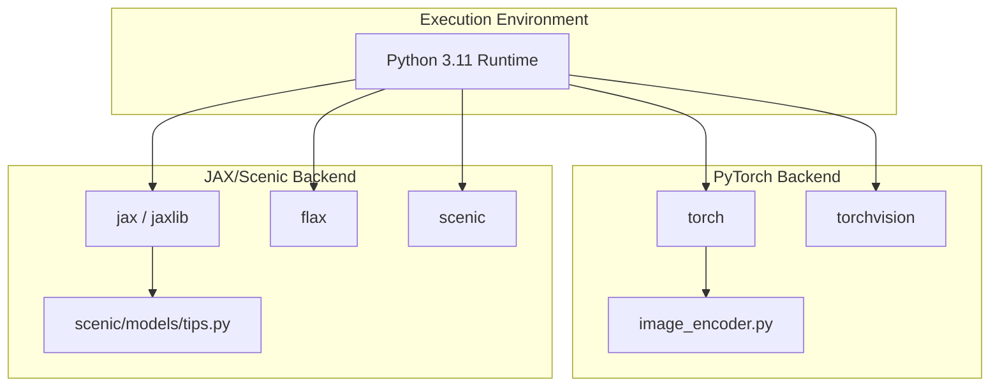
Sources: [README.md:53-64](), [pytorch/run_image_encoder_inference.py:30-37]()

---

## Running Inference Scripts

Once the environment and dependencies are configured, you can execute inference using the provided command-line interfaces.

### Image Encoder Inference (`pytorch/run_image_encoder_inference.py`)

The script `pytorch/run_image_encoder_inference.py` loads a serialized checkpoint (`.npz` converted or raw state dict), resizes input images, instantiates the selected ViT backbone variant, and extracts normalized dual `[CLS]` token embeddings [pytorch/run_image_encoder_inference.py:70-123]().

#### Command-Line Arguments
* `--model_path`: Path to the model checkpoint file (`.npz` or `.pth`) [pytorch/run_image_encoder_inference.py:46]().
* `--image_file`: Path to the input image file for inference [pytorch/run_image_encoder_inference.py:49-53]().
* `--model_variant`: ViT model size variant (`S`, `B`, `L`, `So400m`, `g`) [pytorch/run_image_encoder_inference.py:60-65]().
* `--is_low_res`: Flag for low-resolution models (224px instead of 448px) [pytorch/run_image_encoder_inference.py:55-58]().

#### Execution Example

```bash
python pytorch/run_image_encoder_inference.py \
    --model_path=/path/to/checkpoint.npz \
    --image_file=/path/to/image.jpg \
    --model_variant=g
```

Sources: [pytorch/run_image_encoder_inference.py:16-129]()

---

# Page: Model Variants and Checkpoints

# Model Variants and Checkpoints

<details>
<summary>Relevant source files</summary>

The following files were used as context for generating this wiki page:

- [README.md](README.md)
- [pytorch/checkpoints/download_checkpoints.sh](pytorch/checkpoints/download_checkpoints.sh)
- [scenic/checkpoints/download_checkpoints.sh](scenic/checkpoints/download_checkpoints.sh)
- [scenic/notebooks/TIPS_Demo.ipynb](scenic/notebooks/TIPS_Demo.ipynb)

</details>


This section documents the model variant taxonomy, architectural differences between TIPSv1 and TIPSv2, Google Cloud Storage (GCS) checkpoint organization, and the automated download mechanisms used across both PyTorch and JAX/Scenic backends.

Sources: `README.md:10-84`, `pytorch/checkpoints/download_checkpoints.sh:1-50`

---

## 1. Variant Naming Conventions & Architecture Sizes

TIPS models are distributed across multiple scaling tiers, designated by abbreviations indicating the vision backbone size, patch size, resolution tier, and training methodology (such as distillation).

### Scaling Tiers and Parameters
* **`S` (Small)**: Vision encoder ~21.6M params, Text encoder ~33.6M params (`README.md:82`).
* **`B` (Base)**: Vision encoder ~85.7M params, Text encoder ~109.6M params (`README.md:71`, `README.md:81`).
* **`L` (Large)**: Vision encoder ~303.2M params, Text encoder ~183.9M params (`README.md:70`, `README.md:80`).
* **`So400m` / `So` (Sub-Quadratic / 400M)**: Vision encoder ~412.4M params, Text encoder ~448.3M params (`README.md:69`, `README.md:79`).
* **`g` (Giant)**: Vision encoder ~1.1B params, Text encoder ~389.1M params (`README.md:68`, `README.md:77`).

### Qualitative Modifiers
* **`/14`**: Denotes a fixed patch size of $14 \times 14$ pixels across all vision backends (`README.md:68-82`).
* **`-HR` / `-LR`**: High-Resolution vs. Low-Resolution input handling variants present in TIPSv1 (`README.md:77-82`).
* **`_distilled`**: Indicates models trained using distillation objectives to compress capability into smaller student architectures (`pytorch/checkpoints/download_checkpoints.sh:20-23`).

```mermaid
graph TD
    VariantName[""Model Variant Identifier""] --> SizeTag[""Size: S / B / L / So400m / g""]
    VariantName --> PatchTag[""Patch Size: /14""]
    VariantName --> ResTag[""Resolution: HR / LR (v1 only)""]
    VariantName --> TrainTag[""Method: distilled""]

    SizeTag --> CodeModelDef[""pytorch/ or scenic/ model constructors""]
    PatchTag --> CodePatch[""ViT Patch Embedding Grid""]
    ResTag --> CodePose[""Positional Embedding Interpolation""]
```
Sources: `README.md:65-83`, `pytorch/checkpoints/download_checkpoints.sh:19-32`

---

## 2. TIPSv1 vs. TIPSv2 Evolution

The repository houses two generations of the TIPS architecture:

1. **TIPSv1 (ICLR 2025)**: Introduced Text-Image Pretraining with Spatial Awareness. Explored `-HR` and `-LR` resolution variants across `S`, `B`, `L`, `So400m`, and `g` sizes (`README.md:14`, `README.md:74-83`).
2. **TIPSv2 (CVPR 2026)**: Advances vision-language pretraining with enhanced patch-text alignment. Streamlines variants into unified configurations (`B`, `L`, `So`, `g`) without explicit HR/LR separation, achieving improved dense prediction and zero-shot transfer (`README.md:13`, `README.md:65-72`).

Sources: `README.md:10-27`, `README.md:65-83`

---

## 3. GCS Checkpoint Layout & Storage Format

All model weights are hosted on Google Cloud Storage under the bucket `https://storage.googleapis.com/tips_data/` (`README.md:18`, `pytorch/checkpoints/download_checkpoints.sh:35`). 

### Directory Structure
```
https://storage.googleapis.com/tips_data/
├── v1_0/
│   └── checkpoints/
│       ├── tokenizer.model
│       ├── pytorch/
│       │   ├── tips_oss_s14_highres_distilled_vision.npz
│       │   ├── tips_oss_s14_highres_distilled_text.npz
│       │   └── ...
│       └── scenic/
│           ├── tips_oss_s14_highres_distilled_vision.npz
│           └── ...
└── v2_0/
    └── checkpoints/
        ├── pytorch/
        │   ├── tips_v2_oss_b14_vision.npz
        │   └── tips_v2_oss_b14_text.npz
        └── scenic/
            ├── tips_v2_b14_vision.npz
            └── ...
```

Each variant checkpoint is split into two distinct `.npz` archives:
* **`_vision.npz`**: Contains weights for the Vision Transformer (ViT) backbone and spatial heads.
* **`_text.npz`**: Contains weights for the Text Encoder transformer blocks and token embeddings.

```mermaid
graph LR
    GCSRoot[""GCS Bucket: tips_data""] --> V1[""v1_0/checkpoints/""]
    GCSRoot --> V2[""v2_0/checkpoints/""]

    V1 --> V1_Tok[""tokenizer.model""]
    V1 --> V1_Pth[""pytorch/ (*_vision.npz, *_text.npz)""]
    V1 --> V1_Scn[""scenic/ (*_vision.npz, *_text.npz)""]

    V2 --> V2_Pth[""pytorch/ (*_vision.npz, *_text.npz)""]
    V2 --> V2_Scn[""scenic/ (*_vision.npz, *_text.npz)""]
```
Sources: `pytorch/checkpoints/download_checkpoints.sh:34-49`, `scenic/checkpoints/download_checkpoints.sh:34-49`, `scenic/notebooks/TIPS_Demo.ipynb:179-184`

---

## 4. Download Scripts & Automation

To simplify weight retrieval, shell scripts are provided in both backend directories. These scripts iterate over the defined checkpoint arrays and fetch the appropriate `.npz` files using `wget`.

### PyTorch Checkpoint Downloader
The PyTorch download script retrieves the shared tokenizer and all v1/v2 PyTorch-compatible parameter arrays:

```bash
# Executed from pytorch/checkpoints/
bash download_checkpoints.sh
```

```python
# Conceptual mapping in download_checkpoints.sh
TIPS_CHECKPOINTS = [
  "tips_oss_s14_highres_distilled",
  "tips_oss_b14_highres_distilled",
  "tips_oss_l14_highres_distilled",
  "tips_oss_so400m14_highres_largetext_distilled",
  "tips_oss_g14_lowres",
  "tips_oss_g14_highres"
]
```
Sources: `pytorch/checkpoints/download_checkpoints.sh:1-50`, `scenic/checkpoints/download_checkpoints.sh:1-50`

---

# Page: PyTorch Implementation

# PyTorch Implementation

<details>
<summary>Relevant source files</summary>

The following files were used as context for generating this wiki page:

- [pytorch/__init__.py](pytorch/__init__.py)
- [pytorch/image_encoder.py](pytorch/image_encoder.py)

</details>


## Purpose and Scope
The `pytorch/` package provides a complete PyTorch implementation of the TIPS and TIPSv2 architectures [pytorch/__init__.py:1-32](). It mirrors the capabilities of the JAX/Scenic backend, providing high-performance vision encoders [pytorch/image_encoder.py:16-16](), text encoders, dense prediction decoders, and production-ready inference CLIs. 

This page serves as a high-level overview of the PyTorch subsystem. For granular technical details, refer to the individual child pages linked below.

---

## Architecture Overview (Natural Language Space to Code Entity Space)

The following diagram maps high-level architectural concepts to their concrete code entities within the `pytorch/` package.

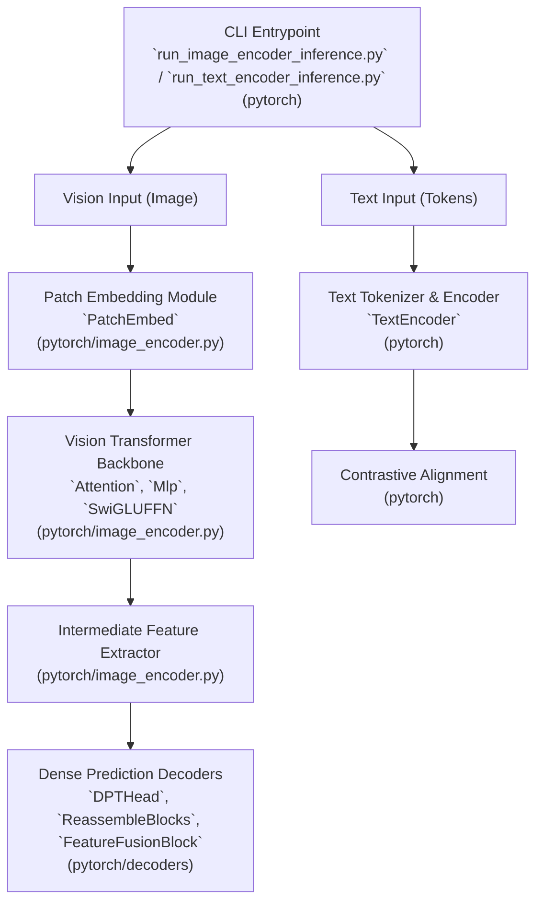
Sources: [pytorch/__init__.py:1-32](), [pytorch/image_encoder.py:16-220]()

---

## 2.1 Image Encoder (ViT backbone)

The Vision Transformer (ViT) backbone is implemented in `pytorch/image_encoder.py` and supports multiple model scales (`vit_small`, `vit_base`, `vit_large`, `vit_so400m`, `vit_giant2`). It features patch extraction with patch size 14 [pytorch/image_encoder.py:67-134](), dual class tokens, positional-embedding interpolation for varying resolutions, and efficient SwiGLU FFN blocks (`SwiGLUFFN`, `SwiGLUFFNFused`) [pytorch/image_encoder.py:136-200]() alongside standard multi-head attention mechanisms (`Attention`) [pytorch/image_encoder.py:201-220]().

For details, see [Image Encoder (ViT backbone)](#2.1).

Sources: [pytorch/image_encoder.py:16-220]()

---

## 2.2 Text Encoder and Tokenizer

The text pipeline processes natural language prompts and inputs to align with visual representations via contrastive learning. It incorporates dedicated `TextEncoder` modules tailored to each model variant, coupled with robust tokenizers handling vocabulary lookup, padding masks, and embedding normalization.

For details, see [Text Encoder and Tokenizer](#2.2).

Sources: [pytorch/__init__.py:1-32]()

---

## 2.3 Dense Prediction Decoders

Dense prediction tasks (such as semantic segmentation, depth estimation, and surface normal prediction) are handled by specialized decoders in the PyTorch package. These modules implement `DPTHead`, `ReassembleBlocks`, and `FeatureFusionBlock` architectures, and include utilities for converting Scenic/Flax pretrained weights into native PyTorch state dicts.

For details, see [Dense Prediction Decoders](#2.3).

Sources: [pytorch/__init__.py:1-32]()

---

## 2.4 PyTorch Inference CLIs

To facilitate evaluation and deployment, the package provides command-line interfaces (`run_image_encoder_inference.py` and `run_text_encoder_inference.py`). These scripts handle argument parsing, image/text preprocessing, device placement (CPU/GPU), model loading, and standardized output formatting.

For details, see [PyTorch Inference CLIs](#2.4).

Sources: [pytorch/__init__.py:1-32]()

---

## Inference and Execution Flow

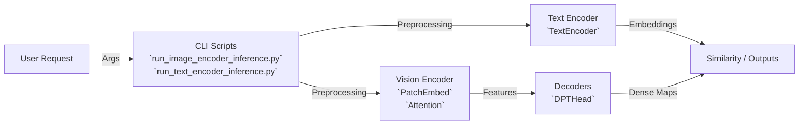
Sources: [pytorch/__init__.py:1-32](), [pytorch/image_encoder.py:67-220]()

---

# Page: Image Encoder (ViT backbone)

# Image Encoder (ViT backbone)

<details>
<summary>Relevant source files</summary>

The following files were used as context for generating this wiki page:

- [pytorch/image_encoder.py](pytorch/image_encoder.py)
- [pytorch/run_image_encoder_inference.py](pytorch/run_image_encoder_inference.py)

</details>


## Purpose and Scope
This page details the PyTorch Vision Transformer (ViT) backbone implementation (`pytorch/image_encoder.py`) and its execution pipeline (`pytorch/run_image_encoder_inference.py`). It covers model variant constructors (`vit_small`, `vit_base`, `vit_large`, `vit_so400m`, `vit_giant2`), patch size configuration (patch size 14), dual class (`CLS`) tokens, positional-embedding interpolation for flexible input resolutions, and intermediate layer extraction.

Sources: `pytorch/image_encoder.py:1-220()`, `pytorch/run_image_encoder_inference.py:16-130()`

---

## Model Variants and Constructors
The image encoder supports multiple Vision Transformer variants, exposed via builder functions mapping configuration keys (`'S'`, `'B'`, `'L'`, `'So400m'`, `'g'`) to specific backbone constructors [pytorch/run_image_encoder_inference.py:72-78]():
- `vit_small`: Small variant (`'S'`) [pytorch/run_image_encoder_inference.py:73]()
- `vit_base`: Base variant (`'B'`) [pytorch/run_image_encoder_inference.py:74]()
- `vit_large`: Large variant (`'L'`) [pytorch/run_image_encoder_inference.py:75]()
- `vit_so400m`: So400m variant (`'So400m'`) [pytorch/run_image_encoder_inference.py:76]()
- `vit_giant2`: Giant-2 variant (`'g'`), which uses the `swiglu` feed-forward network layer instead of standard `mlp` [pytorch/run_image_encoder_inference.py:77-80]()

All variants default to a patch size of 14 (`PATCH_SIZE = 14`) [pytorch/run_image_encoder_inference.py:42]() and support both low-resolution (224px) and high-resolution (448px) inputs [pytorch/run_image_encoder_inference.py:55-58(), pytorch/run_image_encoder_inference.py:71]().

Sources: `pytorch/run_image_encoder_inference.py:40-81()`

---

## Core Backbone Components
The ViT architecture relies on several foundational modules implemented in `pytorch/image_encoder.py`:
- `PatchEmbed`: Converts 2D input images `(B, C, H, W)` into patch embeddings `(B, N, D)` using a 2D convolution projection with kernel size and stride equal to `patch_size` [pytorch/image_encoder.py:67-102](). It verifies input dimension divisibility and supports flattening or retaining spatial resolution [pytorch/image_encoder.py:103-120]().
- `Mlp`: Standard Transformer MLP block following DINOv2 conventions, comprising two linear transformations with an activation layer (`nn.GELU`) and dropout [pytorch/image_encoder.py:29-55]().
- `SwiGLUFFN` / `SwiGLUFFNFused`: SwiGLU feed-forward network implementation used by the giant model variant (`g`), utilizing SiLU activation gated across chunked projections [pytorch/image_encoder.py:136-199]().
- `Attention`: Multi-head self-attention module supporting query-key-value projections and scaling factors [pytorch/image_encoder.py:201-220]().

Sources: `pytorch/image_encoder.py:29-220()`

---

## Dual CLS Tokens and Positional-Embedding Interpolation
TIPS models utilize dual `CLS` tokens appended to the patch sequence. During forward execution, the encoder processes the token sequence containing both class tokens and returns outputs corresponding to each [pytorch/run_image_encoder_inference.py:111-114](). These embeddings are subsequently L2-normalized with a clipping epsilon [pytorch/run_image_encoder_inference.py:116-121]().

Positional embeddings support dynamic resolution adjustments via interpolation. TIPSv2 models incorporate a `(32, 32)` positional-embedding grid (for 448px resolution at patch size 14) compared to smaller grids in TIPSv1, configured via parameters such as `interpolate_antialias=True` and `interpolate_offset=0.0` [pytorch/run_image_encoder_inference.py:16-19(), pytorch/run_image_encoder_inference.py:105-107]().

Sources: `pytorch/run_image_encoder_inference.py:16-124()`

---

## Architecture to Code Mapping

Title: "Vision Encoder Architecture Mapping"
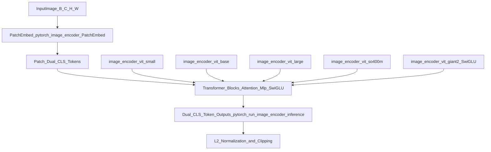
Sources: `pytorch/run_image_encoder_inference.py:72-121()`, `pytorch/image_encoder.py:67-120()`

---

## Data Flow and Intermediate Layer Extraction
The image encoder supports extracting intermediate feature representations across layers (crucial for dense prediction decoders). The data flows from image loading and resizing through `PatchEmbed`, through stacked transformer blocks equipped with either `Mlp` or `SwiGLUFFN`, up to final token outputs or intermediate activations.

Title: "Image Encoder Inference Data Flow"
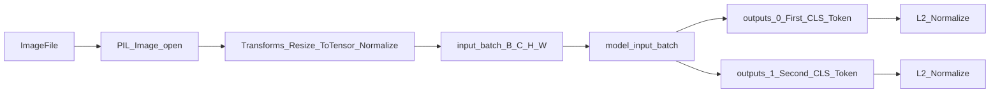
Sources: `pytorch/run_image_encoder_inference.py:87-121()`

---

# Page: Text Encoder and Tokenizer

# Text Encoder and Tokenizer

<details>
<summary>Relevant source files</summary>

The following files were used as context for generating this wiki page:

- [pytorch/run_text_encoder_inference.py](pytorch/run_text_encoder_inference.py)
- [pytorch/text_encoder.py](pytorch/text_encoder.py)

</details>


## Purpose and Scope
This page details the text encoding pipeline and tokenizer implementation in the TIPS/TIPSv2 PyTorch backend (`[pytorch/text_encoder.py]()` and `[pytorch/run_text_encoder_inference.py]()`). The text encoder is responsible for embedding natural language queries into a joint vision-language latent space where they can be matched against visual representations. We cover the SentencePiece tokenizer configuration, architectural variants (`S`, `B`, `L`, `So400m`, `g`), custom masked transformer blocks, positional embeddings, and L2 embedding normalization.

Sources: `[pytorch/text_encoder.py:16-25](), [pytorch/run_text_encoder_inference.py:16-34]()`

---

## 1. Tokenizer and Vocabulary

The text input pipeline utilizes a SentencePiece tokenizer wrapped by `tensorflow_text` to process raw text strings into integer token IDs and binary padding masks.

### Tokenizer Class
The `Tokenizer` class initializes a `tensorflow_text.SentencepieceTokenizer` from a binary model file. It automatically lowercases inputs, truncates sequences exceeding `max_len`, pads shorter sequences with zeros, and generates a corresponding padding mask (`is_padding`).

```python
class Tokenizer(object):
  """A simple tokenizer."""

  def __init__(self, tokenizer_path: str):
    """Initializes the tokenizer."""
    with open(tokenizer_path, 'rb') as f:
      model = f.read()
    self.tokenizer = tensorflow_text.SentencepieceTokenizer(
        model=model, add_eos=False, add_bos=False
    )
```
*Defined at `[pytorch/text_encoder.py:27-37]()`.*

The tokenization and padding routine handles sequence length constraints:
```python
  def tokenize(self, input_text, max_len=64):
    tokens = self.tokenizer.tokenize(tf.strings.lower(input_text)).to_tensor()
    curr_len = tokens.shape[1]
    is_padding = tf.zeros((tokens.shape[0], max_len))
    if curr_len > max_len:
      tokens = tokens[:, :max_len]
    else:
      padding_len = max_len - curr_len
      tokens = tf.pad(tokens, [[0, 0], [0, padding_len]], constant_values=0)
      is_padding = tf.cast(tokens == 0, tf.int32)
    return tokens.numpy(), is_padding.numpy()
```
*Defined at `[pytorch/text_encoder.py:38-48]()`.*

### Constants
* **Vocabulary Size (`VOCAB_SIZE`)**: `32000`
* **Maximum Sequence Length (`MAX_LEN`)**: `64`

Sources: `[pytorch/text_encoder.py:27-48](), [pytorch/run_text_encoder_inference.py:42-43]()`

---

## 2. Text Encoder Architecture per Variant

The text encoder shares its base transformer design across TIPSv1 and TIPSv2. Different vision-tower scale variants determine the hidden dimensions, MLP expansion dimensions, attention heads, and layer depths of the text tower.

### Variant Hyperparameters

| Variant Letter (`v`) | Hidden Size (`hidden_size`) | MLP Dimension (`mlp_dim`) | Attention Heads (`num_heads`) | Layers (`num_layers`) |
| :--- | :--- | :--- | :--- | :--- |
| **S** (Small) | 384 | 1536 | 6 | 12 |
| **B** (Base) | 768 | 3072 | 12 | 12 |
| **L** (Large) | 1024 | 4096 | 16 | 12 |
| **So400m** | 1152 | 4304 | 16 | 27 |
| **g** (Giant) | 1536 | 6144 | 24 | 12 |

### Configuration Function
The text encoder configuration is retrieved via `get_config`:

```python
def get_config(v: str):
  return {
      'hidden_size': {
          'S': 384, 'B': 768, 'L': 1024, 'So400m': 1152, 'g': 1536,
      }[v],
      'mlp_dim': {
          'S': 1536, 'B': 3072, 'L': 4096, 'So400m': 4304, 'g': 6144,
      }[v],
      'num_heads': {
          'S': 6, 'B': 12, 'L': 16, 'So400m': 16, 'g': 24,
      }[v],
      'num_layers': {
          'S': 12, 'B': 12, 'L': 12, 'So400m': 27, 'g': 12,
      }[v],
  }
```
*Defined at `[pytorch/run_text_encoder_inference.py:70-89]()`.*

Sources: `[pytorch/run_text_encoder_inference.py:70-89]()`

---

## 3. Core Components and Masking

The text encoder uses specialized modules to incorporate sinusoidal positional embeddings and handle padding tokens during multi-head self-attention and feed-forward operations.

### Positional Embedding
`PositionalEmbedding` generates 1D sinusoidal position signals across geometric timescales.

```python
class PositionalEmbedding(nn.Module):
  min_timescale: int = 1
  max_timescale: int = 10_000
  embedding_dim: int = 0

  def __init__(self, embedding_dim: int):
    super().__init__()
    self.embedding_dim = embedding_dim

  def __call__(self, seq_length: int = None, position: torch.tensor = None):
    if position is None:
      assert seq_length is not None
      position = torch.arange(seq_length, dtype=torch.float32)[None, :]
    else:
      assert position.ndim == 2, position.shape

    num_timescales = self.embedding_dim // 2
    log_timescale_increment = torch.log(
        torch.tensor(float(self.max_timescale) / float(self.min_timescale))
    ) / torch.maximum(
        torch.tensor(num_timescales, dtype=torch.float32) - 1, torch.tensor(1)
    )
    inv_timescales = self.min_timescale * torch.exp(
        torch.arange(num_timescales, dtype=torch.float32)
        * -log_timescale_increment
    )
    scaled_time = position[:, :, None] * inv_timescales[None, None, :]
    signal = torch.cat((torch.sin(scaled_time), torch.cos(scaled_time)), dim=2)
    signal = F.pad(signal, (0, self.embedding_dim % 2, 0, 0, 0, 0))
    return signal
```
*Defined at `[pytorch/text_encoder.py:51-104]()`.*

### Masked MLP Block
`MlpBlockWithMask` ensures that padded tokens do not influence intermediate feed-forward activations by multiplying intermediate and project outputs with `mlp_mask`.

```python
class MlpBlockWithMask(nn.Module):
  def __init__(self, mlp_dim: int, d_model: int, use_bias: bool = True, ...):
    super().__init__()
    self.c_fc = nn.Linear(in_features=d_model, out_features=mlp_dim, bias=use_bias)
    self.c_proj = nn.Linear(in_features=mlp_dim, out_features=d_model, bias=use_bias)

  def __call__(self, inputs: torch.Tensor, mlp_mask: torch.Tensor) -> torch.Tensor:
    x = self.c_fc(inputs)
    x = F.gelu(x)
    x = x * mlp_mask[..., None]  # First masking.
    x = self.c_proj(x)
    x = x * mlp_mask[..., None]  # Second masking.
    return x
```
*Defined at `[pytorch/text_encoder.py:107-148]()`.*

### Residual Attention Block
`ResidualAttentionBlock` orchestrates layer normalization, multi-head attention with attention masking derived from padding bits, and the masked MLP block.

```python
class ResidualAttentionBlock(nn.Module):
  def __init__(self, d_model: int, n_head: int, mlp_dim: int, dtype: torch.dtype = torch.float32):
    super().__init__()
    self.attn = nn.MultiheadAttention(d_model, n_head, dtype=self.dtype)
    self.ln_1 = nn.LayerNorm(d_model, dtype=self.dtype)
    self.mlp = MlpBlockWithMask(mlp_dim, d_model, use_bias=True, dtype=self.dtype, activation_fn=nn.ReLU)
    self.ln_2 = nn.LayerNorm(d_model, dtype=self.dtype)

  def forward(self, x: torch.Tensor, mask: torch.Tensor):
    x = x + self.attention(self.ln_1(x), mask.permute(1, 0))
    x = x + self.mlp(self.ln_2(x), mask)
    return x, mask
```
*Defined at `[pytorch/text_encoder.py:151-191]()`.*

Sources: `[pytorch/text_encoder.py:51-191]()`

---

## 4. Embedding Normalization and Inference Flow

### Bridge: Natural Language Space to Code Entity Space (Tokenization & Encoding)

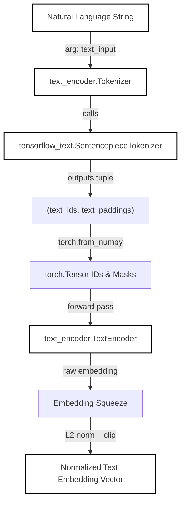
*Sources: `[pytorch/run_text_encoder_inference.py:112-125](), [pytorch/text_encoder.py:38-48]()`*

### Bridge: Transformer Block Data Flow with Masks

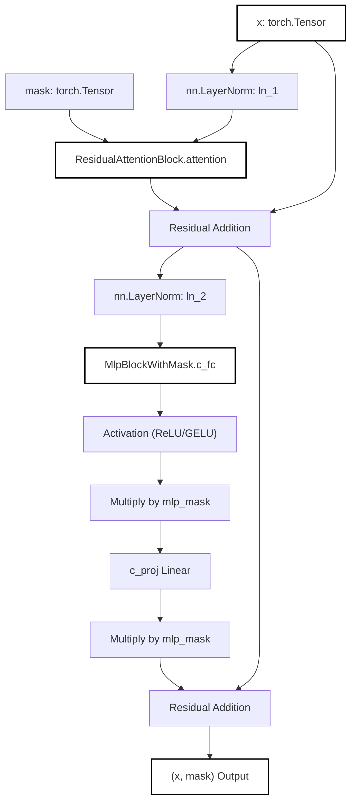
*Sources: `[pytorch/text_encoder.py:151-191]()`*

### Post-Processing Normalization
After extracting raw embeddings from the text encoder, L2 normalization with a minimum clip value is applied to produce unit vectors for contrastive matching:

```python
    text_embedding = (
        model_text(torch.from_numpy(text_ids), torch.from_numpy(text_paddings))
        .detach()
        .numpy()
        .squeeze()
    )
    text_embedding = text_embedding / np.linalg.norm(
        text_embedding, ord=2, axis=-1, keepdims=True
    ).clip(min=1e-3)
```
*Defined at `[pytorch/run_text_encoder_inference.py:116-124]()`.*

Sources: `[pytorch/run_text_encoder_inference.py:112-125]()`

---

# Page: Dense Prediction Decoders

# Dense Prediction Decoders

<details>
<summary>Relevant source files</summary>

The following files were used as context for generating this wiki page:

- [pytorch/decoders.py](pytorch/decoders.py)

</details>


This section covers the PyTorch implementation of Dense Prediction Transformer (DPT) decoders in the TIPS codebase (`pytorch/decoders.py`). It details the low-level building blocks (`PreActResidualConvUnit`, `FeatureFusionBlock`, `ReassembleBlocks`), the shared `DPTHead` architecture for multi-scale intermediate feature fusion, task-specific decoders for segmentation, depth, and surface normals, and the weight conversion pipeline from Scenic (JAX) to PyTorch.

---

## 1. Core Architectural Building Blocks

The dense prediction decoders transform intermediate patch tokens and `[CLS]` tokens extracted from the Vision Transformer (ViT) backbone into dense, high-resolution spatial feature maps. This is achieved via a hierarchy of pre-activation residual units, feature fusion blocks, and reassembly modules.

### PreActResidualConvUnit and FeatureFusionBlock

The `PreActResidualConvUnit` implements a pre-activation residual convolution block consisting of alternating ReLU activations and 3x3 convolutions (`[pytorch/decoders.py:40-55]()`). 

The `FeatureFusionBlock` takes a feature map, optionally integrates a residual feature map via bilinear interpolation and a `PreActResidualConvUnit`, applies a main residual unit, upsamples the result by a factor of 2 using bilinear interpolation with `align_corners=True`, and projects the channels down using a 1x1 convolution (`[pytorch/decoders.py:57-95]()`).

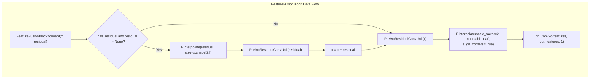
*Sources: `pytorch/decoders.py:40-95`*

### ReassembleBlocks

The `ReassembleBlocks` module takes a list of intermediate ViT feature tuples—each containing a `[CLS]` token and a spatial patch tensor—and projects and resizes them to match four multi-scale target resolutions (`[pytorch/decoders.py:98-146]`). 

Depending on the `readout_type` parameter, when set to `"project"`, the `[CLS]` token is concatenated with flattened spatial patch tokens, processed through a linear layer and a JAX-compatible approximate GELU activation, and reshaped back into a spatial tensor before applying task-specific projections and resize operations (`[pytorch/decoders.py:108-145]()`).

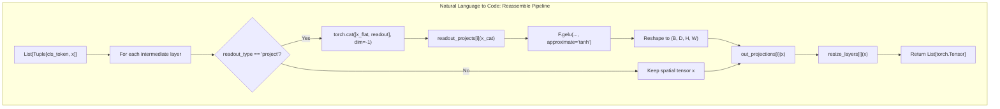
*Sources: `pytorch/decoders.py:98-146`*

---

## 2. Shared DPT Head Architecture

The `DPTHead` module acts as the unified backbone for all dense prediction tasks in TIPS (`[pytorch/decoders.py:153-197]()`). It coordinates feature reassembly, channel projection, and bottom-up feature fusion across multiple network scales.

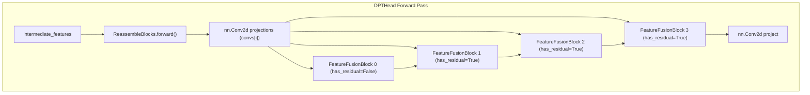
*Sources: `pytorch/decoders.py:153-197`*

### Implementation Summary of DPTHead

1. **Reassembly**: Calls `ReassembleBlocks` to project and resize multi-layer ViT features (`[pytorch/decoders.py:172-176]()`).
2. **Channel Adaptation**: Projects each reassembled feature map to a common channel width using `nn.ModuleList` of 2D convolutions (`[pytorch/decoders.py:177-180]()`).
3. **Bottom-Up Fusion**: Passes features sequentially through four `FeatureFusionBlock` instances where deeper features incorporate residual connections from shallower layers (`[pytorch/decoders.py:181-197]()`).

*Sources: `pytorch/decoders.py:153-197`*

---

## 3. Task-Specific Decoders and Weight Conversion

Building upon `DPTHead`, specialized subclasses handle distinct dense prediction targets:
* **Segmentation Decoder**: Outputs class logits per pixel for tasks like semantic segmentation (e.g., ADE20K).
* **Depth Decoder**: Predicts continuous metric or relative depth maps.
* **Surface Normals Decoder**: Regresses 3-channel unit normal vectors for 3D geometric understanding.

### Scenic to PyTorch Weight Conversion

Weights originating from Scenic (JAX/Flax) checkpoints undergo structural transformation before loading into PyTorch decoders:
* Transposition of 2D convolution weights from Flax layout `(H, W, InC, OutC)` to PyTorch layout `(OutC, InC, H, W)`.
* Mapping parameter names from Flax nested dictionaries to flat PyTorch module hierarchies.
* Handling linear layer weight transpositions where PyTorch expects `(OutC, InC)` and Flax uses `(InC, OutC)`.

*Sources: `pytorch/decoders.py:1-25`*

---

# Page: PyTorch Inference CLIs

# PyTorch Inference CLIs

<details>
<summary>Relevant source files</summary>

The following files were used as context for generating this wiki page:

- [pytorch/run_image_encoder_inference.py](pytorch/run_image_encoder_inference.py)
- [pytorch/run_text_encoder_inference.py](pytorch/run_text_encoder_inference.py)

</details>


## Purpose and Scope
This section details the PyTorch inference command-line interfaces (CLIs) provided in the repository: `run_image_encoder_inference.py` and `run_text_encoder_inference.py`. These scripts execute end-to-end forward passes for TIPS and TIPSv2 models using PyTorch backends. They handle argument parsing, image and text preprocessing, model instantiation across various architectural sizes (`S`, `B`, `L`, `So400m`, `g`), state loading from NumPy checkpoints, and L2-normalized embedding extraction.

---

## 1. Image Encoder CLI (`run_image_encoder_inference.py`)

The image encoder inference script processes input images through the appropriate Vision Transformer (ViT) variant, extracting dual CLS token embeddings.

### Command-Line Arguments
The script accepts four primary arguments via `argparse.ArgumentParser` [pytorch/run_image_encoder_inference.py:44-65]():
* `--model_path`: Filesystem path to the NumPy checkpoint file (`.npz`) [pytorch/run_image_encoder_inference.py:45-47]().
* `--image_file`: Filesystem path to the input image [pytorch/run_image_encoder_inference.py:48-53]().
* `--is_low_res`: Boolean flag indicating low-resolution processing (224px instead of 448px) [pytorch/run_image_encoder_inference.py:54-58]().
* `--model_variant`: ViT scale identifier, restricted to choices `['S', 'B', 'L', 'So400m', 'g']` [pytorch/run_image_encoder_inference.py:59-65]().

### Preprocessing and Initialization
1. **Resolution & Backbone Selection**: Resolves image size to `224` if `--is_low_res` is specified, otherwise `448` [pytorch/run_image_encoder_inference.py:71](). Maps `--model_variant` to the corresponding builder function (`vit_small`, `vit_base`, `vit_large`, `vit_so400m`, or `vit_giant2`) in `tips.pytorch.image_encoder` [pytorch/run_image_encoder_inference.py:72-78]().
2. **FFN Configuration**: Sets `ffn_layer` to `'swiglu'` for variant `'g'`, and `'mlp'` for all other variants [pytorch/run_image_encoder_inference.py:80]().
3. **Checkpoint Loading**: Loads weights using `np.load` and casts arrays to PyTorch tensors [pytorch/run_image_encoder_inference.py:83-85]().
4. **Image Transformations**: Reads image bytes, opens via `PIL.Image`, and applies a `torchvision.transforms` pipeline (Resize, ToTensor, Normalize with zero mean and unit standard deviation) before adding a batch dimension [pytorch/run_image_encoder_inference.py:88-97]().

### Inference and Output Generation
Within a `torch.no_grad()` context [pytorch/run_image_encoder_inference.py:99](), the model is initialized with specific patch sizes (`PATCH_SIZE = 14`), block chunks, and interpolation flags [pytorch/run_image_encoder_inference.py:100-108](). The state dictionary is loaded into the model [pytorch/run_image_encoder_inference.py:109]().

The forward pass returns outputs containing dual `[CLS]` tokens [pytorch/run_image_encoder_inference.py:112]():
* Both `outputs[0]` (first `[CLS]` token) and `outputs[1]` (second `[CLS]` token) are extracted, detached, converted to NumPy arrays, and squeezed [pytorch/run_image_encoder_inference.py:113-114]().
* Each token is L2-normalized along the feature dimension with an epsilon clip of `1e-3` [pytorch/run_image_encoder_inference.py:116-121]().
* The normalized vectors are printed to standard output [pytorch/run_image_encoder_inference.py:122-123]().

```mermaid
title "Image Inference Data Flow to Code Entities"

graph TD
    A["CLI Argument Parsing"] --> B["pytorch/run_image_encoder_inference.py:main"]
    B --> C["Image Loading & BytesIO"]
    C --> D["PIL.Image.open"]
    D --> E["transforms.Compose (Resize, ToTensor, Normalize)"]
    E --> F["input_batch tensor"]
    B --> G["Model Constructor Mapping (vit_small/base/large/so400m/giant2)"]
    G --> H["image_encoder.py Model Instance"]
    F --> I["Model Forward Pass model(input_batch)"]
    H --> I
    I --> J["Dual CLS Tokens extraction (outputs[0], outputs[1])"]
    J --> K["L2 Normalization (np.linalg.norm)"]
    K --> L["Console Print Output"]
```

Sources: [pytorch/run_image_encoder_inference.py:1-129]()

---

## 2. Text Encoder CLI (`run_text_encoder_inference.py`)

The text encoder inference script parses string inputs, tokenizes them, and passes them through the text backbone architecture.

### Command-Line Arguments
The script accepts four arguments [pytorch/run_text_encoder_inference.py:45-67]():
* `--model_path`: Path to the text encoder checkpoint file [pytorch/run_text_encoder_inference.py:46-48]().
* `--model_variant`: Variant size letter (`S`, `B`, `L`, `So400m`, `g`) [pytorch/run_text_encoder_inference.py:49-55]().
* `--tokenizer_path`: Path to the tokenizer asset [pytorch/run_text_encoder_inference.py:56-61]().
* `--text_input`: Raw string input for encoding [pytorch/run_text_encoder_inference.py:62-67]().

### Configuration Mapping
The text tower architecture shares identical configurations across TIPSv1 and TIPSv2 for corresponding sizes. The `get_config(v)` helper maps each variant letter to its specific hyperparameters [pytorch/run_text_encoder_inference.py:70-89]():

| Variant (`v`) | Hidden Size (`hidden_size`) | MLP Dimension (`mlp_dim`) | Attention Heads (`num_heads`) | Layers (`num_layers`) |
| :--- | :--- | :--- | :--- | :--- |
| `S` | 384 | 1536 | 6 | 12 |
| `B` | 768 | 3072 | 12 | 12 |
| `L` | 1024 | 4096 | 16 | 12 |
| `So400m` | 1152 | 4304 | 16 | 27 |
| `g` | 1536 | 6144 | 24 | 12 |

Sources: [pytorch/run_text_encoder_inference.py:70-89]()

### Tokenization and Execution
1. **Checkpoint Loading**: Weights are loaded via `np.load`, converted to PyTorch tensors, and contrastive temperature keys (`temperature`, `temperature_contrastive`) are popped from the state dictionary [pytorch/run_text_encoder_inference.py:94-102]().
2. **Model Instantiation**: `text_encoder.TextEncoder` is initialized using the dictionary returned by `get_config(args.model_variant)` alongside a fixed vocabulary size (`VOCAB_SIZE = 32000`), and state weights are loaded [pytorch/run_text_encoder_inference.py:106-110]().
3. **Tokenization**: `text_encoder.Tokenizer` processes the input string with a maximum sequence length (`MAX_LEN = 64`), returning token IDs and padding masks [pytorch/run_text_encoder_inference.py:112-115]().
4. **Inference & Normalization**: The token tensors are evaluated in `torch.no_grad()`, converted back to NumPy, squeezed, L2-normalized with an epsilon clip of `1e-3`, and printed [pytorch/run_text_encoder_inference.py:104-126]().

```mermaid
title "Text Inference Data Flow to Code Entities"

graph TD
    A["CLI Arguments (--text_input, --tokenizer_path)"] --> B["pytorch/run_text_encoder_inference.py:main"]
    B --> C["text_encoder.Tokenizer(tokenizer_path)"]
    C --> D["Tokenizer.tokenize (max_len=64)"]
    D --> E["text_ids & text_paddings Tensors"]
    B --> F["get_config(model_variant)"]
    F --> G["text_encoder.TextEncoder Initialization"]
    E --> H["Model Forward Pass model_text(...)"]
    G --> H
    H --> I["Detach, NumPy conversion, Squeeze"]
    I --> J["L2 Normalization (np.linalg.norm)"]
    J --> K["Console Print Output"]
```

Sources: [pytorch/run_text_encoder_inference.py:1-129]()

---

# Page: JAX / Scenic Implementation

# JAX / Scenic Implementation

<details>
<summary>Relevant source files</summary>

The following files were used as context for generating this wiki page:

- [scenic/run_tips_inference.py](scenic/run_tips_inference.py)

</details>


The `scenic/` subsystem provides the native JAX and Flax implementation of TIPS and TIPSv2 models. It encompasses modular Flax architectures for vision and text encoding, configuration definitions for various model scales, utility functions for loading `.npz` checkpoints into parameter trees, feature visualization helpers, and an end-to-end inference pipeline script `[scenic/run_tips_inference.py:16-191]()`.

```mermaid
graph TD
    A["ConfigModule" / tips_model_config.py] -->|Variant Params| B["VisionEncoder" / scenic/models/tips.py]
    A -->|Variant Params| C["TextEncoder" / scenic/models/tips.py]
    D["Tokenizer" / scenic/models/text.py] --> C
    E[CheckpointFile] -->|Load Params| F["checkpoint.py" / load_checkpoint]
    F --> B
    F --> C
    B -->|Spatial & CLS Features| G["run_tips_inference.py" / main]
    C -->|Text Embeddings| G
    H["feature_viz.py" / PCAVisualizer & normalize] --> G
    G -->|Output Artifacts| I[output.jpg]

    subspan style="fill:none"
```
*Sources: [scenic/run_tips_inference.py:30-188]()*

---

## 3.1 Scenic Models (VisionEncoder, TextEncoder, ViT)

The model definitions are split across modular Flax files. `scenic/models/tips.py` houses the primary `VisionEncoder` and `TextEncoder` wrappers, while `scenic/models/vit.py` defines the underlying Vision Transformer backbone and `scenic/models/text.py` handles text transformer logic. These components support dual CLS tokens, configurable positional embedding grids, and contrastive temperature scaling.

For details, see [Scenic Models (VisionEncoder, TextEncoder, ViT)](#3.1).

*Sources: [scenic/run_tips_inference.py:39-42]()*, [scenic/run_tips_inference.py:101-127]()

---

## 3.2 Model Configuration

The subsystem utilizes a centralized configuration provider defined by `tips_model_config.get_config(variant)` in `tips.scenic.configs`. It supplies variant-specific hyperparameters such as network depth, attention heads, hidden dimensions, pooling strategies, number of class tokens (`num_cls_tokens`), and positional embedding grid shapes. TIPSv2 variants automatically receive expanded grids like `(32, 32)`.

For details, see [Model Configuration](#3.2).

*Sources: [scenic/run_tips_inference.py:39-40]()*, [scenic/run_tips_inference.py:98-106]()

---

## 3.3 Checkpoint Loading and Feature Visualization Utils

Model weights stored in `.npz` files are loaded directly into Flax parameter trees via utilities defined in `tips.scenic.utils.checkpoint`. Additionally, `tips.scenic.utils.feature_viz` provides feature normalization utilities (`normalize()`) and spatial PCA projection (`PCAVisualizer`) to compress high-dimensional spatial patch tokens into RGB-compatible representations for dense feature debugging and visualization.

For details, see [Checkpoint Loading and Feature Visualization Utils](#3.3).

*Sources: [scenic/run_tips_inference.py:41-43]()*, [scenic/run_tips_inference.py:109-112](), [scenic/run_tips_inference.py:177-182]()

---

## 3.4 run_tips_inference.py Pipeline

The script `scenic/run_tips_inference.py` serves as the primary entrypoint for running end-to-end JAX inference. It parses command-line arguments for model variants, input paths, and image dimensions, loads tokenizer assets, performs image and text preprocessing, runs forward passes through both encoders, computes cosine similarity with contrastive temperature scaling, and generates PCA feature artifacts.

For details, see [run_tips_inference.py Pipeline](#3.4).

*Sources: [scenic/run_tips_inference.py:16-191]()*

---

# Page: Scenic Models (VisionEncoder, TextEncoder, ViT)

# Scenic Models (VisionEncoder, TextEncoder, ViT)

<details>
<summary>Relevant source files</summary>

The following files were used as context for generating this wiki page:

- [scenic/models/text.py](scenic/models/text.py)
- [scenic/models/tips.py](scenic/models/tips.py)
- [scenic/models/vit.py](scenic/models/vit.py)

</details>


## Purpose and Scope
This page details the Flax module definitions that comprise the TIPS JAX/Scenic subsystem located in `scenic/models/tips.py`, `scenic/models/vit.py`, and `scenic/models/text.py`. It covers the core architectural components including `VisionEncoder`, `TextEncoder`, patch extraction, positional embedding interpolation, CLS token handling, and text tokenization mechanisms.

---

## 1. Vision Encoder and ViT Backbone

The vision subsystem is structured around a Vision Transformer (`ViT`) backbone wrapped by a `VisionEncoder` module [scenic/models/tips.py:27-52](). Images are converted to token sequences via patch convolution, augmented with 2D sinusoidal positional encodings, and prepended with learnable classification (`cls`) tokens.

### VisionEncoder Implementation
`VisionEncoder` manages the high-level configuration of the vision tower, including model variants (e.g., `'S'`, `'B'`, `'L'`, `'So400m'`, `'g'`), pooling strategies, and the number of CLS tokens (TIPS defaults to `num_cls_tokens = 2`) [scenic/models/tips.py:30-38](). 

During execution, input images are padded to be multiples of the patch size using `maybe_center_pad` [scenic/models/vit.py:48-66](), processed through the underlying `vit.ViT` module [scenic/models/tips.py:42-50](), and split into spatial patch features and vector tokens via `pool_features` [scenic/models/tips.py:53-71]().

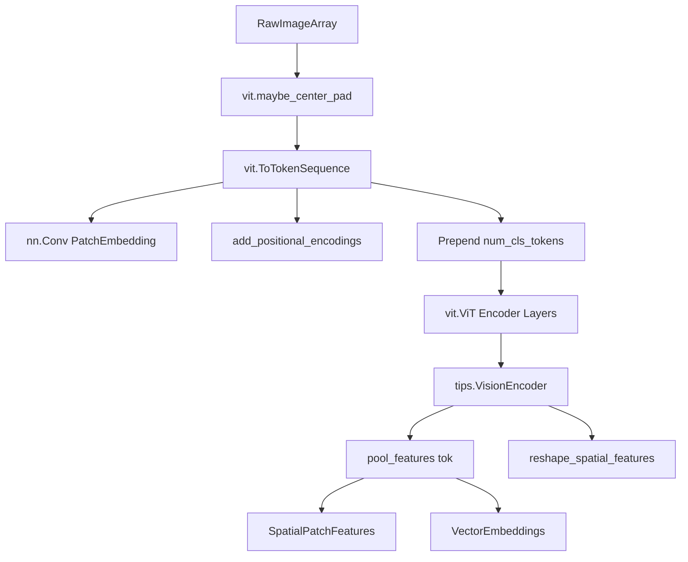

Sources:
- `scenic/models/tips.py`: [27-52]()
- `scenic/models/vit.py`: [48-66]()

---

### Positional Embeddings and Patch Tokenization
The `ToTokenSequence` module [scenic/models/vit.py:69-120]() handles spatial patch projection and positional embedding injection:
1. **Patch Extraction**: An `nn.Conv` layer [scenic/models/vit.py:100-104]() projects image patches into the `hidden_size` dimension with a stride equal to the patch size (`fh, fw`).
2. **Positional Encodings**: Learnable 2D positional embeddings `posembed_input` of shape `[1, posemb_h, posemb_w, c]` are added to the projected patch tokens [scenic/models/vit.py:81-89](). If the input resolution differs from the base grid (`self.posembs`), `jax.image.resize` interpolates the embeddings using bilinear resizing [scenic/models/vit.py:86-88]().
3. **CLS Tokens**: Zero-initialized learnable token parameters (`cls`) of shape `[1, num_cls_tokens, c]` are tiled across the batch dimension and prepended to the patch sequence [scenic/models/vit.py:110-118]().

Sources:
- `scenic/models/vit.py`: [69-120]()

---

## 2. Text Encoder and Tokenization

The text subsystem (`TextEncoder` in `scenic/models/tips.py` and supporting modules in `scenic/models/text.py`) maps raw text identifiers into multi-modal embedding spaces using a Transformer architecture.

### TextEncoder Architecture
The `TextEncoder` class instantiates an embedding table, 1D positional embeddings, a stacked transformer, and global average pooling [scenic/models/tips.py:98-141](). Except for the `So400m/14` variant (which uses a symmetric vision-text configuration), text towers fix their depth to 12 layers [scenic/models/tips.py:113-118]().

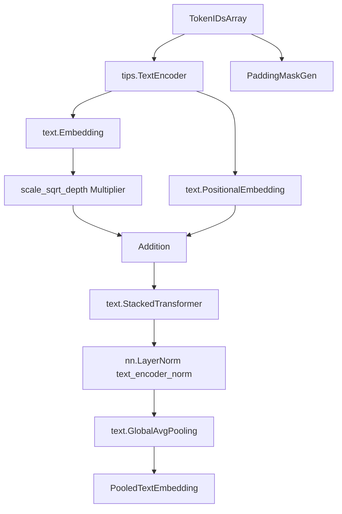

Sources:
- `scenic/models/tips.py`: [98-156]()
- `scenic/models/text.py`: [33-199]()

---

### Tokenizer and Embedding Lookups
- **`Tokenizer`**: Wraps `tensorflow_text.SentencepieceTokenizer` to ingest raw strings, convert them to lowercase token IDs, truncate or pad them to `max_len`, and construct companion padding masks (`is_padding`) [scenic/models/text.py:33-53]().
- **`Embedding`**: Performs token ID indexing against `emb_var` [scenic/models/text.py:56-89]() and optionally scales activations by $\sqrt{D}$ (`scale_sqrt_depth=True`) [scenic/models/text.py:86-88]().
- **`PositionalEmbedding`**: Generates 1D sinusoidal position signals using geometric timescale progressions from `min_timescale=1` to `max_timescale=10_000` [scenic/models/text.py:95-152]().
- **`GlobalAvgPooling`**: Averages valid sequence tokens while accounting for padding masks via `compatible_paddings` [scenic/models/text.py:155-199]().

Sources:
- `scenic/models/text.py`: [33-199]()

---

## 3. Configuration and FFN Variants

Model dimensions and architectural hyperparameters are dynamically resolved through `get_vit_config(variant)` [scenic/models/vit.py:34-45](). Depending on the variant tag (`S`, `B`, `L`, `So400m`, `g`), the configuration determines:
- `hidden_size`, `num_layers`, `mlp_dim`, and `num_heads` [scenic/models/vit.py:38-41]().
- Feed-forward network type (`ffn_layer`), choosing between standard Multi-Layer Perceptrons (`'mlp'`) and gated fused SwiGLU networks (`'swiglu'`) [scenic/models/vit.py:43]().

The `FFNSwiGluFused` module implements the SwiGLU variant by projecting inputs into two parallel dense layers, applying a swish activation to the first projection, and element-wise multiplying them before the output projection [scenic/models/vit.py:122-177]().

Sources:
- `scenic/models/vit.py`: [34-45](), [122-177]()

---

# Page: Model Configuration

# Model Configuration

<details>
<summary>Relevant source files</summary>

The following files were used as context for generating this wiki page:

- [scenic/configs/tips_model_config.py](scenic/configs/tips_model_config.py)

</details>


## Overview and Scope

The model configuration subsystem, implemented in `scenic/configs/tips_model_config.py`, provides the hyperparameter definitions, variant registries, and configuration structures required to instantiate TIPS and TIPSv2 models within the JAX/Scenic environment. It bridges abstract variant names (such as high-resolution V1 variants and V2 architectures) with concrete architectural specifications, including positional embedding grid shapes, normalization constants, token pooling modes, and text encoder constraints.

Sources: [scenic/configs/tips_model_config.py:16-74]()

---

## Variant Registries (V1 and V2)

The configuration file defines two primary dictionaries that map user-facing variant strings to their corresponding internal model architecture architectures (`g/14`, `So400m/14`, `L/14`, `B/14`, and `S/14`).

### TIPS-v1 Registry
`_VARIANT_DICT_V1` maps legacy and distilled high-resolution/low-resolution variant names:
* `tips_oss_g14_highres` $\rightarrow$ `g/14`
* `tips_oss_g14_lowres` $\rightarrow$ `g/14`
* `tips_oss_so400m14_highres_largetext_distilled` $\rightarrow$ `So400m/14`
* `tips_oss_l14_highres_distilled` $\rightarrow$ `L/14`
* `tips_oss_b14_highres_distilled` $\rightarrow$ `B/14`
* `tips_oss_s14_highres_distilled` $\rightarrow$ `S/14`

Sources: [scenic/configs/tips_model_config.py:23-31]()

### TIPS-v2 Registry
`_VARIANT_DICT_V2` maps updated v2 variant strings:
* `tips_v2_g14` $\rightarrow$ `g/14`
* `tips_v2_so14` $\rightarrow$ `So400m/14`
* `tips_v2_l14` $\rightarrow$ `L/14`
* `tips_v2_b14` $\rightarrow$ `B/14`

Sources: [scenic/configs/tips_model_config.py:33-39]()

---

## The `get_config` Function

The core entry point of this module is `get_config(variant: str)`, which returns an `ml_collections.ConfigDict` populated with parameters tailored to the requested variant.

```
+-------------------------------------------------------------+
|               "Natural Language Space"                      |
|  User Variant Strings:                                      |
|  - "tips_v2_g14"                                            |
|  - "tips_oss_b14_highres_distilled"                         |
+------------------------------+------------------------------+
                               |
                               v passes variant string
+-------------------------------------------------------------+
|               "Code Entity Space"                           |
|  Function: scenic/configs/tips_model_config.py              |
|                                                             |
|  [get_config] ---> checks _VARIANT_DICT_V1 / V2             |
|               ---> sets config.variant                      |
|               ---> sets pos_embed_shape                     |
+------------------------------+------------------------------+
                               |
                               v returns
+-------------------------------------------------------------+
|  Output: ml_collections.ConfigDict                          |
|  - rgb_mean / rgb_std                                       |
|  - pooling = "tok"                                          |
|  - num_cls_tokens = 2                                       |
|  - text_vocab_size = 32000                                  |
+-------------------------------------------------------------+
```

Sources: [scenic/configs/tips_model_config.py:42-74]()

### Configuration Fields

When `get_config()` executes, it configures the following fields on the returned `ml_collections.ConfigDict`:

| Configuration Key | Value / Setting | Description |
| :--- | :--- | :--- |
| `config.variant` | `g/14`, `So400m/14`, etc. | Core architecture layout string [scenic/configs/tips_model_config.py:47-50](). |
| `config.rgb_mean` | `[0., 0., 0.]` | Per-channel RGB mean normalization [scenic/configs/tips_model_config.py:20,58](). |
| `config.rgb_std` | `[1., 1., 1.]` | Per-channel RGB standard deviation [scenic/configs/tips_model_config.py:21,59](). |
| `config.pooling` | `'tok'` | Token-based pooling strategy [scenic/configs/tips_model_config.py:61](). |
| `config.pos_interpolation_method` | `'bilinear'` | Method used for positional embedding grid resizing [scenic/configs/tips_model_config.py:62](). |
| `config.positional_embedding.shape` | `(16, 16)` (V1) or `(32, 32)` (V2) | Base 2D grid shape for positional embeddings [scenic/configs/tips_model_config.py:48-51,64-65](). |
| `config.num_cls_tokens` | `2` | Number of classification tokens appended to the sequence [scenic/configs/tips_model_config.py:67-68](). |
| `config.text_max_seq_length` | `64` | Maximum token sequence length for the text encoder [scenic/configs/tips_model_config.py:71](). |
| `config.text_vocab_size` | `32000` | Tokenizer vocabulary size [scenic/configs/tips_model_config.py:72](). |

Sources: [scenic/configs/tips_model_config.py:42-74]()

---

## Configuration Data Flow Architecture

The mapping from high-level variants to structured runtime configurations flows through `tips_model_config.py` into the broader JAX execution pipeline as illustrated below:

```
+-------------------------------------------------------------+
| "VariantString" ("tips_v2_g14" or "tips_oss_l14_...")       |
+------------------------------+------------------------------+
                               |
                               v calls
+-------------------------------------------------------------+
| "[tips_model_config.get_config]"                            |
+------------------------------+------------------------------+
                               |
       +-----------------------+-----------------------+
       | checks version                                | checks version
       v                                               v
+-----------------------------+               +-----------------------------+
| "_VARIANT_DICT_V1"          |               | "_VARIANT_DICT_V2"          |
| shape: (16, 16)             |               | shape: (32, 32)             |
+------------------------------+               +-----------------------------+
       |                                               |
       +-----------------------+-----------------------+
                               |
                               v populates
+-------------------------------------------------------------+
| "[ml_collections.ConfigDict]"                               |
| - "config.variant"                                          |
| - "config.positional_embedding.shape"                       |
| - "config.num_cls_tokens"                                   |
| - "config.text_vocab_size"                                  |
+------------------------------+------------------------------+
                               |
                               v consumed by
+-------------------------------------------------------------+
| "[ScenicModelInitialization]"                               |
+-------------------------------------------------------------+
```

Sources: [scenic/configs/tips_model_config.py:23-74]()

---

## Error Handling and Validation

If an unrecognized variant string is passed to `get_config(variant)`, the function aggregates all valid keys from both `_VARIANT_DICT_V1` and `_VARIANT_DICT_V2` and raises a `ValueError`.

```python
all_variants = list(_VARIANT_DICT_V1.keys()) + list(_VARIANT_DICT_V2.keys())
raise ValueError(
    f'Unknown TIPS variant: {variant}. Please choose one of: '
    f'{all_variants}')
```

Sources: [scenic/configs/tips_model_config.py:52-56]()

---

# Page: Checkpoint Loading and Feature Visualization Utils

# Checkpoint Loading and Checkpoint Visualization Utils

<details>
<summary>Relevant source files</summary>

The following files were used as context for generating this wiki page:

- [scenic/utils/checkpoint.py](scenic/utils/checkpoint.py)
- [scenic/utils/feature_viz.py](scenic/utils/feature_viz.py)

</details>


## Purpose and Scope

This section covers the core utility modules responsible for bridging serialized numpy archives (`.npz`) with Flax parameter hierarchies, as well as transforming high-dimensional spatial feature maps into visualizable RGB representations using Principal Component Analysis (PCA) and tensor normalization. These utilities reside under the `scenic/utils/` package.

Sources: [scenic/utils/checkpoint.py:1-48](), [scenic/utils/feature_viz.py:1-65]()

---

## Checkpoint Loading Mechanism

The checkpoint loading subsystem provides functions to ingest flat or nested model weights stored in `.npz` format and load them directly into structured Flax parameter trees (`frozen_dict` / nested dictionaries). 

### `load_checkpoint`

The primary entry point is `load_checkpoint`, defined in `scenic/utils/checkpoint.py` [scenic/utils/checkpoint.py:24](). It performs strict structural and dimensional validation against an expected parameter skeleton.

```python
def load_checkpoint(
    checkpoint_path: str,
    params_to_load: t.Dict[str, np.ndarray],
    strict: bool = True,
) -> t.Dict[str, np.ndarray]:
```

#### Data Flow and Validation Steps

1. **Flattening Parameter Trees**: `params_to_load` is flattened using `flax.traverse_util.flatten_dict` with `sep='/'` to convert nested parameter dictionaries into single-level dictionary keys [scenic/utils/checkpoint.py:30]().
2. **Loading Archive**: The `.npz` file is loaded into memory as a flat dictionary using `np.load(checkpoint_path, allow_pickle=True)` [scenic/utils/checkpoint.py:31]().
3. **Shape and Presence Verification**:
   - Iterates through every key in `params_to_load_flat` to confirm existence in `params_loaded_flat` and verify that tensor shapes match identically [scenic/utils/checkpoint.py:34-38]().
   - Checks for unexpected extra keys in the loaded checkpoint. If `strict=True`, a `ValueError` is raised; if `strict=False`, a warning is logged [scenic/utils/checkpoint.py:41-46]().
4. **Unflattening**: Reconstructs the original nested parameter hierarchy using `flax.traverse_util.unflatten_dict` [scenic/utils/checkpoint.py:48]().

### Diagram: Checkpoint Loading Pipeline

```mermaid
graph TD
    A["RawNPZFile"] -->|"np.load()"| B["params_loaded_flat"]
    C["FlaxParamTree"] -->|"flax.traverse_util.flatten_dict()"| D["params_to_load_flat"]
    B --> E["ShapeAndKeyValidation"]
    D --> E
    E -->|"unflatten_dict()"| F["InitializedModelParams"]

    sub-graph Code Entities
        A -->|Loaded via| G["load_checkpoint()"]
        C -->|Structure defined in| G
        G -->|Uses| H["flax.traverse_util"]
    end
```
Sources: [scenic/utils/checkpoint.py:24-48]()

---

## Feature Normalization and Spatial Visualization

Spatial feature maps extracted from vision backends typically possess high channel dimensions (e.g., $F$ dimensions). The `scenic/utils/feature_viz.py` module provides transformation tools to normalize these vectors and project them down to 3 components for RGB visualization.

### `normalize()`

The `normalize` function computes vector norms along the final axis and scales the tensor:

```python
def normalize(x, order: int = 2):
  return x / np.linalg.norm(x, ord=order, axis=-1, keepdims=True).clip(min=1e-3)
```
It guards against division by zero using `.clip(min=1e-3)` [scenic/utils/feature_viz.py:28-29]().

Sources: [scenic/utils/feature_viz.py:28-29]()

### `PCAVisualizer`

The `PCAVisualizer` class wraps `sklearn.decomposition.PCA` to fit principal components on feature arrays and project spatial features into a 3-component space suitable for image rendering [scenic/utils/feature_viz.py:32-65]().

#### Initialization (`__init__`)
- Reshapes input features of shape `[..., F]` into flat samples `[-1, F]` [scenic/utils/feature_viz.py:47]().
- Subsamples up to `n_samples` randomly to fit the PCA model efficiently [scenic/utils/feature_viz.py:48-49]().
- Configures attributes for whitening, normalization, and sigmoid activation [scenic/utils/feature_viz.py:50-53]().

#### Call Operator (`__call__`)
- Transforms input feature tensors into PCA space [scenic/utils/feature_viz.py:58-60]().
- Reshapes dimensions back to preserve spatial layout `[..., n_components]` [scenic/utils/feature_viz.py:60]().
- Applies `normalize()` scaled to the `[0, 1]` range if `normalize=True` [scenic/utils/feature_viz.py:61-62]().
- Optionally applies `jax.nn.sigmoid` if `use_sigmoid=True` [scenic/utils/feature_viz.py:63-64]().

Sources: [scenic/utils/feature_viz.py:32-65]()

### Diagram: Feature Visualization Pipeline

```mermaid
graph TD
    A["RawSpatialFeatureMap"] -->|"Reshape and Subsample"| B["PCAFitInput"]
    B -->|"decomposition.PCA.fit()"| C["PCAVisualizerObject"]
    A -->|"__call__()"| D["PCAProjection"]
    C --> D
    D -->|"normalize() * 0.5 + 0.5"| E["NormalizedVisualTensor"]
    E -->|"Optional Sigmoid"| F["FinalRGBVisualMap"]

    sub-graph Code Entities
        A -->|Processed by| G["PCAVisualizer"]
        D -->|Relies on| H["sklearn.decomposition.PCA"]
        E -->|Uses| I["normalize()"]
        F -->|Uses| J["jax.nn.sigmoid"]
    end
```
Sources: [scenic/utils/feature_viz.py:28-65]()

---

# Page: run_tips_inference.py Pipeline

# run_tips_inference.py Pipeline

<details>
<summary>Relevant source files</summary>

The following files were used as context for generating this wiki page:

- [scenic/images/example_image.jpg](scenic/images/example_image.jpg)
- [scenic/run_tips_inference.py](scenic/run_tips_inference.py)

</details>


Purpose and scope: This section details the end-to-end JAX inference pipeline implemented in `scenic/run_tips_inference.py`. It covers argument parsing, vision and text preprocessing, model initialization, checkpoint restoration for both TIPSv1 and TIPSv2 variants, spatial and textual feature extraction, cosine similarity and contrastive temperature scaling, and principal component analysis (PCA) spatial visualization output artifact generation.

## 1. Pipeline Architecture and Flow

The inference script `scenic/run_tips_inference.py` acts as the primary end-to-end driver for JAX/Scenic model execution. It coordinates configuration parsing, backbone loading, tokenization, multi-modal alignment via contrastive embeddings, and artifact serialization.

```mermaid
graph TD
    A["CLI Arguments\n(run_tips_inference.py)"] --> B["Config Loading\ntips_model_config.get_config()"]
    B --> C["Vision Encoder Initialization\ntips.VisionEncoder"]
    B --> D["Text Encoder Initialization\ntips.TextEncoder"]
    C --> E["Load Vision Checkpoint\ncheckpoint.load_checkpoint()"]
    D --> F["Load Text Checkpoint\ncheckpoint.load_checkpoint()"]
    
    G["Image Input\n(Image.open & resize)"] --> H["Vision Forward Pass\nmodel_vision.apply()"]
    E --> H
    H --> I["Normalize CLS Token\nfeature_viz.normalize()"]
    H --> J["PCA Visualizer\nfeature_viz.PCAVisualizer()"]

    K["Text Prompts\n(tokenizer.tokenize)"] --> L["Text Forward Pass\nmodel_text.apply()"]
    F --> L
    L --> M["Normalize Text Embeddings\nfeature_viz.normalize()"]

    I --> N["Cosine Similarity & Softmax\nnn.softmax()"]
    M --> N
    N --> O["Predicted Label & Similarity"]
    
    J --> P["Resize PCA Map"]
    G --> Q["Concatenate Image & PCA"]
    P --> Q
    Q --> R["Save Output Artifact\ncv2.imwrite('output.jpg')"]

    classDef default fill:#fff,stroke:#000,stroke-width:1px;
    class A,B,C,D,E,F,G,H,I,J,K,L,M,N,O,P,Q,R default;
```

Sources: `scenic/run_tips_inference.py:61-187`

## 2. Command-Line Arguments and Supported Variants

The pipeline uses `argparse` to configure execution parameters [`scenic/run_tips_inference.py:61-86`] and supports an extensive suite of TIPSv1 and TIPSv2 model variants [`scenic/run_tips_inference.py:46-59`].

| Argument Name | Type | Default | Description |
| :--- | :--- | :--- | :--- |
| `--image_width` | `int` | `448` | Target width and height for image resizing (`image_shape = (image_width, image_width)`) [`scenic/run_tips_inference.py:62-67, 91-92`]. |
| `--variant` | `str` | `tips_oss_b14_highres_distilled` | Model variant selection from `_ALL_VARIANTS` [`scenic/run_tips_inference.py:68-74`]. |
| `--checkpoint_dir` | `str` | `checkpoints/` | Directory containing `.npz` model weights and `tokenizer.model` [`scenic/run_tips_inference.py:75-80`]. |
| `--image_path` | `str` | `images/example_image.jpg` | Path to the target image file for inference [`scenic/run_tips_inference.py:81-86`]. |

### Supported Variants (`_ALL_VARIANTS`)
- **TIPSv1**: `tips_oss_g14_highres`, `tips_oss_g14_lowres`, `tips_oss_so400m14_highres_largetext_distilled`, `tips_oss_l14_highres_distilled`, `tips_oss_b14_highres_distilled`, `tips_oss_s14_highres_distilled` [`scenic/run_tips_inference.py:47-53`].
- **TIPSv2**: `tips_v2_g14`, `tips_v2_so14`, `tips_v2_l14`, `tips_v2_b14` (utilizing a `(32, 32)` positional embedding grid) [`scenic/run_tips_inference.py:18-19, 54-59`].

Sources: `scenic/run_tips_inference.py:46-86`

## 3. Model Initialization and Checkpoint Restoration

The script initializes both vision and text encoders using Flax module definitions from `tips.VisionEncoder` and `tips.TextEncoder`.

```mermaid
graph TD
    subiling["Vision Model Setup"]
    S1["tips.VisionEncoder()"] --> S2["model_vision.init()"]
    S2 --> S3["checkpoint.load_checkpoint()"]
    
    subtiling["Text Model Setup"]
    T1["text.Tokenizer()"] --> T2["tips.TextEncoder()"]
    T2 --> T3["model_text.init()"]
    T3 --> T4["Assign temperature_contrastive"]
    T4 --> T5["checkpoint.load_checkpoint()"]

    classDef default fill:#fff,stroke:#000,stroke-width:1px;
    class S1,S2,S3,T1,T2,T3,T4,T5 default;
```

1. **Vision Encoder Initialization**:
   - `model_vision` is instantiated via `tips.VisionEncoder` using config attributes for variant, pooling, `num_cls_tokens`, and positional embedding shapes [`scenic/run_tips_inference.py:102-106`].
   - Initialization parameters are generated via `model_vision.init` with dummy inputs `[1, *image_shape, 3]` [`scenic/run_tips_inference.py:107-108`].
   - Weights are restored using `checkpoint.load_checkpoint` from `{variant}_vision.npz` [`scenic/run_tips_inference.py:109-111`].

2. **Text Encoder Initialization**:
   - The SentencePiece tokenizer is loaded via `text.Tokenizer` from `tokenizer.model` [`scenic/run_tips_inference.py:114-115`].
   - `model_text` is initialized with `tips.TextEncoder` and dummy text/padding tensors of shape `(4, 64)` [`scenic/run_tips_inference.py:116-121`].
   - The contrastive temperature parameter `temperature_contrastive` is explicitly initialized in `init_params_text['params']` before loading the text checkpoint from `{variant}_text.npz` [`scenic/run_tips_inference.py:122-126`].

Sources: `scenic/run_tips_inference.py:97-126`

## 4. Preprocessing and Forward Passes

### Image Preprocessing
Input images loaded via PIL are converted to `jnp.float32`, scaled to the `[0, 1]` range, and resized to `image_shape` using bilinear interpolation [`scenic/run_tips_inference.py:128-131`].

### Vision Forward Pass
The vision model `model_vision.apply` processes the batch-expanded image `image[None]` with `train=False`, returning `spatial_features` and `embeddings_vision` [`scenic/run_tips_inference.py:134-135`]:
- The first classification token (`embeddings_vision[:, 0, :]`) is extracted and normalized using `feature_viz.normalize` to form `cls_token` [`scenic/run_tips_inference.py:136-137`]. (Note: The second CLS token is typically preferred for dense downstream tasks [`scenic/run_tips_inference.py:136`]).

### Text Forward Pass
A predefined list of text prompts is tokenized with `tokenizer.tokenize` up to `max_len=64` [`scenic/run_tips_inference.py:143-148`].
`model_text.apply` generates textual embeddings, which are subsequently normalized using `feature_viz.normalize` [`scenic/run_tips_inference.py:149-154`].

Sources: `scenic/run_tips_inference.py:128-156`

## 5. Similarity Computation and Zero-Shot Classification

To classify the input image against the text prompts, the pipeline computes scaled cosine similarities:
1. **Raw Cosine Similarity**: Computed via matrix multiplication between the normalized `cls_token` and transposed text embeddings `embeddings_text.T` [`scenic/run_tips_inference.py:158-159`].
2. **Temperature Scaling**: The raw similarity is scaled by dividing by `temperature` (`params_text['temperature_contrastive']`) and passed through a softmax function [`scenic/run_tips_inference.py:160-166`].
3. **Prediction**: The script extracts the argmax label index and maximum similarity probability, mapping back to the corresponding text prompt [`scenic/run_tips_inference.py:167-175`].

Sources: `scenic/run_tips_inference.py:158-176`

## 6. PCA Spatial Feature Visualization Artifacts

For visual inspection of patch representations, the pipeline executes a Principal Component Analysis workflow:
1. **PCA Transformation**: `feature_viz.PCAVisualizer` is instantiated with `spatial_features` and applied to yield 3-component PCA projections [`scenic/run_tips_inference.py:177-179`].
2. **Resizing**: The PCA feature map is resized back to `image_shape` using nearest-neighbor interpolation [`scenic/run_tips_inference.py:180-181`].
3. **Artifact Serialization**: The original resized image and the PCA visualization are concatenated horizontally, converted from RGB to BGR (`[::-1]`), scaled to `uint8`, and written to disk as `output.jpg` via `cv2.imwrite` [`scenic/run_tips_inference.py:183-187`].

Sources: `scenic/run_tips_inference.py:177-187`

Sources: `scenic/run_tips_inference.py:1-192`

---

# Page: Demos and Notebooks

# Demos and Notebooks

<details>
<summary>Relevant source files</summary>

The following files were used as context for generating this wiki page:

- [pytorch/TIPS_Demo.ipynb](pytorch/TIPS_Demo.ipynb)
- [scenic/checkpoints/download_checkpoints.sh](scenic/checkpoints/download_checkpoints.sh)
- [scenic/notebooks/TIPS_Demo.ipynb](scenic/notebooks/TIPS_Demo.ipynb)

</details>


This page provides a high-level overview of the interactive notebooks and demonstration scripts provided in the codebase for both the PyTorch and JAX/Scenic backends. These environments enable rapid prototyping, model variant selection (`TIPS` versus `TIPS_V2`), remote checkpoint acquisition from Google Cloud Storage (GCS), and downstream spatial feature visualization.

## Interactive Notebook Ecosystem

The repository supplies end-to-end Google Colab notebooks for both the native PyTorch implementation (`pytorch/`) and the JAX/Scenic implementation (`scenic/`). These notebooks handle runtime dependency installation, `PYTHONPATH` configuration, model variant parsing, and checkpoint downloading.

Diagram: Notebook Execution and Backend Routing
```mermaid
graph TD
    UserNotebook["Interactive Colab Notebook"] --> PyTorchBackend["PyTorch Backend pytorch/"]
    UserNotebook --> ScenicBackend["JAX/Scenic Backend scenic/"]
    PyTorchBackend --> PTNotebook["pytorch/TIPS_Demo.ipynb"]
    PyTorchBackend --> PTDecoder["pytorch/TIPS_decoder_inference.ipynb"]
    ScenicBackend --> SCNotebook["scenic/notebooks/TIPS_Demo.ipynb"]
    ScenicBackend --> SCRIPT["scenic/checkpoints/download_checkpoints.sh"]
```
Sources: [pytorch/TIPS_Demo.ipynb:40-167](), [scenic/notebooks/TIPS_Demo.ipynb:50-187](), [scenic/checkpoints/download_checkpoints.sh:1-49]()

## Child Pages Overview

For technical details, architectural walkthroughs, and step-by-step execution flows, refer to the child pages:

- **PyTorch Demo Notebooks**: Detailed walkthroughs of `pytorch/TIPS_Demo.ipynb` and `pytorch/TIPS_decoder_inference.ipynb`, covering model instantiation, tokenization, and dense decoder pipelines. For details, see [PyTorch Demo Notebooks](#4.1).
- **Segmentation Demos**: Overview of foreground segmentation linear probing demos and zero-shot segmentation notebooks built on top of extracted feature maps. For details, see [Segmentation Demos](#4.2).
- **Scenic Demo Notebook**: Setup instructions, checkpoint downloading flows via `scenic/checkpoints/download_checkpoints.sh`, and PCA-based spatial feature visualization utilizing `scenic/notebooks/TIPS_Demo.ipynb`. For details, see [Scenic Demo Notebook](#4.3).

Diagram: Parent-Child Navigation Structure
Parent Page
Child Pages
Demos and Notebooks
PyTorch Demo Notebooks
Segmentation Demos
Scenic Demo Notebook

Sources: [pytorch/TIPS_Demo.ipynb:1-587](), [scenic/notebooks/TIPS_Demo.ipynb:1-187](), [scenic/checkpoints/download_checkpoints.sh:1-49]()

---

# Page: PyTorch Demo Notebooks

# PyTorch Demo Notebooks

<details>
<summary>Relevant source files</summary>

The following files were used as context for generating this wiki page:

- [pytorch/TIPS_Demo.ipynb](pytorch/TIPS_Demo.ipynb)
- [pytorch/TIPS_decoder_inference.ipynb](pytorch/TIPS_decoder_inference.ipynb)

</details>


## Purpose and Scope
This page details the implementation, data flow, and environment setup for the interactive PyTorch demonstration notebooks provided in the repository: `pytorch/TIPS_Demo.ipynb` and `pytorch/TIPS_decoder_inference.ipynb`. These notebooks serve as end-to-end walkthroughs for running feature extraction, contrastive tasks, and dense prediction decoders (segmentation, depth, and surface normals) using PyTorch backend configurations.

Sources: `pytorch/TIPS_Demo.ipynb:1-167` [pytorch/TIPS_Demo.ipynb:1-167](), `pytorch/TIPS_decoder_inference.ipynb:1-180` [pytorch/TIPS_decoder_inference.ipynb:1-180]().

---

## 1. TIPS Interactive Demo (`TIPS_Demo.ipynb`)

The `pytorch/TIPS_Demo.ipynb` notebook provides a complete interactive workflow for initializing both `TIPS` (v1) and `TIPS_V2` models, downloading corresponding weights from Google Cloud Storage, and processing sample visual and textual inputs using PyTorch.

### Environment Setup and Dependencies
The notebook begins by establishing the execution environment within Google Colab or a local Jupyter instance. It determines the root working directory (`ROOT_DIR`), sets up a local clone of the repository under `TIPS_DIR`, and installs required runtime packages including `torch`, `torchvision`, `torchaudio`, `tensorflow_text`, `mediapy`, `jax`, `jaxlib`, and `scikit-learn` [pytorch/TIPS_Demo.ipynb:40-64](). To ensure internal modules are importable, the root directory is inserted into `sys.path` [pytorch/TIPS_Demo.ipynb:57-60]().

Sources: `pytorch/TIPS_Demo.ipynb:40-64` [pytorch/TIPS_Demo.ipynb:40-64]().

### Model and Variant Configuration
Users can interactively select between `TIPS` (v1) and `TIPS_V2` architectures, and choose model variants (`S`, `B`, `L`, `So400m`, `g`, `So`) [pytorch/TIPS_Demo.ipynb:97-116](). A validation check dynamically maps requested variants to available configurations, falling back to valid defaults if an incompatible combination is selected [pytorch/TIPS_Demo.ipynb:104-113]().

Sources: `pytorch/TIPS_Demo.ipynb:97-116` [pytorch/TIPS_Demo.ipynb:97-116]().

### Checkpoint Retrieval and URL Mapping
Checkpoints are fetched dynamically from version-specific GCS buckets (`CHECKPOINT_BASE_URL`) [pytorch/TIPS_Demo.ipynb:140-145](). The notebook maintains explicit dictionaries (`V1_CHECKPOINT_MAP` and `V2_CHECKPOINT_MAP`) mapping each variant to its respective vision and text `.npz` parameter files [pytorch/TIPS_Demo.ipynb:149-165]().

Sources: `pytorch/TIPS_Demo.ipynb:140-165` [pytorch/TIPS_Demo.ipynb:140-165]().

### Diagram: TIPS Demo Data Flow and Code Entities
The following diagram bridges the natural language space of user selections and asset downloading to the underlying code entities and URL structures in `pytorch/TIPS_Demo.ipynb`.

```mermaid
graph TD
    UserSelection["User Model & Variant Selection"] --> VariantMap["variants_map ('TIPS'/'TIPS_V2')"]
    VariantMap --> CheckpointMap["V1_CHECKPOINT_MAP / V2_CHECKPOINT_MAP"]
    CheckpointMap --> GCSDownload["urllib.request.urlretrieve (CHECKPOINT_BASE_URL)"]
    GCSDownload --> LocalStorage["Local Checkpoint Files (.npz)"]
    LocalStorage --> ModelLoader["Model Constructor & Weights Loading"]
    
    sub5["Code Entities"]
    sub5 -.-> VariantMap
    sub5 -.-> CheckpointMap
    sub5 -.-> GCSDownload
```
Sources: `pytorch/TIPS_Demo.ipynb:97-165` [pytorch/TIPS_Demo.ipynb:97-165]().

---

## 2. TIPSv2 Decoder Inference (`pytorch/TIPS_decoder_inference.ipynb`)

The `pytorch/TIPS_decoder_inference.ipynb` notebook focuses on dense prediction tasks using the TIPSv2 DPT (Dense Prediction Transformer) decoder heads. It covers three downstream tasks:
1. **Semantic Segmentation** on ADE20K (150 classes) [pytorch/TIPS_decoder_inference.ipynb:26]()
2. **Monocular Depth Estimation** via classification-based bins (256 bins) [pytorch/TIPS_decoder_inference.ipynb:27]()
3. **Surface Normal Estimation** [pytorch/TIPS_decoder_inference.ipynb:28]()

Sources: `pytorch/TIPS_decoder_inference.ipynb:18-38` [pytorch/TIPS_decoder_inference.ipynb:18-38]().

### Environment Initialization and Repository Cloning
Similar to the core demo, this notebook initializes execution paths, clones the repository into `TIPS_DIR`, updates `sys.path`, and installs essential prerequisites (`torch`, `torchvision`, `torchaudio`, `tensorflow_text`, `scikit-learn`) [pytorch/TIPS_decoder_inference.ipynb:50-74]().

Sources: `pytorch/TIPS_decoder_inference.ipynb:50-74` [pytorch/TIPS_decoder_inference.ipynb:50-74]().

### Checkpoint and Dataset Pipeline
Vision encoder weights (`VISION_CKPT_URL`) and Scenic-format DPT task checkpoints (`DPT_CKPT_URL`) are retrieved based on the selected variant (`B`, `L`, `So`, `g`) [pytorch/TIPS_decoder_inference.ipynb:100-147](). Datasets for evaluation and testing—specifically the NYU Depth v2 subset (`NYU_URL`) and ADE20K challenge data (`ADE20K_URL`)—are automatically downloaded and extracted into local directories (`NYU_IMG_DIR` and `ADE20K_DIR`) [pytorch/TIPS_decoder_inference.ipynb:108-168]().

Sources: `pytorch/TIPS_decoder_inference.ipynb:100-168` [pytorch/TIPS_decoder_inference.ipynb:100-168]().

### Diagram: Decoder Inference Architecture Mapping
The following diagram connects the conceptual dense prediction tasks to the specific checkpoint URLs, directory structures, and loader logic defined in `pytorch/TIPS_decoder_inference.ipynb`.

```mermaid
graph TD
    TaskSelection["Dense Prediction Task (Segmentation/Depth/Normals)"] --> VariantDict["V2_DPT_BASENAME_MAP"]
    VariantDict --> DPTDownload["urllib.request.urlretrieve (DPT_CKPT_URL)"]
    DPTDownload --> ZipExtraction["Dataset Unzipping (ADE20K_URL / NYU_URL)"]
    ZipExtraction --> DecoderInference["DPT Head Execution on ViT Intermediate Features"]

    sub6["Code Entities"]
    sub6 -.-> VariantDict
    sub6 -.-> DPTDownload
    sub6 -.-> DecoderInference
```
Sources: `pytorch/TIPS_decoder_inference.ipynb:100-168` [pytorch/TIPS_decoder_inference.ipynb:100-168]().

---

## 3. Comparative Summary of Notebooks

| Notebook File | Primary Focus | Key Dependencies | Download Sources |
| :--- | :--- | :--- | :--- |
| `pytorch/TIPS_Demo.ipynb` | General feature extraction, contrastive models (v1 & v2) | `torch`, `tensorflow_text`, `mediapy`, `jax` | `CHECKPOINT_BASE_URL`, `TOKENIZER_URL`, `IMAGE_BASE_URL` [pytorch/TIPS_Demo.ipynb:140-146]() |
| `pytorch/TIPS_decoder_inference.ipynb` | Dense prediction (Segmentation, Depth, Normals) | `torch`, `torchvision`, `tensorflow_text`, `scikit-learn` | `VISION_CKPT_URL`, `DPT_CKPT_URL`, `NYU_URL`, `ADE20K_URL` [pytorch/TIPS_decoder_inference.ipynb:100-109]() |

Sources: `pytorch/TIPS_Demo.ipynb:40-167` [pytorch/TIPS_Demo.ipynb:40-167](), `pytorch/TIPS_decoder_inference.ipynb:50-168` [pytorch/TIPS_decoder_inference.ipynb:50-168]().

---

# Page: Segmentation Demos

# Segmentation Demos

<details>
<summary>Relevant source files</summary>

The following files were used as context for generating this wiki page:

- [pytorch/TIPS_foreground_segmentation_demo.ipynb](pytorch/TIPS_foreground_segmentation_demo.ipynb)
- [pytorch/TIPS_zeroshot_segmentation.ipynb](pytorch/TIPS_zeroshot_segmentation.ipynb)

</details>


This page provides full technical documentation for the interactive segmentation notebooks implemented in the PyTorch backend of the TIPS repository: the foreground segmentation linear probing demo [pytorch/TIPS_foreground_segmentation_demo.ipynb]() and the zero-shot segmentation notebook [pytorch/TIPS_zeroshot_segmentation.ipynb](). These notebooks demonstrate how to leverage dense representations extracted from TIPS image and text encoders for downstream pixel-level tasks without modifying core model weights.

---

## 4.2.1 Foreground Segmentation Linear Probing Demo

The foreground segmentation demo [pytorch/TIPS_foreground_segmentation_demo.ipynb]() implements a linear probing pipeline inspired by DINO-style dense feature evaluation [pytorch/TIPS_foreground_segmentation_demo.ipynb:53-58](). It freezes the pre-trained TIPS vision backbone, extracts patch-level feature maps from input images, and trains a lightweight linear classifier (`sklearn.linear.model.LogisticRegression`) to separate foreground objects from background regions [pytorch/TIPS_foreground_segmentation_demo.ipynb:60-79]().

### Pipeline Implementation and Workflow

1. **Environment Setup & Dependencies**: The notebook installs required Python packages (`torch`, `torchvision`, `scikit-learn`, `jax`, `mediapy`), clones the repository into the working environment, and inserts the root directory into `sys.path` to enable `tips.*` imports [pytorch/TIPS_foreground_segmentation_demo.ipynb:98-121]().
2. **Model & Variant Selection**: Uses `ipywidgets` to let users interactively choose between `TIPS` (v1: `S`, `B`, `L`, `So400m`, `g`) and `TIPS_V2` (v2: `B`, `L`, `So`, `g`) architectures [pytorch/TIPS_foreground_segmentation_demo.ipynb:130-175]().
3. **Checkpoint Acquisition**: Downloads pre-trained PyTorch weights from Google Cloud Storage (`CHECKPOINT_BASE_URL` pointing to `https://storage.googleapis.com/tips_data/v1_0/checkpoints/pytorch` or `v2_0/checkpoints/pytorch`) [pytorch/TIPS_foreground_segmentation_demo.ipynb:179-185]().
4. **Feature Extraction & Linear Probing**: Image patches are passed through the backbone to obtain dense spatial feature embeddings. A logistic regression model is fitted on these features using binary foreground/background ground-truth masks.
5. **Evaluation**: Performance is evaluated using scikit-learn metrics, specifically average precision via `average_precision_score` and precision-recall trade-offs via `precision_recall_curve` [pytorch/TIPS_foreground_segmentation_demo.ipynb:60-79]().

```mermaid
graph TD
    A["UserSelectionWidget"] -->| "Select Model/Variant" | B["DownloadCheckpoints"]
    B -->| "Load Weights" | C["TIPSImageEncoder"]
    C -->| "Extract Patch Features" | D["LogisticRegression"]
    E["GroundTruthMasks"] -->| "Supervision" | D
    D -->| "Evaluate Probing" | F["average_precision_score"]
    
    sub5["Code Entity Space"]
    C -->| "Implemented in" | G["pytorch/run_image_encoder_inference.py"]
    D -->| "Uses" | H["sklearn.linear_model.LogisticRegression"]
    F -->| "Uses" | I["sklearn.metrics.average_precision_score"]
```
*Diagram 1: Foreground segmentation linear probing pipeline bridging user interaction widgets to backend PyTorch model inference and scikit-learn evaluation metrics.*

Sources: [pytorch/TIPS_foreground_segmentation_demo.ipynb:1-185]()

---

## 4.2.2 Zero-Shot Segmentation Notebook

The zero-shot segmentation notebook [pytorch/TIPS_zeroshot_segmentation.ipynb]() evaluates open-vocabulary dense semantic segmentation using the ADE20K dataset [pytorch/TIPS_zeroshot_segmentation.ipynb:149-150]() without any fine-tuning. It relies on joint alignment between the vision and text encoders provided in TIPSv2.

### Pipeline Implementation and Workflow

1. **Dataset Download**: Automatically downloads and extracts the ADE20K benchmark dataset archive from `ADE20K_URL` (`http://data.csail.mit.edu/places/ADEchallenge/ADEChallengeData2016.zip`) into `/content/ADEChallengeData2016.zip` [pytorch/TIPS_zeroshot_segmentation.ipynb:149-150]().
2. **Vision and Text Checkpoint Mapping**: Loads variant-specific `.npz` parameter files defined in `V2_CHECKPOINT_MAP` for both vision and text encoders [pytorch/TIPS_zeroshot_segmentation.ipynb:159-165]().
3. **Text Prompt Encoding**: Category names and descriptive prompts corresponding to ADE20K classes are passed through the text encoder to yield text embedding prototypes.
4. **Cosine Similarity Computation**: Dense patch features from the image encoder are compared against the text embedding prototypes using cosine similarity (`torch.nn.functional.cosine_similarity` or inner product). The resulting similarity maps are upsampled to generate pixel-level zero-shot segmentation predictions.

```mermaid
graph TD
    A["ADEChallengeData2016.zip"] -->| "Extract Dataset" | B["ADE20KDatasetLoader"]
    C["V2_CHECKPOINT_MAP"] -->| "Load Vision Weights" | D["VisionEncoder"]
    C -->| "Load Text Weights" | E["TextEncoder"]
    B -->| "Input Image" | D
    F["Text Prompts"] -->| "Class Descriptions" | E
    D -->| "Patch Embeddings" | G["CosineSimilarityCompute"]
    E -->| "Text Prototypes" | G
    G -->| "Zero-Shot Mask" | H["PixelClassificationMap"]

    sub6["Code Entity Space"]
    D -->| "Uses checkpoint" | I["tips_v2_oss_l14_vision.npz"]
    E -->| "Uses checkpoint" | J["tips_v2_oss_l14_text.npz"]
    G -->| "Uses torch op" | K["torch.nn.functional.cosine_similarity"]
```
*Diagram 2: Zero-shot segmentation data flow linking ADE20K challenge data extraction with vision/text encoder feature extraction and cosine similarity computation.*

Sources: [pytorch/TIPS_zeroshot_segmentation.ipynb:1-171]()

---

# Page: Scenic Demo Notebook

# Scenic Demo Notebook

<details>
<summary>Relevant source files</summary>

The following files were used as context for generating this wiki page:

- [scenic/checkpoints/download_checkpoints.sh](scenic/checkpoints/download_checkpoints.sh)
- [scenic/notebooks/TIPS_Demo.ipynb](scenic/notebooks/TIPS_Demo.ipynb)

</details>


## Purpose and Scope

This page documents the setup, dependency management, checkpoint download infrastructure, and model visualization workflow defined in `scenic/notebooks/TIPS_Demo.ipynb` and its underlying helper scripts. The Scenic demo notebook provides an interactive environment to initialize, download weights for, and run inference using JAX/Flax-based TIPS and TIPSv2 models.

Sources: [scenic/notebooks/TIPS_Demo.ipynb:1-187](), [scenic/checkpoints/download_checkpoints.sh:1-49]()

---

## Environment Setup and Package Initialization

The notebook initializes an execution environment by installing core deep learning frameworks, utility libraries, and cloning the required repositories (`scenic` and `tips`).

### Dependency Installation Flow
1. **Frameworks**: Installs `torch`, `torchvision`, `torchaudio`, `jax`, `jaxlib`, and `tensorflow_text`.
2. **Utilities**: Installs `mediapy`, `scikit-learn`, `ml_collections`, and `gdown`.
3. **Scenic Library**: Installs the latest `scenic` repository directly from GitHub via `git+https://github.com/google-research/scenic.git`.
4. **TIPS Repository**: Clones the `tips` repository into a local `TIPS_DIR` (`/content/tips`) and prepends `ROOT_DIR` to `sys.path` to enable module imports (`tips.*`).

```mermaid
graph TD
    A["ColabOrLocalRuntime"] -->|pip install| B["PyTorchAndJAX"]
    A -->|pip install| C["ScenicRepository"]
    A -->|git clone| D["TipsRepository[tips]"]
    D -->|sys.path.insert| E["ModuleImportSpace[tips.*]"]

    style A fill:none,stroke:#000,stroke-width:1px
    style B fill:none,stroke:#000,stroke-width:1px
    style C fill:none,stroke:#000,stroke-width:1px
    style D fill:none,stroke:#000,stroke-width:1px
    style E fill:none,stroke:#000,stroke-width:1px
```
*Figure 1: Environment initialization and dependency resolution mapping.*

Sources: [scenic/notebooks/TIPS_Demo.ipynb:50-96]()

---

## Model and Variant Selection Logic

The demo notebook supports selecting between two distinct generation versions: `TIPS` (v1.0) and `TIPS_V2`. Each version exposes specific model size variants mapped through a configuration dictionary.

| Model Family | Available Variants | Description |
| :--- | :--- | :--- |
| `TIPS` | `S`, `B`, `L`, `So400m`, `g` | Original TIPS architecture with distilled highres/lowres variants [scenic/checkpoints/download_checkpoints.sh:19-26]() |
| `TIPS_V2` | `B`, `L`, `So`, `g` | Second-generation TIPS architecture with updated scaling properties [scenic/checkpoints/download_checkpoints.sh:27-32]() |

If an invalid variant is selected for a given model family, the notebook automatically catches the mismatch and falls back to the first valid default variant for that architecture [scenic/notebooks/TIPS_Demo.ipynb:132-150]().

Sources: [scenic/notebooks/TIPS_Demo.ipynb:132-150](), [scenic/checkpoints/download_checkpoints.sh:19-32]()

---

## Checkpoint and Asset Download Flow

Model parameters are stored as Flax-compatible `.npz` files alongside the SentencePiece tokenizer (`tokenizer.model`). The notebook and auxiliary shell script pull checkpoints directly from Google Cloud Storage (GCS) buckets hosted under `https://storage.googleapis.com/tips_data/`.

```mermaid
graph TD
    subgraph "NaturalLanguageSpace"
        A["TokenizerModel"]
        B["VisionEncoderWeights"]
        C["TextEncoderWeights"]
    end

    subgraph "CodeEntitySpace"
        D["tokenizer.model"]
        E["{CHECKPOINT}_vision.npz"]
        F["{CHECKPOINT}_text.npz"]
    end

    GCS["GCSBucket[tips_data]"] -->|wget| D
    GCS -->|wget| E
    GCS -->|wget| F

    A --> D
    B --> E
    C --> F

    style GCS fill:none,stroke:#000,stroke-width:1px
    style A fill:none,stroke:#000,stroke-width:1px
    style B fill:none,stroke:#000,stroke-width:1px
    style C fill:none,stroke:#000,stroke-width:1px
    style D fill:none,stroke:#000,stroke-width:1px
    style E fill:none,stroke:#000,stroke-width:1px
    style F fill:none,stroke:#000,stroke-width:1px
```
*Figure 2: Mapping of asset types to GCS download endpoints and local file representations.*

### Checkpoint URLs and Layout
* **TIPS v1.0 Checkpoints**: `https://storage.googleapis.com/tips_data/v1_0/checkpoints/scenic/` [scenic/notebooks/TIPS_Demo.ipynb:179-180]()
* **TIPS v2.0 Checkpoints**: `https://storage.googleapis.com/tips_data/v2_0/checkpoints/scenic/` [scenic/notebooks/TIPS_Demo.ipynb:181-182]()
* **Tokenizer Asset**: `https://storage.googleapis.com/tips_data/v1_0/checkpoints/tokenizer.model` [scenic/notebooks/TIPS_Demo.ipynb:183]()

The shell script `scenic/checkpoints/download_checkpoints.sh` automates fetching both vision (`_vision.npz`) and text (`_text.npz`) parameter archives for all supported variants [scenic/checkpoints/download_checkpoints.sh:37-49]().

Sources: [scenic/notebooks/TIPS_Demo.ipynb:175-187](), [scenic/checkpoints/download_checkpoints.sh:1-49]()

---

# Page: Project Meta

# Project Meta

<details>
<summary>Relevant source files</summary>

The following files were used as context for generating this wiki page:

- [CONTRIBUTING.md](CONTRIBUTING.md)
- [LICENSE](LICENSE)

</details>


The "Project Meta" section provides a high-level overview of the repository governance, contribution workflows, licensing frameworks, and documentation assets supporting the TIPS codebase. 

As a parent page, this document outlines the core administrative and structural assets of the project. For deep technical details, consult the respective child pages:
- [Contributing and License](#5.1)
- [Documentation Assets](#5.2)

---

## 5.1 Contributing and License

The repository relies on standard open-source governance models, requiring contributors to execute a Contributor License Agreement (CLA) and adhere to established code review processes via GitHub pull requests [CONTRIBUTING.md:3-20](). Code contributions and project distributions are governed by the Apache License 2.0 [LICENSE:1-126]().

For detailed workflows regarding CLA submission, patch verification, community standards [CONTRIBUTING.md:22-25](), and licensing terms, see [Contributing and License](#5.1).

Sources: `CONTRIBUTING.md:1-25`, `LICENSE:1-126`

---

## 5.2 Documentation Assets

The repository maintains architectural diagrams, feature maps, qualitative visualizations, and teaser graphics inside the documentation directories. These visual assets clarify the multi-backend structure spanning PyTorch and JAX/Scenic implementations.

```mermaid
graph TD
    A["RepositoryRoot"] --> B["CONTRIBUTING.md"]
    A --> C["LICENSE"]
    A --> D["docs/"]
    D --> E["DocumentationAssets"]
    
    style A stroke:#000,stroke-width:2px
    style E stroke:#000,stroke-width:2px
```
*Figure 1: Project meta assets and governance structure.*

For details on the specific contents of `docs/images` and their references across the codebase, see [Documentation Assets](#5.2).

Sources: `CONTRIBUTING.md:1-25`, `LICENSE:1-126`

---

# Page: Contributing and License

# Contributing and License

<details>
<summary>Relevant source files</summary>

The following files were used as context for generating this wiki page:

- [.gitignore](.gitignore)
- [CONTRIBUTING.md](CONTRIBUTING.md)
- [LICENSE](LICENSE)

</details>


## Purpose and Scope
This page documents the governance, contribution workflows, licensing terms, and repository hygiene conventions for the `tips` codebase (`https://github.com/google-deepmind/tips`). It details the requirements for submitting code via the Contributor License Agreement (CLA), the code review process using GitHub pull requests, the rights and restrictions under the Apache 2.0 License, and the exclusion rules enforced by `.gitignore`.

Sources: [CONTRIBUTING.md:1-25](), [LICENSE:1-126](), [.gitignore:1-24]()

---

## Contributor License Agreement and Workflow

Contributions to the repository require adherence to established open-source governance policies. Authors retain the copyright to their contributions while granting the project explicit permission to use and redistribute them [CONTRIBUTING.md:5-9]().

### Contributor License Agreement (CLA)
All contributors must execute a Contributor License Agreement before their changes can be merged. 
* **Individual/Enterprise CLA**: Managed through `https://cla.developers.google.com/` [CONTRIBUTING.md:8-9]().
* **Frequency**: Required once per individual/entity; submissions across different Google-managed open-source repositories typically share the same on-file CLA status [CONTRIBUTING.md:11-13]().

### Review Process and Community Standards
* **Pull Requests**: All submissions—including those authored by core project maintainers—must undergo code review via GitHub pull requests [CONTRIBUTING.md:15-20]().
* **Conduct**: Contributors must adhere to Google's Open Source Community Guidelines [CONTRIBUTING.md:22-25]().

```mermaid
graph TD
    A["DeveloperWorkspace"] -->|SubmitsPullRequest| B["GitHubPullRequests"]
    B -->|TriggersReview| C["ProjectMaintainers"]
    C -->|ValidatesCLA| D["GoogleCLA_cla.developers.google.com"]
    D -->|AcceptsContribution| E["TipsCodebaseMain"]
```
*Figure 1: Natural Language Space to Code Entity Space mapping the contribution governance pipeline.*

Sources: [CONTRIBUTING.md:1-25]()

---

## Apache 2.0 License

The project is made available under the Apache License, Version 2.0 [LICENSE:2-3](). This permissive license governs the use, modification, and distribution of source and object forms.

### Key Provisions
* **Copyright and Patent Grants**: Contributors grant a perpetual, worldwide, non-exclusive, royalty-free license to reproduce, prepare derivative works of, publicly display, sublicense, and distribute the work [LICENSE:67-72](). A corresponding patent grant is included, which terminates if the recipient initiates patent litigation regarding the work [LICENSE:74-88]().
* **Redistribution Requirements**: 
  1. Recipients must receive a copy of the License [LICENSE:95-96]().
  2. Modified files must display prominent notices indicating changes [LICENSE:98-99]().
  3. All copyright, patent, trademark, and attribution notices from the source form must be retained [LICENSE:101-105]().
  4. If a `NOTICE` file is present, derivative works must include a readable copy of those attribution notices [LICENSE:107-116]().

Sources: [LICENSE:1-126]()

---

## Repository Hygiene and `.gitignore` Conventions

To keep the version-controlled repository free of generated artifacts, compiled files, and packaging metadata, the `.gitignore` configuration explicitly excludes specific directories and file patterns [.gitignore:1-24]().

### Excluded Asset Categories
* **Byte-compiled Python Files**: Caches and compiled modules such as `__pycache__/`, `*.py[cod]`, and `*$py.class` [.gitignore:1-4]() are ignored to prevent local bytecode pollution.
* **Packaging and Distribution Artifacts**: Directories used during local builds and packaging—including `build/`, `dist/`, `downloads/`, `eggs/`, `.eggs/`, `lib/`, `lib64/`, `parts/`, `sdist/`, `var/`, `wheels/`, and `*.egg-info/` [.gitignore:6-23]()—are excluded.
* **Metadata and Configuration**: Local packaging configuration files such as `.Python`, `.installed.cfg`, and `MANIFEST` [.gitignore:7-24]() are omitted from version control.

```mermaid
graph TD
    F["LocalPythonExecution"] -->|GeneratesBytecode| G["__pycache__/*"]
    F -->|GeneratesPackaging| H["build/ & dist/"]
    F -->|GeneratesMetadata| I["*.egg-info/"]
    G -.->|IgnoredBy| J[".gitignore"]
    H -.->|IgnoredBy| J
    I -.->|IgnoredBy| J
```
*Figure 2: Natural Language Space to Code Entity Space mapping local build artifacts to `.gitignore` exclusion rules.*

Sources: [.gitignore:1-24]()

---

# Page: Documentation Assets

# Documentation Assets

<details>
<summary>Relevant source files</summary>

The following files were used as context for generating this wiki page:

- [docs/images/block_diagram.png](docs/images/block_diagram.png)
- [docs/images/overview.png](docs/images/overview.png)
- [docs/images/pca.png](docs/images/pca.png)
- [docs/images/qualitative.png](docs/images/qualitative.png)
- [docs/images/tipsv2_block.png](docs/images/tipsv2_block.png)
- [docs/images/tipsv2_teaser.png](docs/images/tipsv2_teaser.png)

</details>


The purpose and scope of this section is to document the inventory of visual assets stored within `docs/images/` for the TIPS (Text-Image Pre-training and Segmentation) and TIPSv2 codebases. These assets provide conceptual overviews, block diagrams, Principal Component Analysis (PCA) feature visualizations, qualitative examples, and teasers. They serve as canonical reference diagrams embedded across markdown documentation, model wikis, and interactive Jupyter notebooks.

---

## 1. Architectural Teasers and High-Level Overviews

The high-level assets provide a macro-level perspective of the multi-modal alignment and backbone architectures used across TIPS and TIPSv2.

*   `docs/images/overview.png` [docs/images/overview.png:1-5](): Illustrates the end-to-end framework layout, connecting the Vision Encoder (ViT backbone) and Text Encoder through joint contrastive learning objectives.
*   `docs/images/tipsv2_teaser.png` [docs/images/tipsv2_teaser.png:1-5](): Acts as the primary visual hook for TIPSv2, demonstrating multi-modal zero-shot generalization capabilities, dense feature alignment, and spatial correspondence across disparate domains.

```mermaid
graph TD
    subgraph "Natural Language Space"
      A["OverviewArchitecture"]
      B["TIPSv2Teaser"]
    end
    subgraph "Code Entity Space"
      C["docs/images/overview.png"]
      D["docs/images/tipsv2_teaser.png"]
      E["scenic/models/tips.py"]
    end
    A --> C
    B --> D
    C -.-> E
    D -.-> E
```

Sources: `docs/images/overview.png:1-5`, `docs/images/tipsv2_teaser.png:1-5`

---

## 2. Structural Block Diagrams

Detailed component layouts break down the internal tensor shapes, patch projection, reassemble modules, and dense prediction heads.

*   `docs/images/block_diagram.png` [docs/images/block_diagram.png:1-5](): Details the standard block-level operations, depicting residual blocks, Multi-Head Self-Attention (MHSA), and SwiGLU vs. standard MLP blocks.
*   `docs/images/tipsv2_block.png` [docs/images/tipsv2_block.png:1-5](): Illustrates the revised TIPSv2 architecture, emphasizing dual CLS token handling, intermediate layer feature extraction, and DPT (Dense Prediction Transformer) head integration.

```mermaid
graph TD
    subgraph "Natural Language Space"
      F["StandardBlockDiagram"]
      G["TIPSv2BlockDiagram"]
    end
    subgraph "Code Entity Space"
      H["docs/images/block_diagram.png"]
      I["docs/images/tipsv2_block.png"]
      J["pytorch/encoders.py"]
      K["scenic/models/vit.py"]
    end
    F --> H
    G --> I
    H -.-> J
    I -.-> K
```

Sources: `docs/images/block_diagram.png:1-5`, `docs/images/tipsv2_block.png:1-5`

---

## 3. Feature Visualizations and Qualitative Results

Spatial representations and empirical outputs validate feature quality, representation smoothness, and zero-shot transfer capabilities.

*   `docs/images/pca.png` [docs/images/pca.png:1-5](): Visualizes spatial feature maps projected via Principal Component Analysis (`PCAVisualizer`), demonstrating semantic clustering across patch embeddings.
*   `docs/images/qualitative.png` [docs/images/qualitative.png:1-5](): Contains side-by-side qualitative comparisons for tasks such as foreground segmentation, depth estimation, and surface normal prediction using DPT decoders.

```mermaid
graph TD
    subgraph "Natural Language Space"
      L["PCAFeatureMapVisualization"]
      M["QualitativeDensePredictions"]
    end
    subgraph "Code Entity Space"
      N["docs/images/pca.png"]
      O["docs/images/qualitative.png"]
      P["scenic/utils/pca.py"]
      Q["pytorch/decoders.py"]
    end
    L --> N
    M --> O
    N -.-> P
    O -.-> Q
```

Sources: `docs/images/pca.png:1-5`, `docs/images/qualitative.png:1-5`

---

# Page: Glossary

# Glossary

<details>
<summary>Relevant source files</summary>

The following files were used as context for generating this wiki page:

- [README.md](README.md)
- [pytorch/decoders.py](pytorch/decoders.py)
- [scenic/run_tips_inference.py](scenic/run_tips_inference.py)

</details>


## Purpose and Scope

This page provides formal technical definitions, implementation details, and code pointers for terminology specific to the TIPS (Text-Image Pretraining with Spatial Awareness) and TIPSv2 codebases. It covers core architectural units, training paradigms, tensor transformations, and framework-specific formatting across both the PyTorch and JAX (Scenic) implementations.

---

## 1. System and Architecture Terminology

### TIPS & TIPSv2
**TIPS** (Text-Image Pretraining with Spatial Awareness) and its successor **TIPSv2** are foundational multimodal vision-language architectures designed to retain high-resolution spatial details alongside global semantic alignment [README.md:10-23]. TIPSv2 introduces enhanced patch-text alignment mechanisms and expands the positional embedding resolution from $16 \times 16$ grids to $32 \times 32$ grids [README.md:13, scenic/run_tips_inference.py:18-19].

### Scenic / Flax Formats
The JAX-based subsystem uses the **Scenic** library and Flax NNX/Linen module definitions [README.md:57-58, scenic/run_tips_inference.py:33]. Model parameters are stored as nested dictionaries within `.npz` files (`_vision.npz`, `_text.npz`) [scenic/run_tips_inference.py:110, 125] and loaded into Flax parameter trees via `checkpoint.load_checkpoint` [scenic/run_tips_inference.py:109].

Sources:
- `README.md:10-23`
- `scenic/run_tips_inference.py:33-42`

---

## 2. Vision and Text Representation Terms

### CLS Tokens (Dual CLS Tokens)
Unlike standard Vision Transformers that utilize a single classification token, TIPS models utilize **dual CLS tokens** prepended to the patch token sequence. The first CLS token is optimized for global contrastive retrieval and text alignment, while the second CLS token preserves spatial properties well-suited for dense downstream tasks like segmentation [scenic/run_tips_inference.py:136].

### Positional Embeddings (`posembs`)
**Positional embeddings** are learnable spatial grids added to patch tokens to retain spatial awareness. TIPSv1 models typically use $16 \times 16$ coordinate layouts (often designated as `-HR` / `-LR`), whereas TIPSv2 scales this baseline grid to $32 \times 32$ to support denser feature extraction [scenic/run_tips_inference.py:18-19].

### SwiGLU vs. MLP
Vision and text encoders within TIPS support alternative feed-forward network (FFN) layers. While standard Vision Transformers use a conventional Multilayer Perceptron (MLP) with GELU activations, advanced variants support **SwiGLU** (Switched Gated Linear Unit) activations to improve representation capacity.

### Distilled
The **distilled** tag indicates model variants trained using knowledge distillation from a larger teacher model (e.g., student variants trained to mimic higher-capacity vision-language representations) [README.md:79-82].

### HR / LR
**HR (High-Resolution)** and **LR (Low-Resolution)** designate variant sub-types in TIPSv1. HR variants retain finer spatial stride configurations or higher input token densities compared to their LR counterparts [README.md:77-78].

### Patch Quantization
**Patch quantization** refers to discrete token-level representations or vector quantization applied across image patches to stabilize multimodal pretraining objectives.

Sources:
- `README.md:77-83`
- `scenic/run_tips_inference.py:18-19`

---

## 3. Decoder and Dense Prediction Terms

### DPT (Dense Prediction Transformer)
**DPT** is a dense prediction architecture repurposed in TIPS to map intermediate Vision Transformer patch features into dense pixel-level outputs for tasks such as semantic segmentation, monocular depth estimation, and surface normal prediction [pytorch/decoders.py:16-19].

### Reassemble Blocks (`ReassembleBlocks`)
`ReassembleBlocks` are modules defined in `pytorch/decoders.py` that project intermediate ViT transformer layers into 2D spatial feature maps of various scales, applying readout operations (concatenating CLS tokens) and resolution adjustments (`ConvTranspose2d`, `Conv2d`, or `Identity`) [pytorch/decoders.py:98-126].

```mermaid
graph TD
    Input["Input Intermediate Features (cls_token, x)"] --> Readout["Readout Projection (nn.Linear)"]
    Readout --> Proj["Channel Projection (nn.Conv2d)"]
    Proj --> Resize["Spatial Resizing (nn.ConvTranspose2d / nn.Identity)"]
    Resize --> Output["Multi-scale Spatial Tensors"]

    style Input fill:#fff,stroke:#000,stroke-width:1px
    style Readout fill:#fff,stroke:#000,stroke-width:1px
    style Proj fill:#fff,stroke:#000,stroke-width:1px
    style Resize fill:#fff,stroke:#000,stroke-width:1px
    style Output fill:#fff,stroke:#000,stroke-width:1px
```
*Figure 1: Data flow inside `ReassembleBlocks`.*

Sources:
- `pytorch/decoders.py:16-145`

---

## 4. Optimization and Evaluation Terms

### `temperature_contrastive`
`temperature_contrastive` is a learnable scalar parameter (`temperature`) stored within the text encoder's parameter dictionary (`params_text['params']['temperature_contrastive']`) [scenic/run_tips_inference.py:122-123]. It scales raw cosine similarity logits prior to softmax normalization during text-image retrieval evaluation [scenic/run_tips_inference.py:160-166]:
$$\text{similarity} = \text{softmax}\left(\frac{\text{cls\_token} \cdot \text{embeddings\_text}^T}{\tau}\right)$$

### mAP (Mean Average Precision)
**mAP** is a primary evaluation metric used across detection, instance segmentation, and dense prediction benchmarks to measure the accuracy of bounding boxes or masks against ground truth annotations.

Sources:
- `scenic/run_tips_inference.py:122-166`

---

## 5. Architectural Entity Mapping (Natural Language to Code)

To bridge natural language architectural concepts with concrete code artifacts in the repository, the following diagrams map semantic entities to their respective python classes and files.

### Vision and Text Encoders Mapping
```mermaid
graph TD
    NaturalVision["Vision Encoder Concept"] --> CodeVision["tips.VisionEncoder / pytorch vit"]
    NaturalText["Text Encoder Concept"] --> CodeText["tips.TextEncoder / text.py"]
    NaturalTokenizer["Tokenizer Concept"] --> CodeTokenizer["text.Tokenizer"]

    subgraph CodeEntitySpace
        CodeVision["tips.scenic.models.tips.VisionEncoder"]
        CodeText["tips.scenic.models.tips.TextEncoder"]
        CodeTokenizer["tips.scenic.models.text.Tokenizer"]
    end

    style NaturalVision fill:#fff,stroke:#000,stroke-width:1px
    style NaturalText fill:#fff,stroke:#000,stroke-width:1px
    style NaturalTokenizer fill:#fff,stroke:#000,stroke-width:1px
    style CodeVision fill:#fff,stroke:#000,stroke-width:1px
    style CodeText fill:#fff,stroke:#000,stroke-width:1px
    style CodeTokenizer fill:#fff,stroke:#000,stroke-width:1px
```
*Figure 2: Natural Language concepts mapped to Scenic/PyTorch code entities.*

Sources:
- `scenic/run_tips_inference.py:39-42`

### Dense Prediction Decoders Mapping
```mermaid
graph TD
    NaturalDPT["DPT Dense Prediction Head"] --> CodeDPT["pytorch.decoders.DPTHead"]
    NaturalReassemble["Reassemble Blocks"] --> CodeReassemble["pytorch.decoders.ReassembleBlocks"]
    NaturalFusion["Feature Fusion Blocks"] --> CodeFusion["pytorch.decoders.FeatureFusionBlock"]
    NaturalResidual["Pre-activation Residual Unit"] --> CodeResUnit["pytorch.decoders.PreActResidualConvUnit"]

    subgraph CodeEntitySpace
        CodeDPT["pytorch/decoders.py:DPTHead"]
        CodeReassemble["pytorch/decoders.py:ReassembleBlocks"]
        CodeFusion["pytorch/decoders.py:FeatureFusionBlock"]
        CodeResUnit["pytorch/decoders.py:PreActResidualConvUnit"]
    end

    style NaturalDPT fill:#fff,stroke:#000,stroke-width:1px
    style NaturalReassemble fill:#fff,stroke:#000,stroke-width:1px
    style NaturalFusion fill:#fff,stroke:#000,stroke-width:1px
    style NaturalResidual fill:#fff,stroke:#000,stroke-width:1px
    style CodeDPT fill:#fff,stroke:#000,stroke-width:1px
    style CodeReassemble fill:#fff,stroke:#000,stroke-width:1px
    style CodeFusion fill:#fff,stroke:#000,stroke-width:1px
    style CodeResUnit fill:#fff,stroke:#000,stroke-width:1px
```
*Figure 3: Dense prediction concepts mapped to PyTorch implementation modules.*

Sources:
- `pytorch/decoders.py:40-187`