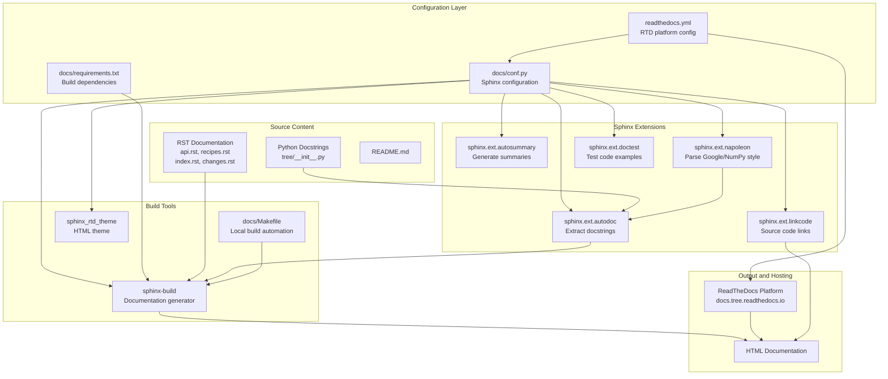
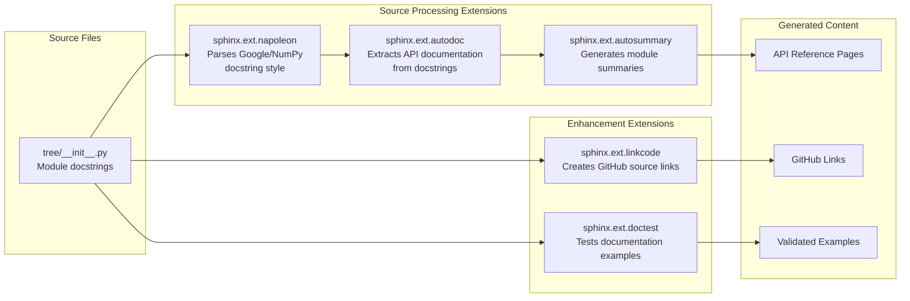
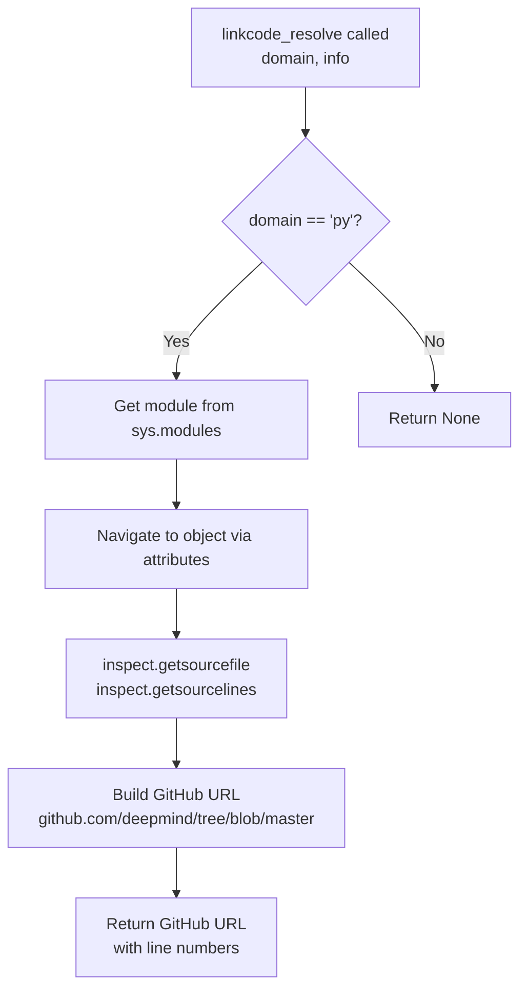
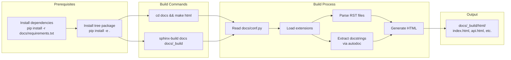
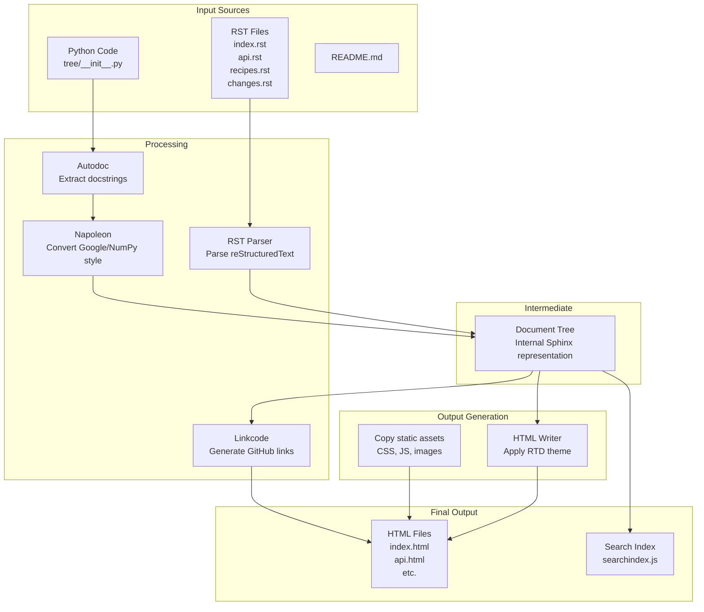

<!-- source: DeepWiki mcp.deepwiki.com · repo google-deepmind/tree · page 4.5 Documentation System · fetched 2026-10-26 -->

# Documentation System

<details>
<summary>Relevant source files</summary>

The following files were used as context for generating this wiki page:

- [docs/Makefile](docs/Makefile)
- [docs/conf.py](docs/conf.py)
- [docs/requirements.txt](docs/requirements.txt)
- [readthedocs.yml](readthedocs.yml)

</details>


## Purpose and Scope

This document describes the dm-tree documentation system, including how documentation is authored, built with Sphinx, and published to ReadTheDocs. It covers the Sphinx configuration, extensions used for automatic API documentation generation, the ReadTheDocs integration, and the local build process.

For information about contributing documentation content, see [Contributing Guidelines](#5.1). For details about the project's evolution and release history, see [Changelog and History](#5.2).

## Overview

The dm-tree project uses a Sphinx-based documentation system that automatically generates API documentation from Python docstrings and combines it with hand-written guides and tutorials. The documentation is built and hosted on ReadTheDocs, ensuring it remains synchronized with code releases.

**Sources:** [docs/conf.py:1-131](), [readthedocs.yml:1-15]()

## Documentation Architecture

The documentation system consists of three main components: configuration files that define build behavior, Sphinx extensions that process source content, and the ReadTheDocs platform that automates building and hosting.



**Sources:** [docs/conf.py:40-131](), [readthedocs.yml:6-14](), [docs/requirements.txt:1-2]()

## Sphinx Configuration

The primary configuration file [docs/conf.py]() defines all aspects of documentation generation. It is structured into several logical sections.

### Project Metadata

The configuration sets basic project information and enables dynamic copyright year calculation:

| Configuration | Value | Line Reference |
|--------------|-------|----------------|
| `project` | 'Tree' | [docs/conf.py:40]() |
| `copyright` | Dynamic year + 'DeepMind' | [docs/conf.py:41]() |
| `author` | 'DeepMind' | [docs/conf.py:42]() |
| `master_doc` | 'index' | [docs/conf.py:46]() |

**Sources:** [docs/conf.py:38-46]()

### Extension Configuration

The documentation system uses five Sphinx extensions to automate documentation generation and enhance functionality:



**Extension Definitions:**

- **`sphinx.ext.autodoc`**: Automatically extracts documentation from Python docstrings in the `tree` module
- **`sphinx.ext.autosummary`**: Generates summary tables of modules and functions
- **`sphinx.ext.linkcode`**: Creates "[source]" links that point to the exact code on GitHub
- **`sphinx.ext.napoleon`**: Parses Google-style and NumPy-style docstrings into reStructuredText
- **`sphinx.ext.doctest`**: Enables testing of code examples embedded in documentation

**Sources:** [docs/conf.py:51-57]()

### Autodoc Configuration

The `autodoc` extension is configured to control how API documentation is generated:

```python
autodoc_default_options = {
    'member-order': 'bysource',
    'special-members': True,
    'exclude-members': '__repr__, __str__, __weakref__',
}
```

| Option | Value | Purpose |
|--------|-------|---------|
| `member-order` | `'bysource'` | Documents members in source code order (not alphabetically) |
| `special-members` | `True` | Include special methods like `__init__` |
| `exclude-members` | `'__repr__, __str__, __weakref__'` | Exclude common special methods from documentation |

**Sources:** [docs/conf.py:69-73]()

### HTML Theme Configuration

The documentation uses the ReadTheDocs theme for consistent styling:

```python
html_theme = 'sphinx_rtd_theme'
```

This theme is specified as a dependency in [docs/requirements.txt:2]() and provides the familiar ReadTheDocs appearance with navigation sidebar, search functionality, and mobile responsiveness.

**Sources:** [docs/conf.py:80](), [docs/requirements.txt:2]()

### Doctest Setup

The `doctest` extension is configured with a global setup that imports commonly used modules for documentation examples:

```python
doctest_global_setup = '''
import collections
import numpy as np
import tree
'''
```

This setup allows documentation examples to use `tree`, `collections`, and `numpy` without explicit import statements in each example, making examples more concise and readable.

**Sources:** [docs/conf.py:89-93]()

### GitHub Source Link Generation

The `linkcode_resolve` function generates GitHub URLs for Python objects, enabling "[source]" links in the API documentation:



The function performs these steps:

1. Verifies the domain is Python (`'py'`)
2. Retrieves the module from `sys.modules`
3. Navigates to the object using its fully qualified name
4. Gets the source file and line numbers using `inspect` module
5. Constructs a GitHub URL pointing to the specific line range

The URL format is: `https://github.com/deepmind/tree/blob/master/tree/{filename}#L{start}#L{end}`

**Sources:** [docs/conf.py:98-130]()

## ReadTheDocs Integration

The [readthedocs.yml]() configuration file enables automatic documentation building and hosting on the ReadTheDocs platform.

### Configuration Structure

```yaml
version: 2

sphinx:
  builder: html
  configuration: docs/conf.py
  fail_on_warning: false

python:
  version: 3.7
  install:
  - requirements: docs/requirements.txt
```

| Section | Configuration | Purpose |
|---------|--------------|---------|
| `version` | `2` | Uses ReadTheDocs configuration format v2 |
| `sphinx.builder` | `html` | Generates HTML output (not PDF or EPUB) |
| `sphinx.configuration` | `docs/conf.py` | Points to Sphinx configuration file |
| `sphinx.fail_on_warning` | `false` | Allows build to succeed with warnings |
| `python.version` | `3.7` | Python version for build environment |
| `python.install` | `requirements: docs/requirements.txt` | Installs documentation dependencies |

**Sources:** [readthedocs.yml:1-15]()

### Build Dependencies

The ReadTheDocs build environment installs these dependencies:

```
sphinx>=2.0.1
sphinx_rtd_theme>=0.4.3
```

These are the minimum requirements for building the documentation. Note that the actual `tree` package must also be installed for autodoc to extract docstrings, which ReadTheDocs handles automatically.

**Sources:** [docs/requirements.txt:1-2]()

## Build Process

The documentation can be built locally using the provided Makefile or directly with `sphinx-build`.

### Makefile Commands

The [docs/Makefile]() provides a standard Sphinx build interface:

| Command | Purpose |
|---------|---------|
| `make help` | Display available build targets |
| `make html` | Build HTML documentation |
| `make clean` | Remove built documentation |
| `make doctest` | Run documentation tests |

The Makefile defines these variables:

| Variable | Value | Purpose |
|----------|-------|---------|
| `SPHINXBUILD` | `sphinx-build` | Sphinx command-line tool |
| `SOURCEDIR` | `.` | Current directory (docs) |
| `BUILDDIR` | `_build` | Output directory |

**Sources:** [docs/Makefile:1-20]()

### Local Build Workflow



**Sources:** [docs/Makefile:1-20](), [docs/conf.py:34]()

### ReadTheDocs Automated Build

When commits are pushed to the repository, ReadTheDocs automatically:

1. Clones the repository
2. Creates a Python 3.7 environment
3. Installs dependencies from [docs/requirements.txt]()
4. Installs the `tree` package
5. Runs `sphinx-build` with configuration from [docs/conf.py]()
6. Publishes the HTML output to the documentation site

This automation ensures documentation remains synchronized with code changes without manual deployment steps.

**Sources:** [readthedocs.yml:1-15]()

## Documentation Content Pipeline

The documentation system transforms multiple content sources into the final HTML output.



**Sources:** [docs/conf.py:51-93]()

## Path Configuration

The Sphinx configuration adds the parent directory to Python's module search path, enabling autodoc to import the `tree` module:

```python
sys.path.insert(0, os.path.abspath('../'))
import tree
```

This configuration at [docs/conf.py:34-36]() allows Sphinx to import `tree` even when building documentation without having installed the package to the system Python environment. This is essential for extracting docstrings during the build process.

**Sources:** [docs/conf.py:34-36]()

## Summary

The dm-tree documentation system provides automated API documentation generation through a well-configured Sphinx setup. The system:

- Uses five Sphinx extensions to automate documentation extraction and enhancement
- Integrates with ReadTheDocs for automatic building and hosting
- Generates GitHub source links for every documented API element
- Tests documentation examples via the doctest extension
- Supports local builds for development and preview

The configuration is minimal yet comprehensive, with just 131 lines in [docs/conf.py]() and 15 lines in [readthedocs.yml]() providing full documentation automation.

**Sources:** [docs/conf.py:1-131](), [readthedocs.yml:1-15](), [docs/requirements.txt:1-2](), [docs/Makefile:1-20]()

---

