# Page: Home

# Home

<details>
<summary>Relevant source files</summary>

The following files were used as context for generating this wiki page:

- [README.md](README.md)
- [docs/index.rst](docs/index.rst)
- [tree/__init__.py](tree/__init__.py)

</details>


This page provides an introduction to dm-tree: what it is, the problem it solves, and an overview of its capabilities. For installation instructions, see [Installation and Setup](#3.1). For detailed API documentation, see [API Reference](#3.4). For architectural details, see [Architecture](#2).

**Sources:** [tree/__init__.py:1-62](), [README.md:1-48](), [docs/index.rst:1-45]()

## What is dm-tree?

`dm-tree` is a library for working with arbitrarily nested data structures in Python. It generalizes Python's built-in `map()` function (which only works with flat sequences) to operate on nested structures while preserving their shape. The library is backed by an optimized C++ implementation, making it suitable for performance-critical applications such as machine learning frameworks.

The library originated as part of TensorFlow (available as `tf.nest`) and has been extracted as a standalone package to benefit the broader Python ecosystem.

**Sources:** [tree/__init__.py:16](), [README.md:3-6](), [docs/index.rst:13-26]()

## Core Problem: Working with Nested Structures

Python programs frequently work with nested data structures like:

```python
# Configuration object
config = {
    'model': {'layers': [64, 128, 256], 'dropout': 0.5},
    'optimizer': {'learning_rate': 0.001, 'momentum': 0.9}
}

# Batch of samples
batch = [(features1, label1), (features2, label2), (features3, label3)]

# Neural network parameters
params = {'weights': [W1, W2, W3], 'biases': [b1, b2, b3]}
```

Common operations on these structures include:
- Applying a function to every leaf value
- Flattening to a list for batch processing
- Validating that two structures have the same shape
- Reconstructing a structure from a flat list

Without `dm-tree`, implementing these operations requires complex recursive code that handles different container types (lists, tuples, dicts, namedtuples, etc.). The library provides a clean, performant API for these operations.

**Sources:** [tree/__init__.py:377-428](), [README.md:3-15]()

## Key Functions and Their Roles

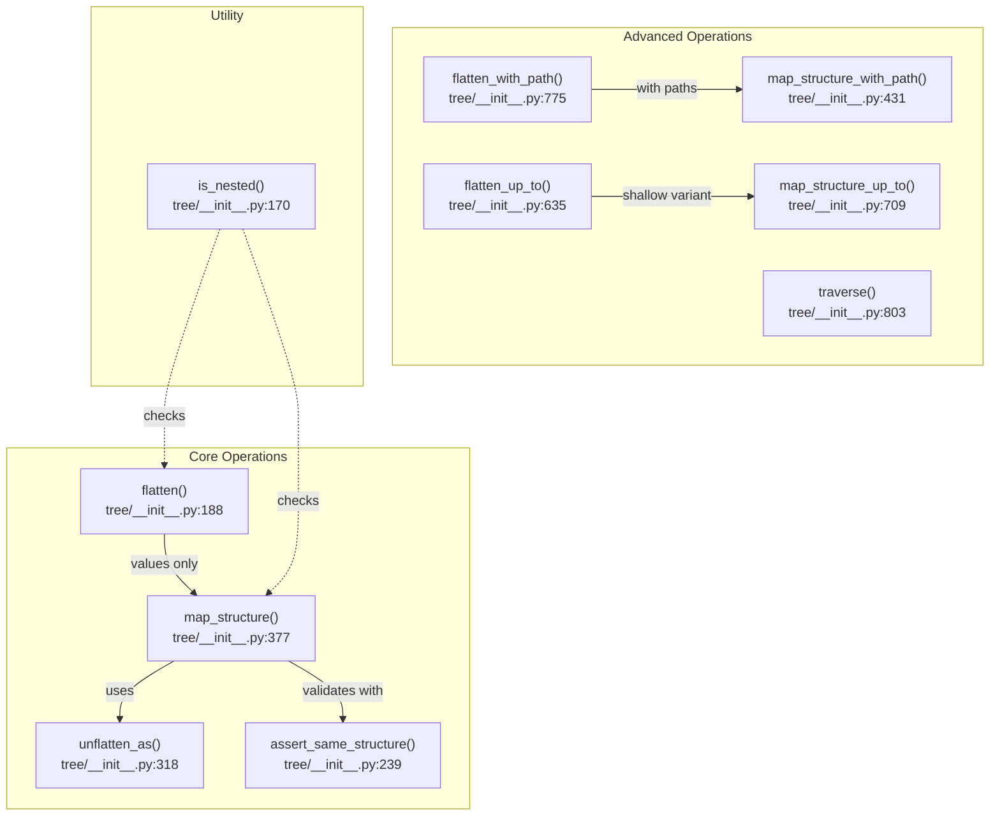

**Sources:** [tree/__init__.py:46-60](), [tree/__init__.py:170-941]()

## Function Categories

| Category | Functions | Purpose |
|----------|-----------|---------|
| **Basic Operations** | `flatten`, `unflatten_as`, `map_structure` | Transform entire nested structures |
| **Structure Validation** | `assert_same_structure`, `is_nested` | Verify structure compatibility and properties |
| **Path-Aware Operations** | `flatten_with_path`, `map_structure_with_path` | Access position information during traversal |
| **Shallow Operations** | `flatten_up_to`, `map_structure_up_to`, `flatten_with_path_up_to`, `map_structure_with_path_up_to` | Process structures only to a certain depth |
| **Custom Traversal** | `traverse`, `traverse_with_path` | Flexible depth-first traversal with pruning |

**Sources:** [tree/__init__.py:46-60]()

## Quick Start Examples

### Flattening and Unflattening

```python
import tree

# Flatten nested structure to list
structure = [[1, 2], {'a': 3, 'b': [4, 5]}]
flat = tree.flatten(structure)
# Result: [1, 2, 3, 4, 5]

# Unflatten using a structure template
new_values = [10, 20, 30, 40, 50]
result = tree.unflatten_as(structure, new_values)
# Result: [[10, 20], {'a': 30, 'b': [40, 50]}]
```

**Sources:** [tree/__init__.py:188-224](), [tree/__init__.py:318-374](), [README.md:8-15]()

### Mapping Functions Over Structures

```python
# Apply function to each leaf
structure = [[1], [[[2, 3]]], [4]]
squared = tree.map_structure(lambda v: v**2, structure)
# Result: [[1], [[[4, 9]]], [16]]

# Apply function to multiple structures element-wise
tree.map_structure(lambda x, y: x + y, [1, 2], [3, 4])
# Result: [4, 6]
```

**Sources:** [tree/__init__.py:377-428](), [README.md:13-14](), [docs/index.rst:18-21]()

### Structure Validation

```python
# Verify two structures have the same shape
tree.assert_same_structure([1, 2], [3, 4])  # OK
tree.assert_same_structure([1, 2], [3])     # Raises ValueError
tree.assert_same_structure([1, 2], (3, 4))  # Raises TypeError (by default)
```

**Sources:** [tree/__init__.py:239-284]()

## Supported Types

`dm-tree` recognizes and correctly handles the following Python types as nested structures:

| Type Category | Examples | Iteration Order |
|--------------|----------|----------------|
| **Sequences** | `list`, `tuple` | Index order (0, 1, 2, ...) |
| **Mappings** | `dict`, `OrderedDict`, `defaultdict`, `MappingProxyType` | **Sorted key order** (not insertion order) |
| **Named Tuples** | `collections.namedtuple` | Field name order (sorted) |
| **Attrs Classes** | `@attr.s` decorated classes | Attribute name order (sorted) |
| **Proxies** | `wrapt.ObjectProxy` | Delegates to wrapped object |

All other types (strings, numbers, custom objects, etc.) are treated as **leaf values**.

**Important:** Dictionaries are always iterated in sorted key order for determinism, even for `OrderedDict`. This ensures consistent behavior across operations.

**Sources:** [tree/__init__.py:64-66](), [tree/__init__.py:129-161](), [tree/__init__.py:144-160]()

## Architecture Overview

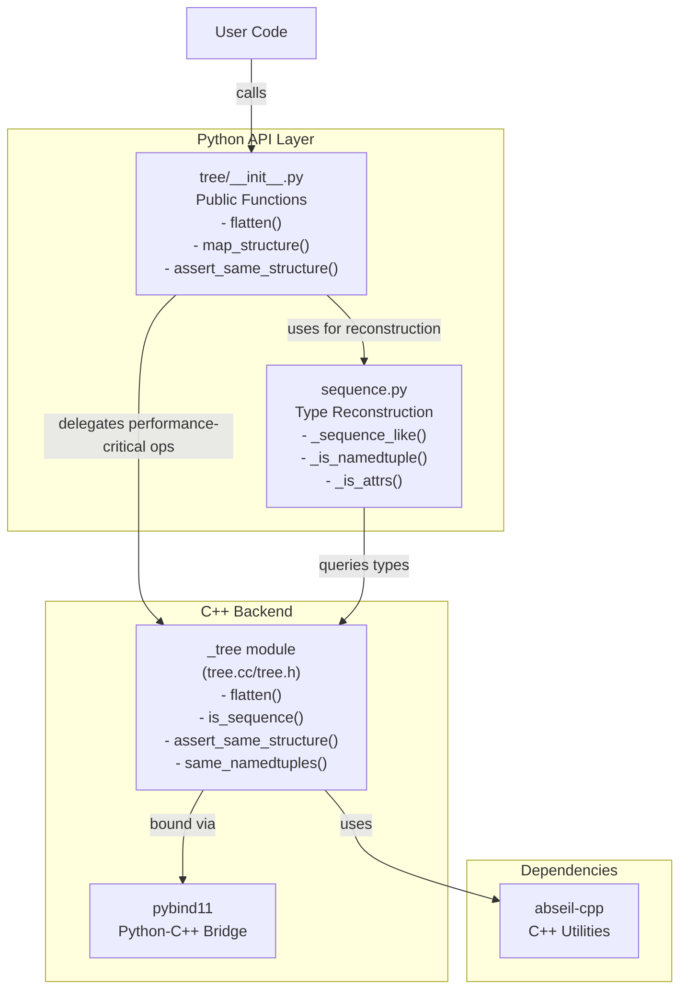

The library uses a two-tier architecture:
- **Python layer** ([tree/__init__.py:1-944]()) provides the rich public API and orchestrates operations
- **C++ backend** ([tree.cc]()) handles performance-critical primitives like flattening, type checking, and structure validation
- **Helper module** ([sequence.py]()) reconstructs Python types from flat sequences

For detailed architecture information, see [Architecture](#2).

**Sources:** [tree/__init__.py:1-44](), [tree/__init__.py:185-224](), [tree/__init__.py:276-284]()

## Type Detection Flow

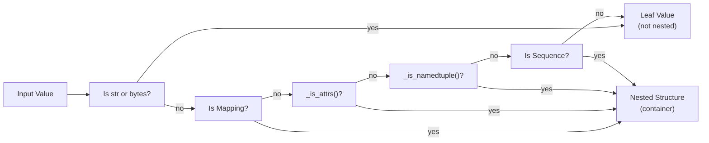

The type detection logic ensures strings and bytes are always treated as leaves (not iterated), while all recognized container types are treated as nested structures.

**Sources:** [tree/__init__.py:64-66](), [tree/__init__.py:170-185](), [tree/__init__.py:487-501]()

## Use Cases

`dm-tree` is particularly useful in:

- **Machine Learning**: Handling nested parameter structures, batch data, and configuration objects
- **Configuration Management**: Processing hierarchical configuration dictionaries
- **Data Pipelines**: Transforming nested data structures in ETL workflows
- **Testing**: Validating structure consistency across inputs and outputs
- **Generic Programming**: Writing functions that work uniformly across different nested container types

**Sources:** [README.md:17-18]()

## Getting Started

1. **Install the package**: See [Installation and Setup](#3.1)
2. **Learn basic operations**: See [Basic Operations](#3.2)
3. **Explore advanced features**: See [Advanced Usage](#3.3)
4. **Review complete API**: See [API Reference](#3.4)

For contributors and developers who want to modify or extend dm-tree:
- **Development setup**: See [Development Setup](#4.1)
- **Build system details**: See [Build System Architecture](#4.2)
- **Testing guidelines**: See [Testing and Benchmarking](#4.3)

**Sources:** [docs/index.rst:28-33](), [README.md:20-38]()

## Version and License

Current version: `0.1.9`

The project is licensed under the Apache 2.0 License.

For project history and version changes, see [Changelog and History](#5.2).

**Sources:** [tree/__init__.py:62](), [README.md:45-47](), [docs/index.rst:41-44]()

---

# Page: Architecture

# Architecture

<details>
<summary>Relevant source files</summary>

The following files were used as context for generating this wiki page:

- [setup.py](setup.py)
- [tree/__init__.py](tree/__init__.py)
- [tree/tree.cc](tree/tree.cc)

</details>


This document provides a high-level overview of dm-tree's internal architecture, focusing on the dual Python/C++ implementation strategy that enables both ease of use and high performance. For detailed information about specific components, see [Python API Layer](#2.1), [C++ Backend Implementation](#2.2), and [Type System and Utilities](#2.3). For build system details, see [Build System Architecture](#4.2).

## Architectural Overview

dm-tree employs a **two-tier architecture** that separates user-facing API functionality from performance-critical operations. The Python layer provides a rich, Pythonic interface while delegating computationally intensive tasks to a C++ backend. This design achieves three key objectives:

1. **Performance**: C++ implementation for flattening, structure validation, and type checking operations
2. **Usability**: Idiomatic Python API with comprehensive docstrings and error handling
3. **Flexibility**: Python-based orchestration for complex operations like `map_structure` and `traverse`

The architecture consists of three primary layers:

| Layer | Implementation | Primary Responsibility |
|-------|---------------|------------------------|
| **Python API** | [tree/\_\_init\_\_.py]() | Public API, orchestration, structure reconstruction |
| **C++ Backend** | [tree/tree.cc](), [tree/tree.h]() | Performance-critical operations, type checking |
| **Type Utilities** | [tree/sequence.py]() | Type-aware reconstruction of Python structures |

Sources: [tree/__init__.py:1-944](), [tree/tree.cc:1-783](), [setup.py:43-53]()

## System Component Diagram

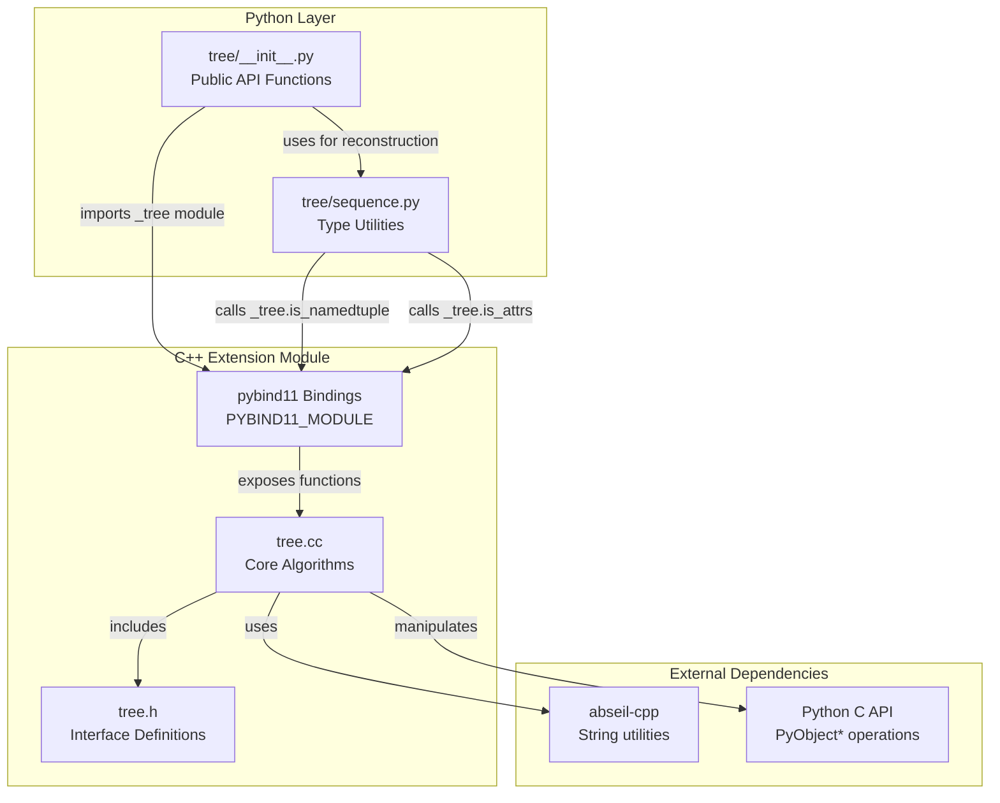

**System Components and Their Roles**

Sources: [tree/__init__.py:37-43](), [tree/tree.cc:744-779](), [tree/sequence.py:1-30]()

## Layer Responsibilities

### Python API Layer

The Python API layer in [tree/\_\_init\_\_.py]() serves as the primary interface for users and handles:

- **API Orchestration**: Functions like `map_structure` coordinate between C++ operations and Python function application
- **Error Enhancement**: Wraps C++ exceptions with detailed structural information ([tree/__init__.py:276-284]())
- **Convenience Operations**: Provides variants like `flatten_with_path`, `map_structure_up_to` that build on C++ primitives
- **Structure Reconstruction**: Uses helper functions to rebuild nested structures after transformation

Key functions include:
- `flatten()` - Direct delegation to C++ ([tree/__init__.py:224]())
- `map_structure()` - Python orchestration using C++ flatten + Python function application ([tree/__init__.py:377-428]())
- `assert_same_structure()` - C++ validation with enhanced error reporting ([tree/__init__.py:239-284]())

### C++ Backend Layer

The C++ implementation in [tree/tree.cc]() and [tree/tree.h]() focuses on:

- **High-Performance Flattening**: `Flatten()` function recursively extracts values ([tree/tree.cc:611-619]())
- **Type Identification**: Fast type checking with caching via `CachedTypeCheck` class ([tree/tree.cc:95-148]())
- **Structure Validation**: `AssertSameStructure()` performs deep structural comparison ([tree/tree.cc:703-721]())
- **Iterator Abstractions**: Specialized iterators for different container types:
  - `DictValueIterator` for dictionaries with sorted keys ([tree/tree.cc:263-295]())
  - `MappingValueIterator` for generic mappings ([tree/tree.cc:298-329]())
  - `SequenceValueIterator` for sequences ([tree/tree.cc:332-358]())
  - `AttrsValueIterator` for attrs-decorated classes ([tree/tree.cc:360-390]())

Sources: [tree/tree.cc:608-619](), [tree/tree.cc:703-721](), [tree/tree.cc:95-148]()

### Type System Utilities

The [tree/sequence.py]() module bridges Python's type system with the tree operations:

- **Type Recognition**: Functions `_is_namedtuple()` and `_is_attrs()` identify special Python types
- **Structure Reconstruction**: `_sequence_like()` rebuilds structures with new values while preserving types
- **Key Sorting**: `_sorted()` provides deterministic ordering for dictionary keys

This module is crucial for operations like `unflatten_as()` and `map_structure()` that need to reconstruct the original structure types after flattening.

Sources: [tree/sequence.py:1-150](), [tree/__init__.py:23-26]()

## Language Boundary and Integration

### pybind11 Bridge

The Python-C++ boundary is managed through pybind11, configured in [tree/tree.cc:744-779](). The `PYBIND11_MODULE` macro exposes five core functions from C++ to Python:

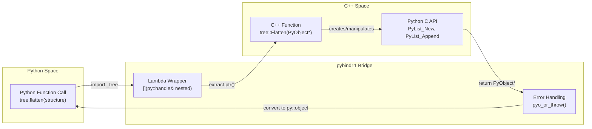

**Exposed C++ Functions:**

| Python Name | C++ Implementation | Purpose |
|-------------|-------------------|---------|
| `_tree.flatten` | `tree::Flatten()` | Recursively flatten nested structures |
| `_tree.assert_same_structure` | `tree::AssertSameStructure()` | Validate structural equivalence |
| `_tree.is_sequence` | `tree::IsSequence()` | Check if object is a sequence |
| `_tree.is_namedtuple` | `tree::IsNamedtuple()` | Identify namedtuple objects |
| `_tree.is_attrs` | `tree::IsAttrs()` | Identify attrs-decorated classes |
| `_tree.same_namedtuples` | `tree::SameNamedtuples()` | Compare namedtuple types |

Sources: [tree/tree.cc:744-779](), [tree/__init__.py:37-42]()

### Compilation and Build Integration

The C++ extension is built through CMake integration in [setup.py]():

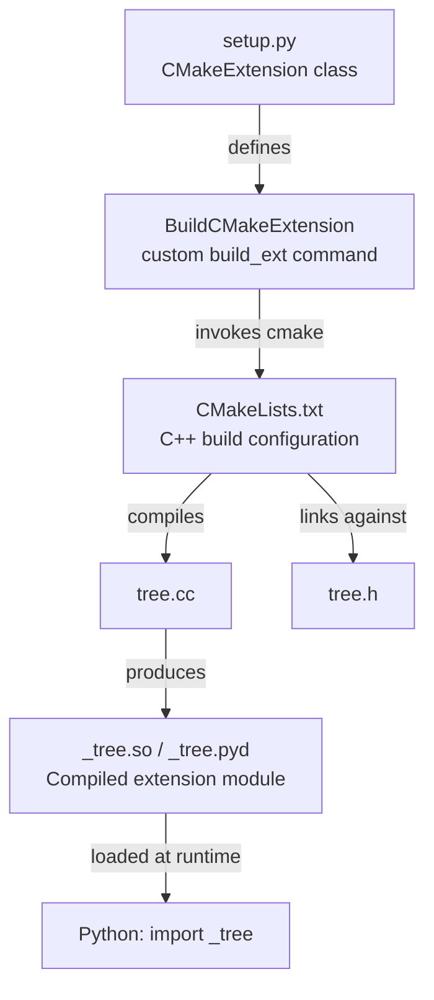

The `CMakeExtension` class in [setup.py:43-53]() and `BuildCMakeExtension` in [setup.py:55-117]() coordinate the build process, passing Python configuration to CMake and handling platform-specific requirements.

Sources: [setup.py:43-117](), [tree/tree.cc:744-779]()

## Operational Flow

### Example: `map_structure` Execution

The following diagram illustrates how a typical high-level operation flows through all architectural layers:

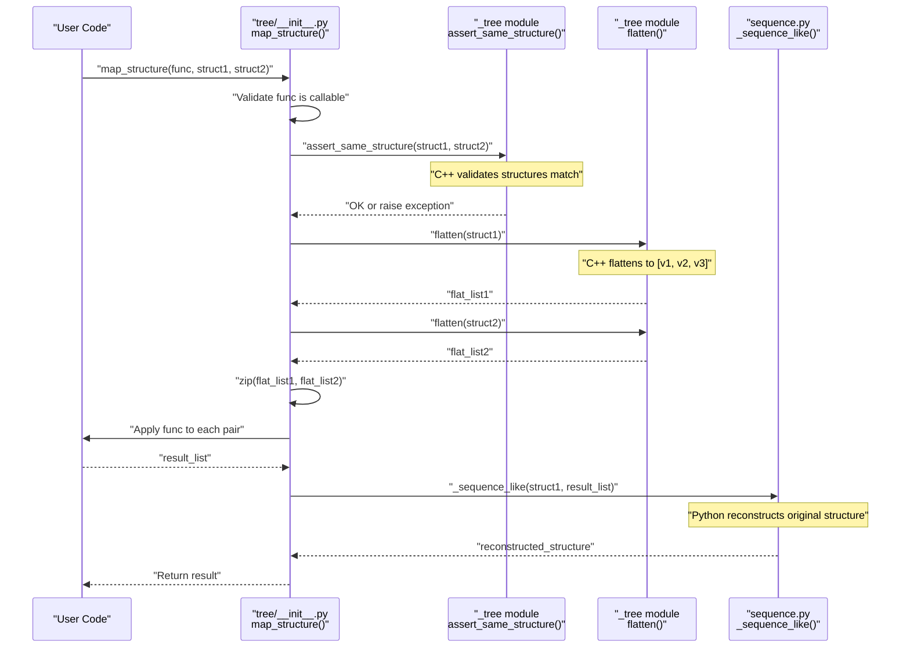

**Flow Breakdown:**

1. **Validation Phase** (Python → C++): `map_structure` calls `assert_same_structure` to ensure all input structures have compatible shapes
2. **Flattening Phase** (Python → C++): Each structure is flattened using the C++ `flatten` function for performance
3. **Application Phase** (Pure Python): The user's function is applied to zipped flat sequences
4. **Reconstruction Phase** (Python with C++ queries): `_sequence_like` rebuilds the output using type information from C++

Sources: [tree/__init__.py:377-428](), [tree/__init__.py:318-374](), [tree/sequence.py:50-150]()

## Type Checking and Caching Strategy

A key performance optimization in the C++ layer is the `CachedTypeCheck` class, which caches type identification results:

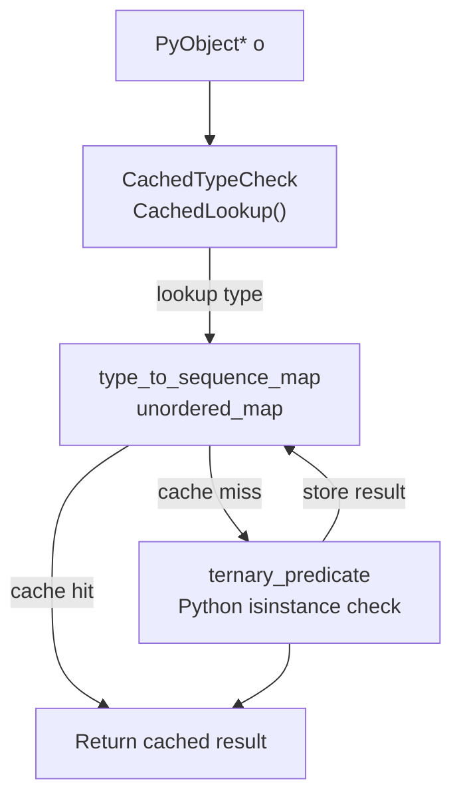

**Caching Mechanism:**

The `CachedTypeCheck` class ([tree/tree.cc:95-148]()) implements a type-based memoization strategy:

1. **First Check**: When encountering a new Python type, call the predicate (e.g., `isinstance(o, Sequence)`)
2. **Cache Storage**: Store the result in `type_to_sequence_map_` with the type object as key
3. **Subsequent Checks**: For objects of the same type, return cached result without Python callback
4. **Cache Limit**: Maximum 1024 types to prevent unbounded memory growth

This optimization is critical because type checks occur frequently during recursive flattening and validation operations.

Sources: [tree/tree.cc:95-148](), [tree/tree.cc:186-254]()

## Design Rationale

### Why Two Languages?

| Aspect | Python Implementation | C++ Implementation | Chosen Approach |
|--------|----------------------|-------------------|-----------------|
| **Recursive flattening** | Simple but slow (function call overhead) | Fast (tight loops, no interpreter) | **C++** |
| **Type identification** | Native `isinstance()` but repeated calls costly | Cached checks, fast lookup | **C++ with caching** |
| **Structure reconstruction** | Natural with Python's type system | Complex, requires Python API calls | **Python** |
| **User function application** | Natural, required for `map_structure` | Would require callback complexity | **Python** |
| **API composition** | Straightforward with decorators, kwargs | Verbose with pybind11 wrappers | **Python** |

### Performance vs. Flexibility Trade-off

The architecture makes deliberate choices about where to draw the Python/C++ boundary:

- **C++ handles**: Operations that iterate over large structures repeatedly (flatten, validate)
- **Python handles**: Operations that compose multiple steps or apply user-provided logic (map_structure, traverse)

This division allows the library to be both fast (competitive with hand-written C++ code for basic operations) and flexible (supporting arbitrary user functions and complex traversal patterns).

Sources: [tree/__init__.py:377-428](), [tree/tree.cc:393-419]()

## Module Dependencies

The following table summarizes the import relationships between core modules:

| Module | Imports From | Provides To |
|--------|--------------|-------------|
| `tree/__init__.py` | `tree._tree` (C++), `tree.sequence` | User code (public API) |
| `tree/sequence.py` | `tree._tree` (for type checks) | `tree/__init__.py` |
| `tree._tree` (C++ module) | Python C API, abseil-cpp | `tree/__init__.py`, `tree/sequence.py` |

The architecture maintains a clear dependency hierarchy with no circular dependencies between modules. The C++ module has no Python-level dependencies beyond the C API, making it independently testable and maintainable.

Sources: [tree/__init__.py:23-43](), [tree/sequence.py:1-30](), [tree/tree.cc:17-39]()

---

# Page: Python API Layer

# Python API Layer

<details>
<summary>Relevant source files</summary>

The following files were used as context for generating this wiki page:

- [LICENSE](LICENSE)
- [tree/__init__.py](tree/__init__.py)
- [tree/tree_test.py](tree/tree_test.py)

</details>


## Purpose and Scope

This document describes the Python API layer implemented in [tree/__init__.py](). This layer serves as the primary public interface to the dm-tree library, providing high-level functions for manipulating nested data structures. It orchestrates operations by delegating performance-critical tasks to the C++ backend while handling Python-specific type reconstruction and error reporting.

For information about the underlying C++ implementation, see [C++ Backend Implementation](#2.2). For details on how different Python types are handled, see [Type System and Utilities](#2.3).

---

## API Overview

The Python API layer exposes 10 public functions organized into three functional categories:

| Category | Functions | Purpose |
|----------|-----------|---------|
| **Basic Operations** | `flatten`, `unflatten_as`, `map_structure`, `assert_same_structure`, `is_nested` | Core tree manipulation operations |
| **Path-Aware Operations** | `flatten_with_path`, `map_structure_with_path` | Operations that track element positions |
| **Shallow Operations** | `flatten_up_to`, `map_structure_up_to`, `flatten_with_path_up_to`, `map_structure_with_path_up_to` | Partial tree traversal operations |
| **Traversal** | `traverse` | Custom tree walking with user-defined logic |

**Sources:** [tree/__init__.py:46-60]()

---

## Module Structure and Public Interface

The following diagram shows how the public API functions are organized and exported:

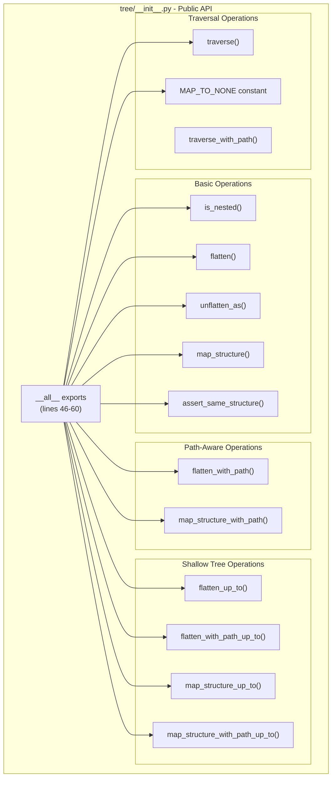

**Sources:** [tree/__init__.py:46-60](), [tree/__init__.py:16]()

---

## Basic Operations

### is_nested()

Determines whether a structure should be treated as nested (i.e., a sequence, mapping, namedtuple, or attrs object).

**Implementation:** [tree/__init__.py:170-185]()


This function directly delegates to the C++ backend's `_tree.is_sequence()` function. Strings and bytes are explicitly **not** treated as sequences, preventing unwanted character-level iteration.

**Sources:** [tree/__init__.py:170-185]()

---

### flatten()

Converts an arbitrarily nested structure into a flat list of leaf values. Dictionary keys are sorted to ensure deterministic ordering.

**Implementation:** [tree/__init__.py:188-224]()

**Key behaviors:**
- Non-nested inputs return single-element lists: `flatten(42) → [42]`
- Dictionary values are extracted in sorted key order
- `OrderedDict` instances ignore their ordering; keys are sorted
- Strings and byte strings are not flattened
- Delegates directly to `_tree.flatten()` for performance

**Sources:** [tree/__init__.py:188-224]()

---

### unflatten_as()

Reconstructs a nested structure from a flat sequence, using a template structure to determine the output shape.

**Implementation:** [tree/__init__.py:318-374]()

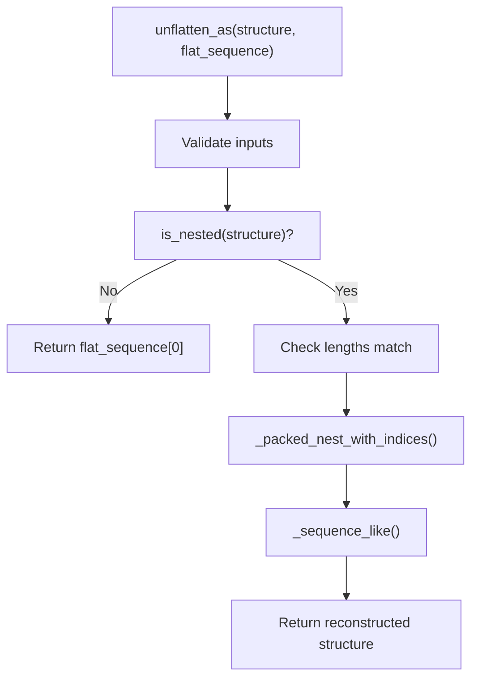

The reconstruction process uses the helper function `_packed_nest_with_indices()` [tree/__init__.py:287-315]() which recursively rebuilds the nested structure by matching the template structure's shape.

**Sources:** [tree/__init__.py:287-374]()

---

### assert_same_structure()

Validates that two structures have identical nesting patterns. This function is heavily used internally to validate inputs before operations.

**Implementation:** [tree/__init__.py:239-284]()

**Features:**
- Delegates to `_tree.assert_same_structure()` for validation
- On error, wraps the exception with visual structure representations
- Uses `map_structure(lambda _: _DOT, ...)` to create printable structure outlines
- The `check_types` parameter controls whether sequence types must match exactly

**Error Enhancement Pattern:**
```python
try:
    _tree.assert_same_structure(a, b, check_types)
except (ValueError, TypeError) as e:
    str1 = str(map_structure(lambda _: _DOT, a))
    str2 = str(map_structure(lambda _: _DOT, b))
    raise type(e)(f"{e}\nEntire first structure:\n{str1}\nEntire second structure:\n{str2}")
```

This pattern provides significantly better error messages by showing the complete structure outline.

**Sources:** [tree/__init__.py:239-284](), [tree/__init__.py:227-236]()

---

### map_structure()

Applies a function to corresponding elements across one or more nested structures, preserving the original structure shape.

**Implementation:** [tree/__init__.py:377-428]()

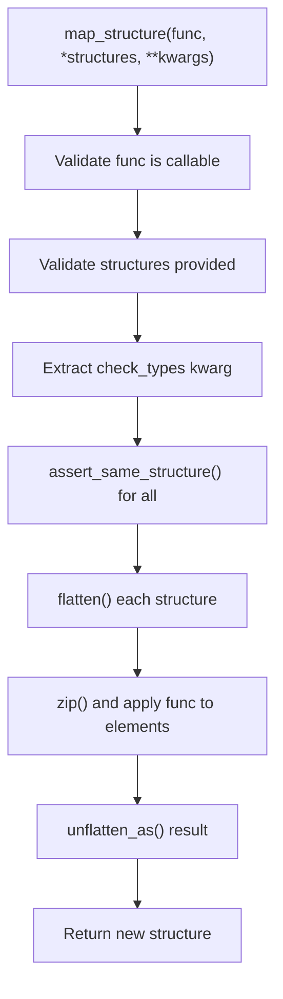

**Algorithm:** [tree/__init__.py:377-428]()
1. Validate callable and inputs
2. Check structure compatibility with `assert_same_structure()`
3. Flatten all input structures
4. Zip flattened lists and apply function element-wise
5. Unflatten results using the first structure as template

This implementation achieves O(n) complexity where n is the total number of leaf elements.

**Sources:** [tree/__init__.py:377-428]()

---

## Path-Aware Operations

Path-aware variants track the position of each element in the nested structure using a tuple of keys/indices.

### flatten_with_path()

Returns a list of `(path, value)` pairs where each path is a tuple identifying the element's location.

**Implementation:** [tree/__init__.py:775-796]()

```python
# Example from docstring:
tree.flatten_with_path([{"foo": 42}])
# Returns: [((0, 'foo'), 42)]
```

Internally delegates to `_yield_flat_up_to(structure, structure)` [tree/__init__.py:471-501](), treating both shallow and input tree as the same structure.

**Sources:** [tree/__init__.py:775-796](), [tree/__init__.py:471-501]()

---

### map_structure_with_path()

Like `map_structure()`, but passes the path as the first argument to the mapping function.

**Implementation:** [tree/__init__.py:431-468]()

```python
# Example:
tree.map_structure_with_path(
    lambda path, v: (path, v**2),
    [{"foo": 42}])
# Returns: [{'foo': ((0, 'foo'), 1764)}]
```

Internally delegates to `map_structure_with_path_up_to()` with the structure as its own shallow tree.

**Sources:** [tree/__init__.py:431-468]()

---

## Shallow Tree Operations

Shallow tree operations traverse only to the depth specified by a "shallow structure" template, leaving deeper nested elements intact.

### Core Helper: _yield_flat_up_to()

The foundation of all shallow operations is `_yield_flat_up_to()` [tree/__init__.py:471-501]():

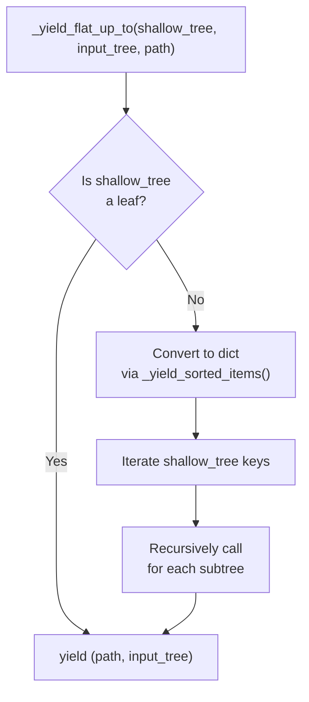

This generator function:
1. Stops at shallow_tree leaves (including strings/bytes)
2. Yields `(path, value)` pairs
3. Recursively processes nested portions
4. Ensures deterministic ordering via sorted iteration

**Sources:** [tree/__init__.py:471-501]()

---

### _assert_shallow_structure()

Validates that the shallow structure's keys are a subset of the input structure's keys and that the nesting pattern is compatible.

**Implementation:** [tree/__init__.py:520-632]()

**Key validation rules:**
- If shallow tree is nested, input tree must also be nested
- Sequence lengths must match
- Type checking respects the `check_types` parameter
- For mappings, validates that all shallow keys exist in input
- Recursively validates all matching subtrees

**Sources:** [tree/__init__.py:520-632]()

---

### flatten_up_to()

Flattens the input structure only to the depth of the shallow structure.

**Implementation:** [tree/__init__.py:635-674]()

```python
# Example:
structure = [[[2, 2], [3, 3]], [[4, 9], [5, 5]]]
shallow = [[True, True], [False, True]]
tree.flatten_up_to(shallow, structure)
# Returns: [[2, 2], [3, 3], [4, 9], [5, 5]]
```

The shallow tree acts as a "mask" determining traversal depth.

**Sources:** [tree/__init__.py:635-674]()

---

### map_structure_up_to()

Maps a function across structures up to the shallow structure's depth.

**Implementation:** [tree/__init__.py:709-739]()

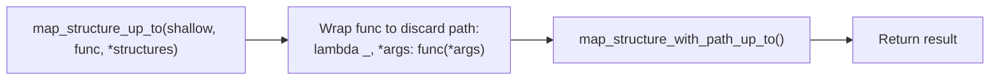

This function is implemented as a thin wrapper around `map_structure_with_path_up_to()` that discards the path argument.

**Sources:** [tree/__init__.py:709-739]()

---

### map_structure_with_path_up_to()

The most general shallow mapping operation, combining path tracking with shallow traversal.

**Implementation:** [tree/__init__.py:742-772]()

**Algorithm:**
1. Uses `_multiyield_flat_up_to()` [tree/__init__.py:504-517]() to yield aligned path-value tuples
2. Applies the function to each aligned set of values
3. Unflattens results using the shallow structure as template

The `_multiyield_flat_up_to()` helper zips multiple input trees together, ensuring all structures align at each path.

**Sources:** [tree/__init__.py:742-772](), [tree/__init__.py:504-517]()

---

## Traversal Operations

### traverse()

Provides custom tree walking with user-defined transformation logic. Supports both top-down and bottom-up traversal.

**Implementation:** [tree/__init__.py:803-844]()

**Traversal modes:**
- **Top-down:** Parents visited before children. Returning non-`None` prunes that subtree.
- **Bottom-up:** Children visited first. Return value replaces the subtree.

**Special value:** `MAP_TO_NONE` [tree/__init__.py:800]() - used when you want to replace a subtree with `None` (since `None` means "don't replace").

Internally delegates to `traverse_with_path()` with a wrapper that discards the path argument.

**Sources:** [tree/__init__.py:803-844](), [tree/__init__.py:800]()

---

### traverse_with_path()

The core traversal implementation that passes path information to the user function.

**Implementation:** [tree/__init__.py:847-941]()

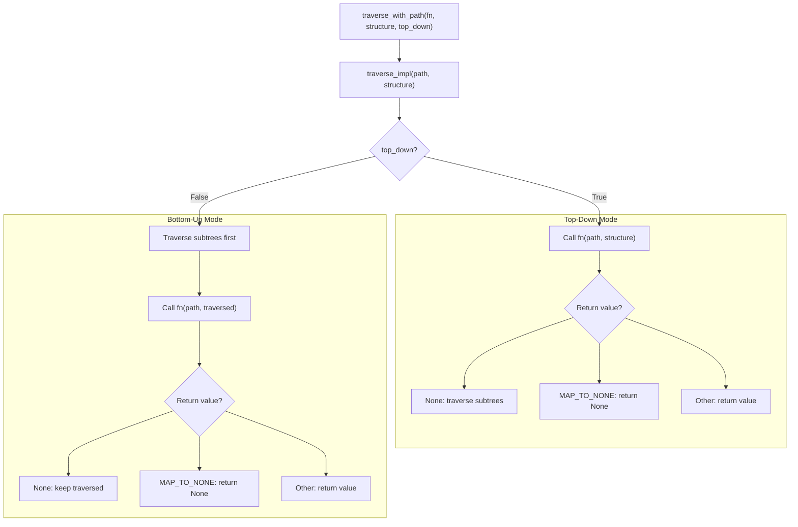

The recursive implementation [tree/__init__.py:909-941]() uses a nested helper `traverse_impl()` that builds paths incrementally and handles the traversal logic.

**Sources:** [tree/__init__.py:847-941]()

---

## Internal Architecture and Design Patterns

### Delegation Strategy

The Python API layer follows a clear delegation pattern:

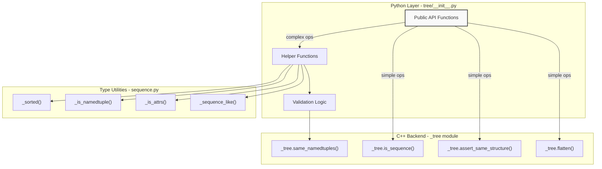

**Performance-critical operations** delegated to C++:
- `flatten()` → `_tree.flatten()`
- `assert_same_structure()` → `_tree.assert_same_structure()`
- `is_nested()` → `_tree.is_sequence()`

**Complex operations** implemented in Python:
- `unflatten_as()` - requires type reconstruction
- `map_structure()` - orchestrates multiple operations
- All shallow and path-aware operations - complex iteration logic

**Sources:** [tree/__init__.py:23-26](), [tree/__init__.py:37-42]()

---

### Helper Functions and Utilities

#### _yield_sorted_items()

Central iteration helper that provides deterministic ordering across all structure types.

**Implementation:** [tree/__init__.py:129-160]()

| Input Type | Iteration Strategy | Key Type |
|------------|-------------------|----------|
| `Mapping` | Sorted keys | Dictionary key |
| attrs object | `__attrs_attrs__` sorted by name | Attribute name |
| namedtuple | `_fields` in order | Field name |
| Sequence | Enumerate indices | Integer index |

This function is used throughout the codebase to ensure operations are deterministic regardless of dict insertion order or other runtime variations.

**Sources:** [tree/__init__.py:129-160]()

---

#### _sequence_like()

Reconstructs a structure of the same type as the input, using new values.

Imported from `sequence.py` [tree/__init__.py:25](), this function is critical for preserving type information during operations like `map_structure()` and `unflatten_as()`.

**Sources:** [tree/__init__.py:25]()

---

#### _get_attrs_items()

Extracts attribute name-value pairs from attrs objects.

**Implementation:** [tree/__init__.py:109-121]()

```python
def _get_attrs_items(obj):
    return [(attr.name, getattr(obj, attr.name))
            for attr in obj.__class__.__attrs_attrs__]
```

**Sources:** [tree/__init__.py:109-121]()

---

### Type Handling and Special Cases

#### Text and Bytes

Strings and byte strings are explicitly **not** treated as sequences to prevent character-level iteration:

```python
_TEXT_OR_BYTES = (str, bytes)  # Line 66
```

These types are checked in various functions to ensure they're treated as atomic values.

**Sources:** [tree/__init__.py:66]()

---

#### ObjectProxy Support

The API layer supports `wrapt.ObjectProxy` objects, with special handling for type checking:

```python
if isinstance(shallow_tree, ObjectProxy):
    shallow_type = type(shallow_tree.__wrapped__)
else:
    shallow_type = type(shallow_tree)
```

This allows transparent proxying of structures while maintaining correct type validation.

**Sources:** [tree/__init__.py:582-585](), [tree/__init__.py:29-34]()

---

### Error Messages and Diagnostics

The module defines several error message templates as module-level constants [tree/__init__.py:68-93]():

| Constant | Usage |
|----------|-------|
| `_SHALLOW_TREE_HAS_INVALID_KEYS` | Shallow tree keys not found in input |
| `_STRUCTURES_HAVE_MISMATCHING_TYPES` | Type mismatch between structures |
| `_STRUCTURES_HAVE_MISMATCHING_LENGTHS` | Length mismatch between structures |
| `_INPUT_TREE_SMALLER_THAN_SHALLOW_TREE` | Input has fewer elements |
| `_IF_SHALLOW_IS_SEQ_INPUT_MUST_BE_SEQ` | Type compatibility error |
| `_IF_SHALLOW_IS_SEQ_INPUT_MUST_BE_SEQ_WITH_PATH` | Type error with path info |

These templates support `.format()` substitution for detailed error reporting.

**Sources:** [tree/__init__.py:68-93]()

---

## Type Annotations

The module provides generic type annotations for nested structures:

```python
K = TypeVar("K")
V = TypeVar("V")

StructureKV = Union[
    Sequence["StructureKV[K, V]"],
    Mapping[K, "StructureKV[K, V]"],
    V,
]
Structure = StructureKV[str, V]
```

**Sources:** [tree/__init__.py:95-106]()

These recursive type definitions capture the concept of arbitrarily nested structures where:
- `StructureKV[K, V]` is a structure with key type K and leaf type V
- `Structure[V]` is shorthand for structures with string keys and leaf type V

---

## Module Initialization and Imports

The module carefully handles imports to support Sphinx documentation builds:

```python
try:
    from tree import _tree
except ImportError:
    if "sphinx" not in sys.modules:
        raise
    _tree = None
```

**Sources:** [tree/__init__.py:37-42]()

This pattern allows documentation to be built without requiring the compiled C++ extension, setting `_tree = None` when running under Sphinx.

Similarly for `wrapt.ObjectProxy`, the module provides a stub class when the library is unavailable [tree/__init__.py:29-34]().

---

## Summary

The Python API layer in `tree/__init__.py` implements a well-structured facade over the C++ backend, providing:

1. **Three categories of operations:** basic, path-aware, and shallow tree operations
2. **Performance optimization:** delegating simple operations to C++ while implementing complex logic in Python
3. **Rich error reporting:** enhancing C++ exceptions with structure visualizations
4. **Type preservation:** using helper utilities to reconstruct Python types correctly
5. **Deterministic behavior:** ensuring consistent ordering via sorted iteration
6. **Comprehensive validation:** checking structure compatibility before operations

The layer achieves a balance between performance (via C++ delegation) and flexibility (via Python implementation of complex operations), while maintaining a clean, well-documented public API.

---

# Page: C++ Backend Implementation

# C++ Backend Implementation

<details>
<summary>Relevant source files</summary>

The following files were used as context for generating this wiki page:

- [tree/tree.cc](tree/tree.cc)
- [tree/tree.h](tree/tree.h)

</details>


## Purpose and Scope

This document provides a detailed technical explanation of the C++ backend implementation in `tree.cc` and `tree.h`. The C++ layer provides performance-critical operations for nested structure manipulation, including flattening, structure validation, and type identification.

For information about how the Python API layer uses these C++ functions, see [Python API Layer](#2.1). For details on how different Python types are handled and reconstructed, see [Type System and Utilities](#2.3).

**Sources:** [tree/tree.cc:1-783](), [tree/tree.h:1-140]()

---

## Architecture Overview

The C++ backend is organized into several key subsystems that work together to provide efficient nested structure operations:

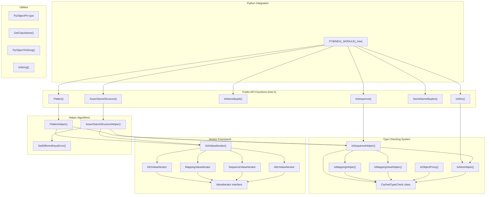

The architecture consists of four main layers:
1. **Public API Functions** - exposed to Python via pybind11
2. **Type Checking System** - cached type identification with Python type introspection
3. **Iterator Framework** - uniform iteration over different container types
4. **Helper Algorithms** - recursive implementations of core operations

**Sources:** [tree/tree.cc:1-783](), [tree/tree.h:16-140]()

---

## Public API Functions

The C++ backend exposes six primary functions to Python through the `_tree` module:

| Function | Signature | Purpose | Return Type |
|----------|-----------|---------|-------------|
| `Flatten` | `PyObject* Flatten(PyObject*)` | Recursively flattens nested structures into a list | `PyObject*` (list) |
| `IsSequence` | `bool IsSequence(PyObject*)` | Checks if object is a sequence (excluding strings) | `bool` |
| `IsNamedtuple` | `PyObject* IsNamedtuple(PyObject*, bool)` | Checks if object is a namedtuple | `PyObject*` (bool) |
| `IsAttrs` | `bool IsAttrs(PyObject*)` | Checks if object is an attrs class instance | `bool` |
| `SameNamedtuples` | `PyObject* SameNamedtuples(PyObject*, PyObject*)` | Checks if two namedtuples have same structure | `PyObject*` (bool) |
| `AssertSameStructure` | `void AssertSameStructure(PyObject*, PyObject*, bool)` | Validates two structures match | `void` (raises on error) |

### Function Details

#### Flatten
[tree/tree.cc:611-619]() implements `Flatten`, which creates a new Python list and delegates to `FlattenHelper` to populate it recursively. On error, it decrements the list reference and returns `nullptr`.

#### IsSequence
[tree/tree.cc:608]() is a thin wrapper around `IsSequenceHelper` that converts the ternary result (-1, 0, 1) to a boolean, with error checking.

#### IsNamedtuple
[tree/tree.cc:621-678]() performs a multi-step validation:
1. Unwraps `wrapt.ObjectProxy` if present
2. Checks if object is a tuple subclass
3. In strict mode, verifies `__base__` is exactly `tuple`
4. Validates `_fields` attribute exists and contains only strings

#### AssertSameStructure
[tree/tree.cc:703-721]() delegates to `AssertSameStructureHelper` and raises either `TypeError` or `ValueError` based on the error type, with detailed error messages including string representations of both structures.

**Sources:** [tree/tree.cc:608-721](), [tree/tree.h:25-115]()

---

## Type Checking System

The type checking system uses a sophisticated caching mechanism to avoid repeated calls into Python's type system:

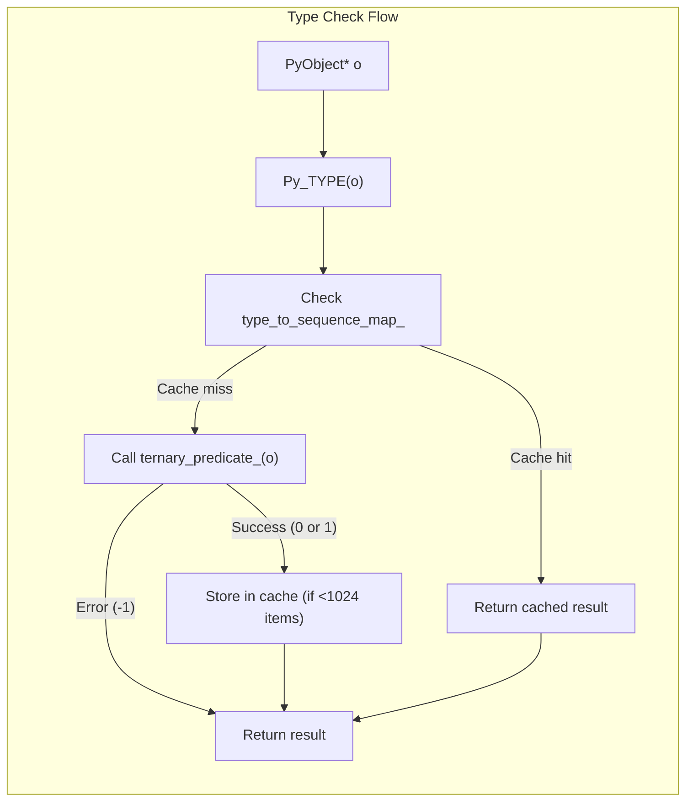

### CachedTypeCheck Class

[tree/tree.cc:95-148]() defines `CachedTypeCheck`, which caches type check results based on `PyTypeObject*` pointers:

**Key Components:**
- **Constructor**: Takes a `std::function<int(PyObject*)>` ternary predicate (returns -1 for error, 0 for false, 1 for true)
- **CachedLookup**: Checks cache first, then calls predicate and caches result
- **Cache Limit**: Limited to `kMaxItemsInCache` (1024) entries to prevent memory leaks
- **Memory Management**: Increments type refcount when caching to prevent type deletion

**Cache Instances:**

| Function | Predicate | Purpose |
|----------|-----------|---------|
| `IsMappingHelper` | `PyObject_IsInstance(..., Mapping)` | Check if object is a mapping |
| `IsMappingViewHelper` | `PyObject_IsInstance(..., MappingView)` | Check if object is a mapping view |
| `IsObjectProxy` | `PyObject_IsInstance(..., wrapt.ObjectProxy)` | Check if object is a wrapt proxy |
| `IsAttrsHelper` | `hasattr(obj.__class__, "__attrs_attrs__")` | Check if object is attrs instance |
| `IsSequenceHelper` | `PyObject_IsInstance(..., Sequence)` | Check if object is a sequence |

Each helper function creates a static `CachedTypeCheck` instance that persists for the lifetime of the module.

**Sources:** [tree/tree.cc:95-148](), [tree/tree.cc:185-254]()

### Type Collection Functions

[tree/tree.cc:150-180]() provides functions to retrieve Python types at runtime:

- `GetCollectionsSequenceType()` - returns `collections.abc.Sequence`
- `GetCollectionsMappingType()` - returns `collections.abc.Mapping`
- `GetCollectionsMappingViewType()` - returns `collections.abc.MappingView`
- `GetWraptObjectProxyType()` - returns `wrapt.ObjectProxy` (handles ImportError gracefully)

These use static `py::object` instances to cache the type objects.

**Sources:** [tree/tree.cc:150-180]()

---

## Iterator Framework

The iterator framework provides uniform iteration over different container types through a common `ValueIterator` interface:

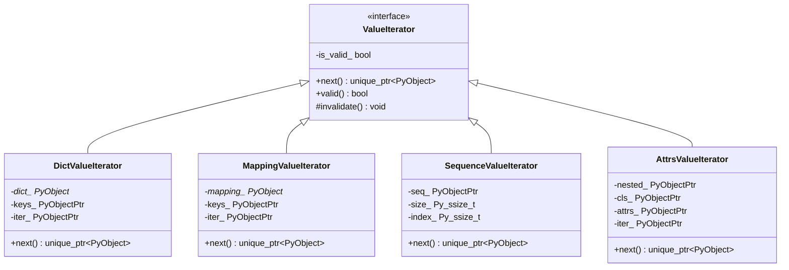

### ValueIterator Interface

[tree/tree.h:122-134]() and [tree/tree.cc:256]() define the base interface:

- **`next()`**: Returns the next value as `PyObjectPtr` (unique_ptr with custom deleter)
- **`valid()`**: Returns whether the iterator is in a valid state
- **`invalidate()`**: Marks iterator as invalid (typically called on initialization error)

### Iterator Implementations

#### DictValueIterator

[tree/tree.cc:263-295]() iterates over Python dictionaries with sorted keys:

1. Extracts keys using `PyDict_Keys`
2. Sorts keys using `PyList_Sort` for deterministic ordering
3. Iterates through sorted keys
4. Retrieves values using `PyDict_GetItem` (borrowed reference, requires INCREF)

**Key behavior**: Ignores original `OrderedDict` ordering to prevent bugs from mixing ordered and plain dicts.

#### MappingValueIterator

[tree/tree.cc:298-329]() handles generic mapping types:

1. Extracts keys using `PyMapping_Keys`
2. Sorts keys for consistency
3. Iterates through sorted keys
4. Retrieves values using `PyObject_GetItem` (new reference)

**Difference from DictValueIterator**: Uses `PyObject_GetItem` instead of `PyDict_GetItem`, which returns a new reference.

#### SequenceValueIterator

[tree/tree.cc:332-358]() iterates over sequences by index:

1. Converts to fast sequence using `PySequence_Fast`
2. Gets size using `PySequence_Fast_GET_SIZE`
3. Iterates by index from 0 to size-1
4. Retrieves items using `PySequence_Fast_GET_ITEM` (borrowed reference)

#### AttrsValueIterator

[tree/tree.cc:360-390]() iterates over attrs class instances:

1. Gets `__class__` attribute
2. Gets `__attrs_attrs__` from class
3. Iterates over attrs
4. For each attr, gets its `name` and retrieves the corresponding attribute value

### GetValueIterator Factory

[tree/tree.cc:723-733]() selects the appropriate iterator based on type:

```
if PyDict_Check       -> DictValueIterator
elif IsMappingHelper  -> MappingValueIterator
elif IsAttrsHelper    -> AttrsValueIterator
else                  -> SequenceValueIterator
```

**Sources:** [tree/tree.h:122-136](), [tree/tree.cc:256-390](), [tree/tree.cc:723-733]()

---

## Core Algorithms

### Flatten Algorithm

[tree/tree.cc:393-419]() implements `FlattenHelper`, the recursive core of the flatten operation:

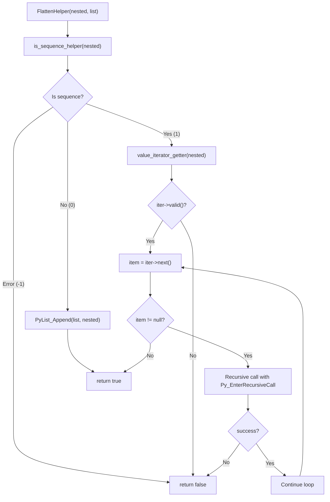

**Algorithm Details:**

1. **Base Case**: If `nested` is not a sequence, append it to `list` and return
2. **Recursive Case**: 
   - Get appropriate iterator for the container type
   - Iterate through all values
   - Recursively call `FlattenHelper` on each value
   - Use `Py_EnterRecursiveCall`/`Py_LeaveRecursiveCall` to protect against infinite recursion

**Error Handling**: Returns `false` on any error, with Python error state set appropriately.

**Sources:** [tree/tree.cc:393-419](), [tree/tree.cc:611-619]()

### AssertSameStructure Algorithm

[tree/tree.cc:457-604]() implements `AssertSameStructureHelper`, which validates that two structures have the same shape:

**Algorithm Flow:**

1. **Check if both are sequences**: If one is and one isn't, set error and return
2. **Base case**: If both are non-sequences, structures match
3. **Type checking** (if `check_types=True`):
   - Unwrap `wrapt.ObjectProxy` wrappers
   - Check if both are namedtuples and validate they match using `SameNamedtuples`
   - Check if types are identical (with special handling for lists and mappings)
   - For dicts/mappings: validate keys match using `SetDifferentKeysError`
4. **Recursive validation**:
   - Get iterators for both structures
   - Iterate through both simultaneously
   - Recursively validate each pair of elements
   - Check that both iterators finish at the same time

**Error Reporting:**

[tree/tree.cc:424-445]() `SetDifferentKeysError` creates detailed error messages for dict key mismatches:
- Fetches keys from both dicts using `PyMapping_Keys`
- Converts keys to strings for error message
- Sets `is_type_error` to `false` (it's a structure error, not type error)

**Output Parameters:**
- `error_msg`: Filled with detailed error description if structures don't match
- `is_type_error`: Set to `true` if error should be `TypeError`, `false` for `ValueError`

**Sources:** [tree/tree.cc:424-445](), [tree/tree.cc:457-604](), [tree/tree.cc:703-721]()

---

## pybind11 Integration

[tree/tree.cc:744-782]() defines the `_tree` Python extension module using pybind11:

```mermaid
graph TB
    subgraph "Python Module: _tree"
        ModuleDef["PYBIND11_MODULE(_tree, m)"]
    end
    
    subgraph "Exported Functions"
        PyAssertSame["assert_same_structure(o1, o2, check_types)"]
        PyIsSeq["is_sequence(o)"]
        PyIsNT["is_namedtuple(o, strict)"]
        PyIsAttrs["is_attrs(o)"]
        PySameNT["same_namedtuples(o1, o2)"]
        PyFlatten["flatten(nested)"]
    end
    
    subgraph "C++ Implementation"
        CppAssertSame["tree::AssertSameStructure()"]
        CppIsSeq["tree::IsSequence()"]
        CppIsNT["tree::IsNamedtuple()"]
        CppIsAttrs["tree::IsAttrs()"]
        CppSameNT["tree::SameNamedtuples()"]
        CppFlatten["tree::Flatten()"]
    end
    
    ModuleDef --> PyAssertSame
    ModuleDef --> PyIsSeq
    ModuleDef --> PyIsNT
    ModuleDef --> PyIsAttrs
    ModuleDef --> PySameNT
    ModuleDef --> PyFlatten
    
    PyAssertSame --> CppAssertSame
    PyIsSeq --> CppIsSeq
    PyIsNT --> CppIsNT
    PyIsAttrs --> CppIsAttrs
    PySameNT --> CppSameNT
    PyFlatten --> CppFlatten
```

### Module Initialization

[tree/tree.cc:744-748]() performs module initialization:
- Resolves `wrapt.ObjectProxy` at import time to avoid imports during function calls
- Note: [tree/tree.cc:178-179]() indicates caching was disabled due to a deadlock issue

### Function Bindings

Each binding uses lambda functions to handle type conversions:

**assert_same_structure** [tree/tree.cc:749-755]()
- Takes `py::handle&` references (no copying)
- Calls C++ function
- Converts to `py::error_already_set` exception on Python error

**is_sequence** [tree/tree.cc:756-762]()
- Returns boolean result
- Checks `PyErr_Occurred()` and throws exception if needed

**is_namedtuple** [tree/tree.cc:763-765]()
- Uses `pyo_or_throw` helper [tree/tree.cc:737-742]() to convert `PyObject*` to `py::object`
- Helper checks for errors and throws `py::error_already_set` if needed

**is_attrs** [tree/tree.cc:766-772]()
- Similar to `is_sequence`, returns boolean with error checking

**same_namedtuples** [tree/tree.cc:773-775]()
- Uses `pyo_or_throw` helper for safe conversion

**flatten** [tree/tree.cc:776-778]()
- Returns `py::object` via `pyo_or_throw` helper
- Uses `py::reinterpret_steal` to take ownership of returned reference

**Sources:** [tree/tree.cc:737-782]()

---

## Memory Management

The C++ implementation uses careful memory management to work with Python's reference counting:

### PyObjectPtr

[tree/tree.cc:49]() and [tree/tree.h:117-119]() define `PyObjectPtr` as:
```cpp
using PyObjectPtr = std::unique_ptr<PyObject, DecrementsPyRefcount>;
```

**DecrementsPyRefcount** [tree/tree.h:117-119]() is a custom deleter that calls `Py_DECREF`:
```cpp
struct DecrementsPyRefcount {
  void operator()(PyObject* p) const { Py_DECREF(p); }
};
```

This enables RAII-style automatic reference counting management. When a `PyObjectPtr` goes out of scope, it automatically decrements the reference count.

### Reference Counting Patterns

**Borrowed References**: Functions like `PyDict_GetItem` and `PySequence_Fast_GET_ITEM` return borrowed references. These must be converted to owned references using `Py_INCREF`:

[tree/tree.cc:277-282]()
```cpp
PyObject* elem = PyDict_GetItem(dict_, key.get());
if (elem) {
    Py_INCREF(elem);
    result.reset(elem);
}
```

**New References**: Functions like `PyObject_GetItem` and `PyObject_GetAttr` return new references that can be directly stored in `PyObjectPtr`:

[tree/tree.cc:314-316]()
```cpp
PyObject* elem = PyObject_GetItem(mapping_, key.get());
if (elem) {
    result.reset(elem);
}
```

**Static Objects**: [tree/tree.cc:151-154]() Type objects are cached in static `py::object` instances to avoid repeated imports and reference management.

### GIL Requirements

[tree/tree.cc:47-48]() notes that `PyObjectPtr` destructor does not acquire the GIL, so the GIL must be held when destructors are called. This is guaranteed by pybind11's bindings.

**Sources:** [tree/tree.cc:44-49](), [tree/tree.h:117-119](), [tree/tree.cc:151-180](), [tree/tree.cc:277-282](), [tree/tree.cc:314-316]()

---

## Performance Optimizations

### Type Caching Strategy

The `CachedTypeCheck` class [tree/tree.cc:95-148]() provides significant performance improvements:

**Cache Size Limit**: [tree/tree.cc:51]() defines `kMaxItemsInCache = 1024` to prevent unbounded memory growth while still caching common types.

**Cache Key**: Uses `PyTypeObject*` as the key, which is stable within a Python session (types don't change addresses).

**Ternary Result**: Returns -1 for errors (not cached), 0 for false, 1 for true. This allows distinguishing between "not a sequence" and "error checking if sequence".

**Refcount Management**: [tree/tree.cc:136-139]() Increments refcount on cached types to prevent type deletion while in cache:
```cpp
if (type_to_sequence_map_.size() < kMaxItemsInCache) {
    Py_INCREF(type);
    type_to_sequence_map_.insert({type, check_result});
}
```

### Iterator Optimizations

**Fast Sequence API**: [tree/tree.cc:335-336]() `SequenceValueIterator` uses `PySequence_Fast` and `PySequence_Fast_GET_SIZE` for O(1) indexing on lists and tuples.

**Borrowed References**: [tree/tree.cc:342-343]() Uses `PySequence_Fast_GET_ITEM` which returns borrowed references, avoiding unnecessary refcount operations.

**Sorted Keys**: [tree/tree.cc:266-271]() and [tree/tree.cc:301-306]() Both dict and mapping iterators sort keys once at initialization, then iterate through the sorted list.

### Recursion Safety

[tree/tree.cc:408-413]() and [tree/tree.cc:584-589]() use Python's recursion limit checking:
```cpp
if (Py_EnterRecursiveCall(" in flatten")) {
    return false;
}
// ... recursive call ...
Py_LeaveRecursiveCall();
```

This prevents stack overflow on deeply nested structures by respecting Python's `sys.getrecursionlimit()`.

**Sources:** [tree/tree.cc:51](), [tree/tree.cc:95-148](), [tree/tree.cc:263-358](), [tree/tree.cc:408-413](), [tree/tree.cc:584-589]()

---

## Error Handling

The C++ implementation uses multiple error handling strategies:

### Return Value Conventions

| Return Type | Success | Error | Example |
|-------------|---------|-------|---------|
| `PyObject*` | Non-null pointer | `nullptr` (with `PyErr_SetString`) | `Flatten`, `IsNamedtuple` |
| `bool` | `true` | `false` (with `PyErr_SetString`) | `FlattenHelper`, `AssertSameStructureHelper` |
| `int` (ternary) | 0 or 1 | -1 (with Python error set) | Type check helpers |
| `void` | N/A | Python error set | `AssertSameStructure` |

### Error State Checking

[tree/tree.cc:463]() and many other locations check `PyErr_Occurred()` to detect Python exceptions:
```cpp
if (PyErr_Occurred()) return false;
```

### Detailed Error Messages

[tree/tree.cc:713-720]() `AssertSameStructure` constructs comprehensive error messages:
- Includes both structure representations
- Specifies whether error is `TypeError` or `ValueError`
- Provides detailed explanation using `PyObjectToString`

**Example error format:**
```
The two structures don't have the same nested structure.

First structure: <str representation>

Second structure: <str representation>

More specifically: <detailed error>
```

### Utility Functions

[tree/tree.cc:55-57]() `IsString` checks for string types (bytes, bytearray, unicode) to exclude them from sequence handling.

[tree/tree.cc:63-79]() `GetClassName` extracts the class name from `tp_name`, removing module prefix.

[tree/tree.cc:81-93]() `PyObjectToString` safely converts Python objects to string representations for error messages, with fallback if `str()` fails.

**Sources:** [tree/tree.cc:55-93](), [tree/tree.cc:393-604](), [tree/tree.cc:703-721]()

---

# Page: Type System and Utilities

# Type System and Utilities

<details>
<summary>Relevant source files</summary>

The following files were used as context for generating this wiki page:

- [tree/__init__.py](tree/__init__.py)
- [tree/sequence.py](tree/sequence.py)
- [tree/tree.cc](tree/tree.cc)

</details>


## Purpose and Scope

This document describes how dm-tree identifies, validates, and reconstructs Python data structures. The type system is fundamental to all tree operations, determining which objects are treated as nested structures versus leaf values, and ensuring that operations like `flatten` and `unflatten_as` correctly preserve type information.

For information about the high-level API that uses this type system, see [Python API Layer](#2.1). For details about the C++ performance optimizations, see [C++ Backend Implementation](#2.2).

## Overview of Supported Types

dm-tree supports a diverse set of Python types, categorized by their structural behavior:

| Category | Types | Behavior |
|----------|-------|----------|
| **Mappings** | `dict`, `OrderedDict`, `defaultdict`, `MappingProxyType` | Iterated by sorted keys |
| **Sequences** | `list`, `tuple` | Iterated by index |
| **Named Structures** | `namedtuple`, attrs classes | Iterated by field/attribute names |
| **Special Cases** | `wrapt.ObjectProxy` | Unwrapped before processing |
| **Mapping Views** | `dict_keys`, `dict_values`, `dict_items` | Converted to lists |
| **Non-sequences** | Strings (`str`, `bytes`), scalars, custom objects | Treated as leaf values |

**Sources:** [tree/__init__.py:66](), [tree/tree.cc:55-254](), [tree/sequence.py:58-112]()

## Type Identification Architecture

```mermaid
graph TB
    subgraph "Python Layer (tree/__init__.py)"
        is_nested["is_nested(structure)"]
        _is_namedtuple["_is_namedtuple(instance, strict)"]
        _is_attrs["_is_attrs(instance)"]
    end
    
    subgraph "C++ Layer (tree.cc)"
        IsSequenceHelper["IsSequenceHelper(PyObject*)"]
        IsNamedtuple["IsNamedtuple(PyObject*, bool)"]
        IsAttrsHelper["IsAttrsHelper(PyObject*)"]
        IsMappingHelper["IsMappingHelper(PyObject*)"]
        IsObjectProxy["IsObjectProxy(PyObject*)"]
        CachedTypeCheck["CachedTypeCheck"]
    end
    
    subgraph "Type Cache"
        type_to_sequence_map["type_to_sequence_map<br/>(unordered_map)"]
    end
    
    subgraph "Python Type System"
        CollectionsSequence["collections.abc.Sequence"]
        CollectionsMapping["collections.abc.Mapping"]
        WraptObjectProxy["wrapt.ObjectProxy"]
    end
    
    is_nested -->|delegates| IsSequenceHelper
    _is_namedtuple -->|delegates| IsNamedtuple
    _is_attrs -->|delegates| IsAttrsHelper
    
    IsSequenceHelper -->|checks| IsMappingHelper
    IsSequenceHelper -->|checks| IsAttrsHelper
    IsSequenceHelper -->|uses| CachedTypeCheck
    
    IsMappingHelper -->|uses| CachedTypeCheck
    IsAttrsHelper -->|uses| CachedTypeCheck
    IsObjectProxy -->|uses| CachedTypeCheck
    
    CachedTypeCheck -->|stores in| type_to_sequence_map
    CachedTypeCheck -->|PyObject_IsInstance| CollectionsSequence
    CachedTypeCheck -->|PyObject_IsInstance| CollectionsMapping
    CachedTypeCheck -->|PyObject_IsInstance| WraptObjectProxy
```

**Sources:** [tree/__init__.py:170-185](), [tree/tree.cc:95-254](), [tree/sequence.py:38-56]()

### C++ Type Checking with Caching

The C++ layer implements a sophisticated caching mechanism to avoid expensive Python type checks. The `CachedTypeCheck` class [tree/tree.cc:95-148]() caches type identification results based on the object's type pointer.

**Key Implementation Details:**

- **Cache Size Limit:** Maximum 1024 type entries to prevent unbounded memory growth [tree/tree.cc:51]()
- **Cache Key:** Uses `PyTypeObject*` pointer as map key [tree/tree.cc:114]()
- **Ternary Return Values:** 
  - `1` = type matches predicate
  - `0` = type does not match
  - `-1` = error occurred (not cached) [tree/tree.cc:111-127]()

**Type Check Functions:**

| Function | Purpose | Implementation |
|----------|---------|----------------|
| `IsSequenceHelper` | Checks if object is any supported sequence | [tree/tree.cc:233-254]() |
| `IsMappingHelper` | Checks for `dict` and `collections.abc.Mapping` | [tree/tree.cc:185-191]() |
| `IsAttrsHelper` | Detects attrs-decorated classes | [tree/tree.cc:216-228]() |
| `IsObjectProxy` | Identifies `wrapt.ObjectProxy` instances | [tree/tree.cc:206-212]() |

**Sources:** [tree/tree.cc:95-254]()

### Namedtuple Identification

Namedtuple detection requires special handling because namedtuples are dynamically created types with specific characteristics:

```mermaid
graph TD
    Start["IsNamedtuple(o, strict)"]
    CheckTuple["PyTuple_Check(o)"]
    CheckBase["Check __class__.__base__<br/>equals tuple"]
    CheckFields["Has _fields attribute?"]
    ValidateFields["All _fields elements<br/>are strings?"]
    
    Start --> CheckTuple
    CheckTuple -->|No| ReturnFalse1[Return False]
    CheckTuple -->|Yes| CheckStrict{strict mode?}
    
    CheckStrict -->|Yes| CheckBase
    CheckBase -->|No| ReturnFalse2[Return False]
    CheckBase -->|Yes| CheckFields
    
    CheckStrict -->|No| CheckFields
    CheckFields -->|No| ReturnFalse3[Return False]
    CheckFields -->|Yes| ValidateFields
    ValidateFields -->|No| ReturnFalse4[Return False]
    ValidateFields -->|Yes| ReturnTrue[Return True]
```

**Algorithm (C++ Implementation):** [tree/tree.cc:621-678]()

1. **Tuple Check:** Must be subclass of `tuple`
2. **Strict Mode Check:** If `strict=True`, `__class__.__base__` must be exactly `tuple` [tree/tree.cc:635-649]()
3. **Fields Validation:** Must have `_fields` attribute containing only strings [tree/tree.cc:653-676]()

**Sources:** [tree/tree.cc:621-678](), [tree/sequence.py:42-56]()

### Attrs Detection

Attrs classes are identified by checking for the `__attrs_attrs__` class attribute:

**Python Layer:** [tree/sequence.py:38-40]()
```python
def _is_attrs(instance):
  return _tree.is_attrs(instance)
```

**C++ Implementation:** [tree/tree.cc:216-228]()
- Retrieves `__class__` attribute from instance
- Checks for presence of `__attrs_attrs__` on the class
- Result is cached per type

**Sources:** [tree/sequence.py:38-40](), [tree/tree.cc:216-228]()

## Type Reconstruction System

The `_sequence_like` function [tree/sequence.py:58-112]() reconstructs nested structures by converting flat sequences back into their original types:

```mermaid
graph TD
    Start["_sequence_like(instance, args)"]
    CheckMapping{isinstance<br/>Mapping?}
    CheckMappingView{isinstance<br/>MappingView?}
    CheckNamedOrAttrs{_is_namedtuple or<br/>_is_attrs?}
    CheckObjectProxy{isinstance<br/>ObjectProxy?}
    
    ReconstructDict["Sort keys<br/>zip with args<br/>Call type(instance)"]
    ReturnList["return list(args)"]
    ReconstructNamed["Call instance_type(*args)<br/>or instance_type(**kwargs)"]
    UnwrapAndRecurse["Recursively call<br/>_sequence_like on<br/>__wrapped__"]
    DefaultReconstruct["type(instance)(args)"]
    
    Start --> CheckMapping
    CheckMapping -->|Yes| ReconstructDict
    CheckMapping -->|No| CheckMappingView
    
    CheckMappingView -->|Yes| ReturnList
    CheckMappingView -->|No| CheckNamedOrAttrs
    
    CheckNamedOrAttrs -->|Yes| ReconstructNamed
    CheckNamedOrAttrs -->|No| CheckObjectProxy
    
    CheckObjectProxy -->|Yes| UnwrapAndRecurse
    CheckObjectProxy -->|No| DefaultReconstruct
```

**Sources:** [tree/sequence.py:58-112]()

### Mapping Reconstruction

For dictionary-like types, reconstruction maintains deterministic ordering by sorting keys:

**Process:** [tree/sequence.py:69-84]()

1. **Sort Keys:** Use `_sorted(instance)` to get sorted key list [tree/sequence.py:30-36]()
2. **Zip with Values:** Combine sorted keys with provided `args`
3. **Type-Specific Construction:**
   - `defaultdict`: Pass `default_factory` as first argument [tree/sequence.py:78-79]()
   - `MappingProxyType`: Wrap dict in proxy [tree/sequence.py:80-82]()
   - Standard mappings: Direct construction [tree/sequence.py:84]()

**Special Case - OrderedDict:** Original insertion order is intentionally ignored to avoid bugs when mixing ordered and unordered dicts [tree/sequence.py:71-74]().

**Sources:** [tree/sequence.py:69-84]()

### Named Structure Reconstruction

Namedtuples and attrs classes require field-aware reconstruction:

| Type | Reconstruction Method | Code Reference |
|------|----------------------|----------------|
| **namedtuple** | `instance_type(*args)` | [tree/sequence.py:101]() |
| **attrs class** | `instance_type(**{attr.name: arg for ...})` | [tree/sequence.py:95-99]() |

**ObjectProxy Handling:** If the instance is wrapped in `wrapt.ObjectProxy`, unwrap to get the actual type before reconstruction [tree/sequence.py:89-92]().

**Sources:** [tree/sequence.py:88-104]()

## Value Iteration System

The C++ layer provides specialized iterators for extracting values from different structure types in deterministic order:

```mermaid
graph TB
    GetValueIterator["GetValueIterator(PyObject*)"]
    
    subgraph "Iterator Implementations"
        DictValueIterator["DictValueIterator<br/>PyDict_Keys + PyList_Sort"]
        MappingValueIterator["MappingValueIterator<br/>PyMapping_Keys + PyList_Sort"]
        AttrsValueIterator["AttrsValueIterator<br/>__attrs_attrs__ iteration"]
        SequenceValueIterator["SequenceValueIterator<br/>PySequence_Fast"]
    end
    
    GetValueIterator -->|PyDict_Check| DictValueIterator
    GetValueIterator -->|IsMappingHelper| MappingValueIterator
    GetValueIterator -->|IsAttrsHelper| AttrsValueIterator
    GetValueIterator -->|default| SequenceValueIterator
    
    DictValueIterator -->|"1. Extract keys"| SortKeys1["PyList_Sort"]
    DictValueIterator -->|"2. Iterate sorted keys"| GetValues1["PyDict_GetItem"]
    
    MappingValueIterator -->|"1. Extract keys"| SortKeys2["PyList_Sort"]
    MappingValueIterator -->|"2. Iterate sorted keys"| GetValues2["PyObject_GetItem"]
    
    AttrsValueIterator -->|"1. Get __attrs_attrs__"| IterAttrs["Iterate attributes"]
    AttrsValueIterator -->|"2. For each attr"| GetAttr["PyObject_GetAttr"]
    
    SequenceValueIterator -->|"PySequence_Fast"| IndexAccess["Direct index access"]
```

**Sources:** [tree/tree.cc:256-390](), [tree/tree.cc:723-733]()

### Iterator Classes

**DictValueIterator** [tree/tree.cc:263-295]()
- Uses `PyDict_Keys` to extract keys
- Sorts keys with `PyList_Sort` for deterministic iteration
- Retrieves values via `PyDict_GetItem` (borrowed reference)

**MappingValueIterator** [tree/tree.cc:298-329]()
- Fallback for custom mapping types
- Uses `PyMapping_Keys` instead of `PyDict_Keys`
- Retrieves values via `PyObject_GetItem` (new reference)

**AttrsValueIterator** [tree/tree.cc:360-390]()
- Accesses `__class__.__attrs_attrs__` to get attribute metadata
- Iterates through attrs in definition order
- Extracts values using `PyObject_GetAttr`

**SequenceValueIterator** [tree/tree.cc:332-358]()
- Converts to fast sequence with `PySequence_Fast`
- Direct index-based access via `PySequence_Fast_GET_ITEM`
- Most efficient iterator for list/tuple types

**Sources:** [tree/tree.cc:263-390]()

## Integration with Core Operations

The type system integrates with all core tree operations:

### Flatten Operation

```mermaid
sequenceDiagram
    participant User
    participant flatten["flatten()"]
    participant FlattenHelper["FlattenHelper (C++)"]
    participant IsSequenceHelper["IsSequenceHelper"]
    participant GetValueIterator["GetValueIterator"]
    
    User->>flatten: flatten(structure)
    flatten->>FlattenHelper: FlattenHelper(structure)
    
    loop For each element
        FlattenHelper->>IsSequenceHelper: Check if sequence
        IsSequenceHelper-->>FlattenHelper: is_seq result
        
        alt is_seq == True
            FlattenHelper->>GetValueIterator: Get iterator
            GetValueIterator-->>FlattenHelper: ValueIterator
            FlattenHelper->>FlattenHelper: Recursive call
        else is_seq == False
            FlattenHelper->>FlattenHelper: Append to list
        end
    end
    
    FlattenHelper-->>flatten: Flattened list
    flatten-->>User: Result
```

**Sources:** [tree/__init__.py:188-224](), [tree/tree.cc:393-419](), [tree/tree.cc:611-619]()

### Unflatten Operation

```mermaid
sequenceDiagram
    participant User
    participant unflatten_as["unflatten_as()"]
    participant _packed_nest_with_indices["_packed_nest_with_indices"]
    participant is_nested["is_nested()"]
    participant _sequence_like["_sequence_like()"]
    
    User->>unflatten_as: unflatten_as(structure, flat)
    
    loop For each element in structure
        unflatten_as->>is_nested: Check if nested
        is_nested-->>unflatten_as: Result
        
        alt is nested
            unflatten_as->>_packed_nest_with_indices: Recursive call
            _packed_nest_with_indices->>_sequence_like: Reconstruct type
            _sequence_like-->>_packed_nest_with_indices: Typed structure
        else not nested
            unflatten_as->>unflatten_as: Take next flat value
        end
    end
    
    unflatten_as->>_sequence_like: Final reconstruction
    _sequence_like-->>unflatten_as: Result
    unflatten_as-->>User: Unflattened structure
```

**Sources:** [tree/__init__.py:287-374](), [tree/sequence.py:58-112]()

### Structure Validation

The `assert_same_structure` operation uses the type system to validate structural compatibility:

**Type Checking Logic:** [tree/tree.cc:457-604]()

1. **Sequence Detection:** Both structures must be sequences or both non-sequences
2. **Type Matching (if `check_types=True`):**
   - Unwrap `ObjectProxy` types [tree/tree.cc:479-489]()
   - Compare `PyTypeObject*` pointers
   - Special handling for namedtuples: compare by name and fields [tree/tree.cc:496-521]()
   - Allow mixing of list types and mapping types [tree/tree.cc:522-538]()
3. **Length Validation:** Compare element counts [tree/tree.cc:605-614]()
4. **Key Validation (mappings):** Ensure same key sets [tree/tree.cc:540-572]()
5. **Recursive Validation:** Check all nested structures [tree/tree.cc:580-603]()

**Sources:** [tree/tree.cc:457-721]()

## Special Type Behaviors

### ObjectProxy Unwrapping

`wrapt.ObjectProxy` is transparently unwrapped in multiple contexts:

| Context | Behavior | Code Reference |
|---------|----------|----------------|
| **Type checking** | Unwrap to check underlying type | [tree/tree.cc:479-489]() |
| **Namedtuple detection** | Check `__wrapped__` attribute | [tree/tree.cc:622-627]() |
| **Reconstruction** | Recursively unwrap then re-wrap | [tree/sequence.py:105-108]() |

**Import Handling:** The library gracefully handles missing `wrapt` installation by providing a stub class [tree/__init__.py:30-34](), [tree/sequence.py:22-28]().

**Sources:** [tree/__init__.py:30-34](), [tree/tree.cc:479-489](), [tree/sequence.py:105-108]()

### String Exclusion

Strings (`str`, `bytes`, `bytearray`) are explicitly excluded from being treated as sequences despite technically being Python sequences:

**Check Function:** [tree/tree.cc:55-57]()
```cpp
bool IsString(PyObject* o) {
  return PyBytes_Check(o) || PyByteArray_Check(o) || PyUnicode_Check(o);
}
```

**Rationale:** Prevents strings from being recursively flattened character-by-character, which would rarely be the desired behavior.

**Sources:** [tree/tree.cc:55-57](), [tree/tree.cc:241]()

### Set Warning

Sets are not considered sequences but may be in the future. A one-time warning is issued: [tree/tree.cc:246-252]()

**Sources:** [tree/tree.cc:246-252]()

## Deterministic Iteration Order

All operations maintain deterministic ordering by sorting dictionary keys and preserving sequence indices:

**Sorting Implementation:** [tree/sequence.py:30-36]()
```python
def _sorted(dictionary):
  """Returns a sorted list of the dict keys, with error if keys not sortable."""
  try:
    return sorted(dictionary)
  except TypeError:
    raise TypeError("tree only supports dicts with sortable keys.")
```

**Iteration Helpers:** [tree/__init__.py:129-161]()
- `_yield_sorted_items`: Yields `(key, value)` pairs in sorted order
- Handles mappings, sequences, namedtuples, and attrs uniformly
- Intentionally ignores `OrderedDict` insertion order [tree/__init__.py:145-149]()

**Sources:** [tree/sequence.py:30-36](), [tree/__init__.py:129-161]()

---

# Page: User Guide

# User Guide

<details>
<summary>Relevant source files</summary>

The following files were used as context for generating this wiki page:

- [README.md](README.md)
- [docs/recipes.rst](docs/recipes.rst)
- [tree/__init__.py](tree/__init__.py)

</details>


## Purpose and Scope

This guide provides practical instructions for using `dm-tree` to work with nested data structures in Python. It covers installation, core concepts, and common usage patterns. For architectural details about how `dm-tree` is implemented internally, see [Architecture](#2). For information on contributing to the project or building from source for development purposes, see [Developer Guide](#4).

## What is dm-tree?

`dm-tree` is a library for working with arbitrarily nested Python data structures such as lists, tuples, dictionaries, and named tuples. It generalizes Python's built-in `map()` function, which only works with flat sequences, to operate on nested structures while preserving their shape.

The library is implemented with an optimized C++ backend [tree.cc](), making it suitable for performance-critical applications such as machine learning model implementations where nested structures are processed repeatedly.

**Sources:** [README.md:1-18](), [tree/__init__.py:16]()

## Core Capabilities

`dm-tree` provides three main categories of operations:

| Operation Category | Functions | Purpose |
|-------------------|-----------|---------|
| **Structure Manipulation** | `flatten`, `unflatten_as` | Convert between nested and flat representations |
| **Structure Mapping** | `map_structure`, `map_structure_with_path` | Apply functions to all leaves while preserving structure |
| **Structure Validation** | `assert_same_structure`, `is_nested` | Verify structural properties |
| **Shallow Operations** | `flatten_up_to`, `map_structure_up_to` | Work with partial structure depth |
| **Traversal** | `traverse`, `flatten_with_path` | Visit nodes with custom logic |

**Sources:** [tree/__init__.py:46-60]()

## API Function Organization

```mermaid
graph TB
    subgraph "Basic Operations"
        flatten["flatten()"]
        unflatten["unflatten_as()"]
        map_structure["map_structure()"]
        assert_same["assert_same_structure()"]
        is_nested["is_nested()"]
    end
    
    subgraph "Path-Aware Variants"
        flatten_path["flatten_with_path()"]
        map_path["map_structure_with_path()"]
    end
    
    subgraph "Shallow Tree Operations"
        flatten_upto["flatten_up_to()"]
        flatten_path_upto["flatten_with_path_up_to()"]
        map_upto["map_structure_up_to()"]
        map_path_upto["map_structure_with_path_up_to()"]
    end
    
    subgraph "Advanced Traversal"
        traverse["traverse()"]
        MAP_TO_NONE["MAP_TO_NONE constant"]
    end
    
    flatten --> flatten_path
    flatten --> flatten_upto
    flatten_path --> flatten_path_upto
    
    map_structure --> map_path
    map_structure --> map_upto
    map_path --> map_path_upto
    
    traverse -.uses.-> MAP_TO_NONE
```

**Diagram: Public API function hierarchy showing basic operations and their variants**

**Sources:** [tree/__init__.py:46-60](), [tree/__init__.py:188-224](), [tree/__init__.py:377-428]()

## Quick Start Examples

### Basic Flattening and Unflattening

The most fundamental operations convert nested structures to flat lists and vice versa:

```python
import tree

# Flatten a nested structure
structure = [[1, 2, 3], [4, [5], [[6]]]]
flat = tree.flatten(structure)
# Result: [1, 2, 3, 4, 5, 6]

# Unflatten using a template structure
template = [[None, None], [None, [None, None, None]]]
result = tree.unflatten_as(template, [1, 2, 3, 4, 5, 6])
# Result: [[1, 2], [3, [4, 5, 6]]]
```

**Sources:** [README.md:8-15](), [tree/__init__.py:188-224](), [tree/__init__.py:318-374]()

### Applying Functions to Nested Structures

`map_structure` applies a function to every leaf value while preserving the overall structure:

```python
structure = [[1], [[[2, 3]]], [4]]
result = tree.map_structure(lambda v: v**2, structure)
# Result: [[1], [[[4, 9]]], [16]]

# Works with multiple structures
tree.map_structure(lambda x, y: x + y, [[1, 2]], [[3, 4]])
# Result: [[4, 6]]
```

**Sources:** [README.md:13-14](), [tree/__init__.py:377-428]()

### Working with Dictionaries

Dictionaries are processed with keys in sorted order to ensure deterministic behavior:

```python
# Dictionary values are flattened in sorted key order
tree.flatten({100: 'world!', 6: 'Hello'})
# Result: ['Hello', 'world!']

# Unflatten maintains key correspondence
tree.unflatten_as({1: None, 2: None}, ['Hello', 'world!'])
# Result: {1: 'Hello', 2: 'world!'}
```

**Sources:** [tree/__init__.py:201-213](), [tree/__init__.py:330-342]()

## Supported Data Types

`dm-tree` recognizes the following types as "nested structures":

| Type Category | Examples | Notes |
|--------------|----------|-------|
| **Sequences** | `list`, `tuple` | Indexed by integer position |
| **Mappings** | `dict`, `OrderedDict`, `defaultdict`, `MappingProxyType` | Keys must be sortable |
| **Named Tuples** | `collections.namedtuple` | Accessed by field names |
| **Attrs Classes** | `@attrs.define` decorated classes | Accessed by attribute names |
| **Proxy Objects** | `wrapt.ObjectProxy` | Unwrapped before processing |

All other types are treated as atomic "leaf" values.

**Sources:** [tree/__init__.py:29-34](), [tree/__init__.py:144-160](), [tree/sequence.py]()

## Common Usage Patterns

### Pattern 1: Validating Structure Compatibility

Before processing multiple structures together, verify they have the same shape:

```python
structure1 = {'a': [1, 2], 'b': 3}
structure2 = {'a': [4, 5], 'b': 6}

# This succeeds
tree.assert_same_structure(structure1, structure2)

# This would raise TypeError due to shape mismatch
structure3 = {'a': [7], 'b': 8}
tree.assert_same_structure(structure1, structure3)  # Raises!
```

**Sources:** [tree/__init__.py:239-284]()

### Pattern 2: Broadcasting Values Across a Structure

Use `map_structure` to replicate a value across all positions in a template:

```python
reference_tree = {'a': 1, 'b': (2, 3)}
value = np.inf
tree.map_structure(lambda _: value, reference_tree)
# Result: {'a': inf, 'b': (inf, inf)}
```

**Sources:** [docs/recipes.rst:32-37]()

### Pattern 3: Path-Aware Processing

Track the location of each value using path-aware variants:

```python
tree.flatten_with_path([{"foo": 42}])
# Result: [((0, 'foo'), 42)]

tree.map_structure_with_path(
    lambda path, v: (path, v**2),
    [{"foo": 42}])
# Result: [{'foo': ((0, 'foo'), 1764)}]
```

**Sources:** [tree/__init__.py:775-796](), [tree/__init__.py:431-468]()

### Pattern 4: Shallow Operations with Template Structures

Process only part of a nested structure using `_up_to` variants:

```python
structure = [[1, 1], [2, 2]]

# Flatten only one level deep
tree.flatten_up_to([None, None], structure)
# Result: [[1, 1], [2, 2]]

# Map at a specific depth
tree.map_structure_up_to([None, None], len, structure)
# Result: [2, 2]
```

**Sources:** [tree/__init__.py:635-674](), [tree/__init__.py:709-739]()

## Typical Usage Flow

```mermaid
sequenceDiagram
    participant User as "User Code"
    participant tree as "tree module"
    participant flatten as "tree.flatten"
    participant map_structure as "tree.map_structure"
    participant unflatten as "tree.unflatten_as"
    
    User->>tree: "import tree"
    
    Note over User,tree: Scenario: Transform nested data
    
    User->>map_structure: "tree.map_structure(func, struct)"
    activate map_structure
    map_structure->>map_structure: "assert_same_structure()"
    map_structure->>flatten: "flatten(struct)"
    flatten-->>map_structure: "[val1, val2, ...]"
    map_structure->>User: "Apply func to each value"
    User-->>map_structure: "[result1, result2, ...]"
    map_structure->>unflatten: "unflatten_as(struct, results)"
    unflatten-->>map_structure: "nested results"
    map_structure-->>User: "Return structured output"
    deactivate map_structure
    
    Note over User,tree: Scenario: Concatenate structures
    
    User->>flatten: "tree.flatten(struct1)"
    flatten-->>User: "flat1"
    User->>flatten: "tree.flatten(struct2)"
    flatten-->>User: "flat2"
    User->>User: "combined = flat1 + flat2"
    User->>unflatten: "tree.unflatten_as(struct1, combined)"
    unflatten-->>User: "concatenated structure"
```

**Diagram: Typical data flow patterns when using dm-tree functions**

**Sources:** [tree/__init__.py:377-428](), [tree/__init__.py:188-224](), [tree/__init__.py:318-374]()

## Function Invocation Patterns

```mermaid
graph LR
    subgraph "User Intent"
        A["Transform all leaves"]
        B["Extract all values"]
        C["Reconstruct structure"]
        D["Validate compatibility"]
        E["Process with depth control"]
    end
    
    subgraph "API Functions"
        F["map_structure()"]
        G["flatten()"]
        H["unflatten_as()"]
        I["assert_same_structure()"]
        J["map_structure_up_to()"]
        K["flatten_with_path()"]
    end
    
    A --> F
    A --> K
    B --> G
    C --> H
    D --> I
    E --> J
    
    F -.internally uses.-> G
    F -.internally uses.-> H
    J -.internally uses.-> F
```

**Diagram: Mapping user intents to appropriate API functions**

**Sources:** [tree/__init__.py:377-428](), [tree/__init__.py:709-739]()

## Error Handling

Common error scenarios and their causes:

| Error Type | Typical Cause | Example |
|-----------|---------------|---------|
| `TypeError` | Structure type mismatch | Mixing `list` and `tuple` with `check_types=True` |
| `ValueError` | Structure size mismatch | Different number of elements in compared structures |
| `TypeError` | Non-sortable dictionary keys | Using unhashable objects as dict keys |
| `ValueError` | Key missing in shallow structure | `_up_to` operations with incompatible templates |

**Sources:** [tree/__init__.py:239-284](), [tree/__init__.py:520-632]()

## Next Steps

- **[Installation and Setup](#3.1)**: Detailed installation instructions including building from source
- **[Basic Operations](#3.2)**: In-depth tutorials for fundamental operations with comprehensive examples
- **[Advanced Usage](#3.3)**: Advanced features including custom traversal and complex transformations
- **[API Reference](#3.4)**: Complete function signatures and parameter documentation

**Sources:** [tree/__init__.py:1-944](), [README.md:1-48]()

---

# Page: Installation and Setup

# Installation and Setup

<details>
<summary>Relevant source files</summary>

The following files were used as context for generating this wiki page:

- [README.md](README.md)
- [docs/changes.rst](docs/changes.rst)
- [setup.py](setup.py)

</details>


## Purpose and Scope

This page provides installation instructions for dm-tree users who want to install and use the library in their Python projects. It covers three installation methods: installing from PyPI (recommended for most users), installing directly from GitHub, and building from source. This document focuses on end-user installation. For contributors who want to set up a development environment to modify dm-tree itself, see [Development Setup](#4.1).

## System Requirements

dm-tree has the following system requirements:

| Requirement | Specification |
|------------|---------------|
| **Python Version** | ≥ 3.10 |
| **Operating Systems** | Linux, macOS, Windows |
| **Architecture** | x86_64, ARM64 (macOS) |

**Note**: Python 3.9 and earlier are no longer supported as of version 0.1.9 (released January 2025).

### Build-from-Source Additional Requirements

If you plan to build from source, you'll also need:

- **CMake** ≥ 3.14
- **C++ Compiler** with C++17 support (GCC, Clang, or MSVC)
- **Python development headers** (python3-dev on Linux)

Sources: [setup.py:130](), [docs/changes.rst:5-10]()

## Installation Methods

```mermaid
graph TD
    Start["User wants to install dm-tree"]
    
    CheckPlatform{"Pre-built wheel<br/>available for<br/>your platform?"}
    CheckReason{"Why build<br/>from source?"}
    
    PyPI["Install from PyPI<br/><code>pip install dm-tree</code>"]
    GitHub["Install from GitHub<br/><code>pip install git+...</code>"]
    Source["Build from source<br/><code>python setup.py install</code>"]
    
    NeedCMake["Install CMake<br/>and C++ compiler"]
    
    Done["Installation complete"]
    
    Start --> CheckPlatform
    CheckPlatform -->|"Yes (recommended)"| PyPI
    CheckPlatform -->|"No or unsure"| CheckReason
    
    CheckReason -->|"Latest commit needed"| GitHub
    CheckReason -->|"Custom build config<br/>or no wheel"| NeedCMake
    
    NeedCMake --> Source
    
    PyPI --> Done
    GitHub --> Done
    Source --> Done
    
    style PyPI fill:#f0f0f0
    style GitHub fill:#f0f0f0
    style Source fill:#f0f0f0
```

Sources: [README.md:20-38](), [setup.py:119-160]()

### Method 1: Installing from PyPI (Recommended)

The simplest installation method uses pre-compiled wheels from PyPI:

```bash
pip install dm-tree
```

This is the recommended method for most users because:
- No compilation required (pre-built wheels provided for common platforms)
- Fastest installation time
- All dependencies installed automatically
- Tested and stable releases

**Pre-built wheels** are available for:
- Linux (manylinux2014 x86_64)
- macOS (x86_64 and arm64)
- Windows (x86_64)

Sources: [README.md:22-26](), [setup.py:119-160]()

### Method 2: Installing from GitHub

To install the latest development version directly from the GitHub repository:

```bash
pip install git+git://github.com/deepmind/tree.git
```

Or using HTTPS:

```bash
pip install git+https://github.com/deepmind/tree.git
```

This method:
- Installs the latest committed code (may be newer than PyPI release)
- Still uses pre-built wheels if available for your platform
- Falls back to building from source if no wheel is available

**When to use this method**:
- You need a bug fix or feature that hasn't been released to PyPI yet
- You want to test changes before a formal release

Sources: [README.md:28-32]()

### Method 3: Building from Source

Building from source gives you full control over the compilation process but requires additional build tools.

#### Prerequisites

Before building, ensure you have the required tools installed:

**On Ubuntu/Debian:**
```bash
sudo apt-get update
sudo apt-get install cmake g++ python3-dev
```

**On macOS:**
```bash
brew install cmake
# Xcode Command Line Tools provide the C++ compiler
xcode-select --install
```

**On Windows:**
- Install CMake from https://cmake.org/download/
- Install Visual Studio with C++ build tools

#### Build Process

1. Clone the repository:
```bash
git clone https://github.com/deepmind/tree.git
cd tree
```

2. Build and install:
```bash
python setup.py install
```

Or for development (editable install):
```bash
pip install -e .
```

Sources: [README.md:34-38](), [setup.py:55-117]()

#### Build System Architecture

The following diagram shows how the build process works when building from source:

```mermaid
graph TB
    subgraph "setup.py Configuration"
        SetupPy["setup.py"]
        CMakeExt["CMakeExtension class<br/>(line 43-52)"]
        BuildExt["BuildCMakeExtension class<br/>(line 55-117)"]
    end
    
    subgraph "Build Tools"
        CMakeCheck["CMake presence check<br/>(line 68-75)"]
        CMakeConfig["CMake configuration<br/>(line 81-101)"]
        CMakeBuild["CMake build<br/>(line 105-107)"]
    end
    
    subgraph "Source Files"
        CppSource["tree.cc / tree.h"]
        CMakeLists["CMakeLists.txt"]
    end
    
    subgraph "External Dependencies"
        Pybind["pybind11 v2.10.1"]
        Abseil["abseil-cpp"]
    end
    
    subgraph "Build Output"
        TreeExt["_tree.so (Linux/macOS)<br/>_tree.pyd (Windows)"]
        TreePkg["tree/ Python package"]
    end
    
    SetupPy --> CMakeExt
    SetupPy --> BuildExt
    
    BuildExt --> CMakeCheck
    CMakeCheck -->|"CMake found"| CMakeConfig
    CMakeCheck -->|"CMake missing"| Error["RuntimeError:<br/>CMake must be installed"]
    
    CMakeConfig --> CMakeLists
    CMakeConfig --> CppSource
    
    CMakeBuild --> Pybind
    CMakeBuild --> Abseil
    
    CMakeBuild --> TreeExt
    TreeExt --> TreePkg
    
    style CMakeExt fill:#f0f0f0
    style BuildExt fill:#f0f0f0
    style TreeExt fill:#f0f0f0
```

The build process works as follows:

1. **CMakeExtension** ([setup.py:43-52]()) defines a setuptools extension that uses CMake instead of direct compilation
2. **BuildCMakeExtension** ([setup.py:55-117]()) is a custom build command that:
   - Checks for CMake availability ([setup.py:66-75]())
   - Configures CMake with Python-specific paths ([setup.py:81-91]())
   - Handles platform-specific settings (macOS architectures, Windows paths)
   - Invokes CMake to build the C++ extension ([setup.py:100-107]())
3. CMake fetches dependencies (pybind11, abseil-cpp) and compiles the C++ code
4. The compiled extension (`_tree.so` or `_tree.pyd`) is placed in the `tree/` package directory

Sources: [setup.py:43-117]()

#### Build Configuration Parameters

The build process accepts several CMake arguments:

| Parameter | Purpose | Source |
|-----------|---------|--------|
| `Python3_ROOT_DIR` | Python installation root | [setup.py:82]() |
| `Python3_EXECUTABLE` | Python interpreter path | [setup.py:83]() |
| `CMAKE_LIBRARY_OUTPUT_DIRECTORY` | Where to place compiled extension | [setup.py:84]() |
| `CMAKE_BUILD_TYPE` | Debug or Release build | [setup.py:85]() |
| `Python3_LIBRARY` | Python standard library path (Unix) | [setup.py:89]() |
| `Python3_INCLUDE_DIR` | Python C API headers (Unix) | [setup.py:90]() |
| `CMAKE_OSX_ARCHITECTURES` | macOS architectures (x86_64/arm64) | [setup.py:98]() |

The build system also supports parallel compilation via the `--parallel` flag:
```bash
python setup.py build_ext --parallel=4
pip install .
```

Sources: [setup.py:81-107]()

## Dependencies

When you install dm-tree, the following Python packages are automatically installed:

```mermaid
graph TD
    DmTree["dm-tree"]
    
    Absl["absl-py ≥ 0.6.1"]
    Attrs["attrs ≥ 18.2.0"]
    Numpy["numpy"]
    Wrapt["wrapt ≥ 1.11.2"]
    
    subgraph "NumPy Version by Python"
        Numpy310["numpy ≥ 1.21.2<br/>(Python 3.10)"]
        Numpy311["numpy ≥ 1.23.3<br/>(Python 3.11)"]
        Numpy312["numpy ≥ 1.26.0<br/>(Python 3.12)"]
        Numpy313["numpy ≥ 2.1.0<br/>(Python 3.13)"]
    end
    
    DmTree --> Absl
    DmTree --> Attrs
    DmTree --> Numpy
    DmTree --> Wrapt
    
    Numpy --> Numpy310
    Numpy --> Numpy311
    Numpy --> Numpy312
    Numpy --> Numpy313
    
    style DmTree fill:#f0f0f0
```

### Dependency Details

| Package | Minimum Version | Purpose |
|---------|----------------|---------|
| **absl-py** | 0.6.1 | Abseil Python common libraries |
| **attrs** | 18.2.0 | Support for attrs-decorated classes in tree structures |
| **numpy** | Version-dependent | Numerical computing support |
| **wrapt** | 1.11.2 | Support for wrapped objects (ObjectProxy) |

**NumPy version requirements** vary by Python version to ensure compatibility:
- Python 3.10: numpy ≥ 1.21.2
- Python 3.11: numpy ≥ 1.23.3
- Python 3.12: numpy ≥ 1.26.0
- Python 3.13: numpy ≥ 2.1.0

Sources: [setup.py:131-140]()

### Build-time Dependencies (C++ Layer)

When building from source, CMake automatically fetches these C++ dependencies:

- **pybind11** v2.10.1 - Python/C++ binding layer
- **abseil-cpp** 20220623.2 - C++ common libraries

These are not Python packages and are only needed during compilation, not at runtime.

Sources: [setup.py:1-160](), [docs/changes.rst:17]()

## Verifying Installation

After installation, verify that dm-tree is working correctly:

```python
import tree

# Test basic functionality
structure = [[1, 2], {"a": 3, "b": 4}]
flat = tree.flatten(structure)
print(flat)  # Should print: [1, 2, 3, 4]

# Check version
print(tree.__version__)  # Should print version number (e.g., "0.1.9")
```

You can also verify that the C++ extension is properly loaded:

```python
import tree._tree

# This should not raise an ImportError
print("C++ extension loaded successfully")
```

If you encounter an `ImportError`, it typically means:
- The C++ extension wasn't compiled properly (if building from source)
- Your system is missing required runtime libraries
- There's a Python version or architecture mismatch

Sources: [README.md:8-15](), [setup.py:30-40]()

## Troubleshooting

### Common Installation Issues

#### "CMake must be installed" Error

If you see this error during installation:
```
RuntimeError: CMake must be installed to build the following extensions: _tree
```

**Solution**: Install CMake before running setup.py:
```bash
# Ubuntu/Debian
sudo apt-get install cmake

# macOS
brew install cmake

# Windows: Download from https://cmake.org/download/
```

This error is raised by the `_check_build_environment()` method in [setup.py:66-75]().

#### Python Version Incompatibility

If you encounter:
```
ERROR: Package 'dm-tree' requires a different Python: 3.9.x not in '>=3.10'
```

**Solution**: Upgrade to Python 3.10 or later. Python 3.9 and earlier are no longer supported as of dm-tree 0.1.9.

Sources: [setup.py:130](), [docs/changes.rst:5-10]()

#### ImportError for _tree Module

If you can import `tree` but operations fail:
```python
ImportError: cannot import name '_tree' from 'tree'
```

**Solution**: The C++ extension wasn't built or installed properly. Try:
1. Uninstall and reinstall: `pip uninstall dm-tree && pip install dm-tree`
2. If building from source, check that CMake completed successfully
3. Verify you have a C++ compiler installed

#### macOS Architecture Issues

On Apple Silicon Macs, if you encounter architecture mismatches:

**Solution**: Set the `ARCHFLAGS` environment variable:
```bash
# For Apple Silicon (M1/M2/M3)
export ARCHFLAGS="-arch arm64"
python setup.py install

# For Intel Macs
export ARCHFLAGS="-arch x86_64"
python setup.py install

# For universal binary
export ARCHFLAGS="-arch x86_64 -arch arm64"
python setup.py install
```

The build system detects and handles this in [setup.py:92-98]().

Sources: [setup.py:92-98]()

## Platform-Specific Notes

### Linux

- Pre-built wheels are manylinux2014-compatible
- Ensure you have `python3-dev` installed if building from source
- GCC 7+ or Clang 5+ recommended for C++17 support

### macOS

- Pre-built wheels available for both Intel and Apple Silicon
- Xcode Command Line Tools required for building from source
- Universal binaries supported via `ARCHFLAGS`

### Windows

- Pre-built wheels use MSVC runtime
- Visual Studio 2017 or later required for building from source
- CMake uses multi-generator output paths that are automatically handled by [setup.py:109-116]()

Sources: [setup.py:87-116]()

## Next Steps

After successful installation, you're ready to use dm-tree in your projects. To learn about basic operations like `flatten`, `map_structure`, and `assert_same_structure`, see [Basic Operations](#3.2). For advanced features, see [Advanced Usage](#3.3).

For a complete reference of all available functions, see [API Reference](#3.4).

Sources: [README.md:1-48](), [setup.py:119-160](), [docs/changes.rst:1-79]()

---

# Page: Basic Operations

# Basic Operations

<details>
<summary>Relevant source files</summary>

The following files were used as context for generating this wiki page:

- [LICENSE](LICENSE)
- [docs/recipes.rst](docs/recipes.rst)
- [tree/__init__.py](tree/__init__.py)
- [tree/tree_test.py](tree/tree_test.py)

</details>


This page covers the fundamental operations of dm-tree that enable working with nested data structures. These operations form the core toolkit for transforming and validating hierarchical data like nested dictionaries, tuples, and lists.

**Scope**: This page focuses on the four essential functions: `flatten`, `unflatten_as`, `map_structure`, and `assert_same_structure`. For advanced features like path-aware operations and shallow tree traversal, see [Advanced Usage](#3.3). For complete API details including all parameters and return types, see [API Reference](#3.4).

## Overview of Basic Operations

The dm-tree library provides four fundamental operations that work together to manipulate nested structures:

```mermaid
graph TB
    Input["Nested Structure<br/>(dict, list, tuple, namedtuple)"]
    
    subgraph "Basic Operations"
        IsNested["tree.is_nested()<br/>Check if structure is nested"]
        Flatten["tree.flatten()<br/>Convert to flat list"]
        Unflatten["tree.unflatten_as()<br/>Reconstruct structure"]
        MapStruct["tree.map_structure()<br/>Transform values"]
        Assert["tree.assert_same_structure()<br/>Validate shapes"]
    end
    
    FlatList["Flat List<br/>[val1, val2, val3, ...]"]
    NewStruct["New Nested Structure<br/>(transformed values)"]
    
    Input --> IsNested
    Input --> Flatten
    Input --> Assert
    Flatten --> FlatList
    FlatList --> Unflatten
    Unflatten --> NewStruct
    Input --> MapStruct
    MapStruct --> NewStruct
    
    Input -.validates.-> Assert
    Input -.validates.-> Assert
```

**Operations Summary**

| Function | Purpose | Input | Output |
|----------|---------|-------|--------|
| `is_nested()` | Check if value is a nested structure | Any value | Boolean |
| `flatten()` | Convert nested structure to flat list | Nested structure | List of leaf values |
| `unflatten_as()` | Reconstruct structure from flat values | Structure template + flat list | Nested structure |
| `map_structure()` | Apply function to all leaf values | Function + structure(s) | New structure with transformed values |
| `assert_same_structure()` | Validate structure compatibility | Two structures | None (raises on mismatch) |

Sources: [tree/__init__.py:170-428]()

## Checking if a Value is Nested

The `is_nested()` function determines whether a value is a nested structure (sequence, mapping, or namedtuple) or a scalar value.

### Function Signature

```python
tree.is_nested(structure) -> bool
```

### What Counts as Nested

**Nested types**: `list`, `tuple`, `dict`, `OrderedDict`, `defaultdict`, `namedtuple`, `attrs` classes, `MappingProxyType`

**Not nested**: `str`, `bytes`, `bytearray`, numbers, NumPy arrays, custom objects without special structure

### Examples

```python
import tree

# Scalar values are not nested
tree.is_nested(42)           # False
tree.is_nested("hello")      # False
tree.is_nested(b"bytes")     # False
tree.is_nested(np.array([1, 2, 3]))  # False

# Collections are nested
tree.is_nested([1, 2, 3])              # True
tree.is_nested({"a": 1, "b": 2})       # True
tree.is_nested((1, 2))                 # True
tree.is_nested([])                     # True (even empty)

# Named tuples are nested
Point = collections.namedtuple("Point", ["x", "y"])
tree.is_nested(Point(1, 2))           # True
```

### Implementation Detail

The function delegates to the C++ backend `_tree.is_sequence()` for performance. Strings and byte strings are explicitly excluded from being considered sequences.

Sources: [tree/__init__.py:170-185](), [tree/tree_test.py:233-246]()

## Flattening Structures

The `flatten()` function converts an arbitrarily nested structure into a single flat list containing all leaf values.

### Function Signature

```python
tree.flatten(structure) -> list
```

### How Flattening Works

```mermaid
graph LR
    subgraph "Input Structure"
        Root["[<br/>  {'a': 1, 'b': 2},<br/>  [3, 4]<br/>]"]
    end
    
    subgraph "tree.flatten()"
        Traverse["Depth-first traversal<br/>_tree.flatten() in C++"]
    end
    
    subgraph "Output"
        Flat["[1, 2, 3, 4]"]
    end
    
    Root --> Traverse
    Traverse --> Flat
    
    Note["Keys sorted alphabetically<br/>for dicts"]
    Traverse -.-> Note
```

### Key Behaviors

**Dictionary key ordering**: Keys are always sorted alphabetically for deterministic output. This applies to both `dict` and `OrderedDict` types.

**Scalar handling**: Non-nested values return a single-element list.

**Empty structures**: Empty containers return empty lists.

### Examples

```python
import tree

# Basic flattening
tree.flatten([[1, 2, 3], [4, [5], [[6]]]])
# Returns: [1, 2, 3, 4, 5, 6]

# Scalar values
tree.flatten(42)
# Returns: [42]

# Dictionary flattening (keys sorted)
tree.flatten({100: 'world!', 6: 'Hello'})
# Returns: ['Hello', 'world!']

# Mixed structures
structure = [
    "z",
    {"c": [1, 2], "b": 5},
    17
]
tree.flatten(structure)
# Returns: ["z", 5, 1, 2, 17]
#          Note: "b" comes before "c" alphabetically
```

### OrderedDict Behavior

Importantly, `OrderedDict` ordering is **ignored** during flattening. Keys are always sorted:

```python
from collections import OrderedDict

ordered = OrderedDict([("d", 3), ("b", 1), ("a", 0), ("c", 2)])
tree.flatten(ordered)
# Returns: [0, 1, 2, 3]  # Sorted by key (a, b, c, d)
```

This design ensures `flatten()` and `unflatten_as()` are compatible between `dict` and `OrderedDict`.

Sources: [tree/__init__.py:188-224](), [tree/tree_test.py:97-213]()

## Reconstructing Structures

The `unflatten_as()` function rebuilds a nested structure from a flat list, using a structure template to determine the shape.

### Function Signature

```python
tree.unflatten_as(structure, flat_sequence) -> nested_structure
```

### How Unflattening Works

```mermaid
graph LR
    subgraph "Inputs"
        Template["Structure Template<br/>[[1, 2], [[3], [4]]]"]
        Flat["Flat Sequence<br/>[5, 6, 7, 8]"]
    end
    
    subgraph "tree.unflatten_as()"
        Pack["_packed_nest_with_indices()<br/>Reconstructs shape<br/>using _sequence_like()"]
    end
    
    subgraph "Output"
        Result["[[5, 6], [[7], [8]]]"]
    end
    
    Template --> Pack
    Flat --> Pack
    Pack --> Result
```

### Key Behaviors

**Shape from template**: The structure template defines the output shape; its values are ignored.

**Type preservation**: Output uses the same types as the template (list vs tuple, namedtuple types, etc.).

**Dictionary key ordering**: Keys are processed in sorted order, matching `flatten()` behavior.

**Length validation**: The flat sequence must have exactly the same number of elements as the flattened template.

### Examples

```python
import tree

# Basic reconstruction
tree.unflatten_as([[1, 2], [[3], [4]]], [5, 6, 7, 8])
# Returns: [[5, 6], [[7], [8]]]

# Scalar template
tree.unflatten_as(None, [1])
# Returns: 1

# Dictionary reconstruction
tree.unflatten_as({1: None, 2: None}, ['Hello', 'world!'])
# Returns: {1: 'Hello', 2: 'world!'}

# Named tuples
Point = collections.namedtuple("Point", ["x", "y"])
structure = Point(x=4, y=2)
flat = [10, 20]
tree.unflatten_as(structure, flat)
# Returns: Point(x=10, y=20)
```

### OrderedDict Compatibility

Like `flatten()`, `unflatten_as()` uses sorted key order. This enables cross-compatibility:

```python
from collections import OrderedDict

# Flatten an OrderedDict
ordered = OrderedDict([("d", 0), ("b", 0), ("a", 0), ("c", 0)])
seq = [0, 1, 2, 3]

# Can unflatten using a plain dict
plain_dict = {"d": 0, "b": 0, "a": 0, "c": 0}
tree.unflatten_as(plain_dict, seq)
# Returns: {'d': 3, 'b': 1, 'a': 0, 'c': 2}

# Result has same values as if we used the OrderedDict
tree.unflatten_as(ordered, seq)
# Returns: OrderedDict([('d', 3), ('b', 1), ('a', 0), ('c', 2)])
```

### Error Conditions

```python
# Wrong number of elements
tree.unflatten_as([5, 6], ["a", "b", "c"])
# Raises: ValueError: Structure had 2 elements, but flat_sequence had 3 elements

# Non-sequence flat_sequence
tree.unflatten_as([4, 5], "bad_sequence")
# Raises: TypeError: flat_sequence must be a sequence

# Scalar template with multiple elements
tree.unflatten_as("scalar", [4, 5])
# Raises: ValueError: Structure is a scalar but len(flat_sequence) == 2 > 1
```

Sources: [tree/__init__.py:318-374](), [tree/tree_test.py:97-130](), [tree/tree_test.py:139-148]()

## Mapping Functions Across Structures

The `map_structure()` function applies a callable to all leaf values in one or more nested structures, preserving the structure shape.

### Function Signature

```python
tree.map_structure(func, *structures, check_types=True) -> nested_structure
```

### Parameters

| Parameter | Type | Default | Description |
|-----------|------|---------|-------------|
| `func` | Callable | Required | Function accepting N arguments (one per structure) |
| `*structures` | Structures | Required | One or more nested structures with matching shapes |
| `check_types` | bool | `True` | Whether to enforce exact type matching between structures |

### How Mapping Works

```mermaid
graph TB
    subgraph "Input Structures"
        S1["Structure 1<br/>{{'a': 1, 'b': 2}}"]
        S2["Structure 2<br/>{{'a': 3, 'b': 4}}"]
    end
    
    subgraph "tree.map_structure(func, s1, s2)"
        Validate["assert_same_structure(s1, s2)<br/>Validates compatibility"]
        Flatten1["flatten(s1) → [1, 2]"]
        Flatten2["flatten(s2) → [3, 4]"]
        Zip["zip([1,2], [3,4])<br/>→ [(1,3), (2,4)]"]
        Apply["Apply func to each pair<br/>func(1,3), func(2,4)"]
        Reconstruct["unflatten_as(s1, results)<br/>Rebuild structure"]
    end
    
    subgraph "Output"
        Result["New Structure<br/>(same shape as s1)"]
    end
    
    S1 --> Validate
    S2 --> Validate
    Validate --> Flatten1
    Validate --> Flatten2
    Flatten1 --> Zip
    Flatten2 --> Zip
    Zip --> Apply
    Apply --> Reconstruct
    Reconstruct --> Result
```

### Single Structure Examples

```python
import tree

# Apply function to all elements
structure = [[1], [2], [3]]
tree.map_structure(lambda v: v**2, structure)
# Returns: [[1], [4], [9]]

# Named tuples
Foo = collections.namedtuple('Foo', ['a', 'b'])
structure = Foo(a=1, b=2)
tree.map_structure(lambda v: v * 2, structure)
# Returns: Foo(a=2, b=4)

# Dictionaries
tree.map_structure(lambda v: v + 10, {"x": 1, "y": 2})
# Returns: {"x": 11, "y": 12}

# Scalar handling
tree.map_structure(lambda x: x - 1, 4)
# Returns: 3
```

### Multiple Structure Examples

```python
import tree

# Element-wise addition
s1 = [[1], [2], [3]]
s2 = [[4], [5], [6]]
tree.map_structure(lambda x, y: x + y, s1, s2)
# Returns: [[5], [7], [9]]

# String manipulation with multiple structures
ab_tuple = collections.namedtuple("ab_tuple", "a, b")
inp_a = ab_tuple(a="foo", b=("bar", "baz"))
inp_b = ab_tuple(a=2, b=(1, 3))
tree.map_structure(lambda string, repeats: string * repeats, inp_a, inp_b)
# Returns: ab_tuple(a='foofoo', b=('bar', 'bazbazbaz'))
```

### Type Checking Behavior

By default, `check_types=True` enforces that corresponding nodes have matching types:

```python
# This raises TypeError
tree.map_structure(lambda x, y: x + y, [1, 2], (1, 2))
# Raises: TypeError: don't have the same sequence type

# Allow type differences with check_types=False
tree.map_structure(lambda x, y: x + y, [1, 2], (1, 2), check_types=False)
# Returns: [2, 4]  # Output type matches first structure (list)
```

**Named tuple exception**: Named tuples with identical names and fields are always considered the same type, even with `check_types=True`.

```python
Foo = collections.namedtuple('Foo', ['a', 'b'])
AlsoFoo = collections.namedtuple('Foo', ['a', 'b'])  # Same name and fields

tree.map_structure(lambda x, y: x + y, Foo(0, 1), AlsoFoo(2, 3))
# Returns: Foo(2, 4)  # Works even though technically different classes
```

### Output Type

The output structure uses the types from the **first structure**:

```python
# First structure is a list
result = tree.map_structure(lambda x, y: x + y, [1, 2], [3, 4])
type(result)  # list

# First structure is a tuple
result = tree.map_structure(lambda x, y: x + y, (1, 2), (3, 4))
type(result)  # tuple
```

### Empty Structures

Empty structures are handled correctly:

```python
tree.map_structure(lambda x: x + 1, ())    # Returns: ()
tree.map_structure(lambda x: x + 1, [])    # Returns: []
tree.map_structure(lambda x: x + 1, {})    # Returns: {}
```

Sources: [tree/__init__.py:377-428](), [tree/tree_test.py:390-472]()

## Validating Structure Compatibility

The `assert_same_structure()` function validates that two structures have the same nested shape, raising an exception if they differ.

### Function Signature

```python
tree.assert_same_structure(a, b, check_types=True) -> None
```

### Parameters

| Parameter | Type | Default | Description |
|-----------|------|---------|-------------|
| `a` | Any | Required | First structure |
| `b` | Any | Required | Second structure |
| `check_types` | bool | `True` | Whether to enforce type matching at each level |

### Validation Rules

```mermaid
graph TB
    Start["Input: structures a, b"]
    
    CheckNested{"Both nested or<br/>both non-nested?"}
    CheckTypes{"check_types=True?"}
    CheckTypeMatch{"Types match?"}
    CheckNamedTuple{"Both namedtuples<br/>with same name<br/>and fields?"}
    CheckLength{"Same length?"}
    CheckKeys{"Dict: same keys?"}
    Recurse["Recursively check<br/>each substructure"]
    
    Success["Validation passes"]
    FailType["Raise TypeError"]
    FailValue["Raise ValueError"]
    
    Start --> CheckNested
    CheckNested -->|No| FailValue
    CheckNested -->|Yes| CheckTypes
    CheckTypes -->|Yes| CheckTypeMatch
    CheckTypes -->|No| CheckLength
    CheckTypeMatch -->|No| CheckNamedTuple
    CheckTypeMatch -->|Yes| CheckLength
    CheckNamedTuple -->|Yes| CheckLength
    CheckNamedTuple -->|No| FailType
    CheckLength -->|No| FailValue
    CheckLength -->|Yes| CheckKeys
    CheckKeys -->|No| FailValue
    CheckKeys -->|Yes| Recurse
    Recurse --> Success
```

### Examples

```python
import tree

# Compatible structures
tree.assert_same_structure([(0, 1)], [(2, 3)])
# Passes

tree.assert_same_structure(
    {"a": 1, "b": 2},
    {"a": 10, "b": 20}
)
# Passes

# Different nesting
tree.assert_same_structure([(0, 1)], [0, 1])
# Raises: ValueError: The two structures don't have the same nested structure

# Different lengths
tree.assert_same_structure([1, 2], [1, 2, 3])
# Raises: ValueError: The two structures don't have the same number of elements

# Different types (with check_types=True)
tree.assert_same_structure([1, 2], (1, 2))
# Raises: TypeError: don't have the same sequence type

# Allow type differences
tree.assert_same_structure([1, 2], (1, 2), check_types=False)
# Passes

# Different dictionary keys
tree.assert_same_structure({"a": 1}, {"b": 1})
# Raises: ValueError: don't have the same set of keys
```

### Named Tuple Handling

Named tuples with identical names and fields are always considered compatible:

```python
Foo = collections.namedtuple('Foo', ['a', 'b'])
AlsoFoo = collections.namedtuple('Foo', ['a', 'b'])

tree.assert_same_structure(Foo(0, 1), AlsoFoo(2, 3))
# Passes

# Different names
Bar = collections.namedtuple('Bar', ['a', 'b'])
tree.assert_same_structure(Foo(0, 1), Bar(2, 3))
# Raises: TypeError: don't have the same sequence type

# Different field names
Baz = collections.namedtuple('Foo', ['x', 'y'])
tree.assert_same_structure(Foo(0, 1), Baz(2, 3))
# Raises: TypeError: don't have the same sequence type
```

### Error Messages

Error messages include visual representations of both structures:

```python
tree.assert_same_structure(
    [[[1, 2], 3], 4, [5, 6]],
    ["spam", "eggs"]
)
# Raises: TypeError: The two structures don't have the same nested structure.
# 
# Entire first structure:
# ((((., .), .), ., (., .)))
# 
# Entire second structure:
# (., .)
```

The `.` symbols represent leaf values, making the structure shapes easy to compare visually.

Sources: [tree/__init__.py:239-284](), [tree/tree_test.py:265-388]()

## Integration with C++ Backend

Understanding how these operations delegate to the C++ backend helps explain their performance characteristics:

```mermaid
graph TB
    subgraph "Python Layer - tree/__init__.py"
        IsNested["is_nested()"]
        Flatten["flatten()"]
        Unflatten["unflatten_as()<br/>+ _packed_nest_with_indices()"]
        MapStruct["map_structure()"]
        Assert["assert_same_structure()"]
    end
    
    subgraph "C++ Backend - _tree module"
        CppIsSeq["_tree.is_sequence()"]
        CppFlatten["_tree.flatten()"]
        CppAssert["_tree.assert_same_structure()"]
        CppTypeFuncs["_tree.is_namedtuple()<br/>_tree.is_attrs()<br/>_tree.same_namedtuples()"]
    end
    
    subgraph "Python Helper - sequence.py"
        SeqLike["_sequence_like()<br/>Reconstructs types"]
    end
    
    IsNested -->|delegates| CppIsSeq
    Flatten -->|delegates| CppFlatten
    Assert -->|delegates| CppAssert
    Unflatten -->|uses| SeqLike
    MapStruct -->|uses| Flatten
    MapStruct -->|uses| Assert
    MapStruct -->|uses| Unflatten
    
    SeqLike -.type checks.-> CppTypeFuncs
    
    Performance["Performance-critical operations<br/>handled in C++<br/>(is_sequence, flatten, validate)"]
    CppIsSeq -.-> Performance
    CppFlatten -.-> Performance
    CppAssert -.-> Performance
```

**Performance characteristics**:
- `flatten()` and `is_nested()` are C++ operations: very fast
- `assert_same_structure()` uses C++ validation: fast
- `unflatten_as()` is pure Python but uses C++ type checks: moderate speed
- `map_structure()` combines all operations: speed depends on the mapped function

Sources: [tree/__init__.py:37-42](), [tree/__init__.py:170-428]()

## Common Patterns

### Pattern 1: Transform and Validate

Combine operations to safely transform structures:

```python
import tree

def safe_transform(structure, func):
    """Transform structure, validating it hasn't changed shape."""
    original = structure
    result = tree.map_structure(func, structure)
    tree.assert_same_structure(original, result)
    return result

# Use it
data = {"x": [1, 2], "y": [3, 4]}
result = safe_transform(data, lambda x: x * 2)
```

### Pattern 2: Flatten, Process, Rebuild

For batch operations on all values:

```python
import tree
import numpy as np

# Flatten, convert to array, process, rebuild
structure = {"a": [1, 2], "b": [3, 4, 5]}
flat = tree.flatten(structure)
array = np.array(flat)
processed = array * 2  # Batch operation
result = tree.unflatten_as(structure, processed.tolist())
# Returns: {"a": [2, 4], "b": [6, 8, 10]}
```

### Pattern 3: Broadcasting Values

Broadcast a single value across a reference structure:

```python
import tree
import numpy as np

reference_tree = {"a": 1, "b": (2, 3)}
value = np.inf
tree.map_structure(lambda _: value, reference_tree)
# Returns: {'a': inf, 'b': (inf, inf)}
```

### Pattern 4: Combining Multiple Sources

Merge data from multiple structures:

```python
import tree
import numpy as np

# Concatenate arrays from multiple sources
tree.map_structure(
    lambda *args: np.concatenate(args, axis=0),
    {'a': np.ones((2, 1))},
    {'a': np.zeros((2, 1))}
)
# Returns: {'a': array([[1.], [1.], [0.], [0.]])}
```

Sources: [docs/recipes.rst:6-38]()

## Type Support Summary

All basic operations support these types consistently:

| Type | Nested? | Notes |
|------|---------|-------|
| `list` | Yes | Standard sequence |
| `tuple` | Yes | Standard sequence |
| `dict` | Yes | Keys sorted alphabetically |
| `OrderedDict` | Yes | Original order ignored, keys sorted |
| `defaultdict` | Yes | Treated like dict |
| `namedtuple` | Yes | Type and field names preserved |
| `attrs` classes | Yes | Attributes sorted by name |
| `MappingProxyType` | Yes | Read-only mapping |
| `str` | No | Treated as scalar |
| `bytes` | No | Treated as scalar |
| `bytearray` | No | Treated as scalar |
| NumPy array | No | Treated as scalar |
| Numbers | No | Scalar values |
| Custom objects | No | Unless they're attrs or namedtuples |

Sources: [tree/__init__.py:16-106](), [tree/tree_test.py:53-246]()

---

# Page: Advanced Usage

# Advanced Usage

<details>
<summary>Relevant source files</summary>

The following files were used as context for generating this wiki page:

- [LICENSE](LICENSE)
- [docs/recipes.rst](docs/recipes.rst)
- [tree/__init__.py](tree/__init__.py)
- [tree/tree_test.py](tree/tree_test.py)

</details>


This page covers advanced features of dm-tree for users who need more control over structure traversal and manipulation. These features extend the basic operations covered in [Basic Operations](#3.2) with path tracking, partial tree processing, and custom traversal patterns.

**Scope:** This page documents path-aware operations (`flatten_with_path`, `map_structure_with_path`), shallow tree operations (`flatten_up_to`, `map_structure_up_to`), combined operations, and the `traverse` API. For basic flatten/unflatten operations, see [Basic Operations](#3.2). For complete API signatures, see [API Reference](#3.4).

---

## Path-Aware Operations

Path-aware operations track the location of each element within the nested structure, providing a tuple of indices/keys that uniquely identifies each element's position. This enables operations that need to know where data is located in the original structure.

### flatten_with_path

The `flatten_with_path()` function produces a list of `(path, value)` pairs instead of just values. Paths are tuples containing the sequence of keys and indices needed to access each element.

```python
# Example from tree/__init__.py:775-796
structure = [{"foo": 42}]
result = tree.flatten_with_path(structure)
# Returns: [((0, 'foo'), 42)]
```

**Path Representation:**
- For lists/tuples: integer indices
- For dicts: string keys (or whatever key type is used)
- For namedtuples: field name strings
- For attrs classes: attribute name strings

```mermaid
graph TB
    Input["Input Structure<br/>[{'foo': 42, 'bar': [1, 2]}]"]
    FlattenWithPath["tree.flatten_with_path()"]
    Output["Output: List of (path, value) pairs<br/>((0, 'bar', 0), 1)<br/>((0, 'bar', 1), 2)<br/>((0, 'foo'), 42)"]
    
    Input --> FlattenWithPath
    FlattenWithPath --> Output
    
    subgraph "Internal Process"
        YieldFlat["_yield_flat_up_to()<br/>Recursively walks structure"]
        YieldItems["_yield_sorted_items()<br/>Produces deterministic order"]
    end
    
    FlattenWithPath -.-> YieldFlat
    YieldFlat -.-> YieldItems
```

**Sources:** [tree/__init__.py:775-796](), [tree/__init__.py:471-502](), [tree/__init__.py:129-161]()

### map_structure_with_path

The `map_structure_with_path()` function passes both the path and values to the mapping function, enabling position-aware transformations.

```python
# Example from tree/__init__.py:439-442
tree.map_structure_with_path(
    lambda path, v: (path, v**2),
    [{"foo": 42}])
# Returns: [{'foo': ((0, 'foo'), 1764)}]
```

**Function Signature:** The mapping function receives `(path, *values)` where path is a tuple and values come from all input structures at that position.

```mermaid
graph LR
    Struct1["Structure 1<br/>{'a': [2, 3], 'b': [1]}"]
    Struct2["Structure 2<br/>{'a': [8, 9], 'b': [5]}"]
    
    MapWithPath["map_structure_with_path<br/>(path_and_sum, s1, s2)"]
    
    Output["Output<br/>{'a': [(('a', 0), 10),<br/>       (('a', 1), 12)],<br/> 'b': [(('b', 0), 6)]}"]
    
    Struct1 --> MapWithPath
    Struct2 --> MapWithPath
    MapWithPath --> Output
    
    FuncDef["Mapping Function:<br/>lambda path, *values:<br/>  return (path, sum(values))"]
    FuncDef -.-> MapWithPath
```

**Sources:** [tree/__init__.py:431-469](), [tree/tree_test.py:982-988]()

### Use Cases for Path-Aware Operations

| Use Case | Example |
|----------|---------|
| **Debugging** | Log the path of problematic values in deeply nested structures |
| **Selective Processing** | Apply different logic based on path (e.g., normalize only certain sub-trees) |
| **Error Reporting** | Report precise location of validation failures |
| **Metadata Tracking** | Associate metadata with specific positions in the structure |
| **Custom Reconstruction** | Build modified structures with path-dependent transformations |

**Sources:** [tree/tree_test.py:982-1002](), [docs/recipes.rst:1-38]()

---

## Shallow Tree Operations

Shallow tree operations process structures only up to the depth defined by a "shallow tree" template. Elements in the input that are nested deeper than the shallow tree are kept as-is, enabling partial structure processing.

### flatten_up_to

The `flatten_up_to(shallow_tree, input_tree)` function flattens `input_tree` only to the depth of `shallow_tree`. Sub-structures deeper than the shallow tree remain intact.

```python
# Example from tree/__init__.py:640-644
structure = [[1, 1], [2, 2]]
tree.flatten_up_to([None, None], structure)
# Returns: [[1, 1], [2, 2]]  # Stops at depth 1

tree.flatten_up_to([None, [None, None]], structure)
# Returns: [[1, 1], 2, 2]  # Flattens second element further
```

**Shallow Tree Semantics:**

```mermaid
graph TB
    subgraph "Example: Shallow vs Deep Flattening"
        ShallowTree["Shallow Tree<br/>{'a': 1, 'b': {'c': 2}}"]
        InputTree["Input Tree<br/>{'a': 2, 'b': {'c': 3, 'd': 4}, 'e': 5}"]
        
        Operation["flatten_up_to(shallow, input)"]
        
        Result["Result<br/>[2, {'c': 3, 'd': 4}]<br/><br/>Note: 'e' ignored,<br/>'b' not fully flattened"]
    end
    
    ShallowTree --> Operation
    InputTree --> Operation
    Operation --> Result
    
    Note["The shallow tree defines<br/>which keys to include and<br/>how deep to flatten"]
    Note -.-> Operation
```

**Sources:** [tree/__init__.py:635-675](), [tree/tree_test.py:509-665]()

### map_structure_up_to

The `map_structure_up_to(shallow_tree, func, *structures)` function maps `func` across structures only up to the depth defined by `shallow_tree`.

```python
# Example from tree/__init__.py:716-720
structure = [[1, 1], [2, 2]]
tree.map_structure_up_to([None, None], len, structure)
# Returns: [2, 2]  # Applies len() to [1, 1] and [2, 2]

tree.map_structure_up_to([None, [None, None]], str, structure)
# Returns: ['[1, 1]', ['2', '2']]  # str() on [1, 1], then recurse
```

**Key Behavior:** The output structure matches the shallow tree's shape, not the input tree's full depth.

```mermaid
graph TB
    subgraph "Shallow Tree Controls Output Shape"
        Shallow["Shallow: [1, (1,)]<br/>(list with 2 elements)"]
        Deep1["Deep1: [1, [2, 3]]"]
        Deep2["Deep2: [2, [3, 4]]"]
        
        Operation["map_structure_up_to<br/>(shallow, sum, deep1, deep2)"]
        
        Output["Output: [3, (5,)]<br/>(matches shallow shape)"]
    end
    
    Shallow --> Operation
    Deep1 --> Operation
    Deep2 --> Operation
    Operation --> Output
    
    Explanation["At each position:<br/>- If shallow stops, apply func<br/>- If shallow continues, recurse"]
    Explanation -.-> Operation
```

**Sources:** [tree/__init__.py:709-740](), [tree/tree_test.py:920-1103](), [docs/recipes.rst:23-29]()

### Structure Validation

The `_assert_shallow_structure()` function validates that the shallow tree is a valid prefix of the input tree. This ensures safe partial processing.

**Validation Rules:**
1. Every key in shallow tree must exist in input tree
2. Sequence lengths must match at each level
3. Type compatibility (if `check_types=True`)

**Sources:** [tree/__init__.py:520-633](), [tree/tree_test.py:473-508]()

---

## Combined Path and Shallow Operations

### flatten_with_path_up_to

Combines path tracking with shallow flattening:

```python
# Example from tree/__init__.py:677-706
shallow = {"a": 0, "b": 0, "d": [0, 0]}
input_tree = {"a": 1, "b": {"c": 2}, "d": [3, (4, 5)]}

tree.flatten_with_path_up_to(shallow, input_tree)
# Returns: [(("a",), 1), (("b",), {"c": 2}), (("d", 0), 3), (("d", 1), (4, 5))]
```

**Sources:** [tree/__init__.py:677-707](), [tree/tree_test.py:671-919]()

### map_structure_with_path_up_to

The most powerful variant, combining path-awareness with shallow processing:

```python
# Example from tree/__init__.py:742-772
def func(path, *values):
    return f"{'/'.join(path)}: {sum(values)}"

shallow = {"a": 1, "b": {"c": 2}}
deep1 = {"a": 2, "b": {"c": 3, "d": 4}, "e": 5}
deep2 = {"a": 3, "b": {"c": 2, "d": 5}, "e": 6}

tree.map_structure_with_path_up_to(shallow, func, deep1, deep2)
# Returns: {"a": "a: 5", "b": {"c": "b/c: 5"}}
```

**Implementation Detail:** This function is the base implementation for `map_structure_with_path()`, which calls it with `shallow_structure=structures[0]`.

```mermaid
graph TB
    subgraph "Function Hierarchy"
        MSWPU["map_structure_with_path_up_to<br/>(shallow, func, *structures)<br/>[tree/__init__.py:742-772]"]
        MSWP["map_structure_with_path<br/>(func, *structures)<br/>[tree/__init__.py:431-469]"]
        
        MultiyieldFlat["_multiyield_flat_up_to<br/>(shallow, *input_trees)<br/>[tree/__init__.py:504-518]"]
        YieldFlat["_yield_flat_up_to<br/>(shallow, input, path)<br/>[tree/__init__.py:471-502]"]
        
        MSWP --> MSWPU
        MSWPU --> MultiyieldFlat
        MultiyieldFlat --> YieldFlat
    end
    
    Note["MSWP is a convenience wrapper<br/>that uses structures[0] as shallow_tree"]
    Note -.-> MSWP
```

**Sources:** [tree/__init__.py:742-772](), [tree/__init__.py:431-469](), [tree/__init__.py:467-468]()

---

## Traversal

The `traverse()` and `traverse_with_path()` functions provide depth-first traversal with customizable processing at each node.

### Basic Traversal

```python
# Example from tree/__init__.py:810-820
visited = []
tree.traverse(visited.append, [(1, 2), [3], {"a": 4}], top_down=True)
# visited: [[(1, 2), [3], {'a': 4}], (1, 2), 1, 2, [3], 3, {'a': 4}, 4]

visited = []
tree.traverse(visited.append, [(1, 2), [3], {"a": 4}], top_down=False)
# visited: [1, 2, (1, 2), 3, [3], 4, {'a': 4}, [(1, 2), [3], {'a': 4}]]
```

### Traversal Modes

| Mode | Order | Use Case |
|------|-------|----------|
| **top_down=True** | Parents before children | Early termination, pruning sub-trees |
| **top_down=False** | Children before parents | Bottom-up aggregation, leaf-to-root processing |

### Early Termination with MAP_TO_NONE

In top-down mode, returning non-None from the function stops traversal into that sub-tree and replaces it with the return value.

```python
# Example from tree/tree_test.py:1020-1032
def visit(x):
    return "X" if isinstance(x, tuple) and len(x) > 2 else None

structure = [(1, [2]), [3, (4, 5, 6)]]
output = tree.traverse(visit, structure)
# Returns: [(1, [2]), [3, "X"]]
# The tuple (4, 5, 6) was replaced with "X" and not traversed further
```

**Special Value:** Use `tree.MAP_TO_NONE` when you want to replace a sub-tree with `None` (since returning `None` means "continue traversing").

```mermaid
graph TB
    subgraph "Top-Down Traversal Flow"
        Root["Root Node"]
        Child1["Child 1"]
        Child2["Child 2"]
        GC1["Grandchild 1"]
        GC2["Grandchild 2"]
        
        Root --> |"fn returns None<br/>(continue)"| Child1
        Root --> |"fn returns None<br/>(continue)"| Child2
        Child1 --> |"fn returns 'X'<br/>(stop, replace)"| Replace["Sub-tree replaced<br/>with 'X'"]
        Child2 --> |"fn returns None<br/>(continue)"| GC2
    end
    
    Order["Visit Order:<br/>1. Root<br/>2. Child1 (stopped)<br/>3. Child2<br/>4. Grandchild2"]
    Order -.-> Root
```

**Sources:** [tree/__init__.py:803-845](), [tree/__init__.py:847-942](), [tree/tree_test.py:1011-1033]()

### traverse_with_path

Provides the same functionality with path tracking:

```python
# Example from tree/__init__.py:854-869
visited = []
tree.traverse_with_path(
    lambda path, subtree: visited.append((path, subtree)),
    [(1, 2), [3], {"a": 4}],
    top_down=True)
# visited includes:
# ((), [(1, 2), [3], {'a': 4}])
# ((0,), (1, 2))
# ((0, 0), 1)
# ((0, 1), 2)
# ((1,), [3])
# ((1, 0), 3)
# ((2,), {'a': 4})
# ((2, 'a'), 4)
```

### Traverse Implementation

```mermaid
graph TB
    subgraph "traverse_impl Recursive Function"
        Start["traverse_impl(path, structure)"]
        CheckMode{"top_down?"}
        
        CallFn["Call fn(path, structure)"]
        CheckReturn{"Return value?"}
        
        TraverseSubs["traverse_subtrees():<br/>If nested, recursively call<br/>traverse_impl on children<br/>using _sequence_like"]
        
        ReturnValue["Return fn result"]
        ReturnTraversed["Return traversed structure"]
        
        Start --> CheckMode
        
        CheckMode --> |"Yes"| CallFn
        CallFn --> CheckReturn
        CheckReturn --> |"None"| TraverseSubs
        CheckReturn --> |"MAP_TO_NONE"| ReturnNone["Return None"]
        CheckReturn --> |"Other"| ReturnValue
        
        CheckMode --> |"No"| TraverseSubs
        TraverseSubs --> CallFn2["Call fn(path, traversed)"]
        CallFn2 --> CheckReturn2{"Return value?"}
        CheckReturn2 --> |"None"| ReturnTraversed
        CheckReturn2 --> |"MAP_TO_NONE"| ReturnNone2["Return None"]
        CheckReturn2 --> |"Other"| ReturnValue2["Return fn result"]
    end
    
    Note["_sequence_like reconstructs<br/>the proper type (list/dict/namedtuple)"]
    Note -.-> TraverseSubs
```

**Sources:** [tree/__init__.py:909-942](), [tree/__init__.py:916-922]()

---

## Common Patterns and Use Cases

### Pattern 1: Type Conversion with Traverse

Convert nested lists to tuples recursively:

```python
# Example from tree/tree_test.py:1011-1018
structure = [(1, 2), [3], {"a": [4]}]
result = tree.traverse(
    lambda x: tuple(x) if isinstance(x, list) else x,
    structure,
    top_down=False)
# Returns: ((1, 2), (3,), {"a": (4,)})
```

**Why bottom-up?** Children must be converted before parents to ensure complete conversion.

**Sources:** [tree/tree_test.py:1011-1018]()

### Pattern 2: Excluding Meta Keys

Process only relevant keys while ignoring metadata:

```python
# Example from docs/recipes.rst:23-29
d1 = {'key_to_exclude': None, 'a': 1}
d2 = {'key_to_exclude': None, 'a': 2}
d3 = {'a': 3}

tree.map_structure_up_to({'a': True}, lambda x, y, z: x+y+z, d1, d2, d3)
# Returns: {'a': 6}
# 'key_to_exclude' is ignored
```

**Sources:** [docs/recipes.rst:23-29]()

### Pattern 3: Path-Based Validation

Use paths to provide detailed error messages:

```python
def validate_structure_with_path(structure):
    def validator(path, value):
        if isinstance(value, (int, float)) and value < 0:
            raise ValueError(f"Negative value at {'/'.join(map(str, path))}: {value}")
        return None  # Continue traversal
    
    tree.traverse_with_path(validator, structure)
```

**Sources:** [tree/tree_test.py:1108-1138]()

### Pattern 4: Broadcasting Values

Broadcast a single value across a reference structure:

```python
# Example from docs/recipes.rst:32-37
reference_tree = {'a': 1, 'b': (2, 3)}
value = np.inf
tree.map_structure(lambda _: value, reference_tree)
# Returns: {'a': inf, 'b': (inf, inf)}
```

**Sources:** [docs/recipes.rst:32-37]()

### Pattern 5: Cross-Structure Operations with Shallow Tree

Sum corresponding elements from multiple structures, processing only common keys:

```python
# Example from tree/tree_test.py:1034-1045
shallow = {"a": 1, "b": {"c": 2}}
deep1 = {"a": 2, "b": {"c": 3, "d": 2}, "e": 4}
deep2 = {"a": 3, "b": {"c": 2, "d": 3}, "e": 1}

summed = tree.map_structure_up_to(
    shallow, lambda *args: sum(args), deep1, deep2)
# Returns: {"a": 5, "b": {"c": 5}}
```

**Sources:** [tree/tree_test.py:1034-1045]()

---

## Error Handling

### Type Mismatches

Path-aware error messages help identify problems:

```python
# From tree/__init__.py:91-93
# Error includes path information:
# "If shallow structure is a sequence, input must also be a sequence. 
#  Input at path: ['a', 'b'] has type: <class 'set'>"
```

**Sources:** [tree/__init__.py:87-94](), [tree/tree_test.py:906-918]()

### Missing Keys in Shallow Operations

```python
# From tree/__init__.py:68-70
# "The shallow_tree's keys are not a subset of the input_tree's keys. 
#  The shallow_tree has the following keys that are not in the input_tree: ['d']"
```

**Sources:** [tree/__init__.py:68-70](), [tree/tree_test.py:494-500]()

### Structure Validation Matrix

| Check | flatten_up_to | map_structure_up_to | Always Validated |
|-------|---------------|---------------------|------------------|
| **Keys exist** | ✓ | ✓ | Shallow keys ⊆ Input keys |
| **Length match** | ✓ | ✓ | At each depth level |
| **Type match** | Optional | Optional | Controlled by `check_types` param |
| **Namedtuple compatibility** | ✓ | ✓ | Same name and fields |

**Sources:** [tree/__init__.py:520-633]()

---

# Page: API Reference

# API Reference

<details>
<summary>Relevant source files</summary>

The following files were used as context for generating this wiki page:

- [docs/api.rst](docs/api.rst)
- [tree/__init__.py](tree/__init__.py)

</details>


This page provides complete reference documentation for all public functions in the `tree` module. Each function includes its signature, parameters, return values, exceptions, and usage examples.

For practical examples and common patterns, see [Basic Operations](#3.2) and [Advanced Usage](#3.3). For understanding the internal implementation, see [Python API Layer](#2.1) and [Type System and Utilities](#2.3).

**Sources:** [tree/__init__.py:46-60](), [docs/api.rst:1-63]()

---

## Core Concepts

### Structure Definition

A **structure** in dm-tree is recursively defined as any Python object that can contain other structures. The type hierarchy is:

```python
Structure = Union[
    Any,                          # Leaf node (non-nested value)
    Sequence['Structure'],        # list, tuple, etc.
    Mapping[Any, 'Structure'],    # dict, OrderedDict, etc.
    'AnyNamedTuple',             # collections.namedtuple instances
    'AttrsClass',                # attrs-decorated classes
]
```

**Supported Types:**
- **Sequences:** `list`, `tuple`
- **Mappings:** `dict`, `OrderedDict`, `defaultdict`, `MappingProxyType`
- **Named tuples:** Any `collections.namedtuple` instance
- **Attrs classes:** Classes decorated with `@attr.s` or `@attrs.define`
- **Special types:** `wrapt.ObjectProxy` instances
- **Non-nested (leaves):** Any other Python object

**Important:** dm-tree only supports acyclic structures. Behavior with cyclic references is undefined.

**Sources:** [tree/__init__.py:101-106](), [docs/api.rst:5-34]()

### Type Aliases

| Type Alias | Definition | Usage |
|------------|-----------|--------|
| `StructureKV[K, V]` | Nested structure with key type `K` and value type `V` | Generic structure typing |
| `Structure[V]` | Shorthand for `StructureKV[str, V]` | Common case with string keys |

**Sources:** [tree/__init__.py:95-106]()

---

## Function Categories

The following diagram shows how the public API functions are organized by their primary purpose:

```mermaid
graph TB
    subgraph "Type Checking & Validation"
        is_nested["is_nested()"]
        assert_same_structure["assert_same_structure()"]
    end
    
    subgraph "Flattening Operations"
        flatten["flatten()"]
        unflatten_as["unflatten_as()"]
        flatten_up_to["flatten_up_to()"]
        flatten_with_path["flatten_with_path()"]
        flatten_with_path_up_to["flatten_with_path_up_to()"]
    end
    
    subgraph "Mapping Operations"
        map_structure["map_structure()"]
        map_structure_up_to["map_structure_up_to()"]
        map_structure_with_path["map_structure_with_path()"]
        map_structure_with_path_up_to["map_structure_with_path_up_to()"]
    end
    
    subgraph "Traversal Operations"
        traverse["traverse()"]
        traverse_with_path["traverse_with_path()"]
        MAP_TO_NONE["MAP_TO_NONE"]
    end
    
    is_nested -.->|"used by"| flatten
    assert_same_structure -.->|"used by"| map_structure
    flatten -.->|"inverse"| unflatten_as
    flatten -.->|"shallow version"| flatten_up_to
    flatten -.->|"path-aware"| flatten_with_path
    map_structure -.->|"uses"| flatten
    map_structure -.->|"uses"| unflatten_as
    map_structure -.->|"shallow version"| map_structure_up_to
    map_structure -.->|"path-aware"| map_structure_with_path
    traverse -.->|"path-aware"| traverse_with_path
    traverse -.->|"uses"| MAP_TO_NONE
```

**Sources:** [tree/__init__.py:46-60]()

---

## Type Checking and Validation

### is_nested

```python
def is_nested(structure) -> bool
```

Checks if a given structure is nested (i.e., contains other structures).

**Parameters:**
- `structure`: Any Python object to check

**Returns:**
- `bool`: `True` if the structure is nested (sequence, mapping, namedtuple, or attrs), `False` otherwise

**Examples:**

```python
>>> tree.is_nested(42)
False
>>> tree.is_nested([42])
True
>>> tree.is_nested({"foo": 42})
True
>>> tree.is_nested((1, 2, 3))
True
>>> tree.is_nested("string")  # Strings are not considered nested
False
```

**Implementation Note:** This function delegates to the C++ backend `_tree.is_sequence()` for performance.

**Sources:** [tree/__init__.py:170-186]()

---

### assert_same_structure

```python
def assert_same_structure(a, b, check_types=True) -> None
```

Asserts that two structures are nested in the same way.

**Parameters:**
- `a`: An arbitrarily nested structure
- `b`: An arbitrarily nested structure
- `check_types` (bool, optional): If `True` (default), types of sequences are checked. If `False`, different sequence types (e.g., list vs tuple) with the same size are considered equivalent

**Returns:**
- `None`: Returns nothing if structures match

**Raises:**
- `ValueError`: If the two structures have different numbers of elements or are not nested in the same way
- `TypeError`: If the two structures differ in the type of sequence and `check_types=True`

**Examples:**

```python
>>> tree.assert_same_structure([(0, 1)], [(2, 3)])
# Passes - same structure

>>> tree.assert_same_structure([1, 2], [3, 4, 5])
Traceback (most recent call last):
  ...
ValueError: The two structures don't have the same number of elements.

>>> tree.assert_same_structure([1, 2], (3, 4))
Traceback (most recent call last):
  ...
TypeError: The two structures don't have the same sequence type.

>>> tree.assert_same_structure([1, 2], (3, 4), check_types=False)
# Passes when check_types=False
```

**Named Tuple Behavior:**

Named tuples with identical name and fields are always considered to have the same structure:

```python
>>> Foo = collections.namedtuple('Foo', ['a', 'b'])
>>> AlsoFoo = collections.namedtuple('Foo', ['a', 'b'])
>>> tree.assert_same_structure(Foo(0, 1), AlsoFoo(2, 3))
# Passes - same name and fields

>>> Bar = collections.namedtuple('Bar', ['a', 'b'])
>>> tree.assert_same_structure(Foo(0, 1), Bar(2, 3))
Traceback (most recent call last):
  ...
TypeError: The two structures don't have the same nested structure.
```

**Implementation Note:** This function uses the C++ backend `_tree.assert_same_structure()` and enhances error messages with visual structure representations.

**Sources:** [tree/__init__.py:239-285]()

---

## Flattening Operations

The following diagram shows the relationships between flattening functions and their data flow:

```mermaid
graph LR
    Input["Nested Structure<br/>{&quot;a&quot;: [1, 2], &quot;b&quot;: 3}"]
    
    flatten["flatten()"]
    Result1["[1, 2, 3]"]
    
    flatten_with_path["flatten_with_path()"]
    Result2["[((a, 0), 1),<br/>((a, 1), 2),<br/>((b,), 3)]"]
    
    flatten_up_to["flatten_up_to(shallow)"]
    Result3["[[1, 2], 3]"]
    
    unflatten_as["unflatten_as(structure, flat)"]
    Result4["Original Structure<br/>Reconstructed"]
    
    Input --> flatten --> Result1
    Input --> flatten_with_path --> Result2
    Input --> flatten_up_to --> Result3
    Result1 --> unflatten_as --> Result4
```

**Sources:** [tree/__init__.py:188-707]()

### flatten

```python
def flatten(structure) -> list
```

Flattens a possibly nested structure into a list.

**Parameters:**
- `structure`: An arbitrarily nested structure

**Returns:**
- `list`: The flattened version of the input structure

**Raises:**
- `TypeError`: If structure contains a mapping with non-sortable keys

**Examples:**

```python
>>> tree.flatten([[1, 2, 3], [4, [5], [[6]]]])
[1, 2, 3, 4, 5, 6]

>>> tree.flatten(None)
[None]

>>> tree.flatten({100: 'world!', 6: 'Hello'})
['Hello', 'world!']  # Sorted by key
```

**Ordering Behavior:**

| Structure Type | Ordering |
|---------------|----------|
| `list`, `tuple` | Index order (0, 1, 2, ...) |
| `dict`, `OrderedDict` | Sorted by key (ignores OrderedDict order) |
| `namedtuple` | Field order (sorted by field name) |
| `attrs` classes | Attribute order (sorted by attribute name) |

**Important:** For dictionaries, values are always sorted by key for deterministic behavior. This applies to `OrderedDict` as well - the original order is ignored.

**Performance:** This function delegates to the optimized C++ implementation `_tree.flatten()`.

**Sources:** [tree/__init__.py:188-224]()

---

### unflatten_as

```python
def unflatten_as(structure, flat_sequence) -> Structure
```

Unflattens a sequence into a given structure.

**Parameters:**
- `structure`: Arbitrarily nested structure to use as a template
- `flat_sequence`: Sequence to unflatten

**Returns:**
- `Structure`: `flat_sequence` unflattened into the shape of `structure`

**Raises:**
- `TypeError`: If `flat_sequence` is not a sequence or if `structure` contains a mapping with non-sortable keys
- `ValueError`: If `flat_sequence` and `structure` have different element counts

**Examples:**

```python
>>> tree.unflatten_as([[1, 2], [[3], [4]]], [5, 6, 7, 8])
[[5, 6], [[7], [8]]]

>>> tree.unflatten_as(None, [1])
1

>>> tree.unflatten_as({1: None, 2: None}, ['Hello', 'world!'])
{1: 'Hello', 2: 'world!'}
```

**Behavior with Scalars:**

If `structure` is a scalar (non-nested), `flat_sequence` must be a single-element list:

```python
>>> tree.unflatten_as(42, [100])
100

>>> tree.unflatten_as(42, [1, 2])
Traceback (most recent call last):
  ...
ValueError: Structure is a scalar but len(flat_sequence) == 2 > 1
```

**Type Preservation:**

The output structure uses the types from `structure`, not from `flat_sequence`:

```python
>>> tree.unflatten_as((1, 2), [3, 4])
(3, 4)  # Tuple, not list
```

**Sources:** [tree/__init__.py:318-374]()

---

### flatten_up_to

```python
def flatten_up_to(shallow_structure, input_structure, check_types=True) -> list
```

Flattens `input_structure` up to `shallow_structure`, retaining nested components below `shallow_structure` leaves.

**Parameters:**
- `shallow_structure`: A structure with the same (but possibly more shallow) layout as `input_structure`
- `input_structure`: An arbitrarily nested structure
- `check_types` (bool, optional): If `True` (default), check that each node in `shallow_structure` has the same type as the corresponding node in `input_structure`

**Returns:**
- `list`: The partially flattened version of `input_structure` with respect to `shallow_structure`

**Raises:**
- `TypeError`: If the layout of `shallow_structure` does not match that of `input_structure`
- `TypeError`: If `check_types=True` and structures differ in types

**Examples:**

```python
>>> structure = [[1, 1], [2, 2]]
>>> tree.flatten_up_to([None, None], structure)
[[1, 1], [2, 2]]

>>> tree.flatten_up_to([None, [None, None]], structure)
[[1, 1], 2, 2]

>>> tree.flatten_up_to(42, [1, 2, 3])
[[1, 2, 3]]  # Non-nested shallow_structure treats input as single element
```

**Use Case:** This is useful when you want to partially flatten a structure, stopping at a certain depth defined by `shallow_structure`.

**Sources:** [tree/__init__.py:635-674]()

---

### flatten_with_path

```python
def flatten_with_path(structure) -> list[tuple[tuple, Any]]
```

Flattens a structure into a list of `(path, item)` pairs.

**Parameters:**
- `structure`: An arbitrarily nested structure

**Returns:**
- `list`: A list of `(path, item)` pairs where `path` is a tuple of indices/keys uniquely identifying the item's position

**Raises:**
- `TypeError`: If structure contains a mapping with non-sortable keys

**Examples:**

```python
>>> tree.flatten_with_path([{"foo": 42}])
[((0, 'foo'), 42)]

>>> tree.flatten_with_path({"a": [1, 2], "b": 3})
[(('a', 0), 1), (('a', 1), 2), (('b',), 3)]
```

**Path Interpretation:**

| Container Type | Path Element Type | Example |
|---------------|-------------------|---------|
| `list`, `tuple` | `int` (index) | `(0,)`, `(1,)` |
| `dict` | Key type | `('key',)` |
| `namedtuple` | `str` (field name) | `('field',)` |
| `attrs` class | `str` (attribute name) | `('attr',)` |

**Sources:** [tree/__init__.py:775-796]()

---

### flatten_with_path_up_to

```python
def flatten_with_path_up_to(shallow_structure, input_structure, check_types=True) -> list[tuple[tuple, Any]]
```

Combines `flatten_up_to` and `flatten_with_path` - flattens `input_structure` up to `shallow_structure` with path information.

**Parameters:**
- `shallow_structure`: A structure with the same (but possibly more shallow) layout as `input_structure`
- `input_structure`: An arbitrarily nested structure
- `check_types` (bool, optional): If `True` (default), check type compatibility

**Returns:**
- `list`: A list of `(path, item)` pairs corresponding to the partially flattened version

**Raises:**
- `TypeError`: If structures don't match or contain mappings with non-sortable keys
- `TypeError`: If `check_types=True` and structures differ in types

**Examples:**

```python
>>> shallow = [None, [None, None]]
>>> input_tree = [[1, 1], [2, 2]]
>>> tree.flatten_with_path_up_to(shallow, input_tree)
[((0,), [1, 1]), ((1, 0), 2), ((1, 1), 2)]
```

**Sources:** [tree/__init__.py:677-706]()

---

## Mapping Operations

The following diagram illustrates the execution flow of mapping operations:

```mermaid
graph TB
    Input1["structure1<br/>[1, 2, 3]"]
    Input2["structure2<br/>[4, 5, 6]"]
    
    Validate["assert_same_structure()"]
    
    Flatten1["flatten(structure1)"]
    Flatten2["flatten(structure2)"]
    
    Zip["zip(flat1, flat2)"]
    
    Apply["Apply func to<br/>each pair"]
    
    Unflatten["unflatten_as(structure1,<br/>results)"]
    
    Output["Result<br/>[func(1,4), func(2,5), func(3,6)]"]
    
    Input1 --> Validate
    Input2 --> Validate
    Validate --> Flatten1
    Validate --> Flatten2
    Flatten1 --> Zip
    Flatten2 --> Zip
    Zip --> Apply
    Apply --> Unflatten
    Unflatten --> Output
```

**Sources:** [tree/__init__.py:377-772]()

### map_structure

```python
def map_structure(func, *structures, **kwargs) -> Structure
```

Maps `func` through given structures element-wise.

**Parameters:**
- `func`: A callable that accepts as many arguments as there are structures
- `*structures`: Arbitrarily nested structures of the same layout
- `**kwargs`: Only valid keyword argument is `check_types` (bool, default `True`)

**Returns:**
- `Structure`: A new structure with the same layout as the input structures. Uses the types from `structures[0]`

**Raises:**
- `TypeError`: If `func` is not callable
- `ValueError`: If no structures were given or if structures have different element counts
- `TypeError`: If `check_types=True` and structures differ in types
- `ValueError`: If invalid keyword arguments are provided

**Examples:**

```python
>>> structure = [[1], [2], [3]]
>>> tree.map_structure(lambda v: v**2, structure)
[[1], [4], [9]]

>>> tree.map_structure(lambda x, y: x * y, structure, structure)
[[1], [4], [9]]

>>> Foo = collections.namedtuple('Foo', ['a', 'b'])
>>> structure = Foo(a=1, b=2)
>>> tree.map_structure(lambda v: v * 2, structure)
Foo(a=2, b=4)
```

**Multiple Structures:**

When mapping over multiple structures, they must have the same layout:

```python
>>> tree.map_structure(lambda x, y: x + y, [1, 2], [3, 4])
[4, 6]

>>> tree.map_structure(lambda x, y: x + y, [1, 2], [3, 4, 5])
Traceback (most recent call last):
  ...
ValueError: Could not pack sequence...
```

**Type Checking:**

```python
>>> tree.map_structure(lambda x: x, [1], (1,), check_types=True)
Traceback (most recent call last):
  ...
TypeError: The two structures don't have the same sequence type.

>>> tree.map_structure(lambda x: x, [1], (1,), check_types=False)
[1]  # Allowed with check_types=False
```

**Sources:** [tree/__init__.py:377-428]()

---

### map_structure_up_to

```python
def map_structure_up_to(shallow_structure, func, *structures, **kwargs) -> Structure
```

Maps `func` through structures up to `shallow_structure`, retaining deeper nesting as-is.

**Parameters:**
- `shallow_structure`: A structure with layout common to all `structures`
- `func`: A callable that accepts as many arguments as there are structures
- `*structures`: Arbitrarily nested structures of the same layout
- `**kwargs`: No valid keyword arguments

**Returns:**
- `Structure`: A new structure with the same layout as `shallow_structure`

**Raises:**
- `ValueError`: If `func` is not callable, if structures have different layout, or if `shallow_structure` layout doesn't match

**Examples:**

```python
>>> structure = [[1, 1], [2, 2]]
>>> tree.map_structure_up_to([None, None], len, structure)
[2, 2]

>>> tree.map_structure_up_to([None, [None, None]], str, structure)
['[1, 1]', ['2', '2']]
```

**Use Case:** This is useful when you want to apply a function at a specific depth and preserve deeper nesting:

```python
>>> deep = [[[1, 2], [3, 4]], [[5, 6], [7, 8]]]
>>> tree.map_structure_up_to([None, None], lambda x: sum(sum(y) for y in x), deep)
[10, 26]
```

**Sources:** [tree/__init__.py:709-739]()

---

### map_structure_with_path

```python
def map_structure_with_path(func, *structures, **kwargs) -> Structure
```

Maps `func` through structures with path information passed to the function.

**Parameters:**
- `func`: A callable that accepts a path (tuple) and as many arguments as there are structures
- `*structures`: Arbitrarily nested structures of the same layout
- `**kwargs`: Only valid keyword argument is `check_types` (bool, default `True`)

**Returns:**
- `Structure`: A new structure with the same layout as the input structures

**Raises:**
- `TypeError`: If `func` is not callable or if structures don't have the same layout
- `TypeError`: If `check_types=True` and structures differ in types
- `ValueError`: If no structures were given or if invalid keyword arguments are provided

**Examples:**

```python
>>> tree.map_structure_with_path(
...     lambda path, v: (path, v**2),
...     [{"foo": 42}])
[{'foo': ((0, 'foo'), 1764)}]

>>> tree.map_structure_with_path(
...     lambda path, x, y: f"{path}: {x}+{y}",
...     {"a": 1}, {"a": 2})
{'a': "(('a',)): 1+2"}
```

**Path Structure:**

The `path` argument is a tuple containing the sequence of keys/indices from the root to the current element:

```python
>>> def print_path(path, value):
...     print(f"Path: {path}, Value: {value}")
...     return value
>>> tree.map_structure_with_path(print_path, {"x": [1, 2]})
Path: (('x', 0),), Value: 1
Path: (('x', 1),), Value: 2
{'x': [1, 2]}
```

**Sources:** [tree/__init__.py:431-468]()

---

### map_structure_with_path_up_to

```python
def map_structure_with_path_up_to(shallow_structure, func, *structures, **kwargs) -> Structure
```

Combines `map_structure_up_to` and `map_structure_with_path`.

**Parameters:**
- `shallow_structure`: A structure with layout common to all `structures`
- `func`: A callable that accepts a path and as many arguments as there are structures
- `*structures`: Arbitrarily nested structures of the same layout
- `**kwargs`: Note that `check_types` is deprecated and has no effect

**Returns:**
- `Structure`: Result of applying `func` with the same structure layout as `shallow_tree`

**Raises:**
- `ValueError`: If `func` is not callable, if structures have different layout, or if `shallow_structure` layout doesn't match

**Examples:**

```python
>>> shallow = [None, None]
>>> inputs = [[1, 1], [2, 2]]
>>> tree.map_structure_with_path_up_to(
...     shallow,
...     lambda path, x: (path, sum(x)),
...     inputs)
[((0,), 2), ((1,), 4)]
```

**Sources:** [tree/__init__.py:742-772]()

---

## Traversal Operations

### traverse

```python
def traverse(fn, structure, top_down=True) -> Structure
```

Traverses the given nested structure depth-first, applying the given function.

**Parameters:**
- `fn`: The function to be applied to each sub-nest of the structure
- `structure`: The structure to traverse
- `top_down` (bool, optional): If `True` (default), parents are visited before children; if `False`, children are visited before parents

**Returns:**
- `Structure`: The structured output from the traversal

**Function Behavior:**

**When `top_down=True`:**
- If `fn(subtree)` returns `None`, traversal continues into the sub-tree
- If `fn(subtree)` returns non-`None`, traversal stops and the sub-tree is replaced by the return value
- Use `MAP_TO_NONE` to replace a sub-tree with `None`

**When `top_down=False`:**
- If `fn(subtree)` returns `None`, the traversed sub-tree is returned unaltered
- If `fn(subtree)` returns non-`None`, the sub-tree is replaced by the return value
- Use `MAP_TO_NONE` to replace a sub-tree with `None`

**Examples:**

**Top-down traversal:**

```python
>>> visited = []
>>> tree.traverse(visited.append, [(1, 2), [3], {"a": 4}], top_down=True)
[(1, 2), [3], {'a': 4}]
>>> visited
[[(1, 2), [3], {'a': 4}], (1, 2), 1, 2, [3], 3, {'a': 4}, 4]
```

**Bottom-up traversal:**

```python
>>> visited = []
>>> tree.traverse(visited.append, [(1, 2), [3], {"a": 4}], top_down=False)
[(1, 2), [3], {'a': 4}]
>>> visited
[1, 2, (1, 2), 3, [3], 4, {'a': 4}, [(1, 2), [3], {'a': 4}]]
```

**Replacing sub-trees:**

```python
>>> # Replace all lists with their length
>>> tree.traverse(
...     lambda x: len(x) if isinstance(x, list) else None,
...     [1, [2, 3], [4, [5, 6]]],
...     top_down=True)
3
```

**Sources:** [tree/__init__.py:803-844]()

---

### traverse_with_path

```python
def traverse_with_path(fn, structure, top_down=True) -> Structure
```

Traverses the structure with path information. Similar to `traverse` but `fn` receives both the path and the subtree.

**Parameters:**
- `fn`: Function that accepts `(path, subtree)` where path is a tuple of indices/keys
- `structure`: The structure to traverse
- `top_down` (bool, optional): If `True` (default), parents are visited before children

**Returns:**
- `Structure`: The structured output from the traversal

**Examples:**

```python
>>> visited = []
>>> tree.traverse_with_path(
...     lambda path, subtree: visited.append((path, subtree)),
...     [(1, 2), [3], {"a": 4}],
...     top_down=True)
[(1, 2), [3], {'a': 4}]
>>> visited == [
...     ((), [(1, 2), [3], {'a': 4}]),
...     ((0,), (1, 2)),
...     ((0, 0), 1),
...     ((0, 1), 2),
...     ((1,), [3]),
...     ((1, 0), 3),
...     ((2,), {'a': 4}),
...     ((2, 'a'), 4)]
True
```

**Note:** `traverse_with_path` is not in `__all__` but is a public function used internally by `traverse`.

**Sources:** [tree/__init__.py:847-941]()

---

### MAP_TO_NONE

```python
MAP_TO_NONE: object
```

Special sentinel value for use with `traverse` and `traverse_with_path`.

**Purpose:** Used to distinguish between returning `None` (continue traversal) and replacing a sub-tree with `None`.

**Example:**

```python
>>> # Replace all nested lists with None
>>> tree.traverse(
...     lambda x: tree.MAP_TO_NONE if isinstance(x, list) else None,
...     [1, [2, 3], [4, [5, 6]]],
...     top_down=True)
None
```

Without `MAP_TO_NONE`, you cannot replace a sub-tree with `None` because returning `None` from `fn` means "continue traversal".

**Sources:** [tree/__init__.py:799-800]()

---

## Function Relationships

The following diagram shows how the API functions relate to each other and which functions build upon others:

```mermaid
graph TB
    subgraph "Core C++ Backend"
        cpp_is_sequence["_tree.is_sequence()"]
        cpp_flatten["_tree.flatten()"]
        cpp_assert["_tree.assert_same_structure()"]
        cpp_same_namedtuples["_tree.same_namedtuples()"]
    end
    
    subgraph "Basic Operations"
        is_nested["is_nested()"]
        flatten["flatten()"]
        assert_same_structure["assert_same_structure()"]
        unflatten_as["unflatten_as()"]
    end
    
    subgraph "Path-Aware Operations"
        flatten_with_path["flatten_with_path()"]
        map_structure_with_path["map_structure_with_path()"]
        traverse_with_path["traverse_with_path()"]
    end
    
    subgraph "Shallow Operations"
        flatten_up_to["flatten_up_to()"]
        flatten_with_path_up_to["flatten_with_path_up_to()"]
        map_structure_up_to["map_structure_up_to()"]
        map_structure_with_path_up_to["map_structure_with_path_up_to()"]
    end
    
    subgraph "High-Level Operations"
        map_structure["map_structure()"]
        traverse["traverse()"]
    end
    
    subgraph "Helper Functions"
        _yield_sorted_items["_yield_sorted_items()"]
        _yield_flat_up_to["_yield_flat_up_to()"]
        _assert_shallow_structure["_assert_shallow_structure()"]
        _sequence_like["_sequence_like()"]
    end
    
    cpp_is_sequence --> is_nested
    cpp_flatten --> flatten
    cpp_assert --> assert_same_structure
    cpp_same_namedtuples --> _assert_shallow_structure
    
    is_nested --> unflatten_as
    is_nested --> traverse_with_path
    flatten --> map_structure
    flatten --> unflatten_as
    assert_same_structure --> map_structure
    unflatten_as --> map_structure
    
    _yield_sorted_items --> flatten_with_path
    _yield_sorted_items --> traverse_with_path
    _yield_flat_up_to --> flatten_with_path
    _yield_flat_up_to --> flatten_with_path_up_to
    _yield_flat_up_to --> map_structure_with_path_up_to
    
    _assert_shallow_structure --> flatten_up_to
    _assert_shallow_structure --> flatten_with_path_up_to
    
    flatten_with_path --> flatten_with_path_up_to
    map_structure_with_path_up_to --> map_structure_with_path
    map_structure_with_path_up_to --> map_structure_up_to
    
    traverse_with_path --> traverse
    _sequence_like --> unflatten_as
    _sequence_like --> traverse_with_path
```

**Sources:** [tree/__init__.py:1-944]()

---

## Quick Reference Table

| Function | Primary Use | Returns Path | Shallow Mode | Key Parameters |
|----------|-------------|--------------|--------------|----------------|
| `is_nested` | Type checking | No | N/A | - |
| `assert_same_structure` | Validation | No | No | `check_types` |
| `flatten` | Flatten to list | No | No | - |
| `unflatten_as` | Reconstruct structure | No | No | - |
| `flatten_up_to` | Partial flatten | No | Yes | `check_types` |
| `flatten_with_path` | Flatten with paths | Yes | No | - |
| `flatten_with_path_up_to` | Partial flatten with paths | Yes | Yes | `check_types` |
| `map_structure` | Apply function | No | No | `check_types` |
| `map_structure_up_to` | Apply function partially | No | Yes | - |
| `map_structure_with_path` | Apply function with paths | Yes | No | `check_types` |
| `map_structure_with_path_up_to` | Apply function partially with paths | Yes | Yes | - |
| `traverse` | Custom traversal | No | N/A | `top_down` |

**Sources:** [tree/__init__.py:46-60]()

---

# Page: Developer Guide

# Developer Guide

<details>
<summary>Relevant source files</summary>

The following files were used as context for generating this wiki page:

- [CONTRIBUTING.md](CONTRIBUTING.md)
- [setup.py](setup.py)
- [tree/CMakeLists.txt](tree/CMakeLists.txt)

</details>


## Purpose and Scope

This guide is for contributors and developers who want to build, test, or modify the dm-tree library. It covers the development workflow, repository structure, build system, and testing infrastructure needed to make changes to the codebase.

For information about using dm-tree as a library, see the [User Guide](#3). For architecture details about the Python API and C++ implementation, see [Architecture](#2). For contribution policies and requirements, see [Contributing Guidelines](#5.1).

## Overview

The dm-tree project is a hybrid Python/C++ library that requires coordination between multiple build systems, testing frameworks, and distribution mechanisms. As a developer, you will interact with:

- **Python source code** in `tree/__init__.py` and `tree/sequence.py`
- **C++ source code** in `tree/tree.cc` and `tree/tree.h`
- **Build configuration** in `setup.py` and `tree/CMakeLists.txt`
- **Test suite** in `tree/tree_test.py`
- **CI/CD pipeline** defined in `.github/workflows/build.yml`

The development workflow involves building the C++ extension module, testing changes across multiple Python versions and platforms, and ensuring documentation stays synchronized.

**Sources:** Overview analysis of provided files and diagrams

## Repository Structure

### Directory Layout

```mermaid
graph TB
    subgraph "Root Directory"
        setup["setup.py<br/>(Build orchestration)"]
        contrib["CONTRIBUTING.md<br/>(Contribution guidelines)"]
        readme["README.md"]
        manifest["MANIFEST.in"]
    end
    
    subgraph "tree/ Package"
        init["__init__.py<br/>(Python API)"]
        sequence["sequence.py<br/>(Type utilities)"]
        tree_cc["tree.cc<br/>(C++ implementation)"]
        tree_h["tree.h<br/>(C++ headers)"]
        cmake["CMakeLists.txt<br/>(C++ build config)"]
        test["tree_test.py<br/>(Test suite)"]
        bench["tree_benchmark.py<br/>(Performance tests)"]
    end
    
    subgraph "docs/ Documentation"
        conf["conf.py<br/>(Sphinx config)"]
        api["api.rst"]
        recipes["recipes.rst"]
    end
    
    subgraph ".github/ CI"
        workflow["workflows/build.yml<br/>(GitHub Actions)"]
    end
    
    setup -->|"builds"| tree_cc
    setup -->|"configures"| cmake
    cmake -->|"compiles"| tree_cc
    init -->|"imports"| tree_cc
    test -->|"validates"| init
    workflow -->|"executes"| setup
    workflow -->|"runs"| test
    
    style setup fill:#f9f9f9,stroke:#333,stroke-width:2px
    style init fill:#f9f9f9,stroke:#333,stroke-width:2px
    style tree_cc fill:#f9f9f9,stroke:#333,stroke-width:2px
```

**Sources:** [setup.py:1-161](), [tree/CMakeLists.txt:1-128](), [CONTRIBUTING.md:1-29]()

### Key Files and Their Roles

| File | Purpose | Developer Impact |
|------|---------|------------------|
| `setup.py` | Build orchestration, defines `CMakeExtension` and `BuildCMakeExtension` | Modify to change build behavior, dependencies, or package metadata |
| `tree/CMakeLists.txt` | CMake configuration for C++ compilation | Modify to change C++ build flags, add dependencies, or configure compilation |
| `tree/__init__.py` | Python API implementation and public interface | Add/modify Python-level functions here |
| `tree/tree.cc` | C++ implementation of performance-critical operations | Modify for C++ algorithm changes or new C++ functions |
| `tree/tree.h` | C++ header with function declarations | Add new C++ function signatures here |
| `tree/sequence.py` | Type reconstruction utilities for Python sequences | Modify to add support for new Python types |
| `tree/tree_test.py` | Main test suite | Add tests for new features or bug fixes |
| `CONTRIBUTING.md` | Contribution guidelines and CLA requirements | Review before submitting PRs |

**Sources:** [setup.py:1-161](), [tree/CMakeLists.txt:1-128](), [CONTRIBUTING.md:1-29]()

## Developer Workflow

### Development Cycle

```mermaid
graph LR
    A["Fork &<br/>Clone"] --> B["Setup Dev<br/>Environment"]
    B --> C["Make Changes"]
    C --> D["Build Locally"]
    D --> E["Run Tests"]
    E --> F{"Tests Pass?"}
    F -->|"No"| C
    F -->|"Yes"| G["Submit PR"]
    G --> H["CI Checks"]
    H --> I{"CI Pass?"}
    I -->|"No"| C
    I -->|"Yes"| J["Code Review"]
    J --> K["Merge"]
    
    subgraph "Local Development"
        C
        D
        E
        F
    end
    
    subgraph "Continuous Integration"
        H
        I
    end
```

**Sources:** [CONTRIBUTING.md:1-29](), workflow analysis from diagrams

### Build System Entry Points

The build process starts with `setup.py`, which defines two custom classes:

1. **`CMakeExtension`** [setup.py:43-52]() - Represents a Python extension built with CMake instead of distutils
2. **`BuildCMakeExtension`** [setup.py:55-117]() - Custom build command that invokes CMake to compile C++ code

When you run `pip install -e .` or `python setup.py build`, the following happens:

```mermaid
sequenceDiagram
    participant Dev as "Developer"
    participant Setup as "setup.py"
    participant BuildCmd as "BuildCMakeExtension"
    participant CMake as "CMake"
    participant Compiler as "C++ Compiler"
    participant Output as "Build Output"
    
    Dev->>Setup: "pip install -e ."
    Setup->>BuildCmd: "run()"
    BuildCmd->>BuildCmd: "_check_build_environment()"
    Note over BuildCmd: "Verify CMake is installed"
    
    BuildCmd->>CMake: "cmake -S tree -B build_temp"
    Note over CMake: "Configure build with:<br/>-DPython3_EXECUTABLE<br/>-DCMAKE_BUILD_TYPE<br/>-DCMAKE_LIBRARY_OUTPUT_DIRECTORY"
    
    CMake->>CMake: "FetchContent abseil-cpp"
    CMake->>CMake: "FetchContent pybind11"
    CMake->>Compiler: "Generate build files"
    
    BuildCmd->>CMake: "cmake --build build_temp"
    CMake->>Compiler: "Compile tree.cc"
    Compiler->>Output: "Generate _tree.so/.pyd"
    
    BuildCmd->>Output: "Move to tree/ directory"
    Output->>Dev: "Extension ready to import"
```

**Key configuration points:**

- **Python interpreter path** [setup.py:82-83]() - Ensures extension is built for the correct Python version
- **Build type** [setup.py:80]() - `Debug` or `Release` mode
- **Output directory** [setup.py:84]() - Where the compiled `.so`/`.pyd` file is placed
- **Platform-specific flags** [setup.py:87-98]() - macOS universal binary support via `CMAKE_OSX_ARCHITECTURES`

**Sources:** [setup.py:43-117](), [tree/CMakeLists.txt:1-128]()

## Build System Architecture

### Two-Stage Build Process

The dm-tree build uses a two-stage process that bridges Python packaging and C++ compilation:

```mermaid
graph TB
    subgraph "Stage 1: Python Setup (setup.py)"
        A["setuptools.setup()"]
        B["CMakeExtension('_tree')"]
        C["BuildCMakeExtension.run()"]
    end
    
    subgraph "Stage 2: CMake Build (CMakeLists.txt)"
        D["find_package(Python3)"]
        E["FetchContent_Declare(absl)"]
        F["FetchContent_Declare(pybind11)"]
        G["pybind11_add_module(_tree)"]
        H["target_link_libraries(_tree)"]
    end
    
    subgraph "Dependencies"
        I["abseil-cpp 20220623.2"]
        J["pybind11 v2.10.1"]
        K["Python Dev Headers"]
    end
    
    subgraph "Output"
        L["_tree.so (Linux)"]
        M["_tree.dylib (macOS)"]
        N["_tree.pyd (Windows)"]
    end
    
    A --> B
    B --> C
    C --> D
    D --> K
    C --> E
    C --> F
    E --> I
    F --> J
    D --> G
    G --> H
    H --> I
    H --> J
    H --> L
    H --> M
    H --> N
```

**Critical implementation details:**

1. **`CMakeExtension` class** [setup.py:43-52]() - Overrides standard Extension to pass empty sources list, preventing distutils from trying to compile C++ directly

2. **`BuildCMakeExtension` class** [setup.py:55-117]() - Implements the actual build logic:
   - Checks for CMake availability [setup.py:66-75]()
   - Configures CMake with Python paths [setup.py:81-86]()
   - Handles platform-specific settings [setup.py:87-98]()
   - Runs parallel builds [setup.py:102-107]()
   - Moves output files to correct location [setup.py:111-116]()

3. **CMake configuration** [tree/CMakeLists.txt:1-128]():
   - Requires CMake 3.24+ [tree/CMakeLists.txt:4]()
   - Uses C++14 standard [tree/CMakeLists.txt:22]()
   - Enables position-independent code for Python extensions [tree/CMakeLists.txt:25]()
   - Fetches dependencies automatically [tree/CMakeLists.txt:90-110]()

For detailed information about the build system, see [Build System Architecture](#4.2).

**Sources:** [setup.py:43-117](), [tree/CMakeLists.txt:1-128]()

## Testing Infrastructure

### Test Organization

The test suite is organized in `tree/tree_test.py` and covers:

| Test Category | Coverage |
|---------------|----------|
| **Core Operations** | `flatten`, `unflatten_as`, `map_structure`, `traverse` |
| **Type Support** | `dict`, `list`, `tuple`, `namedtuple`, `attrs`, custom classes |
| **Edge Cases** | `wrapt.ObjectProxy`, `MappingProxyType`, empty structures |
| **Structure Validation** | `assert_same_structure`, type mismatch detection |
| **Path Operations** | `flatten_with_path`, `map_structure_with_path` |
| **Shallow Operations** | `flatten_up_to`, `map_structure_up_to`, `assert_shallow_structure` |

### Running Tests

```bash
# Run all tests
python -m pytest tree/tree_test.py

# Run specific test
python -m pytest tree/tree_test.py::TestTreeTest::test_flatten

# Run with verbose output
python -m pytest tree/tree_test.py -v

# Run benchmarks
python tree/tree_benchmark.py
```

### Test Execution Flow

```mermaid
graph TB
    subgraph "Local Testing"
        A["Developer runs pytest"]
        B["tree_test.py loads"]
        C["Import tree module"]
        D["Tests execute"]
        E["Results reported"]
    end
    
    subgraph "CI Testing"
        F["GitHub Actions trigger"]
        G["Build matrix: OS x Python"]
        H["cibuildwheel builds"]
        I["pytest runs per wheel"]
        J["Results aggregated"]
    end
    
    A --> B
    B --> C
    C --> D
    D --> E
    
    F --> G
    G --> H
    H --> I
    I --> J
    
    C -->|"imports"| K["_tree C++ extension"]
    I -->|"imports"| K
```

For detailed testing procedures and benchmark information, see [Testing and Benchmarking](#4.3).

**Sources:** Analysis from provided diagrams, referenced test file

## Key Development Areas

### Adding a New Python Function

To add a new function to the Python API:

1. **Define the function** in `tree/__init__.py`
2. **Add to `__all__`** to make it public
3. **Add docstring** following NumPy/Google style
4. **Add tests** in `tree/tree_test.py`
5. **Update documentation** in `docs/api.rst` if needed

### Adding a New C++ Function

To add a new C++ function:

1. **Declare in header** `tree/tree.h`
2. **Implement in source** `tree/tree.cc`
3. **Expose via pybind11** at the bottom of `tree.cc`
4. **Import in Python** via `_tree` module in `tree/__init__.py`
5. **Add C++ and Python tests**

### Modifying Type Support

To add support for a new Python type:

1. **Update type detection** in `tree/tree.cc` (C++ level)
2. **Update reconstruction logic** in `tree/sequence.py` (Python level)
3. **Add comprehensive tests** for flatten/unflatten cycle
4. **Update documentation** with examples

### Build Configuration Changes

When modifying build configuration:

| Change Type | File to Modify | Impact |
|-------------|----------------|--------|
| Python dependencies | `setup.py` `install_requires` | Package installation requirements |
| C++ dependencies | `tree/CMakeLists.txt` `FetchContent_Declare` | Compilation dependencies |
| Compiler flags | `tree/CMakeLists.txt` `CMAKE_CXX_FLAGS` | Build optimization/debugging |
| Platform-specific settings | `setup.py` `build_extension()` | Platform compatibility |
| CMake version requirements | `tree/CMakeLists.txt` line 4 | Minimum CMake version |

**Sources:** [setup.py:119-160](), [tree/CMakeLists.txt:1-128]()

## Contribution Requirements

### Before Contributing

1. **Sign the CLA** - All contributions require a Contributor License Agreement. Visit https://cla.developers.google.com/ [CONTRIBUTING.md:7-16]()

2. **Review guidelines** - Follow Google's Open Source Community Guidelines [CONTRIBUTING.md:27-28]()

3. **Submit via PR** - All changes require code review through GitHub pull requests [CONTRIBUTING.md:19-23]()

### Code Review Process

```mermaid
graph LR
    A["Submit PR"] --> B["Automated Checks"]
    B --> C["CI Tests"]
    C --> D{"All Pass?"}
    D -->|"No"| E["Fix Issues"]
    E --> A
    D -->|"Yes"| F["Code Review"]
    F --> G{"Approved?"}
    G -->|"Changes Requested"| E
    G -->|"Approved"| H["Merge"]
```

**Sources:** [CONTRIBUTING.md:1-29]()

## Next Steps for Developers

Based on your development needs, proceed to:

- **[Development Setup](#4.1)** - Set up your local development environment and build dm-tree from source
- **[Build System Architecture](#4.2)** - Deep dive into how `setup.py` and CMake work together
- **[Testing and Benchmarking](#4.3)** - Learn about the test suite structure and how to run benchmarks
- **[CI/CD Pipeline](#4.4)** - Understand the GitHub Actions workflow that builds and publishes releases
- **[Documentation System](#4.5)** - Learn how to update and build the Sphinx documentation

For architectural understanding of the codebase itself, see:
- **[Architecture](#2)** - High-level overview of the Python/C++ architecture
- **[Python API Layer](#2.1)** - Deep dive into the Python implementation
- **[C++ Backend Implementation](#2.2)** - Detailed C++ implementation guide

**Sources:** Table of contents analysis

---

# Page: Development Setup

# Development Setup

<details>
<summary>Relevant source files</summary>

The following files were used as context for generating this wiki page:

- [README.md](README.md)
- [setup.py](setup.py)
- [tree/CMakeLists.txt](tree/CMakeLists.txt)

</details>


## Purpose and Scope

This document provides a comprehensive guide for setting up a development environment for the dm-tree repository. It covers the prerequisites, building the C++ extension from source, installing the package in development mode, and verifying your setup by running tests.

This page focuses on the practical steps for local development. For detailed information about how the build system works internally, see [Build System Architecture](#4.2). For comprehensive testing procedures and benchmark execution, see [Testing and Benchmarking](#4.3). If you only need to install dm-tree as a user (not for development), see [Installation and Setup](#3.1).

## Prerequisites

### System Requirements

dm-tree requires Python 3.10 or later and has been tested on the following platforms:
- Linux (Ubuntu, Debian, CentOS)
- macOS (Intel and Apple Silicon)
- Windows

**Sources:** [setup.py:130](), [tree/CMakeLists.txt:16-19]()

### Required Build Tools

The following tools must be installed before building dm-tree from source:

| Tool | Minimum Version | Purpose |
|------|----------------|---------|
| CMake | 3.24 | Build system generator for C++ extension |
| C++ Compiler | C++14 compatible | Compiling the native extension module |
| Python | 3.10+ | Runtime and development headers |
| Git | Any | Cloning the repository |

The build system checks for CMake availability at build time and will raise a `RuntimeError` if it's not found [setup.py:68-74]().

**CMake version requirement:** The project specifically requires CMake 3.24 or later for the new `FindPython` module and `FIND_PACKAGE_ARGS` keyword support [tree/CMakeLists.txt:1-4]().

**C++ standard:** The project uses C++14 [tree/CMakeLists.txt:22]().

**Sources:** [setup.py:66-75](), [tree/CMakeLists.txt:1-22]()

### Installing Build Dependencies

#### Linux (Ubuntu/Debian)
```bash
sudo apt-get update
sudo apt-get install -y cmake g++ python3-dev git
```

#### macOS
```bash
brew install cmake
# Xcode Command Line Tools provide the C++ compiler
xcode-select --install
```

#### Windows
- Install CMake from https://cmake.org/download/
- Install Visual Studio 2019 or later with C++ build tools
- Ensure CMake and the compiler are in your PATH

**Sources:** [setup.py:66-75]()

### Python Dependencies

The project requires several Python packages both for runtime and development:

```mermaid
graph LR
    subgraph "Runtime Dependencies"
        absl["absl-py>=0.6.1"]
        attrs["attrs>=18.2.0"]
        numpy["numpy (version-specific)"]
        wrapt["wrapt>=1.11.2"]
    end
    
    subgraph "Build Dependencies"
        setuptools["setuptools"]
        cmake_dep["CMake (system)"]
    end
    
    subgraph "External C++ Libraries"
        pybind["pybind11 v2.10.1<br/>(auto-fetched)"]
        abseil["abseil-cpp 20220623.2<br/>(auto-fetched)"]
    end
    
    setuptools -->|"orchestrates"| cmake_dep
    cmake_dep -->|"fetches"| pybind
    cmake_dep -->|"fetches"| abseil
```

**NumPy version matrix:**

| Python Version | Minimum NumPy Version |
|----------------|-----------------------|
| 3.10 | 1.21.2 |
| 3.11 | 1.23.3 |
| 3.12 | 1.26.0 |
| 3.13 | 2.1.0 |

**Sources:** [setup.py:131-140](), [tree/CMakeLists.txt:90-110]()

## Repository Setup

### Cloning the Repository

Clone the dm-tree repository from GitHub:

```bash
git clone https://github.com/deepmind/tree.git
cd tree
```

**Sources:** [README.md:30-31]()

### Virtual Environment Setup

It's strongly recommended to use a virtual environment for development to isolate dependencies:

```bash
# Create a virtual environment
python3 -m venv tree-dev-env

# Activate it (Linux/macOS)
source tree-dev-env/bin/activate

# Activate it (Windows)
tree-dev-env\Scripts\activate

# Upgrade pip
pip install --upgrade pip setuptools wheel
```

### Installing Python Dependencies

Install the required Python dependencies:

```bash
pip install numpy attrs absl-py wrapt
```

Or install all dependencies from the setup configuration:

```bash
pip install -e .
```

**Sources:** [setup.py:131-140]()

## Build Process Overview

The dm-tree build process involves multiple stages coordinated by `setup.py` and `CMakeLists.txt`:

```mermaid
graph TB
    subgraph "Entry Point"
        user["Developer runs:<br/>python setup.py install"]
    end
    
    subgraph "setup.py Orchestration"
        get_version["_get_tree_version()<br/>[setup.py:30-40]"]
        build_ext_cmd["BuildCMakeExtension<br/>[setup.py:55-117]"]
        check_env["_check_build_environment()<br/>[setup.py:66-75]"]
        build_extension["build_extension()<br/>[setup.py:77-117]"]
    end
    
    subgraph "CMake Configuration"
        cmake_config["cmake -S tree -B build<br/>[setup.py:100-101]"]
        python_config["FindPython3<br/>[CMakeLists.txt:14]"]
        fetch_deps["FetchContent_MakeAvailable<br/>[CMakeLists.txt:110]"]
    end
    
    subgraph "External Dependencies"
        pybind11["pybind11 v2.10.1<br/>[CMakeLists.txt:104-108]"]
        abseil["abseil-cpp 20220623.2<br/>[CMakeLists.txt:90-96]"]
    end
    
    subgraph "Compilation"
        cmake_build["cmake --build build<br/>[setup.py:105-107]"]
        pybind_module["pybind11_add_module(_tree)<br/>[CMakeLists.txt:113]"]
        link_libs["target_link_libraries<br/>[CMakeLists.txt:115-122]"]
    end
    
    subgraph "Output"
        tree_so["tree/_tree.so (Linux/macOS)<br/>tree/_tree.pyd (Windows)"]
    end
    
    user --> build_ext_cmd
    build_ext_cmd --> check_env
    check_env --> build_extension
    build_extension --> cmake_config
    cmake_config --> python_config
    cmake_config --> fetch_deps
    fetch_deps --> pybind11
    fetch_deps --> abseil
    pybind11 --> cmake_build
    abseil --> cmake_build
    cmake_build --> pybind_module
    pybind_module --> link_libs
    link_libs --> tree_so
```

**Sources:** [setup.py:55-117](), [tree/CMakeLists.txt:1-126]()

## Building the C++ Extension

### Understanding the Build Classes

The build process uses two custom classes defined in `setup.py`:

1. **`CMakeExtension`** [setup.py:43-52]() - A setuptools extension with no sources, since CMake handles all compilation
2. **`BuildCMakeExtension`** [setup.py:55-117]() - Custom build command that invokes CMake instead of using distutils' default compiler

### Build Configuration

The `BuildCMakeExtension.build_extension()` method configures CMake with the following arguments:

```mermaid
graph LR
    subgraph "Platform-Independent Args"
        python_root["Python3_ROOT_DIR<br/>[setup.py:82]"]
        python_exec["Python3_EXECUTABLE<br/>[setup.py:83]"]
        output_dir["CMAKE_LIBRARY_OUTPUT_DIRECTORY<br/>[setup.py:84]"]
        build_type["CMAKE_BUILD_TYPE<br/>[setup.py:85]"]
    end
    
    subgraph "Unix-Specific Args"
        python_lib["Python3_LIBRARY<br/>[setup.py:89]"]
        python_include["Python3_INCLUDE_DIR<br/>[setup.py:90]"]
    end
    
    subgraph "macOS-Specific Args"
        osx_arch["CMAKE_OSX_ARCHITECTURES<br/>[setup.py:98]"]
    end
    
    cmake_cmd["cmake command"] --> python_root
    cmake_cmd --> python_exec
    cmake_cmd --> output_dir
    cmake_cmd --> build_type
    
    unix_platform{"Unix-like?"} -->|yes| python_lib
    unix_platform -->|yes| python_include
    
    macos_check{"macOS + ARCHFLAGS?"} -->|yes| osx_arch
```

**Sources:** [setup.py:81-98]()

### Standard Build Process

To build the C++ extension and install the package:

```bash
# Standard installation
python setup.py install
```

This command:
1. Checks for CMake availability [setup.py:68-75]()
2. Creates a build directory [setup.py:99]()
3. Runs CMake configuration [setup.py:100-101]()
4. Compiles the C++ extension [setup.py:105-107]()
5. Moves the compiled extension to the correct location [setup.py:111-116]()

**Sources:** [setup.py:55-117](), [README.md:36-38]()

### Development Installation (Editable Mode)

For active development, use editable mode to avoid reinstalling after each change:

```bash
pip install -e .
```

This creates a link to your source directory, so Python changes take effect immediately. However, you must rebuild after C++ changes:

```bash
# After modifying tree.cc or tree.h
pip install -e . --force-reinstall --no-deps
```

### Build Options

#### Debug Build

To build with debug symbols and reduced optimizations:

```bash
python setup.py build_ext --debug install
```

The CMake configuration sets appropriate compiler flags based on the build type [tree/CMakeLists.txt:36-48]():
- **Debug**: `-g -Og` (debug symbols, minimal optimization)
- **Release**: `-DNDEBUG -O3` (no debug checks, maximum optimization)

**Sources:** [setup.py:80](), [tree/CMakeLists.txt:27-48]()

#### Parallel Build

Speed up compilation by building with multiple jobs:

```bash
python setup.py build_ext --parallel=4 install
```

This passes `-j4` to CMake [setup.py:102-107]().

**Sources:** [setup.py:102-107]()

#### Using System Dependencies

By default, CMake fetches pybind11 and abseil-cpp automatically. To use system-installed versions:

```bash
cmake -DUSE_SYSTEM_PYBIND11=ON -DUSE_SYSTEM_ABSEIL=ON ...
```

Note: This requires manual CMake invocation; the standard `setup.py` flow doesn't expose these options.

**Sources:** [tree/CMakeLists.txt:10-11](), [tree/CMakeLists.txt:68-71](), [tree/CMakeLists.txt:98-102]()

## Build Artifacts and Output Structure

After a successful build, the following structure is created:

```
tree/
├── __init__.py
├── _tree.so          # Linux/macOS compiled extension
├── _tree.pyd         # Windows compiled extension
├── sequence.py
└── ...

build/
└── temp.linux-*/     # Temporary build files
    ├── CMakeCache.txt
    ├── _tree.dir/
    └── ...
```

The extension module is placed in the `tree/` package directory and named `_tree` [tree/CMakeLists.txt:125]().

**Sources:** [setup.py:78-79](), [setup.py:111-116](), [tree/CMakeLists.txt:125]()

## Verification

### Import Test

Verify the installation by importing the module:

```bash
python -c "import tree; print(tree.__version__)"
```

This should print the version number without errors.

**Sources:** [setup.py:30-40]()

### Basic Functionality Test

Test core functionality:

```bash
python -c "
import tree
structure = [[1, 2], {'a': 3}]
print('Flatten:', tree.flatten(structure))
print('Map:', tree.map_structure(lambda x: x * 2, structure))
"
```

Expected output:
```
Flatten: [1, 2, 3]
Map: [[2, 4], {'a': 6}]
```

### Running the Test Suite

The repository includes a comprehensive test suite. To run all tests:

```bash
python -m pytest tree/tree_test.py -v
```

Or using Python's unittest:

```bash
python -m unittest tree.tree_test
```

For more details on the test suite structure and running specific tests, see [Testing and Benchmarking](#4.3).

**Sources:** [setup.py:141]()

### Checking C++ Extension Loading

Verify the C++ extension is properly loaded:

```bash
python -c "
import tree
print('Has C++ extension:', hasattr(tree, '_tree'))
import tree._tree as _tree
print('C++ functions:', [x for x in dir(_tree) if not x.startswith('_')])
"
```

This should list functions like `assert_same_structure`, `flatten`, `is_attrs`, etc.

## Common Development Workflows

### Workflow: Modifying Python Code

```mermaid
graph LR
    edit["Edit tree/__init__.py<br/>or sequence.py"]
    test["Run tests immediately<br/>(no rebuild needed)"]
    
    edit --> test
```

Python-only changes don't require rebuilding when using editable install (`pip install -e .`).

### Workflow: Modifying C++ Code

```mermaid
graph LR
    edit["Edit tree.cc<br/>or tree.h"]
    rebuild["pip install -e .<br/>--force-reinstall<br/>--no-deps"]
    test["Run tests<br/>python -m pytest"]
    
    edit --> rebuild
    rebuild --> test
```

**Sources:** [tree/CMakeLists.txt:113]()

### Workflow: Testing on Multiple Python Versions

```bash
# Using pyenv or similar
for version in 3.10 3.11 3.12 3.13; do
    pyenv shell $version
    pip install -e .
    python -m pytest tree/tree_test.py
done
```

**Sources:** [setup.py:130](), [setup.py:151-154]()

## Platform-Specific Considerations

### macOS

**Apple Silicon (ARM64) and Universal Builds:**

When building on macOS, the `ARCHFLAGS` environment variable controls target architectures:

```bash
# Intel only
ARCHFLAGS="-arch x86_64" pip install -e .

# ARM only
ARCHFLAGS="-arch arm64" pip install -e .

# Universal binary
ARCHFLAGS="-arch x86_64 -arch arm64" pip install -e .
```

The build system parses `ARCHFLAGS` and passes appropriate values to CMake via `CMAKE_OSX_ARCHITECTURES` [setup.py:92-98]().

**Linker flags:** macOS builds use `-undefined dynamic_lookup` for proper pybind11 linking [tree/CMakeLists.txt:50-53]().

**Sources:** [setup.py:92-98](), [tree/CMakeLists.txt:50-58]()

### Windows

**Visual Studio configuration:**

Windows builds use CMake's multi-configuration generator, which creates separate `Debug/` and `Release/` subdirectories. The build script automatically moves the extension to the correct location [setup.py:111-116]().

**Output file naming:** The extension is named `_tree.pyd` on Windows instead of `_tree.so`.

**Sources:** [setup.py:109-116]()

### Linux

**Position-independent code:** The build enables `-fPIC` for creating shared libraries [tree/CMakeLists.txt:24-25]().

**Optimization flags:** Release builds use `-O3 -DNDEBUG` for maximum performance [tree/CMakeLists.txt:43-47]().

**Sources:** [tree/CMakeLists.txt:24-25](), [tree/CMakeLists.txt:36-48]()

## Troubleshooting

### CMake Not Found

**Error:**
```
RuntimeError: CMake must be installed to build the following extensions: _tree
```

**Solution:** Install CMake as described in [Required Build Tools](#required-build-tools).

**Sources:** [setup.py:68-74]()

### Python Development Headers Missing

**Error during CMake configuration:**
```
Could NOT find Python3 (missing: Python3_INCLUDE_DIRS Development)
```

**Solution:**
- **Linux:** `sudo apt-get install python3-dev`
- **macOS:** Python from python.org includes headers; if using Homebrew, ensure `python` package is installed
- **Windows:** Reinstall Python with "Development" option checked

**Sources:** [tree/CMakeLists.txt:14-19]()

### Compiler Version Issues

**Error:**
```
error: This file requires compiler and library support for the ISO C++ 2014 standard
```

**Solution:** Ensure your compiler supports C++14:
- **GCC:** Version 5.0+
- **Clang:** Version 3.4+
- **MSVC:** Visual Studio 2015+

**Sources:** [tree/CMakeLists.txt:22]()

### Import Error After Building

**Error:**
```
ImportError: cannot import name '_tree' from 'tree'
```

**Solution:** The C++ extension wasn't built or placed correctly. Check:
1. The extension file exists: `ls tree/_tree.so` (or `_tree.pyd` on Windows)
2. Rebuild with verbose output: `python setup.py build_ext -v install`

**Sources:** [setup.py:111-116](), [tree/CMakeLists.txt:125]()

### macOS Universal Build Issues

**Error:**
```
ld: warning: ignoring file ... building for macOS-arm64 but attempting to link with file built for macOS-x86_64
```

**Solution:** Ensure all dependencies are built for the same architecture. Clean and rebuild:
```bash
rm -rf build/
ARCHFLAGS="-arch arm64" pip install -e . --force-reinstall --no-deps
```

**Sources:** [setup.py:92-98]()

## Next Steps

After successfully setting up your development environment:

- Learn about the build system internals in [Build System Architecture](#4.2)
- Explore the test suite and benchmarking tools in [Testing and Benchmarking](#4.3)
- Understand the CI/CD pipeline in [CI/CD Pipeline](#4.4)
- Review contributing guidelines in [Contributing Guidelines](#5.1)

---

# Page: Build System Architecture

# Build System Architecture

<details>
<summary>Relevant source files</summary>

The following files were used as context for generating this wiki page:

- [MANIFEST.in](MANIFEST.in)
- [setup.py](setup.py)
- [tree/CMakeLists.txt](tree/CMakeLists.txt)

</details>


## Purpose and Scope

This document explains the build system architecture for dm-tree, which enables compilation and distribution of a Python package with C++ extensions. The build system bridges Python packaging standards (setuptools) with CMake-based C++ compilation, handles cross-platform builds, and manages external dependencies (pybind11 and abseil-cpp).

This page covers the build configuration, compilation process, and dependency management. For information about setting up a development environment and building from source, see [Development Setup](#4.1). For details about the CI/CD pipeline that automates builds across platforms, see [CI/CD Pipeline](#4.4).

## Build System Components

The dm-tree build system consists of three primary components that work together to produce distributable Python wheels containing compiled C++ extensions:

| Component | File | Purpose |
|-----------|------|---------|
| **Python Build Configuration** | `setup.py` | Defines package metadata, dependencies, and custom build commands |
| **CMake Build Script** | `tree/CMakeLists.txt` | Configures C++ compilation, manages external dependencies, and defines build targets |
| **Distribution Manifest** | `MANIFEST.in` | Specifies which source files to include in source distributions |

```mermaid
graph TB
    subgraph "setuptools Layer"
        setup["setup.py"]
        CMakeExt["CMakeExtension class"]
        BuildCmd["BuildCMakeExtension class"]
    end
    
    subgraph "CMake Layer"
        CMakeLists["tree/CMakeLists.txt"]
        FetchContent["FetchContent module"]
        pybind11["pybind11 v2.10.1"]
        abseil["abseil-cpp 20220623.2"]
    end
    
    subgraph "Build Artifacts"
        TreeModule["_tree extension module"]
        Wheel["dm-tree wheel"]
    end
    
    setup -->|defines| CMakeExt
    setup -->|defines| BuildCmd
    CMakeExt -->|source_dir='tree'| CMakeLists
    BuildCmd -->|invokes cmake| CMakeLists
    
    CMakeLists -->|uses| FetchContent
    FetchContent -->|downloads| pybind11
    FetchContent -->|downloads| abseil
    
    CMakeLists -->|defines target| TreeModule
    pybind11 -->|binds| TreeModule
    abseil -->|linked into| TreeModule
    
    BuildCmd -->|produces| TreeModule
    setup -->|packages| Wheel
    TreeModule -->|included in| Wheel
```

**Diagram: Build System Component Relationships**

Sources: [setup.py:1-161](), [tree/CMakeLists.txt:1-128](), [MANIFEST.in:1-11]()

## setup.py Architecture

The `setup.py` file implements a custom build process that integrates CMake into Python's standard setuptools workflow. This approach allows the package to leverage CMake's sophisticated C++ build capabilities while remaining compatible with standard Python packaging tools like pip.

### CMakeExtension Class

The `CMakeExtension` class extends `setuptools.Extension` but intentionally passes an empty source list, as all compilation is delegated to CMake:

```mermaid
classDiagram
    class setuptools_Extension {
        <<stdlib>>
        +__init__(name, sources)
    }
    
    class CMakeExtension {
        +__init__(name, source_dir)
        +source_dir: str
    }
    
    setuptools_Extension <|-- CMakeExtension
    
    note for CMakeExtension "sources=[] always passed to parent\nCMake handles compilation, not distutils"
```

**Diagram: CMakeExtension Inheritance**

The constructor signature is `CMakeExtension(name, source_dir='')` where:
- `name`: Extension module name (`'_tree'`)
- `source_dir`: Path to CMakeLists.txt location (`'tree'`)

The `source_dir` is converted to an absolute path and stored for later use by `BuildCMakeExtension`.

Sources: [setup.py:43-52]()

### BuildCMakeExtension Class

The `BuildCMakeExtension` class inherits from `build_ext.build_ext` and implements the actual build logic. It overrides the standard extension building process to invoke CMake instead of using the default C compiler.

#### Key Methods

| Method | Purpose | Key Operations |
|--------|---------|----------------|
| `run()` | Entry point for build command | Validates environment, iterates extensions |
| `_check_build_environment()` | Verifies build prerequisites | Checks for CMake installation |
| `build_extension(ext)` | Builds a single extension | Configures and invokes CMake, handles output |

#### Build Process Implementation

```mermaid
sequenceDiagram
    participant setuptools as "setuptools.setup()"
    participant BuildCmd as "BuildCMakeExtension"
    participant CMake as "cmake subprocess"
    participant FileSystem as "File System"
    
    setuptools->>BuildCmd: run()
    BuildCmd->>BuildCmd: _check_build_environment()
    BuildCmd->>CMake: cmake --version
    CMake-->>BuildCmd: version info
    
    loop for each extension
        BuildCmd->>BuildCmd: build_extension(ext)
        BuildCmd->>BuildCmd: Construct cmake_args
        BuildCmd->>FileSystem: makedirs(build_temp)
        BuildCmd->>CMake: cmake -S source_dir -B build_temp + args
        CMake-->>BuildCmd: configuration complete
        BuildCmd->>CMake: cmake --build build_temp
        CMake-->>BuildCmd: compilation complete
        BuildCmd->>FileSystem: Move outputs from Release/Debug to tree/
    end
```

**Diagram: BuildCMakeExtension Execution Flow**

Sources: [setup.py:55-117]()

### CMake Configuration Arguments

The `build_extension()` method constructs platform-specific CMake arguments:

**Base Arguments (all platforms):**
- `-DPython3_ROOT_DIR`: Python installation prefix from `sys.prefix`
- `-DPython3_EXECUTABLE`: Path to Python interpreter from `sys.executable`
- `-DCMAKE_LIBRARY_OUTPUT_DIRECTORY`: Target directory for compiled extension
- `-DCMAKE_BUILD_TYPE`: `Debug` or `Release` based on `self.debug`

**Unix-specific Arguments:**
- `-DPython3_LIBRARY`: Standard library path from `sysconfig`
- `-DPython3_INCLUDE_DIR`: Python headers path from `sysconfig`

**macOS-specific Arguments:**
- `-DCMAKE_OSX_ARCHITECTURES`: Extracted from `ARCHFLAGS` environment variable
  - Supports `x86_64`, `arm64`, or universal binaries

Sources: [setup.py:77-98]()

### Parallel Build Support

The build system supports parallel compilation when the `--parallel` flag is passed to setup.py:

- If `self.parallel` is truthy, passes `-j{self.parallel}` to CMake build command
- Uses Python tuple idiom: `num_jobs = (f'-j{self.parallel}',) if self.parallel else ()`

Sources: [setup.py:102-107]()

### Windows Multi-Generator Output Handling

On Windows, CMake may create `Debug/` and `Release/` subdirectories. The build system post-processes these outputs:

```mermaid
graph LR
    subgraph "Before Post-Processing"
        ExtDir1["extension_dir/"]
        ReleaseDir["extension_dir/Release/"]
        DebugDir["extension_dir/Debug/"]
        ReleaseDir --> Module1["_tree.pyd"]
        DebugDir --> Module2["_tree_d.pyd"]
    end
    
    subgraph "After Post-Processing"
        ExtDir2["extension_dir/"]
        TreeDir["extension_dir/tree/"]
        TreeDir --> Module3["_tree.pyd or _tree_d.pyd"]
    end
    
    Module1 -.->|shutil.move| Module3
    Module2 -.->|shutil.move| Module3
```

**Diagram: Windows Output Directory Normalization**

The code iterates through `Release` and `Debug` subdirectories and moves all files to `extension_dir/tree/`, ensuring consistent output structure across platforms.

Sources: [setup.py:109-116]()

## CMakeLists.txt Configuration

The CMake build script at `tree/CMakeLists.txt` configures C++ compilation, manages dependencies, and defines the `_tree` extension module.

### Version and Policy Requirements

The build requires CMake >= 3.24 for:
- Modern `FindPython` module with improved Python detection
- `FIND_PACKAGE_ARGS` keyword in `FetchContent_Declare()` for system-wide package detection

Policy CMP0135 is set to NEW to use new timestamp behavior for `FetchContent`.

Sources: [tree/CMakeLists.txt:1-6]()

### Build Options

| Option | Default | Description |
|--------|---------|-------------|
| `USE_SYSTEM_ABSEIL` | `OFF` | Use system abseil-cpp instead of downloading |
| `USE_SYSTEM_PYBIND11` | `OFF` | Use system pybind11 instead of downloading |

These options allow developers to use system-installed dependencies when available, useful for package maintainers and offline builds.

Sources: [tree/CMakeLists.txt:10-11]()

### Python Detection and Configuration

```mermaid
graph TB
    FindPython["find_package(Python3 COMPONENTS Interpreter Development)"]
    
    FindPython -->|Success| IncludeDirs["include_directories(SYSTEM Python3_INCLUDE_DIRS)"]
    FindPython -->|Version Check| VersionCheck{"Python3_VERSION >= 3.6.0?"}
    
    VersionCheck -->|No| FatalError["FATAL_ERROR message"]
    VersionCheck -->|Yes| Continue["Continue build"]
    
    IncludeDirs --> Continue
```

**Diagram: Python Detection Process**

The build script requires both Python interpreter and development headers. While the version check requires Python >= 3.6.0, the `setup.py` restricts to >= 3.10 in practice.

Sources: [tree/CMakeLists.txt:13-19]()

### Compiler and Build Configuration

**C++ Standard:**
- C++14 is set as the required standard
- `CMAKE_CXX_STANDARD` is configurable via cache variable

**Position-Independent Code:**
- `CMAKE_POSITION_INDEPENDENT_CODE` is enabled globally
- Required for Python extension modules on all platforms

**Build Types:**

| Build Type | Flags (Unix) | Purpose |
|------------|--------------|---------|
| `Debug` | `-g -Og` | Debugging with minimal optimization |
| `Release` | `-DNDEBUG -O3` | Full optimization, no debug checks |

Sources: [tree/CMakeLists.txt:21-48]()

### Platform-Specific Configuration

**macOS:**
- `-Wno-everything -w`: Suppress all warnings
- `-undefined dynamic_lookup`: Required for pybind11 linking on macOS
- `CMAKE_FIND_FRAMEWORK LAST`: Prioritize virtual environment Python over system frameworks

**Windows/MSVC:**
- Platform-specific flags are not set (default MSVC behavior used)

Sources: [tree/CMakeLists.txt:50-58]()

## Dependency Management with FetchContent

The build system uses CMake's `FetchContent` module to automatically download and build external dependencies. This approach eliminates manual dependency installation while supporting system-wide packages when available.

```mermaid
graph TB
    FetchContent["FetchContent module"]
    
    subgraph "abseil-cpp"
        AbslDeclare["FetchContent_Declare(absl)"]
        AbslURL["URL: github.com/abseil/abseil-cpp<br/>Tag: 20220623.2"]
        AbslArgs["CMAKE_ARGS:<br/>CXX_STANDARD, BUILD_TYPE,<br/>POSITION_INDEPENDENT_CODE"]
    end
    
    subgraph "pybind11"
        Pybind11Declare["FetchContent_Declare(pybind11)"]
        Pybind11URL["URL: github.com/pybind/pybind11<br/>Tag: v2.10.1"]
    end
    
    MakeAvailable["FetchContent_MakeAvailable(absl pybind11)"]
    
    FetchContent --> AbslDeclare
    FetchContent --> Pybind11Declare
    
    AbslDeclare --> AbslURL
    AbslDeclare --> AbslArgs
    Pybind11Declare --> Pybind11URL
    
    AbslDeclare --> MakeAvailable
    Pybind11Declare --> MakeAvailable
    
    MakeAvailable --> TreeModule["_tree module"]
```

**Diagram: FetchContent Dependency Resolution**

### abseil-cpp Configuration

The Abseil C++ library is fetched from GitHub with specific build configuration:

**Version:** 20220623.2 (SHA256-verified download)

**Custom CMAKE_ARGS:**
- `CMAKE_CXX_STANDARD`: Inherited from parent project
- `CMAKE_CXX_COMPILER`: Inherited compiler
- `CMAKE_CXX_FLAGS`: Inherited flags
- `CMAKE_BUILD_TYPE`: Inherited build type
- `CMAKE_POSITION_INDEPENDENT_CODE`: Enabled
- `ABSL_PROPAGATE_CXX_STD`: ON (ensures consistent C++ standard)
- `CMAKE_OSX_ARCHITECTURES`: Inherited on macOS for universal binaries

The `EXCLUDE_FROM_ALL` flag prevents Abseil targets from being built unless required by the `_tree` target.

Sources: [tree/CMakeLists.txt:64-96]()

### pybind11 Configuration

**Version:** v2.10.1 (SHA256-verified download)

No custom CMAKE_ARGS are required for pybind11 as it's header-only.

Sources: [tree/CMakeLists.txt:98-110]()

### System Package Support

When `USE_SYSTEM_ABSEIL=ON` or `USE_SYSTEM_PYBIND11=ON`:
- `FIND_PACKAGE_ARGS` keyword is added to `FetchContent_Declare()`
- CMake first attempts `find_package()` for system-installed library
- Falls back to downloading if system package not found

Sources: [tree/CMakeLists.txt:68-71](), [tree/CMakeLists.txt:99-102]()

## Extension Module Definition

The `_tree` extension module is defined using pybind11's CMake integration:

```mermaid
graph LR
    pybind11_add_module["pybind11_add_module(_tree tree.h tree.cc)"]
    
    subgraph "Source Files"
        TreeH["tree.h"]
        TreeCC["tree.cc"]
    end
    
    subgraph "Abseil Dependencies"
        int128["absl::int128"]
        raw_hash_set["absl::raw_hash_set"]
        raw_logging["absl::raw_logging_internal"]
        strings["absl::strings"]
        throw_delegate["absl::throw_delegate"]
    end
    
    TreeH --> pybind11_add_module
    TreeCC --> pybind11_add_module
    
    pybind11_add_module --> target_link_libraries
    
    int128 --> target_link_libraries
    raw_hash_set --> target_link_libraries
    raw_logging --> target_link_libraries
    strings --> target_link_libraries
    throw_delegate --> target_link_libraries
    
    target_link_libraries --> OutputProperties["set_target_properties<br/>OUTPUT_NAME = tree/_tree"]
    
    OutputProperties --> FinalModule["tree/_tree.so or tree/_tree.pyd"]
```

**Diagram: Extension Module Build Graph**

### Module Configuration

**Sources:**
- `tree.h`: Header file with declarations
- `tree.cc`: Implementation with pybind11 bindings

**Linked Libraries (PRIVATE):**
- `absl::int128`: 128-bit integer support
- `absl::raw_hash_set`: Hash set implementation
- `absl::raw_logging_internal`: Internal logging
- `absl::strings`: String utilities
- `absl::throw_delegate`: Exception handling

**Output Name:**
- `OUTPUT_NAME` property set to `tree/_tree`
- Ensures module is placed in `tree/` subdirectory
- Creates `tree/_tree.so` (Unix) or `tree/_tree.pyd` (Windows)

Sources: [tree/CMakeLists.txt:112-125]()

## Complete Build Flow

```mermaid
graph TB
    User["Developer runs:<br/>pip install . or python setup.py build"]
    
    User --> SetupPy["setup.py: setuptools.setup()"]
    
    SetupPy --> GetVersion["_get_tree_version()<br/>Parse __version__ from tree/__init__.py"]
    SetupPy --> CreateExt["CMakeExtension('_tree', source_dir='tree')"]
    SetupPy --> BuildCmd["cmdclass={'build_ext': BuildCMakeExtension}"]
    
    BuildCmd --> Run["BuildCMakeExtension.run()"]
    Run --> Check["_check_build_environment()<br/>Verify cmake --version"]
    Check --> BuildExt["build_extension(ext)"]
    
    BuildExt --> ConstructArgs["Construct cmake_args:<br/>Python3_ROOT_DIR, Python3_EXECUTABLE,<br/>CMAKE_LIBRARY_OUTPUT_DIRECTORY,<br/>CMAKE_BUILD_TYPE, platform-specific"]
    
    ConstructArgs --> CMakeConfigure["subprocess.check_call:<br/>cmake -S tree -B build_temp + args"]
    
    CMakeConfigure --> CMakeListsLoad["CMakeLists.txt processes"]
    CMakeListsLoad --> FindPython3["find_package(Python3)"]
    CMakeListsLoad --> FetchDeps["FetchContent downloads:<br/>pybind11 v2.10.1<br/>abseil-cpp 20220623.2"]
    CMakeListsLoad --> DefineTarget["pybind11_add_module(_tree tree.h tree.cc)"]
    
    DefineTarget --> LinkLibs["target_link_libraries:<br/>absl::int128, absl::raw_hash_set,<br/>absl::strings, etc."]
    
    LinkLibs --> CMakeBuild["subprocess.check_call:<br/>cmake --build build_temp"]
    
    CMakeBuild --> Compile["Compile tree.cc<br/>Link against abseil and pybind11"]
    
    Compile --> Output["Generate _tree.so or _tree.pyd<br/>in extension_dir"]
    
    Output --> WindowsCheck{"Windows<br/>multi-config?"}
    WindowsCheck -->|Yes| MoveFiles["Move from Release/Debug/<br/>to tree/ subdirectory"]
    WindowsCheck -->|No| Done
    MoveFiles --> Done["Build complete:<br/>tree/_tree.so or tree/_tree.pyd"]
    
    Done --> Package["setup.py packages:<br/>Python files + compiled extension<br/>into wheel"]
```

**Diagram: Complete Build Process Flow**

### Build Invocation Methods

The build can be triggered through multiple entry points:

| Command | Entry Point | Use Case |
|---------|-------------|----------|
| `pip install .` | pip → setuptools | Standard installation |
| `python setup.py build` | setuptools directly | Development builds |
| `python setup.py build_ext --inplace` | setuptools directly | In-place development |
| `pip wheel .` | pip → setuptools | Create wheel without installing |

All paths eventually invoke `BuildCMakeExtension.run()`.

Sources: [setup.py:1-161](), [tree/CMakeLists.txt:1-128]()

## Source Distribution Configuration

The `MANIFEST.in` file specifies which files are included in source distributions (sdist):

**Included Files:**
- **Metadata:** `LICENSE`, `WORKSPACE`, `CONTRIBUTING.md`, `README.md`
- **Requirements:** All `requirements*.txt` files
- **Source Code:** Recursively includes files matching: `CMakeLists.txt`, `*.cc`, `*.cpp`, `*.h`, `*.sh`, `*.py`, `*.cmake`

This ensures source distributions contain everything needed to build from source, including the CMake configuration and C++ implementation files.

Sources: [MANIFEST.in:1-11]()

## Key Design Decisions

### Why CMake Instead of Direct Compilation?

**Advantages:**
1. **Dependency Management:** Automatic download and configuration of pybind11 and abseil-cpp
2. **Cross-Platform:** Unified build logic across Linux, macOS, and Windows
3. **Build System Integration:** Leverages CMake's mature ecosystem and tooling
4. **Optimization Control:** Fine-grained control over compiler flags and build types

**Tradeoffs:**
- Requires CMake installation (not pure Python)
- More complex than simple extension modules
- Higher barrier to entry for contributors unfamiliar with CMake

### Two-Stage Build System

The separation of `setup.py` (Python packaging) and `CMakeLists.txt` (C++ compilation) follows Python's extension module best practices:

- **setup.py:** Handles Python-side concerns (versioning, dependencies, metadata)
- **CMakeLists.txt:** Handles C++-side concerns (compilation, linking, external libraries)

This separation allows each tool to focus on its strengths while maintaining integration through the `CMakeExtension` and `BuildCMakeExtension` classes.

### FetchContent vs. Git Submodules

The build system uses CMake's `FetchContent` rather than Git submodules:

**Benefits:**
- No need to clone submodules separately
- Automatic version pinning with SHA256 verification
- Support for system-installed dependencies via `FIND_PACKAGE_ARGS`
- Works in source distributions where `.git/` is absent

Sources: [setup.py:43-117](), [tree/CMakeLists.txt:60-110]()

---

# Page: Testing and Benchmarking

# Testing and Benchmarking

<details>
<summary>Relevant source files</summary>

The following files were used as context for generating this wiki page:

- [LICENSE](LICENSE)
- [tree/tree_benchmark.py](tree/tree_benchmark.py)
- [tree/tree_test.py](tree/tree_test.py)

</details>


This page documents the testing and benchmarking infrastructure for dm-tree. It covers the test suite organization, test execution, coverage areas, and performance benchmarking tools. For information about the CI/CD pipeline that automates test execution, see [CI/CD Pipeline](#4.4). For details on setting up a development environment to run tests locally, see [Development Setup](#4.1).

## Overview

The dm-tree testing infrastructure consists of two primary components:

- **Test Suite** ([tree/tree_test.py]()):  A comprehensive test suite with 1100+ lines of tests validating all library functionality
- **Benchmark Suite** ([tree/tree_benchmark.py]()): Performance benchmarks comparing dm-tree operations against Python built-ins

The test suite uses Python's `unittest` framework with `parameterized` decorators from `absl.testing` for test parameterization. All tests validate both the Python API layer and the underlying C++ implementation.

## Test Suite Architecture

The test suite is organized into two main test classes that validate different aspects of the library:

```mermaid
graph TB
    subgraph "tree/tree_test.py"
        DoctestTest["DoctestTest"]
        NestTest["NestTest"]
    end
    
    subgraph "Test Categories in NestTest"
        CoreTests["Core Operations Tests<br/>flatten, unflatten<br/>map_structure"]
        TypeTests["Type Support Tests<br/>dict, tuple, namedtuple<br/>attrs, OrderedDict"]
        StructTests["Structure Validation<br/>assert_same_structure<br/>various mismatch scenarios"]
        PathTests["Path Operations<br/>flatten_with_path<br/>map_structure_with_path"]
        ShallowTests["Shallow Tree Operations<br/>flatten_up_to<br/>map_structure_up_to"]
        EdgeTests["Edge Cases<br/>numpy, strings, bytearrays<br/>MappingProxyType, wrapt.ObjectProxy"]
    end
    
    subgraph "Target Components"
        PyAPI["tree/__init__.py<br/>Python API"]
        CppImpl["tree.cc<br/>C++ Backend"]
        SeqUtils["sequence.py<br/>Type Utilities"]
    end
    
    DoctestTest -->|"validates docstrings in"| PyAPI
    
    NestTest --> CoreTests
    NestTest --> TypeTests
    NestTest --> StructTests
    NestTest --> PathTests
    NestTest --> ShallowTests
    NestTest --> EdgeTests
    
    CoreTests -->|"tests"| PyAPI
    CoreTests -->|"tests"| CppImpl
    TypeTests -->|"tests"| PyAPI
    TypeTests -->|"tests"| SeqUtils
    StructTests -->|"tests"| CppImpl
    PathTests -->|"tests"| PyAPI
    ShallowTests -->|"tests"| PyAPI
    EdgeTests -->|"tests"| SeqUtils
```

**Sources:** [tree/tree_test.py:1-1143]()

### Test Classes

| Class | Purpose | Line Range |
|-------|---------|------------|
| `DoctestTest` | Validates docstrings examples in the Python API module | [tree/tree_test.py:35-46]() |
| `NestTest` | Comprehensive functional tests for all tree operations | [tree/tree_test.py:48-1139]() |

## Test Categories

The `NestTest` class contains tests organized by functionality:

### Core Operations Tests

Tests for fundamental tree manipulation functions:

- **Flatten/Unflatten Operations**: [tree/tree_test.py:97-129]()
  - Basic flattening of nested structures
  - Unflattening with structure templates
  - Handling of named tuples with field preservation
  - Scalar handling (non-nested values)
  - Error cases (wrong sequence lengths, non-iterable inputs)

- **Map Structure Operations**: [tree/tree_test.py:390-452]()
  - Single and multi-structure mapping
  - Empty structure handling (tuples, lists, dicts, named tuples)
  - Structure compatibility validation
  - Type checking behavior

**Sources:** [tree/tree_test.py:97-129](), [tree/tree_test.py:390-452]()

### Type Support Tests

Validates compatibility with Python's type system:

- **attrs Classes**: [tree/tree_test.py:53-96]()
  - Flattening and unflattening attrs-decorated classes
  - Map structure operations on attrs instances
  - Error handling for non-iterable `__attrs_attrs__`

- **Dictionary Types**: [tree/tree_test.py:131-149](), [tree/tree_test.py:150-195]()
  - `OrderedDict` with key order preservation
  - Plain `dict` with alphabetical sorting
  - `defaultdict` reconstruction [tree/tree_test.py:225-232]()
  - Nested dictionary structures

- **Named Tuples**: [tree/tree_test.py:251-259]()
  - Multiple named tuple types with same/different names
  - Field name matching validation
  - Nested named tuple handling

- **Special Types**: 
  - `MappingProxyType` [tree/tree_test.py:1004-1010]()
  - `wrapt.ObjectProxy` [tree/tree_test.py:83-85](), [tree/tree_test.py:962-964]()

**Sources:** [tree/tree_test.py:53-96](), [tree/tree_test.py:131-232](), [tree/tree_test.py:251-259](), [tree/tree_test.py:1004-1010]()

### Structure Validation Tests

Tests for `assert_same_structure` function:

```mermaid
graph LR
    subgraph "Structure Validation Test Cases"
        SameStruct["testAssertSameStructure<br/>Lines 265-272"]
        DiffElements["testAssertSameStructure_<br/>differentNumElements<br/>Lines 273-286"]
        ListVsArray["testAssertSameStructure_<br/>listVsNdArray<br/>Lines 288-298"]
        IntVsList["testAssertSameStructure_<br/>intVsList<br/>Lines 299-309"]
        TupleVsList["testAssertSameStructure_<br/>tupleVsList<br/>Lines 310-313"]
        DictKeys["testAssertSameStructure_<br/>dictionaryDifferentKeys<br/>Lines 355-358"]
    end
    
    subgraph "Tested Validations"
        TypeCheck["Type Checking<br/>tuple vs list vs ndarray"]
        LengthCheck["Length Checking<br/>same number of elements"]
        NestCheck["Nesting Checking<br/>same nested structure"]
        KeyCheck["Dictionary Key Checking<br/>same keys in dicts"]
    end
    
    SameStruct -->|"validates"| TypeCheck
    DiffElements -->|"validates"| LengthCheck
    ListVsArray -->|"validates"| TypeCheck
    IntVsList -->|"validates"| NestCheck
    TupleVsList -->|"validates"| TypeCheck
    DictKeys -->|"validates"| KeyCheck
```

Error message validation tests ensure proper diagnostic information:
- Structure mismatch descriptions with full structure dumps
- Specific error locations with path information
- Type mismatch details [tree/tree_test.py:288-298]()

**Sources:** [tree/tree_test.py:265-388]()

### Path Operations Tests

Tests for path-aware variants that track element locations:

- **flatten_with_path**: [tree/tree_test.py:949-967]()
  - Returns `(path, value)` tuples for each leaf
  - Handles nested structures with proper path construction
  - Supports all container types (lists, tuples, dicts, named tuples)

- **map_structure_with_path**: [tree/tree_test.py:968-1003]()
  - Passes path information to mapping function
  - Compatible structures test [tree/tree_test.py:982-989]()
  - Incompatible structures test [tree/tree_test.py:990-1003]()

- **flatten_with_path_up_to**: [tree/tree_test.py:671-919]()
  - Combines path tracking with shallow flattening
  - Validates path construction at various nesting levels
  - Error messages include path context [tree/tree_test.py:906-919]()

**Sources:** [tree/tree_test.py:671-919](), [tree/tree_test.py:949-1003]()

### Shallow Tree Operations Tests

Tests for operations that only traverse to a specified depth:

- **flatten_up_to**: [tree/tree_test.py:509-665]()
  - Stops flattening at shallow structure boundaries
  - Handles scalar, string, and sequence shallow trees
  - Edge cases: non-list shallow trees, mismatched types
  
- **map_structure_up_to**: [tree/tree_test.py:920-948](), [tree/tree_test.py:1034-1103]()
  - Maps only to shallow structure depth
  - Output type matches shallow structure type
  - Supports dict subtrees [tree/tree_test.py:1034-1046]()
  - Supports None values [tree/tree_test.py:1047-1055]()
  - Mixed list/tuple handling [tree/tree_test.py:1085-1103]()

**Sources:** [tree/tree_test.py:509-665](), [tree/tree_test.py:920-948](), [tree/tree_test.py:1034-1103]()

### Edge Cases and Special Scenarios

- **Non-flattened Types**: 
  - NumPy arrays [tree/tree_test.py:196-200]()
  - Strings [tree/tree_test.py:201-206]()
  - Bytearrays [tree/tree_test.py:207-214]()
  - Sets (not treated as sequences) [tree/tree_test.py:242]()

- **Sequence Detection**: [tree/tree_test.py:233-247]()
  - `tree.is_nested()` behavior for various types
  - String/bytes exclusion from sequence handling [tree/tree_test.py:666-670]()

- **None Value Handling**: [tree/tree_test.py:1104-1107]()
  - None nodes included in flattening

- **traverse Function**: [tree/tree_test.py:1011-1033]()
  - Top-down vs bottom-up traversal
  - Early termination with return values
  - Visitor function invocation order

- **Custom Classes**: [tree/tree_test.py:1108-1139]()
  - `Mapping` subclass support with path operations

**Sources:** [tree/tree_test.py:196-247](), [tree/tree_test.py:666-670](), [tree/tree_test.py:1011-1139]()

## Running Tests

### Local Execution

```bash
# Run all tests
python -m pytest tree/tree_test.py

# Run specific test class
python -m pytest tree/tree_test.py::NestTest

# Run specific test method
python -m pytest tree/tree_test.py::NestTest::testFlattenAndUnflatten

# Run with verbose output
python -m pytest tree/tree_test.py -v

# Run doctests only
python -m pytest tree/tree_test.py::DoctestTest
```

Tests can also be run directly with unittest:

```bash
python tree/tree_test.py
```

**Sources:** [tree/tree_test.py:1141-1143]()

### Test Fixtures and Data

The test suite uses predefined structures for consistency:

| Constant | Definition | Usage |
|----------|------------|-------|
| `STRUCTURE1` | `(((1, 2), 3), 4, (5, 6))` | Primary test structure [tree/tree_test.py:29]() |
| `STRUCTURE2` | `((("foo1", "foo2"), "foo3"), "foo4", ("foo5", "foo6"))` | Compatible structure for multi-structure tests [tree/tree_test.py:30]() |
| `STRUCTURE_DIFFERENT_NUM_ELEMENTS` | `("spam", "eggs")` | Incompatible structure tests [tree/tree_test.py:31]() |
| `STRUCTURE_DIFFERENT_NESTING` | `(((1, 2), 3), 4, 5, (6,))` | Nesting validation tests [tree/tree_test.py:32]() |

**Sources:** [tree/tree_test.py:29-33]()

## Benchmarking Infrastructure

The benchmarking suite provides performance measurements for dm-tree operations:

```mermaid
graph TB
    subgraph "tree_benchmark.py"
        Main["main()<br/>Lines 62-64"]
        RunBench["run_benchmark()<br/>Lines 37-39"]
        FormatTime["format_time()<br/>Lines 31-34"]
        BenchMap["benchmark_map()<br/>Lines 46-49"]
    end
    
    subgraph "Benchmark Definitions (BENCHMARKS dict)"
        TreeMap1["tree_map_1<br/>map_structure on [0]"]
        TreeMap8["tree_map_8<br/>map_structure on [0]*8"]
        TreeMap64["tree_map_64<br/>map_structure on [0]*64"]
        BuiltinMap1["builtin_map_1<br/>map on [0]"]
        BuiltinMap8["builtin_map_8<br/>map on [0]*8"]
        BuiltinMap64["builtin_map_64<br/>map on [0]*64"]
    end
    
    Main -->|"iterates over"| BENCHMARKS["BENCHMARKS<br/>OrderedDict<br/>Lines 52-59"]
    Main -->|"calls"| RunBench
    Main -->|"calls"| FormatTime
    
    BENCHMARKS --> TreeMap1
    BENCHMARKS --> TreeMap8
    BENCHMARKS --> TreeMap64
    BENCHMARKS --> BuiltinMap1
    BENCHMARKS --> BuiltinMap8
    BENCHMARKS --> BuiltinMap64
    
    TreeMap1 -->|"created by"| BenchMap
    TreeMap8 -->|"created by"| BenchMap
    TreeMap64 -->|"created by"| BenchMap
    BuiltinMap1 -->|"created by"| BenchMap
    BuiltinMap8 -->|"created by"| BenchMap
    BuiltinMap64 -->|"created by"| BenchMap
    
    RunBench -->|"uses"| timeit["timeit.repeat()"]
```

**Sources:** [tree/tree_benchmark.py:1-69]()

### Benchmark Components

**Time Formatting** ([tree/tree_benchmark.py:23-34]()):
- Converts raw times to human-readable format
- Supports seconds (s), milliseconds (ms), microseconds (us), nanoseconds (ns)

**Benchmark Execution** ([tree/tree_benchmark.py:37-39]()):
- Uses `timeit.repeat()` for accurate measurements
- Runs benchmarks twice and discards first run for warmup
- Returns average time per iteration

**Benchmark Factory** ([tree/tree_benchmark.py:46-49]()):
- Creates benchmark functions for map operations
- Compares `tree.map_structure` against `map_to_list`
- Tests with structures of varying sizes

### Running Benchmarks

```bash
# Run all benchmarks
python tree/tree_benchmark.py

# Sample output:
# tree_map_1 XX.XXus
# tree_map_8 XX.XXus
# tree_map_64 XX.XXus
# builtin_map_1 XX.XXus
# builtin_map_8 XX.XXus
# builtin_map_64 XX.XXus
```

The benchmark suite measures performance across three structure sizes (1, 8, 64 elements) to understand scaling behavior.

**Sources:** [tree/tree_benchmark.py:62-69]()

### Benchmark Interpretation

The benchmarks compare:
- **dm-tree overhead**: Additional cost of structure traversal and validation
- **Scaling characteristics**: How performance changes with structure size
- **Baseline comparison**: Performance relative to Python's built-in `map`

The 1000 iteration count ([tree/tree_benchmark.py:64]()) provides sufficient samples for stable measurements while keeping total execution time reasonable.

**Sources:** [tree/tree_benchmark.py:52-64]()

## Test Assertions and Helpers

The test suite includes several custom helper methods:

| Helper Method | Purpose | Location |
|---------------|---------|----------|
| `assertAllEquals(a, b)` | NumPy array comparison | [tree/tree_test.py:50-51]() |
| `assertRaisesWithLiteralMatch(exc, msg)` | Exact error message matching | Used throughout for error validation |

Parameterized tests use `@parameterized.parameters` and `@parameterized.named_parameters` decorators to reduce duplication and improve test coverage systematically.

**Sources:** [tree/tree_test.py:50-51](), [tree/tree_test.py:78-85]()

## Writing New Tests

When adding new functionality to dm-tree, follow these patterns:

### Test Structure Pattern

```python
def testNewFeature(self):
    # 1. Setup test data
    structure = {"key": [1, 2, 3]}
    
    # 2. Execute operation
    result = tree.new_operation(structure)
    
    # 3. Validate result
    self.assertEqual(expected, result)
    
    # 4. Test error cases
    with self.assertRaisesRegex(ValueError, "expected error"):
        tree.new_operation(invalid_input)
```

### Parameterized Test Pattern

```python
@parameterized.parameters([
    (input1, expected1),
    (input2, expected2),
    (input3, expected3),
])
def testNewFeature(self, input_data, expected):
    result = tree.new_operation(input_data)
    self.assertEqual(expected, result)
```

**Sources:** [tree/tree_test.py:78-96](), [tree/tree_test.py:949-967]()

### Coverage Requirements

New tests should cover:
1. **Happy path**: Standard usage with typical inputs
2. **Type variations**: All supported container types (dict, tuple, list, namedtuple, attrs)
3. **Edge cases**: Empty structures, None values, single elements
4. **Error conditions**: Invalid inputs with expected error messages
5. **Cross-platform**: No platform-specific assumptions

**Sources:** Referenced throughout [tree/tree_test.py:1-1143]()

---

# Page: CI/CD Pipeline

# CI/CD Pipeline

<details>
<summary>Relevant source files</summary>

The following files were used as context for generating this wiki page:

- [.github/workflows/build.yml](.github/workflows/build.yml)
- [setup.py](setup.py)

</details>


## Purpose and Scope

This page documents the Continuous Integration and Continuous Deployment (CI/CD) pipeline for dm-tree, implemented via GitHub Actions. The pipeline automates building platform-specific wheels, running tests, and publishing releases to PyPI.

For information about the underlying build system that the CI/CD pipeline invokes, see [Build System Architecture](#4.2). For details on the test suite that runs within the pipeline, see [Testing and Benchmarking](#4.3).

**Sources:** [.github/workflows/build.yml:1-78]()

## Workflow Overview

The CI/CD pipeline is defined in `.github/workflows/build.yml` and consists of two primary jobs:

1. **sdist** - Creates a source distribution tarball
2. **bdist-wheel** - Builds binary wheels for multiple platforms and Python versions

```mermaid
graph TB
    subgraph "Trigger Events"
        PushMaster["Push to master branch"]
        PullRequest["Pull request to master"]
        Release["Release created"]
        Manual["Manual workflow_dispatch"]
    end
    
    subgraph "CI/CD Jobs"
        SdistJob["sdist job<br/>ubuntu-24.04"]
        WheelJob["bdist-wheel job<br/>matrix strategy"]
    end
    
    subgraph "Build Outputs"
        Sdist["dm_tree-*.tar.gz<br/>source distribution"]
        Wheels["*.whl files<br/>platform-specific wheels"]
    end
    
    subgraph "Artifacts"
        SdistArtifact["dm-tree-sdist artifact"]
        WheelArtifacts["dm-tree-bdist-wheel-* artifacts"]
    end
    
    PushMaster --> SdistJob
    PushMaster --> WheelJob
    PullRequest --> SdistJob
    PullRequest --> WheelJob
    Release --> SdistJob
    Release --> WheelJob
    Manual --> SdistJob
    Manual --> WheelJob
    
    SdistJob --> Sdist
    WheelJob --> Wheels
    
    Sdist --> SdistArtifact
    Wheels --> WheelArtifacts
    
    Release -.->|"triggers upload"| SdistArtifact
    Release -.->|"triggers upload"| WheelArtifacts
```

**Workflow Trigger Conditions**

The pipeline runs automatically on:
- Pushes to the `master` branch
- Pull requests targeting `master`
- Release creation events
- Manual triggering via `workflow_dispatch`

**Sources:** [.github/workflows/build.yml:3-10]()

## Source Distribution Job

The `sdist` job creates a source distribution package containing all source code, which users can build locally if pre-built wheels are unavailable for their platform.

### Job Configuration

| Property | Value |
|----------|-------|
| Job Name | `sdist` |
| Runner | `ubuntu-24.04` |
| Python Version | `3.11` |
| Output | `dist/dm_tree-*.tar.gz` |

### Execution Steps

```mermaid
graph LR
    Checkout["actions/checkout@v4.2.2<br/>Clone repository"]
    SetupPython["actions/setup-python@v5.3.0<br/>Install Python 3.11"]
    InstallDeps["pip install setuptools"]
    CreateSdist["python setup.py sdist"]
    ListOutput["ls dist/dm_tree*.tar.gz"]
    Upload["actions/upload-artifact@v4.6.0<br/>Upload dm-tree-sdist"]
    
    Checkout --> SetupPython
    SetupPython --> InstallDeps
    InstallDeps --> CreateSdist
    CreateSdist --> ListOutput
    ListOutput --> Upload
```

The job performs these operations:

1. **Checkout** - Clones the repository at the commit being built ([.github/workflows/build.yml:17]())
2. **Setup Python** - Installs Python 3.11 ([.github/workflows/build.yml:18-20]())
3. **Install Dependencies** - Updates pip and setuptools ([.github/workflows/build.yml:23]())
4. **Create sdist** - Invokes `python setup.py sdist` to create the source tarball ([.github/workflows/build.yml:24]())
5. **List Output** - Verifies the created file ([.github/workflows/build.yml:27]())
6. **Upload Artifact** - Uploads the tarball as a GitHub Actions artifact (only on release or manual dispatch) ([.github/workflows/build.yml:29-33]())

The source distribution includes all Python source files, C++ source files, and build configuration defined in [setup.py:119-160]() and `MANIFEST.in`.

**Sources:** [.github/workflows/build.yml:13-33]()

## Binary Wheel Job

The `bdist-wheel` job builds platform-specific binary wheels using `cibuildwheel`, which automates building and testing across multiple Python versions and architectures.

### Platform Matrix

The job uses a matrix strategy to build wheels on three operating systems:

| OS | Runner | Architectures |
|----|--------|---------------|
| Linux | `ubuntu-24.04` | `x86_64`, `aarch64` |
| macOS | `macos-14` | `universal2` (x86_64 + arm64) |
| Windows | `windows-2022` | `x86_64` |

**Sources:** [.github/workflows/build.yml:36-40]()

### Build Process Flow

```mermaid
sequenceDiagram
    participant GHA as "GitHub Actions Runner"
    participant QEMU as "QEMU (Linux only)"
    participant CIBW as "cibuildwheel 2.22.0"
    participant Docker as "Docker Container"
    participant Setup as "setup.py"
    participant CMake as "CMake Build"
    participant Pytest as "pytest"
    participant Wheel as "Wheel File"
    
    GHA->>GHA: actions/checkout (with submodules)
    GHA->>GHA: actions/setup-python (3.11)
    
    alt Linux Platform
        GHA->>QEMU: docker/setup-qemu-action
        QEMU->>Docker: Enable aarch64 emulation
    end
    
    GHA->>CIBW: pip install cibuildwheel
    GHA->>CIBW: cibuildwheel --output-dir wheelhouse
    
    loop For each Python version (3.10-3.13)
        CIBW->>Docker: Start build container
        CIBW->>Setup: Invoke setup.py build_ext
        Setup->>CMake: Build C++ extension
        CMake->>Setup: Return _tree.so/.pyd
        Setup->>Wheel: Package into .whl
        CIBW->>Pytest: pytest --pyargs tree
        Pytest->>CIBW: Test results
        CIBW->>Wheel: Store validated wheel
    end
    
    CIBW->>GHA: Return all wheels
    GHA->>GHA: actions/upload-artifact
```

**Sources:** [.github/workflows/build.yml:42-77](), [setup.py:55-117]()

### Step-by-Step Execution

#### 1. Repository Checkout

The workflow checks out the repository with submodules enabled, which is necessary for fetching external dependencies like pybind11 and abseil-cpp.

```yaml
- uses: actions/checkout@v4.2.2
  with:
    submodules: true
```

**Sources:** [.github/workflows/build.yml:43-45]()

#### 2. QEMU Setup (Linux Only)

For Linux builds, QEMU is configured to enable cross-compilation for ARM64 (aarch64) architecture. This allows building ARM wheels on x86_64 runners.

```yaml
- name: Set up QEMU
  if: runner.os == 'Linux'
  uses: docker/setup-qemu-action@v3.3.0
  with:
    platforms: all
    image: tonistiigi/binfmt:qemu-v8.1.5
```

**Sources:** [.github/workflows/build.yml:49-57]()

#### 3. cibuildwheel Installation and Execution

The workflow installs `cibuildwheel` version 2.22.0, which orchestrates the entire wheel building process across multiple Python versions.

**Sources:** [.github/workflows/build.yml:58-72]()

### cibuildwheel Configuration

The build behavior is controlled through environment variables prefixed with `CIBW_`:

| Variable | Value | Purpose |
|----------|-------|---------|
| `CIBW_ARCHS_LINUX` | `auto aarch64` | Build x86_64 and ARM64 wheels on Linux |
| `CIBW_ARCHS_MACOS` | `universal2` | Build universal2 wheels (x86_64 + arm64) on macOS |
| `CIBW_BUILD` | `cp310-* cp311-* cp312-* cp313-* cp313t-*` | Build for Python 3.10-3.13 (including free-threaded) |
| `CIBW_BUILD_VERBOSITY` | `1` | Enable verbose build output |
| `CIBW_FREE_THREADED_SUPPORT` | `True` | Build free-threaded Python wheels |
| `CIBW_PRERELEASE_PYTHONS` | `True` | Include pre-release Python versions |
| `CIBW_SKIP` | `*musllinux* *i686* *win32* *t-win*` | Skip musl Linux, 32-bit, and Windows free-threaded |
| `CIBW_TEST_COMMAND` | `pytest --pyargs tree` | Test command to run after building |
| `CIBW_TEST_REQUIRES` | `pytest` | Test dependencies to install |
| `MAKEFLAGS` | `-j$(nproc)` | Parallel compilation flag |

**Build Target Matrix**

The `CIBW_BUILD` specification expands to the following wheel types:

| Python Version | Platform Tags | Example Wheel Name |
|----------------|---------------|-------------------|
| 3.10 | `cp310-cp310` | `dm_tree-*-cp310-cp310-manylinux_2_17_x86_64.whl` |
| 3.11 | `cp311-cp311` | `dm_tree-*-cp311-cp311-macosx_11_0_universal2.whl` |
| 3.12 | `cp312-cp312` | `dm_tree-*-cp312-cp312-win_amd64.whl` |
| 3.13 | `cp313-cp313` | `dm_tree-*-cp313-cp313-manylinux_2_17_aarch64.whl` |
| 3.13t | `cp313t-cp313t` | `dm_tree-*-cp313t-cp313t-macosx_11_0_universal2.whl` |

**Skip Rules**

The `CIBW_SKIP` patterns exclude:
- `*musllinux*` - Alpine Linux and other musl-based distributions
- `*i686*` - 32-bit x86 architectures (deprecated)
- `*win32*` - 32-bit Windows (unsupported)
- `*t-win*` - Free-threaded Python on Windows (not yet stable)

**Sources:** [.github/workflows/build.yml:62-72]()

## Test Integration

Each wheel is automatically tested before being considered valid. The test integration ensures that:

1. The wheel installs correctly in a clean environment
2. All tests pass on the target platform
3. The C++ extension loads properly

### Test Execution Flow

```mermaid
graph TB
    BuildWheel["cibuildwheel builds wheel"]
    CreateEnv["Create clean virtual environment"]
    InstallWheel["pip install wheel file"]
    InstallPytest["pip install pytest"]
    RunTests["pytest --pyargs tree"]
    Validate["Validate test results"]
    StoreWheel["Store validated wheel"]
    FailBuild["Mark build as failed"]
    
    BuildWheel --> CreateEnv
    CreateEnv --> InstallWheel
    InstallWheel --> InstallPytest
    InstallPytest --> RunTests
    RunTests --> Validate
    Validate -->|"All tests pass"| StoreWheel
    Validate -->|"Any test fails"| FailBuild
```

The test command `pytest --pyargs tree` ([.github/workflows/build.yml:70]()) runs the full test suite from [tree_test.py](), which includes:

- Core functionality tests (flatten, unflatten, map_structure)
- Type support validation (dict, tuple, namedtuple, attrs)
- Edge case handling (ObjectProxy, MappingProxyType)
- Structure validation tests
- Path operations tests

If any test fails, the wheel is rejected and the build fails, preventing broken wheels from being published.

**Sources:** [.github/workflows/build.yml:70-71](), referenced from section [4.3](#4.3)

## Artifact Management

The workflow uploads built artifacts conditionally based on the trigger event.

### Upload Conditions

Artifacts are uploaded only when:
- `github.event_name == 'workflow_dispatch'` (manual trigger), OR
- `github.event_name == 'release' && github.event.action == 'created'` (release creation)

For normal pushes and pull requests, wheels are built and tested but not uploaded, which saves storage costs while still validating changes.

**Sources:** [.github/workflows/build.yml:30](), [.github/workflows/build.yml:74]()

### Artifact Structure

```mermaid
graph TB
    subgraph "Artifacts from sdist Job"
        SdistArtifact["dm-tree-sdist<br/>Contains: dm_tree-X.Y.Z.tar.gz"]
    end
    
    subgraph "Artifacts from bdist-wheel Job"
        UbuntuArtifact["dm-tree-bdist-wheel-ubuntu-24.04-0"]
        MacosArtifact["dm-tree-bdist-wheel-macos-14-1"]
        WindowsArtifact["dm-tree-bdist-wheel-windows-2022-2"]
    end
    
    subgraph "Ubuntu Wheels"
        UbuntuX86["*-cp310-*-manylinux_*_x86_64.whl<br/>*-cp311-*-manylinux_*_x86_64.whl<br/>*-cp312-*-manylinux_*_x86_64.whl<br/>*-cp313-*-manylinux_*_x86_64.whl"]
        UbuntuARM["*-cp310-*-manylinux_*_aarch64.whl<br/>*-cp311-*-manylinux_*_aarch64.whl<br/>*-cp312-*-manylinux_*_aarch64.whl<br/>*-cp313-*-manylinux_*_aarch64.whl"]
    end
    
    subgraph "macOS Wheels"
        MacosUniversal["*-cp310-*-macosx_*_universal2.whl<br/>*-cp311-*-macosx_*_universal2.whl<br/>*-cp312-*-macosx_*_universal2.whl<br/>*-cp313-*-macosx_*_universal2.whl<br/>*-cp313t-*-macosx_*_universal2.whl"]
    end
    
    subgraph "Windows Wheels"
        WindowsX64["*-cp310-*-win_amd64.whl<br/>*-cp311-*-win_amd64.whl<br/>*-cp312-*-win_amd64.whl<br/>*-cp313-*-win_amd64.whl"]
    end
    
    UbuntuArtifact --> UbuntuX86
    UbuntuArtifact --> UbuntuARM
    MacosArtifact --> MacosUniversal
    WindowsArtifact --> WindowsX64
```

Each artifact is named with the pattern:
- `dm-tree-sdist` - Source distribution
- `dm-tree-bdist-wheel-{os}-{job-index}` - Binary wheels per platform

The `strategy.job-index` ensures unique artifact names when the matrix expands.

**Sources:** [.github/workflows/build.yml:29-33](), [.github/workflows/build.yml:73-77]()

## Build Environment Details

### Action Versions

The workflow uses pinned versions of GitHub Actions for reproducibility and security:

| Action | Version | Commit SHA | Purpose |
|--------|---------|------------|---------|
| `actions/checkout` | v4.2.2 | `11bd71901bbe5b1630ceea73d27597364c9af683` | Repository checkout |
| `actions/setup-python` | v5.3.0 | `0b93645e9fea7318ecaed2b359559ac225c90a2b` | Python installation |
| `docker/setup-qemu-action` | v3.3.0 | `53851d14592bedcffcf25ea515637cff71ef929a` | QEMU setup |
| `actions/upload-artifact` | v4.6.0 | `65c4c4a1ddee5b72f698fdd19549f0f0fb45cf08` | Artifact upload |

**Sources:** [.github/workflows/build.yml:17](), [.github/workflows/build.yml:18](), [.github/workflows/build.yml:51](), [.github/workflows/build.yml:29]()

### Runner Images

| Platform | Runner Image | Architecture Support |
|----------|--------------|---------------------|
| Linux | `ubuntu-24.04` | x86_64 (native), aarch64 (QEMU) |
| macOS | `macos-14` | arm64 (native), x86_64 (cross-compile) |
| Windows | `windows-2022` | x86_64 (native) |

The Linux runner uses Docker containers provided by `cibuildwheel`, while macOS and Windows build directly on the runner.

**Sources:** [.github/workflows/build.yml:15](), [.github/workflows/build.yml:37](), [.github/workflows/build.yml:40]()

## Integration with setup.py

The CI/CD pipeline invokes the build system defined in `setup.py` for each wheel. The key integration points:

### CMakeExtension Build Process

When `cibuildwheel` runs `pip wheel`, it triggers the `BuildCMakeExtension` class defined in [setup.py:55-117](), which:

1. Checks for CMake availability ([setup.py:66-75]())
2. Configures CMake with Python paths ([setup.py:81-91]())
3. Handles macOS universal binary architectures ([setup.py:92-98]())
4. Invokes CMake to build the C++ extension ([setup.py:100-107]())
5. Moves output files to the correct location ([setup.py:109-116]())

### Build Configuration

```mermaid
graph LR
    CIBW["cibuildwheel"]
    PipWheel["pip wheel"]
    SetupPy["setup.py"]
    BuildExt["BuildCMakeExtension.build_extension"]
    CMake["cmake configure"]
    CMakeBuild["cmake --build"]
    Extension["_tree extension module"]
    
    CIBW -->|"invokes"| PipWheel
    PipWheel -->|"executes"| SetupPy
    SetupPy -->|"calls"| BuildExt
    BuildExt -->|"step 1"| CMake
    BuildExt -->|"step 2"| CMakeBuild
    CMakeBuild --> Extension
```

The build type is determined by the `self.debug` flag in `BuildCMakeExtension`, defaulting to `Release` for optimized performance ([setup.py:80]()).

**Sources:** [setup.py:55-117](), [.github/workflows/build.yml:61]()

## Parallelization and Performance

### Parallel Builds

The workflow enables parallel compilation through the `MAKEFLAGS` environment variable:

```yaml
MAKEFLAGS: "-j$(nproc)"
```

This uses all available CPU cores during C++ compilation. Additionally, `cibuildwheel` can be configured to use parallel jobs via the `--parallel` flag (not currently used).

**Sources:** [.github/workflows/build.yml:72]()

### Build Matrix Parallelization

The matrix strategy runs jobs concurrently:

```mermaid
graph TB
    Workflow["GitHub Actions Workflow"]
    
    subgraph "Parallel Execution"
        Ubuntu["ubuntu-24.04 job"]
        Macos["macos-14 job"]
        Windows["windows-2022 job"]
    end
    
    Workflow --> Ubuntu
    Workflow --> Macos
    Workflow --> Windows
    
    Ubuntu -.->|"~20-30 min"| UbuntuDone["8+ wheels"]
    Macos -.->|"~15-20 min"| MacosDone["5+ wheels"]
    Windows -.->|"~15-20 min"| WindowsDone["4+ wheels"]
```

All three platform jobs run simultaneously, significantly reducing total build time compared to sequential execution.

**Sources:** [.github/workflows/build.yml:38-40]()

## Publishing Flow

While the current workflow uploads artifacts to GitHub Actions, the typical release process continues with manual or automated publishing to PyPI:

1. **Create GitHub Release** - Triggers the workflow with `release.created` event
2. **Build Artifacts** - All wheels and sdist are built and uploaded
3. **Download Artifacts** - Release manager downloads artifacts from GitHub Actions
4. **PyPI Upload** - Artifacts are published to PyPI using `twine upload`

```mermaid
sequenceDiagram
    participant Dev as "Developer"
    participant GitHub as "GitHub"
    participant Actions as "GitHub Actions"
    participant Artifacts as "Actions Artifacts"
    participant PyPI as "PyPI"
    
    Dev->>GitHub: Create release tag
    GitHub->>Actions: Trigger workflow (release.created)
    Actions->>Actions: Build sdist
    Actions->>Actions: Build wheels (matrix)
    Actions->>Actions: Test all wheels
    Actions->>Artifacts: Upload dm-tree-sdist
    Actions->>Artifacts: Upload dm-tree-bdist-wheel-*
    Dev->>Artifacts: Download all artifacts
    Dev->>PyPI: twine upload dist/*
    PyPI->>PyPI: Publish to PyPI
```

**Note:** The workflow does not automatically publish to PyPI. This is a deliberate design choice to allow manual review of artifacts before public release.

**Sources:** [.github/workflows/build.yml:8-9](), [.github/workflows/build.yml:30](), [.github/workflows/build.yml:74]()

## Troubleshooting Common Issues

### Build Failures

| Issue | Cause | Solution |
|-------|-------|----------|
| CMake not found | Missing CMake in build environment | Verified by [setup.py:66-75](), should not occur in cibuildwheel |
| Compilation errors | C++ code incompatibility | Check compiler version and abseil-cpp compatibility |
| Test failures | Breaking changes in code | Fix failing tests before merging |
| QEMU timeout | ARM64 builds taking too long | Increase timeout or reduce test scope |

### Platform-Specific Issues

**Linux (aarch64)**
- QEMU emulation is slower than native builds
- Docker image version matters for ARM64 support ([.github/workflows/build.yml:57]())

**macOS (universal2)**
- Requires macOS 11.0+ to run universal2 binaries
- `ARCHFLAGS` environment variable controls architecture selection ([setup.py:92-98]())

**Windows**
- CMake generator may default to wrong platform
- Build artifacts may end up in `Release/` or `Debug/` subdirectories ([setup.py:109-116]())

**Sources:** [setup.py:66-117](), [.github/workflows/build.yml:49-57]()

## Summary

The CI/CD pipeline provides:

- **Automated builds** across 3 platforms and 5 Python versions (including free-threaded)
- **Comprehensive testing** of every wheel before artifact upload
- **Platform-specific optimizations** (universal2 on macOS, multi-arch on Linux)
- **Artifact management** with conditional uploads based on trigger events
- **Reproducible builds** via pinned action versions and cibuildwheel configuration

The pipeline ensures that dm-tree releases are high-quality, well-tested, and compatible with a wide range of Python environments.

**Sources:** [.github/workflows/build.yml:1-78](), [setup.py:1-160]()

---

# Page: Documentation System

# Documentation System

<details>
<summary>Relevant source files</summary>

The following files were used as context for generating this wiki page:

- [docs/Makefile](docs/Makefile)
- [docs/conf.py](docs/conf.py)
- [docs/requirements.txt](docs/requirements.txt)
- [readthedocs.yml](readthedocs.yml)

</details>


## Purpose and Scope

This document describes the dm-tree documentation system, including how documentation is authored, built with Sphinx, and published to ReadTheDocs. It covers the Sphinx configuration, extensions used for automatic API documentation generation, the ReadTheDocs integration, and the local build process.

For information about contributing documentation content, see [Contributing Guidelines](#5.1). For details about the project's evolution and release history, see [Changelog and History](#5.2).

## Overview

The dm-tree project uses a Sphinx-based documentation system that automatically generates API documentation from Python docstrings and combines it with hand-written guides and tutorials. The documentation is built and hosted on ReadTheDocs, ensuring it remains synchronized with code releases.

**Sources:** [docs/conf.py:1-131](), [readthedocs.yml:1-15]()

## Documentation Architecture

The documentation system consists of three main components: configuration files that define build behavior, Sphinx extensions that process source content, and the ReadTheDocs platform that automates building and hosting.

```mermaid
graph TB
    subgraph "Configuration Layer"
        conf["docs/conf.py<br/>Sphinx configuration"]
        rtdyml["readthedocs.yml<br/>RTD platform config"]
        reqs["docs/requirements.txt<br/>Build dependencies"]
    end
    
    subgraph "Source Content"
        rstfiles["RST Documentation<br/>api.rst, recipes.rst<br/>index.rst, changes.rst"]
        docstrings["Python Docstrings<br/>tree/__init__.py"]
        readme["README.md"]
    end
    
    subgraph "Sphinx Extensions"
        autodoc["sphinx.ext.autodoc<br/>Extract docstrings"]
        autosummary["sphinx.ext.autosummary<br/>Generate summaries"]
        linkcode["sphinx.ext.linkcode<br/>Source code links"]
        napoleon["sphinx.ext.napoleon<br/>Parse Google/NumPy style"]
        doctest["sphinx.ext.doctest<br/>Test code examples"]
    end
    
    subgraph "Build Tools"
        makefile["docs/Makefile<br/>Local build automation"]
        sphinxbuild["sphinx-build<br/>Documentation generator"]
        theme["sphinx_rtd_theme<br/>HTML theme"]
    end
    
    subgraph "Output and Hosting"
        html["HTML Documentation"]
        rtdplatform["ReadTheDocs Platform<br/>docs.tree.readthedocs.io"]
    end
    
    conf --> sphinxbuild
    conf --> autodoc
    conf --> autosummary
    conf --> linkcode
    conf --> napoleon
    conf --> doctest
    conf --> theme
    
    rtdyml --> rtdplatform
    rtdyml --> conf
    reqs --> sphinxbuild
    
    rstfiles --> sphinxbuild
    docstrings --> autodoc
    autodoc --> sphinxbuild
    napoleon --> autodoc
    
    makefile --> sphinxbuild
    sphinxbuild --> html
    rtdplatform --> html
    
    linkcode --> html
```

**Sources:** [docs/conf.py:40-131](), [readthedocs.yml:6-14](), [docs/requirements.txt:1-2]()

## Sphinx Configuration

The primary configuration file [docs/conf.py]() defines all aspects of documentation generation. It is structured into several logical sections.

### Project Metadata

The configuration sets basic project information and enables dynamic copyright year calculation:

| Configuration | Value | Line Reference |
|--------------|-------|----------------|
| `project` | 'Tree' | [docs/conf.py:40]() |
| `copyright` | Dynamic year + 'DeepMind' | [docs/conf.py:41]() |
| `author` | 'DeepMind' | [docs/conf.py:42]() |
| `master_doc` | 'index' | [docs/conf.py:46]() |

**Sources:** [docs/conf.py:38-46]()

### Extension Configuration

The documentation system uses five Sphinx extensions to automate documentation generation and enhance functionality:

```mermaid
graph LR
    subgraph "Source Processing Extensions"
        autodoc["sphinx.ext.autodoc<br/>Extracts API documentation<br/>from docstrings"]
        autosummary["sphinx.ext.autosummary<br/>Generates module summaries"]
        napoleon["sphinx.ext.napoleon<br/>Parses Google/NumPy<br/>docstring style"]
    end
    
    subgraph "Enhancement Extensions"
        linkcode["sphinx.ext.linkcode<br/>Creates GitHub source links"]
        doctest["sphinx.ext.doctest<br/>Tests documentation examples"]
    end
    
    subgraph "Source Files"
        pyapi["tree/__init__.py<br/>Module docstrings"]
    end
    
    subgraph "Generated Content"
        apidocs["API Reference Pages"]
        sourcelinks["GitHub Links"]
        testedcode["Validated Examples"]
    end
    
    pyapi --> napoleon
    napoleon --> autodoc
    autodoc --> autosummary
    autosummary --> apidocs
    
    pyapi --> linkcode
    linkcode --> sourcelinks
    
    pyapi --> doctest
    doctest --> testedcode
```

**Extension Definitions:**

- **`sphinx.ext.autodoc`**: Automatically extracts documentation from Python docstrings in the `tree` module
- **`sphinx.ext.autosummary`**: Generates summary tables of modules and functions
- **`sphinx.ext.linkcode`**: Creates "[source]" links that point to the exact code on GitHub
- **`sphinx.ext.napoleon`**: Parses Google-style and NumPy-style docstrings into reStructuredText
- **`sphinx.ext.doctest`**: Enables testing of code examples embedded in documentation

**Sources:** [docs/conf.py:51-57]()

### Autodoc Configuration

The `autodoc` extension is configured to control how API documentation is generated:

```python
autodoc_default_options = {
    'member-order': 'bysource',
    'special-members': True,
    'exclude-members': '__repr__, __str__, __weakref__',
}
```

| Option | Value | Purpose |
|--------|-------|---------|
| `member-order` | `'bysource'` | Documents members in source code order (not alphabetically) |
| `special-members` | `True` | Include special methods like `__init__` |
| `exclude-members` | `'__repr__, __str__, __weakref__'` | Exclude common special methods from documentation |

**Sources:** [docs/conf.py:69-73]()

### HTML Theme Configuration

The documentation uses the ReadTheDocs theme for consistent styling:

```python
html_theme = 'sphinx_rtd_theme'
```

This theme is specified as a dependency in [docs/requirements.txt:2]() and provides the familiar ReadTheDocs appearance with navigation sidebar, search functionality, and mobile responsiveness.

**Sources:** [docs/conf.py:80](), [docs/requirements.txt:2]()

### Doctest Setup

The `doctest` extension is configured with a global setup that imports commonly used modules for documentation examples:

```python
doctest_global_setup = '''
import collections
import numpy as np
import tree
'''
```

This setup allows documentation examples to use `tree`, `collections`, and `numpy` without explicit import statements in each example, making examples more concise and readable.

**Sources:** [docs/conf.py:89-93]()

### GitHub Source Link Generation

The `linkcode_resolve` function generates GitHub URLs for Python objects, enabling "[source]" links in the API documentation:

```mermaid
flowchart TD
    start["linkcode_resolve called<br/>domain, info"]
    checkdomain{"domain == 'py'?"}
    getmod["Get module from sys.modules"]
    getobj["Navigate to object via attributes"]
    getsource["inspect.getsourcefile<br/>inspect.getsourcelines"]
    buildurl["Build GitHub URL<br/>github.com/deepmind/tree/blob/master"]
    returnurl["Return GitHub URL<br/>with line numbers"]
    returnnone["Return None"]
    
    start --> checkdomain
    checkdomain -->|No| returnnone
    checkdomain -->|Yes| getmod
    getmod --> getobj
    getobj --> getsource
    getsource --> buildurl
    buildurl --> returnurl
```

The function performs these steps:

1. Verifies the domain is Python (`'py'`)
2. Retrieves the module from `sys.modules`
3. Navigates to the object using its fully qualified name
4. Gets the source file and line numbers using `inspect` module
5. Constructs a GitHub URL pointing to the specific line range

The URL format is: `https://github.com/deepmind/tree/blob/master/tree/{filename}#L{start}#L{end}`

**Sources:** [docs/conf.py:98-130]()

## ReadTheDocs Integration

The [readthedocs.yml]() configuration file enables automatic documentation building and hosting on the ReadTheDocs platform.

### Configuration Structure

```yaml
version: 2

sphinx:
  builder: html
  configuration: docs/conf.py
  fail_on_warning: false

python:
  version: 3.7
  install:
  - requirements: docs/requirements.txt
```

| Section | Configuration | Purpose |
|---------|--------------|---------|
| `version` | `2` | Uses ReadTheDocs configuration format v2 |
| `sphinx.builder` | `html` | Generates HTML output (not PDF or EPUB) |
| `sphinx.configuration` | `docs/conf.py` | Points to Sphinx configuration file |
| `sphinx.fail_on_warning` | `false` | Allows build to succeed with warnings |
| `python.version` | `3.7` | Python version for build environment |
| `python.install` | `requirements: docs/requirements.txt` | Installs documentation dependencies |

**Sources:** [readthedocs.yml:1-15]()

### Build Dependencies

The ReadTheDocs build environment installs these dependencies:

```
sphinx>=2.0.1
sphinx_rtd_theme>=0.4.3
```

These are the minimum requirements for building the documentation. Note that the actual `tree` package must also be installed for autodoc to extract docstrings, which ReadTheDocs handles automatically.

**Sources:** [docs/requirements.txt:1-2]()

## Build Process

The documentation can be built locally using the provided Makefile or directly with `sphinx-build`.

### Makefile Commands

The [docs/Makefile]() provides a standard Sphinx build interface:

| Command | Purpose |
|---------|---------|
| `make help` | Display available build targets |
| `make html` | Build HTML documentation |
| `make clean` | Remove built documentation |
| `make doctest` | Run documentation tests |

The Makefile defines these variables:

| Variable | Value | Purpose |
|----------|-------|---------|
| `SPHINXBUILD` | `sphinx-build` | Sphinx command-line tool |
| `SOURCEDIR` | `.` | Current directory (docs) |
| `BUILDDIR` | `_build` | Output directory |

**Sources:** [docs/Makefile:1-20]()

### Local Build Workflow

```mermaid
flowchart LR
    subgraph "Prerequisites"
        install["Install dependencies<br/>pip install -r docs/requirements.txt"]
        installtree["Install tree package<br/>pip install -e ."]
    end
    
    subgraph "Build Commands"
        makefile["cd docs && make html"]
        sphinxcmd["sphinx-build docs docs/_build"]
    end
    
    subgraph "Build Process"
        readconf["Read docs/conf.py"]
        loadext["Load extensions"]
        parsesrc["Parse RST files"]
        extractdoc["Extract docstrings<br/>via autodoc"]
        genhtml["Generate HTML"]
    end
    
    subgraph "Output"
        htmldir["docs/_build/html/<br/>index.html, api.html, etc."]
    end
    
    install --> installtree
    installtree --> makefile
    installtree --> sphinxcmd
    
    makefile --> readconf
    sphinxcmd --> readconf
    readconf --> loadext
    loadext --> parsesrc
    loadext --> extractdoc
    parsesrc --> genhtml
    extractdoc --> genhtml
    genhtml --> htmldir
```

**Sources:** [docs/Makefile:1-20](), [docs/conf.py:34]()

### ReadTheDocs Automated Build

When commits are pushed to the repository, ReadTheDocs automatically:

1. Clones the repository
2. Creates a Python 3.7 environment
3. Installs dependencies from [docs/requirements.txt]()
4. Installs the `tree` package
5. Runs `sphinx-build` with configuration from [docs/conf.py]()
6. Publishes the HTML output to the documentation site

This automation ensures documentation remains synchronized with code changes without manual deployment steps.

**Sources:** [readthedocs.yml:1-15]()

## Documentation Content Pipeline

The documentation system transforms multiple content sources into the final HTML output.

```mermaid
flowchart TD
    subgraph "Input Sources"
        rst["RST Files<br/>index.rst<br/>api.rst<br/>recipes.rst<br/>changes.rst"]
        pycode["Python Code<br/>tree/__init__.py"]
        readme["README.md"]
    end
    
    subgraph "Processing"
        rstparse["RST Parser<br/>Parse reStructuredText"]
        docextract["Autodoc<br/>Extract docstrings"]
        napoleon["Napoleon<br/>Convert Google/NumPy style"]
        linkgen["Linkcode<br/>Generate GitHub links"]
    end
    
    subgraph "Intermediate"
        doctree["Document Tree<br/>Internal Sphinx representation"]
    end
    
    subgraph "Output Generation"
        htmlwriter["HTML Writer<br/>Apply RTD theme"]
        staticcopy["Copy static assets<br/>CSS, JS, images"]
    end
    
    subgraph "Final Output"
        htmlfiles["HTML Files<br/>index.html<br/>api.html<br/>etc."]
        search["Search Index<br/>searchindex.js"]
    end
    
    rst --> rstparse
    pycode --> docextract
    docextract --> napoleon
    
    rstparse --> doctree
    napoleon --> doctree
    
    doctree --> htmlwriter
    doctree --> linkgen
    doctree --> search
    htmlwriter --> htmlfiles
    staticcopy --> htmlfiles
    linkgen --> htmlfiles
```

**Sources:** [docs/conf.py:51-93]()

## Path Configuration

The Sphinx configuration adds the parent directory to Python's module search path, enabling autodoc to import the `tree` module:

```python
sys.path.insert(0, os.path.abspath('../'))
import tree
```

This configuration at [docs/conf.py:34-36]() allows Sphinx to import `tree` even when building documentation without having installed the package to the system Python environment. This is essential for extracting docstrings during the build process.

**Sources:** [docs/conf.py:34-36]()

## Summary

The dm-tree documentation system provides automated API documentation generation through a well-configured Sphinx setup. The system:

- Uses five Sphinx extensions to automate documentation extraction and enhancement
- Integrates with ReadTheDocs for automatic building and hosting
- Generates GitHub source links for every documented API element
- Tests documentation examples via the doctest extension
- Supports local builds for development and preview

The configuration is minimal yet comprehensive, with just 131 lines in [docs/conf.py]() and 15 lines in [readthedocs.yml]() providing full documentation automation.

**Sources:** [docs/conf.py:1-131](), [readthedocs.yml:1-15](), [docs/requirements.txt:1-2](), [docs/Makefile:1-20]()

---

# Page: Project Information

# Project Information

<details>
<summary>Relevant source files</summary>

The following files were used as context for generating this wiki page:

- [CONTRIBUTING.md](CONTRIBUTING.md)
- [docs/changes.rst](docs/changes.rst)

</details>


## Purpose and Scope

This page provides meta-information about the dm-tree project, including repository organization, contribution workflow, version history, and governance structure. For detailed contribution guidelines and the CLA process, see [Contributing Guidelines](#5.1). For a complete version-by-version changelog, see [Changelog and History](#5.2).

## Project Overview

dm-tree is an open-source project maintained by Google DeepMind. The project originated from TensorFlow's nested structure utilities and was extracted as a standalone library in November 2019.

| Property | Value |
|----------|-------|
| **Repository** | `google-deepmind/tree` |
| **Language** | Python with C++ backend |
| **License** | Apache 2.0 |
| **Package Name** | `dm-tree` |
| **Initial Release** | Version 0.1.0 (2019-11-05) |
| **Current Version** | 0.1.9 (2025-01-30) |
| **Python Support** | 3.10+ (as of 0.1.9) |

Sources: [docs/changes.rst:1-79]()

## Repository Organization

The repository follows a standard structure with clear separation between source code, build configuration, testing, and documentation.

**Repository Structure by Component**

```mermaid
graph TB
    Root["Repository Root<br/>google-deepmind/tree"]
    
    subgraph "Source Code"
        TreePkg["tree/<br/>Python package"]
        TreeInit["tree/__init__.py<br/>Public API"]
        SeqPy["tree/sequence.py<br/>Type utilities"]
        TreeCC["tree/tree.cc<br/>C++ implementation"]
        TreeH["tree/tree.h<br/>C++ header"]
    end
    
    subgraph "Build System"
        SetupPy["setup.py<br/>Python package setup<br/>CMakeExtension class"]
        CMakeLists["CMakeLists.txt<br/>C++ build config"]
        Manifest["MANIFEST.in<br/>Package files"]
    end
    
    subgraph "Testing"
        TreeTest["tree/tree_test.py<br/>Unit tests"]
        TreeBench["tree/tree_benchmark.py<br/>Performance tests"]
    end
    
    subgraph "Documentation"
        DocsDir["docs/<br/>Sphinx documentation"]
        ConfPy["docs/conf.py<br/>Sphinx config"]
        ApiRst["docs/api.rst<br/>API reference"]
        RecipesRst["docs/recipes.rst<br/>Usage examples"]
        ChangesRst["docs/changes.rst<br/>Version history"]
        RTDYml["readthedocs.yml<br/>RTD config"]
    end
    
    subgraph "CI/CD"
        GHWorkflows[".github/workflows/"]
        BuildYml[".github/workflows/build.yml<br/>CI pipeline"]
    end
    
    subgraph "Project Meta"
        ContribMd["CONTRIBUTING.md<br/>Contribution guide"]
        License["LICENSE<br/>Apache 2.0"]
        ReadmeMd["README.md<br/>Project intro"]
    end
    
    Root --> TreePkg
    Root --> SetupPy
    Root --> DocsDir
    Root --> GHWorkflows
    Root --> ContribMd
    
    TreePkg --> TreeInit
    TreePkg --> SeqPy
    TreePkg --> TreeCC
    TreePkg --> TreeH
    TreePkg --> TreeTest
    TreePkg --> TreeBench
    
    DocsDir --> ConfPy
    DocsDir --> ApiRst
    DocsDir --> RecipesRst
    DocsDir --> ChangesRst
    
    GHWorkflows --> BuildYml
```

Sources: Repository structure analysis from provided diagrams

## Contribution Workflow

All contributions to dm-tree must follow a structured process involving a Contributor License Agreement (CLA) and code review.

**Contribution Process Flow**

```mermaid
graph TB
    Contributor["External Contributor"]
    
    Fork["Fork Repository<br/>github.com/google-deepmind/tree"]
    
    CLA["Sign CLA<br/>cla.developers.google.com"]
    CLACheck{"CLA<br/>Signed?"}
    
    LocalDev["Local Development<br/>Modify code in tree/"]
    RunTests["Run Tests<br/>pytest tree/tree_test.py"]
    
    PR["Create Pull Request<br/>GitHub PR interface"]
    
    CI["CI Validation<br/>.github/workflows/build.yml"]
    CIChecks["Build Matrix:<br/>Ubuntu/macOS/Windows<br/>Python 3.10-3.13"]
    
    Review["Code Review<br/>Project maintainers"]
    ReviewCheck{"Review<br/>Approved?"}
    
    Merge["Merge to main<br/>Squash and merge"]
    
    PyPI["Published to PyPI<br/>dm-tree package"]
    
    Contributor --> Fork
    Fork --> CLA
    CLA --> CLACheck
    CLACheck -->|No| CLA
    CLACheck -->|Yes| LocalDev
    
    LocalDev --> RunTests
    RunTests --> PR
    
    PR --> CI
    CI --> CIChecks
    CIChecks --> Review
    
    Review --> ReviewCheck
    ReviewCheck -->|Changes requested| LocalDev
    ReviewCheck -->|Approved| Merge
    
    Merge --> PyPI
```

### CLA Requirement

All contributors must sign a Contributor License Agreement before any contributions can be accepted. The CLA is managed through `https://cla.developers.google.com/`. Contributors retain copyright to their work; the CLA simply grants Google DeepMind permission to use and redistribute the contribution.

### Code Review Process

- All submissions require review via GitHub Pull Requests
- Reviews are required even for project members
- The CI pipeline ([.github/workflows/build.yml]()) automatically validates all PRs
- Reviews focus on code quality, test coverage, and alignment with project goals

### Community Guidelines

The project follows [Google's Open Source Community Guidelines](https://opensource.google.com/conduct), which establish expectations for respectful collaboration.

Sources: [CONTRIBUTING.md:1-29]()

## Project Evolution Timeline

dm-tree has evolved from its TensorFlow origins through 9 major releases, with significant changes in build systems, Python version support, and feature additions.

**Version History and Major Milestones**

```mermaid
timeline
    title dm-tree Version History
    2019-11-05 : v0.1.0 Initial Release
              : Extracted from TensorFlow
              : Core flatten/map_structure API
    2019-11-07 : v0.1.1 manylinux2010 wheels
    2020-01-29 : v0.1.2 wrapt.ObjectWrapper support
              : StructureKV types added
    2020-01-30 : v0.1.3 Fixed wrapt ImportError
    2020-03-27 : v0.1.4 MappingProxyType support
    2020-04-30 : v0.1.5 tree.traverse function
    2021-04-12 : v0.1.6 Dropped Python 2.X
              : Path-aware traversal
    2022-04-10 : v0.1.7 Bazel to CMake migration
    2022-12-19 : v0.1.8 pybind11 v2.10.1
              : Dropped Python 3.6
              : Python 3.11 support
    2025-01-30 : v0.1.9 Dropped Python <3.10
```

### Key Evolution Patterns

| Category | Evolution |
|----------|-----------|
| **Build System** | Bazel (pre-0.1.7) → CMake (0.1.7+) |
| **Python Support** | 2.7-3.X (0.1.0-0.1.5) → 3.7+ (0.1.6-0.1.7) → 3.10+ (0.1.9) |
| **Type Support** | Basic types → MappingProxyType (0.1.4) → wrapt.ObjectWrapper (0.1.2) |
| **Features** | Core API → traverse (0.1.5) → Path tracking (0.1.6) |
| **Dependencies** | pybind11 v2.6 → v2.10.1 (0.1.8) |

### Notable Changes by Version

**v0.1.7 (2022-04-10) - Build System Overhaul**
- Migrated from Bazel to CMake for C++ compilation
- Simplified build process for contributors
- Improved cross-platform support

**v0.1.6 (2021-04-12) - Python 3 Transition**
- Dropped Python 2.X support
- Added path-aware traversal capabilities

**v0.1.5 (2020-04-30) - Traversal API**
- Introduced `tree.traverse` function for visiting all subtrees

**v0.1.0 (2019-11-05) - Initial Release**
- Extracted from TensorFlow's nested structure utilities
- Established as standalone `dm-tree` package on PyPI

Sources: [docs/changes.rst:1-79]()

## Governance and Maintenance

### Project Ownership

dm-tree is maintained by Google DeepMind. The project follows Google's open source practices and governance models.

### Maintenance Model

```mermaid
graph LR
    subgraph "Maintainers"
        DeepMind["Google DeepMind Team"]
    end
    
    subgraph "Contribution Channels"
        Issues["GitHub Issues<br/>Bug reports<br/>Feature requests"]
        PRs["Pull Requests<br/>Code contributions"]
    end
    
    subgraph "Review Process"
        Triage["Issue Triage<br/>Priority assessment"]
        CodeReview["Code Review<br/>Maintainer approval"]
    end
    
    subgraph "Release Process"
        Version["Version Bump<br/>docs/changes.rst update"]
        Build["CI Build<br/>cibuildwheel"]
        Publish["PyPI Publication<br/>dm-tree package"]
    end
    
    Issues --> Triage
    PRs --> CodeReview
    
    Triage --> DeepMind
    CodeReview --> DeepMind
    
    DeepMind --> Version
    Version --> Build
    Build --> Publish
```

### Release Cadence

The project follows a semantic versioning approach with releases driven by:
- Feature additions (e.g., `traverse` function in 0.1.5)
- Dependency updates (e.g., pybind11 bump in 0.1.8)
- Python version support changes (e.g., dropping old versions)
- Build system improvements (e.g., Bazel to CMake in 0.1.7)

Release frequency has varied from monthly (early 2020) to yearly (2021-2022), depending on feature maturity and dependency requirements.

Sources: [docs/changes.rst:1-79](), [CONTRIBUTING.md:1-29]()

## License Information

dm-tree is licensed under the Apache License 2.0, a permissive open-source license that allows:

- **Commercial use**: The library can be used in commercial products
- **Modification**: The code can be modified for any purpose
- **Distribution**: Modified or unmodified versions can be distributed
- **Patent use**: Express grant of patent rights from contributors
- **Private use**: The library can be used privately

The Apache 2.0 license requires:
- License and copyright notice inclusion
- State changes documentation
- Disclaimer of warranty

The license text is available at [LICENSE]() in the repository root.

Sources: Repository analysis

## Support and Communication

### Issue Reporting

Bug reports, feature requests, and questions should be submitted through GitHub Issues at the repository. The maintainer team triages issues based on:
- Impact on users
- Alignment with project goals
- Technical feasibility
- Resource availability

### Documentation Resources

- **ReadTheDocs**: Hosted documentation at the official ReadTheDocs site
- **API Reference**: Complete function signatures and usage at [docs/api.rst]()
- **Usage Examples**: Practical recipes at [docs/recipes.rst]()
- **Changelog**: Version history at [docs/changes.rst]()

### Related Projects

dm-tree is used extensively in the DeepMind ecosystem and integrates with:
- JAX nested structure manipulation
- TensorFlow (original source of the code)
- DeepMind research codebases

Sources: Repository analysis, [docs/changes.rst:1-79]()

---

# Page: Contributing Guidelines

# Contributing Guidelines

<details>
<summary>Relevant source files</summary>

The following files were used as context for generating this wiki page:

- [CONTRIBUTING.md](CONTRIBUTING.md)
- [LICENSE](LICENSE)
- [tree/tree_test.py](tree/tree_test.py)

</details>


This document explains the process and requirements for contributing code, bug fixes, features, and documentation to the dm-tree project. It covers the Contributor License Agreement (CLA) requirements, code submission workflow, testing expectations, and community standards that all contributors must follow.

For information about setting up a development environment and building the project locally, see [Development Setup](#4.1). For details about the test infrastructure and how to run tests, see [Testing and Benchmarking](#4.3).

## Purpose and Scope

This page provides practical guidance for external contributors and project members who want to submit changes to the dm-tree codebase. All contributions, including code, documentation, and configuration changes, must follow these guidelines.

**Sources:** [CONTRIBUTING.md:1-29]()

---

## Contributor License Agreement

### CLA Requirement

All contributions to dm-tree must be accompanied by a signed Contributor License Agreement (CLA). The CLA ensures that you (or your employer) retain copyright to your contribution while granting Google DeepMind permission to use and redistribute it as part of the project.

| Requirement | Details |
|-------------|---------|
| **Submission URL** | https://cla.developers.google.com/ |
| **Frequency** | One-time (applies across all Google open source projects) |
| **Scope** | Individual or corporate CLA depending on employment status |
| **Verification** | Automated check during pull request submission |

If you have previously signed a CLA for another Google open source project, you do not need to sign a new one for dm-tree.

**Sources:** [CONTRIBUTING.md:6-16]()

---

## Code Submission Workflow

### Contribution Process

```mermaid
flowchart TD
    Fork["Fork Repository<br/>github.com/google-deepmind/tree"]
    Clone["Clone Fork Locally"]
    Branch["Create Feature Branch"]
    
    Develop["Make Changes"]
    Test["Run Tests Locally<br/>pytest tree/tree_test.py"]
    Lint["Check Code Style"]
    
    Commit["Commit Changes<br/>with descriptive message"]
    Push["Push to Fork"]
    PR["Create Pull Request"]
    
    CLA_Check["Automated CLA Check"]
    CI_Tests["GitHub Actions CI<br/>builds and tests"]
    Review["Code Review<br/>by maintainers"]
    
    Changes{"Changes<br/>Requested?"}
    Update["Address Feedback"]
    Merge["Merge to Main"]
    
    Fork --> Clone
    Clone --> Branch
    Branch --> Develop
    
    Develop --> Test
    Test --> Lint
    Lint --> Commit
    Commit --> Push
    Push --> PR
    
    PR --> CLA_Check
    CLA_Check --> CI_Tests
    CI_Tests --> Review
    
    Review --> Changes
    Changes -->|Yes| Update
    Update --> Test
    Changes -->|No| Merge
```

**Sources:** [CONTRIBUTING.md:18-23](), [.github/workflows/build.yml]()

### Pull Request Requirements

All submissions, including those from project members, require review via GitHub pull requests. No direct commits to the main branch are permitted.

| Requirement | Description |
|-------------|-------------|
| **Branch naming** | Use descriptive branch names (e.g., `fix-flatten-dict-order`, `add-custom-type-support`) |
| **Commit messages** | Clear, descriptive commit messages explaining the change |
| **Test coverage** | All new functionality must include corresponding tests in [tree/tree_test.py]() |
| **Documentation** | Update docstrings and documentation for API changes |
| **CI passing** | All GitHub Actions workflows must pass successfully |

**Sources:** [CONTRIBUTING.md:18-23](), [tree/tree_test.py:1-1142]()

---

## Testing Requirements

### Test Suite Structure

Contributors must ensure their changes pass all existing tests and add new tests for any new functionality. The test suite is organized into several categories:

```mermaid
flowchart LR
    subgraph TestSuite["tree/tree_test.py"]
        Doctest["DoctestTest<br/>Validates docstring examples"]
        Core["NestTest<br/>Core functionality tests"]
        
        subgraph CoreCategories["Test Categories"]
            Flatten["Flatten/Unflatten<br/>testFlattenAndUnflatten"]
            Types["Type Support<br/>testAttrsFlattenAndUnflatten<br/>testIsSequence"]
            Validation["Structure Validation<br/>testAssertSameStructure"]
            MapOps["Map Operations<br/>testMapStructure<br/>testMapWithPathCompatibleStructures"]
            UpTo["Shallow Operations<br/>testFlattenUpTo<br/>testMapStructureUpTo"]
            PathOps["Path Operations<br/>testFlattenWithPath<br/>testFlattenWithPathUpTo"]
        end
    end
    
    Doctest --> API["tree/__init__.py<br/>docstrings"]
    Core --> CoreCategories
```

**Sources:** [tree/tree_test.py:35-46](), [tree/tree_test.py:48-1142]()

### Running Tests Locally

Before submitting a pull request, contributors must run the full test suite locally:

```bash
# Run all tests
pytest tree/tree_test.py

# Run specific test class
pytest tree/tree_test.py::NestTest

# Run specific test method
pytest tree/tree_test.py::NestTest::testMapStructure
```

The test file uses Python's `unittest` framework with `parameterized` test cases for comprehensive coverage across different data types.

**Sources:** [tree/tree_test.py:1-1142]()

### Test Coverage Areas

Contributors should understand which parts of the system their changes affect and ensure appropriate test coverage:

| Component | Test Methods | Line Range |
|-----------|-------------|------------|
| **Attrs support** | `testAttrsFlattenAndUnflatten`, `testAttrsMapStructure` | [tree/tree_test.py:53-96]() |
| **Flatten/Unflatten** | `testFlattenAndUnflatten`, `testFlattenDictOrder` | [tree/tree_test.py:97-149]() |
| **Type checking** | `testIsSequence` | [tree/tree_test.py:233-247]() |
| **Structure validation** | `testAssertSameStructure*` (multiple methods) | [tree/tree_test.py:265-388]() |
| **Map operations** | `testMapStructure`, `testMapStructureWithStrings` | [tree/tree_test.py:390-472]() |
| **Shallow operations** | `testFlattenUpTo`, `testMapStructureUpTo` | [tree/tree_test.py:509-665]() |
| **Path operations** | `testFlattenWithPath`, `testMapWithPathCompatibleStructures` | [tree/tree_test.py:949-1002]() |
| **Special types** | `testMappingProxyType`, `testCustomClassMapWithPath` | [tree/tree_test.py:1004-1138]() |

**Sources:** [tree/tree_test.py:53-1138]()

### Adding New Tests

When adding new functionality, follow these patterns from the existing test suite:

1. **Parameterized tests** for multiple input types:
   ```python
   @parameterized.parameters([
       (input1, expected1),
       (input2, expected2),
   ])
   def testNewFeature(self, input, expected):
       result = tree.new_feature(input)
       self.assertEqual(result, expected)
   ```

2. **Named tuples for complex structures**:
   ```python
   TestTuple = collections.namedtuple("TestTuple", ["field1", "field2"])
   ```

3. **Error case validation**:
   ```python
   with self.assertRaisesRegex(ValueError, "expected error message"):
       tree.function_that_should_fail(invalid_input)
   ```

**Sources:** [tree/tree_test.py:78-95](), [tree/tree_test.py:949-966]()

---

## Code Review Process

### Review Workflow

```mermaid
sequenceDiagram
    participant Contributor
    participant GitHub
    participant CLA_Bot as "CLA Bot"
    participant CI as "GitHub Actions"
    participant Reviewer as "Maintainer"
    
    Contributor->>GitHub: Create Pull Request
    GitHub->>CLA_Bot: Check CLA Status
    
    alt CLA Not Signed
        CLA_Bot->>Contributor: Request CLA Signature
        Contributor->>CLA_Bot: Sign CLA
    end
    
    CLA_Bot->>GitHub: CLA Verified
    GitHub->>CI: Trigger Build Workflow
    
    CI->>CI: Build on Ubuntu/macOS/Windows
    CI->>CI: Test Python 3.10-3.13
    CI->>CI: Run tree_test.py
    
    alt CI Fails
        CI->>Contributor: Report Failures
        Contributor->>Contributor: Fix Issues
        Contributor->>GitHub: Push Updates
        GitHub->>CI: Re-trigger Build
    end
    
    CI->>GitHub: All Checks Pass
    GitHub->>Reviewer: Request Review
    
    Reviewer->>Reviewer: Review Code Changes
    Reviewer->>Reviewer: Check Test Coverage
    Reviewer->>Reviewer: Verify Documentation
    
    alt Changes Requested
        Reviewer->>Contributor: Request Changes
        Contributor->>Contributor: Address Feedback
        Contributor->>GitHub: Push Updates
        GitHub->>Reviewer: Re-request Review
    end
    
    Reviewer->>GitHub: Approve PR
    Reviewer->>GitHub: Merge to Main
```

**Sources:** [CONTRIBUTING.md:18-23](), [.github/workflows/build.yml]()

### Review Criteria

Maintainers evaluate pull requests based on the following criteria:

| Criterion | Requirements |
|-----------|-------------|
| **Functionality** | Changes correctly implement the intended feature or fix |
| **Code quality** | Follows existing code style and patterns in [tree/__init__.py]() |
| **Test coverage** | New code is adequately tested in [tree/tree_test.py]() |
| **Documentation** | Docstrings follow NumPy/Google style, examples provided |
| **Performance** | Changes do not degrade performance (verify with [tree/tree_benchmark.py]()) |
| **Backward compatibility** | Existing APIs remain functional unless explicitly deprecated |
| **Type support** | Works with supported types: dict, list, tuple, namedtuple, attrs, OrderedDict |

**Sources:** [tree/__init__.py](), [tree/tree_test.py:1-1142](), [tree/tree_benchmark.py]()

---

## Community Standards

### Code of Conduct

This project follows [Google's Open Source Community Guidelines](https://opensource.google.com/conduct). All contributors are expected to:

- Be respectful and inclusive
- Provide constructive feedback
- Focus on what is best for the community
- Show empathy towards other community members

**Sources:** [CONTRIBUTING.md:25-28]()

### Communication Channels

| Channel | Purpose |
|---------|---------|
| **GitHub Issues** | Bug reports, feature requests, questions about usage |
| **Pull Requests** | Code contributions and reviews |
| **GitHub Discussions** | General discussions, design proposals |

---

## License Compliance

All contributions are made under the Apache License 2.0. By submitting a contribution, you agree that your contributions will be licensed under the same terms.

### Copyright Notice

All source files must include the standard copyright header:

```python
# Copyright [year] DeepMind Technologies Limited. All Rights Reserved.
#
# Licensed under the Apache License, Version 2.0 (the "License");
# you may not use this file except in compliance with the License.
# You may obtain a copy of the License at
#
#     http://www.apache.org/licenses/LICENSE-2.0
#
# Unless required by applicable law or agreed to in writing, software
# distributed under the License is distributed on an "AS IS" BASIS,
# WITHOUT WARRANTIES OR CONDITIONS OF ANY KIND, either express or implied.
# See the License for the specific language governing permissions and
# limitations under the License.
```

**Sources:** [tree/tree_test.py:1-14](), [LICENSE:1-203]()

---

## Contribution Types and Examples

### Bug Fixes

When fixing bugs, include:
1. Test case demonstrating the bug (should fail before fix)
2. The fix itself
3. Verification that the test now passes
4. Update to changelog if appropriate

Example test pattern from the suite:
- Structure validation bugs: [tree/tree_test.py:273-388]()
- Type handling bugs: [tree/tree_test.py:53-77]()
- Edge cases: [tree/tree_test.py:666-919]()

### New Features

For new features:
1. Propose the feature in a GitHub issue first
2. Implement the feature following existing patterns in [tree/__init__.py]()
3. Add comprehensive tests covering normal and edge cases
4. Update documentation with examples
5. Consider performance impact using [tree/tree_benchmark.py]()

### Documentation Improvements

Documentation contributions are welcome and should update:
- Docstrings in [tree/__init__.py]()
- Sphinx documentation in `docs/` directory
- README examples
- Code comments for complex logic

**Sources:** [tree/__init__.py](), [tree/tree_test.py:1-1142](), [tree/tree_benchmark.py]()

---

## Summary

Contributing to dm-tree requires:

1. **Legal:** Sign the CLA at https://cla.developers.google.com/
2. **Technical:** Ensure all tests pass in [tree/tree_test.py]()
3. **Process:** Submit via GitHub pull request for review
4. **Standards:** Follow Google's Open Source Community Guidelines

All contributions undergo code review by project maintainers before being merged to the main branch. The automated CI/CD pipeline validates builds across multiple platforms and Python versions to ensure quality and compatibility.

**Sources:** [CONTRIBUTING.md:1-29](), [tree/tree_test.py:1-1142]()

---

# Page: Changelog and History

# Changelog and History

<details>
<summary>Relevant source files</summary>

The following files were used as context for generating this wiki page:

- [README.md](README.md)
- [docs/changes.rst](docs/changes.rst)

</details>


## Purpose and Scope

This document provides a comprehensive record of dm-tree's version history, major milestones, and technical evolution from its initial public release to the current version. It tracks all releases with their associated changes, including feature additions, deprecations, build system migrations, and dependency updates. For information about contributing to future releases, see [Contributing Guidelines](#5.1). For current installation instructions, see [Installation and Setup](#3.1).

**Sources:** [docs/changes.rst:1-79](), [README.md:1-48]()

---

## Project Origins

The dm-tree library originated from internal utilities used within TensorFlow for manipulating nested data structures. These utilities were extracted and published as a standalone library to provide the broader Python community with high-performance tree manipulation capabilities. The initial public release (version 0.1.0) on November 5, 2019, established dm-tree as an independent package available on PyPI under the name `dm-tree`.

The library was designed from the outset with a dual implementation strategy: a Python API layer for ease of use and a C++ backend for performance-critical operations. This architecture has remained consistent throughout the library's evolution, though the build system and supported platforms have undergone significant changes.

**Sources:** [README.md:1-48](), [docs/changes.rst:74-78]()

---

## Complete Version History

The following table summarizes all releases of dm-tree, including release dates and major changes:

| Version | Release Date | Key Changes |
|---------|-------------|-------------|
| 0.1.9 | 2025-01-30 | Dropped Python <3.10 support |
| 0.1.8 | 2022-12-19 | Bumped pybind11 to v2.10.1 for Python 3.11; dropped Python 3.6 |
| 0.1.7 | 2022-04-10 | Migrated build system from Bazel to CMake |
| 0.1.6 | 2021-04-12 | Dropped Python 2.X; added path tracking to `traverse` |
| 0.1.5 | 2020-04-30 | Added `tree.traverse` function |
| 0.1.4 | 2020-03-27 | Added support for `types.MappingProxyType` |
| 0.1.3 | 2020-01-30 | Fixed `ImportError` when `wrapt` unavailable |
| 0.1.2 | 2020-01-29 | Added `wrapt.ObjectWrapper` support; added type annotations |
| 0.1.1 | 2019-11-07 | Ensured manylinux2010 compatibility for Linux wheels |
| 0.1.0 | 2019-11-05 | Initial public release |

**Sources:** [docs/changes.rst:5-78]()

---

## Release Timeline and Feature Evolution

```mermaid
timeline
    title "dm-tree Release Timeline and Major Changes"
    section 2019
        Nov 5 : 0.1.0 - Initial Release
        Nov 7 : 0.1.1 - manylinux2010 wheels
    section 2020
        Jan 29 : 0.1.2 - wrapt.ObjectWrapper
              : StructureKV types
        Jan 30 : 0.1.3 - wrapt ImportError fix
        Mar 27 : 0.1.4 - MappingProxyType
        Apr 30 : 0.1.5 - tree.traverse
    section 2021
        Apr 12 : 0.1.6 - Drop Python 2.X
              : traverse with paths
    section 2022
        Apr 10 : 0.1.7 - Bazel to CMake
        Dec 19 : 0.1.8 - pybind11 v2.10.1
              : Drop Python 3.6
    section 2025
        Jan 30 : 0.1.9 - Drop Python <3.10
```

**Sources:** [docs/changes.rst:5-78]()

---

## Major Milestones

### Initial Release (0.1.0 - 0.1.1)

The first public release established the core API surface, including `flatten`, `unflatten_as`, `map_structure`, `assert_same_structure`, and related functions. Version 0.1.1 immediately followed to ensure Linux wheel compatibility with the manylinux2010 standard, enabling broader distribution across Linux systems without requiring users to compile from source.

**Key API Components at Launch:**
- Core flattening operations in [tree/__init__.py]()
- C++ backend implementation in [tree.cc]()
- Support for `dict`, `list`, `tuple`, `namedtuple`, `OrderedDict`, `defaultdict`
- attrs class support

**Sources:** [docs/changes.rst:66-78]()

---

### Type System Expansion (0.1.2 - 0.1.4)

Between January and March 2020, three releases focused on expanding type system compatibility:

**Version 0.1.2 (2020-01-29):**
- Added support for `wrapt.ObjectWrapper` objects [docs/changes.rst:58-64]()
- Introduced type annotations: `StructureKV[K, V]` and `Structure[Text, V]` types for better type checking integration

**Version 0.1.3 (2020-01-30):**
- Fixed import error when the optional `wrapt` dependency was not installed [docs/changes.rst:51-56]()
- Improved graceful degradation of optional features

**Version 0.1.4 (2020-03-27):**
- Added support for `types.MappingProxyType` on Python 3.X [docs/changes.rst:44-49]()
- Expanded read-only mapping compatibility

**Sources:** [docs/changes.rst:44-64]()

---

### Feature Additions: Traversal Operations (0.1.5 - 0.1.6)

```mermaid
graph LR
    subgraph "Version 0.1.5 (2020-04-30)"
        V15[tree.traverse]
        V15Desc["Basic traversal<br/>function added"]
    end
    
    subgraph "Version 0.1.6 (2021-04-12)"
        V16[tree.traverse<br/>with paths]
        V16Desc["Generalized to track<br/>current path"]
        V16Drop["Dropped Python 2.X"]
    end
    
    V15 -->|"Enhanced"| V16
    
    subgraph "Implementation"
        PyAPI["tree/__init__.py"]
        Impl["traverse()<br/>traverse_with_path()"]
    end
    
    V16 -.->|"implements"| PyAPI
    PyAPI -->|"provides"| Impl
```

**Version 0.1.5 Changes:**
The `tree.traverse` function was introduced, allowing users to traverse a nested structure and apply a function to each subtree [docs/changes.rst:36-42](). This complemented the existing `map_structure` function by providing more control over the traversal process.

**Version 0.1.6 Changes:**
The traverse functionality was generalized to track the current path during traversal [docs/changes.rst:28-34](). This enabled path-aware operations where the callback function receives both the value and its location in the tree structure. This version also marked the end of Python 2.X support [docs/changes.rst:32](), aligning with the Python community's transition to Python 3.

**Sources:** [docs/changes.rst:28-42]()

---

### Build System Migration (0.1.7)

```mermaid
graph TB
    subgraph "Pre-0.1.7: Bazel Build System"
        BazelConfig["BUILD files"]
        BazelWorkspace["WORKSPACE file"]
        BazelBuild["bazel build"]
    end
    
    subgraph "Post-0.1.7: CMake Build System"
        CMakeConfig["CMakeLists.txt"]
        SetupPy["setup.py with<br/>CMakeExtension"]
        CMakeBuild["cmake build"]
    end
    
    subgraph "Version 0.1.7 (2022-04-10)"
        Migration["Build System<br/>Migration"]
    end
    
    BazelConfig --> Migration
    BazelWorkspace --> Migration
    BazelBuild --> Migration
    
    Migration --> CMakeConfig
    Migration --> SetupPy
    Migration --> CMakeBuild
    
    subgraph "Benefits"
        Simplicity["Simplified build<br/>configuration"]
        Integration["Better Python<br/>packaging integration"]
        Maintenance["Reduced<br/>maintenance burden"]
    end
    
    CMakeConfig --> Simplicity
    SetupPy --> Integration
    CMakeBuild --> Maintenance
```

Version 0.1.7, released on April 10, 2022, marked a significant technical transition: the build system was migrated from Bazel to CMake [docs/changes.rst:20-25](). This change simplified the build configuration and improved integration with Python packaging tools, particularly `setup.py` and wheel building via `cibuildwheel`.

**Key Technical Changes:**
- New `CMakeLists.txt` configuration file replaced Bazel BUILD files
- Modified `setup.py` to use custom `CMakeExtension` class [setup.py]()
- Streamlined dependency management for pybind11 and abseil-cpp
- Improved compatibility with standard Python build workflows

This migration reduced the complexity of the build system while maintaining the same C++ performance characteristics. For detailed information on the current build system, see [Build System Architecture](#4.2).

**Sources:** [docs/changes.rst:20-25]()

---

## Python Version Support Evolution

The following diagram illustrates how Python version support has evolved across releases:

```mermaid
gantt
    title "Python Version Support Across dm-tree Releases"
    dateFormat YYYY-MM-DD
    axisFormat %Y
    
    section Python 2.X
    Python 2.7 Support       :done, p27, 2019-11-05, 2021-04-12
    
    section Python 3.X
    Python 3.6 Support       :done, p36, 2019-11-05, 2022-12-19
    Python 3.7 Support       :done, p37, 2019-11-05, 2025-01-30
    Python 3.8 Support       :done, p38, 2019-11-05, 2025-01-30
    Python 3.9 Support       :done, p39, 2019-11-05, 2025-01-30
    Python 3.10+ Support     :active, p310, 2021-10-04, 2025-12-31
    Python 3.11+ Support     :active, p311, 2022-10-24, 2025-12-31
    Python 3.13+ Support     :active, p313, 2024-10-01, 2025-12-31
    
    section Key Releases
    v0.1.0 Initial Release   :milestone, m1, 2019-11-05, 0d
    v0.1.6 Drop Python 2.X   :milestone, m2, 2021-04-12, 0d
    v0.1.8 Drop Python 3.6   :milestone, m3, 2022-12-19, 0d
    v0.1.9 Drop Python <3.10 :milestone, m4, 2025-01-30, 0d
```

**Version-Specific Changes:**

| Version | Python Versions Dropped | Python Versions Added | Rationale |
|---------|------------------------|----------------------|-----------|
| 0.1.6 | 2.X | - | Python 2 EOL (January 1, 2020) |
| 0.1.8 | 3.6 | 3.11 support via pybind11 v2.10.1 | Python 3.6 EOL (December 23, 2021) |
| 0.1.9 | 3.7, 3.8, 3.9 | - | Align with modern Python versions |

**Current Support (0.1.9):** Python 3.10, 3.11, 3.12, 3.13

**Sources:** [docs/changes.rst:5-34]()

---

## Dependency Evolution

```mermaid
graph TB
    subgraph "Core Dependencies (All Versions)"
        PyBind["pybind11<br/>(Python-C++ bindings)"]
        Abseil["abseil-cpp<br/>(C++ utilities)"]
    end
    
    subgraph "Optional Dependencies"
        NumPy["numpy<br/>(testing)"]
        Attrs["attrs<br/>(type support)"]
        Wrapt["wrapt<br/>(proxy support)"]
    end
    
    subgraph "Version-Specific Updates"
        V18["v0.1.8<br/>pybind11 v2.10.1"]
        V17["v0.1.7<br/>CMake-based fetch"]
    end
    
    PyBind -->|"updated in"| V18
    V18 -.->|"enables"| Py311["Python 3.11 support"]
    
    Abseil -->|"managed by"| V17
    V17 -.->|"uses"| CMakeFetch["CMake FetchContent"]
    
    Wrapt -.->|"optional since"| V102["v0.1.2"]
    V102 -.->|"graceful fallback"| V103["v0.1.3"]
```

**Key Dependency Milestones:**

1. **pybind11 v2.10.1 (Version 0.1.8):** Updated to support Python 3.11 [docs/changes.rst:17]()
   - Provides Python-C++ binding layer for `_tree` extension module
   - Located in [tree.cc]() implementation

2. **CMake Dependency Management (Version 0.1.7):** Transitioned to CMake's FetchContent for managing C++ dependencies
   - Automated fetching of pybind11 and abseil-cpp during build
   - Configuration in [CMakeLists.txt]()

3. **wrapt ImportError Fix (Version 0.1.3):** Made wrapt truly optional [docs/changes.rst:51-56]()
   - Graceful degradation when `wrapt.ObjectProxy` support is unavailable
   - Error handling in [tree/__init__.py]() and [sequence.py]()

**Sources:** [docs/changes.rst:17-64]()

---

## Feature Mapping to Code Entities

The following table maps features added in each version to their corresponding code implementations:

| Version | Feature | Primary Implementation | Related Files |
|---------|---------|----------------------|---------------|
| 0.1.0 | Core API | `flatten`, `map_structure`, etc. | [tree/__init__.py]() |
| 0.1.0 | C++ Backend | Core flattening/validation | [tree.cc](), [tree.h]() |
| 0.1.2 | wrapt Support | `wrapt.ObjectProxy` handling | [sequence.py]() |
| 0.1.2 | Type Annotations | `StructureKV[K, V]` | [tree/__init__.py]() |
| 0.1.4 | MappingProxyType | Read-only mapping support | [tree.cc](), [sequence.py]() |
| 0.1.5 | traverse | `tree.traverse(func, structure)` | [tree/__init__.py]() |
| 0.1.6 | Path Tracking | `traverse` with path parameter | [tree/__init__.py]() |
| 0.1.7 | CMake Build | `CMakeExtension`, `CMakeLists.txt` | [setup.py](), [CMakeLists.txt]() |
| 0.1.8 | Python 3.11 | pybind11 v2.10.1 compatibility | [CMakeLists.txt]() |

**Sources:** [docs/changes.rst:5-78](), [tree/__init__.py](), [tree.cc](), [sequence.py](), [setup.py](), [CMakeLists.txt]()

---

## Release Patterns and Maintenance Philosophy

```mermaid
graph TB
    subgraph "Release Categories"
        MajorFeatures["Major Features<br/>(0.1.5, 0.1.6)"]
        TypeSupport["Type System<br/>(0.1.2, 0.1.3, 0.1.4)"]
        BuildInfra["Build Infrastructure<br/>(0.1.1, 0.1.7)"]
        VersionSupport["Python Version Updates<br/>(0.1.6, 0.1.8, 0.1.9)"]
    end
    
    subgraph "Release Triggers"
        NewPython["New Python<br/>Version"]
        EOL["Python Version<br/>EOL"]
        BuildTools["Build Tool<br/>Improvements"]
        UserRequests["User Feature<br/>Requests"]
    end
    
    NewPython -->|"triggers"| VersionSupport
    EOL -->|"triggers"| VersionSupport
    BuildTools -->|"triggers"| BuildInfra
    UserRequests -->|"triggers"| MajorFeatures
    UserRequests -->|"triggers"| TypeSupport
    
    subgraph "Maintenance Principles"
        Backward["Backward Compatibility<br/>Preserved"]
        Minimal["Minimal API Surface<br/>Changes"]
        Performance["Performance Maintained<br/>Across Versions"]
    end
    
    MajorFeatures -.->|"follows"| Backward
    TypeSupport -.->|"follows"| Backward
    BuildInfra -.->|"follows"| Minimal
    VersionSupport -.->|"follows"| Performance
```

The release history reveals several patterns:

1. **Incremental Feature Addition:** New features are added conservatively, ensuring each addition integrates cleanly with the existing API (traverse in 0.1.5, path tracking in 0.1.6)

2. **Proactive Python Version Management:** Python version support is updated in response to community EOL dates rather than waiting for user reports

3. **Build System Modernization:** The Bazel-to-CMake migration (0.1.7) demonstrates willingness to make significant infrastructure changes for long-term maintainability

4. **Rapid Bug Fixes:** Quick turnaround on issues like the wrapt ImportError (0.1.2 → 0.1.3) demonstrates responsive maintenance

5. **Platform Compatibility Focus:** Early attention to wheel compatibility (0.1.1) established the pattern of prioritizing ease of installation

**Sources:** [docs/changes.rst:5-78]()

---

## Looking Forward

As of version 0.1.9, dm-tree maintains a stable API surface with a modern Python version support baseline (≥3.10). The library's core functionality remains unchanged from the initial release, while the supporting infrastructure (build system, Python version support, type system coverage) has evolved to meet current ecosystem standards.

Future development is expected to focus on:
- Maintaining compatibility with new Python versions
- Potential performance optimizations in the C++ backend
- Continued support for emerging Python type system features
- Community-driven feature requests and bug fixes

For information on how to contribute to future releases, see [Contributing Guidelines](#5.1).

**Sources:** [docs/changes.rst:5-10](), [README.md:40-48]()