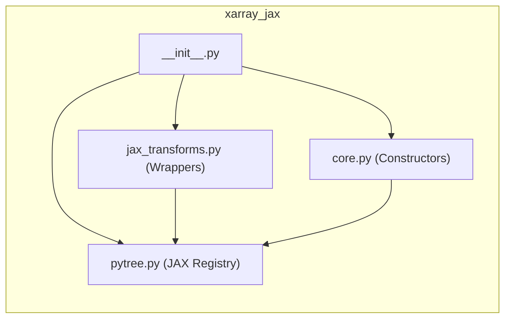

<!-- source: DeepWiki mcp.deepwiki.com · repo google-deepmind/xarray_jax · page 1 Overview · fetched 2026-10-26 -->

# Overview

<details>
<summary>Relevant source files</summary>

The following files were used as context for generating this wiki page:

- [README.md](README.md)
- [pyproject.toml](pyproject.toml)
- [xarray_jax/__init__.py](xarray_jax/__init__.py)

</details>


`xarray_jax` is a library developed by Google DeepMind to bridge the gap between the labeled multidimensional arrays of [xarray](https://docs.xarray.dev) and the high-performance numerical computing capabilities of [JAX](https://docs.jax.dev).

While standard `xarray` objects like `DataArray` and `Dataset` can contain JAX arrays, they are not natively recognized by JAX's transformation engine. `xarray_jax` solves this by registering these structures as **JAX PyTrees** [README.md:23-32](). This enables developers to use xarray objects directly within `jax.jit`, `jax.grad`, and other transformations while preserving dimension names and metadata.

### System Interoperability

The following diagram illustrates how `xarray_jax` positions itself between the user's high-level xarray code and JAX's functional execution model.

**Diagram: xarray_jax Integration Flow**
```mermaid
graph TD
    subgraph "Natural Language Space"
        UserCode["User Logic (xarray API)"]
        JitProcess["JIT Compilation"]
        Output["Labeled Result"]
    end

    subgraph "Code Entity Space"
        XR_Obj["xarray.Dataset / DataArray"]
        Flatten["pytree.py: _flatten_dataset / _flatten_data_array"]
        JAX_Kernel["JAX HLO / XLA"]
        Unflatten["pytree.py: _unflatten_dataset / _unflatten_data_array"]
        
        XR_Obj -->|"jax.tree_util.register_pytree_node"| Flatten
        UserCode --> XR_Obj
        Flatten -->|"Passes Leaves (JAX Arrays)"| JAX_Kernel
        JitProcess --> JAX_Kernel
        JAX_Kernel -->|"Returns Tracers/Arrays"| Unflatten
        Unflatten -->|"Restores Metadata"| Output
    end

    Sources: [xarray_jax/pytree.py:1-400](), [README.md:23-33]()
```

### Core Capabilities

*   **PyTree Registration**: Automatically handles the "flattening" of xarray objects into JAX-compatible leaves and "unflattening" them back into xarray objects [README.md:28-33]().
*   **Transformation Wrappers**: Provides specialized versions of JAX transformations like `vmap`, `pmap`, and `scan` that are aware of xarray dimension names [xarray_jax/__init__.py:97-103]().
*   **Coordinate Management**: Handles the tension between static metadata (coordinates) and dynamic data (JAX arrays). It defaults to treating coordinates as static metadata, causing recompilation if they change [xarray_jax/__init__.py:72-78]().
*   **Global Compatibility**: Automatically configures xarray's `arithmetic_compat` to `'override'` to prevent `TracerBoolConversionError` during JIT-compiled arithmetic operations [xarray_jax/__init__.py:173-173]().

### Package Structure

The library is organized into three primary functional areas:

| Module | Responsibility | Key Entities |
| :--- | :--- | :--- |
| `core.py` | High-level constructors and coordinate logic. | `DataArray`, `Dataset`, `Variable`, `assign_jax_coords` |
| `pytree.py` | JAX integration and data extraction. | `jax_data`, `jax_vars`, `dims_change_on_unflatten` |
| `jax_transforms.py` | Dimension-aware JAX transformations. | `vmap`, `pmap`, `scan`, `tree_map_with_dims` |

**Diagram: Module Relationship**

Sources: [xarray_jax/__init__.py:88-114](), [xarray_jax/jax_transforms.py:1-50]()

---

### Navigation

To dive deeper into specific areas of the library, refer to the following child pages:

*   **[Getting Started](#1.1)**: Installation via `pip`, dependency requirements (`jax>=0.4.30`, `xarray>=2026.01.0`), and a minimal working example of `jax.jit` with `DataArray`.
*   **[Key Concepts and Design Philosophy](#1.2)**: Understanding the static-vs-dynamic split, how metadata is preserved during flattening, and the rationale behind the `arithmetic_compat` global setting.

Sources: [pyproject.toml:24-28](), [xarray_jax/__init__.py:145-173](), [README.md:34-81]()

---

