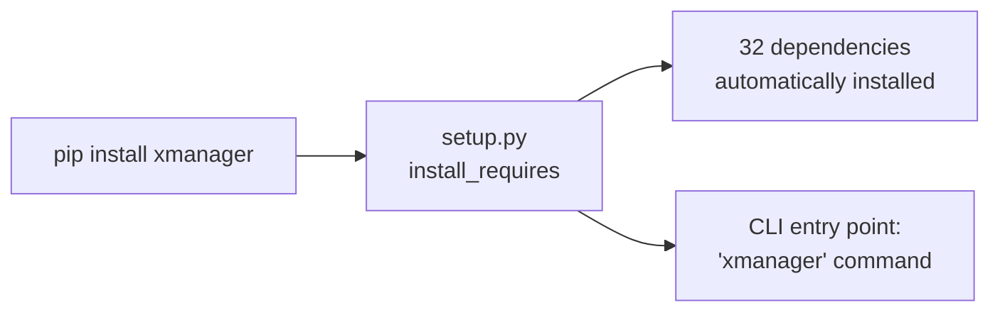
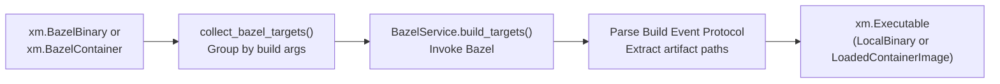
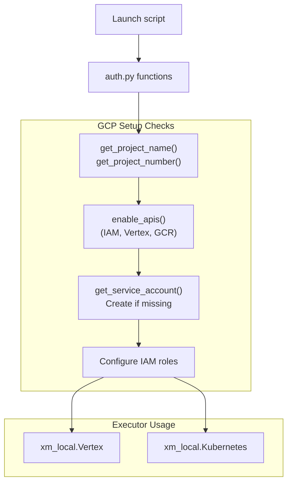
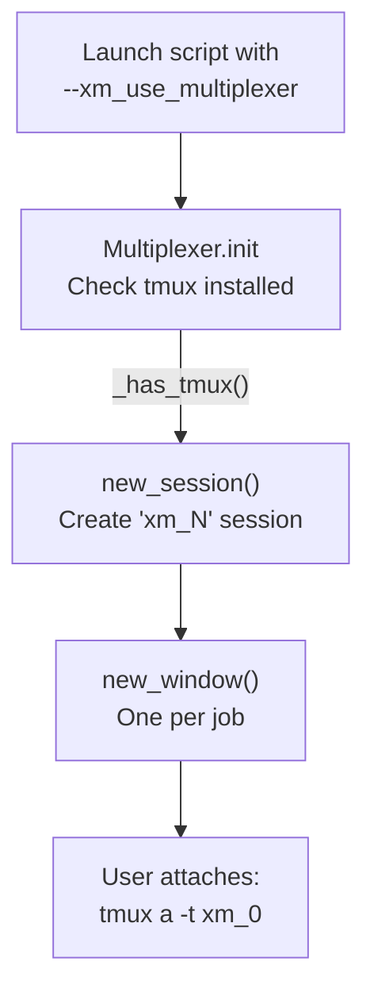
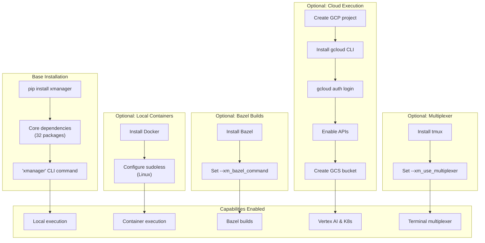

<!-- source: DeepWiki mcp.deepwiki.com · repo google-deepmind/xmanager · page 2.1 Installation · fetched 2026-10-26 -->

# Installation

<details>
<summary>Relevant source files</summary>

The following files were used as context for generating this wiki page:

- [README.md](README.md)
- [setup.py](setup.py)
- [xmanager/xm_flags.py](xmanager/xm_flags.py)
- [xmanager/xm_local/multiplexer.py](xmanager/xm_local/multiplexer.py)

</details>


This document covers the installation process for XManager, including system requirements, core dependencies, and optional components needed for different execution backends. For information about running your first experiment after installation, see [Your First Experiment](#2.2). For detailed configuration options, see [Configuration Flags](#6.1).

---

## Overview

XManager can be installed via pip and requires Python 3.10 or later. The base installation provides core experiment management capabilities with local execution support. Additional components (Docker, Bazel, GCP tools) enable specific executable types and execution backends.

**Installation Options by Capability:**

| Capability | Required Components | Executable Types | Executors |
|-----------|---------------------|------------------|-----------|
| Local binary execution | Base install only | `xm.Binary` | `xm_local.Local` |
| Local container execution | Base install + Docker | `xm.Container`, `xm.PythonContainer` | `xm_local.Local` |
| Bazel builds | Base install + Bazel | `xm.BazelBinary`, `xm.BazelContainer` | All |
| Vertex AI execution | Base install + Docker + GCP | Container types | `xm_local.Vertex` |
| Kubernetes execution | Base install + Docker + GCP | Container types | `xm_local.Kubernetes` |

Sources: [README.md:24-119](), [setup.py:22-63]()

---

## Quick Installation

### Via pip (Recommended)

Install the latest stable release from PyPI:

```bash
pip install xmanager
```

Or install directly from the GitHub repository:

```bash
pip install git+https://github.com/deepmind/xmanager.git
```

### Automated Setup (Debian-based systems)

For Debian-based systems, a setup script installs XManager and all dependencies:

```bash
git clone https://github.com/deepmind/xmanager.git
cd xmanager/setup_scripts
chmod +x setup_all.sh
. ./setup_all.sh
```

Sources: [README.md:24-42]()

---

## System Requirements

### Python Version

XManager requires **Python 3.10 or later**. This is enforced in the package metadata:

```
python_requires='>=3.10'
```

The codebase uses modern Python features including pattern matching, type annotations, and async/await constructs.

### Operating Systems

XManager is primarily tested on:
- **Linux** (recommended for all backends)
- **macOS** (local execution only)
- **Windows** (limited support via WSL recommended)

Sources: [setup.py:31](), [README.md:46]()

---

## Core Dependencies

The following packages are automatically installed with XManager:

```mermaid
graph TB
    subgraph "Core Framework"
        XM["xmanager package"]
        ABSL["absl-py<br/>(flags, logging)"]
        ATTRS["attrs<br/>(data classes)"]
        ASYNC["async_generator<br/>(async utilities)"]
    end
    
    subgraph "Execution Infrastructure"
        DOCKER["docker<br/>(container operations)"]
        K8S["kubernetes<br/>(K8s API client)"]
        VERTEX["google-cloud-aiplatform<br/>(Vertex AI API)"]
    end
    
    subgraph "Data Storage"
        SQL["sqlalchemy==1.2.19<br/>(ORM)"]
        ALEMBIC["alembic==1.4.3<br/>(migrations)"]
        CLOUDSQL["cloud-sql-python-connector<br/>(CloudSQL driver)"]
    end
    
    subgraph "GCP Integration"
        GAUTH["google-auth<br/>(authentication)"]
        GAPI["google-api-python-client<br/>(API client)"]
        GCORE["google-api-core<br/>(core utilities)"]
        GCS["google-cloud-storage<br/>(GCS access)"]
    end
    
    subgraph "Utilities"
        ETILS["etils[epath]<br/>(path handling)"]
        YAML["pyyaml<br/>(config parsing)"]
        TERM["termcolor<br/>(output formatting)"]
        HUMAN["humanize<br/>(readable output)"]
    end
    
    XM --> ABSL
    XM --> ATTRS
    XM --> ASYNC
    XM --> DOCKER
    XM --> K8S
    XM --> VERTEX
    XM --> SQL
    XM --> ALEMBIC
    XM --> CLOUDSQL
    XM --> GAUTH
    XM --> GAPI
    XM --> GCORE
    XM --> GCS
    XM --> ETILS
    XM --> YAML
    XM --> TERM
    XM --> HUMAN
```



**Installation Path:**



The complete dependency list is defined in [setup.py:32-52](). Key dependencies:

- **SQLAlchemy 1.2.19** and **Alembic 1.4.3**: Fixed versions for database schema management
- **Docker Python SDK**: Container operations for all container-based executables
- **Kubernetes Python client**: K8s Job creation and management
- **Google Cloud libraries**: Vertex AI, Cloud Storage, authentication
- **Path utilities** (`etils`): Cross-platform path handling

Sources: [setup.py:32-52]()

---

## Optional Dependencies

### Docker (For Container Execution)

Docker is required for any executable that uses containers, including `xm.PythonContainer`, `xm.Container`, `xm.Dockerfile`, and `xm.BazelContainer`.

**Installation:**

1. Follow the [Docker installation guide](https://docs.docker.com/engine/install/#supported-platforms) for your platform.

2. **Linux users**: Enable sudoless Docker by following [post-installation steps](https://docs.docker.com/engine/install/linux-postinstall):

   ```bash
   sudo groupadd docker
   sudo usermod -aG docker $USER
   newgrp docker
   ```

**Verification:**

```bash
docker run hello-world
```

**XManager Integration:**

The Docker SDK is used in multiple ways depending on configuration flags:

| Flag | Purpose | Default |
|------|---------|---------|
| `--xm_build_image_locally` | Build images locally vs Cloud Build | `True` |
| `--xm_use_docker_command` | Use `docker` CLI vs Python SDK | `True` |
| `--xm_show_docker_command_progress` | Show build output | `False` |
| `--xm_subprocess_docker_impl` | Use subprocess for container launch | `False` |

Sources: [README.md:48-57](), [xm_flags.py:26-50](), [xm_flags.py:181-185]()

---

### Bazel (For Bazel-Based Executables)

Bazel is required for `xm.BazelBinary` and `xm.BazelContainer` executable types.

**Installation:**

Follow the [Bazel installation guide](https://docs.bazel.build/versions/master/install.html) for your platform.

**Configuration:**

XManager invokes Bazel using the command specified by the `--xm_bazel_command` flag:

```bash
xmanager launch launcher.py -- --xm_bazel_command=bazelisk
```

**Verification:**

```bash
bazel version
```

**XManager Integration:**

The Bazel service is invoked during the packaging phase:



Sources: [README.md:59-65](), [xm_flags.py:152-156]()

---

### GCP Setup (For Cloud Execution)

GCP configuration is required for `xm_local.Vertex` and `xm_local.Kubernetes` executors.

**1. Create GCP Project**

Create a project at [Google Cloud Console](https://console.cloud.google.com).

```bash
export GCP_PROJECT=<your-project-id>
```

**2. Install and Configure gcloud CLI**

```bash
# Install gcloud (see https://cloud.google.com/sdk/docs/install)

# Authenticate
gcloud auth login
gcloud auth application-default login
gcloud config set project $GCP_PROJECT

# Configure Docker authentication
gcloud auth configure-docker
```

**3. Enable Required APIs**

```bash
# IAM API (service account management)
gcloud services enable iam.googleapis.com

# Vertex AI (for xm_local.Vertex)
gcloud services enable aiplatform.googleapis.com

# Container Registry (for image storage)
gcloud services enable containerregistry.googleapis.com
```

These can also be enabled via the Cloud Console:
- [Enable IAM](https://console.cloud.google.com/apis/library/iam.googleapis.com)
- [Enable Vertex AI](https://console.cloud.google.com/apis/library/aiplatform.googleapis.com)
- [Enable Container Registry](https://console.cloud.google.com/apis/library/containerregistry.googleapis.com)

**4. Create Cloud Storage Bucket**

```bash
export GOOGLE_CLOUD_BUCKET_NAME=<unique-bucket-name>

# Create bucket in us-central1
gsutil mb -l us-central1 gs://$GOOGLE_CLOUD_BUCKET_NAME
```

Add to environment variables:

```bash
# Add to ~/.bashrc or ~/.zshrc
export GOOGLE_CLOUD_BUCKET_NAME=<unique-bucket-name>
```

**5. Service Account Configuration**

XManager automatically creates and configures a service account if needed. The default name is `xmanager`, configurable via:

```bash
xmanager launch launcher.py -- --xm_gcp_service_account_name=my-service-account
```

**GCP Authentication Flow:**



Sources: [README.md:67-119](), [xm_flags.py:94-113]()

---

## Platform-Specific Notes

### tmux (Optional, for Local Multiplexer)

The local executor can optionally use tmux to run jobs in persistent terminal sessions.

**Installation:**

```bash
# Debian/Ubuntu
sudo apt-get install tmux

# macOS
brew install tmux

# Verify
tmux -V
```

**Usage:**

```bash
xmanager launch launcher.py -- --xm_use_multiplexer
```

When enabled, XManager creates a tmux session (named `xm_0`, `xm_1`, etc.) with one window per job:



**Auto-switch to window:**

```bash
xmanager launch launcher.py -- --xm_open_multiplexer_window=2
```

This automatically switches to window 2 in the new tmux session.

Sources: [xm_flags.py:158-176](), [xmanager/xm_local/multiplexer.py:12-136]()

---

## Verification

### Command-Line Entry Point

After installation, the `xmanager` CLI command should be available:

```bash
xmanager --help
```

This command is registered via the console script entry point in [setup.py:53-57]():

```python
entry_points={
    'console_scripts': [
        'xmanager = xmanager.cli.cli:entrypoint',
    ],
}
```

### Import Test

Verify core modules can be imported:

```python
# Test core API
from xmanager import xm

# Test local backend
from xmanager import xm_local

# Test configuration
from xmanager import xm_flags

print("XManager successfully installed")
```

### Database Initialization

XManager automatically initializes a SQLite database on first use. The default location is determined by the database configuration (see [Database Storage](#6.2)).

**Check database configuration:**

```bash
xmanager launch --help | grep xm_db
```

Relevant flags:
- `--xm_db_yaml_config_path`: Path to database configuration file
- `--xm_upgrade_db`: Automatically upgrade database schema

Sources: [xm_flags.py:117-150]()

---

## Installation Summary



**Next Steps:**

After installation, proceed to [Your First Experiment](#2.2) to create and run a simple XManager experiment. For detailed configuration options, see [Configuration Flags](#6.1).

Sources: [README.md:24-119](), [setup.py:22-63](), [xm_flags.py:1-197]()

---

